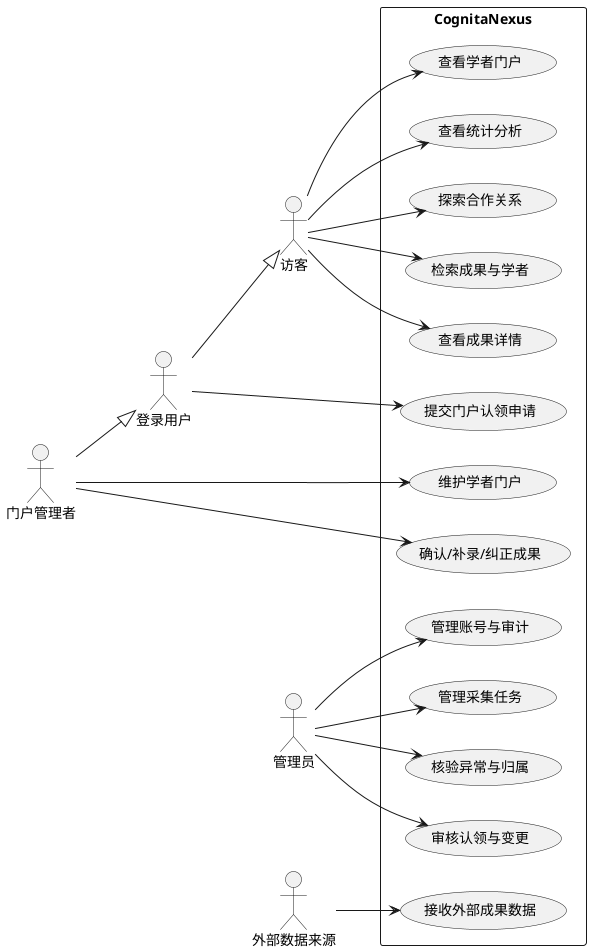
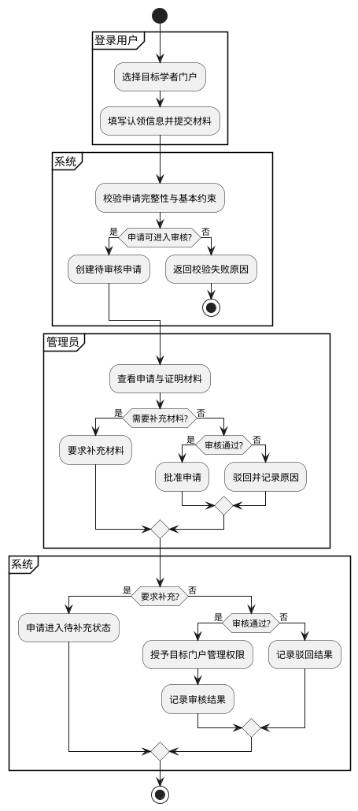
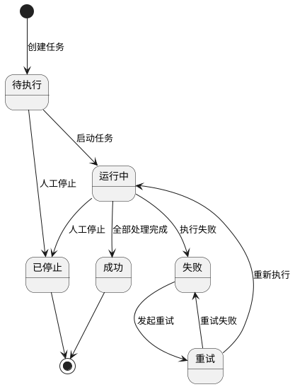
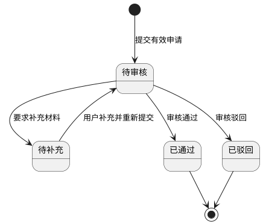

# CognitaNexus SRS 编写与需求建模规范

**版本：V1.0**  
**适用范围：11 人大组、5 人小组、6 人小组**  
**需求基线：`学术成果分享平台需求分析与可行性报告_V1.9.md`**  
**用途：统一两组 SRS 编写、需求编号、UML 建模、图形生成、Git 协作、评审与最终合并方式。**

---

## 1. 目的与基本原则

本规范用于约束 CognitaNexus 两个小组的 SRS（Software Requirements Specification，软件需求规格说明书）编写方式。两个小组均以 V1.9 需求文档中的 FR01～FR16、IN01、Optional 需求、业务规则和非功能需求为输入，分别完成 SRS 初稿，再通过联合评审形成一份共同 SRS。

SRS 的职责是把“系统需要具备什么能力”细化到“开发人员知道应实现什么、测试人员知道怎样判定通过”的程度。SRS **不负责确定具体技术实现**。数据库表、ES Mapping、Redis Key、Kafka Topic、微服务数量、具体 REST URL、框架选型等内容不得提前混入 SRS，应分别进入架构设计、构件设计或 SPEC。

全组统一遵循以下原则：

1. **同一需求只有一个业务语义。** FR01～FR16 的含义以 V1.9 为准，不允许小组自行重新解释或复用编号。
2. **需求可追踪。** 每条 SRS 子需求必须能追溯到 FR、IN 或 NF；后续 SPEC、Issue、PR、测试用例也应继续引用该编号。
3. **行为可验证。** 不允许使用“适当处理”“友好提示”“快速返回”“尽量准确”等无法验收的表述，必须说明可观察结果。
4. **业务与技术分离。** SRS 描述外部可观察行为、业务规则、权限、状态和验收，不描述内部实现方案。
5. **图形源码化。** 正式 UML 图禁止只保留截图或手工拖拽结果；统一使用 PlantUML 源码生成，并将 `.puml` 文件纳入 Git。
6. **两组格式一致。** 5 人组和 6 人组使用相同目录、编号、模板和绘图规范，便于后续合并。
7. **公共规则集中维护。** 术语、角色、核心状态、跨模块业务规则只定义一次，各模块引用，不重复创造不同版本。

---

## 2. 课程阶段与图形边界

任务书将需求建模、需求分析、架构设计和构件设计分为不同阶段。不要为了“图多”把后续阶段的图全部塞进 SRS。

| 图/模型 | 所属阶段 | 当前是否必须 | 本项目统一方式 |
| --- | --- | --- | --- |
| 系统用例图 | 需求建模 / SRS | 必须 | PlantUML Use Case |
| 门户认领审核活动图 | 需求建模 / SRS | 必须 | PlantUML Activity |
| 数据采集任务状态图 | 需求建模 / SRS | 必须 | PlantUML State |
| 认领申请状态图 | 需求建模 / SRS | 必须 | PlantUML State |
| 核心业务类图 | 需求分析 | 后续必须 | PlantUML Class |
| 数据采集入库时序图 | 需求分析 | 后续必须 | PlantUML Sequence |
| 门户认领审核时序图 | 需求分析 | 后续必须 | PlantUML Sequence |
| 检索请求处理时序图 | 需求分析 | 后续必须 | PlantUML Sequence |
| 逻辑架构图 | 架构设计 | 后续必须 | PlantUML/Structurizr/Draw.io，架构阶段统一 |
| 部署拓扑图 | 架构设计 | 后续必须 | PlantUML/Draw.io，架构阶段统一 |
| E-R 图 | 构件设计 | 后续必须 | 数据库建模工具或 Mermaid ER/PlantUML |
| UI 线框/原型 | 构件设计 | 后续必须 | Figma/即时设计等原型工具 |

**SRS 阶段最少交付 4 张正式图：**总体用例图 1 张、门户认领审核活动图 1 张、采集任务状态图 1 张、认领申请状态图 1 张。

后续需求分析阶段再补核心业务类图和 3 张关键时序图。不要在当前 SRS 中画数据库表关系、Kafka 消息链路、服务部署拓扑等实现图。

---

## 3. SRS 目录模板

两组 SRS 必须使用下面的章节结构。允许增加三级标题，但不允许改变一级章节语义。

```text
CognitaNexus 软件需求规格说明书

1. 引言
   1.1 文档目的
   1.2 系统范围
   1.3 术语与缩写
   1.4 参考文档
   1.5 版本历史

2. 系统总体说明
   2.1 产品定位与边界
   2.2 用户角色
   2.3 运行场景与外部依赖
   2.4 约束与假设

3. 用例模型
   3.1 参与者定义
   3.2 系统总体用例图
   3.3 用例清单
   3.4 关键用例规格

4. 功能需求规格
   4.1 FR01～FR02 检索与成果详情
   4.2 FR03～FR07 学者门户、认领与维护
   4.3 FR08～FR10 数据采集、治理与更新
   4.4 FR11～FR13 统计、热点与专家网络
   4.5 FR14 管理后台与审计
   4.6 FR15～FR16 消歧、归属与来源追踪

5. 创新与可选需求
   5.1 IN01 合作关系探索
   5.2 O01 相似论文推荐（Optional）
   5.3 O02 轻量个性化推荐（Optional）

6. 业务流程与状态模型
   6.1 门户认领审核活动图
   6.2 数据采集任务状态图
   6.3 认领申请状态图

7. 数据需求与业务规则
   7.1 核心业务对象
   7.2 关键字段语义
   7.3 去重规则
   7.4 学者消歧与成果归属规则
   7.5 统计口径
   7.6 数据更新与人工修正规则

8. 权限与安全需求
   8.1 访客权限
   8.2 登录用户权限
   8.3 门户管理权限
   8.4 管理员权限
   8.5 对象级授权规则

9. 非功能需求
   9.1 可用性
   9.2 性能
   9.3 安全
   9.4 可靠性与恢复
   9.5 一致性
   9.6 隐私与数据最小化
   9.7 可维护性与测试

10. 验收与追踪
   10.1 验收场景
   10.2 需求追踪矩阵
   10.3 内部问题与变更记录
```

---

## 4. 编号规范

所有编号必须唯一、稳定、可检索。编号一旦进入合并后的正式 SRS，不允许因为章节移动而重编号。

| 类型 | 格式 | 示例 | 含义 |
| --- | --- | --- | --- |
| 基线功能需求 | `FRxx` | `FR05` | 来自 V1.9，不改编号 |
| SRS 子需求 | `FRxx-Syy` | `FR05-S03` | FR 下的可开发、可测试子需求 |
| 创新需求 | `INxx` / `INxx-Syy` | `IN01-S02` | 创新功能及其细化 |
| Optional | `Oxx` / `Oxx-Syy` | `O01-S01` | 非一期基础验收前置条件 |
| 非功能需求 | `NFxx` / `NFxx-Syy` | `NF02-S01` | 性能、安全等 |
| 用例 | `UC-xx` | `UC-05` | 用例规格编号 |
| 业务规则 | `BR-xx` | `BR-12` | 跨多个功能的业务约束 |
| 验收条件 | `AC-<需求>-xx` | `AC-FR05-S03-01` | 可验证条件 |
| 图 | `DGM-类型-xx` | `DGM-STATE-01` | 图形资产编号 |

### 4.1 子需求拆分原则

一个 FR 可以拆成多个 SRS 子需求。例如 FR01 可拆为：

```text
FR01-S01 关键词检索
FR01-S02 成果/学者类型切换
FR01-S03 成果类型筛选
FR01-S04 年份筛选
FR01-S05 领域筛选
FR01-S06 机构筛选
FR01-S07 多条件组合
FR01-S08 排序
FR01-S09 分页
FR01-S10 无结果与查询失败处理
```

拆分时遵守：

- 一条子需求尽量只有一个主要目的。
- 一条子需求应能设计独立验收条件。
- 不要为了凑数量把同一个行为机械拆成很多句。
- 不要把 API、数据表或算法实现当成 SRS 子需求。

---

## 5. 单条 SRS 子需求模板

所有成员必须复制下面模板，不允许自行发明不同格式。

```markdown
### FRxx-Syy 需求名称

- **父需求：** FRxx
- **优先级：** Must / Innovation / Optional
- **主要参与者：**
- **相关参与者：**

#### 需求描述
系统应……

#### 前置条件
1. ……
2. ……

#### 触发条件
……

#### 主成功流程
1. ……
2. ……
3. ……

#### 备选流程
- A1：……
- A2：……

#### 异常流程
- E1：……
- E2：……

#### 输入/业务数据
- ……

#### 输出/可观察结果
- ……

#### 状态变化
- 对象：……
- 原状态：……
- 目标状态：……

#### 权限规则
- ……

#### 业务规则
- BR-xx：……

#### 验收条件
- AC-FRxx-Syy-01：Given … When … Then …
- AC-FRxx-Syy-02：Given … When … Then …

#### 关联项
- 关联用例：UC-xx
- 关联非功能需求：NFxx
- 关联数据对象：……
```

字段不适用时写“无”或“本条不涉及”，禁止直接删除字段导致不同成员格式不一致。

---

## 6. 需求文字规范

### 6.1 统一句式

需求描述优先使用：

> **系统应 + 可观察行为 + 条件/范围 + 必要结果。**

正确：

> 系统应允许访客按年份范围筛选已收录成果；当起始年份大于结束年份时，应拒绝查询并提示年份范围无效。

错误：

> 前端用 Element Plus 做两个年份选择框，然后调用 ES Range Query。

原因：后者属于 UI/技术实现，不属于 SRS。

### 6.2 禁止模糊词

以下词语原则上不得单独作为验收标准：

```text
快速
尽量
适当
合理
友好
高效
智能
准确
及时
必要时
正常处理
```

必须改成可观察、可测量或有明确规则的描述。

例如：

```text
错误：系统应快速返回搜索结果。
正确：在约定测试环境和查询集下，普通检索请求 P95 响应时间不超过约定阈值，具体阈值见 NF02。
```

### 6.3 不在 SRS 中出现的实现细节

除非它本身是外部约束，否则以下内容不得写成需求：

```text
MySQL 表名和字段类型
Elasticsearch Mapping / Analyzer
Redis Key / TTL
Kafka Topic / Consumer Group
具体微服务数量
Docker 容器名称
REST URL
Go struct / Java class
ORM
具体算法代码
云服务器 IP
```

这些分别进入架构、构件设计或 SPEC。

---

## 7. 用例规格模板

总体用例图只展示系统外部参与者与主要目标，不需要把 FR01～FR16 每一条都画成独立椭圆。详细行为写在用例规格中。

### 7.1 用例条目模板

```markdown
## UC-xx 用例名称

- **目标：**
- **对应需求：** FRxx、FRyy
- **主要参与者：**
- **次要参与者：**
- **前置条件：**
- **触发事件：**

### 主成功场景
1. ……
2. ……
3. ……

### 备选/异常场景
- A1 ……
- E1 ……

### 后置条件
- 成功：……
- 失败：……

### 业务规则
- BR-xx ……

### 关联状态
- ……
```

### 7.2 用例命名规范

采用“动词 + 业务对象”，例如：

```text
检索成果与学者
查看成果详情
查看学者门户
提交门户认领申请
审核门户认领申请
维护学者门户
确认或纠正成果
管理采集任务
处理异常数据
查看统计分析
探索合作关系
管理平台账号
```

不要使用技术名称作为用例：

```text
错误：调用 Elasticsearch
错误：写入 MySQL
错误：发送 Kafka 消息
```

---

## 8. UML 统一绘图规范

### 8.1 统一使用 PlantUML

正式 UML 图统一使用 **PlantUML**。原因：

- 文本源码可 Git 版本管理；
- diff 可直接看到图发生了什么变化；
- 可由 CI 或命令行批量生成 SVG/PNG；
- 适合用例图、活动图、状态图、类图和时序图；
- 避免不同成员使用不同拖拽工具导致格式不可合并。

**最终提交必须同时保留：**

```text
*.puml   # 图的唯一源文件，必须提交
*.svg    # 推荐用于文档/PPT，清晰且可缩放
*.png    # 仅在某些平台无法使用 SVG 时生成
```

禁止只上传截图、手画图片或只有 `.drawio` 而没有统一源码的 UML 图。

### 8.2 PlantUML 文件头

所有 `.puml` 文件统一以以下内容开头：

```plantuml
@startuml
skinparam monochrome true
skinparam shadowing false
skinparam defaultFontName "Noto Sans CJK SC"
skinparam dpi 150

' diagram body

@enduml
```

如果成员机器上没有该字体，可去掉 `defaultFontName`，不得将字体文件提交到仓库。

### 8.3 目录与命名

```text
docs/
└── srs/
    ├── CognitaNexus-SRS.md
    ├── modules/
    │   ├── FR01-FR02-search.md
    │   ├── FR03-FR07-scholar.md
    │   └── ...
    └── diagrams/
        ├── DGM-USECASE-01-system.puml
        ├── DGM-ACTIVITY-01-claim-review.puml
        ├── DGM-STATE-01-collection-task.puml
        ├── DGM-STATE-02-claim-request.puml
        └── generated/
            ├── DGM-USECASE-01-system.svg
            └── ...
```

`generated/` 中的产物可以统一由脚本生成；`.puml` 才是唯一真源。

---

## 9. 总体用例图规范与模板

### 9.1 参与者

建议系统级用例图统一使用以下参与者：

- `访客`：未登录也可以使用的公开能力；
- `登录用户`：具有账号但没有特定门户管理权；
- `门户管理者`：已经获得某个 Scholar Portal 的对象级管理权限；
- `管理员`：平台治理和审核权限；
- `外部数据来源`：向系统提供公开/获准数据的外部系统。

其中“门户管理者”不是必须设计成独立账号角色，它表示用户获得了某个学者门户的对象级授权。

### 9.2 `include` / `extend` 使用规则

- `<<include>>`：多个用例**必然复用**的行为；
- `<<extend>>`：只在某些条件下发生的**可选/条件行为**；
- 不确定时宁可不画关系，不要为了 UML 形式堆大量箭头；
- 不允许通过 `include/extend` 表示代码调用关系。

### 9.3 总体用例图 PlantUML 模板

保存为：`docs/srs/diagrams/DGM-USECASE-01-system.puml`



该模板是总体视图，不代表最终必须一字不改。两组合并 SRS 时只能有一张共同总体用例图。

---

## 10. 活动图规范与模板

### 10.1 规则

活动图描述**业务动作与控制流**，不是代码调用图。

必须做到：

- 有明确开始和结束；
- 判断节点的每条出口要写条件；
- 涉及多个责任方时使用泳道/partition；
- 失败、补充、驳回等重要分支不能省略；
- 不写数据库表、HTTP 请求、Kafka 消息等实现细节。

### 10.2 门户认领审核活动图模板

保存为：`DGM-ACTIVITY-01-claim-review.puml`



如果最终状态机没有“待补充”状态，应在联合评审时同步修改活动图和状态图，禁止图和文本各写一套规则。

---

## 11. 状态图规范与模板

### 11.1 状态图通用规则

状态图描述“一个业务对象在生命周期中可以处于什么状态以及如何合法转移”。

统一写法：

```text
源状态 --> 目标状态 : 触发事件 [条件] / 可选动作
```

要求：

- 状态名使用名词/形容状态，例如“待审核”“运行中”“失败”；
- 转移线上写触发事件，不写模糊的“下一步”；
- 不允许出现文本中不存在的隐藏状态；
- 任何新增状态必须同步更新 SRS 状态说明和验收条件。

### 11.2 数据采集任务状态图

保存为：`DGM-STATE-01-collection-task.puml`



若项目最终允许“已停止任务重新启动”，必须先修改业务规则，再修改图，不能直接在实现中增加路径。

### 11.3 认领申请状态图

保存为：`DGM-STATE-02-claim-request.puml`

建议初始状态：



注意：“未认领/已认领”是 Scholar Portal 的认领状态，“待审核/已通过/已驳回”是 ClaimRequest 的申请状态。两个对象不得混成一个状态机。

---

## 12. 后续 UML 也统一 PlantUML

虽然以下内容不属于当前 SRS 必交图，但为了两个组后续一致，提前统一工具。

### 12.1 核心业务类图

需求分析阶段使用 PlantUML Class Diagram。只画业务对象和业务关系，不画 Controller、Service、Repository 等实现类。

核心候选对象：

```text
User
Scholar
Achievement
Paper / Patent / Project / Award
Organization
Field
ScholarAchievementRelation
ClaimRequest
ChangeRequest
SourceRecord
CollectionTask
AuditLog
```

### 12.2 时序图

需求分析阶段必须覆盖至少：

```text
SEQ-01 数据采集入库
SEQ-02 门户认领审核
SEQ-03 检索请求处理
```

此时仍应优先使用逻辑参与者/系统组件；真正微服务内部调用可在架构稳定后进一步细化。

---

## 13. PlantUML 生成方式

### 13.1 推荐方式 A：VS Code + PlantUML 插件

成员安装：

```text
VS Code
PlantUML extension
Graphviz
Java（如插件采用本地 PlantUML JAR）
```

编辑 `.puml` 后直接预览，并导出 SVG。

### 13.2 推荐方式 B：项目内统一命令行

若仓库提供 `tools/plantuml.jar`，可执行：

```bash
java -jar tools/plantuml.jar -tsvg docs/srs/diagrams/*.puml
```

PNG：

```bash
java -jar tools/plantuml.jar -tpng docs/srs/diagrams/*.puml
```

若不希望在仓库保存 JAR，可以在 README 中统一说明安装方式，但**不得把不同成员机器上的绝对路径写进脚本**。

### 13.3 可选方式 C：Docker

团队已有 Docker 时可统一：

```bash
docker run --rm \
  -v "$PWD:/workspace" \
  -w /workspace \
  plantuml/plantuml \
  -tsvg docs/srs/diagrams/*.puml
```

### 13.4 建议项目脚本

仓库可提供：

```text
scripts/render-diagrams.sh
```

统一执行所有图生成，避免每个人手动导出。

示例：

```bash
#!/usr/bin/env bash
set -euo pipefail
mkdir -p docs/srs/diagrams/generated
java -jar tools/plantuml.jar \
  -tsvg \
  -o generated \
  docs/srs/diagrams/*.puml
```

正式合并前必须保证脚本可从源码重新生成全部图。

---

## 14. 需求追踪矩阵

SRS 必须保留追踪关系，建议最后使用下表：

| 基线需求 | SRS 子需求 | 用例 | 业务规则 | 验收条件 | 后续 SPEC | 测试用例 |
| --- | --- | --- | --- | --- | --- | --- |
| FR01 | FR01-S01～S10 | UC-01 | BR-… | AC-… | 待补 | 待补 |
| FR05 | FR05-S01～S… | UC-05/UC-06 | BR-… | AC-… | 待补 | 待补 |
| FR08 | FR08-S01～S… | UC-08 | BR-… | AC-… | 待补 | 待补 |

进入编码阶段后，GitHub Issue/PR 也必须引用 SRS 编号，例如：

```text
Requirement: FR01-S04
Spec: SEARCH-SPEC-02
Closes: #31
```

---

## 15. 两个小组的 SRS 合并规则

两个组不是“写两份完全不同的需求”，而是针对同一个 V1.9 需求基线分别细化，再联合评审。

### 15.1 合并流程

```text
V1.9 共同需求基线
        ↓
5人组 SRS-A      6人组 SRS-B
        ↓              ↓
组内评审         组内评审
        └──────┬───────┘
               ↓
         交叉 Review
               ↓
       冲突/遗漏清单
               ↓
         联合规则决策
               ↓
     CognitaNexus SRS V1.0
```

### 15.2 合并规则

1. FR01～FR16 不允许两组各自重新编号。
2. 同一业务行为描述不同，先比较业务含义，不采用“两个版本都留着”的方式逃避冲突。
3. 一组发现另一组遗漏的异常流程，可直接补入共同 SRS。
4. 两组存在互斥规则时必须形成明确决策，例如：
   - 认领冲突如何处理；
   - 成果本人确认前是否展示；
   - 成果纠错是否立即公开；
   - 统计跨机构成果如何计数。
5. 合并后的共同 SRS 是后续两套系统都要遵守的业务契约；两套系统内部架构可以不同。

---

## 16. Git 目录、分支与提交规范

建议文档工程目录：

```text
docs/
├── requirements/
│   └── requirement-baseline-v1.9.md
├── srs/
│   ├── CognitaNexus-SRS.md
│   ├── modules/
│   └── diagrams/
├── analysis/
├── architecture/
├── spec/
└── adr/
```

分支示例：

```text
docs/srs/fr01-search
/docs/srs/fr05-claim
/docs/srs/collection-state
```

提交信息示例：

```text
docs(srs): specify FR01 search behavior
docs(srs): add claim review activity model
docs(srs): refine collection task state transitions
```

不要使用：

```text
update
doc
修改一下
final-final-2
```

---

## 17. SRS PR / Review 检查清单

每个模块提交 SRS PR 时至少检查：

- [ ] 所有条目都能追溯到 FR/IN/NF。
- [ ] 没有改变 V1.9 中 FR 的原始业务语义。
- [ ] 主成功流程完整。
- [ ] 关键失败与异常分支有说明。
- [ ] 权限边界明确。
- [ ] 状态变化与状态图一致。
- [ ] 没有把技术实现写成需求。
- [ ] 验收条件可观察、可测试。
- [ ] Optional 没有成为 Must 的隐式依赖。
- [ ] 跨模块规则没有由单个成员自行决定。
- [ ] `.puml` 源文件已提交。
- [ ] UML 图可以从源码重新生成。
- [ ] 图中术语与 SRS 正文一致。

---

## 18. SRS 与 SPEC / 架构 / 构件设计的边界

| 内容 | SRS | SPEC | 架构设计 | 构件设计 |
| --- | --- | --- | --- | --- |
| 用户能做什么 | 是 | 引用 | 否 | 否 |
| 权限和业务状态 | 是 | 细化 | 约束 | 实现 |
| 异常流程 | 是 | 技术化 | 部分 | 部分 |
| 验收条件 | 是 | 是 | 非主要 | 是 |
| 搜索排序业务要求 | 是 | 算法细化 | 技术选型 | 索引设计 |
| 去重/消歧规则 | 是 | 算法细化 | 数据流 | 数据结构 |
| MySQL/ES/Redis/Kafka 选型 | 否 | 可引用 | 是 | 是 |
| API URL 与 JSON Schema | 否 | 是/引用 | 接口边界 | 是 |
| 数据库表字段/索引 | 否 | 可引用 | 否 | 是 |
| 微服务数量与通信方式 | 否 | 否 | 是 | 细化 |
| Docker/云部署 | 否 | 否 | 是 | 部分 |

判断一句话应该放在哪里时，可问：

> **“如果把技术栈全部换掉，这句话仍然成立吗？”**

如果成立，大概率属于 SRS；如果不成立，大概率属于架构、SPEC 或构件设计。

---

## 19. 推荐的实际执行顺序

1. 大组冻结本规范与 V1.9 需求基线。
2. 两个小组复制相同 SRS 目录模板。
3. 每名成员按业务模块编写 SRS 子需求。
4. 同步编写对应关键用例规格。
5. 使用 PlantUML 生成总体用例图、认领活动图、两个状态图。
6. 组内 Review：文本、图、状态、权限互相校验。
7. 两组交换 SRS Review，形成冲突和遗漏清单。
8. 合并为共同 `CognitaNexus SRS V1.0`。
9. 冻结 SRS 基线后，进入需求分析阶段，绘制业务类图和三张关键时序图。
10. 两组再分别进行架构设计和独立编码。

---

## 20. 最小交付清单

每个小组完成 SRS 初稿时，至少应提交：

```text
[ ] SRS Markdown/Word 正文
[ ] FR01～FR16 的 SRS 子需求
[ ] IN01 细化需求
[ ] NF01～NF08 细化
[ ] 系统总体用例图 .puml + .svg
[ ] 门户认领审核活动图 .puml + .svg
[ ] 数据采集任务状态图 .puml + .svg
[ ] 认领申请状态图 .puml + .svg
[ ] 关键用例规格
[ ] 核心业务规则
[ ] 权限矩阵
[ ] 验收条件
[ ] 需求追踪矩阵
[ ] 组内 Review 记录
```

**最终原则：需求文档决定“要什么”，SRS 决定“具体应表现成什么”，架构/SPEC/构件设计再决定“怎么实现”。所有 UML 图以可版本管理的 PlantUML 源码为准，不以手工图片为准。**
