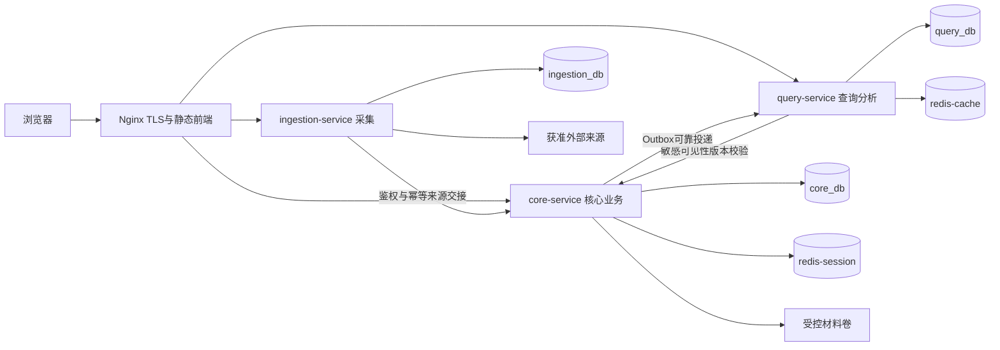
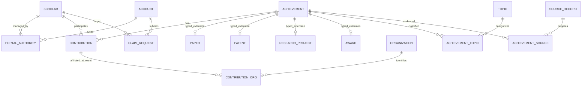

# CognitaNexus 学术成果分享平台架构设计说明书

| 项目 | 内容 |
| --- | --- |
| 版本 | V0.2，2026-10-16 |
| 定位 | 三服务实施设计稿；替代本次提供的架构V0.1，不表示课程或双组已签认 |
| 配套 | [编码规范](../standards/编码规范.md) |
| 已确认方向 | 本次实现少量微服务；Java、Spring Boot、PostgreSQL、Redis；100万条业务联调；500万条、100并发、P95≤2秒；审核生效后60秒内同步 |
| 未确定条件 | 服务器规格、预算和CodeArts执行器能力；不据此承诺性能已达标 |
| 适用范围 | 服务边界、数据所有权、交互契约、事务与事件、Redis、部署、验证和AI辅助开发约束；不包含完整DDL及全部端点字段 |

本文面向六人AI辅助开发团队，先明确哪些服务拥有数据、业务在哪个事务内生效、异步失败如何恢复，再定义实施与验证要求。采用核心业务、采集、查询分析三个独立后端服务，避免把认领、授权和审计拆成跨服务事务。Redis用于缓存与会话，不承担成果和授权的权威存储。

## 1 文档依据与决策状态

### 1.1 本轮已确认事项

以下是用户本轮明确选择，不再列为等待选择的技术路线：

| 决策 | 内容 | 影响 |
| --- | --- | --- |
| D01 | 本次设计并实现少量微服务 | 三个服务从首个集成版本即可分别构建、启动和部署 |
| D02 | Java + Spring Boot + PostgreSQL + Redis | 具体兼容版本由本设计选择，工程初始化时锁定补丁和镜像摘要 |
| D03 | 100万条业务联调，最终500万条可检索去重成果、100并发、P95≤2秒 | 修改旧稿1万条/10并发的设计依据；不得将容量合成数据冒充真实来源数据 |
| D04 | 部署资源尚未确定 | 本文提供拓扑、资源测量方法和压测清单，不编造服务器配置 |
| D05 | 审核生效后各视图60秒内同步；认领证明材料规则暂未定 | 60秒作为工程传播目标；材料规则保留OQ03 |

P95≤2秒和NF05的60秒均为本轮用户确认的工程目标；课程联合签认、性能实测结果是另外两件事，不能因确认目标而写成已达标。

### 1.2 已读取的上位材料

1. 最终修订目录中的《01-需求调研报告-03组-可御风雪可燃冰.docx》V1.9。
2. 《01-SRS-3组-CognitaNexus.docx》共同SRS V1.1 Review Candidate。
3. 《02-SPEC-3组-CognitaNexus.docx》核心SPEC V1.0 Review Candidate。
4. 《01-SPEC工程范围对齐说明.md》V1.1 RC。
5. 本次提供的《架构设计说明书(1).md》《编码规范(1).md》V0.1。

业务语义沿用FR01～FR16、BR-IMP-01～12、NF01～NF08、IN01及AC-IMPL编号。不得因为技术方便改变去重、关系资格、隐私或统计口径。SPEC中的相似度阈值、检索权重等未定业务参数继续标记待评审，不由架构虚构。

原稿引用的六份ADR正文未在本次材料中取得；第16节为本轮新增决策记录，不伪称旧ADR已被读取或批准。本文图源直接维护为Mermaid；既有课程UML的PlantUML源仍按原流程维护，不因本稿改变其事实。

### 1.3 必须同步的上位冲突

| 位置 | 旧口径 | 本轮处理 |
| --- | --- | --- |
| 需求主报告若干联调段落 | 1万与100万并存 | 本轮统一100万；上位Word待单独同步，不声称已修改 |
| SRS 2.1、FR16等旧段落 | 最终1万条 | 与其NF02新增500万/100并发不一致；区分业务联调100万与最终容量500万 |
| SRS 9.1、10.1与SPEC规模衔接段落 | 万条业务联调 | 本轮改为100万；30～100条规则样例仍保留 |
| 架构V0.1 | 单实例、进程内缓存、不引入Redis | 本轮由三服务和Redis方案替代 |
| IN01状态 | 需求报告固定范围、SRS仍为创新候选 | 保留实现接口及测试设计；是否满足课程创新要求须核对；FR12基础网络始终Must |

### 1.4 尚需确认的业务与资源条件

| 编号 | 待明确内容 | 负责人角色 | 未明确前的处理 |
| --- | --- | --- | --- |
| OQ01 | 服务器资源、网络、备份空间、CodeArts能否执行Docker | 部署负责人 | 可完成本地小样本；不宣称容量可行或流水线可运行 |
| OQ02 | 60秒目标已确认，实测条件与课程材料待同步 | 需求/测试负责人 | 按60秒工程门槛验证，环境未落实不声称达标 |
| OQ03 | 认领证据可接受范围及证据材料保留期限 | 业务负责人 | 使用标记清楚的测试材料；真实材料接入前必须配置审核标准和清理规则 |
| OQ04 | IN01课程认可状态、替代创新要求 | 组长 | 不将基础FR12当成创新替代，也不整体关闭基础网络 |
| OQ05 | 来源许可、分类映射、算法候选参数 | 数据/规则负责人 | 来源未核验不启用；模糊候选不自动升级为确定归属 |

## 2 范围和质量目标

Must覆盖FR01～FR16：成果与学者查询、门户、账户、认领、维护、采集、治理、更新、统计、基础网络、热点、管理和四类成果。IN01提供论文合作图筛选、最短路径与逐跳证据。O01/O02本期不实施，也不预建推荐行为采集。全文托管、投稿出版、交易、社交、个人综合学术排名及全网实时检索仍不在范围内。

### 2.1 分阶段验证

| 阶段 | 数据与负载 | 验证内容 | 不可替代的证据 |
| --- | --- | --- | --- |
| A 规则验证 | 30～100条固定样例；对应SPEC T01～T36 | 清洗、去重、消歧、权限、排序及幂等的正确性 | 固定输入、预期、实际输出和失败修复记录 |
| B 业务联调 | 至少1,000,000条去重成果，四类均有可查询样例 | 三服务、认领审核、更新传播、故障恢复、统计图谱 | 去重计数、真实/模拟/混合分布、主链路测试报告 |
| C 最终性能 | 至少5,000,000条可检索去重成果；至少100个活跃并发查询用户 | 固定查询集、预热后持续至少5分钟；P95≤2秒 | 硬件、查询分布、错误率、吞吐、P50/P95/P99、资源与索引体积 |

合成数据仅用于标识明确的容量与故障测试，不能证明真实收录规模。四类的具体数量配比写入测试清单，不虚构为课程硬性比例。

### 2.2 质量场景

所有场景当前均为待实现/待执行。A-*为本文架构检查编号，不替代AC-IMPL。

| 编号 | 刺激与结果 | 核心策略 |
| --- | --- | --- |
| A01 | 固定读版本下筛选翻页不重不漏；版本变更时明确提示刷新 | 全序排序、读版本校验、短事务一致快照 |
| A02 | 无结果为成功空集合；超时/依赖故障不返回空集合伪装成功 | HTTP状态与错误码统一 |
| A03 | 500万条、100并发下检验P95≤2秒 | 代表性查询、索引验证、真实冷热缓存分组压测 |
| A04 | 退出/停用后受保护请求被拒绝 | Redis会话 + 核心数据库会话撤销/账号状态校验 |
| A05 | 甲门户管理者修改乙门户失败，业务数据不变 | 应用层能力和对象授权 |
| A06 | 来源离线仍能读既有成果 | 规范数据独立于来源可达性 |
| A07 | 生效事务提交至各读视图完成传播不超过60秒 | 同事务Outbox、持久Inbox、发布水位、失败重试 |
| A08 | 非本人及无权审核者无法读认领材料 | 受控文件卷、核心服务鉴权代理读取 |
| A09 | 审核/授权/审计同时成功或同时回滚 | 同库本地事务，明确审计调用 |
| A10 | 停用来源、失败任务和积压可定位 | 来源配置与任务状态、结构化日志、指标 |
| A11 | 在干净环境恢复数据、文件、事件进度并复核 | 协调备份与恢复演练 |
| A12 | 重复导入与重复事件不新增实体或边权 | 导入幂等键、数据库约束、消费者幂等 |
| A13 | 仅标题接近不自动合并 | 候选与规范实体分开 |
| A14 | 同名且无充分证据不合并学者 | 证据驱动核验，不用模糊分数直接确权 |
| A15 | 同一图版本、过滤条件下最短路径确定且逐跳有证据 | 版本固定、BFS、稳定ID排序 |
| A16 | 三个选定核心模块各自行覆盖率≥80% | 独立JaCoCo门禁，含单元和集成证据 |

## 3 技术基线

以下为本轮工程选型。版本兼容参考官方资料，未执行实际依赖解析或启动测试，不能称已验证组合。

| 组件 | 采用方案 | 锁定规则 |
| --- | --- | --- |
| Java | JDK 21 | 同一供应商发行版；工具链与运行镜像一致，记录补丁版本 |
| 后端 | Spring Boot 3.5.16、Spring MVC | 由Boot BOM管理Spring/Security/Session等，不手动混搭Boot 4依赖 |
| 持久化 | MyBatis Spring Boot Starter 3.0系列 | 官方兼容Boot 3.2～3.5；初始化时选可解析补丁并固定，禁止另引入第二套ORM |
| 构建 | Maven 3.9系列 + Maven Wrapper | Wrapper写入精确版本与校验值；禁用浮动依赖和SNAPSHOT发布依赖 |
| 数据库 | PostgreSQL 16 | 所有环境同大版本；上线前选维护中的补丁并固定镜像摘要 |
| 迁移 | Flyway及PostgreSQL支持模块 | 优先Boot BOM；按服务单独迁移，不让各副本同时执行 |
| Redis | Redis 8系列，分会话与缓存两个实例 | 具体补丁及镜像摘要经初始化测试固定；客户端由Boot BOM管理 |
| 前端 | Vue 3、TypeScript、Vite、Vue Router、Pinia | Node 22维护版本且不低于22.12；npm精确版本与package-lock锁定；初始化验证所选Vite/plugin配对 |
| 入口 | Nginx静态资源与路径反向代理 | 不单独引入Java网关服务；内部服务不向公网暴露 |
| 部署 | Docker Compose V2 | 单机可起，服务可迁移到独立主机；不预建Kubernetes或注册中心 |
| 验证 | JUnit 5、AssertJ、Mockito、Testcontainers、ArchUnit、JaCoCo、Playwright、k6 | 测试库优先BOM；其余插件精确固定；以实际流水线运行结果为准 |

选择Boot 3.5是为了与原稿的JUnit 5、MyBatis 3及现有规范保持一致，不宣称它是最新主版本。首次工程提交应产生版本清单；若维护周期或扫描结果要求升级，通过一次全服务兼容PR升级，不能由各AI单独升级框架。

一期不引入Spring Cloud全家桶、消息队列和分布式事务框架。微服务不要求必须使用这些组件；增加任何组件须说明已测瓶颈、替代方案、运维成本及回退路径。

## 4 三服务边界

### 4.1 部署视图

三个逻辑数据库可共享一个PostgreSQL物理实例，但各用独立数据库账号和迁移历史；不允许跨库SQL、共享业务表、共享写账号。共享物理实例不等于获得资源隔离或高可用，压测必须记录争用情况。

### 4.2 服务职责与数据所有权

| 服务 | 原模块归属 | 权威数据 | 对外职责 |
| --- | --- | --- | --- |
| core-service | identity、catalog、portal、governance、核心admin组合 | 账号、授权、学者、成果、来源事实、关系、审核、分类、审计、Outbox | 注册登录、详情门户、认领维护、治理、内部鉴权与来源接收 |
| ingestion-service | ingestion及采集管理 | 来源运行配置、采集任务、检查点、失败项、交接批次 | 管理采集与恢复；抓取并交接原始元数据；不修改核心成果表 |
| query-service | discovery、analytics | 可重建读投影、统计、论文边与证据、Inbox、发布版本 | 检索、排名、热点、基础网络与IN01 |

core保存来源记录的长期证据；ingestion的暂存只用于可靠交接，核心确认持久接收后才允许按保留策略清理暂存。来源许可与允许展示规则以core配置为权威，ingestion仅持有执行所需副本和配置版本；来源停用后不得以旧副本继续启动新任务。

query可以写自己的派生数据，但不得写core或ingestion数据。原稿“analytics只读”改为“对权威业务只读，对本服务派生存储可写”。admin是界面与用例入口，不是第四个微服务。

### 4.3 同服务模块边界

core内部：portal编排identity授权与catalog变更；governance处理去重、消歧并经catalog服务发布；catalog不反向调用portal。identity不依赖学术业务领域。来源接收入口只登记原始记录及治理任务，只有治理通过或人工审批才能发布规范实体。

任何模块只调用对方的公开application契约，不引用对方Mapper、持久化对象或内部实体。业务模块依赖纯Java共享基础类型；审计、缓存和Web设施不可放进纯领域共享库。详细目录见编码规范第2节。

### 4.4 为什么把认领与授权留在core

认领批准同时需要检查账号/权限、申请状态、竞争申请、门户授权唯一性、审计以及对外事件。全部在core_db一个本地事务内完成，不把“身份服务”独立拆出去制造分布式提交。未来若拆分，必须重新定义一致性与恢复协议，不允许把HTTP调用塞入数据库事务模拟原子性。

## 5 数据模型与业务不变量

### 5.1 核心概念模型

补充约束不能由ER图单独表达：成果根据type恰好拥有一个对应类型扩展，不同时拥有四种；核心应用事务保证类型与扩展一致，并用数据库约束/触发器或一致性审计验证跨表约束。领域是多对多；机构归属可未知或多个，不以当前任职机构覆盖发生时机构。来源候选未匹配时可以没有成果关联。

### 5.2 分域与写入策略

| 所在服务 | 分域 | 内容 | 策略 |
| --- | --- | --- | --- |
| core | raw | 原始来源版本及许可快照 | 原值只追加；幂等重复不改原值，接收尝试另记 |
| core | core/ref | 成果、学者、关系、类型扩展、领域、映射及证据引用 | 当前值可更新；关键变更版本化；映射证据不等于访问密钥 |
| core | gov | 治理候选与处理状态、合并拆分历史 | 候选状态可变，历史只追加；不把整域规定为不可变 |
| core | iam/wf/aud | 账号会话撤销、授权、申请、材料元数据、审计 | 状态可流转；审计与决定历史不可由业务更新/删除 |
| core | evt/job | Outbox、每接收者投递状态、治理任务 | 事件正文不可变；投递/租约状态可变 |
| ingestion | src/job/stage | 来源执行配置、任务、检查点、交接暂存 | 任务可恢复，原始暂存带哈希与幂等标识 |
| query | read/graph/evt | 读投影、统计、边证据、Inbox、发布水位 | 派生数据可重建；Inbox事件与处理进度可追溯 |

### 5.3 需要数据库保障的约束

- 稳定标识注册键为`类型 + 标识种类 + 作用域 + 规范值`，绑定唯一规范实体；未经证实的冲突标识保留在来源/候选域，不强行插入两个冲突规范实体再靠唯一索引报错。
- `sourceId + sourceRecordId + contentFingerprint`唯一；重复交接返回原接收结果。版本指纹计算须固定字段顺序、编码和规范化版本，采集时间不能使每次重试产生新指纹。
- 学者与成果仅一条参与关系；同一人的多个贡献角色在关系子表或集合表达，不为每个角色重复计数。
- 活跃门户授权的唯一性策略按已核对SRS落实；竞争认领不得自动覆盖原持有人。审批状态更新检查旧状态和版本，受影响行数必须为1。
- `consumerId + eventId`唯一，核心管理幂等键按主体、操作及键唯一。唯一约束失败要转为可解释的冲突结果。

### 5.4 语义不得简化

账号、学者、成果、参与关系、门户授权分别建模。认领通过只授予管理权，不确认全部成果；自动关联与本人确认不混淆；待核验/争议/已排除不参与确定合作边。

原值、人工值与已审核值分别追溯。来源的新值不得覆盖人工生效值；相同标识但关键证据冲突进入治理候选，不静默合并。解除某人关系不删除共享成果或其他参与者。合并/拆分留下旧ID重定向、来源归属和关系前后快照，不能让旧链接指向错误对象。

数据性质REAL/SIMULATED/MIXED互斥，不允许默认REAL。默认现实统计和网络只接受REAL且公开、生效、合格的数据；演示模式明确显示SIMULATED/MIXED。混合来源的合并不得把实体静默升级为REAL，具体资格规则继续依照BR-IMP-07。

年份使用年份值，日期使用日期类型，精确操作时刻用UTC Instant；日期未知不得补1月1日或当前时间。来源更新时间、抓取时间、审核提交时间分别保留。

## 6 事务与服务交互

### 6.1 本地事务边界

| 用例 | 同一事务必须提交 | 事务外行为 |
| --- | --- | --- |
| 认领批准 | 冲突检查、申请决定、授权、审计、Outbox | 事件投递、通知、缓存清理 |
| 成果纠错/归属变更 | 生效版本、关系变化、字段溯源、审计、Outbox | 查询图更新 |
| 来源批次接收 | 幂等记录、原始记录、治理任务、接收状态 | 抓取、文件下载、治理重计算 |
| 治理发布 | 去重实体/来源关联、合法关系、审计、Outbox | 跨服务交付 |
| Inbox接收 | 原始事件、重复键与接收状态 | 重算查询投影和图 |
| 查询发布 | 受影响投影/统计/边证据、处理进度、发布版本 | Redis缓存写入 |

事务内不访问外部HTTP、Redis或文件服务。授权判断需使用数据库当前状态；受保护写入在本地事务内再校验账号和对象授权。审计是显式应用端口，同事务调用；AOP可补通用追踪，但不能作为业务审计必定完整的唯一保证。

核心受保护写入与停用/撤销授权应采用统一的账号及授权行锁顺序或等价版本条件，明确并发线性化点：先于撤销完成授权检查并取得守卫的在途事务可以先提交，撤销提交后新进入的操作必须失败。不能只在Controller请求开始时查一次角色。跨服务采集管理以core鉴权时刻为授权边界，任务每批还要重查来源启用状态；不宣称跨服务撤销具有分布式事务原子性。

### 6.2 采集交接

1. ingestion校验来源启用状态和许可配置版本，获取租约后在事务外抓取。来源适配器只保留获准字段白名单内的原始值；不以“保留原始响应”为由持久化来源意外返回的密码、私人联系方式或无关个人信息。
2. 原始内容限长、结构预检后写本地stage和批次，生成稳定交接键。
3. 通过受认证内部接口分批向core提交；建议初始批次100条、请求体不超过2 MiB，均为可调工程默认值。
4. core提交原始记录及治理任务后返回接收ID；202仅表示持久接收，不表示治理通过。
5. ingestion只在确认接收成功后推进已交接检查点；超时用相同幂等键重试，不另造批次。
6. 管理后台分别展示已抓取、已持久交接、已发布、待核验与失败数；输入均被交付或登记异常后任务才可成功。

### 6.3 Outbox与Inbox协议

一期采用数据库Outbox + HTTP投递 + 持久Inbox，语义为至少一次，不宣称恰好一次。不使用Redis Pub/Sub作为唯一可靠事件通道。

事件最小契约：

| 字段 | 含义 |
| --- | --- |
| eventId | 全局唯一消息ID，重试不变 |
| eventType/schemaVersion | 例如CatalogChangeCommitted、版本1；不与业务实体版本混用 |
| aggregateId/aggregateVersion | 对象及生效版本；防旧事件覆盖新版本 |
| catalogRevision | 核心公开目录的单调提交次序；见下文 |
| occurredAt/traceId | 事件记录时刻与追踪信息；不是外部来源更新时间 |
| payload | 完整的受影响公开投影或受控批次清单；不含口令、材料、私人联系方式 |

凡影响公开检索/统计/图的核心事务，在提交末段更新一行事务性目录修订计数器并写入变更集事件；该行锁持续至提交，使修订顺序与提交顺序一致。不得用普通数据库序列的最大值假设“此前事务均已提交”。此计数器可能成为写入瓶颈，需以小批次聚合并实测锁等待；暂不引入分片顺序协议。

投递器在短事务中领取待投递事件，释放事务后HTTP发送；接收端只在Inbox已提交后ACK。发送端收到ACK再标记该接收者已接收。ACK丢失会导致重复投递，由唯一键消除重复业务效果。网络投递成功不等于查询视图完成更新，必须分别记录`receivedRevision`和`publishedRevision`。

同一接收者按修订顺序投递；接收端只推进连续修订，不跳过毒事件伪造新水位。乱序先持久暂存；缺口请求重发。未知schemaVersion转隔离待处理，不丢弃后继续宣称全量同步。建议重试退避1、2、4、8秒至最高60秒并加抖动；超阈值报警及人工重放，事件不自动删除。

事件较大时拆为带总分片数、内容哈希的批次清单；全部分片校验后才视作完整变更集。最大事件大小、保留和压缩参数写部署清单；查询读模型全量重建完成并确认水位前不得清掉所需事件。

### 6.4 关键故障与恢复

| 故障点 | 预期恢复 |
| --- | --- |
| 核心提交前崩溃 | 业务、审计、Outbox一起回滚 |
| 核心提交后投递前崩溃 | Outbox重启继续投递 |
| 接收端提交后ACK丢失 | 发送端重投；Inbox重复返回成功、不重复执行 |
| 查询计算中崩溃 | 已收事件保留；未发布批次回滚/重算，不推进发布版本 |
| 旧租约执行者恢复 | fencingToken过期，拒绝其完成状态写入；核心交接再靠幂等防重复 |
| 缓存写入失败 | 不回滚业务；读路径验证版本并回源，或受控限流 |

## 7 读投影与60秒一致性

### 7.1 发布协议

query按连续修订处理事件，每次将受影响的成果投影、机构/领域计数、论文贡献边及证据在本地事务内更新，最后原子推进`publishedRevision`。重算计算可在事务外准备，提交前检查基准版本未变化；失配则重算。不因某一张表更新完成就提前发布水位。

普通单成果变更走增量更新；大规模分类重映射、全量重建使用独立generation，构建并核对后原子切换。不得每次审核都重建500万条全量投影。计时从core业务事务提交至对应查询/统计/图版本可见；同时记录入队、接收、开始处理、发布时刻，区分网络延迟与计算积压。

一个query请求在短只读一致快照内读取发布版本与结果。缓存键含该版本；缓存未命中时计算出的结果必须对应同一版本。合作图内存对象不可原地修改，按图版本建立不可变快照；不能把旧邻接表标成新版本。

### 7.2 隐私收紧不能等待缓存TTL

降低可见性、撤销来源展示许可、撤销合格关系等核心变更，同事务更新`requiredPublicRevision`。query每次公开请求通过内部接口读取该权威值：本地发布水位落后时返回503 `VIEW_UPDATING`，不得继续返回旧缓存、旧计数或旧路径证据。core不可用时该校验失败，query不假装已经核实公开资格。

此保守全局屏障会造成更新期间短暂不可用，是本期明确的安全取舍，需在压测中计入额外核心服务调用和延迟。未来按对象或分区细化屏障必须另写设计，不允许为了吞吐直接删掉检查。请求的可见性以开始时完成的权威校验为线性化边界；撤销后新发起请求必须拒绝旧版本。

### 7.3 重建与校验

core提供受服务认证的导出：在同一一致快照内导出公开投影与修订R，记录总量、分片、哈希和数据性质。query在新generation导入快照，再回放R之后事件，校验四类计数、抽样内容、边证据和连续水位后切换。旧generation仅在无在途请求且保留窗口满足后清理。

不得一边分页读取不断变化的core数据、一边把开始时水位当作完整快照。导出事务、磁盘空间、历史事件保留对数据库的影响须实测；500万条重建不能只用小样本验证耗时。

### 7.4 一致性目标的验证边界

在健康依赖、规定数据规模及约定查询/更新负载下，逐个mutationId记录core提交完成时间与详情、门户、检索、统计、基础图首次可见时间，要求每次被测传播≤60秒；不能只报告平均延迟。提交时间采用事务完成后的仪表点，不把来源更新时间或事务开始时间当作提交时间。明确轮询周期和测量误差，报告最大值、分位数和超时样本。

依赖故障演练另记积压与恢复耗时，故障期间不伪称满足正常60秒目标；恢复后须追平连续水位。批量重建和分类全量变更同样披露可见时间，超出目标即记录未满足，不能通过无限返回“同步中”逃避验收。对应负载、批次大小和硬件需与NF02环境一起归档。

## 8 Redis设计

### 8.1 两个实例的职责

| 实例 | 内容 | 淘汰/持久化策略 | 故障行为 |
| --- | --- | --- | --- |
| redis-session | Spring Session登录态、CSRF关联状态、独立命名空间的登录/敏感操作限流计数 | noeviction；开启AOF；独立ACL与内存预算 | 登录及需会话接口返回503；不把会话丢失解释为用户主动退出 |
| redis-cache | 统计/热点/图查询结果，可丢弃的公开接口流量计数 | allkeys-lfu候选；业务缓存可丢弃 | 受限回源或503；公开流量保护回退到有界本地并发限制 |

两个逻辑DB不能提供不同实例级淘汰策略，因此不把会话与可淘汰缓存仅靠DB编号混放。开发机可以小规模启动两个容器；生产内存预算根据测量确定。

Redis不是授权、认领、成果、审计或可靠事件的唯一事实源。Redis复制/持久化也不等于业务数据库事务；故障恢复可能丢失近期缓存/会话状态，必须有明确处理。安全限流计数不得放入可随内存压力淘汰的实例；核心库另记登录失败/锁定状态，Redis计数只提供短窗防护，Redis不健康时敏感操作拒绝而非放开。

### 8.2 Key与值契约

业务缓存例：`cn:{env}:query:v1:{scopeHash}:{ruleVersion}:{publishedRevision}:{queryHash}`。queryHash由规范化后的条件、排序、分页、数据性质与演示模式构成；不能遗漏过滤字段。scopeHash防止不同可见范围串缓存。禁止把原始用户查询、手机号等直接放Key。

Spring Session使用专用命名空间，JSON序列化白名单类型，禁止默认信任任意Java反序列化类型。缓存值显式包含schemaVersion、publishedRevision、generatedAt；读取时校验与请求版本一致。

候选默认：统计缓存TTL 60秒加0～15秒随机抖动，空结果10秒；热点请求合并防击穿；单项缓存建议上限1 MiB，大图只缓存摘要或有界邻接片段。以上是可调起始值，不是性能承诺。正确性依赖数据库发布版本与公开屏障，TTL只负责回收。

### 8.3 失效和故障

先提交数据库，再异步清理/预热缓存，不采用“先删缓存再提交”的无保护方案。旧Key可自然过期，但当前版本读取不得命中旧Key。Redis超时后回源须有本地并发上限，不能让所有请求同时压向数据库。认证会话不可用时拒绝受保护操作；公开查询在缓存不可用但core与query数据库正常时可降级服务。

Redis锁只作减少重复工作的优化。任务互斥、唯一授权、成果去重、写入幂等仍由数据库条件更新、租约令牌与唯一约束保证。

## 9 检索、统计与图

### 9.1 检索路径和分页

query查询本地投影，core负责详情和门户当前事实。建立类型/年份/机构/领域等常用过滤索引；关键词匹配方案必须满足SPEC SR的已确认语义，不能用“加LIKE”代替检索设计。先验证PostgreSQL实现，中文分词、相关性与组合过滤按固定样例比较；若达不到500万目标，再用ADR选择独立检索引擎，不预先声称关系库足够或必然不足。

排序字段走白名单，末位唯一稳定ID。页码分页首请求返回`queryVersion`、规范化条件摘要和规则版本，后续分页必须携带。服务器在一个一致快照中先校验版本再查询：版本已变返回409 `QUERY_VERSION_CHANGED`，前端保留条件并提示刷新。数据不变时保证不重不漏；数据变化时明确拒绝继续旧分页，不偷偷切换快照。

建议每页20、最大100、交互偏移上限10,000条；超过上限提示缩小范围，不伪报无结果。全量后台导出走单独任务和游标，不走交互接口。上述上限须在接口契约和UI展示，深分页目标若不同应在实施前调整并压测。

### 9.2 统计

平台总量按去重实体计数。机构按成果发生时机构计数，同成果同机构只计一次，跨机构各一次；未知单列不进入已知排名。领域可多选并明示合计可超过总量；引用量按来源展示，不相加制造总引用。

统计返回范围、时间窗、数据性质、计数口径、规则版本、发布版本和更新时间。只用真实合格数据作默认现实分析。500万容量测试在独立测试环境显式启用模拟数据查询范围，仍执行相同索引、过滤和序列化路径，不能通过扩大演示范围污染生产默认统计。

### 9.3 合作图与IN01

仅真实、公开、生效、关系合格的共同论文建无向边。每个去重论文与无序作者对贡献一次，边强度是不同合格论文数。维护`论文→作者对贡献→边→证据`的可逆关系；论文更新先移除旧贡献再应用新贡献，同一发布事务完成，不靠累计加一。所有外部接口中的内部ID用字符串；路径并列比较使用规范ID字符串的固定字典序，不用本机区域排序或JavaScript数字转换。

机构/领域筛选先限定论文资格，再用合格作者关系建子图。若上位规则对机构筛选按学者还是论文归属仍有分歧，记入SPEC参数，不由前端自行推断。最短路径按跳数BFS，邻居按稳定ID排序，等长取ID序列字典序最小的一条；固定graphVersion和规则版本。仅返回一条，不枚举全部等长路径。

候选初始限制：子图20,000节点、100,000边、路径计算1秒预算；必须可配置，性能测试后再调整。超过限制返回`GRAPH_SCOPE_TOO_LARGE`或`GRAPH_TIMEOUT`，不能截断后冒充无路径。限制针对单次子图，不把全库500万规模偷换为2万条成果。

超多作者论文的组合边增长需独立测量；不能悄悄只取前N作者改变科研语义。可缩小查询范围或异步构建，超预算明确失败并记录，完整性要求未解决前不能宣布FR12达标。证据与边来自同一发布版本，来源失效与证据不再公开分别处理。

## 10 安全与接口契约

### 10.1 外部路由

| 路由 | 所有者 | 访问规则 |
| --- | --- | --- |
| `/api/v1/auth/*` | core | 注册、登录、CSRF初始化可匿名；退出有会话与CSRF检查 |
| `/api/v1/public/search/*`、`/api/v1/public/analytics/*`、`/api/v1/public/network/*` | query | 无需登录；服务端强制公开资格与版本屏障 |
| `/api/v1/public/achievements/*`、`/api/v1/public/scholars/*` | core | 仅当前可公开详情和门户 |
| `/api/v1/account/*` | core | 本人申请与私有状态 |
| `/api/v1/portal/*`、`/api/v1/admin/core/*` | core | 能力 + 对象级授权 |
| `/api/v1/admin/ingestion/*` | ingestion | 会话经core内部鉴权；校验采集管理能力 |
| `/internal/v1/*` | 对应服务 | 禁止外网入口；服务身份和最小权限，不能凭路径自动信任 |

路由必须在OpenAPI落为完整端点，不能让不同服务同时拥有同一个外部端点。Nginx只做路由及传输保护，不作为唯一授权点；直接调用内部服务仍必须受保护。

### 10.2 认证、会话和服务身份

core统一登录，密码用框架支持的自适应密码哈希，参数通过耗时测试确定。会话Cookie生产启用Secure、HttpOnly、SameSite=Lax；采用同源前后端部署；状态变更请求启用CSRF防护，禁止为方便联调全局关闭。登录成功旋转会话标识，退出销毁会话。

数据库维护`authVersion`及已撤销会话标识的不可逆摘要，受保护请求校验账号启用状态、会话版本及撤销记录。退出先持久登记撤销，再清Redis会话，避免Redis恢复旧数据后会话复活；撤销记录保留至少至会话最大寿命。停用账号同步提高authVersion，旧会话即使尚在Redis也不可用。

ingestion的管理请求携带用户Cookie由core鉴权接口验证并校验CSRF和目标能力；结果不作跨请求正向缓存。内部服务使用各自独立、可轮换的服务令牌，经TLS传递；令牌仅授权指定内部端点，不能冒充人类管理员。开发网络与生产隔离，生产不得明文跨主机传令牌；服务凭据从外部配置注入且不入库。后续可升级mTLS，不在本期自造JWT授权协议。

### 10.3 统一响应和错误

成功包含`code/data/traceId`及适用的版本字段；列表包含`items/page/size/total或totalRelation/queryVersion`，空结果HTTP 200。未知总数不能填0，若未精确统计须说明`totalRelation`。

| HTTP | 用途 | 示例错误码 |
| --- | --- | --- |
| 400 | 格式或过滤条件非法 | INVALID_ARGUMENT |
| 401 | 无有效登录态 | AUTH_REQUIRED |
| 403 | 能力/对象/CSRF拒绝 | ACCESS_DENIED |
| 404 | 不存在或需隐藏对象存在性 | NOT_FOUND |
| 409 | 版本/审批/幂等内容冲突 | VERSION_CONFLICT、QUERY_VERSION_CHANGED |
| 413 | 上传或批次过大 | PAYLOAD_TOO_LARGE |
| 422 | 有效格式但业务规则不满足 | BUSINESS_RULE_VIOLATION |
| 429 | 限流 | RATE_LIMITED |
| 503 | 依赖故障、视图更新、图未就绪 | DEPENDENCY_UNAVAILABLE、VIEW_UPDATING |

不得所有结果都返回200。错误响应不包含SQL、堆栈、文件路径、凭据或材料内容；内部受控日志可保存脱敏堆栈。网络超时与403不能都跳登录页。

### 10.4 幂等与材料

敏感写请求使用Idempotency-Key，服务端绑定当前主体、操作、规范请求哈希。相同键同内容返回原结果；相同键不同内容409；并发处理中返回明确处理中状态。幂等记录与业务结果同事务提交，不能只存Redis；失效窗口必须长于约定客户端重试窗口，初始建议24小时，超窗状态可按业务ID查询。

认领材料存core受控卷，元数据与哈希入core_db。先写临时文件并检查类型、大小、路径与恶意内容，再登记引用；失败临时文件定期清理。文件名使用随机内部ID，不使用上传文件名拼路径；只允许限定PDF/图片类型，拒绝压缩包和可执行内容；初始单文件10 MiB，后续按业务确认调整。

文件经core鉴权下载，不映射为Nginx公开目录，不暴露本地路径。真实材料保留期限及删除授权尚未确认，OQ03确认前只用测试材料。审计只记录材料ID与操作，不记录原文；清理保留必要事件与哈希索引，不保留已要求清理的文件副本。

## 11 任务状态与租约

采用SRS六状态：待执行、运行中、成功、失败、重试、已停止。运行中遇不可恢复错误转失败；管理员重试先进入重试，再按守卫进入运行中。停止是协作式取消，记录stopRequestedAt并在每批边界检查；不能把已提交成果回滚或删除。已停止任务若再次执行，创建关联的新任务，不擅自增加原状态迁移。

任务表保存owner、leaseUntil、fencingToken、checkpoint、attempt、lastError与进度计数。领取可用数据库行锁跳过已锁项，所有领取/续租/完成都必须带token条件更新。旧执行者即使恢复也不能写新进度；长网络请求超出租约后结果不得直接推进状态。数据库时钟用于租约比较，不能只依赖各机器本地时间。

检查点只在对应批次结果已持久交接后推进；重试按原幂等键发送。来源级互斥和任务级互斥分开定义；不同任务不能同时抢同一来源水位。限速、退避和重试上限来自来源条件，不能绕过来源访问限制。

## 12 部署、运维与恢复

### 12.1 可复现拓扑

本地Compose：frontend、core-service、ingestion-service、query-service、PostgreSQL、redis-session、redis-cache，加受控材料卷。三个数据库可在同一PostgreSQL内创建。只发布前端入口端口；数据库、Redis与内部管理端点仅内部网络访问。

单机试运行与正式容量测试是不同环境，不给未获知硬件填写虚假默认资源。服务器就绪后登记：CPU型号/核数、内存、磁盘类型/可用空间/IOPS、网络、容器限制、JVM堆、数据库连接预算、Redis内存预算和是否同机压测。压测发压机优先独立；同机时必须披露资源竞争。

三个服务独立镜像，但使用同一仓库及版本清单。镜像不可变标签为提交SHA并记录digest；不使用latest。先完成迁移作业，再启动应用；迁移账号与运行账号权限分离。数据库、Redis、服务就绪探针分开；liveness不因短暂数据库故障反复重启，readiness根据必要依赖判断。

### 12.2 发布与回退

迁移采用expand → 应用兼容部署 → 数据回填核验 → 后续版本contract。已经发布的迁移不可修改。旧应用不兼容的新列删除不能与同次发布捆绑。回退应用镜像必须先检查数据库和事件schema兼容；无法兼容时前向修复或恢复备份，不假装换旧镜像就回退成功。

停止服务前取消领取新任务，等待有界在途请求完成；未完成工作由租约过期接管。Outbox/Inbox、任务水位均落库，容器重启不能清空。服务密钥轮换提供新旧短重叠窗口，结束后旧凭据失效并验证。

### 12.3 备份恢复

初始采用维护窗口暂停业务写入、采集和事件处理，确认在途事务结束后协调备份三个数据库及材料卷；记录各服务修订、水位、版本和文件哈希清单。恢复到干净环境，先恢复core与材料，再恢复或重建query，核对ingestion检查点并幂等重交接。不能将三个任意时间的数据库备份称为一致恢复点。

恢复后清空业务缓存并强制所有用户重新登录；Redis会话不是恢复权威。验证四类去重总数、来源数、授权、审核决定、材料哈希、事件连续水位、论文边证据。记录实际RPO/RTO；目前没有已承诺值。日后若要求不停写备份，再设计数据库日志归档/PITR与文件一致性方案。

### 12.4 必备指标

记录请求量、分位延迟、错误率、数据库池等待、慢查询、Outbox最老未达事件年龄、Inbox积压、publishedRevision差距、变更传播延迟、失败重试、租约接管、图规模和构建时间、Redis内存/淘汰/命中/错误、磁盘余量。指标端点只内部访问，标签不得包含用户ID或任意查询词造成高基数。

不要求立刻搭完整监控平台，但容量测试和故障演练必须能采集上述数据。Outbox积压逼近60秒目标、磁盘不足和连续鉴权依赖故障应有可见告警或管理待办。

## 13 容量实验与验收清单

### 13.1 先测量再估算

先用真实结构的样本估计每条成果、来源历史、参与关系和索引字节数，再计算500万条规模。内存不能只按成果条数估计，还要测大作者论文、图边数、查询缓存和批次驻留。磁盘预算包含数据库、索引、WAL增长、原始来源、备份、材料与重建generation共存空间。

总数据库连接预算按三服务副本数×各池上限计算，留迁移、运维、投递器与数据库自身余量。JVM Xmx之和不能等于主机全部内存；保留堆外、线程栈、数据库缓存、操作系统和Redis空间。所有数值在环境清单里给出实测/配置值，不在无硬件时虚填。

### 13.2 固定负载建议

| 类别 | 初始查询占比 | 覆盖点 |
| --- | --- | --- |
| 关键词 | 35% | 中文、英文、命中多/少、不同长度 |
| 多条件筛选 | 25% | 类型/年份/机构/领域交集，冷热机构 |
| 分页/排序 | 20% | 首、中、允许上限页；并列排序与版本变化 |
| 无结果 | 10% | 合法无匹配，与失败区分 |
| 热点/统计 | 10% | 不同领域、时间窗与资格条件 |

这是可调整的工程负载配方，不是既有调查统计。100活跃虚拟用户持续循环，明确think time与请求速率；不得用100个空闲连接冒充100并发负载。分别记录总体与各类接口P95、成功率，建议业务意外错误率目标<1%且权限泄露为0；错误率阈值随验收环境确认。不能从P95中排除超时、5xx后宣布整体通过。

预热时间、测量窗口、冷缓存与暖缓存分开报告；queryVersion变化导致的409单列，说明刷新策略和额外请求。再做采集/治理与查询并行的扰动试验，避免只证明无写入、全热点缓存条件下的性能。合作路径和超大图单独压测，不把其时延混入普通检索后隐藏异常。

### 13.3 实施前必须补齐的工程文件

- 精确版本清单、服务镜像与Compose配置、外部配置样例。
- 三服务OpenAPI、事件JSON Schema、错误码表、兼容性检查配置。
- 数据库迁移与索引方案、查询执行计划样例。
- 固定SPEC样例、权限反例、事件重复/乱序/崩溃恢复测试。
- 100万/500万数据生成与导入说明、计数核验脚本、k6负载配置。
- 备份、恢复、重放、材料清理操作说明和CodeArts流水线。

此处为后续工程交付清单；本次仅交付两份文档，没有声称上述脚本已经实现。

## 14 需求追踪

| 父需求 | 责任模块/服务 | 主要AC与验证 |
| --- | --- | --- |
| FR01 | query/discovery | AC-IMPL-FR01-01/02/03；过滤、固定版本分页、空结果与失败 |
| FR02 | core/catalog | AC-IMPL-FR02-01/02；双来源、失效外链 |
| FR03 | core/portal | AC-IMPL-FR03-01/02；未认领可读、待核验关系标识 |
| FR04 | core/identity | AC-IMPL-FR04-01/02；对象越权、停用和退出 |
| FR05 | core/portal+identity | AC-IMPL-FR05-01/02/03；补证、审批原子性、竞争认领 |
| FR06 | core/portal | AC-IMPL-FR06-01/02；待审旧值、对象权限 |
| FR07 | core/portal+catalog | AC-IMPL-FR07-01/02；解除本人关系不删共享成果 |
| FR08 | ingestion及core来源接收 | AC-IMPL-FR08-01/02；异常单列、检查点重试 |
| FR09 | core/governance | AC-IMPL-FR09-01/02/03；稳定ID、候选、重复导入 |
| FR10 | ingestion+core/governance | AC-IMPL-FR10-01/02；人工值不覆盖、来源失败 |
| FR11 | query/analytics | AC-IMPL-FR11-01/02；去重机构计数、数据性质 |
| FR12 | query/analytics | AC-IMPL-FR12-01/02；论文边及去重强度 |
| FR13 | query/analytics | AC-IMPL-FR13-01/02；热点可复核、稀疏提示 |
| FR14 | core/admin、ingestion管理入口 | AC-IMPL-FR14-01/02；能力拒绝、审计完整 |
| FR15 | core/governance | AC-IMPL-FR15-01/02；同名证据与归属传播 |
| FR16 | core/catalog及采集交接 | AC-IMPL-FR16-01/02；四类与分组规模核对 |
| IN01 | query/analytics | AC-IMPL-IN01-01/02/03；筛选、确定路径、无路径 |
| NF01～NF08 | 横切 | 各AC-IMPL-NFxx-01；NF02另含-02数据规模核验 |

## 15 实施顺序与团队协作

第一步搭三服务空骨架、数据库权限和契约检查，但不同时开发所有业务。先做一条认领申请→审批→授权→审计→事件→读视图更新的完整参考链路，验证断点和重试后，再复用模板推进其他模块。

六人可承担核心账户/门户、核心成果/治理、采集、查询/统计、前端、集成/部署六类职责；这只是职责覆盖建议，具体姓名由团队安排，不伪造任命。契约、版本与迁移有明确维护者，所有人及AI使用同一套规范。关键模块至少安排一名能解释业务与失败恢复的人工复核者。

业务正确性阶段通过后再扩大至100万联调，最后500万容量。资源尚未落实时可完成A阶段和小规模参考链路，不能把缩小数据集的演示写成B/C通过。编码、测试、AI协作和PR要求见配套编码规范。

## 16 本轮架构决策记录

| 编号 | 选择 | 主要替代方案与取舍 | 状态 |
| --- | --- | --- | --- |
| ADR-V02-01 | 三个独立服务，认领/授权/审计留core | 九模块逐个拆分会增加跨服务事务；单体不符合本轮即时微服务方向 | 微服务方向用户确认，三服务边界为本轮设计 |
| ADR-V02-02 | Java21/Boot3.5/MyBatis3/PostgreSQL16 | 不混用多ORM、多后端语言；保留现有JUnit5体系 | 技术栈用户确认，兼容组合待初始化验证 |
| ADR-V02-03 | 数据库Outbox/Inbox与HTTP至少一次投递 | Redis Pub/Sub不作为可靠交付；MQ暂不增加 | 本轮设计，须故障测试 |
| ADR-V02-04 | Redis会话与缓存分实例 | 同实例不同逻辑DB无法隔离淘汰策略；权威授权保留DB | Redis用户确认，用途与隔离为本轮设计 |
| ADR-V02-05 | query独立读投影，版本发布与公开屏障 | 不允许直接跨库读写；不以TTL保证隐私撤销 | 本轮设计，需量化屏障性能成本 |
| ADR-V02-06 | 固定读版本分页，变更提示刷新 | 不维持跨HTTP长数据库事务；暂不保存无限查询快照 | 与SRS异常流一致的本轮设计 |

## 17 技术依据与变更记录

官方资料核对日期：2026-10-16。链接支撑能力与兼容性描述，不代表本系统经过运行验证。

- [Spring Boot 3.5系统要求](https://docs.spring.io/spring-boot/3.5/system-requirements.html)：Java与构建工具兼容范围。
- [MyBatis Spring Boot兼容矩阵](https://mybatis.org/spring-boot-starter/mybatis-spring-boot-autoconfigure/)：Starter 3.0与Boot 3.2～3.5配套。
- [Spring事务注解](https://docs.spring.io/spring-framework/reference/data-access/transaction/declarative/annotations.html)：代理与事务生效边界。
- [Spring Session Redis配置](https://docs.spring.io/spring-session/reference/configuration/redis.html)：命名空间、序列化与会话存储配置。
- [Spring Security CSRF](https://docs.spring.io/spring-security/reference/servlet/exploits/csrf.html)：会话型应用的CSRF处理。
- [PostgreSQL分页](https://www.postgresql.org/docs/16/queries-limit.html)、[事务隔离](https://www.postgresql.org/docs/16/transaction-iso.html)：确定排序与查询快照是不同保证。
- [Redis复制](https://redis.io/docs/latest/operate/oss_and_stack/management/replication/)：不把复制当成跨系统原子事务。
- [PostgreSQL备份恢复](https://www.postgresql.org/docs/16/backup.html)：恢复方案需明确备份方法和一致性边界。
- [Vite环境要求](https://vite.dev/guide/)：前端Node最低版本与模板兼容需检查。

| 版本 | 变更 |
| --- | --- |
| V0.1 | 原始模块化单体初稿，万条级/10并发依据 |
| V0.2 | 按用户确认改三服务+Redis；统一100万联调/500万100并发/P95≤2秒及60秒同步目标；修正ER关系、事件恢复、读版本、权限屏障、任务租约、部署与AI协作约束；不修改上位原件 |
