<!-- SHARED-SRS-OVO-V1-RC GENERATED EDITION 2026-10-12 -->
# CognitaNexus × OvO 共同软件需求规格说明书（V1.0 Review Candidate）

> **共同版编辑状态：Review Candidate，未经两组联合签认，不是 Frozen。** 本稿以第一组 2026-10-12 SRS V1.0 的十章完整正文为骨架，纳入 OvO V0.3 的有效补充场景、跨编号追踪及候选规则。CognitaNexus 与 OvO 的独立原始 SRS 仍各自保留；合并到 GitHub main **不代表**冻结业务口径或已通过功能测试。
>
> **固定来源：** 第一组审查提交 `47ca141311170c32f6a6a29a0397d4b81ce5ae53`，第二组 `dfc27e9cc6de744f5f11819c832a2d7baf24c230`。前者 179 条子需求、445 条 AC；后者 124 条子需求、287 条 AC。两个数字不能相加直接认定唯一需求总量。
>
> **业务决策边界：** FR12 四类合格共同成果建基础边 / IN01 论文子图是工作候选方案 A，OvO 的 FR12 仅共同论文方案 B 尚待签认。D-01～D-12 未完成的业务规则保留并列，不将其条件 AC 当作已生效规范。
>

**版本：** V1.0 RC1 ｜ **日期：** 2026-10-12 ｜ **状态：** Review Candidate，待人工联合评审，未Frozen  
**项目：** 学术成果分享平台 ｜ **编制：** 六人责任分册联合整合，AI辅助整理 ｜ **审核与签认：** 待填写，未冒充六人共同批准

本规格覆盖学者中心的四类成果聚合、检索、门户认领与维护、数据治理、统计及合作关系探索。正文完整保留六人负责范围的子需求、关键流程、异常与验收条件；附录保留模块上下文、原章节定位和待决事项。本文可独立阅读，不以外部链接代替需求内容。候选规则未冻结前，相应AC不能判定通过。

## 1. 引言

### 1.1 文档目的

供课程需求建模评审、后续SPEC细化及测试追踪使用。需求完整性指已有责任分册完整纳入，不表示待决参数已确定或系统已实现。

### 1.2 系统范围

一期以学者为中心管理论文、专利、科研项目和获奖元数据，支持学者与成果双向发现和本人维护闭环。不包含投稿审稿、出版、全文托管与下载代理、付费交易、私信或学术质量认证。原站阅读／下载按原站权限完成，不保证每项有全文。

### 1.3 术语与缩写

SRS为需求规格，SPEC细化核心判定规则。账号独立于学者档案，成果实体独立于来源记录和参与关系；认领管理授权独立于本人确认与管理员审核。统一对象状态见第7章。原模块的A、J、Q、CD及BR引用须按责任来源解析；完整上下文已收入附录。

### 1.4 参考文档

课程任务书及课堂展示与提交要求；[V1.9需求基线](../requirements/学术成果分享平台需求分析与可行性报告.md)；[SRS编写与建模规范](CognitaNexus_SRS编写与需求建模规范_V1.0.md)；[核心SPEC](../spec/CognitaNexus-Core-SPEC-V1.0.md)。V1.9仍待小组评审，本次不修改其业务语义。

### 1.5 版本与责任

| 成员 | 负责范围 | 状态 |
| --- | --- | --- |
| 01 | FR01、FR02、O01、O02 | Review Candidate |
| 02 | FR08、FR10、FR16 | Review Candidate |
| 03 | FR09、FR15 | Review Candidate |
| 04 | FR03～FR07 | Review Candidate |
| 05 | FR11～FR13、IN01 | Review Candidate |
| 06 | FR14、NF01～NF08 | Review Candidate |

2026-10-12形成V1.0 RC1；组长确认DEC-01～03，授权编号整改与整合。未取得六人联合签认及另一子组共同评审，不标Frozen。

## 2. 系统总体说明

### 2.1 产品定位与边界

平台聚合已有成果，提供检索重定位、可认领门户、成果确认纠错及可信治理，不提供论文发表。外部来源通过获准API、文件导入或获准采集接入；来源更新不静默覆盖人工确认信息。

### 2.2 用户角色

访客可查询公开信息；登录用户可提交和查询本人认领申请；门户管理者只能维护获授权的具体门户；管理员在角色及对象权限内处理待办、配置与审计。系统自动处理和外部来源是相关参与方，不把内部服务实现画成用户角色。

### 2.3 运行场景与外部依赖

公开浏览无需登录；认领及维护需身份与对象授权。来源或外链失败时保留已收录元数据及更新时间。数据接入许可、可得字段及更新能力须逐源核验，平台不代替原站认证或付费。

### 2.4 约束与假设

FR01～FR16为Must，IN01为本期创新，O01/O02为Optional且不得成为Must或创新的隐式依赖。真实／模拟及来源证据显式区分；待审变更不覆盖公开版本。NF02 P95和NF05 60秒仍为待评审目标，测量条件未确定时不得声称验收通过。

## 3. 用例模型

### 3.1 参与者定义

参与者和权限按第2.2及第8章执行。门户管理者是特定门户授权身份，不等于所有学者或所有登录用户；推荐使用者本人仅在O02选择实施后适用。

### 3.2 系统总体用例图

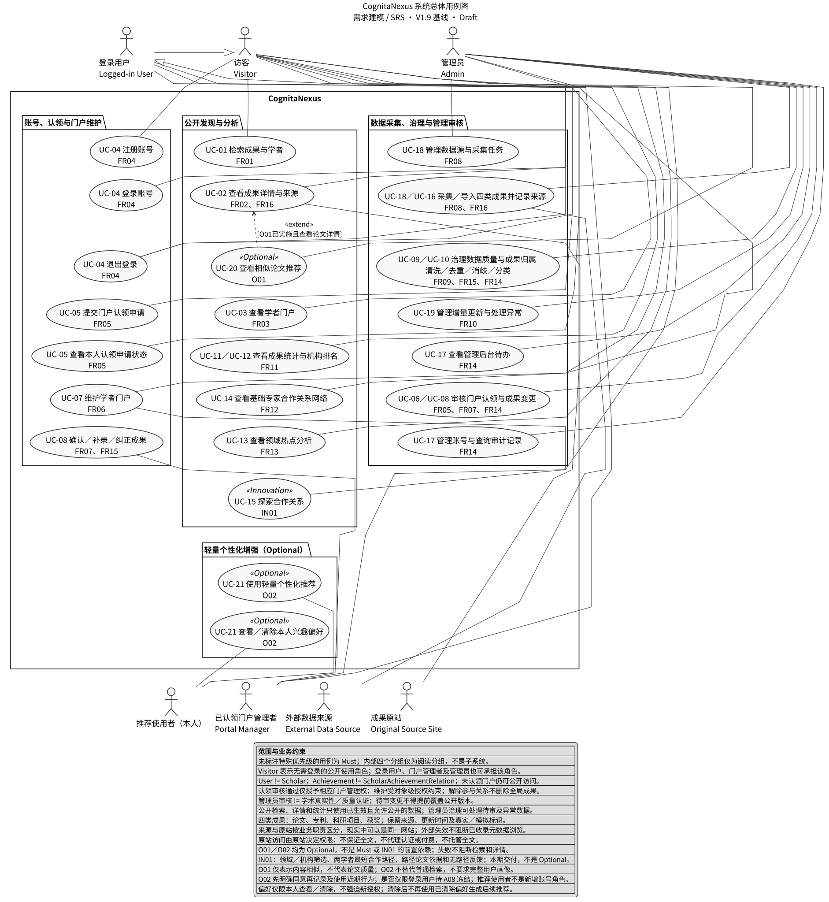

### 3.3 用例清单

| 编号 | 用例 | 成员 | 对应父需求 |
| --- | --- | --- | --- |
| UC-01 | 检索成果与学者 | 01 | FR01 |
| UC-02 | 查看成果详情与来源 | 01 | FR02 |
| UC-03 | 查看学者门户 | 04 | FR03 |
| UC-04 | 注册登录与账号权限 | 04 | FR04 |
| UC-05 | 提交补充并查看本人认领申请 | 04 | FR05 |
| UC-06 | 审核门户认领申请 | 04 | FR05 |
| UC-07 | 维护学者门户 | 04 | FR06 |
| UC-08 | 确认补录与纠正成果 | 04 | FR07 |
| UC-09 | 处理成果清洗去重与治理异常 | 03 | FR09 |
| UC-10 | 核验学者身份与成果归属 | 03 | FR15 |
| UC-11 | 查看成果统计分析 | 05 | FR11 |
| UC-12 | 查看机构分类排名 | 05 | FR11 |
| UC-13 | 查看领域热点 | 05 | FR13 |
| UC-14 | 查看基础专家合作网络 | 05 | FR12 |
| UC-15 | 探索合作关系 | 05 | IN01 |
| UC-16 | 查看四类成果与来源证据 | 02 | FR16 |
| UC-17 | 管理后台待办权限与审计 | 06 | FR14 |
| UC-18 | 管理数据来源与采集任务 | 02 | FR08 |
| UC-19 | 更新来源数据并处理变更 | 02 | FR10 |
| UC-20 | 查看相似论文推荐 | 01 | O01 |
| UC-21 | 授权使用并清除个性化推荐偏好 | 01 | O02 |

### 3.4 关键用例规格

以下用例行为继承对应父需求，Optional仅在选择实施后适用。

### UC-01 检索成果与学者

- **主要参与者：** 访客及登录用户
- **前置条件：** 公开检索可用；仅使用允许公开的数据
- **触发条件：** 提交关键词或改变筛选／排序／分页

#### 主成功场景

1. 选择成果或学者范围并提交关键词。
2. 按已确认字段、过滤和排序规则返回结果并回显条件。
3. 用户清除过滤或翻页，结果保持当前规则。
4. 选择条目进入详情或门户。

#### 备选与异常场景

无结果明确提示；查询失败与无结果区分，保留条件并提供重试；非法输入不得产生错误命中；待决查询语义须先确认。

#### 后置条件

不改变成果或归属；当前结果与条件可观察。

#### 业务规则与追踪

FR01-S01～S14；BR-101～BR-114。验收采用这些父需求下的原有AC，不另造重复验收编号。待决条件以相应分册待决表为准。

### UC-02 查看成果详情与来源

- **主要参与者：** 访客及登录用户
- **前置条件：** 成果已收录且允许当前访问者查看
- **触发条件：** 选择成果条目

#### 主成功场景

1. 展示公共字段、类型专属字段、参与者与出处。
2. 显示来源更新时间、版本和归属状态，缺失显式标未知。
3. 用户选择原站入口时按原站权限访问。

#### 备选与异常场景

成果不可用时反馈；外链已知失效保留元数据并提示；原站认证、订阅或下载由原站处理，本平台不代理。

#### 后置条件

不改变成果实体或参与关系；外站失败不删除本地元数据。

#### 业务规则与追踪

FR02-S01～S08、FR16；BR-115～BR-120。验收采用这些父需求下的原有AC，不另造重复验收编号。待决条件以相应分册待决表为准。

### UC-03 查看学者门户
- **目标：** 查看公开信息与四类成果。
- **对应需求：** FR03。
- **主要参与者：** 访客。
- **次要参与者：** 无。
- **前置条件：** 目标档案存在且允许公开；无需账号或成果非空。
- **触发事件：** 进入门户。
- **主成功场景：** 1. 选择学者；2. 展示公开信息、认领及关系状态；3. 按类型浏览并选择成果导航。
- **备选/异常场景：** 无成果显示空状态；缺字段标未知；不存在／受限不给出受限信息；加载失败明确提示；来源失效仍保留元数据。
- **后置条件：** 成功为公开内容可查，失败有反馈；均不改变业务状态。
- **业务规则：** BR-401～BR-405。
- **关联状态：** 门户认领、成果关系分别只读；不展示他人申请材料。

### UC-04 注册、登录、退出与权限校验
- **目标：** 独立完成账号操作并约束受保护访问，不要求每次先注册。
- **对应需求：** FR04。
- **主要参与者：** 访客、登录用户。
- **次要参与者：** 管理员、门户管理者。
- **前置条件：** 注册不要求已有账号；登录需已有可用账号；退出针对有效会话；受保护操作需身份、账号及权限校验。
- **触发事件：** 选择任一账号操作或请求受保护操作。
- **主成功场景：** 注册校验后创建独立账号；或凭据与状态有效后登录；或退出使当前会话失效；请求受保护操作时校验角色与对象授权。
- **备选/异常场景：** 标识重复／输入缺失拒绝注册；凭据错误拒绝登录；禁用／会话失效／权限不足拒绝受保护操作；校验无法完成不放行。
- **后置条件：** 各操作只改变对应账号或会话；失败不新增门户授权。
- **业务规则：** BR-406～BR-409。
- **关联状态：** 账号可用／禁用与会话有效／失效分离；详细策略 J02。

### UC-05 提交、补充并查看本人认领申请
- **目标：** 提交申请并获知本人处理进度。
- **对应需求：** FR05-S01、S02、S04。
- **主要参与者：** 登录用户。
- **次要参与者：** 管理员。
- **前置条件：** 可用账号、有效会话、存在的目标门户；提交约束按 J03 冻结。
- **触发事件：** 提交新申请、收到补充要求或查询本人申请。
- **主成功场景：** 1. 选择门户并提交材料；2. 校验有效后创建待审核申请；3. 本人查询状态；4. 若待补充，按原因补充并重新提交；5. 有效提交回待审核。
- **备选/异常场景：** 校验失败不创建待审核申请；补充校验失败仍待补充；已有管理人转冲突人工处理不覆盖；撤回仅为 J04 候选。
- **后置条件：** 提交成功只产生申请，非管理授权；查询不改状态；失败可见原因。
- **业务规则：** BR-410～BR-414。
- **关联状态：** 待审核、待补充及终态；见第6章。

### UC-06 审核门户认领申请
- **目标：** 核验证据、记录决定并按决定处理授权。
- **对应需求：** FR05-S03～S07。
- **主要参与者：** 管理员。
- **次要参与者：** 申请人。
- **前置条件：** 有审核权限，申请仍待审核。
- **触发事件：** 处理审核待办。
- **主成功场景：** 1. 查看材料和当前授权；2. 核验证据；3. 无未解决冲突且核验通过，批准并授予目标授权；4. 本人可查结果及原因。
- **备选/异常场景：** 要求补充转待补充，补充重提再审；驳回记录原因；冲突未解决留待审核并保留原授权；状态变化重新校验，不执行过期决定。
- **后置条件：** 通过产生授权；补充／驳回不产生授权、不撤销原管理权；处理失败不虚报通过。
- **业务规则：** BR-410～BR-414。
- **关联状态：** 申请流转与门户授权分别表达；冲突最终处置见 J03。

### UC-07 维护学者门户
- **目标：** 修改允许维护的门户信息。
- **对应需求：** FR06。
- **主要参与者：** 目标门户管理者。
- **次要参与者：** 管理员。
- **前置条件：** 有效登录和对象授权，J05 已冻结字段、校验及审核分类。
- **触发事件：** 保存简介、领域或展示设置。
- **主成功场景：** 1. 展示可编辑项和生效值；2. 校验权限与内容；3. 按明确分类走直接生效或提交待审的唯一分支；4. 记录重要变化及结果。
- **备选/异常场景：** 需审核项待审不替换公开版本，通过才生效，驳回保留原值并给原因；取消不保存；校验／保存失败提示；并发版本变化不静默覆盖，具体协调 J05。
- **后置条件：** 直接项成功则生效；审核项提交成功仅待审；失败公开版本不变。
- **业务规则：** BR-415～BR-418。
- **关联状态：** 公开版本与变更待审核／通过／驳回分离。

### UC-08 确认／补录／纠正成果
- **目标：** 维护本人关系或提出共享成果变更。
- **对应需求：** FR07。
- **主要参与者：** 目标门户管理者。
- **次要参与者：** 管理员。
- **前置条件：** 有效授权；所选操作的目标与证据满足第7章分类。
- **触发事件：** 选择确认、补录、字段纠错、排除本人关系或查询结果。
- **主成功场景：** 1. 明确操作对象；2. 校验证据及权限；3. 无冲突确认记录本人确认，其他依第7章分类提交或处理申请；4. 需审核的通过后生效；5. 本人查看结果。
- **备选/异常场景：** 多位合法作者不是冲突；真正的身份／归属证据矛盾须人工审核；批量逐项给出结果；驳回不替换公开值；补充和撤回属于 J06 待决扩展。
- **后置条件：** 生效仅影响被批准的字段或目标关系；解除关系不删除成果及其他作者关系；失败／待审不伪称已生效。
- **业务规则：** BR-419～BR-423。
- **关联状态：** 本人确认来源、关系状态、成果变更审核状态独立。

### UC-09 处理异常数据

- **目标：** 使校验失败、无法规范化或去重证据不足／冲突的来源记录得到明确处置，处置结论可追溯，且不产生重复成果实体。
- **对应需求：** FR09（FR09-S01～S12）；引用 FR08（任务产出）、FR16（字段集合）、FR14（后台与审计）
- **主要参与者：** 管理员
- **次要参与者：** 系统（产生处理项与自动判定）、外部数据来源（提供记录）
- **前置条件：**
  1. 采集任务已成功结束并产出可读取的来源记录（FR08）。
  2. 该成果类型的必填字段集合与来源字段定义可用（FR16）。
  3. 管理员已登录且具备治理处置权限（FR14）。
  4. 机构规范名与领域分类映射可用；不可用时按 FR09-S04 A2 降级处理。
- **触发事件：**
  - 来源记录进入治理处理并被判定为异常或待核验（系统侧触发）；
  - 或管理员主动进入异常与待核验处理队列。

#### 主成功场景

1. 系统取得来源记录批次，按成果类型校验必填项（FR09-S01）。
2. 系统规范化时间与精度、归一化稳定标识、规范化属性文本与机构领域映射（FR09-S02～S04）。
3. 系统按稳定标识匹配既有成果实体；无标识时按标题、年份、参与者、类型生成候选并判定（FR09-S06、S07）。
4. 系统处理版本关系与重复到达，保持实体计数不变（FR09-S08、S10）。
5. 系统逐字段比较来源值与呈现值，冲突时不覆盖已确认值而是生成字段冲突处理项（FR09-S05）。
6. 系统建立处理项，记录原因、来源标识、原始内容、证据与产生时间（FR09-S11）。
7. 管理员按原因筛选处理项，查看原始内容与候选证据（FR09-S11）。
8. 管理员选择处置动作：修正字段、关联既有实体、确认新实体、忽略（填写理由）或转人工复核。
9. 系统执行处置动作，把处理项置为已处理／已忽略／已转人工复核，并记录操作者、时间、依据与关键变化（FR09-S12）。
10. 系统使处置结果在检索、门户与统计中一致生效（BR-327、NF05），并在管理员处报告处置已生效。

#### 备选/异常场景

- A1 证据全部命中且无冲突：系统自动合并或关联，不产生处理项（FR09-S07）。
- A2 无任何候选：系统建立新实体，依据标注“无标识新建”。
- A3 处理项需要更多证据：管理员标记为需要补充，状态保持待处理并记录说明。
- E1 必填项缺失、日期非法或标识非法：判为异常记录，不进入公开检索与统计（FR09-S01 E1、S02 E1、S03 E1）。
- E2 多个候选实体命中同一标识或类型不一致：判为待核验，列出全部候选，不自动选择（FR09-S06 E1、E2）。
- E3 处置动作执行失败或并发处置同一处理项：保持原状态并记录失败原因；只接受首次提交（FR09-S11 E1、E2）。
- E4 留痕写入失败：治理动作不得表现为成功，且不得出现“已生效但无记录”的状态（FR09-S12 E1）。

#### 后置条件

- 成功：处理项状态为已处理（或已忽略、已转人工复核）；成果实体唯一；出处完整；治理记录可追溯；检索、门户与统计一致。
- 失败：处理项保持待处理，原始证据不丢失，失败原因可查，可重试且重试不产生重复计数。

#### 业务规则

- BR-301～BR-311（去重、版本与幂等）
- BR-321～BR-326（校验、规范化、来源保留与冲突）
- BR-381～BR-382（留痕）
- BR-324（已确认值不得被静默覆盖）
- BR-327（引用 NF05，生效一致性）

#### 关联状态

- 处理项状态机：`DGM-STATE-04`（待处理／处理中／已处理／已忽略／已转人工复核）
- 采集任务状态机由 ② 负责（`DGM-STATE-01`），本用例只消费其成功结果。

#### 关联图

- `DGM-ACTIVITY-06`（数据治理总体活动图）：本用例的主流程
- `DGM-ACTIVITY-08`（成果去重候选判定活动图）：主流程第 3 步展开
- `DGM-STATE-04`（异常／待核验处理项状态图）：处理项生命周期


### UC-10 核验学者身份与成果归属

- **目标：** 在证据充分时建立正确的学者—成果参与关系，在证据不足或冲突时不误合并、不误归属，并把结论可追溯地传播到门户、检索与统计。
- **对应需求：** FR15（FR15-S01～S13）；引用 FR05（认领结果）、FR07（学者申请）、FR09（成果实体）、FR14（后台与审计）
- **主要参与者：** 管理员
- **次要参与者：** 系统、相关学者（已认领门户管理者）、登录用户、访客
- **前置条件：**
  1. 成果实体已由 FR09 去重确定，参与关系可建立在实体之上。
  2. 学者证据（姓名表达、机构、外部标识、合作者、领域）已按 FR15-S01 收集。
  3. 管理员已登录且具备治理处置权限（FR14）；相关学者已完成门户认领（若需要其提交确认）。
  4. 机构与领域映射可用；不可用时按 FR15-S01 A2 降级。
- **触发事件：**
  - 来源记录带来新的人员证据并使判定条件成立或产生候选；
  - 相关学者提交本人确认、纠错或解除关联申请（FR07）；
  - 或管理员主动发起身份核验与归属判定。

#### 主成功场景

1. 系统提取人员证据并剔除私人联系方式，对姓名表达归一（FR15-S01、S02）。
2. 系统判定身份：外部标识一致，或机构一致且合作者与领域证据共同支持时，判定为同一人（FR15-S03）。
3. 系统合并学者档案，保留别名与证据的并集，并迁移参与关系（FR15-S03）。
4. 系统按来源建立参与关系，记录角色与顺序（FR15-S07）。
5. 系统为关系记录三类独立证据：来源证据、本人确认、管理员审核（FR15-S08）。
6. 系统按优先级规则计算关系状态（自动关联／本人确认／待核验／争议／已排除）（FR15-S09）。
7. 管理员对候选或争议作出判定：确认同一人或归属成立、改归属、排除、拆分、标记争议、请求补充证据（FR15-S05、S10）。
8. 系统记录判定依据、操作者、时间与关键变化，保留来源事实与人工修正结论（FR15-S10、BR-381）。
9. 系统同步门户、检索与统计，使其在约定时限内反映同一结论（FR15-S12、NF05）。
10. 系统在约定时限内向管理员报告判定已生效。

#### 备选/异常场景

- A1 证据不足但存在候选：系统生成身份候选并进入待核验队列，相关门户标注“待核验”（FR15-S04）。
- A2 管理员确认非同一人：关闭候选并记录排除依据；同一组合不再重复生成候选，除非出现新证据（FR15-S05）。
- A3 学者申请解除关联并审核通过：仅该关系置为已排除，成果实体与他人关系不变（FR15-S11）。
- A4 冲突认领：保留原授权与原结论，生成冲突处理项，不自动转移管理权（FR15-S13）。
- E1 仅姓名相同或仅有缩写／译名：禁止自动合并，只生成候选（BR-342、BR-345）。
- E2 外部标识一致但机构与领域证据明显冲突：不自动合并，判为待核验并列出冲突项（FR15-S03 E1）。
- E3 判定或纠正执行失败、两名管理员并发判定：保持原状态并以首次提交为准，可重试且不产生部分生效（FR15-S05 E1、FR15-S10 E1）。
- E4 已排除关系被来源证据试图改回自动关联：系统拒绝并记录该尝试（FR15-S09 E1）。
- E5 同步超时或失败：治理结论为唯一真源并持续重试；仅向管理员提示“变更尚未生效”，访客侧不出现互相矛盾的结果（FR15-S12 E1、E2）。
- E6 争议处理期间：禁止自动合并与自动关联（BR-361）。

#### 后置条件

- 成功：身份判定与归属结论明确、证据链完整；门户、检索与统计一致；判定可追溯。
- 失败：保持原结论与原状态；候选或争议项保留；无部分合并、无部分纠正；失败原因与重试状态可查。

#### 业务规则

- BR-341～BR-361（身份、归属与关系证据）
- BR-371（不采集私人联系方式作为消歧依据）
- BR-381～BR-382（留痕、只追加）
- BR-324、BR-326（不静默覆盖、来源失效不删除成果）
- BR-360、BR-327（引用 NF05 的一致性要求）

#### 关联状态

- 参与关系状态机：`DGM-STATE-05`（自动关联／本人确认／待核验／争议／已排除）
- 处理项状态机：`DGM-STATE-04`（候选与争议项的处置载体）
- 门户管理授权状态（未认领／已认领；认领申请另按待审核／待补充／已通过／已驳回表达）与关系状态**分别维护**，见公共文件 §2.1。

#### 关联图

- `DGM-ACTIVITY-07`（学者消歧与归属判定活动图）：本用例的主流程
- `DGM-STATE-05`（学者—成果关系状态图）：关系生命周期
- `DGM-STATE-04`（异常／待核验处理项状态图）：候选与争议处置
- `DGM-SEQ-01`（归属判定与结果传播时序图）：主流程第 5～10 步的交互顺序（需求分析阶段定稿）

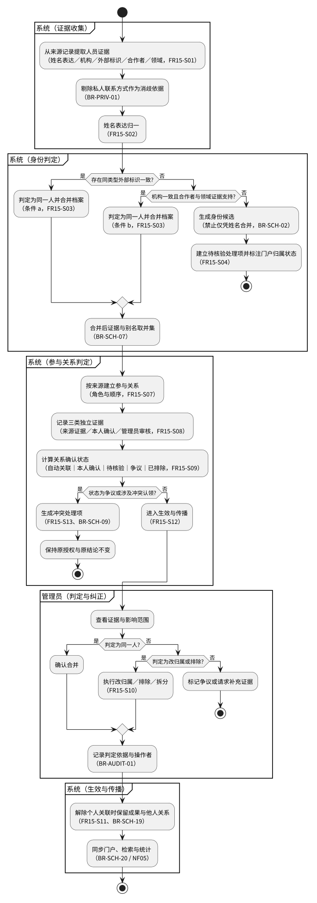

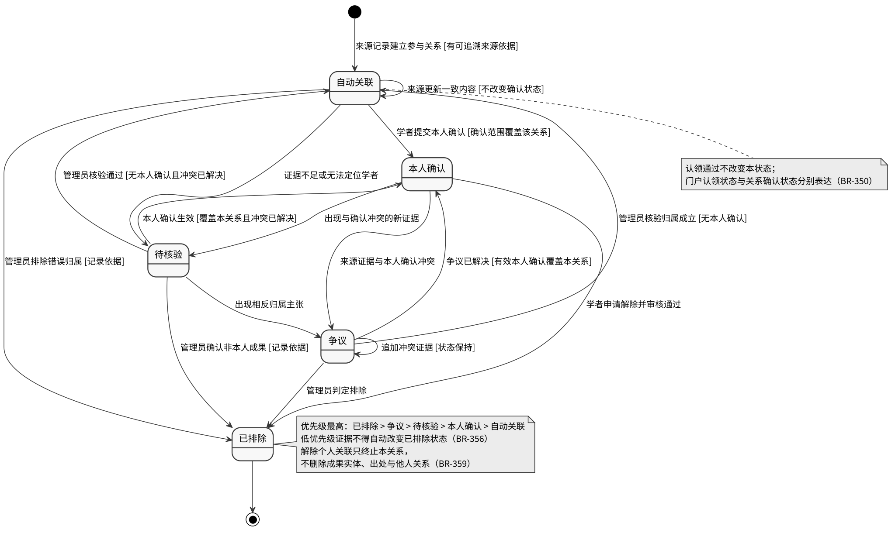

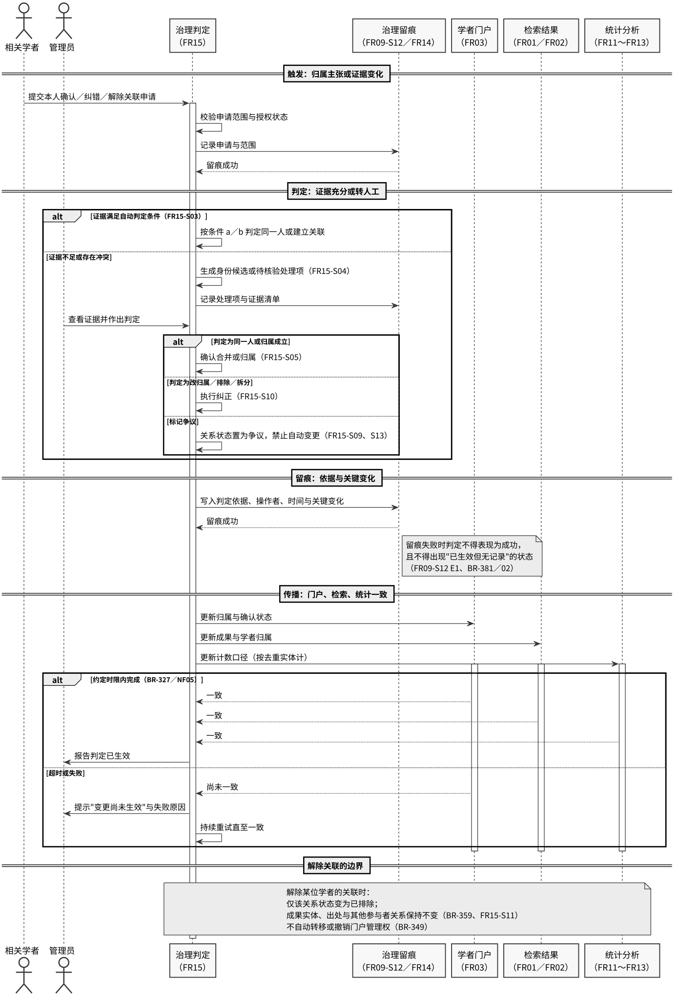

### UC-11 查看统计分析

- **目标：** 访客在公开页面上按条件查看已收录成果的类型／年度／领域分布，并能看到结果所依据的数据范围与计数口径。
- **对应需求：** FR11（FR11-S01～FR11-S04、FR11-S06、FR11-S07、FR11-S09～FR11-S12）
- **主要参与者：** 访客
- **次要参与者：** 管理员（口径与分类映射的维护方，FR14／FR16）
- **前置条件：** 统计范围内存在至少一条已收录且满足统计条件（BR-519）的成果实体；统计结果处于"已生效"状态。
- **触发事件：** 访客打开统计分析视图，或修改筛选条件后提交。

#### 主成功场景

1. 访客打开统计分析视图。
2. 系统读取当前对外可见的统计结果，并展示数据范围、时间范围、计数口径、统计条件、生成时间与真实／模拟数据标识（FR11-S01）。
3. 系统展示成果类型分布（数量与占比）与成果年度分布（含"时间未知"分组）（FR11-S02、FR11-S03）。
4. 系统展示研究领域分布，并说明同一成果关联多个领域时的重复计入规则（FR11-S04）。
5. 访客设置或调整筛选条件（时间范围、成果类型、研究领域、机构、数据集范围）（FR11-S06）。
6. 系统按同一组条件重新计算展示，并同步刷新口径声明块。
7. 访客点击任一统计条目，下钻到检索结果以复核计数（FR11-S11、复用 FR01 的分类浏览）。

#### 备选／异常场景

- A1 访客切换时间窗口或成果类型：系统保留其余条件，重新计算并刷新口径声明。
- A2 访客选择"仅模拟数据"：系统在结果区显著标注数据集来源为模拟数据，并在口径声明中说明该结果不得用于描述真实世界（BR-515）。
- A3 某分类计数为 0：系统展示 0 并标注"本期未收录该类成果"，不隐藏该分类。
- E1 起始时间晚于结束时间：系统拒绝查询，提示"时间范围无效"，保留原有结果，不清空页面（NF01）。
- E2 筛选条件命中 0 条成果：系统提示"当前条件下没有可统计的成果"，保留筛选条件供修改（FR11-S10）。
- E3 无可用的统计结果：系统提示"暂无可用的统计结果"并给出最近一次计算失败或未完成的时间，不展示过期结果冒充最新（FR11-S09、NF05）。
- E4 结果已过约定更新时限：系统展示上一版可用结果，同时标注"数据更新至 …／结果可能未反映最新变更"（FR11-S09、NF04）。
- E5 统计能力不可用：系统给出可识别的失败提示与重试引导，不影响检索等其他公开能力（NF01、NF04）。

#### 后置条件

- 成功：访客看到满足条件的分布结果与完整口径声明；系统状态不变（统计为只读能力）。
- 失败：页面给出明确失败或无结果提示，筛选条件保留，不出现空白页或无限加载。

#### 业务规则

- BR-511、BR-512、BR-514、BR-515、BR-516、BR-519、BR-520、BR-523、BR-526、BR-527、BR-529

#### 关联状态

- 统计结果状态的"已生效／待更新／更新失败／无可用结果"，见 DGM-STATE-03 与 6.6 节。

### UC-12 查看机构分类排名

- **目标：** 访客在限定成果类型与领域的条件下查看机构的成果数量排名，并理解排名的归属口径与并列规则。
- **对应需求：** FR11（FR11-S05、FR11-S08、FR11-S06、FR11-S10）
- **主要参与者：** 访客
- **次要参与者：** 管理员（机构规范名维护，属 FR14／FR16）
- **前置条件：** 存在可用的已生效统计结果；至少有一条成果具有机构归属或可被标注为机构未知。
- **触发事件：** 访客打开机构分类排名视图或修改筛选条件。

#### 主成功场景

1. 访客打开机构分类排名视图。
2. 访客选择成果类型（默认全部类型）、研究领域与时间范围。
3. 系统按"成果发生时的机构归属"口径（BR-513）统计各机构的去重成果实体数。
4. 系统按计数降序排列，展示名次、机构规范名、计数、占比与数据覆盖率。
5. 系统展示并列规则说明（计数相同者名次相同，下一名次跳号）与归属口径说明。
6. 访客点击某一机构，下钻到按同一条件过滤的检索结果进行复核。

#### 备选／异常场景

- A1 两个或多个机构计数相同：系统给出相同名次，下一名次按并列数跳号，并在说明区给出规则。
- A2 某机构计数低于约定阈值：该行标注"样本不足"，仍展示实际计数（FR11-S10）。
- A3 部分成果机构归属缺失：系统在排名之外单独展示"机构未知"计数，不将未知归入任一机构参与名次。
- E1 筛选条件命中 0 条：提示无结果并保留条件。
- E2 领域分类映射尚未完成（存在大量"待分类"）：系统按实际数据展示并标注"待分类"计数与影响，不得强行归类（FR11-S04、C-7）。

#### 后置条件

- 成功：访客得到可复核的机构排名与归属口径说明；系统状态不变。
- 失败：给出明确提示，保留筛选条件。

#### 业务规则

- BR-511、BR-512、BR-513、BR-514、BR-520、BR-526、BR-529

#### 关联状态

- 统计结果状态，见 6.6 节。

### UC-13 查看领域热点

- **目标：** 访客在明确的数据范围与时间窗口内查看热点指标（关键词／主题频次及趋势），并理解指标来源与统计口径。
- **对应需求：** FR13（FR13-S01～FR13-S09）
- **主要参与者：** 访客
- **次要参与者：** 管理员（关键词归一规则与分类映射的维护方）
- **前置条件：** 选定时间窗口与数据范围内存在可提取关键词／主题的成果；热点结果处于"已生效"状态。
- **触发事件：** 访客打开领域热点视图或修改时间窗口与筛选条件。

#### 主成功场景

1. 访客打开领域热点视图。
2. 系统展示默认时间窗口、指标定义与数据范围（FR13-S01、FR13-S02、FR13-S03）。
3. 访客调整时间窗口与筛选条件（领域、机构、成果类型、数据集范围）。
4. 系统按选定条件计算热点指标，按降序展示前若干项，并给出并列规则（FR13-S04）。
5. 系统展示选定窗口内的趋势，并说明趋势的比较基线（FR13-S05）。
6. 系统固定展示声明：热点指标仅反映已收录数据中的出现频次或约定指标，不代表研究质量、影响力或学术水平（FR13-S06）。
7. 访客查询关键词归一规则（如大小写、单复数、常见缩写与同义表达的合并规则）（FR13-S07）。

#### 备选／异常场景

- A1 热点项数少于约定展示条数：系统按实际条数展示，不用占位条目补足（FR13-S08）。
- A2 某时间点样本量低于阈值：系统在该点标注"样本不足"，不以插值、平滑或补零制造趋势（FR13-S05、FR13-S08）。
- A3 无法判定是否同一概念的关键词：系统保留为不同条目并标注，不强行合并（FR13-S07）。
- E1 选定窗口无数据：提示"所选时间窗口内没有可统计的成果"，保留条件。
- E2 热点结果更新失败：展示上一版可用结果并标注最近更新时间（FR13-S09、NF05）。

#### 后置条件

- 成功：访客看到热点排名与趋势、指标口径、数据范围与质量声明；系统状态不变。
- 失败：明确提示，不展示未完成或部分结果。

#### 业务规则

- BR-514、BR-515、BR-520、BR-521、BR-522、BR-523、BR-526

#### 关联状态

- 统计结果状态，见 6.6 节。

### UC-14 查看专家合作关系网络

- **目标：** 访客查看以学者为节点、以共同成果为边的合作网络，并能查看任意一条合作关系的成果依据。
- **对应需求：** FR12（FR12-S01～FR12-S09）
- **主要参与者：** 访客
- **次要参与者：** 无
- **前置条件：** 统计范围内存在至少一条满足条件的合作关系（两个不同学者共享至少一项满足统计条件的成果实体）。
- **触发事件：** 访客打开专家合作网络视图。

#### 主成功场景

1. 访客打开专家合作关系网络视图。
2. 系统展示满足条件的节点与边，并披露数据范围、时间范围与关系定义（FR12-S01）。
3. 访客选中一条合作关系，系统展示构成该关系的共同成果清单（标题、类型、时间、来源、归属状态）（FR12-S02）。
4. 访客选中一个学者节点，系统展示关系强度，并说明其含义为共同成果实体数（FR12-S03）。
5. 访客从节点进入学者门户，或从成果清单进入成果详情（FR12-S09）。
6. 访客可按数据集范围（真实／模拟／全部）过滤并查看结果数据集标识（BR-515）。

#### 备选／异常场景

- A1 访客查看的学者无任何共同成果：该学者不作为有边节点出现；系统的口径声明须明确说明"无合作关系学者不显示为节点"（FR12-S07）。
- A2 满足条件的节点／边超过单次展示上限：系统提示当前规模并要求收窄筛选范围，不展示部分结果冒充完整网络（FR12-S06、BR-528）。
- A3 关系强度与成果清单条数不一致：属缺陷；验收条件 AC-FR12-S03-01 直接以两者一致性判定。
- E1 当前数据范围内不存在任何合作关系：明确提示"当前数据范围内没有可展示的合作关系"。
- E2 合作网络结果不可用：给出可识别提示，不影响其他公开能力（NF01、NF04）。
- E3 点击的学者已被消歧合并：跳转到合并后的学者门户或给出明确说明，不出现空白页（FR12-S08、FR12-S09、BR-530）。

#### 后置条件

- 成功：访客看到网络、关系强度与成果依据，并可导航到门户与成果详情；系统状态不变。
- 失败：明确提示，保留视图条件。

#### 业务规则

- BR-514、BR-516、BR-517、BR-518、BR-519、BR-523、BR-526、BR-528、BR-530

#### 关联状态

- 节点与边所依赖的学者—成果关联状态由 FR15 定义，本分册只引用（BR-519）。
- 统计结果状态，见 6.6 节。

### UC-15 探索合作关系（IN01）

- **目标：** 在基础合作网络之上，访客可按研究领域或机构筛选网络，或查询两名学者之间的最短合作路径并按需查看论文依据；这些操作不要求每次一起执行。
- **对应需求：** IN01（IN01-S01～IN01-S09）
- **主要参与者：** 访客
- **次要参与者：** 无
- **前置条件：** UC-14 的基础合作网络可用；当前数据图范围内至少存在两个可用的学者节点。
- **触发事件：** 访客在合作网络视图中选择"按领域／机构筛选"或"查询两名学者间的合作路径"（即触发 `<<extend>>` 关系）。

#### 主成功场景

1. 访客选择筛选网络或查询路径；可以仅完成其中一项，也可以先筛选再查路径。
2. 选择筛选时，访客设置领域和／或机构条件；系统按已冻结口径展示筛选网络并声明范围（IN01-S01、IN01-S02），访客可在此结束。
3. 选择路径查询时，访客指定起点与终点学者；未筛选时使用已声明的默认范围。
4. 系统在当前范围内仅由合格共同论文支撑的关系子图上计算最短路径，以合作边数作为长度并展示节点顺序、每一跳与长度（IN01-S03）。
5. 若访客选择查看某跳或全部跳的证据，系统展示论文清单并提供成果详情入口；不要求每次查询都打开证据（IN01-S04）。
6. 系统随路径结果声明论文证据范围、关系纳入规则与生效条件（IN01-S06），不以任意成果替代论文依据。

#### 备选／异常场景

- A1 存在多条等长最短路径：系统全部列出，或按约定规则（如按路径内学者标识升序）展示并说明规则（IN01-S08）。
- A2 筛选后网络规模超过展示上限：提示收窄范围并给出当前节点规模（IN01-S01/S02 与 FR12-S06 共用）。
- A3 仅使用基础网络能力（不使用筛选与路径）：UC-14 的流程保持完整可用，IN01 不成为其前置（IN01-S09）。
- E1 两名学者之间不存在合作路径：系统明确提示"在当前数据范围内不存在合作路径"，并重复声明数据范围；不得以空图、报错页或无限加载代替（IN01-S05）。
- E2 指定学者不存在、不可公开或已被消歧合并：系统给出明确提示；已被合并时引导到合并后的学者门户（IN01-S07、BR-530）。
- E3 筛选条件非法（如起始年份晚于结束年份）：拒绝并提示无效条件，保留原结果（NF01）。

#### 后置条件

- 成功：访客得到筛选后的网络，或可逐跳查看论文依据的最短路径；系统状态不变。
- 失败：无路径、无权限或条件非法均有可观察提示，页面不出现空白或崩溃状态。

#### 业务规则

- BR-514、BR-515、BR-517、BR-518、BR-519、BR-524、BR-525、BR-526、BR-528、BR-530

#### 关联状态

- 统计结果状态，见 6.6 节；IN01 不引入新的业务状态。

### UC-16 查看四类成果与来源证据

- **目标：** 浏览允许公开的成果并确认类型、出处、时间与真实／模拟属性。
- **对应需求：** FR16-S01～S03，引用FR01/FR02/FR03展示能力。
- **主要参与者：** 访客。
- **次要参与者：** 管理员（准备覆盖样例及核对计数）。
- **前置条件：** 存在允许公开的已收录成果；来源证据已保存。
- **触发事件：** 访客进入成果详情，或管理员核对数据覆盖。

#### 主成功场景

1. 访客进入论文、专利、科研项目或获奖详情。
2. 系统显示该类适用字段及字段缺失提示，区分参与者角色。
3. 系统显示各来源名称、记录标识、允许公开的入口、采集／更新时间及真实／模拟标签。
4. 管理员核对四类、去重实体总量、真实／模拟及混合证据计数。

#### 备选/异常场景

- A1：同一成果有多个来源，分别显示；引用量按各来源展示而非求和。
- A2：外部源不可用，历史元数据及证据仍可浏览，显示来源访问失败；没有原文不承诺下载。
- E1：字段未知，显示未知，不补造；类型不支持或公共必要信息缺失的输入交异常。
- E2：受控来源内容不可公开，仅展示允许的来源说明；账号凭据及审核材料不能进入详情。

#### 后置条件

- 成功：没有修改成果或关联；出处和覆盖可核验。
- 失败：原有历史数据保留，提供失败或权限反馈。

#### 业务规则

BR-201、BR-202、BR-209、BR-211、BR-212。

#### 关联状态

本用例不改变任务、认领、归属或成果审核状态。

### UC-17 管理后台待办权限与审计

- **主要参与者：** 管理员
- **前置条件：** 账号正常且具备对应管理权限
- **触发条件：** 进入管理后台或选择待办／账号／分类／审计操作

#### 主成功场景

1. 按类别、状态、时间和对象查询工作台。
2. 进入对应业务用例处理采集、治理、认领或成果变更。
3. 按授权管理分类、账号与来源配置。
4. 查看处理结果及关键操作审计。

#### 备选与异常场景

非管理员或无对象权限拒绝；查询失败明确反馈；并发／冲突按照业务负责模块处理，不由工作台覆盖；受控材料不对公开访客开放。

#### 后置条件

业务结果及审计可追踪；授权只在明确批准后改变；后台入口不改写各业务状态机。

#### 业务规则与追踪

FR14-S01～S09；BR-601～BR-616（仅注册表实际条目）。验收采用这些父需求下的原有AC，不另造重复验收编号。待决条件以相应分册待决表为准。

### UC-18 管理数据来源与采集任务

- **目标：** 通过可用来源执行可追踪、可停止、可恢复的采集。
- **对应需求：** FR08-S01～S04、FR16-S02。
- **主要参与者：** 管理员。
- **次要参与者：** 外部数据来源。
- **前置条件：** 管理员账号有效；来源使用条件与采集范围已核验。
- **触发事件：** 管理员保存来源并创建采集任务。

#### 主成功场景

1. 管理员填写来源、使用依据、获取方式、类型、范围、字段和更新能力，系统验证后启用。
2. 管理员选择来源及范围，系统保存任务参数快照、创建时间、操作者，状态为待执行。
3. 管理员启动；系统再次验证权限、来源与范围，任务变为运行中。
4. 系统接收并记录来源证据，按 FR09、FR10、FR15 处理或交入可追踪的核验队列。
5. 全部范围读取结束、所有已读记录完成处置，任务进入成功，显示分类计数和异常／冲突数量。

#### 备选/异常场景

- A1：使用获准文件或明确标识的模拟文件，仍走来源配置、参数和证据校验。
- A2：管理员在待执行、运行中或重试状态停止；停止生效后为已停止，保留已完成数据与未完成范围。
- E1：无权限、使用依据缺失或来源停用，拒绝变更，显示原因。
- E2：取得或处理失败，任务失败；显示错误阶段及可恢复范围，管理员按UC-10恢复。
- E3：停止与完成同时发生，以首先生效的转移为准，返回最终状态，不产生成功又已停止的双重状态。

#### 后置条件

- 成功：任务为成功，有参数、时间、计数和来源记录可查；不承诺所有记录已经公开。
- 失败：错误和未完成范围可查；已完成历史数据和人工结果保留。

#### 业务规则

BR-201、BR-202、BR-203、BR-204、BR-209。

#### 关联状态

采集任务六状态，转移参见§6.2；来源为启用／停用。

### UC-19 更新来源数据并处理变更

- **目标：** 发现新增和变更，保留证据、人工结果及恢复能力。
- **对应需求：** FR10-S01～S05、FR08-S04。
- **主要参与者：** 管理员。
- **次要参与者：** 外部数据来源。
- **前置条件：** 来源启用、更新范围明确；管理员具有任务权限。
- **触发事件：** 管理员发起更新任务，或对失败任务请求重试。

#### 主成功场景

1. 系统按获准范围取得新一轮来源记录，识别来源身份与原版本。
2. 分为新增、未变化、变更；保存检查时间及可取得的来源更新时间。
3. 新增记录交治理；未变化记录不增加成果或伪造变更；变更记录展示前后差异。
4. 无人工结果冲突的变更按既有治理及展示规则生效；与人工结果冲突的变更保留公开值，送交可追踪队列。
5. 系统显示处理汇总与轨迹，生效结果按 NF05 在检索、门户、统计反映。

#### 备选/异常场景

- A1：来源无变更游标时，采用管理员明确指定的已有记录复查／回溯范围；范围与局限公开给管理员。
- A2：来源明确报告删除或撤稿，记录来源事件与证据；不能仅因这次响应缺少记录判为删除。
- E1：失败后从保留的业务范围恢复；重复读取仍不增加重复成果或冲突条目。
- E2：无法识别来源记录身份，转异常／候选，不凭相似标题判定同一版本。
- E3：人工结果在本次更新期间变化，生效前重新检查，不能覆盖后来已确认结果。

#### 后置条件

- 成功：每条可识别记录有处置和来源轨迹，冲突可查，允许生效结果一致。
- 失败：业务结果不被失败回退，错误可定位，完整范围未被标记为更新成功。

#### 业务规则

BR-204、BR-205、BR-206、BR-207、BR-208、BR-210。

#### 关联状态

任务沿§6.2；来源变更处置为待核验／已生效／已驳回，审核决定由FR07/FR14承担。

### UC-20 查看相似论文推荐

- **主要参与者：** 访客及登录用户
- **前置条件：** 选择实施O01且当前成果为论文
- **触发条件：** 打开论文详情并选择查看相似推荐

#### 主成功场景

1. 根据生效论文内容显示相似论文。
2. 展示相似依据并可进入详情。

#### 备选与异常场景

没有推荐／失败时明确反馈；不影响检索与详情；不能以相似度代替质量判断。

#### 后置条件

不改变成果、授权或个人偏好。

#### 业务规则与追踪

O01-S01～S05；BR-121～BR-123。验收采用这些父需求下的原有AC，不另造重复验收编号。待决条件以相应分册待决表为准。

### UC-21 授权使用并清除个性化推荐偏好

- **主要参与者：** 推荐使用者本人（身份范围待A08确认）
- **前置条件：** 选择实施O02，用户可明确决定是否授权
- **触发条件：** 用户授权、查看推荐或查看／清除偏好

#### 主成功场景

1. 说明必要行为范围并取得明确同意。
2. 只使用获准近期行为形成可解释兴趣。
3. 展示成果／学者推荐及依据。
4. 本人查看或清除偏好，清除后后续推荐不再使用已清除数据。

#### 备选与异常场景

未授权不记录／使用该行为；冷启动或失败有反馈，不阻断普通检索；越权读取或清除偏好被拒绝。

#### 后置条件

仅改变本人获准偏好；不得改变他人数据。

#### 业务规则与追踪

O02-S01～S08；BR-124～BR-127。验收采用这些父需求下的原有AC，不另造重复验收编号。待决条件以相应分册待决表为准。


### 3.5 OvO 15 个原用例的全局 UC 对应（共同候选）

两组同号用例不能视为同义，第一组全局 UC-01～UC-21 不重编号；以下 OvO 本地编号保留来源。详细异常、后置条件仍以双方正文及统一对应的 FR/AC 为依据。

| OvO 旧 UC | OvO 业务语义 | 统一 CN UC |
|---|---|---|
| OvO UC-01 | 检索成果与学者 | UC-01 |
| OvO UC-02 | 查看成果详情与来源 | UC-02、UC-16 |
| OvO UC-03 | 查看学者门户 | UC-03 |
| OvO UC-04 | 管理账号与访问权限 | UC-04 |
| OvO UC-05 | 提交并跟踪门户认领 | UC-05 |
| OvO UC-06 | 审核门户认领 | UC-06 |
| OvO UC-07 | 维护学者门户 | UC-07 |
| OvO UC-08 | 确认、补录与纠正成果 | UC-08 |
| OvO UC-09 | 管理采集任务 | UC-18 |
| OvO UC-10 | 治理成果与学者关系 | UC-09、UC-10 |
| OvO UC-11 | 查看统计与机构排名 | UC-11、UC-12 |
| OvO UC-12 | 查看专家合作网络 | UC-14 |
| OvO UC-13 | 查看领域热点 | UC-13 |
| OvO UC-14 | 管理后台与审计 | UC-17 |
| OvO UC-15 | 探索合作关系 | UC-15 |

## 4. 功能需求规格

各子需求保留成员原始FR／AC编号。原分册章节引用以附录对应成员上下文及需求编号定位；未决A／J／Q条件保留，不以候选结果替代人工决议。

### 4.1 检索与成果详情

### FR01-S01 关键词检索

**责任来源：** 成员01，search-recommendation分册。

**父需求：** FR01
- **优先级：** Must
- **主要参与者：** Visitor
- **相关参与者：** Logged-in User、Portal Manager、Admin（使用公开能力）

#### 需求描述
系统应允许用户在统一入口按关键词查询已收录且允许展示的成果或学者，并返回与当前检索范围对应的结果。系统应使用户能够识别查询正在进行、已完成或失败，不将外部来源实时可用作为查询前提。

#### 前置条件
1. 公开检索能力可用；不要求登录或个性化授权。
2. 已有允许公开的数据；无匹配数据时适用 FR01-S11。

#### 触发条件
用户提交关键词查询。

#### 主成功流程
1. 用户给出关键词和检索范围。
2. 系统按当前条件检索允许展示的数据，并提供加载反馈。
3. 系统展示结果及所对应的查询范围，用户可继续筛选或导航。

#### 备选流程
- A1：匹配结果为空，转 FR01-S11。
- A2：用户已登录但未同意个性化行为记录，仍完成同一普通查询流程，不为 O02 记录该行为。

#### 异常流程
- E1：输入不符合冻结的规则时，指出不满足的条件，不伪装成无结果；空输入规则见 A01。
- E2：查询暂时无法完成，转 FR01-S12。

#### 输入/业务数据
关键词、成果或学者范围、当前筛选条件。

#### 输出/可观察结果
加载反馈、查询结果或独立的无结果／失败反馈；不输出受限数据。

#### 状态变化
无（业务实体状态不变；是否为 O02 记录行为由授权规则独立决定）。

#### 权限规则
四种用户身份均可查询公开信息；不要求登录、认领或个性化授权。

#### 业务规则
引用 BR-108、BR-101、BR-103、BR-124。

#### 验收条件
- **AC-FR01-S01-01：** Given 固定样例含一条允许公开的成果与一条禁止公开的成果，关键词按已冻结的 A01 规则匹配两者，When 访客查询，Then 结果包含公开记录而不包含受限记录，且没有登录或个性化授权前置要求。
- **AC-FR01-S01-02：** Given 已收录公开数据且其外部来源暂时停用，When 访客执行可匹配查询，Then 历史成果仍可检索，不以来源停用为由返回“成果不存在”。

#### 关联项
FR01-S02～S14；O02-S02；NF01、NF02、NF03、NF04、NF06；成果、学者。关联用例：UC-01 检索成果与学者。

#### 待确定事项
A01 关键词规则与验收样例；性能条件引用 NF02，不在本条新增阈值。


#### 双组共同补充验收与规范来源（Review Candidate）

**OvO 语义细化与对应关系：**

- OvO `FR01-S01` → `FR01-S01`、`FR01-S02`（REFINEMENT）：检索对象选择与范围判定拆为两个规范性目标。

**补充验收条件：**

- **AC-FR01-S01-03（OvO `AC-FR01-S01-02`）**：Given 本条 E1 的异常输入或条件，When 执行主流程触发动作，Then 关键词和筛选均空时不执行查询，提示补充条件。 
  - *来源裁决：NEW_REQUIRED_CASE；原父需求 FR01-S01，共同主目标 FR01-S01；待两组评审。*
- **AC-FR01-S01-04（OvO `AC-FR01-S01-03`）**：Given 本条 A1 的备选条件，When 执行对应分支，Then 无关键词而有有效筛选时允许浏览。 
  - *来源裁决：ENHANCED_CASE；原父需求 FR01-S01，共同主目标 FR01-S01；待两组评审。*

以上增补保留第一组原验收文本与编号。原始 OvO AC 对照请查 [逐条双向验收映射](integration/shared-ac-resolution-v1.0-rc.md)，标记并不等于实测 PASS。

### FR01-S02 成果与学者检索范围区分

**责任来源：** 成员01，search-recommendation分册。

**父需求：** FR01
- **优先级：** Must
- **主要参与者：** Visitor
- **相关参与者：** 其他使用公开检索的用户

#### 需求描述
系统应使用户能够区分成果检索与学者检索，并获得对应范围的结果；不规定必须使用何种界面控件。

#### 前置条件
公开检索可用。

#### 触发条件
用户指定成果或学者检索范围。

#### 主成功流程
1. 用户明确所查询的对象范围。
2. 系统按该范围执行查询。
3. 系统展示可识别为成果或学者的结果及相应导航入口。

#### 备选流程
- A1：用户改变查询范围，按新范围查询；原有条件如何继承见 A02。

#### 异常流程
- E1：指定的条件不适用于该范围，依照冻结的 A02 规则给出说明，不静默套用不同含义。
- E2：无结果或失败分别引用 FR01-S11、S12。

#### 输入/业务数据
检索范围、关键词及适用条件。

#### 输出/可观察结果
范围可辨识的成果或学者结果。

#### 状态变化
无。

#### 权限规则
公开能力，不要求登录。

#### 业务规则
引用 BR-108、BR-109。

#### 验收条件
- **AC-FR01-S02-01：** Given 样例中同时存在含同一关键词的成果与学者，When 用户分别执行成果检索和学者检索，Then 两次结果均可识别其范围，成果条目通向成果详情、学者条目通向学者门户，不把两类对象混为同一种记录。

#### 关联项
FR01-S01、S10；FR03；NF01；成果、学者。

#### 待确定事项
A02 范围适用条件与默认行为；交互形态留 B02。


#### 双组共同补充验收与规范来源（Review Candidate）

**OvO 语义细化与对应关系：**

- OvO `FR01-S01` → `FR01-S01`、`FR01-S02`（REFINEMENT）：检索对象选择与范围判定拆为两个规范性目标。

**补充验收条件：**

- **AC-FR01-S02-02（OvO `AC-FR01-S01-01`）**：Given 有标题含知识图谱的成果P和姓名为知识图谱的学者A，When 在成果范围查知识图谱，Then 返回P，不返回A。 
  - *来源裁决：NEW_REQUIRED_CASE；原父需求 FR01-S01，共同主目标 FR01-S02；待两组评审。*

以上增补保留第一组原验收文本与编号。原始 OvO AC 对照请查 [逐条双向验收映射](integration/shared-ac-resolution-v1.0-rc.md)，标记并不等于实测 PASS。

### FR01-S03 成果类型筛选

**责任来源：** 成员01，search-recommendation分册。

**父需求：** FR01
- **优先级：** Must
- **主要参与者：** Visitor
- **相关参与者：** 其他使用公开检索的用户

#### 需求描述
系统应支持按论文、专利、科研项目、获奖缩小成果检索结果范围。

#### 前置条件
成果检索可用；数据具有治理后的成果类型。

#### 触发条件
用户指定成果类型条件。

#### 主成功流程
1. 用户指定成果类型。
2. 系统结合当前查询条件执行过滤。
3. 系统展示符合类型条件的成果。

#### 备选流程
- A1：用户清除类型条件，转 FR01-S13。

#### 异常流程
- E1：类型条件不在允许范围，指出类型条件无效，不返回未过滤结果作为成功结果。
- E2：无结果或失败分别引用 FR01-S11、S12。

#### 输入/业务数据
成果类型及其他当前条件。

#### 输出/可观察结果
满足类型条件的成果结果。

#### 状态变化
无。

#### 权限规则
公开能力，不要求登录。

#### 业务规则
引用 BR-109。

#### 验收条件
- **AC-FR01-S03-01：** Given 查询样例含四类成果且均匹配关键词，When 用户仅选论文，Then 结果只含论文；分别只选其他三类时，只含所选类型。

#### 关联项
FR01-S07、S13；FR16；NF01；成果类型。

#### 待确定事项
A02 在学者范围的适用性；A03 同类多选规则。


#### 双组共同补充验收与规范来源（Review Candidate）

**OvO 语义细化与对应关系：**

- OvO `FR01-S02` → `FR01-S03`、`FR01-S04`、`FR01-S05`、`FR01-S06`、`FR01-S14`（REFINEMENT）：成果多维筛选需分别对齐筛选分项；不得沿用同号。

**补充验收条件：**

- **AC-FR01-S03-02（OvO `AC-FR01-S02-01`）**：Given 专利P属于2025年机构甲，论文Q属于2025年机构甲，When 筛选专利和2024至2026及机构甲，Then 只返回P。 
  - *来源裁决：NEW_REQUIRED_CASE；原父需求 FR01-S02，共同主目标 FR01-S03；待两组评审。*
- **AC-FR01-S03-03（OvO `AC-FR01-S02-02`）**：Given 本条 E1 的异常输入或条件，When 执行主流程触发动作，Then 起年大于止年时指出年份错误并保留其他条件。 
  - *来源裁决：NEW_REQUIRED_CASE；原父需求 FR01-S02，共同主目标 FR01-S03；待两组评审。*
- **AC-FR01-S03-04（OvO `AC-FR01-S02-03`）**：Given 本条 A1 的备选条件，When 执行对应分支，Then 不指定某维度表示不限制该维度。 
  - *来源裁决：NEW_REQUIRED_CASE；原父需求 FR01-S02，共同主目标 FR01-S03；待两组评审。*

以上增补保留第一组原验收文本与编号。原始 OvO AC 对照请查 [逐条双向验收映射](integration/shared-ac-resolution-v1.0-rc.md)，标记并不等于实测 PASS。

### FR01-S04 年份筛选

**责任来源：** 成员01，search-recommendation分册。

**父需求：** FR01
- **优先级：** Must
- **主要参与者：** Visitor
- **相关参与者：** 其他使用公开检索的用户

#### 需求描述
系统应按年份条件缩小成果结果范围，并按成果类型采用共同 SRS 冻结的时间语义；不得静默混用发表、申请、公开、项目起止或获奖时间。

#### 前置条件
年份对应的时间语义和合法条件已按 A03 冻结。

#### 触发条件
用户给出年份条件。

#### 主成功流程
1. 用户给出年份或冻结规则支持的年份范围。
2. 系统检查条件是否满足年份规则。
3. 系统按对应时间语义展示结果。

#### 备选流程
- A1：数据缺失对应时间，按 A03 的缺失时间规则处理，不填造年份。

#### 异常流程
- E1：若采用年份范围且起始年大于结束年，指出范围无效，不执行该无效条件的成功查询。
- E2：无结果或失败分别引用 FR01-S11、S12。

#### 输入/业务数据
年份条件、成果类型和其他当前条件。

#### 输出/可观察结果
符合冻结时间口径的结果，或年份条件错误说明。

#### 状态变化
无。

#### 权限规则
公开能力，不要求登录。

#### 业务规则
引用 BR-109、BR-103。

#### 验收条件
- **AC-FR01-S04-01：** Given 按冻结的 A03 时间口径准备目标年内、年外和缺失时间三类样例，When 用户指定目标年查询，Then 年内样例入选、年外样例不入选，缺失样例依照冻结规则处理且不产生虚构年份。

#### 关联项
FR01-S07、S13；FR02-S01、S02；NF01；成果时间及时间语义。

#### 待确定事项
A03 年份字段、端点、单年／范围和缺失处理；A02 学者范围适用性。


#### 双组共同补充验收与规范来源（Review Candidate）

**OvO 语义细化与对应关系：**

- OvO `FR01-S02` → `FR01-S03`、`FR01-S04`、`FR01-S05`、`FR01-S06`、`FR01-S14`（REFINEMENT）：成果多维筛选需分别对齐筛选分项；不得沿用同号。

以上增补保留第一组原验收文本与编号。原始 OvO AC 对照请查 [逐条双向验收映射](integration/shared-ac-resolution-v1.0-rc.md)，标记并不等于实测 PASS。

### FR01-S05 研究领域筛选

**责任来源：** 成员01，search-recommendation分册。

**父需求：** FR01
- **优先级：** Must
- **主要参与者：** Visitor
- **相关参与者：** Admin（通过分类治理模块提供生效分类规则）

#### 需求描述
系统应按研究领域缩小结果范围，复用生效的本地分类及映射，不将待分类数据强行归入用户选择的领域。

#### 前置条件
存在生效的分类与数据关系；下级分类及多领域口径按 A03 冻结。

#### 触发条件
用户指定研究领域。

#### 主成功流程
1. 用户指定领域条件。
2. 系统按生效分类关系及下级包含规则筛选。
3. 系统展示匹配领域条件的结果。

#### 备选流程
- A1：一条成果属于多个领域，按已生效领域关系参与过滤，不因多个来源重复展示同一实体。

#### 异常流程
- E1：领域条件无效，明确指出无效条件。
- E2：无结果或失败分别引用 FR01-S11、S12。

#### 输入/业务数据
领域、当前检索范围与其他条件。

#### 输出/可观察结果
按冻结分类口径获得的结果。

#### 状态变化
无。

#### 权限规则
公开能力，不要求登录；本条不提供分类修改权。

#### 业务规则
引用 BR-109、BR-110。

#### 验收条件
- **AC-FR01-S05-01：** Given 固定样例分别关联领域甲、领域乙和待分类，When 仅按领域甲查询，Then 包含甲的样例且不把仅属乙或待分类的样例强行匹配为甲；下级领域样例按 A03 冻结规则逐条核对。

#### 关联项
FR01-S07、S13；FR14、FR16（引用分类结果）；NF05；领域及映射。

#### 待确定事项
A03 下级分类包含规则、多领域多选关系；不在本模块定义新的分类树。


#### 双组共同补充验收与规范来源（Review Candidate）

**OvO 语义细化与对应关系：**

- OvO `FR01-S02` → `FR01-S03`、`FR01-S04`、`FR01-S05`、`FR01-S06`、`FR01-S14`（REFINEMENT）：成果多维筛选需分别对齐筛选分项；不得沿用同号。

以上增补保留第一组原验收文本与编号。原始 OvO AC 对照请查 [逐条双向验收映射](integration/shared-ac-resolution-v1.0-rc.md)，标记并不等于实测 PASS。

### FR01-S06 机构筛选

**责任来源：** 成员01，search-recommendation分册。

**父需求：** FR01
- **优先级：** Must
- **主要参与者：** Visitor
- **相关参与者：** Admin（通过治理模块提供生效机构与归属信息）

#### 需求描述
系统应按机构条件缩小结果范围。成果机构归属优先使用成果发生时的单位，缺失时标明未知，不静默替换为学者当前任职机构。

#### 前置条件
存在生效的机构规范名、别名及关系；学者查询与机构层级口径按 A03 冻结。

#### 触发条件
用户指定机构条件。

#### 主成功流程
1. 用户指定机构。
2. 系统按当前检索范围对应的机构口径筛选。
3. 系统展示匹配机构条件的结果。

#### 备选流程
- A1：机构信息缺失，保留未知语义，不从当前任职信息补造历史归属。

#### 异常流程
- E1：机构条件无效，指出无效条件。
- E2：无结果或失败分别引用 FR01-S11、S12。

#### 输入/业务数据
机构、当前检索范围及其他条件。

#### 输出/可观察结果
满足所选机构口径的结果。

#### 状态变化
无。

#### 权限规则
公开能力，不要求登录；本条不提供机构关系修改权。

#### 业务规则
引用 BR-109、BR-111。

#### 验收条件
- **AC-FR01-S06-01：** Given 某成果发生时单位为甲、相关学者现任单位为乙，另有历史单位缺失的成果，When 在成果范围仅按乙筛选，Then 不因学者现任乙而将前述两条成果自动当作乙的成果命中。

#### 关联项
FR01-S07、S13；FR15；NF05；机构、参与关系。

#### 待确定事项
A03 学者机构口径、机构层级、别名匹配与多机构筛选规则。


#### 双组共同补充验收与规范来源（Review Candidate）

**OvO 语义细化与对应关系：**

- OvO `FR01-S02` → `FR01-S03`、`FR01-S04`、`FR01-S05`、`FR01-S06`、`FR01-S14`（REFINEMENT）：成果多维筛选需分别对齐筛选分项；不得沿用同号。

以上增补保留第一组原验收文本与编号。原始 OvO AC 对照请查 [逐条双向验收映射](integration/shared-ac-resolution-v1.0-rc.md)，标记并不等于实测 PASS。

### FR01-S07 多条件组合查询

**责任来源：** 成员01，search-recommendation分册。

**父需求：** FR01
- **优先级：** Must
- **主要参与者：** Visitor
- **相关参与者：** 其他使用公开检索的用户

#### 需求描述
系统应允许同时使用关键词及适用的类型、年份、领域、机构条件缩小结果范围，不静默丢弃已接受的条件。同一维度多选的逻辑和条件适用性须按 A02、A03 冻结。

#### 前置条件
组合条件符合已冻结的规则。

#### 触发条件
用户提交多个条件的查询。

#### 主成功流程
1. 用户给出多个筛选条件。
2. 系统核对条件适用性与合法性。
3. 系统展示满足当前组合约束的结果，并使当前生效条件可辨识。

#### 备选流程
- A1：结果为空，转 FR01-S11，不自动放宽条件并冒充原查询结果。

#### 异常流程
- E1：组合中有无效条件，指出对应条件，不能静默忽略该条件后报告成功。
- E2：查询失败，转 FR01-S12。

#### 输入/业务数据
关键词与多个适用筛选条件。

#### 输出/可观察结果
当前组合条件下的结果或条件错误说明。

#### 状态变化
无。

#### 权限规则
公开能力，不要求登录。

#### 业务规则
引用 BR-109。

#### 验收条件
- **AC-FR01-S07-01：** Given 样例含同时符合指定类型、年份、领域、机构的记录，以及各仅违反一个所选约束的记录，When 用户提交这组单值条件，Then 仅同时符合全部约束的记录进入结果；不匹配时显示无结果而不自动放宽条件。

#### 关联项
FR01-S01～S06、S11～S14；NF01、NF02；查询条件。

#### 待确定事项
A02、A03 同维度多选及不同检索范围的条件组合规则。


#### 双组共同补充验收与规范来源（Review Candidate）

**OvO 语义细化与对应关系：**

- OvO `FR01-S03` → `FR01-S07`、`FR01-S13`（REFINEMENT）：组合筛选及逐项或全部清除分别落位。

**补充验收条件：**

- **AC-FR01-S07-02（OvO `AC-FR01-S03-02`）**：Given 本条 E1 的异常输入或条件，When 执行主流程触发动作，Then 清除后所有条件为空时提示输入条件，不能悄然保留旧筛选。 
  - *来源裁决：NEW_REQUIRED_CASE；原父需求 FR01-S03，共同主目标 FR01-S07；待两组评审。*

以上增补保留第一组原验收文本与编号。原始 OvO AC 对照请查 [逐条双向验收映射](integration/shared-ac-resolution-v1.0-rc.md)，标记并不等于实测 PASS。

### FR01-S08 检索结果排序

**责任来源：** 成员01，search-recommendation分册。

**父需求：** FR01
- **优先级：** Must
- **主要参与者：** Visitor
- **相关参与者：** 其他使用公开检索的用户

#### 需求描述
系统应按共同 SRS 冻结的排序业务规则排列普通检索结果。排序不得使不符合检索范围或筛选条件的数据进入结果，也不得以个性化推荐替代普通检索。

#### 前置条件
存在查询结果；默认排序、是否允许用户选择排序及并列规则已按 A04 冻结。

#### 触发条件
查询产生结果，或用户采用已支持的排序方式。

#### 主成功流程
1. 系统确定本次查询适用的排序业务规则。
2. 系统对匹配结果排序。
3. 系统展示排序后的结果。

#### 备选流程
- A1：未指定排序时使用冻结的默认规则，不据此要求增加多种排序模式。

#### 异常流程
- E1：指定的排序条件不受支持，明确说明，不静默改为另一种用户无法识别的排序。
- E2：排序所需数据缺失或存在并列，按 A04 冻结规则处理，不伪造数值。

#### 输入/业务数据
匹配结果、适用排序规则。

#### 输出/可观察结果
按冻结规则排列的结果。

#### 状态变化
无。

#### 权限规则
公开能力，不要求登录或个性化授权。

#### 业务规则
引用 BR-112、BR-101、BR-103。

#### 验收条件
- **AC-FR01-S08-01：** Given 已冻结 A04，并准备含并列和缺失排序字段的固定样例及人工复核的期望次序，When 执行普通检索，Then 结果顺序符合该规则与期望次序，且排序前后符合条件的实体集合不变。

#### 关联项
FR01-S09；O02-S04；NF02、NF08；成果、学者。

#### 待确定事项
A04 排序的外部业务口径和样例；具体计算方法留 B01。未冻结前本条验收标记为待决，不声称“相关性准确”。


#### 双组共同补充验收与规范来源（Review Candidate）

**OvO 语义细化与对应关系：**

- OvO `FR01-S04` → `FR01-S08`、`FR01-S09`（REFINEMENT）：稳定排序、分页及切页条件保持合并验收。

**补充验收条件：**

- **AC-FR01-S08-02（OvO `AC-FR01-S04-01`）**：Given 固定结果P01至P21，每页10条且排序已固定，When 查看第一页和第二页并返回，Then 两页不重叠且第一页面仍为P01至P10。 
  - *来源裁决：NEW_REQUIRED_CASE；原父需求 FR01-S04，共同主目标 FR01-S08；待两组评审。*
- **AC-FR01-S08-03（OvO `AC-FR01-S04-02`）**：Given 本条 E1 的异常输入或条件，When 执行主流程触发动作，Then 页码非法或超过结果页数时提示有效范围。 
  - *来源裁决：NEW_REQUIRED_CASE；原父需求 FR01-S04，共同主目标 FR01-S08；待两组评审。*

以上增补保留第一组原验收文本与编号。原始 OvO AC 对照请查 [逐条双向验收映射](integration/shared-ac-resolution-v1.0-rc.md)，标记并不等于实测 PASS。

### FR01-S09 分页

**责任来源：** 成员01，search-recommendation分册。

**父需求：** FR01
- **优先级：** Must
- **主要参与者：** Visitor
- **相关参与者：** 其他使用公开检索的用户

#### 需求描述
系统应支持分批查看超过一页的查询结果，在数据、条件和排序不变的测试前提下，按页遍历不得重复或遗漏匹配实体。

#### 前置条件
分页容量、边界行为与排序已按 A04 冻结。

#### 触发条件
用户查看查询结果的一页或请求后续页面。

#### 主成功流程
1. 系统展示当前页结果。
2. 用户请求其他有效页。
3. 系统在相同条件下展示对应页结果，使当前浏览位置可辨识。

#### 备选流程
- A1：最后一页不足一页容量时，只展示实际结果，不补造记录。

#### 异常流程
- E1：请求超出结果范围，按 A04 冻结规则反馈，不把查询失败伪装成最后一页。
- E2：获取页面失败，转 FR01-S12。

#### 输入/业务数据
查询条件、排序、分页位置。

#### 输出/可观察结果
当前页结果及分页位置或边界反馈。

#### 状态变化
无。

#### 权限规则
公开能力，不要求登录。

#### 业务规则
引用 BR-112。

#### 验收条件
- **AC-FR01-S09-01：** Given 页容量为已冻结的 N，固定数据中有 2N+1 条匹配实体，When 依次查看全部有效页，Then 三页分别显示 N、N、1 条，合并结果恰好为这 2N+1 个实体，无重复和遗漏。

#### 关联项
FR01-S08、S12；NF01、NF02；查询结果。

#### 待确定事项
A04 容量、越界、条件改变后的页位置及数据更新时分页语义。界面形式留 B02。


#### 双组共同补充验收与规范来源（Review Candidate）

**OvO 语义细化与对应关系：**

- OvO `FR01-S04` → `FR01-S08`、`FR01-S09`（REFINEMENT）：稳定排序、分页及切页条件保持合并验收。

以上增补保留第一组原验收文本与编号。原始 OvO AC 对照请查 [逐条双向验收映射](integration/shared-ac-resolution-v1.0-rc.md)，标记并不等于实测 PASS。

### FR01-S10 搜索结果跳转

**责任来源：** 成员01，search-recommendation分册。

**父需求：** FR01
- **优先级：** Must
- **主要参与者：** Visitor
- **相关参与者：** FR02 与 FR03 的公开浏览者

#### 需求描述
系统应允许用户从成果结果进入对应成果详情，从学者结果进入对应学者门户，不以姓名相同替代实体关系判断。

#### 前置条件
存在允许展示的搜索结果。

#### 触发条件
用户选择某一成果或学者结果。

#### 主成功流程
1. 用户选择结果条目。
2. 系统确定该条目对应的成果或学者。
3. 系统展示其公开详情或门户。

#### 备选流程
- A1：学者门户尚未认领，仍可进入其公开门户。

#### 异常流程
- E1：选择后对象已不存在或不再允许公开，提示当前无法访问，不展示受限信息，不跳转到同名其他对象。
- E2：目标暂时加载失败，明确反馈失败，不宣称对象不存在。

#### 输入/业务数据
被选择的成果或学者。

#### 输出/可观察结果
对应公开详情／门户，或访问失败说明。

#### 状态变化
无。

#### 权限规则
公开目标无需登录；管理权限不由此授予。

#### 业务规则
引用 BR-102、BR-116。

#### 验收条件
- **AC-FR01-S10-01：** Given 两位同名学者分别具有公开档案，其中一位未认领，When 用户选择任一结果，Then 进入该条目对应的档案而非另一同名档案，未认领状态不阻断公开访问。
- **AC-FR01-S10-02：** Given 一个可访问成果结果，When 访客选择它，Then 进入该成果详情且不要求登录。

#### 关联项
FR02、FR03、FR15（使用生效身份关系）；NF01、NF03。

#### 待确定事项
访问失败的具体呈现形式留 B02；不新增找回对象或管理操作。


#### 双组共同补充验收与规范来源（Review Candidate）

**OvO 语义细化与对应关系：**

- OvO `FR01-S05` → `FR01-S10`（REFINEMENT）：详情门户跳转及查询上下文作为导航验收。

**补充验收条件：**

- **AC-FR01-S10-03（OvO `AC-FR01-S05-01`）**：Given 在第三页选择成果P，When 查看P再返回，Then 查询词、筛选、排序及第三页恢复。 
  - *来源裁决：NEW_REQUIRED_CASE；原父需求 FR01-S05，共同主目标 FR01-S10；待两组评审。*
- **AC-FR01-S10-04（OvO `AC-FR01-S05-02`）**：Given 本条 E1 的异常输入或条件，When 执行主流程触发动作，Then 目标受限或已失效时显示不可访问，仍可返回查询。 
  - *来源裁决：NEW_REQUIRED_CASE；原父需求 FR01-S05，共同主目标 FR01-S10；待两组评审。*

以上增补保留第一组原验收文本与编号。原始 OvO AC 对照请查 [逐条双向验收映射](integration/shared-ac-resolution-v1.0-rc.md)，标记并不等于实测 PASS。

### FR01-S11 无结果处理；FR01-S12 查询异常处理

**责任来源：** 成员01，search-recommendation分册。

**子需求编号及名称：** FR01-S11 无结果处理；FR01-S12 查询异常处理
- **父需求：** FR01
- **优先级：** Must（两项均为 Must）
- **主要参与者：** Visitor
- **相关参与者：** 其他使用公开检索的用户

#### 需求描述
- **FR01-S11：** 系统应在查询成功且无匹配结果时明确反馈无结果，不将无结果解释为现实世界不存在相关成果或学者。
- **FR01-S12：** 系统应在查询未完成时反馈查询失败，与成功但无结果区分，不将未经验证的旧结果表述为本次成功结果。

#### 前置条件
用户已提交查询。

#### 触发条件
查询完成但无匹配，或查询无法完成。

#### 主成功流程
1. 系统判定本次查询是成功为空还是执行失败。
2. 系统给出对应反馈。
3. 用户能够重新提交查询或修改条件后查询。

#### 备选流程
- A1（S11）：用户清除条件后重新查询，按 FR01-S13 执行，不自动扩大范围。

#### 异常流程
- E1（S12）：再次查询仍失败，继续显示失败，不产生虚假的空结果成功反馈。
- E2（S12）：若仍展示此前结果，应使用户能够辨识其不是本次查询成功结果；不强制保留旧结果。

#### 输入/业务数据
查询条件、本次查询完成或失败状态。

#### 输出/可观察结果
无结果反馈或查询失败反馈，用户可重新查询。

#### 状态变化
无。

#### 权限规则
公开能力，不要求登录。

#### 业务规则
引用 BR-113、BR-101。

#### 验收条件
- **AC-FR01-S11-01：** Given 固定样例中无记录满足当前条件且查询成功完成，When 用户查询，Then 显示无匹配结果，不显示执行失败，也不自动展示条件之外的数据作为匹配结果。
- **AC-FR01-S12-01：** Given 测试环境使查询无法完成，When 用户提交查询，Then 显示查询失败而不是“无匹配结果”；恢复后用户重新提交可完成查询。

#### 关联项
FR01-S01～S09、S13；NF01、NF04；查询条件。

#### 待确定事项
失败文案、加载表现留 B02；不要求自动重试或新增推荐兜底。


#### 双组共同补充验收与规范来源（Review Candidate）

**OvO 语义细化与对应关系：**

- OvO `FR01-S06` → `FR01-S11`、`FR01-S12`（REFINEMENT）：无匹配、无效条件和执行失败分别验收。

**补充验收条件：**

- **AC-FR01-S12-02（OvO `AC-FR01-S06-01`）**：Given 固定查询服务故障，When 提交合法关键词，Then 显示查询失败及重试，不显示0条作为成功结果。 
  - *来源裁决：ENHANCED_CASE；原父需求 FR01-S06，共同主目标 FR01-S12；待两组评审。*
- **AC-FR01-S11-02（OvO `AC-FR01-S06-02`）**：Given 本条 E1 的异常输入或条件，When 执行主流程触发动作，Then 不得将处理超时显示为零条结果。 
  - *来源裁决：NEW_REQUIRED_CASE；原父需求 FR01-S06，共同主目标 FR01-S11；待两组评审。*

以上增补保留第一组原验收文本与编号。原始 OvO AC 对照请查 [逐条双向验收映射](integration/shared-ac-resolution-v1.0-rc.md)，标记并不等于实测 PASS。

### FR01-S13 筛选条件清除

**责任来源：** 成员01，search-recommendation分册。

**父需求：** FR01
- **优先级：** Must
- **主要参与者：** Visitor
- **相关参与者：** 其他使用公开检索的用户

#### 需求描述
系统应允许用户清除生效的过滤条件，并按清除后的条件执行后续查询。

#### 前置条件
存在生效的过滤条件。

#### 触发条件
用户请求清除过滤条件。

#### 主成功流程
1. 用户发起清除。
2. 系统移除本次清除操作所针对的过滤条件。
3. 用户执行后续查询，系统不再应用已清除条件。

#### 备选流程
- A1：没有过滤条件时，不引入新的限制。

#### 异常流程
- E1：清除后的查询失败，按 FR01-S12 反馈，不宣称已取得新结果。

#### 输入/业务数据
当前过滤条件及清除目标。

#### 输出/可观察结果
已清除的条件不再生效；后续结果按剩余条件获得。

#### 状态变化
无。

#### 权限规则
公开能力，不要求登录。

#### 业务规则
引用 BR-109；依据 NF01。

#### 验收条件
- **AC-FR01-S13-01：** Given 仅按论文类型过滤且样例另含可公开专利，When 用户清除全部过滤并重新查询，Then 结果不再受论文类型限制，包含符合剩余查询条件的专利。

#### 关联项
FR01-S03～S07；NF01；过滤条件。

#### 待确定事项
A04 清除是否保留关键词、范围和如何处理页位置；不要求特定清除控件。


#### 双组共同补充验收与规范来源（Review Candidate）

**OvO 语义细化与对应关系：**

- OvO `FR01-S03` → `FR01-S07`、`FR01-S13`（REFINEMENT）：组合筛选及逐项或全部清除分别落位。

**补充验收条件：**

- **AC-FR01-S13-02（OvO `AC-FR01-S03-01`）**：Given 关键词为图谱且选专利和机构甲，When 仅清除类型，Then 保留关键词和机构甲，允许机构甲其他类型成果。 
  - *来源裁决：NEW_REQUIRED_CASE；原父需求 FR01-S03，共同主目标 FR01-S13；待两组评审。*

以上增补保留第一组原验收文本与编号。原始 OvO AC 对照请查 [逐条双向验收映射](integration/shared-ac-resolution-v1.0-rc.md)，标记并不等于实测 PASS。

### FR01-S14 真实／模拟数据区分

**责任来源：** 成员01，search-recommendation分册。

**父需求：** FR01
- **优先级：** Must
- **主要参与者：** Visitor
- **相关参与者：** Admin（通过数据治理模块提供真实／模拟标识）

#### 需求描述
系统应在检索展示中保留可辨识的真实／模拟数据属性，不将模拟数据表述为真实成果；应支持依据已有标识核对两类检索样例。基线 B §3.3.2 明确要求真实与模拟数据“分开标识、支持过滤”，但没有确定该过滤能力的使用角色和入口。本条不规定普通用户搜索页必须提供显式筛选控件，公开筛选能力边界见 A05。

#### 前置条件
数据已由 FR16 提供真实／模拟标识。

#### 触发条件
查询结果包含真实或模拟记录。

#### 主成功流程
1. 系统读取记录已有的数据属性标识。
2. 系统展示结果，使模拟记录身份可辨识。
3. 用户可辨识结果中的真实与模拟记录；固定样例的一致性核对见本条验收条件。

#### 备选流程
- A1：结果仅有一种属性，仍保留该属性的可辨识性。

#### 异常流程
- E1：标识缺失或冲突，反馈属性未确认，不默认标为真实；该记录可否公开由 A05 及治理规则决定。

#### 输入/业务数据
成果及真实／模拟标识。

#### 输出/可观察结果
可区分的数据属性；标识不明时不作真实数据承诺。

#### 状态变化
无。

#### 权限规则
展示规则适用于所有公开浏览者；过滤能力的角色、责任模块及入口待 A05 冻结，不推定为管理员专属或访客必有。

#### 业务规则
引用 BR-114、BR-103。

#### 验收条件
- **AC-FR01-S14-01：** Given 固定查询命中一条真实记录和一条模拟记录，When 访客查看结果并进入详情，Then 两处都能辨识模拟记录，标识与样例一致，不将其显示为真实数据。
- **AC-FR01-S14-02：** Given 缺少已确认属性标识的允许展示样例，When 查看结果，Then 不出现系统自动补成的“真实”结论。

#### 关联项
FR02-S01；FR16；NF06；B §3.3.2、§8.2 数据规模验收。项目总量核对归数据模块，本条不重新承担全平台计数。

#### 待确定事项
A05。联合评审必须为基线已有“支持过滤”能力分配责任与验收落点，不能以未规定公开控件为由删除该能力。


#### 双组共同补充验收与规范来源（Review Candidate）

**OvO 语义细化与对应关系：**

- OvO `FR01-S02` → `FR01-S03`、`FR01-S04`、`FR01-S05`、`FR01-S06`、`FR01-S14`（REFINEMENT）：成果多维筛选需分别对齐筛选分项；不得沿用同号。

以上增补保留第一组原验收文本与编号。原始 OvO AC 对照请查 [逐条双向验收映射](integration/shared-ac-resolution-v1.0-rc.md)，标记并不等于实测 PASS。

### FR02-S01 展示成果公共信息；FR02-S06 缺失字段处理

**责任来源：** 成员01，search-recommendation分册。

**子需求编号及名称：** FR02-S01 展示成果公共信息；FR02-S06 缺失字段处理
- **父需求：** FR02
- **优先级：** Must（两项均为 Must）
- **主要参与者：** Visitor
- **相关参与者：** 其他公开浏览者；提供已生效数据的治理模块

#### 需求描述
- **FR02-S01：** 系统应展示允许公开的成果名称、类型、作者或参与者、机构、时间及其语义、来源、更新时间与真实／模拟标识，并按数据可获得性展示领域等公共信息；参与者、来源和状态细节分别引用 S03、S04、S08。
- **FR02-S06：** 系统应对缺失的上述应展示字段表达未知或未提供，不编造、猜测或用不同语义的值填补；该规则同样适用于类型专属信息、来源和推荐结果。

#### 前置条件
目标成果已收录且允许公开。不要求原文可访问。

#### 触发条件
用户进入成果详情。

#### 主成功流程
1. 用户选择成果。
2. 系统取得允许公开的已生效信息。
3. 系统展示公共信息、数据属性及更新时间，按类型展示专属信息。

#### 备选流程
- A1（S06）：某字段缺失，显示未知／未提供，不显示虚构值；具体文字不作为唯一验收形式。
- A2：成果含待审变更，展示已公开版本，不提前用待审值替换。
- A3：外部来源停用，继续展示已收录元数据和更新时间。

#### 异常流程
- E1：成果不存在或不再允许公开，给出无法访问反馈，不泄露受限信息。
- E2：详情暂时无法加载，反馈加载失败，不将其表述为无成果或无全文。

#### 输入/业务数据
目标成果、已生效公共信息、数据属性。

#### 输出/可观察结果
公开详情、缺失字段说明或加载／访问失败反馈。

#### 状态变化
无；浏览不改变确认、认领、发表、审核或归属状态。

#### 权限规则
Visitor、Logged-in User、Portal Manager、Admin 均可查看公开版本；详情中不公开认领材料、私人联系方式或未公开项目细节。

#### 业务规则
引用 BR-102、BR-103、BR-104、BR-114、BR-115、BR-119。

#### 验收条件
- **AC-FR02-S01-01：** Given 允许公开的成果具有名称、类型、参与者、机构、时间、来源、更新时间及模拟标识，When 访客打开详情，Then 上述信息按其业务语义显示，模拟身份可辨识，不要求登录。
- **AC-FR02-S06-01：** Given 一条记录缺摘要和机构、专利样例缺授权日，When 分别查看详情，Then 缺失项表达未知或未提供，不从其他不等价字段填入机构、摘要或授权日。
- **AC-FR02-S01-02：** Given 已发布名称为甲、待审核修改名称为乙，When 用户查看详情，Then 仍显示甲，不将待审核乙作为公开名称。

#### 关联项
FR02-S02～S08；FR01-S10、S14；FR07、FR10、FR16；NF01、NF03～NF06；成果公共信息。关联用例：UC-02 查看成果详情。

#### 待确定事项
A06 各类型最小显示集合和来源冲突的公开值口径；缺失值表达不得改变“未知”语义。


#### 双组共同补充验收与规范来源（Review Candidate）

**OvO 语义细化与对应关系：**

- OvO `FR02-S01` → `FR02-S01`、`FR02-S06`（REFINEMENT）：公共字段与缺失字段处理分别落位。
- OvO `FR02-S07` → `FR02-S06`、`FR02-S07`（REFINEMENT）：缺失、受限和失效来源为不同展示分支。

**补充验收条件：**

- **AC-FR02-S01-03（OvO `AC-FR02-S01-01`）**：Given P公开标题为旧值，待审标题为新值，When 打开P，Then 显示旧值和公开版本更新时间，不显示新值。 
  - *来源裁决：NEW_REQUIRED_CASE；原父需求 FR02-S01，共同主目标 FR02-S01；待两组评审。*
- **AC-FR02-S01-04（OvO `AC-FR02-S01-02`）**：Given 本条 E1 的异常输入或条件，When 执行主流程触发动作，Then 未公开或不存在对象返回不含其字段的不可访问提示。 
  - *来源裁决：NEW_REQUIRED_CASE；原父需求 FR02-S01，共同主目标 FR02-S01；待两组评审。*
- **AC-FR02-S06-02（OvO `AC-FR02-S07-01`）**：Given P日期缺失且含私人邮箱，When 查看详情，Then 日期为未知，页面和返回内容均不含私人邮箱。 
  - *来源裁决：ENHANCED_CASE；原父需求 FR02-S07，共同主目标 FR02-S06；待两组评审。*
- **AC-FR02-S06-03（OvO `AC-FR02-S07-02`）**：Given 本条 E1 的异常输入或条件，When 执行主流程触发动作，Then 私人联系方式和审核材料不得以占位旁注泄露。 
  - *来源裁决：NEW_REQUIRED_CASE；原父需求 FR02-S07，共同主目标 FR02-S06；待两组评审。*

以上增补保留第一组原验收文本与编号。原始 OvO AC 对照请查 [逐条双向验收映射](integration/shared-ac-resolution-v1.0-rc.md)，标记并不等于实测 PASS。

### FR02-S02 展示不同成果类型的专属信息

**责任来源：** 成员01，search-recommendation分册。

**父需求：** FR02
- **优先级：** Must
- **主要参与者：** Visitor
- **相关参与者：** 其他公开浏览者

#### 需求描述
系统应依据成果类型展示第3.3节对应的可获得且允许公开的专属信息，不将不同类型的参与者、时间或状态混用。缺失项按 FR02-S06 处理；可选引用量不成为每篇论文必有字段。

#### 前置条件
成果详情可访问，类型已确定。

#### 触发条件
系统展示该类型成果详情。

#### 主成功流程
1. 系统确定成果类型。
2. 系统展示该类型的适用专属信息及字段语义。
3. 对不同时间、参与角色、状态来源分别表达。

#### 备选流程
- A1：某适用字段缺失，引用 S06。
- A2：论文有多个来源的引用量，分别标明来源，不求和生成“总引用量”。

#### 异常流程
- E1：类型或字段含义尚未核实，不擅自套用其他类型字段或宣称确定状态；公开范围遵循治理结果。

#### 输入/业务数据
成果类型、可公开专属信息。

#### 输出/可观察结果
具有类型和字段语义的详情。

#### 状态变化
无。

#### 权限规则
公开信息无需登录；不因项目字段存在而公开未授权的经费或未公开细节。

#### 业务规则
引用 BR-115、BR-120、BR-103。

#### 验收条件
- **AC-FR02-S02-01：** Given 四类样例分别提供第3.3节适用字段，When 查看各自详情，Then 论文作者顺序与来源一致；专利申请人和发明人分别显示；项目负责人和承担单位分别显示；获奖人和获奖成果分别显示，且缺失可选字段不产生虚构值。
- **AC-FR02-S02-02：** Given 同一论文两个来源的引用量分别为10和12，When 展示引用量，Then 分别关联两个来源，不显示未经来源支持的“总引用量22”。

#### 关联项
FR02-S01、S06、S08；FR16；NF06；论文、专利、科研项目、获奖。

#### 待确定事项
A06 字段展示集合与多来源冲突口径；不在此重新定义数据采集要求。


#### 双组共同补充验收与规范来源（Review Candidate）

**OvO 语义细化与对应关系：**

- OvO `FR02-S02` → `FR02-S02`（EQUIVALENT）：四类成果类型专属字段同一业务目标。

**补充验收条件：**

- **AC-FR02-S02-03（OvO `AC-FR02-S02-01`）**：Given 专利P申请人为机构甲、发明人为乙，When 打开P，Then 两字段分别显示，乙不被写成申请人。 
  - *来源裁决：ENHANCED_CASE；原父需求 FR02-S02，共同主目标 FR02-S02；待两组评审。*
- **AC-FR02-S02-04（OvO `AC-FR02-S02-02`）**：Given 本条 E1 的异常输入或条件，When 执行主流程触发动作，Then 无法确定类型时不伪造类型专属字段。 
  - *来源裁决：NEW_REQUIRED_CASE；原父需求 FR02-S02，共同主目标 FR02-S02；待两组评审。*

以上增补保留第一组原验收文本与编号。原始 OvO AC 对照请查 [逐条双向验收映射](integration/shared-ac-resolution-v1.0-rc.md)，标记并不等于实测 PASS。

### FR02-S03 展示参与者／学者并支持跳转

**责任来源：** 成员01，search-recommendation分册。

**父需求：** FR02
- **优先级：** Must
- **主要参与者：** Visitor
- **相关参与者：** FR03 公开门户使用者、归属治理模块

#### 需求描述
系统应展示成果作者或参与者及可获得的角色、顺序；已有允许公开且生效的学者关系时，应支持进入对应学者门户，不仅凭同名建立跳转。

#### 前置条件
成果允许公开；参与信息及学者关系由治理模块提供。

#### 触发条件
查看参与者或选择已关联学者。

#### 主成功流程
1. 系统按成果类型展示参与者、角色和已有顺序。
2. 系统对有生效公开关系的学者提供导航。
3. 用户选择后进入对应学者门户。

#### 备选流程
- A1：来源有参与者名称但未关联平台学者，展示来源名称，不生成未经证实的档案跳转。
- A2：门户未认领，不阻断其公开访问。

#### 异常流程
- E1：关系存在争议或已排除，不展示为已确认关系；可公开的状态及导航范围按 D03 和 A06 执行。
- E2：门户无法访问，明确反馈，不替换为同名门户。

#### 输入/业务数据
参与者、角色、顺序、生效的学者关系及状态。

#### 输出/可观察结果
参与者信息及证据支持的导航。

#### 状态变化
无。

#### 权限规则
公开查看无需登录；不能借此查看审核证明或变更参与关系。

#### 业务规则
引用 BR-116、BR-119、BR-102。

#### 验收条件
- **AC-FR02-S03-01：** Given 成果关联学者甲，另有同名学者乙，且另一个来源参与者丙没有平台关联，When 查看详情并选择甲，Then 进入甲的门户而非乙；丙仍可显示来源名称，但不产生凭名称推断的门户导航。

#### 关联项
FR03、FR15；FR02-S08；NF03、NF05；参与关系、学者。

#### 待确定事项
A06 待核验、争议关系的公开展示粒度；本模块不决定消歧或审核规则。


#### 双组共同补充验收与规范来源（Review Candidate）

**OvO 语义细化与对应关系：**

- OvO `FR02-S04` → `FR02-S03`（REFINEMENT）：参与者机构导航需禁止虚假关联链接。

**补充验收条件：**

- **AC-FR02-S03-02（OvO `AC-FR02-S04-01`）**：Given P含已建档学者甲及未建档机构乙，When 点击参与者和机构，Then 甲可进入门户，乙只显示名称。 
  - *来源裁决：ENHANCED_CASE；原父需求 FR02-S04，共同主目标 FR02-S03；待两组评审。*
- **AC-FR02-S03-03（OvO `AC-FR02-S04-02`）**：Given 本条 E1 的异常输入或条件，When 执行主流程触发动作，Then 已限制目标不输出其内部信息。 
  - *来源裁决：NEW_REQUIRED_CASE；原父需求 FR02-S04，共同主目标 FR02-S03；待两组评审。*

以上增补保留第一组原验收文本与编号。原始 OvO AC 对照请查 [逐条双向验收映射](integration/shared-ac-resolution-v1.0-rc.md)，标记并不等于实测 PASS。

### FR02-S04 展示来源信息

**责任来源：** 成员01，search-recommendation分册。

**父需求：** FR02
- **优先级：** Must
- **主要参与者：** Visitor
- **相关参与者：** 外部来源服务、来源治理模块

#### 需求描述
系统应提供可追溯的数据来源信息及来源入口，并展示可获得的更新时间。跨来源合并不得使其他已保留出处不可追溯；不将平台更新时间混称为成果发表时间或来源最新核验时间。

#### 前置条件
成果详情允许公开；来源记录由 FR16 等相关模块提供。

#### 触发条件
用户查看成果来源。

#### 主成功流程
1. 系统展示来源名称、可获得的来源标识和来源入口。
2. 系统展示相应时间的业务含义。
3. 用户能够辨识该成果的各已保留公开出处并选择可用入口。

#### 备选流程
- A1：有来源记录但缺链接，保留来源信息并说明入口未提供，不编造地址。
- A2：来源暂时不可用，保留历史信息，引用 S07。

#### 异常流程
- E1：来源信息缺失，按 S06 表达未知，不将数据自动表述为平台原创。

#### 输入/业务数据
来源名称、标识、链接、采集或入库及更新时间。

#### 输出/可观察结果
可追溯来源及时间说明，或来源字段缺失说明。

#### 状态变化
无。

#### 权限规则
只展示允许公开的来源信息，不展示来源凭据或受控审核材料。

#### 业务规则
引用 BR-117、BR-103、BR-104。

#### 验收条件
- **AC-FR02-S04-01：** Given 一个成果合并自两个公开来源且两处来源记录仍保留，When 查看来源信息，Then 两个出处均可追溯，现有链接对应各自出处，更新时间不冒充发表日期。

#### 关联项
FR02-S05、S07；FR09、FR10、FR16；NF04、NF07；来源记录。

#### 待确定事项
A06 来源冲突的公开字段表达；来源排列及展开形式留 B02。


#### 双组共同补充验收与规范来源（Review Candidate）

**OvO 语义细化与对应关系：**

- OvO `FR02-S03` → `FR02-S04`（REFINEMENT）：完整来源及人工修正区分补强来源展示。

**补充验收条件：**

- **AC-FR02-S04-02（OvO `AC-FR02-S03-01`）**：Given P由来源A与B合并且标题被人工修正，When 查看来源，Then A、B标识均保留，人工标题标记为修正值。 
  - *来源裁决：ENHANCED_CASE；原父需求 FR02-S03，共同主目标 FR02-S04；待两组评审。*
- **AC-FR02-S04-03（OvO `AC-FR02-S03-02`）**：Given 本条 E1 的异常输入或条件，When 执行主流程触发动作，Then 内部审核材料不得随着来源清单一并返回。 
  - *来源裁决：NEW_REQUIRED_CASE；原父需求 FR02-S03，共同主目标 FR02-S04；待两组评审。*
- **AC-FR02-S04-04（OvO `AC-FR02-S03-03`）**：Given 本条 A1 的备选条件，When 执行对应分支，Then 有来源冲突时显示当前公开值及来源差异说明。 
  - *来源裁决：NEW_REQUIRED_CASE；原父需求 FR02-S03，共同主目标 FR02-S04；待两组评审。*

以上增补保留第一组原验收文本与编号。原始 OvO AC 对照请查 [逐条双向验收映射](integration/shared-ac-resolution-v1.0-rc.md)，标记并不等于实测 PASS。

### FR02-S05 外部原站访问；FR02-S07 外链失效处理

**责任来源：** 成员01，search-recommendation分册。

**子需求编号及名称：** FR02-S05 外部原站访问；FR02-S07 外链失效处理
- **父需求：** FR02
- **优先级：** Must（两项均为 Must；原文入口受“来源已提供可用链接”条件约束）
- **主要参与者：** Visitor
- **相关参与者：** 外部来源服务、其他公开浏览者

#### 需求描述
- **FR02-S05：** 系统应提供已有来源入口的跳转；来源明确提供可用原文链接时，可提供在原站阅读／下载入口，访问由原站或浏览器完成。
- **FR02-S07：** 系统应在外链失效时提供失败反馈并保留成果元数据，不把外部原文不可访问解释为成果不存在。可判定失效的范围与反馈时点须按 A07 冻结，不承诺感知用户离开平台后的所有访问结果。

#### 前置条件
成果详情可访问；外部跳转需要已有且允许提供的来源链接。

#### 触发条件
用户选择来源或已提供的原站原文入口，或系统获得已确认的链接失效信息。

#### 主成功流程
1. 用户选择外部访问入口。
2. 系统引导用户访问对应原站资源。
3. 原站决定是否展示、要求登录、订阅或付费；平台不代替处理。

#### 备选流程
- A1：没有原文链接，只提供已有来源信息，不显示保证获得全文或下载的承诺。
- A2：原站要求账号、机构订阅或付款，由原站处理；本平台不代收凭据或费用。

#### 异常流程
- E1（S07）：链接已确认失效，给出外部访问失败反馈，元数据与来源信息仍可查看。
- E2：来源删除、撤稿或临时失联分别按已有状态表达，不把一次访问失败自动转为撤稿或删除成果。
- E3：无法确定原站可达性时，不宣称已验证可下载，也不伪造失败类型；反馈责任边界见 A07。

#### 输入/业务数据
来源／原文链接、来源已知访问状态。

#### 输出/可观察结果
原站访问，或明确的缺链接／失效反馈；成果元数据保留。

#### 状态变化
本条不改变成果存在性、发表状态或归属。已知链接状态的治理记录由相关模块负责；不以一次失败触发成果删除。

#### 权限规则
平台来源入口无需登录；原站访问权限不由平台角色授予，不绕过原站控制。

#### 业务规则
引用 BR-118、BR-104、BR-103。

#### 验收条件
- **AC-FR02-S05-01：** Given 样例提供来源链接及来源明确给出的可用原文入口，When 访客选择平台提供的入口，Then 访问对应原站；原站要求登录或付费时由原站处理，本平台不出现代理认证或代付流程。
- **AC-FR02-S05-02：** Given 样例没有原文链接，When 查看详情，Then 不出现声称本平台保证提供全文或下载的入口或文字。
- **AC-FR02-S07-01：** Given 测试样例的外链按 A07 冻结口径已确认为失效，When 用户查看或尝试该入口，Then 在约定反馈时点获得外链失败说明，仍能查看该成果元数据、来源与更新时间，成果未被删除。

#### 关联项
FR02-S01、S04；FR10、FR16；NF01、NF04；来源链接。

#### 待确定事项
A07 失效判定的业务范围、反馈时点和跨模块责任；具体检测方式留 B03。不承诺全文可得率。


#### 双组共同补充验收与规范来源（Review Candidate）

**OvO 语义细化与对应关系：**

- OvO `FR02-S05` → `FR02-S05`、`FR02-S07`（REFINEMENT）：原站访问及失效异常分别落位。
- OvO `FR02-S07` → `FR02-S06`、`FR02-S07`（REFINEMENT）：缺失、受限和失效来源为不同展示分支。

**补充验收条件：**

- **AC-FR02-S05-03（OvO `AC-FR02-S05-01`）**：Given P只有元数据来源地址，无全文授权，When 打开详情，Then 存在原站入口但无平台全文下载承诺。 
  - *来源裁决：ENHANCED_CASE；原父需求 FR02-S05，共同主目标 FR02-S05；待两组评审。*
- **AC-FR02-S05-04（OvO `AC-FR02-S05-02`）**：Given 本条 E1 的异常输入或条件，When 执行主流程触发动作，Then 已知失效地址禁用或警告，不承诺可下载全文。 
  - *来源裁决：NEW_REQUIRED_CASE；原父需求 FR02-S05，共同主目标 FR02-S05；待两组评审。*

以上增补保留第一组原验收文本与编号。原始 OvO AC 对照请查 [逐条双向验收映射](integration/shared-ac-resolution-v1.0-rc.md)，标记并不等于实测 PASS。

### FR02-S08 版本／状态信息展示

**责任来源：** 成员01，search-recommendation分册。

**父需求：** FR02
- **优先级：** Must
- **主要参与者：** Visitor
- **相关参与者：** 来源及归属治理模块

#### 需求描述
系统应展示可获得且允许公开的成果版本、发表或业务状态及其来源；门户认领、成果关系确认、管理员审核与发表状态应分别表达，不将任何一种转换为论文质量或同行评审结论。

#### 前置条件
成果详情可访问；状态和版本依据已提供。

#### 触发条件
用户查看成果详情中的版本或状态。

#### 主成功流程
1. 系统取得已有状态、版本标识及关系证据。
2. 系统按对象分别展示状态及可获得的来源信息。
3. 已确认存在版本关系时，展示该关系，不自行进行版本合并。

#### 备选流程
- A1：版本或状态未知，引用 S06。
- A2：仅有候选版本关系，不能展示为已确认同一成果的正式版本关系。

#### 异常流程
- E1：源版本与已审核值冲突，遵守公开版本规则，不静默覆盖人工审核结果。

#### 输入/业务数据
版本标识、发表／业务状态、关系确认状态、审核状态及可公开依据。

#### 输出/可观察结果
语义分离的版本与状态信息。

#### 状态变化
无；展示不触发认领、确认、审核或版本合并。

#### 权限规则
只展示允许公开的状态及依据，不公开审核附件。

#### 业务规则
引用 BR-119、BR-103、BR-105。

#### 验收条件
- **AC-FR02-S08-01：** Given 某论文为预印本，相关学者门户已认领，关联已本人确认且某业务修改已获审核通过，When 查看详情，Then 预印本状态保留，不因其他三项状态显示“已同行评审”或“研究结论可信”。
- **AC-FR02-S08-02：** Given 两条记录仅有候选版本关系而未确认，When 查看版本信息，Then 不把候选关系展示为已核实的正式发表对应关系。

#### 关联项
FR03、FR07、FR09、FR10、FR15；NF03、NF05；版本、状态、参与关系。

#### 待确定事项
A06 各状态的公开粒度；不在本模块决定状态流转或归并规则。

### 4.2 学者门户认领与维护


#### 双组共同补充验收与规范来源（Review Candidate）

**OvO 语义细化与对应关系：**

- OvO `FR02-S06` → `FR02-S08`（REFINEMENT）：预印本发表状态与版本证据补强。

**补充验收条件：**

- **AC-FR02-S08-03（OvO `AC-FR02-S06-01`）**：Given 预印本P已通过平台纠错审核，When 查看状态，Then 仍显示预印本，不能显示已同行评审。 
  - *来源裁决：ENHANCED_CASE；原父需求 FR02-S06，共同主目标 FR02-S08；待两组评审。*
- **AC-FR02-S08-04（OvO `AC-FR02-S06-02`）**：Given 本条 E1 的异常输入或条件，When 执行主流程触发动作，Then 不得将认领或纠错审核通过解释为同行评审通过。 
  - *来源裁决：ENHANCED_CASE；原父需求 FR02-S06，共同主目标 FR02-S08；待两组评审。*

以上增补保留第一组原验收文本与编号。原始 OvO AC 对照请查 [逐条双向验收映射](integration/shared-ac-resolution-v1.0-rc.md)，标记并不等于实测 PASS。

### FR03-S01 学者基本信息展示

**责任来源：** 成员04，scholar-claim分册。

**父需求：** FR03
- **优先级：** Must
- **主要参与者：** 访客
- **相关参与者：** 其他公开浏览者
#### 需求描述
系统应展示允许公开的姓名、别名、机构、研究领域、简介和门户认领状态；缺失不编造。
#### 前置条件
档案存在且允许公开，无需登录。
#### 触发条件
进入门户。
#### 主成功流程
1. 定位学者档案；2. 展示公开生效信息；3. 分别标识门户认领和成果关系状态。
#### 备选流程
缺字段显示未知或未提供；当前机构不冒充成果发生时机构。
#### 异常流程
档案不存在／受限时反馈不可访问；加载失败区别于不存在。
#### 输入/业务数据
学者标识、公开字段、认领状态。
#### 输出/可观察结果
对应学者信息，不暴露申请材料。
#### 状态变化
无，浏览不改变任何状态。
#### 权限规则
所有身份只读公开信息。
#### 业务规则
BR-401、BR-403、BR-404。
#### 验收条件
- AC-FR03-S01-01：Given 档案有姓名、机构、领域、别名与简介，When 访客访问，Then 显示这些公开值及认领状态；缺失样例标未知，不补造。
- AC-FR03-S01-02：Given 门户由甲管理、乙的冲突申请被驳回，When 浏览，Then 门户仍为已认领，甲的管理授权未因乙的驳回被撤销。
#### 关联项
UC-03；NF01、NF03、NF06；学者、机构、领域、门户授权；J01。


#### 双组共同补充验收与规范来源（Review Candidate）

**OvO 语义细化与对应关系：**

- OvO `FR03-S01` → `FR03-S01`（REFINEMENT）：别名和公开认领状态补足基本门户信息。

**补充验收条件：**

- **AC-FR03-S01-03（OvO `AC-FR03-S01-01`）**：Given 甲乙同名且分别有机构甲乙，When 打开甲标识，Then 仅展示甲档案，不拼接乙简介。 
  - *来源裁决：NEW_REQUIRED_CASE；原父需求 FR03-S01，共同主目标 FR03-S01；待两组评审。*
- **AC-FR03-S01-04（OvO `AC-FR03-S01-02`）**：Given 本条 E1 的异常输入或条件，When 执行主流程触发动作，Then 同名未消歧时要求选择档案，不合并展示。 
  - *来源裁决：NEW_REQUIRED_CASE；原父需求 FR03-S01，共同主目标 FR03-S01；待两组评审。*

以上增补保留第一组原验收文本与编号。原始 OvO AC 对照请查 [逐条双向验收映射](integration/shared-ac-resolution-v1.0-rc.md)，标记并不等于实测 PASS。

### FR03-S02 学者成果分类展示

**责任来源：** 成员04，scholar-claim分册。

**父需求：** FR03
- **优先级：** Must
- **主要参与者：** 访客
- **相关参与者：** 数据治理方
#### 需求描述
系统应按论文、专利、科研项目和获奖区分展示已收录且具有可公开生效关联的成果。
#### 前置条件
公开门户可访问，不要求至少一项成果。
#### 触发条件
查看门户成果。
#### 主成功流程
1. 取得可公开关系；2. 按类型展示成果；3. 保留已有来源和关系状态。
#### 备选流程
无成果时明确“暂无已收录成果”；不解释为现实中无成果。
#### 异常流程
加载失败提示失败，不冒充空列表。
#### 输入/业务数据
成果、类型、学者—成果关系。
#### 输出/可观察结果
四类成果可区分，空与失败可区分。
#### 状态变化
无。
#### 权限规则
不向访客泄露待核验的受控材料。
#### 业务规则
BR-403、BR-404、BR-405。
#### 验收条件
- AC-FR03-S02-01：Given 学者有四类可公开关联成果，When 访问，Then 四类均可分类查看；另以零项样例验证空状态，不要求认领。
#### 关联项
UC-03；NF01、NF03；成果、关系；FR15、FR16；J01。


#### 双组共同补充验收与规范来源（Review Candidate）

**OvO 语义细化与对应关系：**

- OvO `FR03-S02` → `FR03-S02`（EQUIVALENT）：四类成果分类展示具有共同业务目标。

**补充验收条件：**

- **AC-FR03-S02-02（OvO `AC-FR03-S02-01`）**：Given 甲关联四类公开成果各一条，另有待核验论文Q，When 查看门户，Then 四类各一条，Q不计入公开成果数。 
  - *来源裁决：ENHANCED_CASE；原父需求 FR03-S02，共同主目标 FR03-S02；待两组评审。*
- **AC-FR03-S02-03（OvO `AC-FR03-S02-02`）**：Given 本条 E1 的异常输入或条件，When 执行主流程触发动作，Then 待核验、争议或已排除关系不得作为已确定成果计入列表。 
  - *来源裁决：NEW_REQUIRED_CASE；原父需求 FR03-S02，共同主目标 FR03-S02；待两组评审。*

以上增补保留第一组原验收文本与编号。原始 OvO AC 对照请查 [逐条双向验收映射](integration/shared-ac-resolution-v1.0-rc.md)，标记并不等于实测 PASS。

### FR03-S03 学者与成果相互导航

**责任来源：** 成员04，scholar-claim分册。

**父需求：** FR03
- **优先级：** Must
- **主要参与者：** 访客
- **相关参与者：** FR02 使用者
#### 需求描述
系统应依据生效且允许公开的关系支持门户与成果相互导航，不按姓名推断目标。
#### 前置条件
公开成果及相应学者关联可用。
#### 触发条件
选择成果或其学者链接。
#### 主成功流程
1. 选择门户成果；2. 进入对应详情；3. 从详情选择该学者进入门户。
#### 备选流程
一成果可链接多名真实参与者，分别进入对应门户。
#### 异常流程
目标受限／不存在时提示不可访问，不转至同名其他学者。
#### 输入/业务数据
成果与学者标识、生效关系。
#### 输出/可观察结果
对应实体页面或失败反馈。
#### 状态变化
无。
#### 权限规则
导航不增加任何管理权限。
#### 业务规则
BR-402、BR-403、BR-423。
#### 验收条件
- AC-FR03-S03-01：Given 门户有公开成果，When 点击并从详情选择该学者，Then 分别进入对应成果与原学者门户；同名另一学者不被误选。
#### 关联项
UC-03；NF01、NF03；学者、成果、关系；FR02-S03。


#### 双组共同补充验收与规范来源（Review Candidate）

**OvO 语义细化与对应关系：**

- OvO `FR03-S03` → `FR03-S03`（REFINEMENT）：相互导航保留成果参与角色。

**补充验收条件：**

- **AC-FR03-S03-02（OvO `AC-FR03-S03-01`）**：Given 甲是专利P第二发明人，When 从门户打开P再返回，Then 展示第二发明人且返回甲门户。 
  - *来源裁决：NEW_REQUIRED_CASE；原父需求 FR03-S03，共同主目标 FR03-S03；待两组评审。*
- **AC-FR03-S03-03（OvO `AC-FR03-S03-02`）**：Given 本条 E1 的异常输入或条件，When 执行主流程触发动作，Then 导航目标变化时提示合并或不可访问。 
  - *来源裁决：NEW_REQUIRED_CASE；原父需求 FR03-S03，共同主目标 FR03-S03；待两组评审。*

以上增补保留第一组原验收文本与编号。原始 OvO AC 对照请查 [逐条双向验收映射](integration/shared-ac-resolution-v1.0-rc.md)，标记并不等于实测 PASS。

### FR03-S04 未认领门户可访问

**责任来源：** 成员04，scholar-claim分册。

**父需求：** FR03
- **优先级：** Must
- **主要参与者：** 访客
- **相关参与者：** 登录用户
#### 需求描述
系统应允许无需账号访问未认领的公开学者档案。
#### 前置条件
档案允许公开，是否认领不是访问前提。
#### 触发条件
打开未认领门户。
#### 主成功流程
1. 定位门户；2. 展示公开信息及未认领标识。
#### 备选流程
门户存在申请待审或被驳回记录，仍按公开资格浏览；是否公开申请提示见 J01。
#### 异常流程
访问失败明确反馈，不以未认领要求登录。
#### 输入/业务数据
门户及认领状态。
#### 输出/可观察结果
无需登录可查看。
#### 状态变化
无。
#### 权限规则
浏览不授予管理权。
#### 业务规则
BR-401、BR-402。
#### 验收条件
- AC-FR03-S04-01：Given 门户未认领且允许公开，When 未登录访客访问，Then 页面可打开并显示未认领，无账号／登录前置。
#### 关联项
UC-03；NF01；学者门户。


#### 双组共同补充验收与规范来源（Review Candidate）

**OvO 语义细化与对应关系：**

- OvO `FR03-S04` → `FR03-S04`（EQUIVALENT）：未认领门户可公开访问的语义一致。

**补充验收条件：**

- **AC-FR03-S04-02（OvO `AC-FR03-S04-01`）**：Given 甲无账号关联且门户未认领，When 访客打开门户，Then 信息可浏览，显示未认领且没有编辑权限。 
  - *来源裁决：ENHANCED_CASE；原父需求 FR03-S04，共同主目标 FR03-S04；待两组评审。*
- **AC-FR03-S04-03（OvO `AC-FR03-S04-02`）**：Given 本条 E1 的异常输入或条件，When 执行主流程触发动作，Then 点击管理操作必须经过登录及对象授权。 
  - *来源裁决：NEW_REQUIRED_CASE；原父需求 FR03-S04，共同主目标 FR03-S04；待两组评审。*
- **AC-FR03-S04-04（OvO `AC-FR03-S04-03`）**：Given 本条 A1 的备选条件，When 执行对应分支，Then 有待审申请时附申请待审摘要，不展示申请人证明。 
  - *来源裁决：NEW_REQUIRED_CASE；原父需求 FR03-S04，共同主目标 FR03-S04；待两组评审。*

以上增补保留第一组原验收文本与编号。原始 OvO AC 对照请查 [逐条双向验收映射](integration/shared-ac-resolution-v1.0-rc.md)，标记并不等于实测 PASS。

### FR03-S05 收录范围与归属状态说明

**责任来源：** 成员04，scholar-claim分册。

**父需求：** FR03
- **优先级：** Must
- **主要参与者：** 访客
- **相关参与者：** 门户管理者
#### 需求描述
系统应说明收录范围、来源、更新时间及可公开的关系状态，区分本人确认与管理员审核来源。
#### 前置条件
公开门户可访问。
#### 触发条件
查看门户说明及成果条目。
#### 主成功流程
1. 显示平台已收录范围说明；2. 展示来源及时间含义；3. 按具体学者—成果关系展示归属状态。
#### 备选流程
来源或时间缺失标未知；来源失效保留历史元数据。
#### 异常流程
状态证据未知不得升级为已确认。
#### 输入/业务数据
收录范围、来源、更新时间、关系和审核来源。
#### 输出/可观察结果
有边界的说明，不宣称全球完整或学术质量认证。
#### 状态变化
无。
#### 权限规则
受控争议细节与材料不公开；公开粒度待 J01。
#### 业务规则
BR-403、BR-404、BR-405。
#### 验收条件
- AC-FR03-S05-01：Given 门户有成果及来源和更新时间，When 查看，Then 能看到收录范围、来源、更新时间及对应归属状态，不把门户已认领解释为所有成果本人确认。
#### 关联项
UC-03；NF04、NF06；来源、关系；FR02、FR15；J01。


#### 双组共同补充验收与规范来源（Review Candidate）

**OvO 语义细化与对应关系：**

- OvO `FR03-S05` → `FR03-S05`（REFINEMENT）：更新时间和数据性质披露补强归属说明。

**补充验收条件：**

- **AC-FR03-S05-02（OvO `AC-FR03-S05-01`）**：Given P自动关联、Q本人确认、R为模拟，When 查看门户，Then P和Q标签不同，R明确模拟且不宣称全球完整收录。 
  - *来源裁决：ENHANCED_CASE；原父需求 FR03-S05，共同主目标 FR03-S05；待两组评审。*
- **AC-FR03-S05-03（OvO `AC-FR03-S05-02`）**：Given 本条 E1 的异常输入或条件，When 执行主流程触发动作，Then 有争议的归属不得用已确认标签掩盖。 
  - *来源裁决：NEW_REQUIRED_CASE；原父需求 FR03-S05，共同主目标 FR03-S05；待两组评审。*

以上增补保留第一组原验收文本与编号。原始 OvO AC 对照请查 [逐条双向验收映射](integration/shared-ac-resolution-v1.0-rc.md)，标记并不等于实测 PASS。

### FR03-S06 成果较多时支持类型、年份等门户内筛选和稳定分页

**父需求：** FR03 ｜ **优先级：** Must ｜ **来源：** OvO FR03-S06 V0.3，联合评审新增候选（尚未签认）。

#### 需求描述

系统应满足：成果较多时支持类型、年份等门户内筛选和稳定分页。在不改变已确认来源事实、公开权限及审核边界的前提下提供可观察结果；若涉及未冻结的数值/状态策略，须先完成业务决议。

#### 前置条件

门户可浏览且存在可筛选成果。

#### 触发条件

把查询范围限定到该学者。

#### 主成功流程

1. 把查询范围限定到该学者。
2. 应用类型年份条件。
3. 按确定顺序分页并保持条件。

#### 备选流程

- A1：筛选无匹配时显示该门户无匹配成果。

#### 异常流程

- E1：非法年份或页码提示具体错误。

#### 输入/业务数据

门户标识、类型、年份、页码。

#### 输出/可观察结果

门户内筛选列表及总量。

#### 状态变化

仅查询上下文改变。

#### 权限规则

公开读取无需登录；仅返回当前可公开对象，不返回受控材料。

#### 验收条件（共同候选）

- **AC-FR03-S06-01**：Given 甲有2025年论文21条、乙有同年论文1条，When 在甲门户筛选2025年并翻页，Then 总量21且不出现乙独有成果。（OvO `AC-FR03-S06-01`；NEW_REQUIRED_CASE，待共同评审）
- **AC-FR03-S06-02**：Given 本条 E1 的异常输入或条件，When 执行主流程触发动作，Then 非法年份或页码提示具体错误。（OvO `AC-FR03-S06-02`；NEW_REQUIRED_CASE，待共同评审）

#### 来源与追踪

OvO FR03-S06 → FR03-S06；原验收与裁决见 [双向 AC 表](integration/shared-ac-resolution-v1.0-rc.md)。状态：Review Candidate。

### FR04-S01 账号注册

**责任来源：** 成员04，scholar-claim分册。

**父需求：** FR04
- **优先级：** Must
- **主要参与者：** 访客
- **相关参与者：** 无
#### 需求描述
系统应允许尚无账号的访客提交注册信息，校验后创建独立账号，不自动认领门户。
#### 前置条件
注册能力可用；不要求已有账号或学者档案。
#### 触发条件
提交注册。
#### 主成功流程
1. 输入登录标识与凭据；2. 检查必填、唯一性及已冻结 J02 规则；3. 创建账号并反馈。
#### 备选流程
已有账号者可独立登录，不强制再次注册。
#### 异常流程
标识重复或缺项指出问题，不创建重复账号；处理失败不虚报成功。
#### 输入/业务数据
登录标识、凭据；最小字段和限制见 J02，不预设手机号或私人邮箱。
#### 输出/可观察结果
注册成功或失败原因。
#### 状态变化
账号从无到已创建；初始可用状态按 J02；不默认登录或授予门户权。
#### 权限规则
访客可以注册；不得自行指定管理员权限。
#### 业务规则
BR-406、BR-409。
#### 验收条件
- AC-FR04-S01-01：Given 无账号访客填写符合已冻结 J02 的有效注册信息，When 提交，Then 创建账号且无门户管理授权。
#### 关联项
UC-04；NF01、NF03、NF06；账号；J02。


#### 双组共同补充验收与规范来源（Review Candidate）

**OvO 语义细化与对应关系：**

- OvO `FR04-S01` → `FR04-S01`（REFINEMENT）：重复标识无效输入和必填校验补强注册验收。

**补充验收条件：**

- **AC-FR04-S01-02（OvO `AC-FR04-S01-01`）**：Given 标识user01未注册，When 用符合R-ACCOUNT的凭据注册，Then 只新增一个有效账号，没有新增学者或授权。 
  - *来源裁决：NEW_REQUIRED_CASE；原父需求 FR04-S01，共同主目标 FR04-S01；待两组评审。*
- **AC-FR04-S01-03（OvO `AC-FR04-S01-02`）**：Given 本条 E1 的异常输入或条件，When 执行主流程触发动作，Then 重复标识或缺失必填项拒绝创建，凭据不得回显。 
  - *来源裁决：NEW_REQUIRED_CASE；原父需求 FR04-S01，共同主目标 FR04-S01；待两组评审。*

以上增补保留第一组原验收文本与编号。原始 OvO AC 对照请查 [逐条双向验收映射](integration/shared-ac-resolution-v1.0-rc.md)，标记并不等于实测 PASS。

### FR04-S02 账号登录

**责任来源：** 成员04，scholar-claim分册。

**父需求：** FR04
- **优先级：** Must
- **主要参与者：** 持有账号的用户
- **相关参与者：** 管理员、门户管理者
#### 需求描述
系统应校验凭据和账号可用性，成功后建立有效登录会话。
#### 前置条件
账号已存在，用户不必已经登录。
#### 触发条件
提交登录凭据。
#### 主成功流程
1. 提交凭据；2. 校验凭据与账号状态；3. 建立会话并反馈成功。
#### 备选流程
不同身份登录后仅获得已有授权，不因登录认领门户。
#### 异常流程
凭据错误拒绝；账号禁用拒绝；校验失败不建立有效会话。错误反馈不泄露凭据。
#### 输入/业务数据
凭据、账号可用状态。
#### 输出/可观察结果
登录成功或失败。
#### 状态变化
会话从无／失效到有效，账号可用状态不由登录改变。
#### 权限规则
登录不替代后续对象级授权。
#### 业务规则
BR-406、BR-409。
#### 验收条件
- AC-FR04-S02-01：Given 可用账号，When 输入正确凭据，Then 登录成功且账号可用状态不变，不新增门户管理权。
#### 关联项
UC-04；NF03；账号、会话；并发登录和时限 J02。


#### 双组共同补充验收与规范来源（Review Candidate）

**OvO 语义细化与对应关系：**

- OvO `FR04-S02` → `FR04-S02`、`FR04-S03`（REFINEMENT）：登录和退出由第一组两个独立子需求承载。

**补充验收条件：**

- **AC-FR04-S02-02（OvO `AC-FR04-S02-02`）**：Given 本条 E1 的异常输入或条件，When 执行主流程触发动作，Then 不存在账号与错误密码均显示凭据或账号状态无效，不透露哪项错误。 
  - *来源裁决：NEW_REQUIRED_CASE；原父需求 FR04-S02，共同主目标 FR04-S02；待两组评审。*

以上增补保留第一组原验收文本与编号。原始 OvO AC 对照请查 [逐条双向验收映射](integration/shared-ac-resolution-v1.0-rc.md)，标记并不等于实测 PASS。

### FR04-S03 账号退出

**责任来源：** 成员04，scholar-claim分册。

**父需求：** FR04
- **优先级：** Must
- **主要参与者：** 登录用户
- **相关参与者：** 已登录管理员、门户管理者
#### 需求描述
系统应允许退出当前登录，退出成功后该会话不得继续执行受保护操作。
#### 前置条件
当前存在有效会话。
#### 触发条件
用户选择退出。
#### 主成功流程
1. 请求退出；2. 当前会话失效；3. 返回退出结果。
#### 备选流程
已失效会话不因重复退出恢复；公开浏览仍可用。
#### 异常流程
退出未完成不得虚报成功。
#### 输入/业务数据
当前会话。
#### 输出/可观察结果
退出结果和后续受保护访问拒绝。
#### 状态变化
会话有效→失效；账号及既有门户授权不因此删除。
#### 权限规则
退出仅针对本人会话，是否退出其他终端见 J02。
#### 业务规则
BR-408、BR-409。
#### 验收条件
- AC-FR04-S03-01：Given 已登录，When 成功退出并用原会话请求受保护操作，Then 请求被拒绝；公开门户仍可访问。
#### 关联项
UC-04；NF03；会话；J02。


#### 双组共同补充验收与规范来源（Review Candidate）

**OvO 语义细化与对应关系：**

- OvO `FR04-S02` → `FR04-S02`、`FR04-S03`（REFINEMENT）：登录和退出由第一组两个独立子需求承载。

以上增补保留第一组原验收文本与编号。原始 OvO AC 对照请查 [逐条双向验收映射](integration/shared-ac-resolution-v1.0-rc.md)，标记并不等于实测 PASS。

### FR04-S04 账号状态校验

**责任来源：** 成员04，scholar-claim分册。

**父需求：** FR04
- **优先级：** Must
- **主要参与者：** 登录用户
- **相关参与者：** 管理员
#### 需求描述
系统应在登录及受保护操作时检查账号可用状态，禁用账号不能凭既有会话继续操作。
#### 前置条件
存在账号；账号管理由 FR14 提供。
#### 触发条件
尝试登录或受保护操作。
#### 主成功流程
1. 读取账号当前可用性；2. 可用者继续其他鉴权；3. 禁用者拒绝。
#### 备选流程
公开浏览与账号管理状态不混同；未验证等额外状态及限制待 J02。
#### 异常流程
状态无法确认时不放行受保护操作。
#### 输入/业务数据
账号状态、请求身份。
#### 输出/可观察结果
允许继续校验或拒绝原因。
#### 状态变化
本条只校验；不以会话失效代表账号禁用，也不自动撤销门户授权。
#### 权限规则
所有受保护操作均受约束，包括管理员身份。
#### 业务规则
BR-409。
#### 验收条件
- AC-FR04-S04-01：Given 账号禁用，When 尝试登录，Then 拒绝并提示。
- AC-FR04-S04-02：Given 曾登录的账号后被禁用，When 用原会话请求修改门户，Then 拒绝且公开数据不变。
#### 关联项
UC-04；NF03；账号、会话；FR14；J02。


#### 双组共同补充验收与规范来源（Review Candidate）

**OvO 语义细化与对应关系：**

- OvO `FR04-S03` → `FR04-S04`、`FR04-S05`、`FR04-S06`（REFINEMENT）：账号状态角色对象级授权及拒绝应独立校验。
- OvO `FR04-S04` → `FR04-S04`（REFINEMENT）：停用账号禁止受保护操作但保留公开档案。

**补充验收条件：**

- **AC-FR04-S04-03（OvO `AC-FR04-S04-01`）**：Given U已登录并认领甲，When 管理员停用U后U继续编辑，Then 编辑拒绝，访客仍能浏览甲。 
  - *来源裁决：NEW_REQUIRED_CASE；原父需求 FR04-S04，共同主目标 FR04-S04；待两组评审。*
- **AC-FR04-S04-04（OvO `AC-FR04-S04-02`）**：Given 本条 E1 的异常输入或条件，When 执行主流程触发动作，Then 停用不能仅靠隐藏按钮，已有会话直接操作也被拒绝。 
  - *来源裁决：NEW_REQUIRED_CASE；原父需求 FR04-S04，共同主目标 FR04-S04；待两组评审。*

以上增补保留第一组原验收文本与编号。原始 OvO AC 对照请查 [逐条双向验收映射](integration/shared-ac-resolution-v1.0-rc.md)，标记并不等于实测 PASS。

### FR04-S05 角色与权限校验

**责任来源：** 成员04，scholar-claim分册。

**父需求：** FR04
- **优先级：** Must
- **主要参与者：** 登录用户
- **相关参与者：** 门户管理者、管理员
#### 需求描述
系统应同时检查角色允许的操作与具体目标的授权范围；管理门户甲不意味着可以修改乙。
#### 前置条件
身份、账号状态及目标可识别。
#### 触发条件
请求受保护操作。
#### 主成功流程
1. 检查有效登录和可用账号；2. 检查操作权限；3. 检查目标授权；4. 全部满足才允许。
#### 备选流程
管理员按治理授权处理审核，不能把治理行为标成本人确认。
#### 异常流程
任一条件不满足或校验无法完成均拒绝，不修改对象。
#### 输入/业务数据
角色、操作、目标门户、授权。
#### 输出/可观察结果
授权范围内允许、范围外拒绝。
#### 状态变化
校验本身无状态变化。
#### 权限规则
前端可见性不是授权依据。
#### 业务规则
BR-407、BR-408。
#### 验收条件
- AC-FR04-S05-01：Given 用户管理甲但无乙的管理权，When 尝试修改乙，Then 拒绝且乙不变；登录或管理甲不能绕过约束。
#### 关联项
UC-04；NF03；角色、门户授权。


#### 双组共同补充验收与规范来源（Review Candidate）

**OvO 语义细化与对应关系：**

- OvO `FR04-S03` → `FR04-S04`、`FR04-S05`、`FR04-S06`（REFINEMENT）：账号状态角色对象级授权及拒绝应独立校验。

**补充验收条件：**

- **AC-FR04-S05-02（OvO `AC-FR04-S03-01`）**：Given 用户U仅获门户甲授权，When U提交门户乙简介修改，Then 拒绝且乙的公开值与待审记录均不变。 
  - *来源裁决：ENHANCED_CASE；原父需求 FR04-S03，共同主目标 FR04-S05；待两组评审。*
- **AC-FR04-S05-03（OvO `AC-FR04-S03-02`）**：Given 本条 E1 的异常输入或条件，When 执行主流程触发动作，Then 任一检查失败立即拒绝，不执行后续业务修改。 
  - *来源裁决：NEW_REQUIRED_CASE；原父需求 FR04-S03，共同主目标 FR04-S05；待两组评审。*

以上增补保留第一组原验收文本与编号。原始 OvO AC 对照请查 [逐条双向验收映射](integration/shared-ac-resolution-v1.0-rc.md)，标记并不等于实测 PASS。

### FR04-S06 未授权访问拒绝

**责任来源：** 成员04，scholar-claim分册。

**父需求：** FR04
- **优先级：** Must
- **主要参与者：** 受保护操作请求者
- **相关参与者：** 管理员
#### 需求描述
系统应在受保护请求的实际处理处拒绝越权，不能只依靠隐藏入口或跳转。
#### 前置条件
存在受保护操作或材料。
#### 触发条件
直接请求受保护操作或对象。
#### 主成功流程
1. 校验身份与对象权限；2. 拒绝无权限请求；3. 给出失败反馈且不泄露受控内容。
#### 备选流程
会话失效时要求重新登录，但重新登录仍需对象授权。
#### 异常流程
鉴权失败或无法完成不按允许处理。
#### 输入/业务数据
请求身份、目标对象与操作。
#### 输出/可观察结果
拒绝及未改变的业务对象。
#### 状态变化
拒绝不改变门户、成果或申请。
#### 权限规则
包括越权查看他人申请及证明材料；本人查询不等于读取全部审核附件。
#### 业务规则
BR-407、BR-408、BR-409。
#### 验收条件
- AC-FR04-S06-01：Given 未授权用户直接调用受保护接口，When 修改他人门户或读取他人申请材料，Then 拒绝、对象不变且不返回材料；不以页面隐藏代替验证。
#### 关联项
UC-04；NF03、NF06；申请、材料、门户。


#### 双组共同补充验收与规范来源（Review Candidate）

**OvO 语义细化与对应关系：**

- OvO `FR04-S03` → `FR04-S04`、`FR04-S05`、`FR04-S06`（REFINEMENT）：账号状态角色对象级授权及拒绝应独立校验。
- OvO `FR04-S05` → `FR04-S06`（REFINEMENT）：拒绝越权和安全事件摘要联合校验。

**补充验收条件：**

- **AC-FR04-S06-02（OvO `AC-FR04-S03-03`）**：Given 本条 A1 的备选条件，When 执行对应分支，Then 公开只读操作不要求门户授权。 
  - *来源裁决：NEW_REQUIRED_CASE；原父需求 FR04-S03，共同主目标 FR04-S06；待两组评审。*
- **AC-FR04-S06-03（OvO `AC-FR04-S05-01`）**：Given U无管理权限，When 直接提交分类删除，Then 分类不变，事件含U、目标、操作和时间，不含密码。 
  - *来源裁决：NEW_REQUIRED_CASE；原父需求 FR04-S05，共同主目标 FR04-S06；待两组评审。*
- **AC-FR04-S06-04（OvO `AC-FR04-S05-02`）**：Given 本条 E1 的异常输入或条件，When 执行主流程触发动作，Then 事件记录失败不得放行原越权请求。 
  - *来源裁决：NEW_REQUIRED_CASE；原父需求 FR04-S05，共同主目标 FR04-S06；待两组评审。*

以上增补保留第一组原验收文本与编号。原始 OvO AC 对照请查 [逐条双向验收映射](integration/shared-ac-resolution-v1.0-rc.md)，标记并不等于实测 PASS。

### FR05-S01 提交认领申请

**责任来源：** 成员04，scholar-claim分册。

**父需求：** FR05
- **优先级：** Must
- **主要参与者：** 登录用户
- **相关参与者：** 管理员
#### 需求描述
系统应允许对本人对应的学者档案提交有效认领申请，并查看本人申请进度。
#### 前置条件
账号可用、会话有效、目标档案存在；重复或再次申请限制见 J03。
#### 触发条件
提交认领或查询本人申请。
#### 主成功流程
1. 选择门户并提供说明与材料；2. 校验完整性及当前授权；3. 创建待审核申请；4. 本人可查看申请与目标、当前状态。
#### 备选流程
已有管理人标冲突并进入人工处理；不自动排斥合理申诉，也不转移授权。
#### 异常流程
缺项／目标不存在拒绝并说明；处理失败不虚报待审核；审核前重新验证权限。
#### 输入/业务数据
申请人、门户、说明、证明材料。
#### 输出/可观察结果
申请提交结果及本人可查状态。
#### 状态变化
无申请→待审核；门户原有管理授权保持不变。
#### 权限规则
仅本人发起和查看；管理员审核权限独立。
#### 业务规则
BR-410、BR-411、BR-412、BR-413。
#### 验收条件
- AC-FR05-S01-01：Given 登录用户与有效申请，When 提交，Then 创建待审核申请，不授予管理权。
- AC-FR05-S01-02：Given 本人已有待审核或待补充申请，When 查看，Then 能辨认目标门户、当前状态和已发出的处理／补充原因；换成他人身份请求不得读取。
#### 关联项
UC-05；NF01、NF03、NF06；申请、授权；J03。


#### 双组共同补充验收与规范来源（Review Candidate）

**OvO 语义细化与对应关系：**

- OvO `FR05-S01` → `FR05-S01`、`FR05-S02`（REFINEMENT）：选择目标档案与必要证明涉及两个目标。
- OvO `FR05-S02` → `FR05-S01`、`FR05-S02`（REFINEMENT）：本人声明材料校验与不合格阻断补充前置条件。

**补充验收条件：**

- **AC-FR05-S01-04（OvO `AC-FR05-S01-01`）**：Given U无门户甲权限，When 为甲提交完整声明和证明，Then 新建待审核申请，U仍不能编辑甲。 
  - *来源裁决：ENHANCED_CASE；原父需求 FR05-S01，共同主目标 FR05-S01；待两组评审。*
- **AC-FR05-S01-05（OvO `AC-FR05-S01-02`）**：Given 本条 E1 的异常输入或条件，When 执行主流程触发动作，Then 未登录或目标不存在时拒绝，不创建申请。 
  - *来源裁决：ENHANCED_CASE；原父需求 FR05-S01，共同主目标 FR05-S01；待两组评审。*
- **AC-FR05-S01-06（OvO `AC-FR05-S02-01`）**：Given U对甲已有待审核申请，When U再次提交甲认领，Then 仍只有原申请，返回查看原申请入口。 
  - *来源裁决：ENHANCED_CASE；原父需求 FR05-S02，共同主目标 FR05-S01；待两组评审。*
- **AC-FR05-S01-07（OvO `AC-FR05-S02-02`）**：Given 本条 E1 的异常输入或条件，When 执行主流程触发动作，Then 缺失声明或材料超约束时保留非敏感合法输入并拒绝创建。 
  - *来源裁决：NEW_REQUIRED_CASE；原父需求 FR05-S02，共同主目标 FR05-S01；待两组评审。*

以上增补保留第一组原验收文本与编号。原始 OvO AC 对照请查 [逐条双向验收映射](integration/shared-ac-resolution-v1.0-rc.md)，标记并不等于实测 PASS。

### FR05-S02 提供证明材料

**责任来源：** 成员04，scholar-claim分册。

**父需求：** FR05
- **优先级：** Must
- **主要参与者：** 申请人
- **相关参与者：** 管理员
#### 需求描述
系统应接收经评审允许的必要认领证据，支持多证据人工核验；不承诺学校邮箱验证或 ORCID 自动认证。
#### 前置条件
本人提交／补充申请，J03 已冻结证据种类、必填与格式边界。
#### 触发条件
提供材料。
#### 主成功流程
1. 提供说明与允许的证据；2. 校验完整性；3. 将材料关联到本人申请供授权审核。
#### 备选流程
学校机构身份依据、公开个人主页、外部标识、附件为候选，不要求全部具备；单一标识不自动证明身份。
#### 异常流程
材料不完整或接收失败说明原因，不伪称成功提交。
#### 输入/业务数据
证据来源、说明、必要附件；最小化和清理规则见 J07。
#### 输出/可观察结果
材料接收状态及校验反馈。
#### 状态变化
提供材料本身不通过申请；有效提交才按第6章转移。
#### 权限规则
材料受控，不出现在公开门户；本人可查看已提交信息的范围按 J07。
#### 业务规则
BR-414、BR-413。
#### 验收条件
- AC-FR05-S02-01：Given J03 已冻结允许证据集合且申请人提供其中满足要求的证据，When 提交，Then 材料可用于审核；不再以“学校邮箱或上传”作为未冻结的必达集成承诺。
#### 关联项
UC-05；NF03、NF06；证明材料；J03、J07。


#### 双组共同补充验收与规范来源（Review Candidate）

**OvO 语义细化与对应关系：**

- OvO `FR05-S01` → `FR05-S01`、`FR05-S02`（REFINEMENT）：选择目标档案与必要证明涉及两个目标。
- OvO `FR05-S02` → `FR05-S01`、`FR05-S02`（REFINEMENT）：本人声明材料校验与不合格阻断补充前置条件。

以上增补保留第一组原验收文本与编号。原始 OvO AC 对照请查 [逐条双向验收映射](integration/shared-ac-resolution-v1.0-rc.md)，标记并不等于实测 PASS。

### FR05-S03 管理员查看申请

**责任来源：** 成员04，scholar-claim分册。

**父需求：** FR05
- **优先级：** Must
- **主要参与者：** 管理员
- **相关参与者：** 申请人
#### 需求描述
系统应向有审核权限的管理员展示申请、材料、补充记录及当前门户授权情况。
#### 前置条件
有效管理员身份且有审核权限；申请存在。
#### 触发条件
查看申请。
#### 主成功流程
1. 校验审核权限；2. 展示申请与材料；3. 展示状态、证据和是否存在授权冲突。
#### 备选流程
终态申请仅查看记录，不据此再次授予权限。
#### 异常流程
无权限、对象不存在或加载失败分别反馈，不泄露材料。
#### 输入/业务数据
申请、证据、历史处理记录、当前授权。
#### 输出/可观察结果
可核验的信息与冲突提示。
#### 状态变化
查看不改变状态。
#### 权限规则
普通用户不能作为审核者读取他人材料。
#### 业务规则
BR-411、BR-413、BR-414。
#### 验收条件
- AC-FR05-S03-01：Given 待审核申请及证据，When 有审核权限管理员查看，Then 显示申请、材料、状态及已有管理人冲突提示；无权用户不能读取。
#### 关联项
UC-06；NF03、NF06；申请、材料、授权；FR14。


#### 双组共同补充验收与规范来源（Review Candidate）

**OvO 语义细化与对应关系：**

- OvO `FR05-S03` → `FR05-S03`、`FR05-S04`、`FR05-S05`、`FR05-S06`（REFINEMENT）：管理员查看补证通过驳回各有独立分支。

**补充验收条件：**

- **AC-FR05-S03-02（OvO `AC-FR05-S03-02`）**：Given 本条 E1 的异常输入或条件，When 执行主流程触发动作，Then 他人已处理或目标出现授权冲突时拒绝过时通过决定。 
  - *来源裁决：NEW_REQUIRED_CASE；原父需求 FR05-S03，共同主目标 FR05-S03；待两组评审。*

以上增补保留第一组原验收文本与编号。原始 OvO AC 对照请查 [逐条双向验收映射](integration/shared-ac-resolution-v1.0-rc.md)，标记并不等于实测 PASS。

### FR05-S04 要求补充材料

**责任来源：** 成员04，scholar-claim分册。

**父需求：** FR05
- **优先级：** Must
- **主要参与者：** 管理员、申请人
- **相关参与者：** 无
#### 需求描述
系统应支持管理员说明补充要求，申请人补充并重新提交有效材料后回到待审核，形成闭环。
#### 前置条件
管理员处理待审核申请；用户只补充本人的待补充申请。
#### 触发条件
要求补充或本人重新提交。
#### 主成功流程
1. 管理员记录补充原因与要求；2. 申请转待补充，本人可查；3. 本人补充重提；4. 校验有效后回待审核，管理员重新核验。
#### 备选流程
尚未重提时持续待补充，不自动通过或驳回；超时终止规则未定义，不引入。
#### 异常流程
补充校验失败保持待补充并说明；申请已终结不能按旧状态重提。
#### 输入/业务数据
补充要求、原因、新材料及原申请。
#### 输出/可观察结果
补充要求和重新提交结果可查。
#### 状态变化
待审核→待补充→待审核；授权不变。
#### 权限规则
只有审核者可要求补充，只有本人可补充；重新提交不代表通过。
#### 业务规则
BR-412、BR-413、BR-414。
#### 验收条件
- AC-FR05-S04-01：Given 管理员已要求补充，When 本人补充有效材料并重新提交，Then 申请回待审核而非已通过，可再次由管理员处理。
- AC-FR05-S04-02：Given 待补充申请，When 本人查看后提交仍缺必要信息的材料，Then 可见补充原因和校验失败原因，状态仍待补充，未获管理权。
#### 关联项
UC-05、UC-06；NF01、NF03；申请、材料；DGM-ACTIVITY-01、DGM-STATE-02。


#### 双组共同补充验收与规范来源（Review Candidate）

**OvO 语义细化与对应关系：**

- OvO `FR05-S03` → `FR05-S03`、`FR05-S04`、`FR05-S05`、`FR05-S06`（REFINEMENT）：管理员查看补证通过驳回各有独立分支。
- OvO `FR05-S04` → `FR05-S04`（REFINEMENT）：待补充回到待审和历史保存加强状态机。

**补充验收条件：**

- **AC-FR05-S04-03（OvO `AC-FR05-S03-01`）**：Given 申请待审核且材料缺机构证明，When 管理员要求补充机构证明，Then 进入待补充，申请人能看到缺失项，未获权限。 
  - *来源裁决：ENHANCED_CASE；原父需求 FR05-S03，共同主目标 FR05-S04；待两组评审。*
- **AC-FR05-S04-04（OvO `AC-FR05-S04-01`）**：Given 申请X待补充且旧材料v1存在，When 本人提交合格v2，Then X回到待审核，v1和补充要求仍可审计。 
  - *来源裁决：ENHANCED_CASE；原父需求 FR05-S04，共同主目标 FR05-S04；待两组评审。*
- **AC-FR05-S04-05（OvO `AC-FR05-S04-02`）**：Given 本条 E1 的异常输入或条件，When 执行主流程触发动作，Then 非申请人提交或申请已终结时拒绝。 
  - *来源裁决：ENHANCED_CASE；原父需求 FR05-S04，共同主目标 FR05-S04；待两组评审。*
- **AC-FR05-S04-06（OvO `AC-FR05-S04-03`）**：Given 本条 A1 的备选条件，When 执行对应分支，Then 尚未补齐时保留待补充并列出缺项。 
  - *来源裁决：NEW_REQUIRED_CASE；原父需求 FR05-S04，共同主目标 FR05-S04；待两组评审。*

以上增补保留第一组原验收文本与编号。原始 OvO AC 对照请查 [逐条双向验收映射](integration/shared-ac-resolution-v1.0-rc.md)，标记并不等于实测 PASS。

### FR05-S05 批准认领

**责任来源：** 成员04，scholar-claim分册。

**父需求：** FR05
- **优先级：** Must
- **主要参与者：** 管理员
- **相关参与者：** 申请人
#### 需求描述
系统应仅在申请核验通过且无未解决授权冲突时批准，授予目标门户管理权并保留处理记录。
#### 前置条件
申请仍待审核；审核者有权限；证据支持，当前授权已复核。
#### 触发条件
管理员批准。
#### 主成功流程
1. 复核申请状态与授权；2. 确认通过理由；3. 记录已通过与目标管理授权；4. 本人可查结果。
#### 备选流程
发现已有管理人冲突，转 S07，不以普通批准覆盖。
#### 异常流程
状态已变化或授权处理失败不虚报通过／已获得管理权；给出未完成提示。
#### 输入/业务数据
申请、审核意见、当前授权。
#### 输出/可观察结果
通过结果、理由及目标门户可管理。
#### 状态变化
待审核→已通过；授权从无到对该门户有效；门户显示已认领；不确认所有成果。
#### 权限规则
只有审核者批准；申请人不能自行通过。
#### 业务规则
BR-410、BR-411、BR-413。
#### 验收条件
- AC-FR05-S05-01：Given 待审核申请核验通过且无未解决冲突，When 管理员批准成功，Then 申请人获得该门户管理权，其他门户不受影响。
- AC-FR05-S05-02：Given 本人申请已通过，When 查询，Then 能查看通过状态、处理原因和结果；认领结果不成为成果质量或所有归属的认证。
#### 关联项
UC-06；NF03、NF05；申请、授权、审核记录；J03。


#### 双组共同补充验收与规范来源（Review Candidate）

**OvO 语义细化与对应关系：**

- OvO `FR05-S03` → `FR05-S03`、`FR05-S04`、`FR05-S05`、`FR05-S06`（REFINEMENT）：管理员查看补证通过驳回各有独立分支。
- OvO `FR05-S05` → `FR05-S05`、`FR05-S06`（REFINEMENT）：通过授权与驳回拒绝须拆为两条结果。

**补充验收条件：**

- **AC-FR05-S05-03（OvO `AC-FR05-S05-01`）**：Given U申请甲被批准，When U访问甲和乙管理，Then 可管理甲，不可管理乙；乙授权集合不变。 
  - *来源裁决：NEW_REQUIRED_CASE；原父需求 FR05-S05，共同主目标 FR05-S05；待两组评审。*
- **AC-FR05-S05-04（OvO `AC-FR05-S05-02`）**：Given 本条 E1 的异常输入或条件，When 执行主流程触发动作，Then 不得出现已通过但无授权的成功结果；失败保留待审核并报告未完成。 
  - *来源裁决：NEW_REQUIRED_CASE；原父需求 FR05-S05，共同主目标 FR05-S05；待两组评审。*
- **AC-FR05-S05-05（OvO `AC-FR05-S05-03`）**：Given 本条 A1 的备选条件，When 执行对应分支，Then 已完成的同一决定再次提交返回现有结果。 
  - *来源裁决：NEW_REQUIRED_CASE；原父需求 FR05-S05，共同主目标 FR05-S05；待两组评审。*

以上增补保留第一组原验收文本与编号。原始 OvO AC 对照请查 [逐条双向验收映射](integration/shared-ac-resolution-v1.0-rc.md)，标记并不等于实测 PASS。

### FR05-S06 驳回认领

**责任来源：** 成员04，scholar-claim分册。

**父需求：** FR05
- **优先级：** Must
- **主要参与者：** 管理员
- **相关参与者：** 申请人
#### 需求描述
系统应记录驳回原因，向本人提供可查询结果；驳回只作用于该申请。
#### 前置条件
有权限审核者处理仍待审核的申请。
#### 触发条件
驳回申请。
#### 主成功流程
1. 填写原因；2. 复核状态并驳回；3. 本人可查询结果及原因。
#### 备选流程
用户在本人申请结果入口获知处理，不强制邮件／短信等外部通知通道。
#### 异常流程
缺少原因或处理失败不报告成功；终态不得重复审核。
#### 输入/业务数据
申请、驳回原因、处理人及时间。
#### 输出/可观察结果
已驳回及原因可查。
#### 状态变化
待审核→已驳回；不授予申请人权限、不撤销原管理者权限。
#### 权限规则
拒绝他人查询该申请受控信息。
#### 业务规则
BR-411、BR-413。
#### 验收条件
- AC-FR05-S06-01：Given 管理员驳回申请，When 本人查询处理结果，Then 已驳回状态及原因可见（作为原稿“通知”的本模块验收落点），申请人未因该申请获得管理权。
- AC-FR05-S06-02：Given 甲已管理门户且乙申请被驳回，When 核对门户和授权，Then 仍已认领且甲原授权保留；不存在“乙被驳回所以门户无人管理”的结果。
#### 关联项
UC-06；NF03、NF05；申请、授权、审核记录；重新申请 J03。


#### 双组共同补充验收与规范来源（Review Candidate）

**OvO 语义细化与对应关系：**

- OvO `FR05-S03` → `FR05-S03`、`FR05-S04`、`FR05-S05`、`FR05-S06`（REFINEMENT）：管理员查看补证通过驳回各有独立分支。
- OvO `FR05-S05` → `FR05-S05`、`FR05-S06`（REFINEMENT）：通过授权与驳回拒绝须拆为两条结果。

以上增补保留第一组原验收文本与编号。原始 OvO AC 对照请查 [逐条双向验收映射](integration/shared-ac-resolution-v1.0-rc.md)，标记并不等于实测 PASS。

### FR05-S07 冲突认领处理

**责任来源：** 成员04，scholar-claim分册。

**父需求：** FR05
- **优先级：** Must
- **主要参与者：** 管理员
- **相关参与者：** 申请人、原门户管理者
#### 需求描述
系统应将已有管理人的新认领申请标为冲突并交人工处理，保留原授权，不自动转移。
#### 前置条件
有效申请指向已有管理者的门户，或审核时发现授权变化。
#### 触发条件
提交／重新审核时发现冲突。
#### 主成功流程
1. 记录冲突标记；2. 申请保持待审核；3. 管理员核验；4. 需要材料转 S04，可明确驳回转 S06。
#### 备选流程
冲突最终授权处置（转移、共管、撤销及申诉）未冻结；未解决时保持待审核，不执行覆盖。冻结后才允许依据处理结论解除冲突并按 S05 批准。
#### 异常流程
并行申请或过期审核决定不得绕过当前授权复核。
#### 输入/业务数据
申请、当前授权、冲突证据和处理记录。
#### 输出/可观察结果
冲突处理进度及原因；原管理者权限不被自动改变。
#### 状态变化
冲突是标记而非新申请状态；可在待审核／待补充间流转；最终处置依 J03。
#### 权限规则
只有授权审核者处理，不公开其他申请人的材料。
#### 业务规则
BR-411、BR-412、BR-413。
#### 验收条件
- AC-FR05-S07-01：Given 门户已有管理人，When 新用户提交有效申请，Then 标为冲突待人工处理，原管理权与门户已认领状态保持，不自动转移。
- AC-FR05-S07-02：Given 冲突尚未按 J03 冻结规则解决，When 尝试普通批准，Then 不覆盖既有授权，不报告已授予新管理权；最终冲突处置验收须待 J03 冻结。
#### 关联项
UC-06；NF03、NF05；申请、授权；D04；J03、J04。

### FR05-S08 申请人可查看本人申请状态、要求补充内容和最终结果

**父需求：** FR05 ｜ **优先级：** Must ｜ **来源：** OvO FR05-S07 V0.3，联合评审新增候选（尚未签认）。

#### 需求描述

系统应满足：申请人可查看本人申请状态、要求补充内容和最终结果。在不改变已确认来源事实、公开权限及审核边界的前提下提供可观察结果；若涉及未冻结的数值/状态策略，须先完成业务决议。

#### 前置条件

存在本人申请，可包含终结申请。

#### 触发条件

核验申请归属。

#### 主成功流程

1. 核验申请归属。
2. 读取状态时间与可公开给本人的理由。
3. 显示补充入口或最终结果。

#### 备选流程

- A1：无申请时显示暂无申请并提供新申请入口。

#### 异常流程

- E1：读取他人申请时拒绝且不泄露材料或申请详情。

#### 输入/业务数据

本人身份、申请标识。

#### 输出/可观察结果

本人申请的进度、补充要求和决定。

#### 状态变化

只读。

#### 权限规则

仅本人可补充本人申请；材料限申请人及有审核能力管理员访问。

#### 验收条件（共同候选）

- **AC-FR05-S08-01**：Given U和V各有申请，When U请求V申请详情，Then 返回无权访问，内容不含V材料或审核意见。（OvO `AC-FR05-S07-01`；NEW_REQUIRED_CASE，待共同评审）
- **AC-FR05-S08-02**：Given 本条 E1 的异常输入或条件，When 执行主流程触发动作，Then 读取他人申请时拒绝且不泄露材料或申请详情。（OvO `AC-FR05-S07-02`；NEW_REQUIRED_CASE，待共同评审）

#### 来源与追踪

OvO FR05-S07 → FR05-S08；原验收与裁决见 [双向 AC 表](integration/shared-ac-resolution-v1.0-rc.md)。状态：Review Candidate。

### FR06-S01 维护个人简介

**责任来源：** 成员04，scholar-claim分册。

**父需求：** FR06
- **优先级：** Must
- **主要参与者：** 门户管理者
- **相关参与者：** 管理员
#### 需求描述
系统应允许维护获授权门户的简介，按 J05 冻结的字段分类决定直接生效或提交待审，不能以二选一作为同一样例的期望。
#### 前置条件
有效账号、会话和目标授权；简介可编辑规则已冻结。
#### 触发条件
保存简介。
#### 主成功流程
1. 展示当前值及适用分类；2. 编辑并校验；3. 直接类保存生效；审核类只创建待审修改；4. 返回明确结果。
#### 备选流程
取消不保存；审核通过才发布新值，驳回保留旧值并可查原因。
#### 异常流程
无权／字段无效／保存失败拒绝并提示，公开版本不变；版本冲突不静默覆盖。
#### 输入/业务数据
门户、简介新旧值、修改人。
#### 输出/可观察结果
按已确定分类给出生效成功或提交待审反馈，不含不确定“或”。
#### 状态变化
直接类公开旧值→新值；审核类产生待审版本，公开旧值不变。
#### 权限规则
仅目标管理者编辑；管理员按审核权限处理。
#### 业务规则
BR-415、BR-416、BR-418。
#### 验收条件
- AC-FR06-S01-01：Given J05 已把样例简介修改划为直接生效且用户有权，When 保存成功，Then 新简介成为生效值，非待审核。（保留原编号并收窄为确定分支。）
- AC-FR06-S01-02：Given J05 已把另一简介修改划为需审核，When 提交，Then 只产生待审版本，公开旧简介不变；通过后采用新值，驳回仍旧值且本人可查原因。
#### 关联项
UC-07；NF01、NF03、NF05；门户、修改申请；J05。若冻结后无某分类，须联合调整相应AC并留映射，不宣称该分支通过。


#### 双组共同补充验收与规范来源（Review Candidate）

**OvO 语义细化与对应关系：**

- OvO `FR06-S01` → `FR06-S01`、`FR06-S02`、`FR06-S03`（REFINEMENT）：简介领域展示设置分别对应第一组三项。

**补充验收条件：**

- **AC-FR06-S01-03（OvO `AC-FR06-S01-02`）**：Given 本条 E1 的异常输入或条件，When 执行主流程触发动作，Then 包含私人联系方式、不可编辑身份字段或版本过时时拒绝。 
  - *来源裁决：NEW_REQUIRED_CASE；原父需求 FR06-S01，共同主目标 FR06-S01；待两组评审。*

以上增补保留第一组原验收文本与编号。原始 OvO AC 对照请查 [逐条双向验收映射](integration/shared-ac-resolution-v1.0-rc.md)，标记并不等于实测 PASS。

### FR06-S02 维护研究领域

**责任来源：** 成员04，scholar-claim分册。

**父需求：** FR06
- **优先级：** Must
- **主要参与者：** 门户管理者
- **相关参与者：** 管理员、分类治理方
#### 需求描述
系统应支持修改允许编辑的研究领域，复用生效分类，不由个人修改公共分类树。
#### 前置条件
目标授权有效，J05 已冻结允许值和审核分类。
#### 触发条件
提交领域修改。
#### 主成功流程
1. 选择允许领域；2. 校验；3. 按冻结分类直接生效或只提交待审；4. 记录反馈。
#### 备选流程
需审核通过才生效，驳回保留原值和处理原因。
#### 异常流程
无效领域、无权限或处理失败不替换旧值。
#### 输入/业务数据
门户、领域、新旧关系。
#### 输出/可观察结果
生效领域或明确待审状态。
#### 状态变化
直接类更新生效领域；审核类公开领域不变，新增待审修改。
#### 权限规则
管理本人门户不授予全平台分类管理权。
#### 业务规则
BR-415、BR-416、BR-418。
#### 验收条件
- AC-FR06-S02-01：Given J05 已将样例领域修改确定为直接类，When 有权用户保存有效领域，Then 新领域生效且公共分类不变。
- AC-FR06-S02-02：Given J05 已将样例领域修改确定为审核类，When 提交，Then 仅待审、公开原领域不变；通过才更新，驳回不更新。
#### 关联项
UC-07；NF03、NF05；领域、修改申请；FR14；J05（分支适用性须冻结）。


#### 双组共同补充验收与规范来源（Review Candidate）

**OvO 语义细化与对应关系：**

- OvO `FR06-S01` → `FR06-S01`、`FR06-S02`、`FR06-S03`（REFINEMENT）：简介领域展示设置分别对应第一组三项。

**补充验收条件：**

- **AC-FR06-S02-03（OvO `AC-FR06-S01-01`）**：Given U获甲授权，When 修改甲成果分类展示顺序，Then 顺序生效且不改变成果归属和计数。 
  - *来源裁决：ENHANCED_CASE；原父需求 FR06-S01，共同主目标 FR06-S02；待两组评审。*

以上增补保留第一组原验收文本与编号。原始 OvO AC 对照请查 [逐条双向验收映射](integration/shared-ac-resolution-v1.0-rc.md)，标记并不等于实测 PASS。

### FR06-S03 维护展示设置

**责任来源：** 成员04，scholar-claim分册。

**父需求：** FR06
- **优先级：** Must
- **主要参与者：** 门户管理者
- **相关参与者：** 管理员
#### 需求描述
系统应允许调整经评审允许的展示设置，不能通过设置公开敏感材料或抹去必须披露的来源／状态。
#### 前置条件
目标授权有效，J05 已明确允许控制的字段及审核分类。
#### 触发条件
保存展示设置。
#### 主成功流程
1. 选择允许设置；2. 校验权限和公开约束；3. 按已冻结分类生效或提交待审；4. 反馈结果。
#### 备选流程
取消不变；“恢复默认”属于原稿候选，不形成必做能力。
#### 异常流程
不允许的设置拒绝；处理失败不虚报已隐藏或公开。
#### 输入/业务数据
展示设置、字段范围、当前公开版本。
#### 输出/可观察结果
生效展示范围或待审申请。
#### 状态变化
只改变允许范围，不删除全局成果及其他作者关系。
#### 权限规则
仅本人门户；敏感信息及审核材料不因设置而公开。
#### 业务规则
BR-415、BR-417、BR-418。
#### 验收条件
- AC-FR06-S03-01：Given J05 已允许某字段隐藏且划为直接类，When 有权用户关闭并保存成功，Then 公开门户不再显示该字段，不删除其成果实体。
- AC-FR06-S03-02：Given J05 确定样例设置需审核，When 提交，Then 公开设置不提前改变；批准后按新设置展示，驳回保留旧设置。
#### 关联项
UC-07；NF03、NF05、NF06；展示设置；J05（分支适用性须冻结）。


#### 双组共同补充验收与规范来源（Review Candidate）

**OvO 语义细化与对应关系：**

- OvO `FR06-S01` → `FR06-S01`、`FR06-S02`、`FR06-S03`（REFINEMENT）：简介领域展示设置分别对应第一组三项。

以上增补保留第一组原验收文本与编号。原始 OvO AC 对照请查 [逐条双向验收映射](integration/shared-ac-resolution-v1.0-rc.md)，标记并不等于实测 PASS。

### FR06-S04 重要修改留痕

**责任来源：** 成员04，scholar-claim分册。

**父需求：** FR06
- **优先级：** Must
- **主要参与者：** 门户管理者
- **相关参与者：** 管理员
#### 需求描述
系统应为重要修改和审核处理保留操作者、时间、目标、变化及结果，区分提交与生效。
#### 前置条件
发生重要修改；重要字段范围依 J05。
#### 触发条件
提交、生效或审核处理。
#### 主成功流程
1. 识别目标与变化；2. 记录操作与结果；3. 有权者可追溯提交、审核和生效状态。
#### 备选流程
驳回亦保留原因，不能冒充已生效修改。
#### 异常流程
处理未完成时明确未完成，不宣称成功留痕或生效。
#### 输入/业务数据
新旧值、操作者、时间、审核理由及结果。
#### 输出/可观察结果
可追溯记录。
#### 状态变化
新增处理记录，不独立改变公开版本。
#### 权限规则
管理员按审计权限访问；不向访客开放全部日志。
#### 业务规则
BR-416。
#### 验收条件
- AC-FR06-S04-01：Given 按 J05 冻结范围的重要修改，When 成功保存或提交待审，Then 记录操作者、时间、目标和变化，并明确区分“已生效”与“仅待审”。
#### 关联项
UC-07；NF03、NF05；修改记录；FR14；J05、J07。


#### 双组共同补充验收与规范来源（Review Candidate）

**OvO 语义细化与对应关系：**

- OvO `FR06-S02` → `FR06-S04`（REFINEMENT）：待审重要变更不得覆盖已生效版本。
- OvO `FR06-S04` → `FR06-S04`（EQUIVALENT）：重要修改审计留痕为同一目标。

**补充验收条件：**

- **AC-FR06-S04-02（OvO `AC-FR06-S02-01`）**：Given 甲简介为A，When 提交简介B尚未审批，Then 访客仍见A，管理者能见B及待审核标签。 
  - *来源裁决：NEW_REQUIRED_CASE；原父需求 FR06-S02，共同主目标 FR06-S04；待两组评审。*
- **AC-FR06-S04-03（OvO `AC-FR06-S02-02`）**：Given 本条 E1 的异常输入或条件，When 执行主流程触发动作，Then 不能以展示设置通道修改姓名机构或领域。 
  - *来源裁决：NEW_REQUIRED_CASE；原父需求 FR06-S02，共同主目标 FR06-S04；待两组评审。*
- **AC-FR06-S04-04（OvO `AC-FR06-S04-01`）**：Given 简介A改B且审核通过，When 查询甲审计，Then 可见A、B、提交人、审核人、两个时间及原因。 
  - *来源裁决：NEW_REQUIRED_CASE；原父需求 FR06-S04，共同主目标 FR06-S04；待两组评审。*
- **AC-FR06-S04-05（OvO `AC-FR06-S04-02`）**：Given 本条 E1 的异常输入或条件，When 执行主流程触发动作，Then 审计不能保存凭据或原始私密证明内容。 
  - *来源裁决：NEW_REQUIRED_CASE；原父需求 FR06-S04，共同主目标 FR06-S04；待两组评审。*

以上增补保留第一组原验收文本与编号。原始 OvO AC 对照请查 [逐条双向验收映射](integration/shared-ac-resolution-v1.0-rc.md)，标记并不等于实测 PASS。

### FR06-S05 未授权修改拒绝

**责任来源：** 成员04，scholar-claim分册。

**父需求：** FR06
- **优先级：** Must
- **主要参与者：** 修改请求者
- **相关参与者：** 门户管理者
#### 需求描述
系统应拒绝未获得目标门户管理权限的用户修改该门户。
#### 前置条件
目标门户存在。
#### 触发条件
请求修改。
#### 主成功流程
1. 校验账号、会话、角色和对象授权；2. 无权则拒绝；3. 保留原内容。
#### 备选流程
仅有待审认领申请也不具备管理权。
#### 异常流程
权限无法确认不得先写入待审或公开内容。
#### 输入/业务数据
用户、目标、操作、授权。
#### 输出/可观察结果
拒绝及不变的内容。
#### 状态变化
拒绝不改变公开或待审版本。
#### 权限规则
直接请求同样校验；管理其他门户不是授权。
#### 业务规则
BR-418、BR-407、BR-408。
#### 验收条件
- AC-FR06-S05-01：Given 普通登录用户或仅管理另一门户的用户，When 尝试修改目标门户，Then 拒绝且公开内容与待审记录不被其修改。
#### 关联项
UC-07；NF03；门户、授权。


#### 双组共同补充验收与规范来源（Review Candidate）

**OvO 语义细化与对应关系：**

- OvO `FR06-S05` → `FR06-S05`（EQUIVALENT）：未授权修改拒绝为同一目标。

**补充验收条件：**

- **AC-FR06-S05-02（OvO `AC-FR06-S05-01`）**：Given U仅获甲授权且账号停用，When 直接修改甲或乙，Then 两次均拒绝，无任何新增变更申请。 
  - *来源裁决：NEW_REQUIRED_CASE；原父需求 FR06-S05，共同主目标 FR06-S05；待两组评审。*
- **AC-FR06-S05-03（OvO `AC-FR06-S05-02`）**：Given 本条 E1 的异常输入或条件，When 执行主流程触发动作，Then 不允许通过更换目标标识操作其他门户。 
  - *来源裁决：NEW_REQUIRED_CASE；原父需求 FR06-S05，共同主目标 FR06-S05；待两组评审。*

以上增补保留第一组原验收文本与编号。原始 OvO AC 对照请查 [逐条双向验收映射](integration/shared-ac-resolution-v1.0-rc.md)，标记并不等于实测 PASS。

### FR06-S06 管理者可查看提交状态、审核结果和已生效版本

**父需求：** FR06 ｜ **优先级：** Must ｜ **来源：** OvO FR06-S03 V0.3，联合评审新增候选（尚未签认）。

#### 需求描述

系统应满足：管理者可查看提交状态、审核结果和已生效版本。在不改变已确认来源事实、公开权限及审核边界的前提下提供可观察结果；若涉及未冻结的数值/状态策略，须先完成业务决议。

#### 前置条件

有本门户提交记录。

#### 触发条件

校验门户授权。

#### 主成功流程

1. 校验门户授权。
2. 按时间列出提交。
3. 分别显示当前公开版本和申请结果。

#### 备选流程

- A1：无历史时显示暂无提交记录。

#### 异常流程

- E1：授权失效时不再展示受控历史，公共版本仍公开。

#### 输入/业务数据

门户标识、变更标识。

#### 输出/可观察结果

待审核、通过、驳回及版本对照。

#### 状态变化

只读。

#### 权限规则

有效账号且有目标门户授权；共享字段审核另须管理员能力。其他门户和其他作者关系不可擅改。

#### 验收条件（共同候选）

- **AC-FR06-S06-01**：Given 甲公开v1且申请v2被驳回，When 管理者查看记录，Then 显示v1仍生效、v2驳回及理由。（OvO `AC-FR06-S03-01`；NEW_REQUIRED_CASE，待共同评审）
- **AC-FR06-S06-02**：Given 本条 E1 的异常输入或条件，When 执行主流程触发动作，Then 授权失效时不再展示受控历史，公共版本仍公开。（OvO `AC-FR06-S03-02`；NEW_REQUIRED_CASE，待共同评审）

#### 来源与追踪

OvO FR06-S03 → FR06-S06；原验收与裁决见 [双向 AC 表](integration/shared-ac-resolution-v1.0-rc.md)。状态：Review Candidate。

### FR07-S01 确认系统归集成果

**责任来源：** 成员04，scholar-claim分册。

**父需求：** FR07
- **优先级：** Must
- **主要参与者：** 门户管理者
- **相关参与者：** 管理员、归属治理方
#### 需求描述
系统应允许逐项或批量确认本人候选成果；无争议的本人确认不必无条件进入管理员审核，有冲突的关系转人工核验。
#### 前置条件
有效目标授权、候选成果存在；证据和冲突分类依 J06 与 FR15 冻结。
#### 触发条件
确认所选候选成果。
#### 主成功流程
1. 确认目标学者—成果关系；2. 校验权限与冲突；3. 无冲突时记录本人确认来源；4. 返回逐项结果。
#### 备选流程
真正证据冲突进入待核验／审核，不提前生效；多人合法合著不属于冲突；已确认项不重复制造关系。
#### 异常流程
无权／目标失效拒绝；并行变更后重新核验，不以旧证据覆盖已审核结论。
#### 输入/业务数据
目标学者、候选成果集合、归属证据。
#### 输出/可观察结果
每项本人确认成功、待核验或失败原因。
#### 状态变化
无冲突自动关联→本人确认；冲突项不以本人操作直接解除争议；其他作者关系不变。
#### 权限规则
只对本人授权学者确认；管理员审核不冒充本人确认。
#### 业务规则
BR-419、BR-420、BR-423。
#### 验收条件
- AC-FR07-S01-01：Given J06 冻结样例中无冲突的候选关系及有效管理者，When 确认，Then 本关系标为本人确认，不强制全部进入管理员审批，不连带确认其他成果。
- AC-FR07-S01-02：Given 同一成果已有作者乙合法确认、甲亦有无冲突候选关系，When 甲确认，Then 不仅因乙已确认而报冲突；甲乙关系均保留。
- AC-FR07-S01-03：Given 批量样例含无冲突项及身份依据矛盾项，When 确认，Then 逐项反馈，前者按规则确认、后者待核验且不冒充已确认；J06 分类未冻结不得判定通过。
#### 关联项
UC-08；NF03、NF05；关系、确认记录；FR15；J06。


#### 双组共同补充验收与规范来源（Review Candidate）

**OvO 语义细化与对应关系：**

- OvO `FR07-S01` → `FR07-S01`（REFINEMENT）：批量确认须逐项状态证据且不替代他人确认。

**补充验收条件：**

- **AC-FR07-S01-04（OvO `AC-FR07-S01-01`）**：Given 甲候选P无冲突、Q有冲突，When 甲管理者批量确认P和Q，Then P本人确认、Q待核验，结果分别列出。 
  - *来源裁决：ENHANCED_CASE；原父需求 FR07-S01，共同主目标 FR07-S01；待两组评审。*
- **AC-FR07-S01-05（OvO `AC-FR07-S01-02`）**：Given 本条 E1 的异常输入或条件，When 执行主流程触发动作，Then 越权关系逐项拒绝，不因批量跳过校验。 
  - *来源裁决：NEW_REQUIRED_CASE；原父需求 FR07-S01，共同主目标 FR07-S01；待两组评审。*

以上增补保留第一组原验收文本与编号。原始 OvO AC 对照请查 [逐条双向验收映射](integration/shared-ac-resolution-v1.0-rc.md)，标记并不等于实测 PASS。

### FR07-S02 补录已有成果

**责任来源：** 成员04，scholar-claim分册。

**父需求：** FR07
- **优先级：** Must
- **主要参与者：** 门户管理者
- **相关参与者：** 管理员、数据治理方
#### 需求描述
系统应允许补录平台尚未收录的本人相关既有成果元数据，提交审核，不把补录解释为论文投稿或发表。
#### 前置条件
有效授权；四类成果字段及证据校验依 J06 与 FR16 冻结。
#### 触发条件
提交补录。
#### 主成功流程
1. 指定成果类型并填写元数据和来源依据；2. 校验完整性并核对是否已收录；3. 符合补录条件则创建待审申请；4. 本人可查询。
#### 备选流程
发现已收录实体时反馈并引导维护对应关系／字段，不重复新建全局成果；疑似重复交治理核验。
#### 异常流程
字段缺失、无来源依据或无权限拒绝；未知字段不填造。
#### 输入/业务数据
成果类型、公共及专属元数据、来源、本人关系依据。
#### 输出/可观察结果
补录待审结果或重复／校验反馈。
#### 状态变化
无申请→待审核；待审内容不成为公开成果；通过后方可按治理结果收录关联。
#### 权限规则
不得借补录确认其他人的身份或修改其他合法作者关系。
#### 业务规则
BR-420、BR-422、BR-423。
#### 验收条件
- AC-FR07-S02-01：Given 已冻结 J06 且未收录的有效本人成果，When 有权用户补录，Then 创建待审申请，公开门户／详情不提前展示待审新成果。
- AC-FR07-S02-02：Given 样例指向平台已有成果实体，When 再次补录，Then 不产生重复公开实体，反馈已有记录或待核验结果。
#### 关联项
UC-08；NF01、NF03、NF05；成果、来源、申请；FR09、FR16；J06。


#### 双组共同补充验收与规范来源（Review Candidate）

**OvO 语义细化与对应关系：**

- OvO `FR07-S02` → `FR07-S02`（REFINEMENT）：补录已有成果不等于投稿发表。

**补充验收条件：**

- **AC-FR07-S02-03（OvO `AC-FR07-S02-01`）**：Given P的DOI已在库，When 补录同DOI的论文，Then 不创建第二实体，返回P及关系核验入口。 
  - *来源裁决：NEW_REQUIRED_CASE；原父需求 FR07-S02，共同主目标 FR07-S02；待两组评审。*
- **AC-FR07-S02-04（OvO `AC-FR07-S02-02`）**：Given 本条 E1 的异常输入或条件，When 执行主流程触发动作，Then 无来源且无法核验的原创内容不进入公开成果库。 
  - *来源裁决：NEW_REQUIRED_CASE；原父需求 FR07-S02，共同主目标 FR07-S02；待两组评审。*

以上增补保留第一组原验收文本与编号。原始 OvO AC 对照请查 [逐条双向验收映射](integration/shared-ac-resolution-v1.0-rc.md)，标记并不等于实测 PASS。

### FR07-S03 纠错申请

**责任来源：** 成员04，scholar-claim分册。

**父需求：** FR07
- **优先级：** Must
- **主要参与者：** 门户管理者
- **相关参与者：** 管理员
#### 需求描述
系统应区分错误字段纠正、遗漏关联和误关联排除；影响共享公开字段或存在归属争议的变更提交审核，不把它们都当作本人确认。
#### 前置条件
有效授权，存在目标成果或关系。
#### 触发条件
提交纠错及依据。
#### 主成功流程
1. 选择字段或具体关系；2. 提供原值、建议值／排除意见及依据；3. 按操作分类校验；4. 共享字段纠错／争议关系创建待审申请，非争议排除按 S05。
#### 备选流程
平台未收录成果用 S02；已有实体遗漏本人关系按 J06 归属核验，不制造重复成果。
#### 异常流程
目标不明、无权或证据缺失反馈；不能凭同名自动建立关系。
#### 输入/业务数据
变更类型、目标、字段新旧值、关系与证据。
#### 输出/可观察结果
明确针对字段或关系的处理结果。
#### 状态变化
待审申请不改变公开字段或生效归属。
#### 权限规则
提出建议不等于直接覆盖共享成果。
#### 业务规则
BR-420、BR-421、BR-423。
#### 验收条件
- AC-FR07-S03-01：Given 有权管理者提出共享成果错误字段纠正，When 有效提交，Then 创建待审申请，公开原值保持，其他作者关系不变。
#### 关联项
UC-08；NF03、NF05；成果变更、关系；FR15；J06。


#### 双组共同补充验收与规范来源（Review Candidate）

**OvO 语义细化与对应关系：**

- OvO `FR07-S03` → `FR07-S03`、`FR07-S05`（REFINEMENT）：纠错和解除个人关联为不同动作。

**补充验收条件：**

- **AC-FR07-S03-02（OvO `AC-FR07-S03-01`）**：Given 甲误关联论文P，When 提交解除甲与P关系及证据，Then 创建待审核申请，P及其他作者关系仍存在。 
  - *来源裁决：ENHANCED_CASE；原父需求 FR07-S03，共同主目标 FR07-S03；待两组评审。*
- **AC-FR07-S03-03（OvO `AC-FR07-S03-02`）**：Given 本条 E1 的异常输入或条件，When 执行主流程触发动作，Then 请求直接修改其他作者关系时拒绝。 
  - *来源裁决：ENHANCED_CASE；原父需求 FR07-S03，共同主目标 FR07-S03；待两组评审。*

以上增补保留第一组原验收文本与编号。原始 OvO AC 对照请查 [逐条双向验收映射](integration/shared-ac-resolution-v1.0-rc.md)，标记并不等于实测 PASS。

### FR07-S04 管理员处理变更申请

**责任来源：** 成员04，scholar-claim分册。

**父需求：** FR07
- **优先级：** Must
- **主要参与者：** 管理员
- **相关参与者：** 申请人
#### 需求描述
系统应允许管理员核验需审核的成果变更并批准或驳回，保留原因与记录；不将全部本人确认送入同一审核流程。
#### 前置条件
待审核申请、有效治理权限、当前目标与证据可核验。
#### 触发条件
处理变更申请。
#### 主成功流程
1. 查看目标、新旧值和证据；2. 复核是否存在新冲突；3. 批准后只使批准范围生效；4. 记录原因，通知结果入口可查。
#### 备选流程
驳回保留公开版本并给原因；原稿“要求补充”作为 J06 待评审扩展，不擅自为成果变更新增状态机。
#### 异常流程
申请或目标已变时重新核验；生效失败提示未完成，不把待审／失败写成已发布。
#### 输入/业务数据
变更申请、审核结论、证据、当前公开版本。
#### 输出/可观察结果
通过／驳回原因和生效情况；门户、检索、统计按 NF05 一致更新。
#### 状态变化
待审核→通过／驳回；通过才更新对应公开值或关系；本人确认与审核来源保持区分。
#### 权限规则
仅授权管理员审核；审核不是学术质量认证。
#### 业务规则
BR-420、BR-421、BR-422。
#### 验收条件
- AC-FR07-S04-01：Given 有效待审核变更，When 管理员批准且生效成功，Then 仅更新批准的关系或字段，保留记录，并按 NF05 冻结观察条件在门户、检索、统计一致反映；时限依 J09，未冻结不宣称60秒通过。
- AC-FR07-S04-02：Given 有公开旧值和待审新值，When 驳回，Then 旧值保持、新值不公开，本人可查原因。
#### 关联项
UC-08；NF03、NF05；变更申请、审核记录；FR14；J06、J09。


#### 双组共同补充验收与规范来源（Review Candidate）

**OvO 语义细化与对应关系：**

- OvO `FR07-S04` → `FR07-S04`（REFINEMENT）：审核时对比证据以及公开版本。
- OvO `FR07-S05` → `FR07-S04`（REFINEMENT）：待审不公开和批准后传播添加分支验收。

**补充验收条件：**

- **AC-FR07-S04-03（OvO `AC-FR07-S04-01`）**：Given P公开v2而申请基于v1，When 管理员直接批准旧申请，Then 提示版本冲突且v2不变。 
  - *来源裁决：NEW_REQUIRED_CASE；原父需求 FR07-S04，共同主目标 FR07-S04；待两组评审。*
- **AC-FR07-S04-04（OvO `AC-FR07-S04-02`）**：Given 本条 E1 的异常输入或条件，When 执行主流程触发动作，Then 来源或公开版本已变化时要求重新核验，拒绝旧决定覆盖。 
  - *来源裁决：NEW_REQUIRED_CASE；原父需求 FR07-S04，共同主目标 FR07-S04；待两组评审。*
- **AC-FR07-S04-05（OvO `AC-FR07-S05-01`）**：Given P年份从2024核准为2025，When 完成发布并查四类视图，Then 详情和门户为2025，检索及统计不再把P计入2024。 
  - *来源裁决：NEW_REQUIRED_CASE；原父需求 FR07-S05，共同主目标 FR07-S04；待两组评审。*
- **AC-FR07-S04-06（OvO `AC-FR07-S05-02`）**：Given 本条 E1 的异常输入或条件，When 执行主流程触发动作，Then 同步失败不得伪装为全部完成，重试不重复变更。 
  - *来源裁决：NEW_REQUIRED_CASE；原父需求 FR07-S05，共同主目标 FR07-S04；待两组评审。*
- **AC-FR07-S04-07（OvO `AC-FR07-S05-03`）**：Given 本条 A1 的备选条件，When 执行对应分支，Then 某视图未同步时保留其旧版本和更新时间并提示。 
  - *来源裁决：NEW_REQUIRED_CASE；原父需求 FR07-S05，共同主目标 FR07-S04；待两组评审。*

以上增补保留第一组原验收文本与编号。原始 OvO AC 对照请查 [逐条双向验收映射](integration/shared-ac-resolution-v1.0-rc.md)，标记并不等于实测 PASS。

### FR07-S05 解除个人关联不删除全局成果

**责任来源：** 成员04，scholar-claim分册。

**父需求：** FR07
- **优先级：** Must
- **主要参与者：** 门户管理者
- **相关参与者：** 管理员、其他合法作者
#### 需求描述
系统应允许逐项或批量提出错误关联排除意见；生效时只解除目标学者与成果关系，不删除全局成果或其他合法关系。
#### 前置条件
用户有目标学者授权；关系存在；J06 已冻结非争议排除与需审核的分类。
#### 触发条件
排除指定关系。
#### 主成功流程
1. 指明学者—成果关系及理由；2. 校验授权和冲突；3. 无争议且属于直接排除类时记录排除生效；需审核类只创建待审申请；4. 逐项反馈。
#### 备选流程
真正争议交管理员；批量操作不扩大到其他作者关系；已排除项不重复删除任何实体。
#### 异常流程
无权／关系已变／证据冲突时不直接覆盖；反馈具体项原因。
#### 输入/业务数据
目标关系、排除理由、归属证据。
#### 输出/可观察结果
目标关系排除结果或待审状态；共享成果仍可查。
#### 状态变化
生效后目标关系→已排除；待审时不提前改变公开版本；其他合法关系不变。
#### 权限规则
管理本人门户不授予全局成果删除权。
#### 业务规则
BR-420、BR-421、BR-422、BR-423。
#### 验收条件
- AC-FR07-S05-01：Given 成果T关联甲乙且乙合法，When 甲的排除按已冻结规则生效，Then 甲-T已排除，成果T及乙-T仍保留、乙门户仍可查T，平台实体不因甲退出而被删除。
- AC-FR07-S05-02：Given J06 已冻结批量样例含直接排除项与需审核争议项，When 提交排除，Then 逐项返回结果；争议项仅待审，公开版本不提前改变，任何项均不删除共享成果。
#### 关联项
UC-08；NF03、NF05；关系、成果；FR15、FR11～FR13；J06。


#### 双组共同补充验收与规范来源（Review Candidate）

**OvO 语义细化与对应关系：**

- OvO `FR07-S03` → `FR07-S03`、`FR07-S05`（REFINEMENT）：纠错和解除个人关联为不同动作。
- OvO `FR07-S06` → `FR07-S05`（EQUIVALENT）：解除个人关联不删除全局实体。

**补充验收条件：**

- **AC-FR07-S05-03（OvO `AC-FR07-S06-01`）**：Given 甲乙共同关联P，When 审批解除甲关系，Then 甲不再关联P，乙、P及P全部来源仍存在。 
  - *来源裁决：NEW_REQUIRED_CASE；原父需求 FR07-S06，共同主目标 FR07-S05；待两组评审。*
- **AC-FR07-S05-04（OvO `AC-FR07-S06-02`）**：Given 本条 E1 的异常输入或条件，When 执行主流程触发动作，Then 不可把关系解除转换为全局成果删除。 
  - *来源裁决：NEW_REQUIRED_CASE；原父需求 FR07-S06，共同主目标 FR07-S05；待两组评审。*
- **AC-FR07-S05-05（OvO `AC-FR07-S06-03`）**：Given 本条 A1 的备选条件，When 执行对应分支，Then 成果只剩零条学者关系仍可按公开状态保留。 
  - *来源裁决：NEW_REQUIRED_CASE；原父需求 FR07-S06，共同主目标 FR07-S05；待两组评审。*

以上增补保留第一组原验收文本与编号。原始 OvO AC 对照请查 [逐条双向验收映射](integration/shared-ac-resolution-v1.0-rc.md)，标记并不等于实测 PASS。

### FR07-S06 处理结果查询

**责任来源：** 成员04，scholar-claim分册。

**父需求：** FR07
- **优先级：** Must
- **主要参与者：** 申请人／操作人
- **相关参与者：** 管理员
#### 需求描述
系统应使本人查询成果操作的进度、结果、处理原因及是否已经生效，直接确认也有可追溯结果。
#### 前置条件
本人有历史操作或变更申请，账号与会话有效。
#### 触发条件
查询本人处理记录。
#### 主成功流程
1. 校验本人身份；2. 展示目标、操作类型、状态；3. 展示已发生的处理原因及生效情况。
#### 备选流程
无记录显示空状态；待审明确尚未生效。
#### 异常流程
越权拒绝；查询失败不同于无记录；不得向本人暴露其他申请人的材料。
#### 输入/业务数据
本人操作、申请、审核与生效结果。
#### 输出/可观察结果
可识别的进度与结果。
#### 状态变化
查询无状态变化。
#### 权限规则
本人可查本人成果处理记录；管理员按独立审核权限查看。
#### 业务规则
BR-422、BR-420。
#### 验收条件
- AC-FR07-S06-01：Given 本人有待审、通过、驳回及直接确认样例，When 查询，Then 分别显示进度、结果及已有原因，区分已生效和未生效；他人越权查询拒绝。
#### 关联项
UC-08；NF01、NF03、NF05；操作、申请、审核记录；J07。

### 4.3 数据采集治理与更新


#### 双组共同补充验收与规范来源（Review Candidate）

**OvO 语义细化与对应关系：**

- OvO `FR07-S07` → `FR07-S06`（REFINEMENT）：申请人查看结果及拒绝原因。

**补充验收条件：**

- **AC-FR07-S06-02（OvO `AC-FR07-S07-01`）**：Given 批次中P通过Q驳回，When 本人查批次，Then 显示两个独立结果及Q驳回原因，不显示整批成功。 
  - *来源裁决：NEW_REQUIRED_CASE；原父需求 FR07-S07，共同主目标 FR07-S06；待两组评审。*
- **AC-FR07-S06-03（OvO `AC-FR07-S07-02`）**：Given 本条 E1 的异常输入或条件，When 执行主流程触发动作，Then 他人请求不得获取受控说明或证明。 
  - *来源裁决：NEW_REQUIRED_CASE；原父需求 FR07-S07，共同主目标 FR07-S06；待两组评审。*

以上增补保留第一组原验收文本与编号。原始 OvO AC 对照请查 [逐条双向验收映射](integration/shared-ac-resolution-v1.0-rc.md)，标记并不等于实测 PASS。

### FR08-S01 配置与启停获准来源

**责任来源：** 成员02，collection-update分册。

**父需求：** FR08
- **优先级：** Must
- **主要参与者：** 管理员
- **相关参与者：** 外部数据来源

#### 需求描述
系统应允许管理员保存经核验或获准来源的配置和启停状态，缺少使用依据或超出获准范围时拒绝启用和创建任务。

#### 前置条件
1. 管理员账号有效且具有来源管理权限。
2. 管理员可提供来源使用依据、类型和采集范围。

#### 触发条件
管理员保存、启用或停用来源。

#### 主成功流程
1. 输入来源名称、提供者、使用依据、获取方式、成果类型、范围、字段覆盖、更新能力和真实／模拟属性。
2. 系统验证必要信息及获准范围；保存来源标识、操作者和时间。
3. 启用有效来源，允许后续任务选用。
4. 停用时禁止新建／启动／重试；已有运行任务按原获准快照完成或由管理员停止，历史数据保留。

#### 备选流程
- A1：获准文件导入或模拟文件作为来源，仍须声明提供者、数据性质和范围。
- A2：修改配置仅作用于后续任务，不改既有任务的参数快照。

#### 异常流程
- E1：缺少使用依据、方式或范围，指出缺失项，保存未启用状态或拒绝本次提交。
- E2：普通用户或失效管理员执行操作，拒绝并保留原配置。
- E3：使用条件已失效或收紧，应停用并停止超出新获准范围的运行任务，不继续获取。

#### 输入/业务数据
- 来源提供者与名称、使用依据、方式（公开API／获准文件／获准网页）、类型、范围、更新能力、性质。

#### 输出/可观察结果
- 来源配置及启停状态、校验原因、变更操作者与时间；不在公开视图展示凭据。

#### 状态变化
- 对象：数据来源。
- 原状态：未登记／停用／启用。
- 目标状态：有效配置可启用；停用后禁止新执行操作。

#### 权限规则
- 仅管理员可管理；访客、普通用户和门户管理者无此权限。

#### 业务规则
- BR-201：来源与范围须获准；不能以HTTP成功或robots未禁止替代使用条件核验。
- BR-202：独立来源按提供者或独立数据集合识别。
- BR-203：任务保存参数快照；来源配置变化不追改历史任务。

#### 验收条件
- AC-FR08-S01-01：Given 缺少使用依据的来源，When 管理员请求启用，Then 启用失败，显示缺失项且无法创建可执行任务。
- AC-FR08-S01-02：Given 来源A的API与其导出文件、独立提供者B，When 核对来源覆盖，Then A的两种方式只计一个独立来源，B计另一个。
- AC-FR08-S01-03：Given 停用的来源及已有成果，When 请求新任务并浏览历史成果，Then 新任务被拒绝，原成果与来源证据仍可查看。

#### 关联项
- 关联用例：UC-18
- 关联非功能需求：NF01、NF03、NF04、NF06、NF07
- 关联数据对象：数据来源、采集任务、审计记录


#### 双组共同补充验收与规范来源（Review Candidate）

**OvO 语义细化与对应关系：**

- OvO `FR08-S01` → `FR08-S01`（REFINEMENT）：获准来源类型许可启停完善源登记。

**补充验收条件：**

- **AC-FR08-S01-04（OvO `AC-FR08-S01-01`）**：Given 来源A已有历史成果P，When 停用A，Then A不能新建任务，P及来源链仍可浏览。 
  - *来源裁决：ENHANCED_CASE；原父需求 FR08-S01，共同主目标 FR08-S01；待两组评审。*
- **AC-FR08-S01-05（OvO `AC-FR08-S01-02`）**：Given 本条 E1 的异常输入或条件，When 执行主流程触发动作，Then 缺少许可核验依据时不得启用采集。 
  - *来源裁决：ENHANCED_CASE；原父需求 FR08-S01，共同主目标 FR08-S01；待两组评审。*

以上增补保留第一组原验收文本与编号。原始 OvO AC 对照请查 [逐条双向验收映射](integration/shared-ac-resolution-v1.0-rc.md)，标记并不等于实测 PASS。

### FR08-S02 创建与启动采集任务

**责任来源：** 成员02，collection-update分册。

**父需求：** FR08
- **优先级：** Must
- **主要参与者：** 管理员
- **相关参与者：** 外部数据来源

#### 需求描述
系统应按启用来源及明确范围创建待执行任务，并在启动时再次校验权限、来源与范围，保存本次执行依据。

#### 前置条件
1. 有满足FR08-S01的启用来源。
2. 当前管理员可管理任务，所选类型和范围被来源允许。

#### 触发条件
管理员提交任务，随后请求启动。

#### 主成功流程
1. 选择来源、首次采集／更新目的、类型、年度或记录范围及真实／模拟性质。
2. 系统验证输入，生成任务标识，保存参数快照、创建人和创建时间，状态为待执行。
3. 请求启动；系统复核当前授权、来源状态和范围。
4. 将待执行转为运行中，记录本轮开始时间并开始接收记录。

#### 备选流程
- A1：创建后暂不启动，保持待执行，可查参数。
- A2：文件导入任务须记录对应文件批次说明，公开视图不显示本地敏感路径。

#### 异常流程
- E1：起始时间大于结束时间、类型不支持、范围超出许可或文件不可读取，拒绝创建／启动并明确原因。
- E2：启动前来源停用或管理员账号失效，保留待执行，拒绝启动。
- E3：对运行中、成功、已停止任务重复请求启动，拒绝非法转移；同一任务不会出现两个同时运行的轮次。

#### 输入/业务数据
- 来源标识、采集目的、类型、范围、文件批次、性质。

#### 输出/可观察结果
- 唯一任务标识、参数快照、状态、创建／开始时间、错误反馈。

#### 状态变化
- 对象：采集任务。
- 原状态：无任务／待执行。
- 目标状态：创建为待执行；合法启动为运行中。

#### 权限规则
- 仅具任务权限的有效管理员可创建、启动；启动时复核当前权限。

#### 业务规则
- BR-201：仅执行获准范围。
- BR-203：任务以快照确定本次范围，不在运行时无记录扩展。
- BR-204：只允许§6.2规定的转移。

#### 验收条件
- AC-FR08-S02-01：Given 有效来源及范围，When 创建且启动任务，Then 先为待执行再为运行中，创建与开始时间及快照可查。
- AC-FR08-S02-02：Given 待执行任务的来源已停用，When 请求启动，Then 明确拒绝，仍为待执行且没有新的采集轮次。
- AC-FR08-S02-03：Given 运行中任务，When 再次请求启动，Then 不生成并行轮次，不改变其已完成计数。

#### 关联项
- 关联用例：UC-18、UC-19
- 关联非功能需求：NF01、NF03、NF07
- 关联数据对象：采集任务、数据来源、任务执行轮次


#### 双组共同补充验收与规范来源（Review Candidate）

**OvO 语义细化与对应关系：**

- OvO `FR08-S02` → `FR08-S02`（REFINEMENT）：支持获准API文件网页三种来源候选。
- OvO `FR08-S04` → `FR08-S02`、`FR08-S04`（REFINEMENT）：启动停止重试与许可状态约束分别落实。

**补充验收条件：**

- **AC-FR08-S02-04（OvO `AC-FR08-S02-01`）**：Given 来源A为公开API，B为独立获准文件，When 分别创建并运行两项采集，Then 两项任务来源独立可查且各有可核对成果样例。 
  - *来源裁决：ENHANCED_CASE；原父需求 FR08-S02，共同主目标 FR08-S02；待两组评审。*
- **AC-FR08-S02-05（OvO `AC-FR08-S02-02`）**：Given 本条 E1 的异常输入或条件，When 执行主流程触发动作，Then 停用来源、无权限或越出许可范围时拒绝创建。 
  - *来源裁决：ENHANCED_CASE；原父需求 FR08-S02，共同主目标 FR08-S02；待两组评审。*

以上增补保留第一组原验收文本与编号。原始 OvO AC 对照请查 [逐条双向验收映射](integration/shared-ac-resolution-v1.0-rc.md)，标记并不等于实测 PASS。

### FR08-S03 查看进度、处理汇总与错误

**责任来源：** 成员02，collection-update分册。

**父需求：** FR08
- **优先级：** Must
- **主要参与者：** 管理员
- **相关参与者：** 无

#### 需求描述
系统应展示任务状态、参数、各轮时间和处理计数，并使管理员能够定位异常记录、冲突记录与失败阶段。

#### 前置条件
1. 任务存在。
2. 当前管理员可查看任务。

#### 触发条件
管理员打开任务列表或详情。

#### 主成功流程
1. 系统列出任务来源、目的、类型、范围、状态、创建人及时间。
2. 展示本轮已读取数量及互斥处置计数：新增、未变化、变更、异常输入／身份候选；未完成数单列。
3. 变更计数细分已生效与待核验；变更冲突仍属于“变更”，不重复计入“异常输入／身份候选”。显示错误类别、阶段、原因、发生时间及可定位记录。
4. 全部范围读取完且已读记录全部处置时记为成功；存在未完成读取／处理时不能标成功。

#### 备选流程
- A1：来源总量未知时显示未知及已读数，不伪造百分比。
- A2：成功任务仍可含已明确送交治理的异常或冲突，详情标明未公开／待核验，而非隐藏异常。

#### 异常流程
- E1：取得来源或处理步骤失败，进入失败，显示已完成及未完成范围。
- E2：无权限或任务不存在，显示拒绝或不存在；不泄露源凭据和内部敏感信息。

#### 输入/业务数据
- 任务标识、状态或来源筛选条件。

#### 输出/可观察结果
- 状态、参数、进度、互斥计数及异常／冲突明细；凭据不出现在错误文本中。

#### 状态变化
- 对象：采集任务。
- 原状态：运行中。
- 目标状态：全部处置为成功；执行未完成失败为失败；查询本身不改状态。

#### 权限规则
- 任务明细和原始异常内容仅管理员可查；公开成果信息按FR16提供。

#### 业务规则
- BR-204：成功与失败的判定不可互换。
- BR-209：采集和治理进度不等于成果实体总量或公开量。

#### 验收条件
- AC-FR08-S03-01：Given 已读取10条且分别新增4、未变3、变更2、异常1，When 全范围处置完成，Then **在Q-202“有效交接队列可视作处置完成”的口径经联合确认后**，状态成功，互斥计数合计10，异常1仍有明细。
- AC-FR08-S03-02：Given 全范围10条仅读6条即失败，When 查看详情，Then 状态失败、已读6、未完成范围可查，不能显示100%成功。
- AC-FR08-S03-03：Given 来源未提供总量，When 查看运行进度，Then 总量显示未知且展示已读取数量，不给出推测百分比。

#### 关联项
- 关联用例：UC-18、UC-19
- 关联非功能需求：NF01、NF03、NF07
- 关联数据对象：采集任务、异常记录、来源变更记录


#### 双组共同补充验收与规范来源（Review Candidate）

**OvO 语义细化与对应关系：**

- OvO `FR08-S03` → `FR08-S03`（REFINEMENT）：状态时间处理量和错误信息补强任务可观测性。

**补充验收条件：**

- **AC-FR08-S03-04（OvO `AC-FR08-S03-01`）**：Given 任务处理10条，8成功2异常且总量未知，When 查看任务，Then 显示8和2及未知总量，不显示100%完成。 
  - *来源裁决：ENHANCED_CASE；原父需求 FR08-S03，共同主目标 FR08-S03；待两组评审。*
- **AC-FR08-S03-05（OvO `AC-FR08-S03-02`）**：Given 本条 E1 的异常输入或条件，When 执行主流程触发动作，Then 进度读取失败时保留最后更新时间并提示刷新失败。 
  - *来源裁决：NEW_REQUIRED_CASE；原父需求 FR08-S03，共同主目标 FR08-S03；待两组评审。*

以上增补保留第一组原验收文本与编号。原始 OvO AC 对照请查 [逐条双向验收映射](integration/shared-ac-resolution-v1.0-rc.md)，标记并不等于实测 PASS。

### FR08-S04 停止与重试采集任务

**责任来源：** 成员02，collection-update分册。

**父需求：** FR08
- **优先级：** Must
- **主要参与者：** 管理员
- **相关参与者：** 外部数据来源

#### 需求描述
系统应允许停止待执行、运行中或重试任务，允许失败任务发起重试，保留已完成数据和历次执行记录，禁止成功与已停止任务直接重启。

#### 前置条件
1. 任务存在，管理员有操作权限。
2. 重试时来源仍启用且范围仍获准。

#### 触发条件
管理员请求停止或对失败任务请求重试。

#### 主成功流程
1. 停止请求生效后，任务转为已停止，记录操作者、时间及停止原因，不再接收新的本轮记录。
2. 保留停止前已完成结果；尚未完成的处理不记作完成，恢复范围可查。
3. 对失败任务发起重试，状态为重试，保留原错误和原范围。
4. 准备通过后由重试转运行中，生成新执行轮次；按FR10-S05恢复。

#### 备选流程
- A1：成功或已停止任务需要再次采集时，另建关联原任务的新任务，不改变原终态。
- A2：重复停止已停止任务，返回已停止，保留第一次生效记录，不新增执行轮次。

#### 异常流程
- E1：重试准备失败，从重试转失败，记录本轮原因，不清除原失败记录。
- E2：停止与完成竞争，只接受先发生的合法转移；成功先生效时停止被拒绝并显示成功。
- E3：非失败任务请求重试、失效管理员或停用来源请求重试，被拒绝；任务原状态保留。

#### 输入/业务数据
- 任务标识、停止原因、重试请求、原任务关联。

#### 输出/可观察结果
- 终态或新轮次、停止／重试记录、保留结果和未完成范围。

#### 状态变化
- 对象：采集任务。
- 原状态：待执行／运行中／重试／失败。
- 目标状态：前三者可停止为已停止；失败可转重试；重试可转运行中或失败。

#### 权限规则
- 仅有效管理员可发起操作；恢复执行前再次校验来源和授权。

#### 业务规则
- BR-204：遵循六状态转移表，不增加隐藏状态。
- BR-205：失败／停止不删除已完成数据，重复处理不能新增重复成果。

#### 验收条件
- AC-FR08-S04-01：Given 运行中已完成5条，When 停止生效，Then 为已停止且5条保留，无新的本轮接收；未完成记录不算成功。
- AC-FR08-S04-02：Given 失败任务及有效来源，When 发起重试并完成准备，Then 依次失败→重试→运行中，原错误与新轮次均可查。
- AC-FR08-S04-03：Given 成功或已停止任务，When 请求重启／重试，Then 拒绝直接执行，可另建关联任务且原终态不变。
- AC-FR08-S04-04：Given 重试中的任务，When 管理员停止，Then 转已停止，不能随后转运行中。

#### 关联项
- 关联用例：UC-18、UC-19
- 关联非功能需求：NF03、NF04、NF07
- 关联数据对象：采集任务、执行轮次、来源记录、审计记录


#### 双组共同补充验收与规范来源（Review Candidate）

**OvO 语义细化与对应关系：**

- OvO `FR08-S04` → `FR08-S02`、`FR08-S04`（REFINEMENT）：启动停止重试与许可状态约束分别落实。
- OvO `FR08-S05` → `FR08-S04`（REFINEMENT）：失败停止保留历史与检查点恢复上下文。
- OvO `FR08-S06` → `FR08-S04`、`FR09-S10`（REFINEMENT）：任务重试和业务结果幂等区分。

**补充验收条件：**

- **AC-FR08-S04-05（OvO `AC-FR08-S04-01`）**：Given 任务运行中且已有5条成功，When 发出停止并完成停止，Then 状态已停止，5条历史仍在，新任务才能重新发起该范围。 
  - *来源裁决：ENHANCED_CASE；原父需求 FR08-S04，共同主目标 FR08-S04；待两组评审。*
- **AC-FR08-S04-06（OvO `AC-FR08-S04-03`）**：Given 本条 A1 的备选条件，When 执行对应分支，Then 重试启动失败回失败并记原因。 
  - *来源裁决：NEW_REQUIRED_CASE；原父需求 FR08-S04，共同主目标 FR08-S04；待两组评审。*
- **AC-FR08-S04-07（OvO `AC-FR08-S05-01`）**：Given 任务前9条成功第10条断连，When 查看任务和已收录数据，Then 任务失败、前9条保留、失败位置为10。 
  - *来源裁决：NEW_REQUIRED_CASE；原父需求 FR08-S05，共同主目标 FR08-S04；待两组评审。*
- **AC-FR08-S04-08（OvO `AC-FR08-S05-02`）**：Given 本条 E1 的异常输入或条件，When 执行主流程触发动作，Then 不得因末条失败回删之前已成功成果。 
  - *来源裁决：NEW_REQUIRED_CASE；原父需求 FR08-S05，共同主目标 FR08-S04；待两组评审。*
- **AC-FR08-S04-09（OvO `AC-FR08-S06-03`）**：Given 本条 A1 的备选条件，When 执行对应分支，Then 新版本内容变化转FR10处理。 
  - *来源裁决：NEW_REQUIRED_CASE；原父需求 FR08-S06，共同主目标 FR08-S04；待两组评审。*

以上增补保留第一组原验收文本与编号。原始 OvO AC 对照请查 [逐条双向验收映射](integration/shared-ac-resolution-v1.0-rc.md)，标记并不等于实测 PASS。

### FR09-S01 必填项校验与规范化

**责任来源：** 成员03，governance-dedup分册。

**父需求：** FR09
- **优先级：** Must
- **主要参与者：** 系统
- **相关参与者：** 管理员

#### 需求描述

系统应对每条来源记录按成果类型校验必填项的存在性与可比对性；对通过校验的记录执行等价写法归一（去除首尾与重复空白、全角／半角统一、大小写统一到比对用形式）；对未通过校验的记录标明缺失字段并路由至异常处理，**不得以任何方式补造或从其它记录推断填充缺失字段**。

#### 前置条件

1. 采集任务已成功结束（FR08），来源记录已被保存且可读取。
2. 该记录的成果类型已确定为论文、专利、科研项目、获奖之一。
3. 该类型对应的必填字段集合已按 FR16 与 V1.9 表5-1 定义并可用。

#### 触发条件

来源记录进入治理处理（首次导入或增量更新后）。

#### 主成功流程

1. 系统读取来源记录及其成果类型。
2. 系统按该类型必填字段集合逐项检查存在性。
3. 系统对存在的字段执行等价写法归一，生成规范化记录。
4. 系统记录本记录的规范化结果与被归一的具体字段。
5. 系统将规范化记录交付去重匹配（FR09-S03、S06）。

#### 备选流程

- A1：来源记录含类型专属可选字段（如摘要、关键词、IPC）但为空——系统保留为空，按“无该信息”处理，不判为异常。
- A2：来源记录存在多个同义字段（如来源同时给出“公开日”与“公告日”）——系统仅按 FR16 定义的主字段取值，其余作为来源原始字段保留，不参与主流程判断。

#### 异常流程

- E1：标题缺失或归一后为空——系统将该记录判为异常记录，异常原因为“必填项缺失：标题”，不进入公开检索与统计。
- E2：成果类型无法确定或不在四类之内——系统判为异常记录，原因为“成果类型不可识别”。
- E3：全部必填字段均缺失——系统判为异常记录并标注“疑似无效记录”，保留原始内容以便复核。
- E4：同一记录中字段值互相矛盾（如专利的申请日晚于公开日）——系统判为待核验记录，不自动删除字段。

#### 输入/业务数据

- 来源记录（原始字段值、来源标识、采集或导入时间）
- 成果类型
- 该类型的必填字段集合

#### 输出/可观察结果

- 规范化记录（含归一后的字段值）
- 异常记录（含异常原因与原始内容）
- 每条记录的规范化处置结果记录

#### 状态变化

- 对象：来源记录
- 原状态：已接收（未治理）
- 目标状态：规范化完成，或异常待处理（见 `DGM-STATE-04`）

#### 权限规则

- 执行主体为系统，不需要用户权限。
- 缺失字段的补录只能由管理员在后台执行（FR14），且须留痕；登录用户与访客不得补录。

#### 业务规则

- BR-321：缺失字段必须显式标明为未知，禁止推断填充。
- BR-325：字段值的规范形式只在治理内部用于比对，来源原始值必须保留。

#### 验收条件

- AC-FR09-S01-01：Given 一条标题为“ Attention  Is All You Need ”的来源记录，When 治理处理完成，Then 该记录标题的比对用规范形式为“Attention Is All You Need”，且来源原始值仍可查询。
- AC-FR09-S01-02：Given 一条缺失标题的来源记录，When 治理处理完成，Then 该记录状态为异常待处理且异常原因为“必填项缺失：标题”，并且该记录不出现在访客检索结果中。
- AC-FR09-S01-03：Given 一条缺失摘要与关键词的论文记录且其余必填项完整，When 治理处理完成，Then 该记录正常完成规范化，其摘要与关键词显示为“未知”，且不产生异常记录。
- AC-FR09-S01-04：Given 一条标题缺失但可通过其它记录推断标题的记录，When 治理处理完成，Then 系统不写入任何推断标题，且记录仍为异常待处理。

#### 关联项

- 关联用例：UC-09
- 关联非功能需求：NF04、NF07
- 关联数据对象：来源记录、成果实体、异常记录
- 关联图：`DGM-ACTIVITY-06`（治理总体流程）


#### 双组共同补充验收与规范来源（Review Candidate）

**OvO 语义细化与对应关系：**

- OvO `FR09-S01` → `FR09-S01`、`FR09-S02`（REFINEMENT）：必填日期非法标识分属清洗验收。

以上增补保留第一组原验收文本与编号。原始 OvO AC 对照请查 [逐条双向验收映射](integration/shared-ac-resolution-v1.0-rc.md)，标记并不等于实测 PASS。

### FR09-S02 时间与日期语义规范化

**责任来源：** 成员03，governance-dedup分册。

**父需求：** FR09
- **优先级：** Must
- **主要参与者：** 系统
- **相关参与者：** 管理员

#### 需求描述

系统应将来源记录中的日期与时间字段规范化为统一表示，并**保留并标明时间精度与时间语义**（成果发生时间、来源公布时间、平台入库时间、平台更新时间分别表达）；对无法确定语义或超出可接受范围的日期，系统应判为待核验或异常，不得默认取某一天填充。

#### 前置条件

1. 记录已通过 FR09-S01 的必填项校验。
2. 字段的时间语义已按 FR16 定义可区分。

#### 触发条件

记录中存在日期或时间字段。

#### 主成功流程

1. 系统识别每个日期字段的语义（发生时间／公布时间／入库时间／更新时间）。
2. 系统按统一表示解析日期，并记录其精度（年／月／日）。
3. 系统保留来源原始日期字符串作为出处证据。
4. 系统将规范化日期与精度写入规范化记录。

#### 备选流程

- A1：来源只提供年份——系统按“精度＝年”保存，不补全为某月某日。
- A2：来源只提供年月——系统按“精度＝月”保存。
- A3：同一成果存在多个语义不同的日期（如专利申请日与公开日）——系统分别保存，不合并为单一日期。

#### 异常流程

- E1：日期不存在（如 2023-02-30）或月份超出 1～12——系统判为异常记录，原因为“日期非法”，保留原始字符串。
- E2：日期格式歧义且来源未标明顺序（如 05/06/2023）——系统判为待核验记录，不按任一解释写入生效日期。
- E3：日期明显超出可接受范围（晚于当前年份加一年，或早于该成果类型可存在的起始年份）——系统判为待核验记录，原因为“日期可疑”，进入人工确认。
- E4：来源未提供任何发生时间——系统标明“发生时间未知”，记录仍可进入检索，但参与时间范围筛选时按“未知”处理，不计入任一年份区间。

#### 输入/业务数据

- 来源记录中的日期／时间字段及来源标注的语义

#### 输出/可观察结果

- 规范化日期值（含精度标识）
- 时间语义标识
- 异常或待核验记录（含原因）
- 来源原始日期字符串（作为出处保留）

#### 状态变化

- 对象：来源记录
- 原状态：已通过必填项校验
- 目标状态：时间规范化完成，或异常待处理，或待核验

#### 权限规则

- 日期语义判定由系统执行；语义修正由管理员在后台执行并留痕。
- 已认领门户管理者可对本人相关成果提出日期纠错申请（FR07），不得直接改写规范化结果。

#### 业务规则

- BR-322：时间精度与语义必须显式保存，禁止把“只有年份”补全为具体日期。
- BR-321：日期未知时标明未知，不推断。

#### 验收条件

- AC-FR09-S02-01：Given 一条来源日期为“2023”的论文记录，When 治理处理完成，Then 该记录的时间精度为“年”，且其发生时间不显示为 2023-01-01。
- AC-FR09-S02-02：Given 一条来源日期为“2023/5/9”的记录，When 治理处理完成，Then 规范化的发生时间为 2023-05-09 且精度为“日”，来源原始字符串“2023/5/9”仍可查询。
- AC-FR09-S02-03：Given 一条发生时间为“2023-02-30”的记录，When 治理处理完成，Then 该记录为异常待处理且原因为“日期非法”，并且不写入任何生效日期。
- AC-FR09-S02-04：Given 一条仅有“05/06/2023”且来源未标明顺序的记录，When 治理处理完成，Then 该记录为待核验且不写入生效发生时间，直到管理员确认。
- AC-FR09-S02-05：Given 一条来源日期为 2099 年的论文记录，When 治理处理完成，Then 该记录为待核验且原因为“日期可疑”。

#### 关联项

- 关联用例：UC-09
- 关联非功能需求：NF05、NF07
- 关联数据对象：来源记录、成果实体、异常记录
- 关联图：`DGM-ACTIVITY-06`


#### 双组共同补充验收与规范来源（Review Candidate）

**OvO 语义细化与对应关系：**

- OvO `FR09-S01` → `FR09-S01`、`FR09-S02`（REFINEMENT）：必填日期非法标识分属清洗验收。
- OvO `FR09-S02` → `FR09-S02`、`FR09-S03`、`FR09-S04`、`FR09-S05`（REFINEMENT）：文本标识日期及来源原值保留须分别映射。

**补充验收条件：**

- **AC-FR09-S02-06（OvO `AC-FR09-S01-01`）**：Given 论文缺DOI但有标题来源，另一条日期为2025-02-30，When 执行校验，Then 前者可继续处理，后者日期异常且保留原值。 
  - *来源裁决：ENHANCED_CASE；原父需求 FR09-S01，共同主目标 FR09-S02；待两组评审。*
- **AC-FR09-S02-07（OvO `AC-FR09-S01-02`）**：Given 本条 E1 的异常输入或条件，When 执行主流程触发动作，Then 非法日期不得用当前日期替换，无法识别类型不公开。 
  - *来源裁决：NEW_REQUIRED_CASE；原父需求 FR09-S01，共同主目标 FR09-S02；待两组评审。*
- **AC-FR09-S02-08（OvO `AC-FR09-S02-01`）**：Given 标题含首尾空白，日期仅2025，When 规范化，Then 标题去首尾空白且原文保留，日期不编造成2025-01-01。 
  - *来源裁决：ENHANCED_CASE；原父需求 FR09-S02，共同主目标 FR09-S02；待两组评审。*
- **AC-FR09-S02-09（OvO `AC-FR09-S02-02`）**：Given 本条 E1 的异常输入或条件，When 执行主流程触发动作，Then 日期语义不可判断或分类有歧义时进入核验。 
  - *来源裁决：NEW_REQUIRED_CASE；原父需求 FR09-S02，共同主目标 FR09-S02；待两组评审。*

以上增补保留第一组原验收文本与编号。原始 OvO AC 对照请查 [逐条双向验收映射](integration/shared-ac-resolution-v1.0-rc.md)，标记并不等于实测 PASS。

### FR09-S03 标识符归一化与等价识别

**责任来源：** 成员03，governance-dedup分册。

**父需求：** FR09
- **优先级：** Must
- **主要参与者：** 系统
- **相关参与者：** 管理员

#### 需求描述

系统应按标识类型对稳定标识执行归一化（去空格、统一大小写、去除访问前缀、统一连字符与校验位写法），使同一标识的不同书写形式归一为同一比对键；系统应**按标识类型分别建索引并按类型匹配**，不得跨类型（如专利申请号与公开号）直接判为同一成果。

#### 前置条件

1. 记录已通过 FR09-S01 校验。
2. 标识字段已按 FR16 定义可识别其类型。

#### 触发条件

记录中存在一个或多个稳定标识字段。

#### 主成功流程

1. 系统识别记录中的标识及其类型。
2. 系统按该类型的归一规则生成比对键。
3. 系统记录归一前后对照（归一动作，不覆盖来源原始值）。
4. 系统将比对键交付 FR09-S06 匹配。

#### 备选流程

- A1：同一记录含多个同类型标识（如两个公开号）——系统保留全部，且任一命中均视为同一成果候选，需按 FR09-S06 判定。
- A2：标识缺少校验位或格式不完整（如 DOI 缺前缀）——系统保留原值，该标识不参与自动匹配，记录进入待核验。

#### 异常流程

- E1：标识格式明显非法（如包含空格与非法字符的申请号）——系统判为异常记录，原因为“标识非法”。
- E2：不同类型标识指向不同成果（如 DOI 指向成果 A、来源 ID 指向成果 B）——系统不得自动合并，判为待核验并保留双方证据。
- E3：标识为空字符串或占位值（如“N/A”“-”“待补”）——系统按“无标识”处理，不生成比对键。

#### 输入/业务数据

- 来源记录中的标识字段及其类型

#### 输出/可观察结果

- 各类型标识的归一化比对键
- 归一动作记录
- 异常或待核验记录（含原因与冲突标识）

#### 状态变化

- 对象：来源记录
- 原状态：已通过必填项与时间校验
- 目标状态：标识归一完成，或异常待处理，或待核验

#### 权限规则

- 标识归一由系统执行。
- 标识的人工修正由管理员执行并留痕；已认领学者可提出纠错申请（FR07），不得直接改写。

#### 业务规则

- BR-301：同类型稳定标识归一化后完全相等且证据相容，是自动关联既有成果的依据；无标识按FR09-S07的待评审组合条件处理。
- BR-304：不同类型标识不得直接互相当作同一成果的证据。
- BR-325：来源原始标识值必须保留。

#### 验收条件

- AC-FR09-S03-01：Given 两条记录分别给出同一数字对象标识的“https://doi.org/10.1000/ABC”与“10.1000/abc”，When 治理处理完成，Then 两条记录的标识比对键相同。
- AC-FR09-S03-02：Given 一条记录的标识为“N/A”，When 治理处理完成，Then 该记录被视为无稳定标识，且不产生匹配命中。
- AC-FR09-S03-03：Given 同一记录的专利公开号标识指向成果 A、数字对象标识指向成果 B，When 治理处理完成，Then 系统不合并，该记录为待核验并保留两个标识。
- AC-FR09-S03-04：Given 一条标识含非法字符的记录，When 治理处理完成，Then 该记录为异常待处理且原因为“标识非法”。

#### 关联项

- 关联用例：UC-09
- 关联非功能需求：NF04、NF07
- 关联数据对象：来源记录、成果实体、出处
- 关联图：`DGM-ACTIVITY-06`


#### 双组共同补充验收与规范来源（Review Candidate）

**OvO 语义细化与对应关系：**

- OvO `FR09-S02` → `FR09-S02`、`FR09-S03`、`FR09-S04`、`FR09-S05`（REFINEMENT）：文本标识日期及来源原值保留须分别映射。

以上增补保留第一组原验收文本与编号。原始 OvO AC 对照请查 [逐条双向验收映射](integration/shared-ac-resolution-v1.0-rc.md)，标记并不等于实测 PASS。

### FR09-S04 属性文本规范化

**责任来源：** 成员03，governance-dedup分册。

**父需求：** FR09
- **优先级：** Must
- **主要参与者：** 系统
- **相关参与者：** 管理员

#### 需求描述

系统应对标题、人名、机构名、领域名等属性文本执行规范化：去除控制字符、统一空白与标点形态、统一全角半角、按既有别名映射替换为规范名；规范化**只用于生成比对用形式，不覆盖来源原文**；无法映射到既有规范名的取值应保留原值并标注“未映射”，不得强行归入相近机构或领域。

#### 前置条件

1. 记录已通过 FR09-S01 校验。
2. 机构规范名与别名映射、领域分类映射已由 FR14 维护并可用（不可用时按 A2 降级）。

#### 触发条件

记录中存在标题、人名、机构名或领域名文本字段。

#### 主成功流程

1. 系统对文本字段执行字符级与空白级归一，生成文本比对用形式。
2. 系统用机构／领域别名映射将可识别取值替换为规范名，并保留来源原值。
3. 系统对未能映射的机构或领域标注“未映射／待分类”。
4. 系统记录本记录的规范化动作。

#### 备选流程

- A1：一个文本字段包含多个值（多机构、多领域）——系统按分隔规则拆分后逐项映射并保留顺序。
- A2：机构或领域映射不可用——系统只做字符级归一，全部机构／领域标注“未映射”，并向管理员产生配置缺失提示。
- A3：标题含副标题或补充说明——系统保留完整标题用于展示，比对用形式按去标点后的完整字符串生成。

#### 异常流程

- E1：文本归一后为空——按 FR09-S01 E1 处理为异常记录。
- E2：人名文本含不可见字符导致同一姓名出现多个形式——系统判为待核验记录，原因为“人名文本异常”。
- E3：同一字段的多个值互相冲突且无法并存（如同一作者顺序重复）——系统判为待核验记录，保留全部原始取值。

#### 输入/业务数据

- 标题、人名、机构名、领域名等文本字段
- 机构别名映射表、领域分类映射表

#### 输出/可观察结果

- 文本比对用形式
- 规范机构名、规范领域名（或“未映射／待分类”标注）
- 未映射清单（供管理员处理）
- 来源原值保留

#### 状态变化

- 对象：来源记录
- 原状态：已通过前置校验
- 目标状态：文本规范化完成，或异常待处理，或待核验

#### 权限规则

- 规范化由系统执行。
- 机构与领域映射的建立与修正由管理员执行（FR14），本模块不提供映射维护入口。
- 普通用户与访客不得修改任何规范化结果。

#### 业务规则

- BR-323：无法可靠映射时必须标为“未映射／待分类”，禁止强行归类。
- BR-325：来源原文必须保留。
- BR-305：标题相似只用于生成候选，不作为合并依据。

#### 验收条件

- AC-FR09-S04-01：Given 一条机构文本为“清华大学 ”（含尾随空格）的记录，When 映射表存在该机构别名，Then 规范化机构名为映射表中的规范名，且来源原值仍可查询。
- AC-FR09-S04-02：Given 一条机构文本为映射表中不存在的机构，When 治理处理完成，Then 该机构标注为“未映射”，且不出现任何被替代为相近机构的规范名。
- AC-FR09-S04-03：Given 一条标题为“Deep Learning：A Survey”的记录，When 治理处理完成，Then 展示标题保留原标点，比对用形式去除标点差异后可与“Deep Learning: A Survey”生成的比对用形式相同。
- AC-FR09-S04-04：Given 机构与领域映射表不可用，When 治理处理完成，Then 处理不中断，所有机构与领域标注“未映射”，并产生一条面向管理员的配置缺失提示。

#### 关联项

- 关联用例：UC-09
- 关联非功能需求：NF07
- 关联数据对象：来源记录、机构、领域、成果实体
- 关联图：`DGM-ACTIVITY-06`


#### 双组共同补充验收与规范来源（Review Candidate）

**OvO 语义细化与对应关系：**

- OvO `FR09-S02` → `FR09-S02`、`FR09-S03`、`FR09-S04`、`FR09-S05`（REFINEMENT）：文本标识日期及来源原值保留须分别映射。

以上增补保留第一组原验收文本与编号。原始 OvO AC 对照请查 [逐条双向验收映射](integration/shared-ac-resolution-v1.0-rc.md)，标记并不等于实测 PASS。

### FR09-S05 多来源字段优先级与冲突保留

**责任来源：** 成员03，governance-dedup分册。

**父需求：** FR09
- **优先级：** Must
- **主要参与者：** 系统
- **相关参与者：** 管理员

#### 需求描述

当同一成果实体获得多条来源记录时，系统应按**确定的字段优先级**选取对外呈现的字段值，并**保留各来源的原始取值与来源归属**；当来源取值与已人工确认或已审核的值冲突时，系统**不得静默覆盖**，应保留公开版本与来源版本差异并进入处理队列。

#### 前置条件

1. 该成果实体已存在，或本次处理将建立实体（FR09-S09）。
2. 已完成 FR09-S01～S04 的规范化。
3. 字段优先级规则（见业务规则）已生效。

#### 触发条件

同一成果实体新增或更新一条来源记录，且该记录与现有值存在差异。

#### 主成功流程

1. 系统逐字段比较新来源值与当前呈现值。
2. 系统按优先级规则确定差异字段的呈现值。
3. 系统保存新来源原始值、来源标识与到达时间，并保留旧值的出处。
4. 系统记录本次字段变更的来源与依据（若判定为冲突则见 E1）。

#### 备选流程

- A1：新来源值仅是格式差异、归一后与现值相同——系统不产生变更记录，仅追加出处并更新来源到达时间。
- A2：新来源补充了当前为“未知”的字段——系统按补充处理并记录补充来源，不视为冲突。
- A3：新来源提供了更精确的时间精度（年 → 日）——系统按更精确值呈现并保留原精度历史。

#### 异常流程

- E1：来源值与已人工确认或已审核的值不同——系统**不覆盖**该值，保留公开版本，并生成一条“字段冲突”处理项进入管理员处理队列（不计为异常记录，不计为错误）。
- E2：同一字段的两个来源值都具备稳定标识依据且互相矛盾——系统判为待核验记录，公开值保持现值。
- E3：来源撤回或删除原值（如撤稿、来源下架）——系统记录撤回事件与时间，保留成果实体与历史值，不删除成果（BR-326）。
- E4：冲突处理项在管理员处理前又有新来源到达——系统追加冲突证据到同一处理项，不产生并列重复处理项。

#### 输入/业务数据

- 新来源记录的规范化字段值与其来源标识
- 当前呈现值、其确认／审核状态与其出处
- 字段优先级规则

#### 输出/可观察结果

- 更新后的呈现值（或保持不变的公开值）
- 字段冲突处理项（含新旧值、双方来源、疑似原因）
- 每条字段值的出处追溯记录

#### 状态变化

- 对象：字段值
- 原状态：现值（可能为已确认／已审核）
- 目标状态：更新为更可信来源值，或保持现值并进入冲突队列
- 对象：冲突处理项
- 原状态：无
- 目标状态：待处理（见 `DGM-STATE-04`）

#### 权限规则

- 字段值选取由系统按规则执行。
- 冲突的最终处置只能由管理员执行（FR14）；已认领门户管理者可提交纠错申请（FR07），不得直接改写呈现值。
- 未登录用户与登录用户只能查看公开值与其出处，不得查看冲突处理队列内容。

#### 业务规则

- BR-306：人工确认或已审核值优先级高于自动来源值；冲突不得静默覆盖。
- BR-326：来源删除、撤回、外链失效分别记录，均不导致成果实体被删除。
- BR-325：全部来源原始值必须保留并可追溯到具体来源。

#### 验收条件

- AC-FR09-S05-01：Given 某论文的发表载体已被本人确认，When 新来源给出不同发表载体，Then 公开呈现值仍为已确认值，且系统生成一条字段冲突处理项。
- AC-FR09-S05-02：Given 某成果的摘要为“未知”，When 新来源提供摘要，Then 摘要被补充呈现，且其出处显示为该新来源。
- AC-FR09-S05-03：Given 某成果的年份精度为“年”，When 新来源给出完整发表日期（精度“日”），Then 呈现时间精度变为“日”，且原“年”精度记录仍可追溯。
- AC-FR09-S05-04：Given 某冲突处理项已有两条来源证据，When 第三条来源给出不同值，Then 处理项数量不增加，其证据集合包含三条来源。
- AC-FR09-S05-05：Given 某来源撤回其记录，When 治理处理完成，Then 该成果仍可检索，展示其来源撤回事件与时间，且不产生删除结果。

#### 关联项

- 关联用例：UC-09
- 关联非功能需求：NF04、NF05、NF07
- 关联数据对象：成果实体、出处、来源记录、异常记录
- 关联图：`DGM-ACTIVITY-06`、`DGM-STATE-04`


#### 双组共同补充验收与规范来源（Review Candidate）

**OvO 语义细化与对应关系：**

- OvO `FR09-S02` → `FR09-S02`、`FR09-S03`、`FR09-S04`、`FR09-S05`（REFINEMENT）：文本标识日期及来源原值保留须分别映射。
- OvO `FR09-S06` → `FR09-S05`、`FR09-S09`（REFINEMENT）：冲突字段保留与实体合并出处追踪分项。

**补充验收条件：**

- **AC-FR09-S05-06（OvO `AC-FR09-S06-02`）**：Given 本条 E1 的异常输入或条件，When 执行主流程触发动作，Then 参与者冲突不得合并成重复本人确认，需另行核验。 
  - *来源裁决：ENHANCED_CASE；原父需求 FR09-S06，共同主目标 FR09-S05；待两组评审。*

以上增补保留第一组原验收文本与编号。原始 OvO AC 对照请查 [逐条双向验收映射](integration/shared-ac-resolution-v1.0-rc.md)，标记并不等于实测 PASS。

### FR09-S06 基于稳定标识的重复识别

**责任来源：** 成员03，governance-dedup分册。

**父需求：** FR09
- **优先级：** Must
- **主要参与者：** 系统
- **相关参与者：** 管理员

#### 需求描述

系统应在标识归一化（FR09-S03）后，按标识类型在该类型范围内查找已存在的成果实体；当**同类型稳定标识完全相等**时，系统应将该来源记录关联到既有成果实体而非新建实体；当存在多个候选实体命中同一标识时，系统应判为待核验，不得任选其一。

#### 前置条件

1. 记录已完成标识归一化，且至少存在一个可用稳定标识。
2. 已有成果实体及其标识索引可用。

#### 触发条件

规范化记录进入匹配环节。

#### 主成功流程

1. 系统按标识类型查找相同比对键的成果实体。
2. 命中且唯一时，系统把该来源记录关联到该实体，追加出处。
3. 系统更新该实体的来源到达时间与字段（按 FR09-S05 判定是否变更）。
4. 系统记录匹配依据为该类型标识的相等。

#### 备选流程

- A1：未命中任何实体——系统按 FR09-S07 继续判定，或在无候选时建立新实体。
- A2：命中同一实体但该实体已标记为“已合并至其它实体”——系统把记录关联到合并后的目标实体，并保留合并链。
- A3：记录含多个同类型标识且分别命中不同实体——进入 E1。

#### 异常流程

- E1：多个候选实体命中同一标识（数据不一致或历史脏数据）——系统判为待核验记录，列出全部候选与命中标识，不自动选择。
- E2：命中的实体类型与记录类型不一致（如专利记录命中论文实体）——系统不关联，判为待核验，原因为“类型不一致”。
- E3：命中实体的标识已被标记为“争议”（来源撤回或纠错未决）——系统不自动合并，判为待核验并引用争议标记。

#### 输入/业务数据

- 规范化记录的标识比对键与成果类型
- 成果实体标识索引、实体类型、合并链、争议标记

#### 输出/可观察结果

- 来源记录与既有成果实体的关联，或新建实体，或待核验记录
- 匹配依据记录（标识类型与值）

#### 状态变化

- 对象：来源记录
- 原状态：标识归一等价（可匹配）
- 目标状态：已关联既有实体，或已建立新实体，或待核验
- 对象：成果实体
- 原状态：既有
- 目标状态：出处增加、来源到达时间更新（字段按 FR09-S05）

#### 权限规则

- 匹配由系统执行。
- 待核验记录的处置由管理员执行（FR14）；冲突处置结果须留痕。

#### 业务规则

- BR-301：同类型稳定标识完全相等且证据相容可关联既有成果；无标识按FR09-S07待评审条件处理。
- BR-302：多条来源记录对应同一成果实体时，全部出处必须保留。
- BR-304：不同类型标识不得互相作为同一成果依据。

#### 验收条件

- AC-FR09-S06-01：Given 平台已有实体 E（标识 DOI=10.1000/abc），When 导入一条标识归一后同为 10.1000/abc 的来源记录，Then 平台成果实体总数不变，且 E 的出处数量增加 1。
- AC-FR09-S06-02：Given 两条历史实体已错误地持有同一标识，When 导入一条持有该标识的记录，Then 该记录为待核验并列出两个候选实体，且不发生自动合并。
- AC-FR09-S06-03：Given 一条专利记录命中一个成果类型为论文的实体，When 治理处理完成，Then 不建立关联，该记录为待核验且原因为“类型不一致”。
- AC-FR09-S06-04：Given 实体 E 已合并至实体 F，When 导入一条标识等于 E 旧标识的记录，Then 该记录关联到 F，且合并链可追溯至 E。

#### 关联项

- 关联用例：UC-09
- 关联非功能需求：NF04
- 关联数据对象：成果实体、出处、来源记录
- 关联图：`DGM-ACTIVITY-06`、`DGM-ACTIVITY-08`（去重候选判定）


#### 双组共同补充验收与规范来源（Review Candidate）

**OvO 语义细化与对应关系：**

- OvO `FR09-S03` → `FR09-S06`（EQUIVALENT）：稳定标识主键证据去重等价。

**补充验收条件：**

- **AC-FR09-S06-05（OvO `AC-FR09-S03-01`）**：Given 来源A DOI为https://doi.org/10.1/ABC，B为10.1/abc且无冲突，When 查重，Then 两来源归一到一个论文实体。 
  - *来源裁决：ENHANCED_CASE；原父需求 FR09-S03，共同主目标 FR09-S06；待两组评审。*
- **AC-FR09-S06-06（OvO `AC-FR09-S03-02`）**：Given 本条 E1 的异常输入或条件，When 执行主流程触发动作，Then 标识一致但类型或人工判定矛盾进入待核验。 
  - *来源裁决：ENHANCED_CASE；原父需求 FR09-S03，共同主目标 FR09-S06；待两组评审。*
- **AC-FR09-S06-07（OvO `AC-FR09-S03-03`）**：Given 本条 A1 的备选条件，When 执行对应分支，Then 不同类型标识相同不得跨类型合并。 
  - *来源裁决：NEW_REQUIRED_CASE；原父需求 FR09-S03，共同主目标 FR09-S06；待两组评审。*

以上增补保留第一组原验收文本与编号。原始 OvO AC 对照请查 [逐条双向验收映射](integration/shared-ac-resolution-v1.0-rc.md)，标记并不等于实测 PASS。

### FR09-S07 缺稳定标识时的候选生成与证据判定

**责任来源：** 成员03，governance-dedup分册。

**父需求：** FR09
- **优先级：** Must
- **主要参与者：** 系统
- **相关参与者：** 管理员

#### 需求描述

当记录缺少可用稳定标识时，系统应基于**标题相似度、发生时间、参与者、成果类型**等多项证据生成候选匹配，并输出**每一项证据的命中或冲突情况**；系统**不得仅凭标题相似直接合并**；当证据组合达到可自动合并条件时执行合并，未达到时形成待核验记录交人工判定。

#### 前置条件

1. 记录已完成 FR09-S01～S04 规范化。
2. 记录无可用稳定标识，或标识未命中（FR09-S06 A1）。

#### 触发条件

可匹配记录进入无标识候选判定。

#### 主成功流程

1. 系统按标题比对用形式检索候选实体范围。
2. 系统对每个候选逐项比较发生时间、参与者、成果类型，形成证据清单。
3. 系统应用自动合并条件判定。
4. 达到条件时，系统把记录关联到该实体并记录全部命中证据。
5. 未达到条件时，系统生成待核验记录，列出候选实体及其证据清单。

#### 备选流程

- A1：无任何候选——系统建立新的成果实体，并标注“无标识新建”。
- A2：多个候选各自满足部分证据——系统生成包含全部候选的待核验记录，按证据完整度排序展示，不自动选择。
- A3：标题比对用形式完全相同但时间、参与者和类型全部冲突——系统判为待核验，并明确标注“疑似不同成果同名”。

#### 异常流程

- E1：标题比对用形式极短或无实义（如“Editorial”“序言”）导致候选数量过多——系统限制候选清单长度并在待核验记录中标注“候选过多，需人工筛查”。
- E2：参与者信息缺失导致证据不足——系统不降低合并条件，判为待核验。
- E3：候选实体本身处于待核验或争议状态——系统不自动合并，把记录并入既有待核验记录作为附加证据。
- E4：待核验记录超过约定时限未处置——系统保持“待核验”状态并在管理员待办中标记为超期（时限值由 FR14 待办规则定义）。

#### 输入/业务数据

- 标题比对用形式、发生时间及精度、参与者列表、成果类型
- 候选成果实体集合及其字段
- 自动合并条件（见业务规则）

#### 输出/可观察结果

- 自动合并结果（含证据清单），或
- 待核验记录（含候选实体、逐项证据、候选排序、超期标记）

#### 状态变化

- 对象：来源记录
- 原状态：无稳定标识可匹配
- 目标状态：已自动合并，或已建立新实体，或待核验

#### 权限规则

- 候选生成由系统执行。
- 自动合并条件不得被普通用户、登录用户或门户管理者修改；门户管理者只能通过 FR07 提出纠错申请。
- 待核验判定与合并确认由管理员执行（FR14）。

#### 业务规则

- BR-305：标题相似只产生候选，不能单独作为合并依据。
- BR-303：无稳定标识时须比较年份、参与者与类型等多项证据。
- BR-307：证据不足时进入待核验，禁止自动合并。

#### 验收条件

- AC-FR09-S07-01：Given 一条无标识记录与一条已有实体记录的标题比对用形式相同，但年份相差 3 年，When 治理处理完成，Then 不自动合并，生成待核验记录且证据清单显示“年份冲突”。
- AC-FR09-S07-02：Given 一条无标识记录与已有实体在标题、年份、参与者集合、成果类型四项上全部一致，When 治理处理完成，Then 自动合并到该实体，且证据清单记录四项命中。
- AC-FR09-S07-03：Given 一条标题为“Editorial”的无标识记录且匹配到 50 个候选，When 治理处理完成，Then 生成一条待核验记录，其中候选清单被限制在约定长度内并标注“候选过多，需人工筛查”。
- AC-FR09-S07-04：Given 一条无标识记录，When 平台内不存在标题比对用形式相近的实体，Then 建立新的成果实体，其新建依据标注为“无标识新建”。

#### 关联项

- 关联用例：UC-09
- 关联非功能需求：NF04、NF07
- 关联数据对象：成果实体、来源记录、出处、异常记录
- 关联图：`DGM-ACTIVITY-08`

<!-- 以下插图由交付打包时添加 -->
### 图：成果去重候选判定（DGM-ACTIVITY-08）


> 本图展开"稳定标识匹配 → 无标识候选判定 → 版本与计数 → 管理员候选核验 → 幂等保护"，对应本条与 FR09-S03、S06、S08、S10、S11。


#### 双组共同补充验收与规范来源（Review Candidate）

**OvO 语义细化与对应关系：**

- OvO `FR09-S04` → `FR09-S07`（EQUIVALENT）：无稳定标识只生成候选不得合并。

**补充验收条件：**

- **AC-FR09-S07-05（OvO `AC-FR09-S04-01`）**：Given 两条同名论文无DOI，年份作者不同，When 查重，Then 保留两个实体或待核验候选，不直接合并。 
  - *来源裁决：NEW_REQUIRED_CASE；原父需求 FR09-S04，共同主目标 FR09-S07；待两组评审。*
- **AC-FR09-S07-06（OvO `AC-FR09-S04-02`）**：Given 本条 E1 的异常输入或条件，When 执行主流程触发动作，Then 不能只按标题或名称相同强制合并。 
  - *来源裁决：ENHANCED_CASE；原父需求 FR09-S04，共同主目标 FR09-S07；待两组评审。*
- **AC-FR09-S07-07（OvO `AC-FR09-S04-03`）**：Given 本条 A1 的备选条件，When 执行对应分支，Then 无任何候选且字段合格可新建独立实体。 
  - *来源裁决：NEW_REQUIRED_CASE；原父需求 FR09-S04，共同主目标 FR09-S07；待两组评审。*

以上增补保留第一组原验收文本与编号。原始 OvO AC 对照请查 [逐条双向验收映射](integration/shared-ac-resolution-v1.0-rc.md)，标记并不等于实测 PASS。

### FR09-S08 预印本、修订版本与正式发表记录的版本关系

**责任来源：** 成员03，governance-dedup分册。

**父需求：** FR09
- **优先级：** Must
- **主要参与者：** 系统
- **相关参与者：** 管理员、访客

#### 需求描述

系统应保留预印本、修订版本与正式发表记录的**版本标识、来源标识、状态与关联证据**；只有存在明确来源关系或经审核确认的匹配时，系统才把这些记录归并为同一成果实体；**不同版本不直接增加平台成果实体总量**；无法确认是否同一成果时，系统应保留候选关联并说明其处理状态。第一期不进行全文差异比较。

#### 前置条件

1. 相关记录已通过 FR09-S01～S04 规范化。
2. 记录携带版本类型或发表状态信息（FR16 定义）。

#### 触发条件

记录被识别为预印本、修订版本或正式发表记录，且与既有实体存在关联可能。

#### 主成功流程

1. 系统识别记录的版本类型与发表状态。
2. 系统按稳定标识或明确来源关系查找其对应版本记录。
3. 存在明确关系时，系统把该记录作为版本并入同一成果实体，并保留版本顺序与状态。
4. 系统在成果详情中呈现版本列表与其来源标识，实体计数不增加。

#### 备选流程

- A1：仅有预印本、无正式发表记录——系统以单版本实体呈现，标明“仅收录预印本版本”。
- A2：来源明确给出“本记录为 X 的修订版”——系统按明确关系归并，不需要额外审核。
- A3：正式发表记录提供了与预印本不同的标题——系统按证据组合判定（FR09-S07），标题差异记录为证据项而非冲突。

#### 异常流程

- E1：无法确认两条记录是否同一成果——系统保留候选关联，实体保持分离，并在两方详情中显示“存在可能的版本关联，处理状态：待核验”。
- E2：来源声明为同一成果但关键证据矛盾（如参与者完全不同）——系统判为待核验，不归并。
- E3：预印本被撤回——系统记录撤回事件与该版本状态，不影响正式发表记录的可浏览性（BR-326）。
- E4：同一来源重复给出同一版本的多个标识——系统按 FR09-S03 A1 处理，不新增版本条目。

#### 输入/业务数据

- 版本类型、发表状态、版本标识、来源标识
- 来源声明的版本关系
- 候选关联及其处理状态

#### 输出/可观察结果

- 同一实体下的版本列表（含版本类型、状态、来源标识、顺序）
- 候选关联记录及其处理状态
- 实体计数保持不变（不因版本增加而增加）

#### 状态变化

- 对象：来源记录
- 原状态：规范化完成
- 目标状态：已归并为实体下的一个版本，或作为独立实体并保留候选关联，或待核验

#### 权限规则

- 版本识别与归并由系统执行。
- 版本关系的最终确认（含拆分为独立实体）由管理员执行并留痕（FR14）。
- 访客可查看版本列表与处理状态，不得修改。

#### 业务规则

- BR-308：只有明确来源关系或经审核确认的匹配才能归并版本。
- BR-309：不同版本不直接增加成果实体总量；无法确认时保留候选并说明处理状态。
- BR-326：撤回与失效分别记录，不删除成果。

#### 验收条件

- AC-FR09-S08-01：Given 平台已有某论文正式发表记录，When 导入其预印本且来源明确标注二者关系，Then 平台成果实体总数不变，该实体版本列表包含预印本与正式发表两个版本。
- AC-FR09-S08-02：Given 导入一条与既有实体疑似同一论文的修订版记录但无明确关系证据，When 治理处理完成，Then 两方保持独立实体，且各自详情显示“存在可能的版本关联，处理状态：待核验”。
- AC-FR09-S08-03：Given 某预印本被来源撤回，When 治理处理完成，Then 该版本状态标注为已撤回并记录时间，且对应正式发表记录仍可被访客检索。
- AC-FR09-S08-04：Given 同一来源对同一版本给出两个标识，When 治理处理完成，Then 该版本数量仍为 1，两个标识均作为该版本的来源标识保留。

#### 关联项

- 关联用例：UC-09
- 关联非功能需求：NF04、NF05
- 关联数据对象：成果实体、论文、来源记录、出处
- 关联图：`DGM-ACTIVITY-06`


#### 双组共同补充验收与规范来源（Review Candidate）

**OvO 语义细化与对应关系：**

- OvO `FR09-S05` → `FR09-S08`（EQUIVALENT）：预印本修订版正式发表证据关联。

**补充验收条件：**

- **AC-FR09-S08-05（OvO `AC-FR09-S05-01`）**：Given 预印本P和正式版Q有明确来源关系，When 核验关联，Then 两版本状态均保留，平台成果总量按一个实体计算。 
  - *来源裁决：ENHANCED_CASE；原父需求 FR09-S05，共同主目标 FR09-S08；待两组评审。*
- **AC-FR09-S08-06（OvO `AC-FR09-S05-02`）**：Given 本条 E1 的异常输入或条件，When 执行主流程触发动作，Then 标题相近不能自行推出预印本和正式版关系。 
  - *来源裁决：ENHANCED_CASE；原父需求 FR09-S05，共同主目标 FR09-S08；待两组评审。*

以上增补保留第一组原验收文本与编号。原始 OvO AC 对照请查 [逐条双向验收映射](integration/shared-ac-resolution-v1.0-rc.md)，标记并不等于实测 PASS。

### FR09-S09 成果实体合并与全量出处保留

**责任来源：** 成员03，governance-dedup分册。

**父需求：** FR09
- **优先级：** Must
- **主要参与者：** 系统
- **相关参与者：** 管理员

#### 需求描述

当判定两条及以上来源记录属于同一成果时，系统应把它们归并到一个成果实体；合并后**所有出处必须保留**，包括每一来源的来源标识、来源URL可达性状态与数据到达时间；合并应生成**可追溯的合并链**，使任一被合并项仍可被定位到当前实体。

#### 前置条件

1. 至少两条记录已被判定为同一成果（FR09-S06 或 S07 或管理员确认）。
2. 参与合并的实体不存在互相指向的循环合并关系。

#### 触发条件

系统自动判定相同，或管理员确认合并。

#### 主成功流程

1. 系统确定合并的目标实体与来源实体集合。
2. 系统把来源实体的全部出处、版本与关系证据迁移到目标实体。
3. 系统按 FR09-S05 优先级规则确定各字段的呈现值，冲突按冲突流程处理。
4. 系统在目标实体记录合并链（含依据与执行者类型：系统或管理员）。
5. 系统把来源实体标记为“已合并”，并使其标识指向目标实体。

#### 备选流程

- A1：来源实体已被引用于学者—成果关系——系统保留这些关系并转移到目标实体，若同一学者在两侧都有关联则见 E1。
- A2：合并双方的字段完全一致——系统只追加出处与合并链，不产生字段变更记录。
- A3：管理员在合并前要求预览——系统展示预计保留字段值、冲突字段与出处清单，不做写入（预览不改变任何状态）。

#### 异常流程

- E1：同一学者在合并双方都存在关联——系统合并为一条关系，保留双方证据，并在关系证据链中标注“由实体合并产生”。
- E2：检测到循环合并（A 合并至 B、B 合并至 A）——系统拒绝该次合并，判为待核验并提示循环。
- E3：合并过程中断（处理失败）——系统不得留下部分合并状态；未完成的合并整体回滚，并生成异常记录以便重试（可重复执行且不重复计数）。
- E4：合并后目标实体的必填字段反而缺失（来源实体字段更完整）——按 FR09-S05 A2 以更完整值补充，不视为冲突。

#### 输入/业务数据

- 目标与来源成果实体、其全部出处、版本、字段值
- 学者—成果关系（若存在）
- 合并依据

#### 输出/可观察结果

- 合并后的成果实体（出处数量为双方之和）
- 合并链（含时间、依据、执行者类型）
- 字段冲突处理项（若存在）

#### 状态变化

- 对象：成果实体
- 原状态：独立（多条记录分别建实体）
- 目标状态：合并为一个实体；来源实体状态为“已合并”
- 对象：出处
- 原状态：分属不同实体
- 目标状态：全部保留于目标实体

#### 权限规则

- 系统可在自动条件成立时执行合并。
- 自动条件不成立时的合并只能由管理员确认执行（FR14），且必须记录操作者与依据。
- 普通用户、登录用户与门户管理者无权执行合并。

#### 业务规则

- BR-302：跨来源合并必须保留所有出处。
- BR-310：合并必须可追溯（合并链），已合并实体不得成为不可解释的孤立对象。
- BR-311：合并操作必须可重复执行且不产生重复计数（幂等）。

#### 验收条件

- AC-FR09-S09-01：Given 两个实体分别来自来源 A 与来源 B，When 管理员确认合并，Then 合并后实体出处数量为 2，且两个来源标识与到达时间均可查询。
- AC-FR09-S09-02：Given 实体 A 已合并至实体 B，When 访客访问实体 A 的历史标识或链接，Then 可定位到实体 B，并可查看合并链（时间、依据、执行者类型）。
- AC-FR09-S09-03：Given 某学者在实体 A 与实体 B 上各有一条关联，When A 与 B 合并，Then 该学者在合并后实体上只有一条关联，其证据链包含双方原有证据并标注来源为实体合并。
- AC-FR09-S09-04：Given 一次合并处理在写入过程中失败，When 处理结束，Then 不出现部分合并的中间状态，且重试该合并后平台实体计数与出处数量符合预期、无重复。
- AC-FR09-S09-05：Given 实体 A 已合并至 B，When 试图把 B 合并至 A，Then 系统拒绝该次合并并给出循环合并提示。

#### 关联项

- 关联用例：UC-09
- 关联非功能需求：NF04、NF05
- 关联数据对象：成果实体、出处、学者—成果关系、异常记录
- 关联图：`DGM-ACTIVITY-06`


#### 双组共同补充验收与规范来源（Review Candidate）

**OvO 语义细化与对应关系：**

- OvO `FR09-S06` → `FR09-S05`、`FR09-S09`（REFINEMENT）：冲突字段保留与实体合并出处追踪分项。

**补充验收条件：**

- **AC-FR09-S09-06（OvO `AC-FR09-S06-01`）**：Given P有来源A作者甲，Q有来源B作者乙，When 批准合并，Then A与B均保留，甲乙角色事实不丢失，冲突有记录。 
  - *来源裁决：ENHANCED_CASE；原父需求 FR09-S06，共同主目标 FR09-S09；待两组评审。*

以上增补保留第一组原验收文本与编号。原始 OvO AC 对照请查 [逐条双向验收映射](integration/shared-ac-resolution-v1.0-rc.md)，标记并不等于实测 PASS。

### FR09-S10 重复导入幂等：不增加重复成果

**责任来源：** 成员03，governance-dedup分册。

**父需求：** FR09
- **优先级：** Must
- **主要参与者：** 系统
- **相关参与者：** 管理员

#### 需求描述

系统应保证**同一来源记录被重复导入、采集任务重试或增量窗口重叠时，平台不增加重复的成果实体，也不产生重复计数**；重复到达应被识别为同一实体上的重复出处或重复到达事件，并按规则合并或忽略，同时保留可核查的到达记录。

#### 前置条件

1. 来源记录已完成标识归一化；或该来源在无标识情况下已有可判定候选。
2. FR08 的重试与增量过程可用（本模块只处理已经到达的记录）。

#### 触发条件

同一来源记录第二次及以后进入治理处理（含任务重试、重叠时间窗口、人工重复导入）。

#### 主成功流程

1. 系统按 FR09-S06／S07 判定该记录对应的既有实体。
2. 系统识别本次到达与既有出处的来源标识是否相同。
3. 相同时，系统记录一次“重复到达”事件（含时间与批次依据），不新增实体、不新增重复出处、不改变计数。
4. 若本批次携带字段变化，按 FR09-S05 处理变更（变化不视为重复）。

#### 备选流程

- A1：同一来源重复提供同一标识的两条记录在同一批次内——系统在该批次内先去重，再只处理一条。
- A2：来源标识相同但内容相比上次确有变化——系统按增量更新处理（FR10），记录变更而非计为重复。
- A3：来源标识相同、内容一致，但上次到达曾被标记为异常——系统更新异常记录的到达信息，不重复生成异常记录。

#### 异常流程

- E1：来源标识相同但成果类型不同——系统判为待核验，不并入同一实体，并保留两次到达记录。
- E2：来源未提供可区分标识且证据不足——系统生成待核验记录，但**不新建重复实体**（在候选未决前保持不新增）。
- E3：重复到达检测失败的记录——系统进入异常记录，且不得因此新增成果实体。
- E4：来源标识相同且平台内已有多个候选实体——系统按 FR09-S06 E1 处理为待核验，不新增实体。

#### 输入/业务数据

- 来源标识、成果类型、记录内容（用于判定是否变化）
- 既有出处与到达事件记录

#### 输出/可观察结果

- 重复到达事件记录（时间、批次或任务依据）
- 成果实体计数保持不变
- 变更记录（当内容确有变化时）

#### 状态变化

- 对象：成果实体
- 原状态：已存在
- 目标状态：不变（仅到达事件追加）
- 对象：到达事件
- 原状态：无
- 目标状态：已记录

#### 权限规则

- 幂等判定由系统执行，不依赖用户操作。
- 管理员可查看重复到达记录；登录用户与访客不可见。

#### 业务规则

- BR-311：重复导入、任务重试与增量重叠不得增加成果实体或重复计数。
- BR-302：既有出处保持唯一，不因重复到达产生重复出处条目。
- BR-325：到达事件必须可追溯（时间与批次依据）。

#### 验收条件

- AC-FR09-S10-01：Given 同一来源记录已被成功治理，When 用同一批次重复导入，Then 平台成果实体总数不变，且该实体新增一条“重复到达”事件。
- AC-FR09-S10-02：Given 某采集任务第一次执行成功，When 该任务重试并对同一批记录再次执行，Then 成果实体总数与计数口径统计值均不变。
- AC-FR09-S10-03：Given 两个增量时间窗口存在重叠并覆盖同一条来源记录，When 两次治理完成后，Then 该成果实体只有 1 条对应来源标识的出处，且有 2 条到达事件可查。
- AC-FR09-S10-04：Given 一条来源记录缺少可区分标识且证据不足，When 该记录被第二次导入，Then 不新增成果实体，且相关待核验记录不重复生成。

#### 关联项

- 关联用例：UC-18、UC-09
- 关联非功能需求：NF04、NF05
- 关联数据对象：成果实体、出处、到达事件、异常记录
- 关联图：`DGM-ACTIVITY-06`


#### 双组共同补充验收与规范来源（Review Candidate）

**OvO 语义细化与对应关系：**

- OvO `FR08-S06` → `FR08-S04`、`FR09-S10`（REFINEMENT）：任务重试和业务结果幂等区分。

**补充验收条件：**

- **AC-FR09-S10-05（OvO `AC-FR08-S06-01`）**：Given 输入含100个唯一成果且已处理完成，When 再次完整处理同一输入，Then 成果仍为100，两个任务的历史均可查询。 
  - *来源裁决：ENHANCED_CASE；原父需求 FR08-S06，共同主目标 FR09-S10；待两组评审。*
- **AC-FR09-S10-06（OvO `AC-FR08-S06-02`）**：Given 本条 E1 的异常输入或条件，When 执行主流程触发动作，Then 稳定标识冲突时进入核验，不直接覆盖旧实体。 
  - *来源裁决：NEW_REQUIRED_CASE；原父需求 FR08-S06，共同主目标 FR09-S10；待两组评审。*

以上增补保留第一组原验收文本与编号。原始 OvO AC 对照请查 [逐条双向验收映射](integration/shared-ac-resolution-v1.0-rc.md)，标记并不等于实测 PASS。

### FR09-S11 异常与待核验记录的路由与人工处置

**责任来源：** 成员03，governance-dedup分册。

**父需求：** FR09
- **优先级：** Must
- **主要参与者：** 管理员
- **相关参与者：** 系统

#### 需求描述

系统应把无法通过校验、规范化或去重判定的记录统一路由到可检索的处理队列，并按类型区分**异常记录**（校验失败、无法规范化）与**待核验记录**（证据不足或证据冲突）；管理员应能查看每条记录的原因、原始内容、候选与证据，并执行处置动作；处置结果必须可追溯。

#### 前置条件

1. 记录在 FR09-S01～S10 任一环节被判定为异常或待核验。
2. 管理员已登录且具备治理处置权限（FR14）。

#### 触发条件

系统产生异常或待核验记录；或管理员主动进入处理队列。

#### 主成功流程

1. 系统按原因类型建立处理项，记录来源标识、原始内容、产生时间与建议动作。
2. 管理员按原因筛选并打开某处理项，查看原始内容与证据（含候选实体清单）。
3. 管理员选择处置动作：修正字段、指定实体关联、确认为新实体、忽略（含忽略理由）、转交他人复核。
4. 系统执行处置动作并更新处理项状态为已处理，记录操作者、时间、动作与关键变化。
5. 处置结果按 FR09-S12 生效并被检索、门户与统计采用。

#### 备选流程

- A1：管理员确认该记录确属无效——系统把处设置为已忽略并保留原始内容，不进入公开检索。
- A2：管理员把记录关联到既有实体——系统按 FR09-S09 执行合并并保留出处。
- A3：管理员确认应作为新实体——系统建立新实体，并在其依据中记录人工判定。
- A4：需要更多证据——管理员把处理项标记为需要补充来源或转交复核，状态保持待处理并记录说明。

#### 异常流程

- E1：处置动作执行失败（并发修改、数据冲突）——系统保持原状态，记录失败原因并允许重新处置；不得留下半处置状态。
- E2：两名管理员同时处置同一处理项——系统只接受首次提交，后续提交提示已被处置并展示处置结果。
- E3：待处理项长期未处置——系统在待办中标记超期（时限由 FR14 定义），保持原始证据不丢失。
- E4：处置结果与既有审核结论冲突——系统不自动覆盖，转为需要更高权限确认的处理项并保留双方依据。

#### 输入/业务数据

- 异常／待核验记录（原因、来源标识、原始内容、证据、候选清单）
- 管理员的处置动作与理由

#### 输出/可观察结果

- 处理项状态（待处理／处理中／已处理／已忽略／已转人工复核，见 `DGM-STATE-04`）
- 处置结果与留痕（操作者、时间、动作、关键变化）
- 处置后达成一致的检索、门户与统计结果

#### 状态变化

- 对象：异常／待核验记录（处理项）
- 原状态：待处理
- 目标状态：处理中 → 已处理／已忽略／已转人工复核；失败时回到待处理

#### 权限规则

- 仅管理员可执行处置（FR14）。
- 已认领门户管理者可对涉及本人成果的待核验项提交说明或纠错申请（FR07），但不得直接处置处理项。
- 登录用户与访客不可查看处理队列与原始内容。

#### 业务规则

- BR-307：证据不足必须人工核验，禁止自动合并。
- BR-326：来源失败、撤回或外链失效不导致成果被删除。
- BR-381：处置必须留痕，可追溯操作者、时间与关键变化。

#### 验收条件

- AC-FR09-S11-01：Given 一条因标题缺失被判异常的记录，When 管理员打开处理队列，Then 可看到异常原因、来源标识与原始内容。
- AC-FR09-S11-02：Given 一个证据不足的待核验项，When 管理员选择“确认新实体”，Then 处理项状态为已处理，新建实体的判定依据显示为人工判定，且处理记录包含操作者与时间。
- AC-FR09-S11-03：Given 某处理项已被管理员 A 处置，When 管理员 B 提交同一处理项的处置，Then 系统拒绝 B 的提交并展示 A 的处置结果。
- AC-FR09-S11-04：Given 某待核验项超过约定待办时限未处置，When 管理员查看待办列表，Then 该项被标记为超期，且其原始证据仍完整可查。
- AC-FR09-S11-05：Given 管理员处置动作执行时发生数据冲突，When 提交结束，Then 处理项状态保持原状态、记录失败原因，且可再次提交处置。

#### 关联项

- 关联用例：UC-09
- 关联非功能需求：NF07、NF01
- 关联数据对象：异常记录、成果实体、来源记录、审计日志
- 关联图：`DGM-ACTIVITY-06`、`DGM-STATE-04`

<!-- 以下插图由交付打包时添加 -->
### 图：异常与待核验处理项状态图（DGM-STATE-04）


> 处理项生命周期：待处理／处理中／已处理／已忽略／已转人工复核；图中同时标注了超期标记与留痕要求（BR-381／BR-382）。


#### 双组共同补充验收与规范来源（Review Candidate）

**OvO 语义细化与对应关系：**

- OvO `FR09-S07` → `FR09-S11`（EQUIVALENT）：异常不确定候选转人工核验。

**补充验收条件：**

- **AC-FR09-S11-06（OvO `AC-FR09-S07-01`）**：Given 两来源对同一标识给出矛盾类型，When 处理，Then 生成类型冲突待办，能定位双方来源和原值。 
  - *来源裁决：NEW_REQUIRED_CASE；原父需求 FR09-S07，共同主目标 FR09-S11；待两组评审。*
- **AC-FR09-S11-07（OvO `AC-FR09-S07-02`）**：Given 本条 E1 的异常输入或条件，When 执行主流程触发动作，Then 不得以跳过记录且不留原因的方式宣称成功。 
  - *来源裁决：NEW_REQUIRED_CASE；原父需求 FR09-S07，共同主目标 FR09-S11；待两组评审。*

以上增补保留第一组原验收文本与编号。原始 OvO AC 对照请查 [逐条双向验收映射](integration/shared-ac-resolution-v1.0-rc.md)，标记并不等于实测 PASS。

### FR09-S12 合并、拆分与人工修正的可解释性与审计留痕

**责任来源：** 成员03，governance-dedup分册。

**父需求：** FR09
- **优先级：** Must
- **主要参与者：** 系统
- **相关参与者：** 管理员

#### 需求描述

系统应为每一次**自动或人工的合并、拆分、字段修正与忽略**保留可解释记录，内容包括：动作类型、对象、触发依据（标识命中或证据清单）、执行者类型（系统或具体管理员）、时间与关键变化；任何受治理影响的展示结果应能回溯到其依据；**已生效的治理结论被再次改变时，历史记录不得被覆盖**。

#### 前置条件

1. 发生了合并、拆分、字段修正或忽略动作。
2. 审计留痕机制可用（FR14 提供查看入口）。

#### 触发条件

治理动作执行（自动或人工）。

#### 主成功流程

1. 系统在动作执行时生成治理记录，含动作类型、对象与依据。
2. 系统记录执行者类型与身份（系统或管理员账号）、时间。
3. 系统记录动作前后的关键差异（字段值、实体归属、出处数量、关系归属）。
4. 系统使该记录可通过对象（成果实体、来源记录）与操作者两种方式检索。

#### 备选流程

- A1：同一实体多次变更——系统按时间顺序保留全部记录，不做合并压缩。
- A2：自动合并——依据记录为标识命中或完整证据清单，执行者类型为系统。
- A3：拆分（把已合并实体还原为两个实体）——系统记录拆分依据与拆分后各实体的出处与关系归属。

#### 异常流程

- E1：留痕写入失败——治理动作不得静默成功；系统应报告失败并保证可重试，且不得出现“动作已生效但无记录”的状态。
- E2：动作生效但检索或统计未在约定时间内反映——系统按 NF05 在约定时间内重试并使结果一致；期间对管理员提示“变更尚未生效”。
- E3：管理员撤销自己的处置——系统记录撤销为新的一条记录，原记录保留。

#### 输入/业务数据

- 治理动作、对象、依据、执行者、时间
- 动作前后的关键差异

#### 输出/可观察结果

- 治理记录（可查询、可追溯、不可被后续动作覆盖）
- 变更前后的可对比信息

#### 状态变化

- 对象：治理记录
- 原状态：无
- 目标状态：已生成（追加语义，不可修改）
- 对象：成果实体／学者—成果关系
- 原状态：治理动作前状态
- 目标状态：治理动作后状态

#### 权限规则

- 治理记录由系统生成，任何用户不得修改或删除。
- 管理员可查看治理记录（FR14）；登录用户只能查看与本人相关成果的公开变更说明；访客不可见。

#### 业务规则

- BR-381：关键治理动作必须留痕，含操作者、时间与关键变化。
- BR-382：历史治理记录只追加、不覆盖；撤销以新记录表达。
- BR-310：合并链必须可追溯。

#### 验收条件

- AC-FR09-S12-01：Given 系统自动合并了两条记录，When 管理员查看该成果的治理记录，Then 可见执行者类型为系统、依据为标识命中或证据清单、时间与合并前后出处数量。
- AC-FR09-S12-02：Given 一次人工拆分已生效，When 查看治理记录，Then 可见拆分依据、操作者与时间，且拆分前的合并记录仍然存在。
- AC-FR09-S12-03：Given 管理员撤销了先前的处置，When 查看治理记录，Then 撤销作为一条新记录出现，原处置记录内容未被修改。
- AC-FR09-S12-04：Given 留痕写入失败，When 治理动作尝试执行，Then 动作不表现为成功，系统报告失败且可重试，且不出现无记录的有效变更。
- AC-FR09-S12-05：Given 某成果的字段已被来源更新，When 在变更生效约定时间内查看检索与门户，Then 两处显示同一结果；若尚未生效，管理员处可见“变更尚未生效”提示。

#### 关联项

- 关联用例：UC-09
- 关联非功能需求：NF05、NF07、NF03
- 关联数据对象：审计日志、成果实体、出处、学者—成果关系
- 关联图：`DGM-ACTIVITY-06`、`DGM-STATE-04`


#### 双组共同补充验收与规范来源（Review Candidate）

**OvO 语义细化与对应关系：**

- OvO `FR09-S08` → `FR09-S12`（REFINEMENT）：人工拒绝拆分与合并的审计可解释性补充。

**补充验收条件：**

- **AC-FR09-S12-06（OvO `AC-FR09-S08-01`）**：Given P和Q误合成R且历史映射完整，When 管理员按原映射拆分，Then P、Q来源关系恢复，原合并与本次拆分审计可查。 
  - *来源裁决：NEW_REQUIRED_CASE；原父需求 FR09-S08，共同主目标 FR09-S12；待两组评审。*
- **AC-FR09-S12-07（OvO `AC-FR09-S08-02`）**：Given 本条 E1 的异常输入或条件，When 执行主流程触发动作，Then 拆分遗漏来源或关系归属不明时拒绝完成。 
  - *来源裁决：NEW_REQUIRED_CASE；原父需求 FR09-S08，共同主目标 FR09-S12；待两组评审。*
- **AC-FR09-S12-08（OvO `AC-FR09-S08-03`）**：Given 本条 A1 的备选条件，When 执行对应分支，Then 拒绝候选保留原实体而非删除来源。 
  - *来源裁决：NEW_REQUIRED_CASE；原父需求 FR09-S08，共同主目标 FR09-S12；待两组评审。*

以上增补保留第一组原验收文本与编号。原始 OvO AC 对照请查 [逐条双向验收映射](integration/shared-ac-resolution-v1.0-rc.md)，标记并不等于实测 PASS。

### FR10-S01 区分新增、未变化与来源变更

**责任来源：** 成员02，collection-update分册。

**父需求：** FR10
- **优先级：** Must
- **主要参与者：** 管理员（发起），系统（执行主体）
- **相关参与者：** 外部数据来源

#### 需求描述
系统应对同一来源身份的记录进行业务内容比较，区分新增、未变化、变更，并把身份不明的记录转入异常／核验，而非强行当作确定变更。

#### 前置条件
1. 更新任务运行中，来源及范围有效。
2. 原来源版本与本次内容可取得；缺少原版本可作为新增来源记录处理。

#### 触发条件
本次取得一条来源记录。

#### 主成功流程
1. 按来源标识及该源稳定记录标识识别来源记录，保留原始身份依据。
2. 无原版本时判新增来源记录，交FR09去重；不直接等同新增成果实体。
3. 同身份的规范化业务内容相同时判未变化，只更新检查时间。
4. 内容不同时判变更，保存新源版本与差异，按FR10-S02/S03处置。

#### 备选流程
- A1：无游标来源允许明确范围的已有ID复查或年度回溯，并展示本次范围与历史变更可能遗漏的局限。
- A2：换行或无意义首尾空白变化经FR09规范化后相同，判未变化。

#### 异常流程
- E1：标识缺失、互相矛盾或不足以确定来源身份，交异常／候选，保留原版本。
- E2：来源返回不完整结果，不视为完整范围完成；已读取记录仍按原分类保存。

#### 输入/业务数据
- 来源身份、本次内容、原版本、明确更新范围、来源更新能力说明。

#### 输出/可观察结果
- 三类判定或异常原因、检查时间、本轮计数与新版本差异。

#### 状态变化
- 对象：来源记录。
- 原状态：无记录／已有版本。
- 目标状态：新增来源记录／原版本未变化／产生新源版本；不直接改变认领状态。

#### 权限规则
- 管理员发起；访客不能触发受控更新或查看受控原始记录。

#### 业务规则
- BR-206：基于明确来源身份比较，不以相似标题替代身份。
- BR-209：新增来源记录仍须去重；来源版本数不作为成果实体数。

#### 验收条件
- AC-FR10-S01-01：Given 原记录R1及新R2，When 输入R1原值、R1改值和R2，Then 分别判未变化、变更、新增来源记录，可定位对应输入。
- AC-FR10-S01-02：Given 原版本仅首尾空白不同，When 规范化后比较，Then 未变化，不新增业务变更轨迹。
- AC-FR10-S01-03：Given 无稳定身份且标题相似记录，When 更新，Then 进入候选／异常，不覆盖既有记录。

#### 关联项
- 关联用例：UC-19
- 关联非功能需求：NF04、NF05、NF07
- 关联数据对象：来源记录、来源版本、采集任务、异常记录


#### 双组共同补充验收与规范来源（Review Candidate）

**OvO 语义细化与对应关系：**

- OvO `FR10-S01` → `FR10-S01`、`FR10-S04`（REFINEMENT）：删除失效不同于来源更新和变更。
- OvO `FR10-S02` → `FR10-S01`（REFINEMENT）：未变化记录不重复业务更新。

**补充验收条件：**

- **AC-FR10-S01-04（OvO `AC-FR10-S01-01`）**：Given A新增B未变C标题变更D请求超时，When 比较批次，Then 分为新增未变变更访问失败，D不标删除。 
  - *来源裁决：ENHANCED_CASE；原父需求 FR10-S01，共同主目标 FR10-S01；待两组评审。*
- **AC-FR10-S01-05（OvO `AC-FR10-S02-01`）**：Given P内容未变但本次检查晚一天，When 更新，Then 仅检查时间前进，成果实体数和公开内容版本不变。 
  - *来源裁决：NEW_REQUIRED_CASE；原父需求 FR10-S02，共同主目标 FR10-S01；待两组评审。*
- **AC-FR10-S01-06（OvO `AC-FR10-S02-02`）**：Given 本条 E1 的异常输入或条件，When 执行主流程触发动作，Then 分类与内容不符时重新比较，不直接覆盖。 
  - *来源裁决：NEW_REQUIRED_CASE；原父需求 FR10-S02，共同主目标 FR10-S01；待两组评审。*

以上增补保留第一组原验收文本与编号。原始 OvO AC 对照请查 [逐条双向验收映射](integration/shared-ac-resolution-v1.0-rc.md)，标记并不等于实测 PASS。

### FR10-S02 保存更新时间与变更轨迹

**责任来源：** 成员02，collection-update分册。

**父需求：** FR10
- **优先级：** Must
- **主要参与者：** 管理员（查看），系统（执行主体）
- **相关参与者：** 访客（查看允许公开的时间）

#### 需求描述
系统应记录采集／导入、成功检查、来源更新时间和平台生效时间，发生变更时保留前后值及处置依据，并使已生效结果按NF05反映。

#### 前置条件
1. 已取得记录并完成FR10-S01分类。
2. 新增／变更拟生效时符合治理、展示和人工结果保护规则。

#### 触发条件
取得记录、产生源版本或业务结果生效。

#### 主成功流程
1. 保存来源、本次任务／轮次、采集时间、检查时间及来源给出的更新时间。
2. 变更记录保存前后内容、受影响字段、发现时间和处置结果；人工决定引用其操作者、时间和原因。
3. 允许生效时记录平台生效时间，提供给相关展示；检索、门户及统计按NF05反映。
4. 管理员可查询记录的来源及各次变更；访客可查允许公开的时间语义。

#### 备选流程
- A1：来源不提供更新时间，标未知，仍保存本平台采集和检查时间。
- A2：未变化时更新检查时间，不变动原平台生效时间。

#### 异常流程
- E1：无法保存完整变更证据，不发布无法追踪的新业务结果，记录失败并保留原生效版本。
- E2：结果暂未展示或更新失败，明确显示未生效／更新失败反馈并保留恢复记录，不宣称已一致。

#### 输入/业务数据
- 来源版本、字段差异、任务轮次、时间、人工决定引用、生效结果。

#### 输出/可观察结果
- 可查询时间和轨迹、公开展示中的更新时间、未生效或更新失败反馈。

#### 状态变化
- 对象：来源变更处置。
- 原状态：新发现变更／待核验。
- 目标状态：符合规则可已生效；被驳回保留轨迹；失败保留原公开值。

#### 权限规则
- 原始差异和审核原因由有权管理员查看；访客只看允许公开的字段和时间。

#### 业务规则
- BR-207：采集、检查、源更新、生效时间不混用。
- BR-208：生效前检查人工结果，不静默覆盖。
- BR-210：NF05时限从业务结果生效起计。

#### 验收条件
- AC-FR10-S02-01：Given 源未提供更新时间，When 成功取得，Then 源更新时间未知，采集与检查时间有值且语义可见。
- AC-FR10-S02-02：Given 已生效字段从V1变为V2，When 查变更记录，Then 可见V1、V2、来源、任务、发现／生效时间及决定依据。
- AC-FR10-S02-03：Given 一个允许生效的修改和正常运行条件，When 修改生效，Then 按NF05目标在60秒内检索、门户、统计采用同一结果；失败或未生效有提示。该时限待全组评审冻结。

#### 关联项
- 关联用例：UC-19、UC-16
- 关联非功能需求：NF03、NF05、NF07
- 关联数据对象：来源版本、变更轨迹、成果、审计记录


#### 双组共同补充验收与规范来源（Review Candidate）

**OvO 语义细化与对应关系：**

- OvO `FR10-S03` → `FR10-S02`、`FR10-S03`（REFINEMENT）：版本轨迹与自动审核分流联合。
- OvO `FR10-S06` → `FR10-S02`、`NF05-S01`（REFINEMENT）：生效传播含一致性时限跨模块。

**补充验收条件：**

- **AC-FR10-S02-04（OvO `AC-FR10-S03-02`）**：Given 本条 E1 的异常输入或条件，When 执行主流程触发动作，Then 变更含未经许可的私人字段时排除，不发布。 
  - *来源裁决：NEW_REQUIRED_CASE；原父需求 FR10-S03，共同主目标 FR10-S02；待两组评审。*
- **AC-FR10-S02-05（OvO `AC-FR10-S06-03`）**：Given 本条 A1 的备选条件，When 执行对应分支，Then 在传播期间显示旧版本时间及更新中。 
  - *来源裁决：NEW_REQUIRED_CASE；原父需求 FR10-S06，共同主目标 FR10-S02；待两组评审。*

以上增补保留第一组原验收文本与编号。原始 OvO AC 对照请查 [逐条双向验收映射](integration/shared-ac-resolution-v1.0-rc.md)，标记并不等于实测 PASS。

### FR10-S03 保护人工结果并转交冲突

**责任来源：** 成员02，collection-update分册。

**父需求：** FR10
- **优先级：** Must
- **主要参与者：** 管理员（核验），系统（执行主体）
- **相关参与者：** 门户管理者（其既有确认结果被保护）

#### 需求描述
系统应在自动更新拟影响已人工确认或审核的字段、归属、排除关系或版本结果时保留已生效结果，记录新源版本与差异并转交核验。

#### 前置条件
1. 已发现来源变更，存在人工结果及其证据。
2. 本次更新可识别拟影响的业务字段或关系。

#### 触发条件
来源变更拟生效。

#### 主成功流程
1. 对照当前人工结果判断拟生效内容是否冲突，生效前复核并发期间新增的人工决定。
2. 冲突时保留公开值、确认或排除关系，新源值保存为待核验内容。
3. 保存受影响对象、原值、新值、人工依据、来源版本及任务，交FR07/FR14/FR15处理。
4. 有权审核通过后按决定生效，驳回保留人工值；记录决定与轨迹。

#### 备选流程
- A1：不涉及人工值的更新可按治理和展示规则生效；如更新引用量，不改变既有作者排除关系。
- A2：同一来源版本的重复冲突关联同一待核验项，不生成重复待办；不同新版本保留各自证据。

#### 异常流程
- E1：无法读取当前人工保护信息，暂停该项生效，保留原结果并记录处理失败。
- E2：队列交接失败，保留源版本与未完成处理，不把该项报为已完成处置。

#### 输入/业务数据
- 当前人工结果、来源新版本、字段／关系差异、审核依据。

#### 输出/可观察结果
- 未被覆盖的人工值、待核验项、差异、最终决定引用。

#### 状态变化
- 对象：来源变更处置。
- 原状态：新发现冲突。
- 目标状态：待核验；后续由相应审核功能变为已生效／已驳回。

#### 权限规则
- 自动处理不具有审核权；最终审核由相应模块的有效管理员执行，门户管理者只处理本人获授权范围。

#### 业务规则
- BR-208：人工结果保护适用于本人确认、排除及管理员审核，不能因自动更新恢复已排除关系。
- BR-210：只有审核生效才进入公开展示一致性时限。

#### 验收条件
- AC-FR10-S03-01：Given 管理员审核标题为A而源改为B，When 自动更新，Then 公开标题仍A，待核验项含A/B和人工依据，未经审核不展示B。
- AC-FR10-S03-02：Given 学者已排除某关联且来源仍有其姓名，When 重复更新，Then 不恢复该关联，不改变其他作者关系。
- AC-FR10-S03-03：Given 同源同版本冲突已在队列，When 重试再次读取，Then 关联原待办且不新增重复项。
- AC-FR10-S03-04：Given 更新开始后管理员确认了新人工值，When 本次源变更拟生效，Then 使用最新人工结果检查，冲突转待核验。

#### 关联项
- 关联用例：UC-19
- 关联非功能需求：NF03、NF04、NF05
- 关联数据对象：成果、学者成果关系、人工决定、来源版本、待核验项


#### 双组共同补充验收与规范来源（Review Candidate）

**OvO 语义细化与对应关系：**

- OvO `FR10-S03` → `FR10-S02`、`FR10-S03`（REFINEMENT）：版本轨迹与自动审核分流联合。
- OvO `FR10-S04` → `FR10-S03`（EQUIVALENT）：禁止覆盖人工确认结果语义相同。

**补充验收条件：**

- **AC-FR10-S03-05（OvO `AC-FR10-S03-01`）**：Given 来源P标题A改B且无人工保护，When 完成差异校验，Then 原值A可追溯，公开值B及来源更新时间可核对。 
  - *来源裁决：ENHANCED_CASE；原父需求 FR10-S03，共同主目标 FR10-S03；待两组评审。*
- **AC-FR10-S03-06（OvO `AC-FR10-S04-01`）**：Given P标题人工修正为B，新来源给C，When 自动更新，Then 公开仍为B，冲突待办记录B与C。 
  - *来源裁决：ENHANCED_CASE；原父需求 FR10-S04，共同主目标 FR10-S03；待两组评审。*
- **AC-FR10-S03-07（OvO `AC-FR10-S04-02`）**：Given 本条 E1 的异常输入或条件，When 执行主流程触发动作，Then 不能因来源时间较新而解除人工保护。 
  - *来源裁决：NEW_REQUIRED_CASE；原父需求 FR10-S04，共同主目标 FR10-S03；待两组评审。*
- **AC-FR10-S03-08（OvO `AC-FR10-S04-03`）**：Given 本条 A1 的备选条件，When 执行对应分支，Then 新源值与人工值一致时记录核对一致。 
  - *来源裁决：NEW_REQUIRED_CASE；原父需求 FR10-S04，共同主目标 FR10-S03；待两组评审。*

以上增补保留第一组原验收文本与编号。原始 OvO AC 对照请查 [逐条双向验收映射](integration/shared-ac-resolution-v1.0-rc.md)，标记并不等于实测 PASS。

### FR10-S04 区分来源删除、撤稿与访问失败

**责任来源：** 成员02，collection-update分册。

**父需求：** FR10
- **优先级：** Must
- **主要参与者：** 管理员（查看），系统（执行主体）
- **相关参与者：** 外部数据来源、访客

#### 需求描述
系统应分别记录有证据的来源删除、撤稿及访问失败，不因一次请求失败或结果缺失删除成果；历史数据仍按原展示规则提供。

#### 前置条件
1. 存在来源记录及历史成果。
2. 本次更新或来源访问返回状态信息。

#### 触发条件
取得明确删除／撤稿证据，或来源请求失败、外链访问失败。

#### 主成功流程
1. 识别并记录来源事件、事件时间或未知、发现时间及证据。
2. 明确删除表示该来源记录状态变化，不等于成果实体不存在；明确撤稿保存发表状态证据，不混同平台审核状态。
3. 访问失败记为不可访问／失败反馈，保持成果、其他来源及最后成功版本。
4. 涉及公开字段或人工结果变化，按FR10-S02/S03处理并显示允许公开的状态和来源日期。

#### 备选流程
- A1：另一个来源仍可访问，继续提供该入口，各来源状态分别展示。
- A2：后续来源恢复访问，记录恢复检查时间，不把旧失败伪写为从未发生。

#### 异常流程
- E1：部分响应中未出现记录或含糊404，仅记缺失／访问失败待核验，不判撤稿或全局删除。
- E2：无法核实撤稿证据，保留原状态并标待核验，不贴确定撤稿标签。

#### 输入/业务数据
- 删除／撤稿明确证据、来源状态、访问结果、关联成果。

#### 输出/可观察结果
- 独立来源事件和状态、失败反馈、保留的历史成果与其他出处。

#### 状态变化
- 对象：来源可访问情况／来源声明的发表状态。
- 原状态：原访问或发表状态。
- 目标状态：按证据记录访问失败／恢复或源声明删除／撤稿；不改变认领状态。

#### 权限规则
- 管理员查看事件明细；访客只查看已允许公开的状态及失败提示。

#### 业务规则
- BR-211：删除、撤稿、外链失效分别表达；失败不触发全局删除。
- BR-208：受保护的人工结果继续走冲突核验。

#### 验收条件
- AC-FR10-S04-01：Given 已收录成果，When 来源超时或本次返回未含该记录，Then 原成果和关联保留，显示失败／缺失待核验，不标确定删除或撤稿。
- AC-FR10-S04-02：Given 来源明确声明撤稿且证据可核验，When 处理，Then 保存撤稿来源与日期，状态不被写成平台审核驳回。
- AC-FR10-S04-03：Given 两个出处且一个被明确删除，When 查看成果，Then 保留成果与另一出处，并分别显示来源情况。

#### 关联项
- 关联用例：UC-19、UC-16
- 关联非功能需求：NF01、NF04、NF05
- 关联数据对象：来源记录、成果发表状态、来源事件、异常记录


#### 双组共同补充验收与规范来源（Review Candidate）

**OvO 语义细化与对应关系：**

- OvO `FR10-S01` → `FR10-S01`、`FR10-S04`（REFINEMENT）：删除失效不同于来源更新和变更。

**补充验收条件：**

- **AC-FR10-S04-04（OvO `AC-FR10-S01-02`）**：Given 本条 E1 的异常输入或条件，When 执行主流程触发动作，Then 访问失败不得推断来源删除或成果撤稿。 
  - *来源裁决：ENHANCED_CASE；原父需求 FR10-S01，共同主目标 FR10-S04；待两组评审。*

以上增补保留第一组原验收文本与编号。原始 OvO AC 对照请查 [逐条双向验收映射](integration/shared-ac-resolution-v1.0-rc.md)，标记并不等于实测 PASS。

### FR10-S05 恢复失败更新并避免重复业务结果

**责任来源：** 成员02，collection-update分册。

**父需求：** FR10
- **优先级：** Must
- **主要参与者：** 管理员
- **相关参与者：** 外部数据来源、系统（执行主体）

#### 需求描述
系统应保留失败更新的已完成和未完成范围，在FR08-S04重试或关联新任务时恢复处理，重复输入不增加重复成果、已生效变更或同版本冲突待办。

#### 前置条件
1. 存在失败任务，或已停止任务及其关联新任务。
2. 原范围和来源证据可查；当前来源及范围获准。

#### 触发条件
失败任务重试进入运行中，或关联新任务开始恢复。

#### 主成功流程
1. 展示失败阶段、已完成数据、未完成范围和恢复依据。
2. 依据原范围处理未完成项；无法精确续读时重新读取明确范围并显示说明。
3. 对重复输入执行相同治理与增量规则，复用已有成果、来源版本及同版本冲突项。
4. 全范围完成处置后记成功，保留每轮结果，生效结果按NF05一致展示。

#### 备选流程
- A1：来源不支持精确续读，重复读取原范围，不能因重读重复计入实体或已生效变更。
- A2：已停止任务需恢复时另建关联新任务，原任务仍已停止。

#### 异常流程
- E1：再次失败，当前轮次为失败，已完成数据继续保留，可查各轮错误。
- E2：恢复范围扩大或数据性质改变，要求显式新任务及新依据，不暗改原快照。

#### 输入/业务数据
- 任务及轮次、原范围、已完成处置、来源版本、关联任务。

#### 输出/可观察结果
- 可核对恢复结果及历次错误；实体与业务变更不重复，人工结果保留。

#### 状态变化
- 对象：采集任务。
- 原状态：失败→重试→运行中，或关联新任务运行中。
- 目标状态：成功／再次失败／已停止，遵循§6.2。

#### 权限规则
- 仅有效管理员可恢复，不因历史发起人曾有权限而跳过本次校验。

#### 业务规则
- BR-205：恢复不回滚已完成结果，不产生重复成果；具体成果去重由FR09负责。
- BR-206：来源版本重复不作为新变更。
- BR-208：恢复仍保护人工结果。

#### 验收条件
- AC-FR10-S05-01：Given 10条输入中6条完成后失败，When 恢复并重读10条，Then 最终处置覆盖10条，实体数量与一次成功处理同集相同，原6条不重复。
- AC-FR10-S05-02：Given 已有生效变更和同版本冲突项，When 失败恢复重复读取，Then 不重复生效、不新增同版本待办，历轮检查／尝试记录可保留。
- AC-FR10-S05-03：Given 源故障，When 失败并再次失败，Then 已有历史成果可浏览，历轮错误可查且任务不显示成功。

#### 关联项
- 关联用例：UC-18、UC-19
- 关联非功能需求：NF04、NF05、NF07、NF08
- 关联数据对象：采集任务、来源记录、来源版本、成果、异常记录

FR09由第③成员提供，本文只要求处理交接有可追踪结果，不另定义清洗及去重算法。

### 4.4 统计热点与专家网络


#### 双组共同补充验收与规范来源（Review Candidate）

**OvO 语义细化与对应关系：**

- OvO `FR10-S05` → `FR10-S05`（EQUIVALENT）：恢复失败增量并避免重复。

**补充验收条件：**

- **AC-FR10-S05-04（OvO `AC-FR10-S05-01`）**：Given 批次100条，前60条成功，When 从失败位置恢复，Then 最终100条唯一成果，前60条不重复新增。 
  - *来源裁决：ENHANCED_CASE；原父需求 FR10-S05，共同主目标 FR10-S05；待两组评审。*
- **AC-FR10-S05-05（OvO `AC-FR10-S05-02`）**：Given 本条 E1 的异常输入或条件，When 执行主流程触发动作，Then 不可从检查点恢复时明确重新扫描并保证幂等。 
  - *来源裁决：NEW_REQUIRED_CASE；原父需求 FR10-S05，共同主目标 FR10-S05；待两组评审。*
- **AC-FR10-S05-06（OvO `AC-FR10-S05-03`）**：Given 本条 A1 的备选条件，When 执行对应分支，Then 来源仍不可用则保持失败并追加本次原因。 
  - *来源裁决：NEW_REQUIRED_CASE；原父需求 FR10-S05，共同主目标 FR10-S05；待两组评审。*

以上增补保留第一组原验收文本与编号。原始 OvO AC 对照请查 [逐条双向验收映射](integration/shared-ac-resolution-v1.0-rc.md)，标记并不等于实测 PASS。

### FR11-S01 统计数据集与口径声明

**责任来源：** 成员05，analytics-graph分册。

**父需求：** FR11
- **优先级：** Must
- **主要参与者：** 访客
- **相关参与者：** 管理员（数据范围与统计口径的维护方）、系统（统计处理）

#### 需求描述

系统应在每一个统计视图上，与结果同屏披露本次结果的数据范围、时间范围、计数口径、统计条件与生成时间六项信息；当本次结果基于模拟数据时，还应显著标识数据集来源。未声明数据范围与口径的统计结果不得作为排名或热点结论对外展示。

#### 前置条件

1. 统计范围内存在至少一条已收录且满足统计条件（BR-519）的成果实体。
2. 存在一份有效且允许公开的统计结果（见 §6.6；更新中／失败时可为上一版有效结果）。

#### 触发条件

访客打开统计、机构排名或领域热点视图，或在该视图内修改筛选条件后提交。

#### 主成功流程

1. 访客打开统计视图。
2. 系统读取当前对外可见的统计结果及其对应的统计条件与口径版本。
3. 系统在与结果同屏的位置展示：数据范围、时间范围、计数口径、统计条件、生成时间、数据集范围（真实／模拟）。
4. 系统展示统计结果。
5. 访客在结果页可继续查询计数口径的详细说明（去重、归属、多领域、时间未知、版本合并的处理规则）。

#### 备选流程

- A1：访客修改任一筛选条件。系统按新条件重新计算后，同步刷新口径声明块，不保留与结果不符的旧声明。
- A2：访客选择"仅模拟数据"作为数据集范围。系统在结果区显著标注数据集来源，并在口径声明中说明该结果不得用于描述真实世界。

#### 异常流程

- E1：无可用的统计结果。系统提示"暂无可用的统计结果"并给出最近一次计算失败或未完成的时间；不得展示过期结果并把它描述为最新。
- E2：结果已超过约定更新时限（NF05）。系统展示上一版可用结果，并标注"数据更新至 …"与"结果可能未反映最新变更"。
- E3：口径版本已被废弃。系统不展示依赖该口径的结果，按 6.6 节流转处理。

#### 输入/业务数据

- 统计条件（时间范围、成果类型、研究领域、机构、数据集范围）
- 统计口径版本、数据截止时间、计算完成时间
- 成果实体及其类型、时间、领域、机构归属、来源、数据集标识

#### 输出/可观察结果

- 结果区上方或旁边的口径声明块，至少含六项信息
- 与声明一致的统计结果
- 可查询的口径详细说明

#### 状态变化

- 对象：无（本条为只读展示，不改变统计结果状态）
- 原状态：无
- 目标状态：无

#### 权限规则

- 访客可查看，无需登录（BR-526）。
- 口径声明不得包含个人敏感字段（手机号、私人邮箱、未公开项目细节），不得包含审核材料（NF06）。

#### 业务规则

- BR-514：统计结果必须披露数据范围、时间范围、计数口径与生成时间
- BR-515：真实／模拟数据分开标识与过滤
- BR-519：统计可纳入范围
- BR-523：与检索、门户的一致性时限
- BR-526：公开可见性与对象级边界

#### 验收条件

- AC-FR11-S01-01：Given 存在一份"已生效"的统计结果 When 访客打开统计视图 Then 同一页面内同时出现数据范围、时间范围、计数口径、统计条件、生成时间、数据集范围六项信息，缺少任意一项即判定不通过。
- AC-FR11-S01-02：Given 统计范围内数据已发生变更且结果尚未更新 When 访客打开统计视图 Then 页面显示"数据更新至 …"并给出"结果可能未反映最新变更"的可读提示，且提示与结果同屏可见。
- AC-FR11-S01-03：Given 访客选择数据集范围为"仅模拟数据" When 查看结果 Then 结果区出现模拟数据标识，且口径声明中含"不得用于描述真实世界"的说明。

#### 关联项

- 关联用例：UC-11
- 关联非功能需求：NF01、NF05、NF06、NF07
- 关联数据对象：统计结果、统计口径、成果实体


#### 双组共同补充验收与规范来源（Review Candidate）

**OvO 语义细化与对应关系：**

- OvO `FR11-S01` → `FR11-S01`、`FR11-S02`、`FR11-S03`、`FR11-S04`（REFINEMENT）：成果类型年份领域和统计口径分别实现。

**补充验收条件：**

- **AC-FR11-S01-04（OvO `AC-FR11-S01-01`）**：Given 固定集为2024论文2条、2025专利1条，When 按年和类型统计，Then 2024为2、2025为1，论文2专利1。 
  - *来源裁决：NEW_REQUIRED_CASE；原父需求 FR11-S01，共同主目标 FR11-S01；待两组评审。*
- **AC-FR11-S01-05（OvO `AC-FR11-S01-02`）**：Given 本条 E1 的异常输入或条件，When 执行主流程触发动作，Then 缺少统计口径不得发布带确定含义的数字。 
  - *来源裁决：NEW_REQUIRED_CASE；原父需求 FR11-S01，共同主目标 FR11-S01；待两组评审。*

以上增补保留第一组原验收文本与编号。原始 OvO AC 对照请查 [逐条双向验收映射](integration/shared-ac-resolution-v1.0-rc.md)，标记并不等于实测 PASS。

### FR11-S02 成果类型分布统计

**责任来源：** 成员05，analytics-graph分册。

**父需求：** FR11
- **优先级：** Must
- **主要参与者：** 访客
- **相关参与者：** 无

#### 需求描述

系统应基于满足统计条件的成果实体，按论文、专利、科研项目、获奖四类分别展示成果数量与占比；占比以本次统计条件内的去重成果实体总数为分母；某类型无数据时应展示 0 并标注原因，不得隐藏该类型。

#### 前置条件

1. 存在当前可用的统计结果。
2. 四类成果类型已在 FR16 中明确定义。

#### 触发条件

访客打开统计视图，或在统计视图中将成果类型条件保持为"全部类型"。

#### 主成功流程

1. 系统按成果类型对满足条件的成果实体分组计数（每个实体只计一次，BR-511）。
2. 系统计算各类型占比，分母为本次条件的去重实体总数。
3. 系统展示四类数量、占比与合计总数。
4. 访客点击某一类型，下钻到按相同条件过滤的检索结果以复核计数。

#### 备选流程

- A1：访客将成果类型条件指定为某一类。系统改为展示该类的时间与领域分布，并在口径声明中标注当前类型条件。

#### 异常流程

- E1：某一类型计数为 0。系统展示 0 并标注"本期未收录该类成果"，不隐藏该类型。
- E2：四类合计与总数不一致（数据或口径异常）。系统不得输出不一致结果，须阻断展示并给出可识别的错误提示（属缺陷，测试须判失败）。

#### 输入/业务数据

- 成果实体与成果类型
- 统计条件

#### 输出/可观察结果

- 四类成果的数量与占比
- 去重成果实体总数

#### 状态变化

本条为只读展示，不改变任何对象的状态。

#### 权限规则

- 访客可见。

#### 业务规则

- BR-511：以去重后的成果实体计数
- BR-516：同一成果的重复来源不得重复计数
- BR-527：版本（预印本／正式发表）合并计数规则

#### 验收条件

- AC-FR11-S02-01：Given 固定样例集 When 查看成果类型分布 Then 四类计数之和等于该样例集在相同统计条件下的去重成果实体总数。
- AC-FR11-S02-02：Given 样例集中专利为 0 条 When 查看成果类型分布 Then 专利一项展示为 0 且带有"本期未收录该类成果"标注，该类型未被隐藏。
- AC-FR11-S02-03：Given 固定样例集 When 分别用统计视图与检索功能按同一条件逐类复核 Then 每一类的两个计数完全一致。

#### 关联项

- 关联用例：UC-11
- 关联非功能需求：NF01
- 关联数据对象：成果实体、成果类型


#### 双组共同补充验收与规范来源（Review Candidate）

**OvO 语义细化与对应关系：**

- OvO `FR11-S01` → `FR11-S01`、`FR11-S02`、`FR11-S03`、`FR11-S04`（REFINEMENT）：成果类型年份领域和统计口径分别实现。

以上增补保留第一组原验收文本与编号。原始 OvO AC 对照请查 [逐条双向验收映射](integration/shared-ac-resolution-v1.0-rc.md)，标记并不等于实测 PASS。

### FR11-S03 成果年度分布统计

**责任来源：** 成员05，analytics-graph分册。

**父需求：** FR11
- **优先级：** Must
- **主要参与者：** 访客
- **相关参与者：** 系统（时间字段的语义归一）

#### 需求描述

系统应基于成果的时间字段展示年度分布；不同成果类型的时间字段语义应分别明确（论文的发表日期或预印本年份、专利的申请日或公开日、科研项目的起始年份、获奖的年度）；时间字段缺失的成果应归入"时间未知"分组单独展示，且不得计入任何年度。

#### 前置条件

1. 存在当前可用的统计结果。
2. FR16 已为四类成果分别定义时间字段语义与"时间未知"的判定规则。

#### 触发条件

访客打开年度分布视图，或修改时间范围条件。

#### 主成功流程

1. 系统按成果类型取其约定的时间字段（缺省时使用口径声明中指定的默认字段）。
2. 系统按年度分组计数，每个成果实体只计一次。
3. 系统展示各年度计数、年度合计，并单独展示"时间未知"计数。
4. 系统在口径声明中说明每类成果使用的时间字段。

#### 备选流程

- A1：访客勾选"按不同时间字段对比"。系统在口径声明中逐一说明所比字段，并避免把不同语义的时间字段直接相加成一个总量。

#### 异常流程

- E1：某类成果的时间字段全部缺失。系统只展示"时间未知"分组并给出原因说明，不显示全零的年度轴误导用户。
- E2：时间字段值超出合理范围（如晚于当前年份）。系统将其归入"时间未知"并记录，不渲染为未来年度。

#### 输入/业务数据

- 成果实体的时间字段及其语义、类型
- 统计条件中的时间范围

#### 输出/可观察结果

- 各年度计数与年度合计
- "时间未知"分组计数
- 口径声明中的时间字段语义说明

#### 状态变化

本条为只读展示，不改变任何对象的状态。

#### 权限规则

- 访客可见。

#### 业务规则

- BR-511：以去重后的成果实体计数
- BR-513：机构归属取成果发生时单位（本条用于时间语义的同类"发生时"原则）
- BR-514：披露口径

#### 验收条件

- AC-FR11-S03-01：Given 固定样例集 When 查看年度分布 Then 各年度计数之和加上"时间未知"计数，等于该样例集在相同统计条件下的去重成果实体总数。
- AC-FR11-S03-02：Given 若干成果时间字段为空 When 查看年度分布 Then 这些成果只出现在"时间未知"分组，未落在任何年度中。
- AC-FR11-S03-03：Given 口径声明 When 查看 Then 声明中逐一给出四类成果所使用的时间字段名称。

#### 关联项

- 关联用例：UC-11
- 关联非功能需求：NF01、NF07
- 关联数据对象：成果实体、时间字段语义


#### 双组共同补充验收与规范来源（Review Candidate）

**OvO 语义细化与对应关系：**

- OvO `FR11-S01` → `FR11-S01`、`FR11-S02`、`FR11-S03`、`FR11-S04`（REFINEMENT）：成果类型年份领域和统计口径分别实现。

以上增补保留第一组原验收文本与编号。原始 OvO AC 对照请查 [逐条双向验收映射](integration/shared-ac-resolution-v1.0-rc.md)，标记并不等于实测 PASS。

### FR11-S04 研究领域分布统计

**责任来源：** 成员05，analytics-graph分册。

**父需求：** FR11
- **优先级：** Must
- **主要参与者：** 访客
- **相关参与者：** 管理员（领域分类映射的维护方，FR14／FR16）

#### 需求描述

系统应按研究领域分组展示成果数量；当同一成果关联多个领域时应分别计入各领域，并在口径声明中明确说明"各领域计数之和可以大于成果实体总数"；无法可靠映射到本地分类的成果应计入"待分类"分组单独展示，不得强行归类。

#### 前置条件

1. 存在当前可用的统计结果。
2. 领域分类采用一套本地分类树，并保留来源原分类与映射关系（C-7）。

#### 触发条件

访客打开领域分布视图。

#### 主成功流程

1. 系统按成果所关联的领域（可多个）分组计数。
2. 系统展示各领域计数与占比，并说明占比的分母与多领域重复计入规则。
3. 系统单独展示"待分类"计数及其占全部成果的比例。
4. 访客点击某一领域，下钻到按该领域（含下级分类，规则见口径声明）过滤的检索结果。

#### 备选流程

- A1：访客只选择某一领域下的下级分类。系统按声明的"是否包含下级分类"规则计算，并在声明中回显该规则。

#### 异常流程

- E1："待分类"占比超过约定阈值。系统在结果区提示分类映射覆盖率偏低，并在口径声明中给出"待分类"计数，仍展示实际数据。
- E2：领域映射尚未配置。系统只展示"待分类"，不显示空的领域轴。

#### 输入/业务数据

- 成果实体与领域关联
- 本地分类树与来源分类映射关系
- 统计条件

#### 输出/可观察结果

- 各领域计数与占比
- "待分类"计数与占比
- 多领域重复计入规则的文字说明

#### 状态变化

本条为只读展示，不改变任何对象的状态。

#### 权限规则

- 访客可见。

#### 业务规则

- BR-511：以去重后的成果实体计数
- BR-512：多领域成果在多个领域各计一次，各领域计数之和可大于实体总数
- BR-514：披露口径

#### 验收条件

- AC-FR11-S04-01：Given 固定样例集中存在关联两个领域的成果 k 条 When 查看领域分布 Then 这 k 条同时计入两个领域，且各领域计数之和等于实体总数加 k（多领域重复计入次数）。
- AC-FR11-S04-02：Given 口径声明 When 查看 Then 明确写出"各领域计数之和可能大于成果实体总数"及其原因。
- AC-FR11-S04-03：Given 存在无法可靠映射的成果 When 查看领域分布 Then 这些成果只出现在"待分类"分组，未归入任何具体领域。

#### 关联项

- 关联用例：UC-11
- 关联非功能需求：NF01、NF07
- 关联数据对象：成果实体、领域、分类映射


#### 双组共同补充验收与规范来源（Review Candidate）

**OvO 语义细化与对应关系：**

- OvO `FR11-S01` → `FR11-S01`、`FR11-S02`、`FR11-S03`、`FR11-S04`（REFINEMENT）：成果类型年份领域和统计口径分别实现。

以上增补保留第一组原验收文本与编号。原始 OvO AC 对照请查 [逐条双向验收映射](integration/shared-ac-resolution-v1.0-rc.md)，标记并不等于实测 PASS。

### FR11-S05 机构成果分类排名

**责任来源：** 成员05，analytics-graph分册。

**父需求：** FR11
- **优先级：** Must
- **主要参与者：** 访客
- **相关参与者：** 系统（机构归属口径的应用）

#### 需求描述

系统应提供机构成果分类排名：在选定成果类型（可含"全部类型"）、研究领域与时间范围后，按机构归属口径统计各机构的去重成果实体数并按降序排列，展示名次、机构规范名、计数、占比与数据覆盖率；计数相同者名次相同且下一名次按并列数跳号；机构归属缺失时不得归入任一机构参与名次。

#### 前置条件

1. 存在当前可用的统计结果。
2. 机构规范名与别名已按 FR14／FR16 维护。

#### 触发条件

访客打开机构分类排名视图，或修改成果类型、领域、时间范围条件。

#### 主成功流程

1. 访客选择成果类型、研究领域与时间范围。
2. 系统按"成果发生时的机构归属"口径（BR-513）统计各机构的去重成果实体数。
3. 系统按计数降序排列，展示名次、机构规范名、计数、占比与数据覆盖率（有机构归属的成果占该条件下全部成果的比例）。
4. 系统展示并列规则与归属口径说明。
5. 访客点击某一机构，下钻到按同一条件过滤的检索结果。

#### 备选流程

- A1：两个或多个机构计数相同。系统给出相同名次，下一名次按并列数量跳号（如 1、1、3），并在说明区给出规则文字。
- A2：某机构计数低于约定阈值。该行标注"样本不足"，仍展示实际计数（FR11-S10、BR-520）。

#### 异常流程

- E1：部分成果机构归属缺失。系统在排名之外单独展示"机构未知"计数，不计入任一机构的名次。
- E2：同一成果有多位不同机构参与者。系统按口径声明中已确认的归属规则处理（见待决项 Q-4），并保证门户、检索与统计使用同一规则；规则未确认前不得静默采用某一实现版本。
- E3：筛选条件命中 0 条。提示无结果并保留条件。

#### 输入/业务数据

- 成果实体的机构归属（成果发生时的机构）
- 机构规范名与别名
- 成果类型、领域、时间范围

#### 输出/可观察结果

- 带名次的机构排名表（名次、机构规范名、计数、占比、数据覆盖率）
- "机构未知"计数
- 并列规则与归属口径说明

#### 状态变化

本条为只读展示，不改变任何对象的状态。

#### 权限规则

- 访客可见；只展示机构级聚合数据，不展示个人敏感字段（NF06、BR-526）。

#### 业务规则

- BR-511、BR-512、BR-513、BR-514、BR-520、BR-526、BR-529

#### 验收条件

- AC-FR11-S05-01：Given 固定样例集 When 按"论文 + 领域甲"查看机构排名 Then 每一行的机构计数等于该机构在该条件下按 BR-511 去重后的论文实体数，且与用检索功能按相同条件复核的结果一致。
- AC-FR11-S05-02：Given 两个机构计数相同 When 查看排名 Then 二者名次相同且下一名次按并列数跳号，页面同时给出并列规则文字。
- AC-FR11-S05-03：Given 存在机构归属缺失的成果 When 查看排名 Then 这些成果出现在"机构未知"分组，未出现在任何机构行的计数中。
- AC-FR11-S05-04：Given 在某机构完成成果后调往另一机构的学者 When 查看机构排名 Then 该成果只计入成果发生时的机构，另一机构计数不变。

#### 关联项

- 关联用例：UC-12
- 关联非功能需求：NF01、NF06、NF07
- 关联数据对象：成果实体、机构、机构归属、统计结果


#### 双组共同补充验收与规范来源（Review Candidate）

**OvO 语义细化与对应关系：**

- OvO `FR11-S02` → `FR11-S05`、`FR11-S06`（REFINEMENT）：机构分类排名和统计筛选组合。

**补充验收条件：**

- **AC-FR11-S05-05（OvO `AC-FR11-S02-01`）**：Given 甲有2篇论文1项专利，乙有1篇论文，When 筛选论文，Then 甲2乙1，专利不计入。 
  - *来源裁决：NEW_REQUIRED_CASE；原父需求 FR11-S02，共同主目标 FR11-S05；待两组评审。*
- **AC-FR11-S05-06（OvO `AC-FR11-S02-02`）**：Given 本条 E1 的异常输入或条件，When 执行主流程触发动作，Then 没有发生时机构时计未知，不推测当前机构。 
  - *来源裁决：ENHANCED_CASE；原父需求 FR11-S02，共同主目标 FR11-S05；待两组评审。*

以上增补保留第一组原验收文本与编号。原始 OvO AC 对照请查 [逐条双向验收映射](integration/shared-ac-resolution-v1.0-rc.md)，标记并不等于实测 PASS。

### FR11-S06 统计筛选条件与联动

**责任来源：** 成员05，analytics-graph分册。

**父需求：** FR11
- **优先级：** Must
- **主要参与者：** 访客
- **相关参与者：** 无

#### 需求描述

系统应允许访客在统计视图内设置时间范围、成果类型、研究领域、机构与数据集范围（真实／模拟／全部）等条件，并使分布、排名、热点与合作网络在同一页面内按同一组条件计算；筛选条件应可一键清除；非法条件应被拒绝并给出可读提示，且不得清空或破坏已有结果。

#### 前置条件

1. 统计视图可用。

#### 触发条件

访客设置或修改筛选条件并提交。

#### 主成功流程

1. 系统展示可用的筛选条件与其当前取值。
2. 访客设置条件并提交。
3. 系统校验条件合法性。
4. 系统按条件重新计算并展示结果，同时在口径声明中回显本次生效的全部条件。
5. 访客使用"清除条件"控件，系统恢复为默认条件与默认口径声明。

#### 备选流程

- A1：访客连续修改多个条件。系统以最后一次提交生效的条件为准，声明块与结果始终一致。

#### 异常流程

- E1：起始时间晚于结束时间。系统拒绝查询，提示"时间范围无效"，保留原有结果与条件，不清空页面。
- E2：条件组合命中 0 条成果。系统展示空结果提示并保留条件供修改。
- E3：条件值不在允许集合内（如不存在的领域或机构）。系统提示该条件无效并保留其余条件。

#### 输入/业务数据

- 筛选条件取值集合（时间范围、成果类型、领域、机构、数据集范围）
- 统计条件

#### 输出/可观察结果

- 生效条件回显
- 与条件一致的结果
- 非法条件的可读提示

#### 状态变化

本条为只读展示，不改变任何对象的状态。

#### 权限规则

- 访客可用。

#### 业务规则

- BR-514：披露统计条件
- BR-526：公开可见性

#### 验收条件

- AC-FR11-S06-01：Given 访客设置起始年份晚于结束年份 When 提交查询 Then 系统拒绝并提示"时间范围无效"，原有结果未被清空，条件仍可编辑。
- AC-FR11-S06-02：Given 访客连续设置三个条件 When 查看结果与声明 Then 声明中回显的条件与本次结果使用条件完全一致。
- AC-FR11-S06-03：Given 访客点击"清除条件" When 操作完成 Then 所有条件回到默认值且结果与声明同步刷新。

#### 关联项

- 关联用例：UC-11、UC-13
- 关联非功能需求：NF01
- 关联数据对象：统计条件


#### 双组共同补充验收与规范来源（Review Candidate）

**OvO 语义细化与对应关系：**

- OvO `FR11-S02` → `FR11-S05`、`FR11-S06`（REFINEMENT）：机构分类排名和统计筛选组合。

以上增补保留第一组原验收文本与编号。原始 OvO AC 对照请查 [逐条双向验收映射](integration/shared-ac-resolution-v1.0-rc.md)，标记并不等于实测 PASS。

### FR11-S07 去重计数规则

**责任来源：** 成员05，analytics-graph分册。

**父需求：** FR11
- **优先级：** Must
- **主要参与者：** 系统
- **相关参与者：** 访客（可复核）、管理员（异常处理）

#### 需求描述

系统的统计计数必须基于去重后的成果实体：同一成果的多条来源记录只计一次；预印本与其正式发表记录在被确认属于同一成果时合并为一个实体计数，未确认时应保持候选关系并在统计口径中说明其处理状态；统计不得把来源记录条数当作成果数。

#### 前置条件

1. FR09 已提供稳定的成果去重实体标识（C-5）。
2. 存在来源记录与成果实体的对应关系。

#### 触发条件

统计计算执行时。

#### 主成功流程

1. 系统按成果实体标识聚合来源记录。
2. 系统对每条成果实体计数一次，无论其关联多少条来源记录。
3. 系统对被确认为同一成果的预印本与正式发表记录按一个实体计数。
4. 系统在口径声明中说明上述两条规则。

#### 备选流程

- A1：预印本与正式发表记录的同一性尚未确认。系统保留候选关联，按两个实体计数，并在口径声明中标注"存在 N 条待确认的版本候选关系"，供复核。

#### 异常流程

- E1：同一成果实体存在两条互相矛盾的标识归并结果。系统不得在统计中静默选取其中一个结果，须将该实体排除出统计并计入异常，交由 FR09／FR15 处理。
- E2：成果实体缺少稳定标识且无法判定唯一性。系统不计入统计，并在口径声明中给出"未纳入统计的实体数"，保证可复核。

#### 输入/业务数据

- 成果实体标识、来源记录、来源 ID、版本标识、候选关联状态

#### 输出/可观察结果

- 基于去重实体的计数
- 口径声明中的去重与版本合并规则
- 待确认版本候选关系数量（如适用）

#### 状态变化

本条为只读展示，不改变任何对象的状态。

#### 权限规则

- 访客只看到聚合结果与规则说明；异常明细仅管理员可见（FR14）。

#### 业务规则

- BR-511、BR-516、BR-527

#### 验收条件

- AC-FR11-S07-01：Given 同一篇论文由两种独立来源导入 When 统计计算完成 Then 该论文对应的计数增加 1 而不是 2。
- AC-FR11-S07-02：Given 一条预印本记录与其正式发表记录已被确认为同一成果 When 统计 Then 成果实体总数只增加 1，且口径声明中含该合并规则。
- AC-FR11-S07-03：Given 存在待确认的版本候选关系 When 统计 Then 口径声明给出待确认关系的数量，且该数量可被复核。

#### 关联项

- 关联用例：UC-11
- 关联非功能需求：NF05、NF07
- 关联数据对象：成果实体、来源记录、版本关系


#### 双组共同补充验收与规范来源（Review Candidate）

**OvO 语义细化与对应关系：**

- OvO `FR11-S03` → `FR11-S07`、`FR11-S08`（REFINEMENT）：去重与多机构多领域计数口径分离。

**补充验收条件：**

- **AC-FR11-S07-04（OvO `AC-FR11-S03-01`）**：Given P有来源A和B，关联机构甲乙、领域X和Y，When 统计，Then 全局1，甲乙各1，X和Y各1，来源重复不加分。 
  - *来源裁决：NEW_REQUIRED_CASE；原父需求 FR11-S03，共同主目标 FR11-S07；待两组评审。*
- **AC-FR11-S07-05（OvO `AC-FR11-S03-02`）**：Given 本条 E1 的异常输入或条件，When 执行主流程触发动作，Then 不得累加来源数替代成果数。 
  - *来源裁决：NEW_REQUIRED_CASE；原父需求 FR11-S03，共同主目标 FR11-S07；待两组评审。*

以上增补保留第一组原验收文本与编号。原始 OvO AC 对照请查 [逐条双向验收映射](integration/shared-ac-resolution-v1.0-rc.md)，标记并不等于实测 PASS。

### FR11-S08 归属口径与跨机构计数

**责任来源：** 成员05，analytics-graph分册。

**父需求：** FR11
- **优先级：** Must
- **主要参与者：** 访客
- **相关参与者：** 管理员（口径确认）

#### 需求描述

系统应按成果发生时的机构归属进行统计；机构归属缺失时标注为未知，不得静默使用学者当前任职机构；学者维度的计数合计与机构维度的计数合计可以分别超过平台成果实体总量，系统应在口径声明中说明这一现象及其原因。

#### 前置条件

1. 成果实体已保留机构归属字段（含"发生时"语义或缺失标记）。

#### 触发条件

访客查看机构排名或学者维度统计。

#### 主成功流程

1. 系统对每条成果实体取其成果发生时的机构归属。
2. 系统按机构分组计数；归属缺失者归入"机构未知"。
3. 系统在口径声明中说明：同一成果可被多位不同机构的学者关联，因此学者维度与机构维度的合计可分别超过平台成果实体总量。

#### 备选流程

- A1：同一成果有多位不同机构参与者。系统按已确认口径分配归属（见 Q-4），并在声明中回显所用规则。

#### 异常流程

- E1：机构归属字段被更新为学者当前任职机构（数据治理误操作）。统计结果会因此偏移；系统应在口径声明中写明"机构归属取成果发生时单位"，使该现象可被识别为数据问题而非口径问题。
- E2：机构正名或别名发生合并。系统按合并后的机构规范名计数，不出现同一机构的重复行。
- E3：跨机构计数规则 Q-4 未冻结。不得发布采用候选规则的正式排名或宣称相关验收通过；评审样例须明确标为候选口径。

#### 输入/业务数据

- 成果发生时的机构归属、机构规范名与别名、参与者列表

#### 输出/可观察结果

- 按机构归属统计的计数
- "机构未知"计数
- 口径声明中的归属与合计说明

#### 状态变化

本条为只读展示，不改变任何对象的状态。

#### 权限规则

- 访客可见。

#### 业务规则

- BR-512、BR-513、BR-514

#### 验收条件

- AC-FR11-S08-01：Given 学者在机构甲完成成果后调往机构乙 When 查看机构排名 Then 该成果计入机构甲，机构乙计数不因该成果变化。
- AC-FR11-S08-02：Given Q-4 已联合冻结且固定样例含同一成果关联三位分属三个成果发生时机构的学者 When 查看机构维度计数 Then 各机构计数符合冻结的归属分配规则，页面声明该规则且结果可复算；Q-4 未冻结前本条件标记为“待决、不可判定通过”，不得预定“三个机构各计一次”。
- AC-FR11-S08-03：Given 某成果机构归属缺失 When 查看机构排名 Then 其进入"机构未知"，且"机构未知"不出现在名次序列中。

#### 关联项

- 关联用例：UC-12
- 关联非功能需求：NF06、NF07
- 关联数据对象：机构归属、机构、学者—成果关系


#### 双组共同补充验收与规范来源（Review Candidate）

**OvO 语义细化与对应关系：**

- OvO `FR11-S03` → `FR11-S07`、`FR11-S08`（REFINEMENT）：去重与多机构多领域计数口径分离。
- OvO `FR11-S04` → `FR11-S08`（REFINEMENT）：成果发生时机构与未知归属资格依D-06。

**补充验收条件：**

- **AC-FR11-S08-04（OvO `AC-FR11-S03-03`）**：Given 本条 A1 的备选条件，When 执行对应分支，Then 未知机构单列未知，未知领域列待分类。 
  - *来源裁决：NEW_REQUIRED_CASE；原父需求 FR11-S03，共同主目标 FR11-S08；待两组评审。*
- **AC-FR11-S08-05（OvO `AC-FR11-S04-01`）**：Given 甲在2024成果P署机构A现任B，When 统计P，Then P计A不计B；历史机构缺失的Q计未知。 
  - *来源裁决：ENHANCED_CASE；原父需求 FR11-S04，共同主目标 FR11-S08；待两组评审。*
- **AC-FR11-S08-06（OvO `AC-FR11-S04-02`）**：Given 本条 E1 的异常输入或条件，When 执行主流程触发动作，Then 当前任职变动不得追溯改写历史成果机构。 
  - *来源裁决：ENHANCED_CASE；原父需求 FR11-S04，共同主目标 FR11-S08；待两组评审。*

以上增补保留第一组原验收文本与编号。原始 OvO AC 对照请查 [逐条双向验收映射](integration/shared-ac-resolution-v1.0-rc.md)，标记并不等于实测 PASS。

### FR11-S09 统计结果更新与一致性时限

**责任来源：** 成员05，analytics-graph分册。

**父需求：** FR11
- **优先级：** Must
- **主要参与者：** 系统
- **相关参与者：** 访客（看到提示）、管理员（处理失败）

#### 需求描述

系统应在纳入统计范围的数据或已生效统计口径发生变更后，按 NF05 的约定时限使统计视图与检索、门户反映一致的结果；结果尚未更新或更新失败时，系统应给出可观察提示，并展示上一版可用结果，不得以未完成或部分结果替代。

#### 前置条件

1. 统计范围已纳入；可能已有历史有效结果，也可能是首次生成（失败分支按 §6.6 区分）。
2. 涉及时限验收时，NF05 的时限值与测量方式须经联合评审并由成员⑥统一维护。

#### 触发条件

成果实体、学者—成果关系或公开范围发生变化，或被纳入统计范围的分类映射与口径发生变更。

#### 主成功流程

1. 系统感知变更并将其落入统计范围判定。
2. 系统将受影响指标标记为"待更新"。
3. 系统按已生效口径重新计算受影响指标。
4. 计算成功后生成新版本结果（含数据范围、时间范围、口径版本、生成时间）。
5. 系统在 NF05 约定时限内使新结果对外可见。
6. 访客在结果页看到更新后的生成时间。

#### 备选流程

- A1：变更不影响任何统计指标（如字段变化不参与统计）。系统不重算，直接结束。

#### 异常流程

- E1：重算失败。系统将结果置为"更新失败"，保留上一版可用结果，记录失败原因与时间，并在页面标注最近更新时间与"结果可能未反映最新变更"；不对外展示半成品结果。
- E2：重试至约定上限仍失败。系统维持"更新失败"状态并在结果页给出失败时间，供管理员在管理后台定位（FR14）。
- E3：更新失败且此前无任何可用结果。系统提示"暂无可用的统计结果"并给出失败时间；不得展示空图表冒充正常结果。

#### 输入/业务数据

- 变更事件（新增／更新／合并／关系变更／下架）
- 统计范围判定规则
- 统计口径版本

#### 输出/可观察结果

- 更新后的结果与新的生成时间
- 未更新或更新失败时的可读提示与最近更新时间
- 失败原因（供管理员查看）

#### 状态变化

- 对象：统计结果
- 原状态：已生效 / 无可用结果 / 更新失败
- 目标状态：待更新 → 计算中 → 已生效 / 更新失败（首次生成由无可用结果进入计算中；完整状态机见 6.6 节与 DGM-STATE-03）

#### 权限规则

- 访客可看到结果与提示，不看到内部失败明细；失败明细仅管理员可见（FR14、NF03）。

#### 业务规则

- BR-514、BR-523

#### 验收条件

- AC-FR11-S09-01：Given 一项成果被审核通过且当前结果为"已生效" When 在 NF05 约定时限内查询统计视图 Then 结果反映该变更且生成时间已更新。
- AC-FR11-S09-02：Given 重算失败且存在仍有效、允许公开的历史结果（包括放弃重试后） When 访客打开统计视图 Then 继续展示上一版，并出现最近更新时间与"结果可能未反映最新变更"及失败提示，页面不出现部分计算结果；仅因本次失败不得转为无可用结果。
- AC-FR11-S09-03：Given 从未成功生成且最近计算失败 When 访客打开统计视图 Then 出现"暂无可用的统计结果"提示与最近失败时间，不出现空图表；尚未计算时说明未生成，不编造失败时间。
- AC-FR11-S09-04：Given 审计该次失败 When 管理员在管理后台查询 Then 可定位失败时间与原因摘要（依赖 FR14，接口在联合评审确认）。

#### 关联项

- 关联用例：UC-11、UC-13、UC-14
- 关联非功能需求：NF01、NF04、NF05、NF07
- 关联数据对象：统计结果、变更记录

### FR11-S10 无结果、样本不足与展示规模保护

**责任来源：** 成员05，analytics-graph分册。

**父需求：** FR11
- **优先级：** Must
- **主要参与者：** 访客
- **相关参与者：** 无

#### 需求描述

当筛选条件下没有满足条件的成果时，系统应明确提示并保留筛选条件；当某统计条目的计数低于约定阈值时，系统应在该条目上标注"样本不足"但仍展示实际计数；当满足条件的对象规模超过单次展示上限时，系统应提示当前规模并要求收窄条件，不得展示部分结果并把它描述为完整结果。

#### 前置条件

1. 统计视图可用。
2. "样本不足"阈值与"展示规模上限"已由联合评审确认（见 Q-1、Q-6）。

#### 触发条件

访客提交筛选条件，或结果规模超出上限。

#### 主成功流程

1. 系统按条件计算命中对象数量。
2. 命中为 0 时，系统提示"当前条件下没有可统计的成果"并保留条件。
3. 命中对象中存在计数低于阈值的条目时，系统在这些条目上标注"样本不足"并照常展示计数。
4. 命中对象规模超过展示上限时，系统给出当前规模并提示收窄条件。

#### 备选流程

- A1：访客接受规模提示后收窄条件。系统重新计算并正常展示。

#### 异常流程

- E1：某分类计数为 0。系统展示 0 并标注"本期未收录该类成果"，不隐藏该分类。
- E2：规模超限但访客坚持查看。系统仍不展示超出上限的部分结果，只展示上限内已声明的子集并明确标注为"部分结果（已声明子集）"；不得标注为完整网络或完整排名。

#### 输入/业务数据

- 命中对象计数与规模
- 样本不足阈值、展示规模上限

#### 输出/可观察结果

- 空结果提示
- "样本不足"标注
- 规模提示与收窄引导

#### 状态变化

本条为只读展示，不改变任何对象的状态。

#### 权限规则

- 访客可见。

#### 业务规则

- BR-520：样本不足标注规则
- BR-526、BR-528：公开性与规模上限

#### 验收条件

- AC-FR11-S10-01：Given 筛选条件命中 0 条成果 When 查看统计 Then 页面出现明确空结果提示，且筛选条件仍可编辑。
- AC-FR11-S10-02：Given 某机构计数低于约定阈值 When 查看机构排名 Then 该行标注"样本不足"且仍显示实际计数，未被隐藏或补足。
- AC-FR11-S10-03：Given 满足条件的对象数超过展示上限 When 查看结果 Then 出现当前规模提示与收窄引导，页面未出现"完整结果"之类表述。

#### 关联项

- 关联用例：UC-11、UC-12、UC-14
- 关联非功能需求：NF01
- 关联数据对象：统计结果


#### 双组共同补充验收与规范来源（Review Candidate）

**OvO 语义细化与对应关系：**

- OvO `FR11-S06` → `FR11-S10`、`FR11-S11`（REFINEMENT）：数据不足更新状态与可人工复核结果。

**补充验收条件：**

- **AC-FR11-S10-04（OvO `AC-FR11-S06-01`）**：Given 统计旧版本有12条且新计算失败，When 查看统计，Then 显示旧12条及旧时间和更新失败，不能显示最新0条。 
  - *来源裁决：ENHANCED_CASE；原父需求 FR11-S06，共同主目标 FR11-S10；待两组评审。*
- **AC-FR11-S10-05（OvO `AC-FR11-S06-02`）**：Given 本条 E1 的异常输入或条件，When 执行主流程触发动作，Then 更新失败不将旧数据时间改成当前时间。 
  - *来源裁决：NEW_REQUIRED_CASE；原父需求 FR11-S06，共同主目标 FR11-S10；待两组评审。*

以上增补保留第一组原验收文本与编号。原始 OvO AC 对照请查 [逐条双向验收映射](integration/shared-ac-resolution-v1.0-rc.md)，标记并不等于实测 PASS。

### FR11-S11 统计结果的可复核性

**责任来源：** 成员05，analytics-graph分册。

**父需求：** FR11
- **优先级：** Must
- **主要参与者：** 访客
- **相关参与者：** 无

#### 需求描述

系统应使统计结果可被独立复核：任一统计条目应能按同一统计条件在检索功能中复现相同计数；系统应提供可查询的计数规则说明（去重、归属、多领域重复计入、时间未知、版本合并、待核验关系排除）；经口径说明解释的差异必须可被逐项复算，不接受"以系统显示为准"的表述。

#### 前置条件

1. 统计条目可携带其对应的统计条件。
2. 检索功能（FR01）已支持按同样的条件过滤。

#### 触发条件

访客从统计条目下钻到检索结果，或查阅计数规则说明。

#### 主成功流程

1. 访客点击某个统计条目。
2. 系统带着该条目对应的统计条件跳转到检索结果。
3. 检索结果的总数与该条目的计数一致。
4. 若两者不一致，口径说明应逐项给出可复算的解释（例如多领域重复计入、待核验关系排除）。

#### 备选流程

- A1：访客直接查阅计数规则说明而不下钻。系统提供可查询的规则说明页或区块。

#### 异常流程

- E1：下钻后的检索结果总数与统计计数不一致且无法被口径解释。判为缺陷：验收直接不通过，并须记录为内部问题（10.4 节）。
- E2：统计条件在跳转过程中丢失或改变。系统必须回显条件；条件丢失导致复核失真同样判为缺陷。

#### 输入/业务数据

- 统计条目对应的统计条件
- 计数规则说明

#### 输出/可观察结果

- 携带条件的检索结果页（含条件回显）
- 可查询的计数规则说明

#### 状态变化

本条为只读展示，不改变任何对象的状态。

#### 权限规则

- 访客可用。

#### 业务规则

- BR-511、BR-514

#### 验收条件

- AC-FR11-S11-01：Given 统计结果中某条目的计数为 N When 访客按相同条件在检索功能中查询 Then 结果总数等于 N。
- AC-FR11-S11-02：Given 因多领域重复计入导致各领域计数之和大于实体总数 When 访客复核 Then 计数规则说明中给出可逐项复算的解释，人工按固定样例集复算结果一致。
- AC-FR11-S11-03：Given 访客从统计条目下钻 When 进入检索结果页 Then 页面回显与统计条目一致的统计条件。

#### 关联项

- 关联用例：UC-11、UC-12
- 关联非功能需求：NF01、NF07、NF08
- 关联数据对象：统计条件、成果实体、成果实体与条件的对应关系


#### 双组共同补充验收与规范来源（Review Candidate）

**OvO 语义细化与对应关系：**

- OvO `FR11-S06` → `FR11-S10`、`FR11-S11`（REFINEMENT）：数据不足更新状态与可人工复核结果。

以上增补保留第一组原验收文本与编号。原始 OvO AC 对照请查 [逐条双向验收映射](integration/shared-ac-resolution-v1.0-rc.md)，标记并不等于实测 PASS。

### FR11-S12 真实／模拟数据标识与过滤

**责任来源：** 成员05，analytics-graph分册。

**父需求：** FR11
- **优先级：** Must
- **主要参与者：** 访客
- **相关参与者：** 管理员（数据集标识维护）

#### 需求描述

系统应在统计、排名、热点与合作网络结果中标识所用数据集来源（真实／模拟），并支持按数据集范围过滤（真实／模拟／全部）；使用模拟数据产生的统计结果不得被用于描述真实世界的机构排名、热点或合作关系结论。

#### 前置条件

1. 成果实体已保留真实／模拟数据标识（数据集标识由数据链路负责，FR16）。

#### 触发条件

访客查看任一统计结果，或设置数据集范围条件。

#### 主成功流程

1. 系统读取结果的成果实体集合。
2. 系统按数据集范围条件过滤。
3. 系统在结果区标识所用数据集，并在口径声明中说明数据集范围。
4. 当结果为"仅模拟数据"时，系统展示"不得用于描述真实世界"的固定声明。

#### 备选流程

- A1：访客选择"全部"。系统展示全部数据，并分别标注真实与模拟的构成比例。

#### 异常流程

- E1：成果实体缺少数据集标识。系统默认归入"未知"，并在口径声明中给出"标识缺失"的实体数量，不得默认当作真实数据。

#### 输入/业务数据

- 成果实体的真实／模拟标识
- 数据集范围条件

#### 输出/可观察结果

- 结果区的数据集标识
- 口径声明中的数据集范围与构成说明

#### 状态变化

本条为只读展示，不改变任何对象的状态。

#### 权限规则

- 访客可见。

#### 业务规则

- BR-515、BR-514

#### 验收条件

- AC-FR11-S12-01：Given 访客选择数据集范围为"仅真实数据" When 查看统计 Then 结果中的成果全部为真实数据实体，且结果区出现真实数据标识。
- AC-FR11-S12-02：Given 访客选择"仅模拟数据" When 查看机构排名 Then 结果区出现"本结果基于模拟数据，不得用于描述真实世界"的固定声明。
- AC-FR11-S12-03：Given 存在缺少数据集标识的成果 When 查看统计 Then 这些成果不被计入"真实数据"，口径声明中给出其数量。

#### 关联项

- 关联用例：UC-11、UC-13、UC-14
- 关联非功能需求：NF06、NF07
- 关联数据对象：成果实体、数据集标识

### FR12-S01 合作网络基础视图

**责任来源：** 成员05，analytics-graph分册。

**父需求：** FR12
- **优先级：** Must
- **主要参与者：** 访客
- **相关参与者：** 系统（网络构建）

#### 需求描述

系统应以学者为节点、以明确的合作关系为边，展示本平台已收录且满足统计条件（BR-519）的成果所构成的合作关系网络，并在图上披露数据范围、时间范围与"合作关系"的定义；网络不得包含范围外推断出的节点或边。

#### 前置条件

1. 统计范围内存在至少一条满足条件的合作关系。
2. 存在可用的已生效统计结果（网络与统计共用同一套数据范围与一致性时限）。

#### 触发条件

访客打开专家合作关系网络视图。

#### 主成功流程

1. 访客打开网络视图。
2. 系统读取当前有效结果对应的成果实体集合。
3. 系统逐条按 BR-519 校验学者—成果关系，仅以合格且公开的学者为节点，以对同一合格成果均有合格关联的两位不同学者为一条边。
4. 系统展示节点与边，并披露数据范围、时间范围、关系定义（"共享至少一项合格成果且两端关联均符合 BR-519"）。
5. 访客选中节点查看学者基本信息与关系强度；选中边查看成果依据。

#### 备选流程

- A1：访客设置数据集范围（真实／模拟／全部）。系统按该范围重建网络，并更新数据集标识（BR-515）。

#### 异常流程

- E1：当前数据范围内不存在任何合作关系。系统明确提示"当前数据范围内没有可展示的合作关系"，并展示数据范围，不展示空画布作为正常结果。
- E2：网络结果不可用（未生成或生成失败）。系统给出可识别提示与最近更新时间，不影响其他公开能力（NF01、NF04）。

#### 输入/业务数据

- 成果实体及其参与者（学者）列表
- 学者与成果实体的关联状态
- 统计条件

#### 输出/可观察结果

- 节点与边的网络视图
- 数据范围、时间范围与关系定义声明
- 数据集标识

#### 状态变化

本条为只读展示，不改变任何对象的状态。

#### 权限规则

- 访客可见，无需登录（BR-526）。
- 网络中不得出现归属处于"待核验／争议／已排除"的关联（BR-519）；不得出现个人敏感字段（NF06）。

#### 业务规则

- BR-514、BR-517、BR-518、BR-519、BR-526

#### 验收条件

- AC-FR12-S01-01：Given 固定样例集包含 3 篇各由两名学者共同署名的论文 When 访客打开网络视图 Then 出现与该 3 篇论文对应的边，且每条边均可追溯到具体的成果实体。
- AC-FR12-S01-02：Given 网络视图已打开 When 查看页面 Then 数据范围、时间范围与关系定义三项声明与结果同屏可见。
- AC-FR12-S01-03：Given 某学者—成果关联处于"待核验"状态 When 查看网络 Then 该关联未被计入任何边的强度（若系统选择在证据清单中标注，须在口径说明中写明）。

#### 关联项

- 关联用例：UC-14
- 关联非功能需求：NF01、NF04、NF06、NF07
- 关联数据对象：学者、成果实体、学者—成果关系、合作关系

### FR12-S02 合作关系的成果依据

**责任来源：** 成员05，analytics-graph分册。

**父需求：** FR12
- **优先级：** Must
- **主要参与者：** 访客
- **相关参与者：** 无

#### 需求描述

对网络中任意一条合作关系，系统应展示构成该关系的共同成果清单，清单至少包含成果标题、类型、时间、来源与归属状态，并可从清单进入对应成果详情（FR02）。

#### 前置条件

1. 网络视图可用且该边存在。

#### 触发条件

访客选中一条合作关系并查看其成果依据。

#### 主成功流程

1. 访客选中一条边。
2. 系统展示构成该边的共同成果实体清单，含标题、类型、时间、来源与归属状态。
3. 系统标注清单条数。
4. 访客点击任一成果，进入成果详情页。

#### 备选流程

- A1：清单条数较多。系统按时间倒序展示并支持分页，明确标注总数。

#### 异常流程

- E1：清单中某项成果的来源链接不可用。系统仍展示元数据并标注来源不可用，不删除该项（与 FR02、FR16 的边界一致）。
- E2：清单条数与关系强度不一致。判为缺陷，验收不通过（见 AC-FR12-S03-01）。

#### 输入/业务数据

- 合作关系、共同成果实体清单、成果公共字段与来源信息

#### 输出/可观察结果

- 成果依据清单（含条数）
- 可进入的成果详情入口

#### 状态变化

本条为只读展示，不改变任何对象的状态。

#### 权限规则

- 访客可见；清单只展示公开字段。

#### 业务规则

- BR-518：合作关系必须可追溯到具体成果实体
- BR-519、BR-526

#### 验收条件

- AC-FR12-S02-01：Given 任意一条边 When 访客查看其成果依据 Then 清单中的每一项成果都同时关联该边两端的两位学者。
- AC-FR12-S02-02：Given 某条边的成果依据清单 When 查看清单 Then 每一项均展示标题、类型、时间、来源与归属状态五项字段；字段缺失时明确标注为未知，不隐藏该项。
- AC-FR12-S02-03：Given 清单中的任一成果 When 点击 Then 进入该成果的详情页（FR02）。

#### 关联项

- 关联用例：UC-14、UC-15
- 关联非功能需求：NF01、NF06
- 关联数据对象：合作关系、成果实体、来源记录

### FR12-S03 关系强度定义与可解释性

**责任来源：** 成员05，analytics-graph分册。

**父需求：** FR12
- **优先级：** Must
- **主要参与者：** 访客
- **相关参与者：** 无

#### 需求描述

当系统展示关系强度时，必须采用本分册定义的"共同成果实体数"，并在页面上说明其含义与计算方式；该数值必须与 FR12-S02 的成果依据清单条数一致；关系强度不得被解释为研究质量、影响力或学术水平。

#### 前置条件

1. 该边存在且其成果依据清单可查询。

#### 触发条件

访客查看某条边或某个节点。

#### 主成功流程

1. 系统按共同成果实体数计算该边的关系强度。
2. 系统展示强度值并给出含义说明（"两名学者共同署名的、已收录去重后的成果实体数量"）。
3. 系统在同一页面固定展示声明：关系强度不代表研究质量或学术水平。

#### 备选流程

- A1：若评审决定不展示关系强度，本条改为只展示成果依据清单，并在口径声明中说明"本视图不提供关系强度"（须同步修改 FR12-S01 与验收条件）。

#### 异常流程

- E1：强度值与清单条数不一致。判为缺陷，验收不通过。
- E2：页面出现把强度解释为质量或影响力的文案。判为缺陷，验收不通过（BR-522）。

#### 输入/业务数据

- 合作关系的共同成果实体集合

#### 输出/可观察结果

- 关系强度数值
- 强度含义说明
- "不代表研究质量"声明

#### 状态变化

本条为只读展示，不改变任何对象的状态。

#### 权限规则

- 访客可见。

#### 业务规则

- BR-518、BR-522

#### 验收条件

- AC-FR12-S03-01：Given 某条边显示关系强度为 k When 打开其成果依据清单 Then 清单条数等于 k。
- AC-FR12-S03-02：Given 网络视图已打开 When 查看页面 Then 强度含义说明与"不代表研究质量或学术水平"的声明同屏可见。

#### 关联项

- 关联用例：UC-14
- 关联非功能需求：NF01、NF07
- 关联数据对象：合作关系、成果实体

### FR12-S04 合作关系的去重与对称性

**责任来源：** 成员05，analytics-graph分册。

**父需求：** FR12
- **优先级：** Must
- **主要参与者：** 系统
- **相关参与者：** 无

#### 需求描述

同一成果的多条来源记录不得重复增加关系强度；合作关系无方向性，任意两名学者之间只保留一条边——无论作者顺序如何、无论合作发生在哪一项成果上，都视为同一条边的不同证据。

#### 前置条件

1. 成果实体已完成去重（FR09）。
2. 学者身份已完成基本消歧且未处于待核验状态（FR15）。

#### 触发条件

网络构建时。

#### 主成功流程

1. 系统按成果实体（而非来源记录）遍历其参与者学者组合。
2. 系统对每一对被组合的学者维护唯一一条无向边。
3. 系统把该成果实体加入该边的证据集合，证据集合按成果实体去重。
4. 系统以证据集合的规模作为关系强度。

#### 备选流程

- A1：同一成果由两位学者重叠署名（异常数据）。系统对学者对去重，仍只保留一条边与一次计数。

#### 异常流程

- E1：同一成果实体因去重失败被重复计入。导致强度虚高；须由 FR09 修正，本分册的验收条件将直接判定失败。
- E2：学者消歧合并后形成自环（原两名学者实为同一人）。系统不得展示自环，应删除该边并触发统计重算（BR-530）。

#### 输入/业务数据

- 成果实体、参与者学者、成果去重标识

#### 输出/可观察结果

- 无向且唯一的边集合
- 边的证据集合与强度

#### 状态变化

本条为只读展示，不改变任何对象的状态。

#### 权限规则

- 系统内部规则，对访客表现为网络形态与强度数值。

#### 业务规则

- BR-516、BR-517、BR-527、BR-530

#### 验收条件

- AC-FR12-S04-01：Given 同一篇合著论文由两条独立来源记录导入 When 查看该两名学者的合作关系 Then 关系强度仍为 1，边只有一条。
- AC-FR12-S04-02：Given 学者 A 与 B 在两篇论文中作者顺序互换 When 查看网络 Then A 与 B 之间只有一条边，强度为 2。
- AC-FR12-S04-03：Given 两位学者档案被确认为同一人并完成合并 When 重新构建网络 Then 不出现自环，且原有的共同成果证据归入合并后的学者。

#### 关联项

- 关联用例：UC-14
- 关联非功能需求：NF05、NF07
- 关联数据对象：成果实体、合作关系、学者身份

### FR12-S05 网络节点的数据范围与公开性

**责任来源：** 成员05，analytics-graph分册。

**父需求：** FR12
- **优先级：** Must
- **主要参与者：** 访客
- **相关参与者：** 管理员（口径确认）

#### 需求描述

网络中只应出现满足统计条件（BR-519）且公开范围允许的学者节点与成果；归属处于"待核验／争议／已排除"状态的学者—成果关联不得计入任何边的强度；系统必须把上述排除规则写入网络视图的口径说明，使访客知道图上"看不到什么"。

#### 前置条件

1. FR15 已提供四种关系状态（自动关联／本人确认／待核验／争议／已排除）（C-6）。

#### 触发条件

网络构建或访客查看网络。

#### 主成功流程

1. 系统按 BR-519 过滤成果实体与学者—成果关联。
2. 系统按过滤后的关联构建节点与边。
3. 系统在口径说明中列出被排除的关系状态与排除原因。

#### 备选流程

- A1：若评审决定把"待核验"关系以虚线或单独图层呈现（不作为强度依据），系统须在口径说明中区分"参与强度计算"与"仅作提示"两类关系，且不得影响强度数值。

#### 异常流程

- E1：某学者档案存在但未公开。该学者不出现在网络中；若其是某条边的端点，该边相应不出现。
- E2：公开范围在统计周期内发生变化。系统按 NF05 时限更新网络，并在版本未更新时给出提示。

#### 输入/业务数据

- 学者—成果关联状态
- 公开范围设置（属 FR03～FR07）

#### 输出/可观察结果

- 过滤后的节点与边
- 口径说明中的排除规则

#### 状态变化

本条为只读展示，不改变任何对象的状态。

#### 权限规则

- 访客可见；争议与待核验关系的明细只对管理员可见（FR14、NF03）。

#### 业务规则

- BR-519、BR-526、BR-514

#### 验收条件

- AC-FR12-S05-01：Given 一条学者—成果关联处于"待核验" When 查看网络 Then 该关联未计入任何边的强度。
- AC-FR12-S05-02：Given 网络视图已打开 When 查看口径说明 Then 说明中明确列出被排除的关系状态名称及其含义。
- AC-FR12-S05-03：Given 一条关联处于"争议或已排除" When 查看网络 Then 该关联不作为任何边的证据且访客无法看到其明细；仅依赖该关联的边不出现，仍有其他合格共同成果证据的边保留并按有效证据计数。

#### 关联项

- 关联用例：UC-14
- 关联非功能需求：NF03、NF06、NF07
- 关联数据对象：学者—成果关联状态、公开范围

### FR12-S06 网络规模上限与收窄提示

**责任来源：** 成员05，analytics-graph分册。

**父需求：** FR12
- **优先级：** Must
- **主要参与者：** 访客
- **相关参与者：** 管理员（上限值确认）

#### 需求描述

系统应对单次展示的网络规模设置上限（节点数与边数）；当满足条件的规模超过上限时，系统应给出当前规模并要求访客收窄筛选范围，同时保证页面仍可使用；系统不得展示超出上限的部分网络并把它描述为完整网络。

#### 前置条件

1. 展示规模上限已由联合评审确认（Q-6）。

#### 触发条件

网络构建完成且规模超过上限。

#### 主成功流程

1. 系统计算节点数与边数。
2. 规模未超上限时正常展示。
3. 规模超过上限时，系统提示当前规模与上限，并给出收窄方向（如缩小时间范围、加领域或机构条件）。
4. 访客收窄条件后，系统重新计算并按规则展示。

#### 备选流程

- A1：访客在规模超限时选择"查看已声明子集"。系统只展示上限内的、来源规则明确声明的子集，并在图上标注"部分结果（已声明子集）"，同时给出被省略的规模。

#### 异常流程

- E1：规模极大导致计算或渲染超时。系统在约定时限内返回规模提示而非无限加载；不得出现无反馈的白屏（NF01）。
- E2：超限后仍出现"完整网络"表述。判为缺陷，验收不通过。

#### 输入/业务数据

- 节点数、边数、展示规模上限

#### 输出/可观察结果

- 规模提示与收窄引导
- 子集展示时的明确标注与被省略规模

#### 状态变化

本条为只读展示，不改变任何对象的状态。

#### 权限规则

- 访客可见。

#### 业务规则

- BR-528：网络规模上限与提示规则
- BR-526

#### 验收条件

- AC-FR12-S06-01：Given 筛选条件下节点数超过上限 When 打开网络视图 Then 出现当前规模与上限的提示及收窄引导，页面未出现"完整网络"之类表述。
- AC-FR12-S06-02：Given 规模超限 When 访客收窄条件至上限以内 Then 网络正常展示且提示消失。

#### 关联项

- 关联用例：UC-14、UC-15
- 关联非功能需求：NF01、NF02
- 关联数据对象：统计条件、网络规模


#### 双组共同补充验收与规范来源（Review Candidate）

**OvO 语义细化与对应关系：**

- OvO `FR12-S05` → `FR12-S06`、`FR12-S07`（REFINEMENT）：空合作网络与规模上限展示分项。

**补充验收条件：**

- **AC-FR12-S06-03（OvO `AC-FR12-S05-02`）**：Given 本条 E1 的异常输入或条件，When 执行主流程触发动作，Then 不得静默截断后称完整网络或把无边当故障。 
  - *来源裁决：ENHANCED_CASE；原父需求 FR12-S05，共同主目标 FR12-S06；待两组评审。*

以上增补保留第一组原验收文本与编号。原始 OvO AC 对照请查 [逐条双向验收映射](integration/shared-ac-resolution-v1.0-rc.md)，标记并不等于实测 PASS。

### FR12-S07 孤立学者与零合作情况

**责任来源：** 成员05，analytics-graph分册。

**父需求：** FR12
- **优先级：** Must
- **主要参与者：** 访客
- **相关参与者：** 无

#### 需求描述

未与任何其他学者共同发表成果的学者不得被虚构连线；系统必须在口径说明中明确采用下列两种处理之一并全站保持一致：不把无合作学者显示为节点，或单独标注为"无合作关系"。同时必须把"无合作关系"与"数据缺失"区分开。

#### 前置条件

1. 网络视图可用。

#### 触发条件

网络构建完成。

#### 主成功流程

1. 系统识别无任何满足条件的合作关系证据的学者。
2. 系统按所选口径处理（不显示，或单独标注为"无合作关系"）。
3. 系统在口径说明中写出该处理方式。

#### 备选流程

- A1：采用"单独标注"口径时，系统在视图的可识别区域列出"无合作关系"学者，并说明这类学者可能只是本平台尚未收录其合作成果。

#### 异常流程

- E1：把"无合作关系"与"数据缺失"混为一谈。判为缺陷：若采用标注口径，必须能在界面上区分两种情况；测试须覆盖此点。

#### 输入/业务数据

- 学者节点、边集合

#### 输出/可观察结果

- 与所选口径一致的网络形态
- 口径说明中的处理规则

#### 状态变化

本条为只读展示，不改变任何对象的状态。

#### 权限规则

- 访客可见。

#### 业务规则

- BR-519、BR-514

#### 验收条件

- AC-FR12-S07-01：Given 某学者在本平台没有任何共同成果证据 When 查看网络 Then 该学者不作为有边节点出现；系统不为其虚构连线。
- AC-FR12-S07-02：Given 口径说明 When 查看 Then 说明中写出无合作学者的处理方式，且实际展示与该方式一致。
- AC-FR12-S07-03：Given 系统采用"单独标注"口径 When 查看标注项 Then 界面能区分"无合作关系"与"数据缺失"两种情况。

#### 关联项

- 关联用例：UC-14
- 关联非功能需求：NF01、NF07
- 关联数据对象：学者、合作关系


#### 双组共同补充验收与规范来源（Review Candidate）

**OvO 语义细化与对应关系：**

- OvO `FR12-S05` → `FR12-S06`、`FR12-S07`（REFINEMENT）：空合作网络与规模上限展示分项。

**补充验收条件：**

- **AC-FR12-S07-04（OvO `AC-FR12-S05-01`）**：Given 甲没有共同论文，When 请求甲网络，Then 显示甲节点和无合作记录，不能显示服务失败。 
  - *来源裁决：ENHANCED_CASE；原父需求 FR12-S05，共同主目标 FR12-S07；待两组评审。*

以上增补保留第一组原验收文本与编号。原始 OvO AC 对照请查 [逐条双向验收映射](integration/shared-ac-resolution-v1.0-rc.md)，标记并不等于实测 PASS。

### FR12-S08 网络结果更新与一致性

**责任来源：** 成员05，analytics-graph分册。

**父需求：** FR12
- **优先级：** Must
- **主要参与者：** 系统
- **相关参与者：** 访客（看到提示）

#### 需求描述

合作网络应与统计视图遵循相同的一致性时限与失败提示规则：纳入网络的数据或口径变化后，按 NF05 时限使网络与检索、门户反映一致结果；学者消歧合并后，网络节点标识应指向合并后的学者，不得同时保留重复节点。

#### 前置条件

1. NF05 时限已冻结。

#### 触发条件

成果、参与者、关系状态或公开范围发生变化；或学者档案被合并。

#### 主成功流程

1. 系统感知影响网络结果的变更。
2. 系统重新构建受影响部分的网络。
3. 系统在约定时限内使新网络对外可见。
4. 合并发生后，系统以合并后的学者标识呈现唯一节点。

#### 备选流程

- A1：变更不影响任何合作关系。系统不重建，直接结束。

#### 异常流程

- E1：网络重建失败。系统保留上一版可用网络并标注最近更新时间与"结果可能未反映最新变更"（与 FR11-S09 一致），不展示半成品网络。
- E2：合并后仍出现重复节点。判为缺陷，验收不通过。

#### 输入/业务数据

- 变更事件、学者合并结果、成果实体

#### 输出/可观察结果

- 更新后的网络与新的生成时间
- 未更新时的提示
- 合并后的唯一节点

#### 状态变化

- 对象：统计结果（网络结果与统计结果共用同一组状态，见 6.6 节）
- 原状态：已生效 / 更新失败 / 无可用结果
- 目标状态：待更新 → 计算中 → 已生效 / 更新失败

#### 权限规则

- 访客可见结果与提示；失败明细仅管理员可见。

#### 业务规则

- BR-523、BR-517、BR-530

#### 验收条件

- AC-FR12-S08-01：Given 两名重复的学者档案被合并 When 在 NF05 时限内查看网络 Then 不出现重复节点，原两名学者相关的共同成果证据归入合并后的节点。
- AC-FR12-S08-02：Given 网络重建失败 When 访客打开网络视图 Then 展示上一版可用网络并标注最近更新时间与"结果可能未反映最新变更"提示。
- AC-FR12-S08-03：Given 新增一项使两名学者产生共同成果的成果实体 When 在约定时限内查看网络 Then 出现对应的新边。

#### 关联项

- 关联用例：UC-14
- 关联非功能需求：NF01、NF04、NF05
- 关联数据对象：统计结果、学者身份

### FR12-S09 节点与边的导航

**责任来源：** 成员05，analytics-graph分册。

**父需求：** FR12
- **优先级：** Must
- **主要参与者：** 访客
- **相关参与者：** 无

#### 需求描述

从网络节点应能进入对应的学者门户；从成果依据清单应能进入对应成果详情；当目标对象因未收录、未公开或已被合并而不可用时，系统应给出明确提示或跳转到合并后的对象，不得出现空白页或静默失败。

#### 前置条件

1. 网络视图可用；目标学者门户或成果详情按 FR02／FR03 可访问。

#### 触发条件

访客点击网络节点或成果依据条目。

#### 主成功流程

1. 访客点击一个学者节点。
2. 系统进入该学者的门户页（FR03）。
3. 访客点击成果依据中的一项成果。
4. 系统进入该成果的详情页（FR02）。

#### 备选流程

- A1：目标学者门户尚未认领。系统仍进入公开门户（未认领门户可访问，FR03）。

#### 异常流程

- E1：目标学者已被消歧合并。系统跳转到合并后的学者门户，或给出明确说明并提供跳转入口。
- E2：目标成果或门户已不可公开访问。系统给出明确提示，说明原因类别（未收录／未公开／已合并），不跳转到空白页。

#### 输入/业务数据

- 学者标识、成果标识、对象可用性与公开状态

#### 输出/可观察结果

- 学者门户页或成果详情页
- 不可用时的明确提示

#### 状态变化

本条为只读展示，不改变任何对象的状态。

#### 权限规则

- 访客可用；导航不得绕过目标对象的公开范围与权限校验（BR-526、NF03）。

#### 业务规则

- BR-526、BR-530

#### 验收条件

- AC-FR12-S09-01：Given 点击一个学者节点 When 目标门户公开可访问 Then 进入该学者的门户页。
- AC-FR12-S09-02：Given 点击成果依据中的一项成果 When 进入详情 Then 显示该成果的公共字段与来源入口。
- AC-FR12-S09-03：Given 目标学者已被合并 When 点击其节点 Then 跳转到合并后的学者门户或出现明确说明与跳转入口，页面不空白。

#### 关联项

- 关联用例：UC-14、UC-15
- 关联非功能需求：NF01、NF03
- 关联数据对象：学者、成果实体


#### 双组共同补充验收与规范来源（Review Candidate）

**OvO 语义细化与对应关系：**

- OvO `FR12-S06` → `FR12-S09`（REFINEMENT）：节点及边证据导航补强。

**补充验收条件：**

- **AC-FR12-S09-04（OvO `AC-FR12-S06-01`）**：Given 展开甲乙边选择P，When 查看P后返回网络，Then P详情正确且仍可定位甲乙边。 
  - *来源裁决：NEW_REQUIRED_CASE；原父需求 FR12-S06，共同主目标 FR12-S09；待两组评审。*
- **AC-FR12-S09-05（OvO `AC-FR12-S06-02`）**：Given 本条 E1 的异常输入或条件，When 执行主流程触发动作，Then 受限目标不泄露内部字段。 
  - *来源裁决：NEW_REQUIRED_CASE；原父需求 FR12-S06，共同主目标 FR12-S09；待两组评审。*

以上增补保留第一组原验收文本与编号。原始 OvO AC 对照请查 [逐条双向验收映射](integration/shared-ac-resolution-v1.0-rc.md)，标记并不等于实测 PASS。

### FR13-S01 热点指标定义与口径

**责任来源：** 成员05，analytics-graph分册。

**父需求：** FR13
- **优先级：** Must
- **主要参与者：** 访客
- **相关参与者：** 管理员（指标口径维护）

#### 需求描述

系统应明确定义热点指标的构成（关键词出现频次、主题词频次或其他约定指标）、统计单位（"出现一次"指什么）、计算方式与取值来源，并在热点视图中披露；只提供图形而不提供可查询的口径说明不符合要求。

#### 前置条件

1. 一期采用可手算复核的计数型指标，不训练预测模型（C-4）。
2. 热点结果处于"已生效"状态。

#### 触发条件

访客打开领域热点视图。

#### 主成功流程

1. 系统展示热点指标名称、定义、统计单位与计算方式。
2. 系统展示指标的数据来源字段（例如论文的关键词、标题或摘要，须逐项写明）。
3. 系统展示当前生效的时间窗口与数据范围。
4. 系统展示热点结果。

#### 备选流程

- A1：系统提供多种约定指标。访客可切换指标，系统同步刷新定义说明与结果。

#### 异常流程

- E1：某指标的来源字段在部分成果中缺失。系统在口径说明中给出"该指标基于 N 条含该字段的成果计算，另有 M 条成果缺少该字段未计入"，保证可复核。
- E2：指标定义未配置。系统不展示热点结果，提示指标尚未配置，不展示空图形。

#### 输入/业务数据

- 成果的关键词／标题／摘要等来源字段
- 指标定义与统计单位
- 时间窗口与数据范围

#### 输出/可观察结果

- 指标定义与计算方式说明
- 来源字段与覆盖情况说明
- 热点结果

#### 状态变化

本条为只读展示，不改变任何对象的状态。

#### 权限规则

- 访客可见。

#### 业务规则

- BR-514、BR-521、BR-522

#### 验收条件

- AC-FR13-S01-01：Given 访客打开领域热点视图 When 查看页面 Then 指标名称、定义、统计单位、计算方式与数据来源字段五项同时可见。
- AC-FR13-S01-02：Given 固定样例集 When 按口径说明人工复算热点指标 Then 复算结果与页面显示一致。
- AC-FR13-S01-03：Given 部分成果缺少来源字段 When 查看口径说明 Then 说明中给出计入与未计入的成果数量，数量可被复核。

#### 关联项

- 关联用例：UC-13
- 关联非功能需求：NF01、NF07
- 关联数据对象：成果实体、关键词／主题、指标定义


#### 双组共同补充验收与规范来源（Review Candidate）

**OvO 语义细化与对应关系：**

- OvO `FR13-S01` → `FR13-S01`、`FR13-S02`、`FR13-S03`（REFINEMENT）：领域时间窗热点指标与范围条件需对齐。
- OvO `FR13-S02` → `FR13-S01`、`FR13-S04`、`FR13-S06`、`FR13-S09`（REFINEMENT）：指标口径并列时间与来源信息。

**补充验收条件：**

- **AC-FR13-S01-04（OvO `AC-FR13-S01-02`）**：Given 本条 E1 的异常输入或条件，When 执行主流程触发动作，Then 起年大于止年拒绝查询。 
  - *来源裁决：NEW_REQUIRED_CASE；原父需求 FR13-S01，共同主目标 FR13-S01；待两组评审。*
- **AC-FR13-S01-05（OvO `AC-FR13-S02-02`）**：Given 本条 E1 的异常输入或条件，When 执行主流程触发动作，Then 缺定义或来源范围时不发布热点名次。 
  - *来源裁决：ENHANCED_CASE；原父需求 FR13-S02，共同主目标 FR13-S01；待两组评审。*

以上增补保留第一组原验收文本与编号。原始 OvO AC 对照请查 [逐条双向验收映射](integration/shared-ac-resolution-v1.0-rc.md)，标记并不等于实测 PASS。

### FR13-S02 时间窗口选择与限定

**责任来源：** 成员05，analytics-graph分册。

**父需求：** FR13
- **优先级：** Must
- **主要参与者：** 访客
- **相关参与者：** 无

#### 需求描述

访客应能选择热点统计的时间窗口（起止年份或系统约定的窗口类型）；系统按选定窗口计算，窗口外的成果不得计入；未选择时系统使用默认窗口并在页面声明。

#### 前置条件

1. 成果的时间字段语义已按 FR11-S03 明确。

#### 触发条件

访客打开热点视图或修改时间窗口。

#### 主成功流程

1. 系统展示当前时间窗口（默认或上次选择）。
2. 访客调整起止年份。
3. 系统校验窗口合法性与覆盖的成果数量。
4. 系统按窗口计算并展示结果，同时在口径声明中回显窗口。

#### 备选流程

- A1：访客选择系统提供的窗口类型（如"最近 N 年"）。系统把该类型转换为具体起止年份并回显，避免用户在复核时无法复现窗口。

#### 异常流程

- E1：起始年份晚于结束年份。系统拒绝查询，提示"时间范围无效"，保留原有结果。
- E2：窗口内无成果或成果量极低。系统明确提示窗口内数据不足，并给出该窗口内的成果数量（不隐去数量）。
- E3：成果时间字段缺失。这些成果不计入任何时间窗口；系统在口径说明中给出"时间未知"成果的数量。

#### 输入/业务数据

- 时间窗口、成果时间字段

#### 输出/可观察结果

- 生效窗口的回显
- 按窗口计算的热点结果
- 窗口内成果数量

#### 状态变化

本条为只读展示，不改变任何对象的状态。

#### 权限规则

- 访客可用。

#### 业务规则

- BR-514、BR-520

#### 验收条件

- AC-FR13-S02-01：Given 访客设置窗口为 2020～2015 When 提交 Then 系统拒绝并提示时间范围无效，原有结果未被清空。
- AC-FR13-S02-02：Given 选定窗口 2018～2022 When 查看结果 Then 窗口外的成果均未计入，且页面回显的窗口为 2018～2022。
- AC-FR13-S02-03：Given 存在时间未知的成果 When 查看热点结果 Then 这些成果未被计入任何窗口，且口径说明给出其数量。

#### 关联项

- 关联用例：UC-13
- 关联非功能需求：NF01
- 关联数据对象：成果实体、时间字段、时间窗口


#### 双组共同补充验收与规范来源（Review Candidate）

**OvO 语义细化与对应关系：**

- OvO `FR13-S01` → `FR13-S01`、`FR13-S02`、`FR13-S03`（REFINEMENT）：领域时间窗热点指标与范围条件需对齐。

**补充验收条件：**

- **AC-FR13-S02-04（OvO `AC-FR13-S01-01`）**：Given 2024年领域X的P词AI、2025年领域Y的Q词AI，When 查X和2024，Then 仅P参与且频次为1。 
  - *来源裁决：NEW_REQUIRED_CASE；原父需求 FR13-S01，共同主目标 FR13-S02；待两组评审。*

以上增补保留第一组原验收文本与编号。原始 OvO AC 对照请查 [逐条双向验收映射](integration/shared-ac-resolution-v1.0-rc.md)，标记并不等于实测 PASS。

### FR13-S03 数据范围限定与条件叠加

**责任来源：** 成员05，analytics-graph分册。

**父需求：** FR13
- **优先级：** Must
- **主要参与者：** 访客
- **相关参与者：** 管理员（领域分类映射维护）

#### 需求描述

热点指标的计算必须限定在明确的数据范围内；访客应能叠加研究领域、机构、成果类型与数据集范围（真实／模拟／全部）条件；所有生效条件必须在口径声明中回显，且结果与条件严格对应。

#### 前置条件

1. 领域分类、机构规范名与成果类型已按各分册定义可用。

#### 触发条件

访客设置或修改数据范围条件。

#### 主成功流程

1. 系统展示可选的数据范围条件。
2. 访客叠加设置条件并提交。
3. 系统按叠加后的条件计算热点指标。
4. 系统在口径声明中回显全部生效条件。

#### 备选流程

- A1：访客只选择领域而不选机构。系统按全部机构计算，并在声明中说明"机构：全部"。

#### 异常流程

- E1：条件组合命中 0 条成果。系统提示"当前条件下没有可统计的成果"，保留条件。
- E2：所选领域在本平台主要依赖"待分类"数据（映射覆盖率低）。系统展示实际结果，并在声明中提示映射覆盖率，不强行归类。

#### 输入/业务数据

- 研究领域、机构、成果类型、数据集范围
- 成果实体与上述维度的关联

#### 输出/可观察结果

- 与条件一致的热点结果
- 生效条件回显

#### 状态变化

本条为只读展示，不改变任何对象的状态。

#### 权限规则

- 访客可用。

#### 业务规则

- BR-514、BR-515、BR-519

#### 验收条件

- AC-FR13-S03-01：Given 访客叠加设置"领域甲 + 机构乙 + 论文 + 仅真实数据" When 查看结果与声明 Then 声明回显四项条件，且结果只使用满足全部条件的成果。
- AC-FR13-S03-02：Given 条件组合命中 0 条 When 查看结果 Then 出现明确空结果提示，条件保留可编辑。

#### 关联项

- 关联用例：UC-13
- 关联非功能需求：NF01、NF07
- 关联数据对象：成果实体、领域、机构、数据集标识


#### 双组共同补充验收与规范来源（Review Candidate）

**OvO 语义细化与对应关系：**

- OvO `FR13-S01` → `FR13-S01`、`FR13-S02`、`FR13-S03`（REFINEMENT）：领域时间窗热点指标与范围条件需对齐。

以上增补保留第一组原验收文本与编号。原始 OvO AC 对照请查 [逐条双向验收映射](integration/shared-ac-resolution-v1.0-rc.md)，标记并不等于实测 PASS。

### FR13-S04 热点排名展示与并列规则

**责任来源：** 成员05，analytics-graph分册。

**父需求：** FR13
- **优先级：** Must
- **主要参与者：** 访客
- **相关参与者：** 无

#### 需求描述

在选定的时间窗口与数据范围内，系统应按热点指标值降序展示前若干项，展示指标值、名次与并列规则；指标值相同者名次相同且下一名次按并列数跳号；展示条数少于约定条数时按实际条数展示。

#### 前置条件

1. 热点结果处于"已生效"状态。

#### 触发条件

访客查看热点排名。

#### 主成功流程

1. 系统按指标值降序排序热点项。
2. 系统展示名次、热点项文本、指标值与并列规则。
3. 系统展示本次参与计算的成果数量与热点项总数。

#### 备选流程

- A1：指标值相同。系统给出相同名次，下一名次按并列数跳号，并在说明区写出规则。

#### 异常流程

- E1：热点项数少于约定展示条数。系统按实际条数展示，不用占位条目补足。
- E2：热点项文本为空或为无效字符。系统将其归入"无效词条"并排除出排名，同时在口径说明中给出数量。

#### 输入/业务数据

- 热点项与指标值、参与计算的成果数量

#### 输出/可观察结果

- 带名次的热点排名表
- 并列规则文字
- 参与计算的成果数量

#### 状态变化

本条为只读展示，不改变任何对象的状态。

#### 权限规则

- 访客可见。

#### 业务规则

- BR-514、BR-520、BR-521

#### 验收条件

- AC-FR13-S04-01：Given 固定样例集 When 查看热点排名 Then 指标值降序排列，人工按口径说明复算每一项的指标值均一致。
- AC-FR13-S04-02：Given 两个热点项指标值相同 When 查看排名 Then 二者名次相同且下一名次按并列数跳号，页面给出并列规则文字。
- AC-FR13-S04-03：Given 实际热点项数少于约定展示条数 When 查看排名 Then 按实际条数展示，未出现空占位条目。

#### 关联项

- 关联用例：UC-13
- 关联非功能需求：NF01
- 关联数据对象：热点项、指标值


#### 双组共同补充验收与规范来源（Review Candidate）

**OvO 语义细化与对应关系：**

- OvO `FR13-S02` → `FR13-S01`、`FR13-S04`、`FR13-S06`、`FR13-S09`（REFINEMENT）：指标口径并列时间与来源信息。
- OvO `FR13-S04` → `FR13-S04`、`FR13-S05`、`FR13-S08`（REFINEMENT）：排名趋势样本不足分别验收。

**补充验收条件：**

- **AC-FR13-S04-04（OvO `AC-FR13-S04-01`）**：Given 样例AI和图谱各出现于2篇论文，When 排名，Then 两词并列且显示次数2，重复请求顺序一致。 
  - *来源裁决：NEW_REQUIRED_CASE；原父需求 FR13-S04，共同主目标 FR13-S04；待两组评审。*
- **AC-FR13-S04-05（OvO `AC-FR13-S04-02`）**：Given 本条 E1 的异常输入或条件，When 执行主流程触发动作，Then 数据缺失时间桶不得绘制为测得零增长。 
  - *来源裁决：NEW_REQUIRED_CASE；原父需求 FR13-S04，共同主目标 FR13-S04；待两组评审。*

以上增补保留第一组原验收文本与编号。原始 OvO AC 对照请查 [逐条双向验收映射](integration/shared-ac-resolution-v1.0-rc.md)，标记并不等于实测 PASS。

### FR13-S05 热点趋势展示

**责任来源：** 成员05，analytics-graph分册。

**父需求：** FR13
- **优先级：** Must
- **主要参与者：** 访客
- **相关参与者：** 无

#### 需求描述

系统应展示选定窗口内热点指标的变化趋势，并说明趋势的比较基线（如与相邻等长窗口比较、与上一期比较）；样本不足的时间点必须标注"样本不足"，不得以插值、平滑或补零制造趋势。

#### 前置条件

1. 选定窗口覆盖至少两个可比较的时间单位。

#### 触发条件

访客查看热点趋势。

#### 主成功流程

1. 系统按时间单位（如年度）汇总指标值。
2. 系统按声明的比较基线展示变化（上升／下降／持平）。
3. 系统在每个时间点展示该点的参与成果数量。
4. 样本量低于阈值的时间点标注"样本不足"。

#### 备选流程

- A1：窗口只覆盖一个时间单位。系统不展示趋势，明确说明"所选窗口不足以展示趋势"，只展示排名。

#### 异常流程

- E1：某时间点无数据。系统在该点明确标注"无数据"，不插值、不补零、不平滑。
- E2：比较基线未定义。系统不展示趋势并提示基线未配置，避免无参照的"上下箭头"。

#### 输入/业务数据

- 按时间单位汇总的指标值、每点参与成果数量、比较基线定义

#### 输出/可观察结果

- 趋势视图与比较基线说明
- 每点参与成果数量
- "样本不足"与"无数据"标注

#### 状态变化

本条为只读展示，不改变任何对象的状态。

#### 权限规则

- 访客可见。

#### 业务规则

- BR-514、BR-520

#### 验收条件

- AC-FR13-S05-01：Given 某时间点在窗口内无成果 When 查看趋势 Then 该点标注为"无数据"，且图形未对该点插值或补零。
- AC-FR13-S05-02：Given 某时间点参与成果数量低于阈值 When 查看趋势 Then 该点标注"样本不足"，同时仍显示该点的实际指标值与成果数量。
- AC-FR13-S05-03：Given 访客查看趋势 When 查看页面 Then 比较基线（比较对象与比较方式）的文字说明可见。

#### 关联项

- 关联用例：UC-13
- 关联非功能需求：NF01、NF07
- 关联数据对象：热点项、时间单位、样本量


#### 双组共同补充验收与规范来源（Review Candidate）

**OvO 语义细化与对应关系：**

- OvO `FR13-S04` → `FR13-S04`、`FR13-S05`、`FR13-S08`（REFINEMENT）：排名趋势样本不足分别验收。

以上增补保留第一组原验收文本与编号。原始 OvO AC 对照请查 [逐条双向验收映射](integration/shared-ac-resolution-v1.0-rc.md)，标记并不等于实测 PASS。

### FR13-S06 指标来源声明与"不代表研究质量"

**责任来源：** 成员05，analytics-graph分册。

**父需求：** FR13
- **优先级：** Must
- **主要参与者：** 访客
- **相关参与者：** 无

#### 需求描述

热点视图必须固定展示声明：热点指标仅反映本平台已收录数据中出现频次或约定的计算指标，不代表研究质量、影响力或学术水平；同时展示指标来源字段、数据范围与时间窗口。该声明不得被折叠隐藏或需要额外点击才能看到。

#### 前置条件

1. 热点视图可用。

#### 触发条件

访客打开热点视图。

#### 主成功流程

1. 系统在热点结果同屏位置固定展示"不代表研究质量、影响力或学术水平"的声明。
2. 系统在同一说明区展示指标来源字段、数据范围与时间窗口。
3. 访客无需额外操作即可读到上述内容。

#### 备选流程

- A1：访客切换指标。系统按新指标刷新声明中的来源字段，声明本身始终存在。

#### 异常流程

- E1：页面出现把热点指标描述为质量、影响力或排名优势的文案。判为缺陷，验收不通过（BR-522）。
- E2：声明仅以图标或悬停提示形式存在。判为缺陷：声明须为可直接读到的文字。

#### 输入/业务数据

- 指标来源字段、数据范围、时间窗口、声明文本

#### 输出/可观察结果

- 与结果同屏可读的质量声明
- 指标来源与范围说明

#### 状态变化

本条为只读展示，不改变任何对象的状态。

#### 权限规则

- 访客可见。

#### 业务规则

- BR-522、BR-514

#### 验收条件

- AC-FR13-S06-01：Given 访客打开领域热点视图 When 查看页面 Then 无需任何额外点击即可读到"不代表研究质量、影响力或学术水平"的完整文字。
- AC-FR13-S06-02：Given 全站热点相关文案 When 审查 Then 未出现把热点指标作为研究质量、影响力或机构／学者优劣依据的表述。

#### 关联项

- 关联用例：UC-13
- 关联非功能需求：NF07
- 关联数据对象：声明文本、指标定义


#### 双组共同补充验收与规范来源（Review Candidate）

**OvO 语义细化与对应关系：**

- OvO `FR13-S02` → `FR13-S01`、`FR13-S04`、`FR13-S06`、`FR13-S09`（REFINEMENT）：指标口径并列时间与来源信息。
- OvO `FR13-S05` → `FR13-S06`（EQUIVALENT）：热度不能代表学术质量。

**补充验收条件：**

- **AC-FR13-S06-03（OvO `AC-FR13-S05-01`）**：Given AI在演示集排第一，When 查看热点，Then 显示演示标识和频次含义，不称AI研究质量最高。 
  - *来源裁决：ENHANCED_CASE；原父需求 FR13-S05，共同主目标 FR13-S06；待两组评审。*
- **AC-FR13-S06-04（OvO `AC-FR13-S05-02`）**：Given 本条 E1 的异常输入或条件，When 执行主流程触发动作，Then 不可将模拟热度用于宣称现实研究优劣。 
  - *来源裁决：NEW_REQUIRED_CASE；原父需求 FR13-S05，共同主目标 FR13-S06；待两组评审。*
- **AC-FR13-S06-05（OvO `AC-FR13-S05-03`）**：Given 本条 A1 的备选条件，When 执行对应分支，Then 趋势可解释为该收录范围内频次变化。 
  - *来源裁决：NEW_REQUIRED_CASE；原父需求 FR13-S05，共同主目标 FR13-S06；待两组评审。*

以上增补保留第一组原验收文本与编号。原始 OvO AC 对照请查 [逐条双向验收映射](integration/shared-ac-resolution-v1.0-rc.md)，标记并不等于实测 PASS。

### FR13-S07 关键词与主题的归一与合并规则

**责任来源：** 成员05，analytics-graph分册。

**父需求：** FR13
- **优先级：** Must
- **主要参与者：** 系统
- **相关参与者：** 管理员（规则维护与查询）

#### 需求描述

系统应按可解释、可查询的规则对关键词文本进行归一（至少覆盖大小写、单复数、常见缩写与同义表达等情形）；归一前后的差异不得造成同一概念被重复计数；无法判定是否同一概念时不得强行合并，应保留为不同条目并标注。归一规则必须可被访客查询。

#### 前置条件

1. 关键词字段已在成果实体中可用（主要来自论文关键词／标题等）。

#### 触发条件

热点指标计算时。

#### 主成功流程

1. 系统按已生效的归一规则处理关键词文本。
2. 系统合并判定为同一概念的关键词并合并计数。
3. 系统展示归一后的热点项。
4. 系统提供可查询的归一规则说明，并支持按热点项查看其合并了哪些原始写法。

#### 备选流程

- A1：访客查询某个热点项的归一明细。系统展示该热点项包含的原始关键词写法及各自出现次数，使计数可复核。

#### 异常流程

- E1：归一规则把两个不同概念错误合并。须可通过明细发现并修正规则；修正后统计结果须重算（BR-523）。
- E2：规则无法判定。系统保留为不同条目并标注"可能为同一概念的候选"，不参与自动合并。

#### 输入/业务数据

- 关键词原文、归一规则、同义与缩写映射

#### 输出/可观察结果

- 归一后的热点项与计数
- 可查询的归一规则说明
- 热点项的归一明细（原始写法与次数）

#### 状态变化

本条为只读展示，不改变任何对象的状态。

#### 权限规则

- 访客可查询归一规则与明细；规则维护与变更留痕归管理侧（FR14）。

#### 业务规则

- BR-521：关键词归一规则必须可解释且可查询
- BR-514

#### 验收条件

- AC-FR13-S07-01：Given 同一关键词以"大写／小写／单复数"两种写法出现 When 查看热点排名 Then 两种写法合并为一个热点项，计数为两者之和，未被重复计为两项。
- AC-FR13-S07-02：Given 某个热点项 When 访客查看其归一明细 Then 可看到该热点项所包含的原始写法及各自出现次数，明细求和等于热点项计数。
- AC-FR13-S07-03：Given 两个含义不同但文本相近的关键词 When 查看热点排名 Then 二者未被合并，或已标注为"可能为同一概念的候选"。

#### 关联项

- 关联用例：UC-13
- 关联非功能需求：NF07、NF08
- 关联数据对象：关键词、归一规则、热点项


#### 双组共同补充验收与规范来源（Review Candidate）

**OvO 语义细化与对应关系：**

- OvO `FR13-S03` → `FR13-S07`（REFINEMENT）：词项归一保留原词。

**补充验收条件：**

- **AC-FR13-S07-04（OvO `AC-FR13-S03-01`）**：Given 同一论文含AI、ai及人工智能但词典未合并中英文，When 汇总，Then ai文档频次1，人工智能另列1，原词均可追溯。 
  - *来源裁决：NEW_REQUIRED_CASE；原父需求 FR13-S03，共同主目标 FR13-S07；待两组评审。*
- **AC-FR13-S07-05（OvO `AC-FR13-S03-02`）**：Given 本条 E1 的异常输入或条件，When 执行主流程触发动作，Then 不得凭模型猜测把含义不同词汇合并。 
  - *来源裁决：ENHANCED_CASE；原父需求 FR13-S03，共同主目标 FR13-S07；待两组评审。*

以上增补保留第一组原验收文本与编号。原始 OvO AC 对照请查 [逐条双向验收映射](integration/shared-ac-resolution-v1.0-rc.md)，标记并不等于实测 PASS。

### FR13-S08 无结果与数据不足的处理

**责任来源：** 成员05，analytics-graph分册。

**父需求：** FR13
- **优先级：** Must
- **主要参与者：** 访客
- **相关参与者：** 无

#### 需求描述

无满足条件的数据时，系统应给出明确提示并保留条件；热点项数少于约定展示条数时按实际条数展示，不补足占位条目；数据量过低时系统应给出可读的"数据不足"提示而非展示容易误读的结果。

#### 前置条件

1. 热点视图可用。

#### 触发条件

访客提交筛选条件或查看热点结果。

#### 主成功流程

1. 系统计算命中成果数量与热点项数量。
2. 命中为 0 时给出"当前条件下没有可统计的成果"提示并保留条件。
3. 热点项数少于约定条数时按实际条数展示。
4. 参与计算的成果数量低于约定阈值时，系统在结果区给出"数据不足"提示并说明依据的成果数量。

#### 备选流程

- A1：访客在数据不足时仍继续查看。系统仍展示实际结果，并保留"数据不足"标注。

#### 异常流程

- E1：系统以占位条目或默认值补足展示条数。判为缺陷，验收不通过。
- E2：结果为空但页面未给出任何提示。判为缺陷（违反 NF01）。

#### 输入/业务数据

- 命中成果数量、热点项数量、约定阈值

#### 输出/可观察结果

- 空结果提示
- "数据不足"标注
- 实际条数的热点排名

#### 状态变化

本条为只读展示，不改变任何对象的状态。

#### 权限规则

- 访客可见。

#### 业务规则

- BR-520、BR-514

#### 验收条件

- AC-FR13-S08-01：Given 选定条件下没有可统计的成果 When 查看热点视图 Then 出现明确空结果提示，筛选条件仍可编辑。
- AC-FR13-S08-02：Given 实际热点项数为 3 而约定展示条数为 20 When 查看排名 Then 页面展示 3 项，无占位条目。
- AC-FR13-S08-03：Given 参与计算的成果数量低于约定阈值 When 查看结果 Then 结果区出现"数据不足"提示并给出实际成果数量。

#### 关联项

- 关联用例：UC-13
- 关联非功能需求：NF01
- 关联数据对象：热点项、成果实体


#### 双组共同补充验收与规范来源（Review Candidate）

**OvO 语义细化与对应关系：**

- OvO `FR13-S04` → `FR13-S04`、`FR13-S05`、`FR13-S08`（REFINEMENT）：排名趋势样本不足分别验收。

以上增补保留第一组原验收文本与编号。原始 OvO AC 对照请查 [逐条双向验收映射](integration/shared-ac-resolution-v1.0-rc.md)，标记并不等于实测 PASS。

### FR13-S09 热点结果更新与一致性

**责任来源：** 成员05，analytics-graph分册。

**父需求：** FR13
- **优先级：** Must
- **主要参与者：** 系统
- **相关参与者：** 访客（看到提示）

#### 需求描述

热点结果应与统计视图遵循相同的一致性时限与失败提示规则：成果内容、时间字段、领域归属或归一规则变化后，按 NF05 时限使热点结果与检索、门户反映一致结果并更新生成时间；失败时展示上一版可用结果并明确标注。

#### 前置条件

1. NF05 时限已冻结。

#### 触发条件

影响热点指标的成果字段或归一规则发生变化。

#### 主成功流程

1. 系统感知影响热点结果的变更。
2. 系统按生效口径与生效归一规则重算。
3. 系统在约定时限内使新结果对外可见，并更新时间记录。
4. 访客看到更新后的生成时间。

#### 备选流程

- A1：变更不影响任何热点指标。系统不重算。

#### 异常流程

- E1：重算失败。系统保留上一版可用热点结果并标注最近更新时间与"结果可能未反映最新变更"，不展示半成品。
- E2：归一规则变更后结果未重算。导致新旧规则混用；系统必须在规则变更后触发重算，否则判为缺陷。
- E3：无任何可用结果。系统提示"暂无可用的热点结果"并给出最近失败时间。

#### 输入/业务数据

- 变更事件、归一规则版本、指标口径版本

#### 输出/可观察结果

- 更新后的热点结果与新的生成时间
- 未更新或失败时的提示

#### 状态变化

- 对象：统计结果（热点结果与统计结果共用同一组状态，见 6.6 节）
- 原状态：已生效 / 更新失败 / 无可用结果
- 目标状态：待更新 → 计算中 → 已生效 / 更新失败

#### 权限规则

- 访客可见结果与提示；失败明细仅管理员可见（FR14、NF03）。

#### 业务规则

- BR-521、BR-523

#### 验收条件

- AC-FR13-S09-01：Given 一项成果的关键词被修正 When 在 NF05 时限内查看热点视图 Then 热点结果反映该修正且生成时间已更新。
- AC-FR13-S09-02：Given 归一规则被修正 When 查看热点结果 Then 结果按新规则重算，页面不再出现新旧规则混用的计数。
- AC-FR13-S09-03：Given 重算失败 When 访客打开热点视图 Then 展示上一版可用结果并标注最近更新时间与"结果可能未反映最新变更"。

#### 关联项

- 关联用例：UC-13
- 关联非功能需求：NF01、NF04、NF05
- 关联数据对象：统计结果、归一规则、指标口径

### 4.5 管理后台与审计


#### 双组共同补充验收与规范来源（Review Candidate）

**OvO 语义细化与对应关系：**

- OvO `FR13-S02` → `FR13-S01`、`FR13-S04`、`FR13-S06`、`FR13-S09`（REFINEMENT）：指标口径并列时间与来源信息。

**补充验收条件：**

- **AC-FR13-S09-04（OvO `AC-FR13-S02-01`）**：Given 热点AI计数3，When 查看结果说明，Then 明确3表示含该词的去重成果数而非词出现次数。 
  - *来源裁决：ENHANCED_CASE；原父需求 FR13-S02，共同主目标 FR13-S09；待两组评审。*

以上增补保留第一组原验收文本与编号。原始 OvO AC 对照请查 [逐条双向验收映射](integration/shared-ac-resolution-v1.0-rc.md)，标记并不等于实测 PASS。

### FR14-S01 统一管理工作台与待办队列

**责任来源：** 成员06，admin-audit分册。

**父需求：** FR14
- **优先级：** Must
- **主要参与者：** 管理员
- **相关参与者：** 无

#### 需求描述
系统应向管理员提供统一管理工作台，按待办类别显示采集状态、异常数据、待核验关系、认领申请与成果变更申请的数量与条目，并允许按类别、状态、时间范围与对象标识查询并进入处理；读取失败时应显示失败原因与再次查询入口。

#### 前置条件
1. 操作者已登录、账号状态为“正常”，且被判定为管理员。
2. 平台内已存在至少一类待办记录（采集任务、异常记录、待核验关系、认领申请或成果变更申请）。

#### 触发条件
管理员打开统一管理工作台，或选择某一待办类别。

#### 主成功流程
1. 管理员进入统一管理工作台，系统按类别显示待处理数量。
2. 管理员选择待办类别，并按状态、时间范围或对象标识筛选。
3. 系统返回符合条件的条目列表，每条显示对象标识、当前状态、进入队列时间与最近变化时间。
4. 管理员从列表进入单条待办的处理入口，或返回工作台切换类别。

#### 备选流程
- A1：筛选后无符合条件的条目时，系统显示“无符合条件的待办”，并保留可清除的筛选条件。

#### 异常流程
- E1：筛选条件非法（时间起止颠倒、状态取值不在基线状态集合内）时，系统拒绝查询并指出非法项，不返回列表。
- E2：待办数据读取失败时，系统显示失败原因与再次查询入口，其他已成功显示的类别仍可查看。

#### 输入/业务数据
- 待办类别：采集任务、异常记录、学者—成果关系、认领申请、成果变更申请。
- 筛选条件：类别、状态、时间范围、对象标识；各类别待处理计数。

#### 输出/可观察结果
- 各类别待处理数量与条目列表；条目的当前状态与时间信息；无结果提示；读取失败提示与再次查询入口。
- 待办查询按 NF02-S04 要求给出加载与失败反馈；管理后台查询不在 NF02 的 P95 目标范围内（统计模块Q-11／JR-P1-07），如需性能指标则在 SPEC 中另行约定并记录测试条件。

#### 状态变化
- 对象：无（本条只读取待办，不改变 §4 状态基线对象的状态）
- 原状态：无
- 目标状态：无

#### 权限规则
- 管理员可查询全部待办类别与条目。
- 非管理员（登录用户、门户管理者）不得查询待办队列：其请求由后端按角色判定后拒绝，并返回权限不足提示；不得以不显示入口或改变访问方式替代该判定。

#### 业务规则
- BR-604：门户认领状态、学者—成果关联确认状态与成果变更审核状态分别显示，工作台不得由一种状态推导另一种状态。
- BR-612：待办列表只显示允许公开的元数据；冲突记录按核验流程显示为待办，不作为已确认信息显示。

#### 验收条件
- AC-FR14-S01-01：Given 管理员账号状态为“正常”且被判定为管理员，When 该管理员打开统一管理工作台，Then 系统按类别显示采集任务、异常记录、待核验关系、认领申请与成果变更申请的待处理数量。
- AC-FR14-S01-02：Given 待办队列中存在至少一条记录，When 管理员按类别与状态筛选并选择其中一条，Then 系统显示该条的对象标识、当前状态与时间信息，并提供进入处理的入口。
- AC-FR14-S01-03：Given 待办数据读取失败，When 管理员打开统一管理工作台，Then 系统显示失败原因与再次查询入口，且已成功显示的类别仍可查看。

#### 关联项
- 关联用例：UC-17
- 关联非功能需求：NF01、NF02、NF07
- 关联数据对象：采集任务、异常记录、学者—成果关系、认领申请、成果变更申请


#### 双组共同补充验收与规范来源（Review Candidate）

**OvO 语义细化与对应关系：**

- OvO `FR14-S01` → `FR14-S01`、`FR14-S02`、`FR14-S03`、`FR14-S04`（REFINEMENT）：统一工作台纳入多种独立队列。
- OvO `FR14-S02` → `FR14-S01`、`FR14-S02`（REFINEMENT）：队列筛选处理流程补强。

**补充验收条件：**

- **AC-FR14-S01-04（OvO `AC-FR14-S01-01`）**：Given 管理员有全部治理权限且五类各1项，When 打开工作台，Then 五类各显示1且能进入正确队列。 
  - *来源裁决：NEW_REQUIRED_CASE；原父需求 FR14-S01，共同主目标 FR14-S01；待两组评审。*
- **AC-FR14-S01-05（OvO `AC-FR14-S01-02`）**：Given 本条 E1 的异常输入或条件，When 执行主流程触发动作，Then 无权队列不得用汇总数字泄露受控信息。 
  - *来源裁决：NEW_REQUIRED_CASE；原父需求 FR14-S01，共同主目标 FR14-S01；待两组评审。*
- **AC-FR14-S01-06（OvO `AC-FR14-S02-01`）**：Given 两来源各有失败任务，When 按来源A和失败筛选，Then 只显示A的失败项，进入后对象标识相同。 
  - *来源裁决：ENHANCED_CASE；原父需求 FR14-S02，共同主目标 FR14-S01；待两组评审。*
- **AC-FR14-S01-07（OvO `AC-FR14-S02-02`）**：Given 本条 E1 的异常输入或条件，When 执行主流程触发动作，Then 非法时间范围拒绝，不静默改为全量。 
  - *来源裁决：NEW_REQUIRED_CASE；原父需求 FR14-S02，共同主目标 FR14-S01；待两组评审。*

以上增补保留第一组原验收文本与编号。原始 OvO AC 对照请查 [逐条双向验收映射](integration/shared-ac-resolution-v1.0-rc.md)，标记并不等于实测 PASS。

### FR14-S02 采集状态与异常数据查看处理

**责任来源：** 成员06，admin-audit分册。

**父需求：** FR14
- **优先级：** Must
- **主要参与者：** 管理员
- **相关参与者：** 无

#### 需求描述
系统应使管理员查看采集任务的状态、来源、时间与处理结果，查看异常记录的类型、涉及对象与来源版本差异，并对状态为“待处理”的异常记录执行“已处理”或“已忽略”处置且填写处置说明；处置失败时应显示失败原因。

#### 前置条件
1. 操作者被判定为管理员，且账号状态为“正常”。
2. 已存在采集任务记录，或存在状态为“待处理”的异常记录。

#### 触发条件
管理员选择采集状态或异常数据待办类别。

#### 主成功流程
1. 管理员查看采集任务列表，读取状态（待执行、运行中、成功、失败、重试、已停止）、来源、开始与结束时间、处理条数。
2. 管理员查看失败任务的失败原因与失败阶段，需要重试时进入 FR08 规定的重试流程。
3. 管理员查看异常记录列表，并按异常类型、涉及对象与时间范围筛选。
4. 管理员选择一条“待处理”异常记录，查看公开版本与来源版本差异，填写处置说明后置为“已处理”或“已忽略”。
5. 系统记录处置结论、操作者与时间，并在列表中显示新状态。

#### 备选流程
- A1：管理员将异常记录置为“已忽略”时，系统要求填写忽略原因，该记录仍可再次查询。

#### 异常流程
- E1：处置说明为空时，系统拒绝提交并指出缺失项，该记录保持“待处理”。
- E2：该异常记录已被其他管理员处置、状态不再是“待处理”时，系统拒绝本次处置并显示当前状态，不覆盖已有结论。

#### 输入/业务数据
- 采集任务：状态、来源、时间、处理条数、失败原因与失败阶段（读取）。
- 异常记录：类型、涉及对象、公开版本与来源版本差异、当前状态、处置说明。

#### 输出/可观察结果
- 采集任务状态与处理结果列表；异常记录列表与处置后的状态；处置失败提示与原因。

#### 状态变化
- 对象：异常记录（ExceptionStatus）
- 原状态：待处理
- 目标状态：已处理 或 已忽略

#### 权限规则
- 管理员可查看采集状态、查看并处置异常记录。
- 非管理员不得查看处置入口或提交处置；采集任务的状态转移、停止与重试由 FR08 规定的权限判定执行，本模块不改变采集任务状态。

#### 业务规则
- BR-605：自动更新与人工确认或已审核结果冲突时，保留公开版本与来源版本差异并进入处理队列，处置不得静默覆盖已审核结果。
- BR-612：只显示允许公开且归属证据达到规则要求的元数据；冲突记录按核验流程处理。
- DEC-01及采集六状态约束：本模块不把状态为“成功”或“已停止”的任务改回“运行中”。

#### 验收条件
- AC-FR14-S02-01：Given 存在状态为“失败”的采集任务，When 管理员打开采集状态列表，Then 系统显示该任务的状态、失败原因与失败阶段。
- AC-FR14-S02-02：Given 存在状态为“待处理”的异常记录，When 管理员填写处置说明并选择“已处理”，Then 该记录状态显示为“已处理”，审计记录包含操作者、时间与处置说明。
- AC-FR14-S02-03：Given 一条异常记录已被其他管理员处置，When 管理员对同一条记录再次提交处置，Then 系统拒绝本次提交并显示该记录当前状态。

#### 关联项
- 关联用例：UC-18、UC-19、UC-09、UC-17
- 关联非功能需求：NF01、NF04、NF07
- 关联数据对象：采集任务、异常记录、审计记录


#### 双组共同补充验收与规范来源（Review Candidate）

**OvO 语义细化与对应关系：**

- OvO `FR14-S01` → `FR14-S01`、`FR14-S02`、`FR14-S03`、`FR14-S04`（REFINEMENT）：统一工作台纳入多种独立队列。
- OvO `FR14-S02` → `FR14-S01`、`FR14-S02`（REFINEMENT）：队列筛选处理流程补强。

以上增补保留第一组原验收文本与编号。原始 OvO AC 对照请查 [逐条双向验收映射](integration/shared-ac-resolution-v1.0-rc.md)，标记并不等于实测 PASS。

### FR14-S03 待核验关系处理

**责任来源：** 成员06，admin-audit分册。

**父需求：** FR14
- **优先级：** Must
- **主要参与者：** 管理员
- **相关参与者：** 门户管理者（已认领学者）

#### 需求描述
系统应使管理员查看状态为“待核验”或“争议”的学者—成果关系及其匹配依据与来源记录，并依据审核结论将关系置为“本人确认”或“已排除”，同时填写审核说明；审核不通过或证据不足时保持原状态并保留原因。

#### 前置条件
1. 操作者被判定为管理员，且账号状态为“正常”。
2. 存在状态为“待核验”或“争议”的学者—成果关系，且该关系带有匹配依据与来源记录。

#### 触发条件
管理员选择待核验关系待办类别，并打开一条关系记录。

#### 主成功流程
1. 系统显示该关系涉及的学者、成果、当前状态与匹配依据。
2. 管理员查看构成该关系的来源记录以及公开版本与来源版本差异。
3. 管理员选择审核结论：证据充分时置为“本人确认”，归属不成立时置为“已排除”，并填写审核说明。
4. 系统保存结论、操作者、时间与审核说明，并按 BR-615 在 60 秒内（待评审目标，见 NF05-S01）于门户、检索与统计显示一致结果。

#### 备选流程
- A1：管理员认为需要继续举证时，将关系置为“争议”，记录争议提出方与原因，不改变公开内容。

#### 异常流程
- E1：审核说明为空或结论取值不在基线状态集合内时，系统拒绝提交并指出缺失项或非法项，关系保持原状态。
- E2：两名管理员对同一条关系提交相反结论时，系统只接受先提交的结论，后提交者收到该关系状态已变化的提示，不覆盖已保存结论。

#### 输入/业务数据
- 关系记录：学者、成果、当前状态、匹配依据、来源记录、公开版本与来源版本差异。
- 审核结论与审核说明。

#### 输出/可观察结果
- 关系新状态与审核说明；该关系在门户、检索与统计中的显示结果；冲突提交时的提示。

#### 状态变化
- 对象：学者—成果关系（RelationStatus）
- 原状态：待核验 或 争议
- 目标状态：本人确认 或 已排除（继续举证时转 争议）

#### 权限规则
- 管理员可处理状态为“待核验”或“争议”的关系。
- 门户管理者只能对本人的关系提出归属确认或排除意见，不得直接改变关系状态；访客与登录用户不得提交关系审核结论。

#### 业务规则
- BR-602、BR-603：无稳定标识或仅姓名相同时只能形成候选或转入人工核验，不得据此自动确认归属。
- BR-605：审核不得静默覆盖已人工确认的结果；发现冲突时保留公开版本与来源版本差异。
- BR-608：审核通过只表示该归属申请通过，不得转化为学术质量标签。
- DEC-03及FR07／FR15边界：排除某位学者的关系只解除或标记排除该参与关系，保留历史，不删除全局成果实体，也不影响其他参与者关系。

#### 验收条件
- AC-FR14-S03-01：Given 存在状态为“待核验”的关系且证据充分，When 管理员提交归属成立结论并填写审核说明，Then 该关系状态显示为“本人确认”，审计记录包含操作者、时间与审核说明。
- AC-FR14-S03-02：Given 存在状态为“待核验”的关系且归属不成立，When 管理员提交归属不成立结论，Then 该关系状态显示为“已排除”，且该成果实体与其他参与者的关系仍可查询。
- AC-FR14-S03-03：Given 一条关系已被其他管理员审核，When 管理员对同一条关系提交相反结论，Then 系统拒绝覆盖并显示该关系当前状态。

#### 关联项
- 关联用例：UC-10
- 关联非功能需求：NF03、NF05
- 关联数据对象：学者—成果关系、来源记录、审计记录


#### 双组共同补充验收与规范来源（Review Candidate）

**OvO 语义细化与对应关系：**

- OvO `FR14-S01` → `FR14-S01`、`FR14-S02`、`FR14-S03`、`FR14-S04`（REFINEMENT）：统一工作台纳入多种独立队列。

以上增补保留第一组原验收文本与编号。原始 OvO AC 对照请查 [逐条双向验收映射](integration/shared-ac-resolution-v1.0-rc.md)，标记并不等于实测 PASS。

### FR14-S04 认领与成果变更申请审核入口

**责任来源：** 成员06，admin-audit分册。

**父需求：** FR14
- **优先级：** Must
- **主要参与者：** 管理员
- **相关参与者：** 登录用户、门户管理者（已认领学者）

#### 需求描述
系统应在管理后台提供认领申请与成果变更申请的处理入口，使管理员查看申请内容与受控审核材料、要求补充、批准或驳回并记录处理原因；待审申请不得提前改变公开内容，审核材料读取失败时应显示失败原因。

#### 前置条件
1. 操作者被判定为管理员，且账号状态为“正常”。
2. 存在状态为“待审核”或“待补充”的认领申请，或状态为“待审核”的成果变更申请。

#### 触发条件
管理员选择认领申请或成果变更申请待办类别，并打开一条申请。

#### 主成功流程
1. 系统显示申请类型、申请人、目标门户或目标成果、提交时间与当前状态。
2. 管理员查看申请内容与受控审核材料。
3. 对认领申请：要求补充材料时置为“待补充”并填写补充要求；批准时置为“已通过”，授予该门户管理权并将门户状态置为“已认领”；驳回时置为“已驳回”并填写驳回原因。
4. 对成果变更申请：审核后置为“通过”或“驳回”；“通过”后生效并更新公开内容，“驳回”保留原因与原公开内容。
5. 系统记录处理结论、原因、操作者与时间，并按 BR-615 在 60 秒内（待评审目标，见 NF05-S01）显示一致结果。

#### 备选流程
- A1：申请人在规定时间内补充材料并重新提交后，认领申请由“待补充”回到“待审核”，管理员可再次审核。

#### 异常流程
- E1：目标门户已有有效管理人时，系统拒绝直接批准该冲突认领并向管理员显示拒绝原因，保留原授权状态与门户状态取值，同时把该申请保留在待办列表中并标注为“冲突待处理”（DEC-03／门户模块J03）。
- E2：申请已被其他管理员处理、状态不再是“待审核”时，系统拒绝本次处理并显示当前状态与已有处理原因。
- E3：审核材料读取失败时，系统显示失败原因并保留申请状态，不以空白材料作为审核依据。

#### 输入/业务数据
- 认领申请：申请人、目标学者门户、证明材料、当前状态、补充要求。
- 成果变更申请：目标成果、变更前后字段值、申请理由、当前状态。

#### 输出/可观察结果
- 申请新状态与处理原因；认领通过后的门户管理权归属与门户状态；变更通过后的公开内容；处理失败提示与原因。

#### 状态变化
- 对象：认领申请（ClaimStatus）、成果变更申请（ChangeStatus）
- 原状态：待审核 或 待补充（认领申请）；待审核（成果变更申请）
- 目标状态：已通过 或 已驳回 或 待补充（认领申请）；通过 或 驳回（成果变更申请）；认领申请“已通过”时目标门户（PortalStatus）由“认领申请待审”改为“已认领”
- 冲突申请（DEC-03／门户模块J03）：不改变认领申请与门户的状态取值，仅在待办列表中标注“冲突待处理”，处置结论按 FR05-S06 形成

#### 权限规则
- 管理员可查看受控审核材料，并处理认领申请与成果变更申请。
- 认领材料仅申请人本人与管理员可见；访客、其他登录用户、其他门户管理者不得查看或处理该申请。

#### 业务规则
- BR-608：审核通过只表示该项业务申请通过，不得转化为“论文已同行评审”“研究结论可信”等学术质量标签。
- BR-611：已认领门户出现冲突认领申请时不自动转移管理权，保留原状态并进入人工处理。
- BR-614：审核材料属受控审核材料，仅记录审核必需字段，并设置访问与清理规则。
- V1.9 FR07及待审公开版本边界：待审核的成果变更不替换公开内容，审核通过后才生效，驳回保留原因并保留原公开内容。

#### 验收条件
- AC-FR14-S04-01：Given 存在状态为“待审核”的认领申请且目标门户无有效管理人，When 管理员批准该申请，Then 申请状态显示为“已通过”，该门户状态显示为“已认领”，审计记录包含操作者、时间与处理结论。
- AC-FR14-S04-02：Given 存在状态为“待审核”的成果变更申请，When 管理员驳回该申请并填写驳回原因，Then 申请状态显示为“驳回”，公开内容保持变更前内容，处理原因可查询。
- AC-FR14-S04-03：Given 目标门户已有有效管理人，When 管理员尝试批准另一份针对该门户的认领申请，Then 系统拒绝该操作并向管理员显示拒绝原因，原授权与门户状态取值不变，且该申请仍出现在待办列表中并标注为“冲突待处理”（DEC-03／门户模块J03）。
- AC-FR14-S04-04：Given 一份状态为“待审核”的认领申请，When 管理员未填写驳回原因即提交驳回，Then 系统拒绝提交并指出缺失的驳回原因，申请状态保持“待审核”；当管理员填写驳回原因后提交，Then 申请状态显示为“已驳回”且申请人可查询到该原因。

#### 关联项
- 关联用例：UC-06、UC-17
- 关联非功能需求：NF03、NF05、NF06
- 关联数据对象：认领申请、成果变更申请、学者门户、审计记录


#### 双组共同补充验收与规范来源（Review Candidate）

**OvO 语义细化与对应关系：**

- OvO `FR14-S01` → `FR14-S01`、`FR14-S02`、`FR14-S03`、`FR14-S04`（REFINEMENT）：统一工作台纳入多种独立队列。

以上增补保留第一组原验收文本与编号。原始 OvO AC 对照请查 [逐条双向验收映射](integration/shared-ac-resolution-v1.0-rc.md)，标记并不等于实测 PASS。

### FR14-S05 分类管理与待分类处理

**责任来源：** 成员06，admin-audit分册。

**父需求：** FR14
- **优先级：** Must
- **主要参与者：** 管理员
- **相关参与者：** 门户管理者（已认领学者）

#### 需求描述
系统应使管理员维护本地分类树与来源分类映射，并为被标记为待分类的成果指定一个或多个本地分类或保留待分类标记，同时保留映射调整前后的记录；保存失败时应显示失败原因。

#### 前置条件
1. 操作者被判定为管理员，且账号状态为“正常”。
2. 已存在本地分类树，或存在被标记为待分类的成果记录。

#### 触发条件
管理员选择分类管理或待分类处理待办类别。

#### 主成功流程
1. 管理员查看本地分类树（名称、层级、父级分类）与来源分类映射关系。
2. 管理员新增、调整或停用一条来源分类到本地分类的映射，并填写调整说明。
3. 系统显示调整前后的映射内容与受影响成果数量，管理员确认后保存。
4. 管理员对待分类成果指定一个或多个本地分类，或保留待分类标记。
5. 保存后，检索与统计按新映射显示分类归属。

#### 备选流程
- A1：来源分类无法可靠映射时，管理员保留该成果的待分类标记，不强行归类。

#### 异常流程
- E1：分类名称为空或与同层级既有分类重名时，系统拒绝保存并指出冲突项。
- E2：保存映射调整失败时，系统显示失败原因，映射与成果分类归属保持调整前内容。

#### 输入/业务数据
- 本地分类：名称、层级、父级分类。
- 来源分类与本地分类的映射关系及调整说明；待分类成果及其来源分类。

#### 输出/可观察结果
- 分类树与映射的当前内容；映射调整前后记录；待分类成果的新分类或保留的待分类标记；保存失败提示与原因。

#### 状态变化
- 对象：无（分类映射调整属治理记录，不改变 §4 状态基线对象的状态）
- 原状态：无
- 目标状态：无

#### 权限规则
- 管理员可维护分类树与来源分类映射、处理待分类成果。
- 门户管理者可在其门户内维护研究领域字段，但不得调整本地分类树与来源分类映射；访客与登录用户不得提交分类变更。

#### 业务规则
- BR-609：一期使用一套本地分类树并保留来源原分类与映射；无法可靠映射时标记为待分类；允许同一成果关联多个领域；分类浏览包含下级分类时须声明。
- BR-615：分类调整生效后，检索与统计在 60 秒内（待评审目标，见 NF05-S01）显示一致结果；未生效时给出可观察提示。

#### 验收条件
- AC-FR14-S05-01：Given 存在被标记为待分类的成果，When 管理员为其指定两个本地分类并保存，Then 该成果在检索与统计中按这两个分类均可查询。
- AC-FR14-S05-02：Given 管理员调整一条来源分类到本地分类的映射，When 保存成功，Then 系统保留调整前后的映射记录，并显示受影响的成果数量。

#### 关联项
- 关联用例：UC-17
- 关联非功能需求：NF05、NF07
- 关联数据对象：本地分类、分类映射、成果、审计记录


#### 双组共同补充验收与规范来源（Review Candidate）

**OvO 语义细化与对应关系：**

- OvO `FR14-S03` → `FR14-S05`、`FR14-S06`、`FR14-S07`（REFINEMENT）：分类账号来源配置对应管理功能。

以上增补保留第一组原验收文本与编号。原始 OvO AC 对照请查 [逐条双向验收映射](integration/shared-ac-resolution-v1.0-rc.md)，标记并不等于实测 PASS。

### FR14-S06 账号管理与账号状态

**责任来源：** 成员06，admin-audit分册。

**父需求：** FR14
- **优先级：** Must
- **主要参与者：** 管理员
- **相关参与者：** 登录用户

#### 需求描述
系统应使管理员查询账号并查看其角色与状态，将账号状态在“正常”与“停用”之间变更并填写变更原因；状态为“停用”的账号不能登录，也不能执行门户管理操作；变更失败时应显示失败原因。

#### 前置条件
1. 操作者被判定为管理员，且账号状态为“正常”。
2. 目标账号存在，且不是操作者本人的账号。

#### 触发条件
管理员选择账号管理待办类别，并打开一个账号。

#### 主成功流程
1. 管理员按登录标识或状态查询账号列表，查看账号角色、当前状态与状态最近变更时间。
2. 管理员选择一个账号，选择“停用”或“恢复为正常”，并填写变更原因。
3. 系统保存变更，记录操作者、时间、原状态与新状态。
4. 系统对“停用”账号实施限制：拒绝其登录，并拒绝其门户管理操作。

#### 备选流程
- A1：被停用账号已提交的认领申请或成果变更申请保持原状态，由管理员按 FR14-S04 处理。

#### 异常流程
- E1：目标账号不存在，或目标状态取值不在“正常／停用”范围内时，系统拒绝变更并指出原因。
- E2：两名管理员同时变更同一账号状态时，系统只接受先提交的变更，后提交者收到状态已变化的提示。

#### 输入/业务数据
- 账号：登录标识、角色、当前状态、状态最近变更时间。
- 变更原因。

#### 输出/可观察结果
- 账号新状态与变更原因；被停用账号登录被拒绝的提示；其门户管理操作被拒绝的提示。

#### 状态变化
- 对象：账号（AccountStatus）
- 原状态：正常 或 停用
- 目标状态：停用 或 正常

#### 权限规则
- 管理员可查询账号并变更账号状态。
- 访客、登录用户、门户管理者不得变更任何账号状态，也不得查看他人账号的状态变更记录；一期只变更状态，不删除账号，也不修改与本次变更无关的账号信息。

#### 业务规则
- BR-614：不采集手机号、私人邮箱、未公开项目细节与经费等敏感字段；账号管理只处理登录标识、角色与状态。
- BR-615：账号状态变更生效后，后续登录与门户管理操作按新权限判定；NF05的60秒数据展示目标不外推为权限撤销宽限期；变更失败时给出可观察提示。

#### 验收条件
- AC-FR14-S06-01：Given 一个状态为“正常”的账号，When 管理员将其停用并填写变更原因，Then 该账号状态显示为“停用”，且该账号的登录请求被拒绝。
- AC-FR14-S06-02：Given 一个状态为“停用”的账号，When 管理员将其恢复为“正常”，Then 该账号可以登录，审计记录包含操作者、时间、原状态与新状态。
- AC-FR14-S06-03：Given 一个已认领学者的账号状态为“停用”，When 该账号请求维护其门户信息，Then 系统拒绝该操作并返回权限不足提示。

#### 关联项
- 关联用例：UC-17、UC-04
- 关联非功能需求：NF03、NF06
- 关联数据对象：账号、审计记录


#### 双组共同补充验收与规范来源（Review Candidate）

**OvO 语义细化与对应关系：**

- OvO `FR14-S03` → `FR14-S05`、`FR14-S06`、`FR14-S07`（REFINEMENT）：分类账号来源配置对应管理功能。

**补充验收条件：**

- **AC-FR14-S06-04（OvO `AC-FR14-S03-01`）**：Given 管理员仅有来源管理权，When 先停用来源A再尝试停用用户U，Then A停用成功且历史在，U停用被拒绝。 
  - *来源裁决：NEW_REQUIRED_CASE；原父需求 FR14-S03，共同主目标 FR14-S06；待两组评审。*
- **AC-FR14-S06-05（OvO `AC-FR14-S03-02`）**：Given 本条 E1 的异常输入或条件，When 执行主流程触发动作，Then 无账号管理能力者不得借分类权限停用账号。 
  - *来源裁决：ENHANCED_CASE；原父需求 FR14-S03，共同主目标 FR14-S06；待两组评审。*

以上增补保留第一组原验收文本与编号。原始 OvO AC 对照请查 [逐条双向验收映射](integration/shared-ac-resolution-v1.0-rc.md)，标记并不等于实测 PASS。

### FR14-S07 数据来源配置管理

**责任来源：** 成员06，admin-audit分册。

**父需求：** FR14
- **优先级：** Must
- **主要参与者：** 管理员
- **相关参与者：** 外部数据来源

#### 需求描述
系统应使管理员查看数据来源配置及其状态，并在“已启用”与“已停用”之间切换并填写变更原因；停用来源不删除已入库成果，其历史数据仍可浏览并显示更新时间；变更失败时应显示失败原因。

#### 前置条件
1. 操作者被判定为管理员，且账号状态为“正常”。
2. 已存在至少一条数据来源配置（来源名称、接入范围说明、状态）。

#### 触发条件
管理员选择数据来源配置管理待办类别。

#### 主成功流程
1. 管理员查看来源列表，读取来源名称、状态、最近一次采集结果与最近更新时间。
2. 管理员选择“启用”或“停用”，并填写变更原因。
3. 系统保存变更，记录操作者、时间、原状态与新状态。
4. 来源停用后不再发起新的采集任务，其已入库成果与来源记录保持可查询。

#### 备选流程
- A1：来源具备合法、稳定接入条件后，管理员可将“已停用”来源重新启用，启用不改变用户检索与门户的使用方式。

#### 异常流程
- E1：来源不存在，或目标状态取值不在“已启用／已停用”范围内时，系统拒绝变更并指出原因。
- E2：来源停用后仍存在该来源的运行中任务时，系统显示该任务当前状态，不把未完成任务显示为“成功”；任务停止与重试按 FR08 规定处理。

#### 输入/业务数据
- 来源配置：来源名称、状态、接入范围说明、最近更新时间。
- 变更原因。

#### 输出/可观察结果
- 来源状态与变更原因；停用后不再产生新采集任务的观察结果；停用来源历史成果仍可浏览并显示来源与更新时间。

#### 状态变化
- 对象：数据来源配置（SourceStatus）
- 原状态：已启用 或 已停用
- 目标状态：已停用 或 已启用

#### 权限规则
- 管理员可查看数据来源配置并切换其状态。
- 非管理员不得查看来源状态变更记录或提交状态变更；外部数据来源只按约定范围提供数据，不能自行启用、停用或修改来源配置。

#### 业务规则
- BR-606：来源停用或采集失败不删除已收录成果；来源临时不可用时历史数据仍可浏览并显示更新时间。
- D06（项目约定）：条件不明确或暂不可用的数据源不作为一期必达依赖；具备合法、稳定接入条件后再启用。

#### 验收条件
- AC-FR14-S07-01：Given 一个状态为“已启用”的数据来源，When 管理员将其停用并填写变更原因，Then 该来源状态显示为“已停用”，且不再发起新的采集任务。
- AC-FR14-S07-02：Given 某来源已停用且该来源此前已有入库成果，When 访客检索这些成果，Then 成果仍可查询并显示来源与更新时间，成果数量不因停用减少。

#### 关联项
- 关联用例：UC-18、UC-17
- 关联非功能需求：NF04、NF07
- 关联数据对象：数据来源配置、采集任务、来源记录、成果、审计记录


#### 双组共同补充验收与规范来源（Review Candidate）

**OvO 语义细化与对应关系：**

- OvO `FR14-S03` → `FR14-S05`、`FR14-S06`、`FR14-S07`（REFINEMENT）：分类账号来源配置对应管理功能。

以上增补保留第一组原验收文本与编号。原始 OvO AC 对照请查 [逐条双向验收映射](integration/shared-ac-resolution-v1.0-rc.md)，标记并不等于实测 PASS。

### FR14-S08 关键操作审计留痕

**责任来源：** 成员06，admin-audit分册。

**父需求：** FR14
- **优先级：** Must
- **主要参与者：** 管理员
- **相关参与者：** 系统

#### 需求描述
系统应对关键审核、合并与重要修改生成审计记录，记录操作者、时间、操作对象、操作类型、关键变化（变更前后值或审核结论）与操作结果；审计记录可按对象、操作者与时间范围查询，且任何角色不得修改或删除已生成的审计记录。

#### 前置条件
1. 已发生至少一项关键操作：认领申请或成果变更申请审核、异常记录处置、待核验关系审核、成果合并、分类映射调整、账号状态变更、数据来源配置状态变更。
2. 查询审计记录的操作者被判定为管理员。

#### 触发条件
上述任一关键操作提交，或管理员查询审计记录。

#### 主成功流程
1. 关键操作提交后，系统生成审计记录，包含操作者、时间、操作对象标识、操作类型、关键变化与操作结果。
2. 操作未成功时，系统同样记录该次操作的对象、时间与失败原因，不记录为成功。
3. 管理员按对象标识、操作者或时间范围查询审计记录。
4. 系统按时间倒序显示符合条件的记录，每条可查看关键变化的变更前后内容。

#### 备选流程
- A1：查询结果为空时，系统显示“无符合条件的审计记录”，并保留可清除的查询条件。

#### 异常流程
- E1：查询条件非法（时间起止颠倒、操作者标识为空）时，系统拒绝查询并指出非法项。
- E2：审计记录查询失败时，系统显示失败原因与再次查询入口，并提示该失败不影响已生效的业务操作结果。

#### 输入/业务数据
- 审计记录字段：操作者、时间、操作对象与对象标识、操作类型、关键变化（变更前后值或审核结论）、操作结果与失败原因。
- 查询条件：对象标识、操作者、时间范围。

#### 输出/可观察结果
- 审计记录列表与单条明细；操作未成功时的失败记录；查询为空提示；查询失败提示与再次查询入口。

#### 状态变化
- 对象：无（审计记录为写入后不再变更的留痕，不改变 §4 状态基线对象的状态）
- 原状态：无
- 目标状态：无

#### 权限规则
- 管理员可查询审计记录。
- 访客、登录用户、门户管理者不得查询审计记录；任何角色（含管理员）不得修改或删除已生成的审计记录。

#### 业务规则
- BR-601、BR-605：合并保留全部出处；人工确认或已审核结果不被静默覆盖，冲突内容以关键变化形式写入审计记录。
- BR-614：审计记录只保留审核与治理必需字段，不记录手机号、私人邮箱等敏感字段。
- BR-615：保留确认与修改记录；审核通过或数据更新未在 60 秒内（待评审目标，见 NF05-S01）生效时给出可观察提示。

#### 验收条件
- AC-FR14-S08-01：Given 管理员完成一次认领申请审核或成果变更申请审核，When 查询该申请的审计记录，Then 记录显示操作者、时间、处理结论与关键变化。
- AC-FR14-S08-02：Given 发生一次成果合并，When 查询该成果的审计记录，Then 记录显示被合并成果的标识、保留的成果标识与全部出处。
- AC-FR14-S08-03：Given 已生成一条审计记录，When 任一角色请求修改或删除该记录，Then 系统拒绝该请求，原审计记录内容保持不变。

#### 关联项
- 关联用例：UC-17
- 关联非功能需求：NF03、NF05、NF08
- 关联数据对象：审计记录、认领申请、成果变更申请、异常记录、学者—成果关系、成果、账号、数据来源配置


#### 双组共同补充验收与规范来源（Review Candidate）

**OvO 语义细化与对应关系：**

- OvO `FR14-S04` → `FR14-S08`（REFINEMENT）：关键操作原因及失败处理审计。
- OvO `FR14-S05` → `FR14-S08`（REFINEMENT）：审计查询条件前后值补强。

**补充验收条件：**

- **AC-FR14-S08-04（OvO `AC-FR14-S04-01`）**：Given 管理员驳回申请但理由仅空格，When 提交，Then 申请仍待审核，提示必须填写原因。 
  - *来源裁决：NEW_REQUIRED_CASE；原父需求 FR14-S04，共同主目标 FR14-S08；待两组评审。*
- **AC-FR14-S08-05（OvO `AC-FR14-S04-02`）**：Given 本条 E1 的异常输入或条件，When 执行主流程触发动作，Then 空白理由或过时版本拒绝执行。 
  - *来源裁决：NEW_REQUIRED_CASE；原父需求 FR14-S04，共同主目标 FR14-S08；待两组评审。*
- **AC-FR14-S08-06（OvO `AC-FR14-S05-01`）**：Given 甲的合并事件由管理员U在T完成，When 按甲和U查询，Then 可见T、合并原因和前后映射，无密码或证明原文。 
  - *来源裁决：NEW_REQUIRED_CASE；原父需求 FR14-S05，共同主目标 FR14-S08；待两组评审。*
- **AC-FR14-S08-07（OvO `AC-FR14-S05-02`）**：Given 本条 E1 的异常输入或条件，When 执行主流程触发动作，Then 审计中凭据和证明原文必须隐藏，不能通过查询泄露。 
  - *来源裁决：NEW_REQUIRED_CASE；原父需求 FR14-S05，共同主目标 FR14-S08；待两组评审。*
- **AC-FR14-S08-08（OvO `AC-FR14-S05-03`）**：Given 本条 A1 的备选条件，When 执行对应分支，Then 未找到事件时显示筛选范围和零结果。 
  - *来源裁决：NEW_REQUIRED_CASE；原父需求 FR14-S05，共同主目标 FR14-S08；待两组评审。*

以上增补保留第一组原验收文本与编号。原始 OvO AC 对照请查 [逐条双向验收映射](integration/shared-ac-resolution-v1.0-rc.md)，标记并不等于实测 PASS。

### FR14-S09 非管理员拒绝管理操作

**责任来源：** 成员06，admin-audit分册。

**父需求：** FR14
- **优先级：** Must
- **主要参与者：** 管理员
- **相关参与者：** 访客、登录用户、门户管理者（已认领学者）

#### 需求描述
系统应按后端判定的角色与授权范围决定管理操作是否可执行：仅管理员可执行统一管理工作台内的查询与处理操作；非管理员提交管理操作时，系统拒绝该操作、返回权限不足提示且不产生业务结果。

#### 前置条件
1. 请求方可能处于未登录状态，或已登录但其角色为登录用户或门户管理者。
2. 被请求的操作属于管理操作范围：待办队列查询、异常记录处置、待核验关系审核、认领申请与成果变更申请审核、分类与映射管理、账号状态变更、数据来源配置状态变更、审计记录查询。

#### 触发条件
请求方发起上述任一管理操作。

#### 主成功流程
1. 系统依据请求方身份、账号状态与授权范围判定其是否为管理员。
2. 判定为管理员时，系统执行该操作并返回结果。
3. 判定为非管理员时，系统拒绝该操作、返回权限不足提示，且不改变任何数据。
4. 系统将该次被拒操作记入审计记录，包含请求方、时间、被请求操作与拒绝原因。

#### 备选流程
- A1：门户管理者发起本人门户范围内的维护操作时，系统按 FR06／FR07 的授权范围判定后放行，不属于本条拒绝范围。

#### 异常流程
- E1：请求方身份标识缺失、凭据无效或账号状态为“停用”时，系统拒绝该操作并返回相应提示，不执行管理操作。
- E2：一次请求包含多项操作且其中任一项超出授权范围时，系统拒绝整次请求，不执行其中任何一项操作。

#### 输入/业务数据
- 请求方身份与角色判定结果、账号状态。
- 被请求的管理操作与目标对象标识。

#### 输出/可观察结果
- 管理操作执行结果，或权限不足提示与拒绝原因；被拒操作不产生数据变化；被拒操作对应的审计记录。

#### 状态变化
- 对象：无（拒绝操作不改变 §4 状态基线中任何对象的状态）
- 原状态：无
- 目标状态：无

#### 权限规则
- 管理员可执行前置条件中列出的管理操作。
- 访客、登录用户、门户管理者不得执行上述管理操作；该判定由后端按角色与授权范围执行，不得以不显示入口或改变访问方式替代。

#### 业务规则
- BR-614：认领相关材料属受控审核材料，仅申请人本人与管理员可见；其他角色发起的材料查看请求同样被拒绝。
- BR-612：非管理员不得通过管理操作改变允许公开的元数据范围或归属确认状态。

#### 验收条件
- AC-FR14-S09-01：Given 一个未登录的请求方，When 其请求查询统一管理工作台待办队列，Then 系统拒绝该请求并返回权限不足提示，待办数据不被返回。
- AC-FR14-S09-02：Given 一个已登录但未被判定为管理员的用户，When 其请求处置一条状态为“待处理”的异常记录，Then 系统拒绝该请求，该记录状态仍为“待处理”。
- AC-FR14-S09-03：Given 一个已登录但未被判定为管理员的用户，When 其请求查询审计记录，Then 系统拒绝该请求并返回权限不足提示。

#### 关联项
- 关联用例：UC-17
- 关联非功能需求：NF01、NF03、NF08
- 关联数据对象：账号、审计记录

---

#### 本模块自检记录

- 覆盖子需求：FR14-S01～FR14-S09，共 9 条
- 字段完整性：通过（逐条核对 12 个 #### 字段与 4 个抬头字段：父需求、优先级、主要参与者、相关参与者，不适用字段写“无”）
- 验收条件：共 25 条，编号连续（FR14-S01/S02/S03/S04/S06/S08/S09 各 3 条，FR14-S05/S07 各 2 条）
- 引用编号：UC、BR采用全局注册表；原包FD编号不作为已存在的共同决议，相关待决见公共整合决策表及业务负责分册
- 状态名称：与共享约定 §4 一致（异常记录：待处理/已处理/已忽略；认领申请：待审核/待补充/已通过/已驳回；成果变更申请：待审核/通过/驳回；学者门户：认领申请待审/已认领；学者—成果关系：待核验/本人确认/已排除/争议；账号：正常/停用；数据来源配置：已启用/已停用；采集任务六状态仅读取不修改）
- 约定偏差（篇幅，⚠请整合人裁决）：本文件 567 行，超出任务书 §A3 的 100～300 行建议区间。原因为 §B【分工⑥】建议拆分 9 条子需求，而 §A2 要求每条写满 12 个 #### 字段与 4 个抬头字段（合计 18 行结构）并至少 2 条 AC，单条子需求约 55～60 行，9 条约 520 行；在“不删字段、不写空话”的前提下无法压入 300 行。压缩到 300 行以内需删减流程与异常条数，会降低验证边界的覆盖度（统一待办、失败反馈、留痕、越权拒绝四项将无法同时给出可判定 AC）。
- 遗留问题：见 `docs/srs/review/自检-分工6-FR14.md`

### 4.6 消歧归属与来源追踪


#### 双组共同补充验收与规范来源（Review Candidate）

**OvO 语义细化与对应关系：**

- OvO `FR14-S06` → `FR14-S09`（EQUIVALENT）：非管理员拒绝权限。

**补充验收条件：**

- **AC-FR14-S09-04（OvO `AC-FR14-S06-01`）**：Given U仅有认领审核权，When 请求执行成果拆分，Then 被拒绝，实体与来源映射不变。 
  - *来源裁决：NEW_REQUIRED_CASE；原父需求 FR14-S06，共同主目标 FR14-S09；待两组评审。*
- **AC-FR14-S09-05（OvO `AC-FR14-S06-02`）**：Given 本条 E1 的异常输入或条件，When 执行主流程触发动作，Then 直接调用后台操作也必须执行同样校验。 
  - *来源裁决：NEW_REQUIRED_CASE；原父需求 FR14-S06，共同主目标 FR14-S09；待两组评审。*
- **AC-FR14-S09-06（OvO `AC-FR14-S06-03`）**：Given 本条 A1 的备选条件，When 执行对应分支，Then 管理员可读公开内容但不能据此获得所有后台能力。 
  - *来源裁决：NEW_REQUIRED_CASE；原父需求 FR14-S06，共同主目标 FR14-S09；待两组评审。*

以上增补保留第一组原验收文本与编号。原始 OvO AC 对照请查 [逐条双向验收映射](integration/shared-ac-resolution-v1.0-rc.md)，标记并不等于实测 PASS。

### FR15-S01 学者身份证据收集与维护

**责任来源：** 成员03，scholar-disambiguation分册。

**父需求：** FR15
- **优先级：** Must
- **主要参与者：** 系统
- **相关参与者：** 管理员

#### 需求描述

系统应为每个学者档案收集并维护可用于身份判定的证据：**姓名与姓名表达（别名）、机构关系及其时间、外部标识（如研究者标识）、合作者集合、研究领域**；每条证据必须标明**来源与到达时间**；证据更新为追加语义，**不得覆盖历史证据**，以便复核判定依据。

#### 前置条件

1. 来源记录已完成 FR09 的规范化，且其中的参与者信息已可解析。
2. 机构规范名映射与领域分类映射可用（不可用时按 A2 降级）。

#### 触发条件

来源记录携带人员信息并进入归属处理；或管理员新增、修正某学者的证据。

#### 主成功流程

1. 系统从来源记录中提取人员姓名表达、机构、外部标识、合作者与领域。
2. 系统为每个证据项记录来源标识、到达时间与精度（如机构关系的时间区间是否已知）。
3. 系统把证据追加到对应学者档案的证据集合。
4. 系统标记新出现的姓名表达为“别名候选”，供 FR15-S02 处理。

#### 备选流程

- A1：来源未提供外部标识——系统只记录姓名、机构、合作者与领域证据，不降低判定条件。
- A2：机构或领域映射不可用——系统保留来源原值并标注“未映射”，证据仍可参与判定但不得作为唯一依据。
- A3：同一学者由多个来源给出不同机构——系统按机构关系＋时间分别保存，不合并为单一“当前机构”。

#### 异常流程

- E1：人员信息含私人联系方式（手机号、私人邮箱）——系统**不采集该字段作为消歧证据**，并在清理记录中登记已剔除（BR-371）。
- E2：姓名表达归一后为空或仅含不可见字符——系统判为异常记录，不建立学者关联。
- E3：同一来源的同一人员信息重复到达——系统按到达事件追加记录，不重复生成证据项。
- E4：证据之间互相矛盾（如同一时间区间在两家机构）——系统保留两条证据并标记“机构证据冲突”，进入 FR15-S04 候选处理。

#### 输入/业务数据

- 人员姓名表达、机构（含时间信息，若来源提供）、外部标识、合作者、研究领域
- 来源标识与到达时间

#### 输出/可观察结果

- 学者档案的证据集合（含来源与到达时间）
- 别名候选列表
- 机构证据冲突标记
- 私人联系方式的剔除记录

#### 状态变化

- 对象：学者档案证据集合
- 原状态：既有证据
- 目标状态：追加新证据（历史证据保留）

#### 权限规则

- 证据收集由系统执行。
- 私人联系方式即使来源提供也不得采集为公开消歧字段，任何角色均不得将其用于判定展示（BR-371）。
- 管理员可修正证据或标注证据失效（FR14）并留痕；学者可通过 FR07 提出本人信息纠错申请。

#### 业务规则

- BR-342：姓名相同不足以判定同一人；判定须结合机构、外部标识、合作者与领域证据。
- BR-343：人员敏感信息不得作为公开消歧依据。
- BR-325：证据必须标明来源与到达时间。
- BR-344：机构归属优先采用成果发生时的单位；缺失时标明未知，不得静默使用当前任职机构。

#### 验收条件

- AC-FR15-S01-01：Given 某来源记录给出“王伟”及其机构为机构甲，When 治理处理完成，Then 对应学者档案的证据集合包含该机构证据，且记录来源标识与到达时间。
- AC-FR15-S01-02：Given 同一学者先后由两个来源给出机构甲与机构乙，When 治理处理完成，Then 两条机构证据并存，可按时间或来源区分，且未合并为单一当前机构。
- AC-FR15-S01-03：Given 某来源记录的人员信息含手机号，When 治理处理完成，Then 该字段未进入消歧证据集合，且存在一条剔除登记记录。
- AC-FR15-S01-04：Given 某学者的既有证据集合包含 3 条记录，When 追加 2 条新证据，Then 证据总数为 5 且原有 3 条内容未被修改。

#### 关联项

- 关联用例：UC-10
- 关联非功能需求：NF03、NF06、NF07
- 关联数据对象：学者、机构、领域、来源记录、审计日志
- 关联图：`DGM-ACTIVITY-07`


#### 双组共同补充验收与规范来源（Review Candidate）

**OvO 语义细化与对应关系：**

- OvO `FR15-S01` → `FR15-S01`（EQUIVALENT）：学者证据收集与维护。

**补充验收条件：**

- **AC-FR15-S01-05（OvO `AC-FR15-S01-01`）**：Given 两来源给出甲不同机构但时间不同，When 登记证据，Then 两段机构及时间均保留，不据此直接判为不同人。 
  - *来源裁决：ENHANCED_CASE；原父需求 FR15-S01，共同主目标 FR15-S01；待两组评审。*
- **AC-FR15-S01-06（OvO `AC-FR15-S01-02`）**：Given 本条 E1 的异常输入或条件，When 执行主流程触发动作，Then 私人邮箱手机号不得作为公开消歧证据。 
  - *来源裁决：ENHANCED_CASE；原父需求 FR15-S01，共同主目标 FR15-S01；待两组评审。*

以上增补保留第一组原验收文本与编号。原始 OvO AC 对照请查 [逐条双向验收映射](integration/shared-ac-resolution-v1.0-rc.md)，标记并不等于实测 PASS。

### FR15-S02 姓名表达差异归一（同人不同表达）

**责任来源：** 成员03，scholar-disambiguation分册。

**父需求：** FR15
- **优先级：** Must
- **主要参与者：** 系统
- **相关参与者：** 管理员

#### 需求描述

系统应对姓名的不同书写表达进行归一（大小写与空格差异、全角半角、中文姓名中的间隔点或空格、姓名顺序差异、缩写形式等），生成用于比对的姓名形式；归一结果**只用于候选与比对**，不替换对外展示的姓名；当同一来源内出现无法确定是否为同一人的多种表达时，系统应保留原表达并标记待核验。

#### 前置条件

1. 已完成 FR15-S01 的证据收集。
2. 存在需要比对的姓名表达。

#### 触发条件

新姓名表达到达，或既有学者档案出现新的表达形式。

#### 主成功流程

1. 系统对姓名表达执行字符级归一，生成比对用形式。
2. 系统按比对用形式查找已有的学者档案与别名集合。
3. 命中相同比对用形式时，系统把该表达登记为该学者的一个姓名表达，并记录来源。
4. 系统保留全部原始表达用于展示与追溯。

#### 备选流程

- A1：姓名存在常见缩写（如“J. Wang”）——系统生成缩写形式的比对用形式，只用于候选生成，不足以判定同一人（见 E3）。
- A2：姓名存在已知译名差异（如不同译法）——若来源或管理员已声明两者等价，系统登记为同一学者的两个表达，并记录该等价的来源依据。
- A3：姓名表达在原文中含职务或称谓（如“教授”）——系统在比对用形式中去除称谓，展示时保留来源原文。

#### 异常流程

- E1：姓名表达归一后出现多个候选学者——系统不自动合并，生成身份候选交 FR15-S04。
- E2：两个不同来源对同一姓名给出矛盾的外部标识——系统标记“标识冲突”，进入候选核验。
- E3：仅姓名比对用形式相同（含缩写形式相同），无其它证据——系统只生成候选，**不得自动合并**（BR-342）。
- E4：姓名表达无法归一到稳定形式（如包含乱码）——系统判为待核验，原因为“姓名表达异常”。

#### 输入/业务数据

- 姓名原始表达（可能含称谓、缩写、多种写法）
- 已登记的姓名表达与别名集合

#### 输出/可观察结果

- 姓名比对用形式
- 姓名表达登记（含来源）
- 身份候选或待核验记录

#### 状态变化

- 对象：学者档案
- 原状态：既有姓名表达集合
- 目标状态：新增姓名表达（原表达保留），或新增身份候选

#### 权限规则

- 归一由系统执行。
- 姓名表达等价关系的确认由管理员执行（FR14）并留痕；学者可通过 FR07 提出姓名表达纠错申请。

#### 业务规则

- BR-342：姓名相同不足以判定同一人。
- BR-345：姓名缩写或译名形式只用于产生候选，不作为判定依据。
- BR-325：姓名表达必须可追溯到来源。

#### 验收条件

- AC-FR15-S02-01：Given 来源分别给出“Wang Wei”与“wang wei”，When 治理处理完成，Then 两者比对用形式相同，且被登记为同一学者的两个姓名表达并保留各自来源。
- AC-FR15-S02-02：Given 来源给出“王伟”而平台已有学者“王 伟”（含空格），When 治理处理完成，Then 两者比对用形式相同并生成同一学者的表达登记或身份候选，且不因此自动合并两篇不同论文的归属。
- AC-FR15-S02-03：Given 仅有“J. Wang”这一证据，When 治理处理完成，Then 系统只生成身份候选，不自动合并任何学者档案。
- AC-FR15-S02-04：Given 某姓名表达含乱码无法归一，When 治理处理完成，Then 生成待核验记录且原因为“姓名表达异常”。

#### 关联项

- 关联用例：UC-10
- 关联非功能需求：NF06、NF07
- 关联数据对象：学者、来源记录、异常记录
- 关联图：`DGM-ACTIVITY-07`


#### 双组共同补充验收与规范来源（Review Candidate）

**OvO 语义细化与对应关系：**

- OvO `FR15-S02` → `FR15-S02`、`FR15-S04`（REFINEMENT）：姓名表达规范化与证据不足生成候选。

**补充验收条件：**

- **AC-FR15-S02-05（OvO `AC-FR15-S02-01`）**：Given 两名王伟无共同稳定ID且证据不足，When 归一姓名，Then 仍保留独立档案并待核验，成果不混入。 
  - *来源裁决：ENHANCED_CASE；原父需求 FR15-S02，共同主目标 FR15-S02；待两组评审。*
- **AC-FR15-S02-06（OvO `AC-FR15-S02-03`）**：Given 本条 A1 的备选条件，When 执行对应分支，Then 同人不同表达由FR15-S03进一步核验。 
  - *来源裁决：NEW_REQUIRED_CASE；原父需求 FR15-S02，共同主目标 FR15-S02；待两组评审。*

以上增补保留第一组原验收文本与编号。原始 OvO AC 对照请查 [逐条双向验收映射](integration/shared-ac-resolution-v1.0-rc.md)，标记并不等于实测 PASS。

### FR15-S03 基于稳定标识或充分证据的同一身份判定

**责任来源：** 成员03，scholar-disambiguation分册。

**父需求：** FR15
- **优先级：** Must
- **主要参与者：** 系统
- **相关参与者：** 管理员

#### 需求描述

系统应在满足以下任一条件时判定两个学者档案属于同一人并合并：**（a）存在同一类型外部标识的完全一致取值；（b）机构证据一致且合作者集合与研究领域证据共同支持**。系统应记录判定所依据的全部证据；不满足条件时**不得合并**，应转为身份候选（FR15-S04）。

#### 前置条件

1. 两个学者档案均已具备 FR15-S01 的证据集合。
2. 外部标识已完成归一化（按 FR09-S03 的同类规则）。

#### 触发条件

新记录带来的证据使两个档案之间出现可判定关系，或管理员发起身份合并。

#### 主成功流程

1. 系统在候选档案之间逐项比较外部标识、机构证据、合作者集合与研究领域。
2. 系统应用上述判定条件。
3. 条件成立时，系统合并两个学者档案：保留全部姓名表达、机构证据、外部标识与合作者证据。
4. 系统迁移两个档案上已有的参与关系，按 FR15-S07 规则消除同一成果上的重复关系。
5. 系统记录判定依据、执行者类型（系统或管理员）与时间。
6. 系统使门户、检索与统计在约定时限内反映合并结果（FR15-S12）。

#### 备选流程

- A1：同一外部标识但姓名表达完全不同（如改名或不同语种表达）——系统仍判定为同一人，并把两个表达都登记为别名。
- A2：两个档案的证据完全相同且都无外部标识——系统按条件（b）判定，要求机构证据一致同时合作者与领域支持。
- A3：管理员主动发起合并且证据满足条件（a）或（b）——系统按 FR15-S10 流程执行并留痕。

#### 异常流程

- E1：外部标识一致但机构与领域证据存在明显冲突——系统**不自动合并**，判为待核验并列出冲突项。
- E2：标识指向两个不同的人（如同一标识被错误复用）——系统标记“标识冲突”并进入待核验，禁止自动合并。
- E3：合并将导致某成果上出现同一人在同一角色上的重复条目——系统按 FR15-S07 合并为一条关系并保留双方证据。
- E4：合并过程中断——系统整体回滚，不留部分合并状态；重试不产生重复别名或重复关系。

#### 输入/业务数据

- 两个学者档案的全部证据（姓名表达、机构、外部标识、合作者、领域）
- 既有参与关系

#### 输出/可观察结果

- 合并后的学者档案（别名、机构、标识、合作者证据为并集）
- 判定依据记录（证据清单、执行者类型、时间）
- 参与关系迁移与去重结果

#### 状态变化

- 对象：学者档案
- 原状态：两个独立档案
- 目标状态：一个档案；另一档案标记为“已合并入”（保留别名与合并链）

#### 权限规则

- 系统可在条件（a）或（b）成立时自动合并。
- 条件不成立时的合并只能由管理员确认执行（FR14）并留痕。
- 登录用户与访客不得触发或影响身份合并。

#### 业务规则

- BR-341：成果实体去重与学者身份合并相互独立，一方证据不足不得连带影响另一方。
- BR-342：姓名相同不足以判定同一人。
- BR-346：满足条件（a）或（b）才可自动合并；其余转候选或人工核验。
- BR-347：身份合并必须可追溯，且合并后证据为并集、不得丢失。

#### 验收条件

- AC-FR15-S03-01：Given 两个学者档案持有同一类型外部标识的同一归一化取值，When 治理处理完成，Then 两档案合并为一个，且判定依据显示为“外部标识一致”。
- AC-FR15-S03-02：Given 两个同名学者分别属于机构甲与机构乙且无外部标识，When 治理处理完成，Then 不合并，生成身份候选且证据清单显示“机构证据不一致”。
- AC-FR15-S03-03：Given 两个档案机构一致、合作者集合高度重合且研究领域一致，When 治理处理完成，Then 合并为一个档案，判定依据列出机构、合作者与领域三项证据。
- AC-FR15-S03-04：Given 两个档案外部标识一致但研究领域与机构证据明显冲突，When 治理处理完成，Then 不自动合并，生成待核验记录并列出冲突项。
- AC-FR15-S03-05：Given 一次合并处理中断，When 处理结束并重试，Then 无部分合并状态，别名与参与关系数量符合预期且无重复。

#### 关联项

- 关联用例：UC-10
- 关联非功能需求：NF04、NF05、NF07
- 关联数据对象：学者、机构、领域、参与关系、审计日志
- 关联图：`DGM-ACTIVITY-07`、`DGM-SEQ-01`


#### 双组共同补充验收与规范来源（Review Candidate）

**OvO 语义细化与对应关系：**

- OvO `FR15-S03` → `FR15-S03`（EQUIVALENT）：稳定身份标识和充分证据判定。

**补充验收条件：**

- **AC-FR15-S03-06（OvO `AC-FR15-S03-01`）**：Given Wang Wei与王伟的同源稳定ID相同且无冲突，When 匹配，Then 指向同一学者并保留两个名字与来源。 
  - *来源裁决：NEW_REQUIRED_CASE；原父需求 FR15-S03，共同主目标 FR15-S03；待两组评审。*
- **AC-FR15-S03-07（OvO `AC-FR15-S03-02`）**：Given 本条 E1 的异常输入或条件，When 执行主流程触发动作，Then 稳定ID相同却有强冲突时转核验，不盲目合并。 
  - *来源裁决：NEW_REQUIRED_CASE；原父需求 FR15-S03，共同主目标 FR15-S03；待两组评审。*

以上增补保留第一组原验收文本与编号。原始 OvO AC 对照请查 [逐条双向验收映射](integration/shared-ac-resolution-v1.0-rc.md)，标记并不等于实测 PASS。

### FR15-S04 证据不足时仅生成候选（禁止仅凭姓名合并）

**责任来源：** 成员03，scholar-disambiguation分册。

**父需求：** FR15
- **优先级：** Must
- **主要参与者：** 系统
- **相关参与者：** 管理员

#### 需求描述

当身份判定证据不足或证据冲突时，系统应生成**身份候选**，包含候选档案、逐项证据的命中与冲突情况、候选排序依据，并使其进入待核验处理队列；系统**在任何情况下都不得仅凭姓名（含姓名相同或相似）自动合并学者档案**。

#### 前置条件

1. 存在两个及以上可能属于同一人的学者档案或姓名表达。
2. 已应用 FR15-S03 的判定条件且未满足。

#### 触发条件

姓名相同或相似、部分证据命中但不完整、或证据互相冲突。

#### 主成功流程

1. 系统生成身份候选，记录涉及的档案与全部比对证据。
2. 系统按证据命中数量与证据类型给出候选排序依据（仅用于人工查看顺序，不改变判定条件）。
3. 系统把候选送入待核验处理队列（FR09-S11 的处理项机制，类型为身份候选）。
4. 系统在相关学者门户上标注归属状态为“待核验”（FR15-S09），不改变公开归属结论。

#### 备选流程

- A1：候选涉及两个以上档案——系统生成一个候选组，包含全部成员与两两证据。
- A2：候选产生后又到达新证据使条件（a）成立——系统按 FR15-S03 正常合并，并关闭对应候选。
- A3：候选涉及已认领门户——系统通知相关门户管理者有待核验事项（通知机制由 FR14／④定义），但不向其暴露其他学者的私人信息。

#### 异常流程

- E1：候选数量过多（如常见姓名）——系统限制候选组规模并标注“候选过多，需人工筛查”，不得自动选择任一候选合并。
- E2：候选长期未处置——系统保持待核验状态并标记超期（时限由 FR14 定义），相关成果的归属状态保持“待核验”。
- E3：候选涉及版权限不足无法查看证据——系统仅展示可公开部分，完整证据仅管理员可见（NF03）。
- E4：候选产生后又出现冲突证据——系统更新候选证据并保持待核验，不自动关闭或升级为合并。

#### 输入/业务数据

- 候选学者档案及其证据
- 姓名比对用形式、机构、外部标识、合作者、领域

#### 输出/可观察结果

- 身份候选组（成员、逐项证据、排序依据、候选规模提示）
- 待核验处理项
- 相关门户的“待核验”归属状态标注

#### 状态变化

- 对象：身份候选
- 原状态：无
- 目标状态：待核验（进入队列）
- 对象：学者档案
- 原状态：独立
- 目标状态：独立且标注存在待核验候选（不合并）

#### 权限规则

- 候选生成由系统执行。
- 候选的确认、驳回与合并只能由管理员执行（FR14），且必须记录依据。
- 门户管理者可提交本人相关说明，不得直接处置候选。
- 访客与登录用户不可查看候选及其证据。

#### 业务规则

- BR-342：姓名相同不足以判定同一人。
- BR-345：缩写、译名、相似形式只用于生成候选。
- BR-346：不满足条件（a）（b）时禁止自动合并。
- BR-343：候选证据不得包含私人联系方式。

#### 验收条件

- AC-FR15-S04-01：Given 两条来源记录给出同名但机构不同的“王伟”，When 治理处理完成，Then 生成 1 个身份候选组，平台学者档案数量不变。
- AC-FR15-S04-02：Given 某姓名在平台内匹配到 30 个档案，When 治理处理完成，Then 生成候选组并标注“候选过多，需人工筛查”，且不发生任何自动合并。
- AC-FR15-S04-03：Given 一个身份候选与某已认领门户相关，When 候选生成，Then 该门户显示归属状态“待核验”，且未向门户管理者展示其他候选人的私人信息。
- AC-FR15-S04-04：Given 一个身份候选已存在 10 天未处置，When 管理员查看处理队列，Then 该项标记为超期且相关门户归属状态保持“待核验”。

#### 关联项

- 关联用例：UC-10
- 关联非功能需求：NF01、NF03、NF07
- 关联数据对象：学者、异常记录、参与关系
- 关联图：`DGM-ACTIVITY-07`、`DGM-STATE-05`


#### 双组共同补充验收与规范来源（Review Candidate）

**OvO 语义细化与对应关系：**

- OvO `FR15-S02` → `FR15-S02`、`FR15-S04`（REFINEMENT）：姓名表达规范化与证据不足生成候选。
- OvO `FR15-S04` → `FR15-S04`、`FR15-S05`（REFINEMENT）：候选转人工与冲突处理分项。

**补充验收条件：**

- **AC-FR15-S04-05（OvO `AC-FR15-S02-02`）**：Given 本条 E1 的异常输入或条件，When 执行主流程触发动作，Then 同名且不同机构不能单独确定同一或不同身份。 
  - *来源裁决：ENHANCED_CASE；原父需求 FR15-S02，共同主目标 FR15-S04；待两组评审。*
- **AC-FR15-S04-06（OvO `AC-FR15-S04-01`）**：Given 论文作者王伟可匹配甲乙但无稳定ID，When 执行匹配，Then 产生候选且不把论文同时计入甲乙公开成果。 
  - *来源裁决：NEW_REQUIRED_CASE；原父需求 FR15-S04，共同主目标 FR15-S04；待两组评审。*
- **AC-FR15-S04-07（OvO `AC-FR15-S04-02`）**：Given 本条 E1 的异常输入或条件，When 执行主流程触发动作，Then 不得按相似分最高者强制公开归属。 
  - *来源裁决：NEW_REQUIRED_CASE；原父需求 FR15-S04，共同主目标 FR15-S04；待两组评审。*

以上增补保留第一组原验收文本与编号。原始 OvO AC 对照请查 [逐条双向验收映射](integration/shared-ac-resolution-v1.0-rc.md)，标记并不等于实测 PASS。

### FR15-S05 候选核验与人工判定

**责任来源：** 成员03，scholar-disambiguation分册。

**父需求：** FR15
- **优先级：** Must
- **主要参与者：** 管理员
- **相关参与者：** 系统、相关学者

#### 需求描述

管理员应能对身份候选与待核验归属执行判定：**确认合并、驳回（保持独立）、标记为争议、请求补充证据**；判定必须记录依据与操作者；判定完成后系统应按结果更新学者档案、参与关系与门户归属状态，并在约定时限内使检索、门户与统计一致（FR15-S12）。

#### 前置条件

1. 存在待核验的身份候选或归属争议处理项。
2. 管理员已登录并具备治理处置权限（FR14）。

#### 触发条件

管理员在处理队列中打开某候选或争议项。

#### 主成功流程

1. 管理员查看候选成员、逐项证据与来源。
2. 管理员选择判定：确认为同一人（合并）、确认非同一人（保持独立）、标记争议、请求补充证据。
3. 系统执行判定并记录操作者、时间、依据与关键变化。
4. 确认为同一人时按 FR15-S03 合并；确认非同一人时关闭候选并记录排除依据，后续不再自动生成同一组合的候选（除非出现新证据）。
5. 系统更新相关门户归属状态并触发一致性同步。

#### 备选流程

- A1：管理员请求补充证据——候选保持待核验，系统记录请求说明与时限，并在新证据到达时更新候选。
- A2：管理员标记争议——相关归属状态变为“争议”，公开页面显示争议提示，合并与自动关联被禁止。
- A3：候选成员之一已被另一判定合并——系统更新候选成员指向合并后档案，不重复判定。

#### 异常流程

- E1：两名管理员同时判定同一候选——系统只接受首次提交，后续提交提示已判定并展示结果。
- E2：判定为“非同一人”后出现新证据（如标识一致）——系统生成新的候选并记录新证据，原有排除记录保留。
- E3：判定执行失败——系统保持原状态并记录失败原因，可重试；不产生部分生效的判定。
- E4：判定涉及已认领门户的管理权归属——系统不自动转移或撤销门户管理权，按 BR-349 转由认领冲突流程处理。

#### 输入/业务数据

- 候选成员与其证据
- 管理员的判定选择、依据与说明

#### 输出/可观察结果

- 判定记录（结论、依据、操作者、时间、关键变化）
- 更新后的学者档案与参与关系
- 门户归属状态更新
- 后续一致性同步

#### 状态变化

- 对象：身份候选
- 原状态：待核验
- 目标状态：已确认（合并）／已排除（保持独立）／争议中／待补充证据（仍为待核验）

#### 权限规则

- 仅管理员可执行判定（FR14）。
- 系统不得自动替代管理员作出“非同一人”以外的扩权决定。
- 相关学者可提交说明或佐证材料，不得直接判定。
- 访客不可查看判定过程与材料。

#### 业务规则

- BR-346：人工判定是证据不足时的唯一合并途径。
- BR-381：判定必须留痕。
- BR-349：身份合并或归属判定不得自动转移门户管理权。
- BR-348：标记争议期间，相关归属不得进入自动合并或自动关联。

#### 验收条件

- AC-FR15-S05-01：Given 一个待核验身份候选，When 管理员确认为同一人，Then 两个档案合并，判定记录包含依据、操作者与时间。
- AC-FR15-S05-02：Given 一个待核验身份候选，When 管理员确认非同一人，Then 两档案保持独立，且同一组合不再重复生成候选，除非出现新证据。
- AC-FR15-S05-03：Given 管理员将某候选标记为争议，When 之后有来源记录带来新证据，Then 该争议状态下的档案不参与自动合并与自动关联，公开页面显示争议提示。
- AC-FR15-S05-04：Given 某候选已被管理员 A 判定，When 管理员 B 提交同一候选判定，Then 系统拒绝并展示 A 的判定结果。
- AC-FR15-S05-05：Given 某学者档案已被认领，When 身份判定导致档案变化，Then 门户管理权不自动转移或撤销，并产生一条认领冲突处理项。

<!-- 以下插图由交付打包时添加 -->
### 图：关系状态图（DGM-STATE-05）


> 本条涉及的合法转移：`待核验 → 自动关联 / 本人确认 / 争议 / 已排除`（本人确认须有本人事件），以及"争议期间禁止自动变更"（BR-348）。

#### 关联项

- 关联用例：UC-10
- 关联非功能需求：NF03、NF05、NF07
- 关联数据对象：学者、参与关系、异常记录、审计日志
- 关联图：`DGM-ACTIVITY-07`、`DGM-STATE-05`


#### 双组共同补充验收与规范来源（Review Candidate）

**OvO 语义细化与对应关系：**

- OvO `FR15-S04` → `FR15-S04`、`FR15-S05`（REFINEMENT）：候选转人工与冲突处理分项。
- OvO `FR15-S06` → `FR15-S05`、`FR15-S10`（REFINEMENT）：人工确认排除改归属和历史记录。

**补充验收条件：**

- **AC-FR15-S05-06（OvO `AC-FR15-S06-02`）**：Given 本条 E1 的异常输入或条件，When 执行主流程触发动作，Then 与已授权门户身份冲突时转争议，不静默转移授权。 
  - *来源裁决：ENHANCED_CASE；原父需求 FR15-S06，共同主目标 FR15-S05；待两组评审。*

以上增补保留第一组原验收文本与编号。原始 OvO AC 对照请查 [逐条双向验收映射](integration/shared-ac-resolution-v1.0-rc.md)，标记并不等于实测 PASS。

### FR15-S06 认领通过不得转化为成果关系自动确认

**责任来源：** 成员03，scholar-disambiguation分册。

**父需求：** FR15
- **优先级：** Must
- **主要参与者：** 系统
- **相关参与者：** 管理员、相关学者

#### 需求描述

系统应将**门户管理授权状态**（未认领／已认领；认领申请另按待审核／待补充／已通过／已驳回表达）与**学者—成果关系确认状态**（自动关联／本人确认／待核验／争议／已排除）**分别保存与展示**；认领审核通过**只授予门户管理权**，**不得**使该学者名下已完成或未完成的成果关系自动转为“本人确认”，也不得使成果获得任何真实性或质量含义的标识。

#### 前置条件

1. 学者档案与其参与关系存在。
2. 认领申请已按 FR05 审核通过（本模块只消费其结果）。

#### 触发条件

认领审核通过并授予门户管理权。

#### 主成功流程

1. 系统授予门户管理权并更新该学者档案的门户认领状态为“已认领”。
2. 系统保持该学者名下全部参与关系的确认状态不变（自动关联仍为自动关联，待核验仍为待核验）。
3. 系统在门户与成果详情分别展示认领状态与关系确认状态，二者不合并为单一标签。

#### 备选流程

- A1：该学者此前已有本人确认的关系——系统保持这些关系为本人确认，不因认领而批量变化。
- A2：认领被驳回——被驳回的是单份认领申请，其状态为“已驳回”；门户已有管理授权及关系确认状态均不因驳回改变。
- A3：同一用户认领多个学者档案——各档案的门户管理权与关系确认状态分别维护。

#### 异常流程

- E1：系统检测到实现路径会使认领通过批量改成“本人确认”——按本条需求视为**不允许行为**，须在评审中以验收条件拒绝。
- E2：认领通过后门户展示出现“已认证”“可信”等质量含义标识——按 FR09／FR15 业务规则视为违规展示，须移除。
- E3：认领通过时存在该学者的待核验关系——关系保持待核验，不因认领而自动通过。
- E4：认领通过后出现的冲突认领——按 BR-349 保留原授权并进入人工处理，不自动覆盖。

#### 输入/业务数据

- 认领审核结果与门户管理权授予结果
- 该学者的全部参与关系及其确认状态

#### 输出/可观察结果

- 门户认领状态更新为“已认领”
- 参与关系确认状态保持不变
- 门户与成果详情分别展示两类状态

#### 状态变化

- 对象：学者档案（门户认领状态）
- 原状态：认领申请待审
- 目标状态：已认领
- 对象：参与关系（确认状态）
- 原状态：各自既有状态
- 目标状态：**不变**

#### 权限规则

- 认领审核由管理员执行（FR05）。
- 获得门户管理权后，学者只能对本人相关成果提出确认、补录、纠错或解除关联申请；影响公开归属的变更仍需管理员审核（FR07）。
- 未获授权的登录用户不得修改任何门户或关系。

#### 业务规则

- BR-350：门户认领状态与关系确认状态分别表达，不得互相推导。
- BR-351：认领通过及平台审核通过均不构成学术质量或真实性认证。
- BR-349：冲突认领不得自动覆盖原授权。

#### 验收条件

- AC-FR15-S06-01：Given 某学者档案下存在 5 条“自动关联”关系，When 认领审核通过，Then 5 条关系的确认状态仍为“自动关联”，门户认领状态为“已认领”。
- AC-FR15-S06-02：Given 某学者存在 1 条“待核验”关系，When 认领通过，Then 该关系仍为“待核验”且不出现在门户的已确认成果中。
- AC-FR15-S06-03：Given 某门户已认领，When 访客查看该门户与其中成果详情，Then 页面分别标明门户认领状态与各成果关系的确认状态，且不出现含义为学术质量认证的标识。
- AC-FR15-S06-04：Given 某门户已认领，When 出现第二条针对同一门户的认领申请并通过审核，Then 原门户管理权不被自动撤销或转移，并生成认领冲突处理项。

#### 关联项

- 关联用例：UC-06、UC-10
- 关联非功能需求：NF03
- 关联数据对象：学者、参与关系、认领申请、审计日志
- 关联图：`DGM-ACTIVITY-07`、`DGM-STATE-05`


#### 双组共同补充验收与规范来源（Review Candidate）

**OvO 语义细化与对应关系：**

- OvO `FR15-S07` → `FR15-S06`、`FR15-S09`（REFINEMENT）：认领权限与参与关系本人确认分离。

**补充验收条件：**

- **AC-FR15-S06-05（OvO `AC-FR15-S07-01`）**：Given 甲认领通过且P、Q均自动关联，When 甲只确认P，Then P本人确认、Q仍自动关联、其他作者状态不变。 
  - *来源裁决：ENHANCED_CASE；原父需求 FR15-S07，共同主目标 FR15-S06；待两组评审。*
- **AC-FR15-S06-06（OvO `AC-FR15-S07-03`）**：Given 本条 A1 的备选条件，When 执行对应分支，Then 用户可逐项或按FR07-S01批量提交意见。 
  - *来源裁决：NEW_REQUIRED_CASE；原父需求 FR15-S07，共同主目标 FR15-S06；待两组评审。*

以上增补保留第一组原验收文本与编号。原始 OvO AC 对照请查 [逐条双向验收映射](integration/shared-ac-resolution-v1.0-rc.md)，标记并不等于实测 PASS。

### FR15-S07 参与关系建立（角色与顺序）

**责任来源：** 成员03，scholar-disambiguation分册。

**父需求：** FR15
- **优先级：** Must
- **主要参与者：** 系统
- **相关参与者：** 管理员、相关学者

#### 需求描述

系统应为成果实体上的每位参与者建立参与关系，记录**参与者角色（作者／发明人／负责人／获奖人／获奖团队成员等）与顺序（如作者位次）**，并记录该关系所依据的来源；系统应区分同名的不同参与者，**不得把同一成果上的多位同人合并为一条关系，也不得把专利申请人字段与发明人字段混用**。

#### 前置条件

1. 成果实体已由 FR09 确定（去重完成）。
2. 来源记录已提供参与者信息与角色语义（FR16 定义字段）。

#### 触发条件

成果实体新增或更新来源记录，或管理员人工建立、修正关系。

#### 主成功流程

1. 系统解析来源记录中的参与者列表、角色与顺序。
2. 系统为每个参与者定位学者档案（按 FR15-S03／S04 判定），或建立新的学者档案。
3. 系统建立参与关系，写入角色、顺序、依据来源与确认状态（默认为“自动关联”）。
4. 系统记录关系证据（来源标识与到达时间）。

#### 备选流程

- A1：来源未提供顺序——系统保存关系但不设置顺序，并标注“顺序未知”。
- A2：来源给出团队或机构级别的成果——系统按 FR16 定义的关系类型建立，不虚构具体个人顺序。
- A3：同一来源对同一参与者给出重复条目——系统在同一批次内去重，只建立一条关系并保留原始条目。

#### 异常流程

- E1：参与者姓名无法定位到任何学者档案且证据不足——系统建立学者档案（按 FR15-S04 允许的“无候选新建”）并标注关系为“待核验”。
- E2：同一成果上同一角色的同一顺序被两个不同学者占用——系统标记“顺序冲突”并进入待核验。
- E3：来源把专利申请人与发明人混在同一字段——系统按 FR16 字段语义分别处理，无法区分时判为待核验并保留原值。
- E4：参与者角色不在已定义角色集合内——系统按“角色未知”建立关系并标记待核验，不丢弃该参与者。

#### 输入/业务数据

- 参与者列表、角色、顺序
- 成果实体、来源标识与到达时间
- 学者档案（已存在或新建）

#### 输出/可观察结果

- 参与关系（学者、成果、角色、顺序、确认状态）
- 关系证据记录
- 顺序冲突或角色未知标记

#### 状态变化

- 对象：参与关系
- 原状态：无
- 目标状态：自动关联（或待核验）

#### 权限规则

- 关系建立由系统执行。
- 管理员的角色或顺序修正按 FR15-S10 执行并留痕。
- 相关学者可对本人相关关系提出纠错或解除关联申请（FR07），不得直接改写他人关系。

#### 业务规则

- BR-352：参与关系必须记录角色与顺序（顺序未知时须显式标注）。
- BR-353：同一成果上不同参与者不得合并为一条关系；角色不得混用。
- BR-354：一条关系的建立必须有可追溯的来源依据。

#### 验收条件

- AC-FR15-S07-01：Given 一条论文来源记录给出 3 位作者及其顺序，When 治理处理完成，Then 该成果实体上存在 3 条参与关系，角色为作者且顺序分别为 1、2、3。
- AC-FR15-S07-02：Given 一条专利来源记录分别给出申请人与发明人，When 治理处理完成，Then 申请人关系与发明人关系的角色分别标注，且未被合并。
- AC-FR15-S07-03：Given 来源未提供作者顺序，When 治理处理完成，Then 参与关系存在且顺序标注为“顺序未知”。
- AC-FR15-S07-04：Given 同一成果上第 2 作者位次被两个不同学者档案占用，When 治理处理完成，Then 系统标记“顺序冲突”并生成待核验记录。

#### 关联项

- 关联用例：UC-10
- 关联非功能需求：NF05
- 关联数据对象：参与关系、学者、成果实体、专利、论文
- 关联图：`DGM-ACTIVITY-07`


#### 双组共同补充验收与规范来源（Review Candidate）

**OvO 语义细化与对应关系：**

- OvO `FR15-S05` → `FR15-S07`、`FR15-S08`、`FR15-S09`（REFINEMENT）：角色顺序证据和关系置信层级分开。

**补充验收条件：**

- **AC-FR15-S07-05（OvO `AC-FR15-S05-01`）**：Given 专利申请人为机构A、发明人为甲乙，When 建立关系，Then 甲乙为发明人，A不是学者发明人。 
  - *来源裁决：ENHANCED_CASE；原父需求 FR15-S05，共同主目标 FR15-S07；待两组评审。*
- **AC-FR15-S07-06（OvO `AC-FR15-S05-02`）**：Given 本条 E1 的异常输入或条件，When 执行主流程触发动作，Then 专利申请人不能自动当作发明人生成学者关系。 
  - *来源裁决：ENHANCED_CASE；原父需求 FR15-S05，共同主目标 FR15-S07；待两组评审。*

以上增补保留第一组原验收文本与编号。原始 OvO AC 对照请查 [逐条双向验收映射](integration/shared-ac-resolution-v1.0-rc.md)，标记并不等于实测 PASS。

### FR15-S08 关系证据链与可核验性

**责任来源：** 成员03，scholar-disambiguation分册。

**父需求：** FR15
- **优先级：** Must
- **主要参与者：** 系统
- **相关参与者：** 管理员、访客

#### 需求描述

系统应为每条参与关系维护**可核验的证据链**，至少区分三类证据并分别记录：**来源证据**（来源标识、到达时间、来源可达性状态）、**本人确认**（确认人、时间、范围）、**管理员审核**（审核结论、审核人、时间）；三类证据**不得互相替代或合并为单一“可信”标签**；系统应能依据证据链回答“该关系为什么成立”。

#### 前置条件

1. 参与关系已建立（FR15-S07）。
2. 证据来源可用（来源记录、本人确认记录、审核记录）。

#### 触发条件

关系建立、本人确认、管理员审核或来源更新。

#### 主成功流程

1. 系统在关系上追加对应类型的证据记录。
2. 系统保留证据的历史序列，追加新证据时不覆盖旧证据。
3. 系统按证据组合计算该关系的确认状态（FR15-S09）。
4. 系统对外展示关系的确认状态与其可公开的证据摘要（不含审核材料原件与私人信息）。

#### 备选流程

- A1：仅有来源证据——关系状态为“自动关联”，展示来源与到达时间。
- A2：来源证据＋本人确认——关系状态为“本人确认”，展示确认时间与范围。
- A3：存在管理员审核结论——关系状态按审核结论更新，审核记录可追溯。

#### 异常流程

- E1：来源证据失效（链接失效、来源撤回）——系统记录失效事件与时间，关系不因此被删除，状态改为按剩余证据判定并在详情中显示失效提示（BR-326）。
- E2：本人确认的范围不覆盖该关系——系统不把确认扩展到未覆盖的关系。
- E3：审核结论与本人确认冲突——系统保留两类证据并存，并把关系状态置为“争议”，交管理员处理。
- E4：证据记录写入失败——关系状态不得按未落地的证据改变；系统报告失败并可重试。

#### 输入/业务数据

- 来源证据（来源标识、到达时间、可达性）
- 本人确认记录（确认人、时间、范围）
- 管理员审核记录（结论、审核人、时间）

#### 输出/可观察结果

- 关系证据链（分类追加、可追溯）
- 关系确认状态与其依据
- 对访客可见的证据摘要

#### 状态变化

- 对象：参与关系证据链
- 原状态：已有证据集合
- 目标状态：追加新证据；关系确认状态按规则重算

#### 权限规则

- 证据写入由系统执行；本人确认由已认领门户管理者在授权范围内提交（FR07）；审核由管理员执行（FR14）。
- 审核材料原件仅管理员可见；访客只能看到证据摘要与状态（NF03）。
- 任何用户不得删除或改写既有证据记录。

#### 业务规则

- BR-355：来源证据、本人确认与管理员审核是三类独立证据，不得合并为单一标签。
- BR-351：审核通过不等于学术质量或真实性认证。
- BR-326：来源失效记录，不删除成果或关系。
- BR-381：审核与确认必须留痕。

#### 验收条件

- AC-FR15-S08-01：Given 一条仅有来源证据的参与关系，When 访客查看成果详情，Then 该关系的确认状态显示为“自动关联”并可见来源与到达时间。
- AC-FR15-S08-02：Given 某学者对一条关系提交本人确认，When 确认生效，Then 关系状态为“本人确认”，证据链同时保留原有来源证据。
- AC-FR15-S08-03：Given 某关系的来源链接已失效，When 来源可达性检查更新，Then 关系仍存在，详情显示失效提示与失效时间，且关系状态按剩余证据判定。
- AC-FR15-S08-04：Given 某关系的管理员审核结论与本人确认冲突，When 证据链更新，Then 关系状态为“争议”，两类证据均可在管理员处追溯。
- AC-FR15-S08-05：Given 某关系存在来源证据与本人确认，When 访客查看，Then 页面不出现合并表述为单一“可信”的标签，且不展示审核材料原件。

#### 关联项

- 关联用例：UC-10
- 关联非功能需求：NF03、NF05、NF06
- 关联数据对象：参与关系、来源记录、审计日志、认领申请
- 关联图：`DGM-STATE-05`


#### 双组共同补充验收与规范来源（Review Candidate）

**OvO 语义细化与对应关系：**

- OvO `FR15-S05` → `FR15-S07`、`FR15-S08`、`FR15-S09`（REFINEMENT）：角色顺序证据和关系置信层级分开。

以上增补保留第一组原验收文本与编号。原始 OvO AC 对照请查 [逐条双向验收映射](integration/shared-ac-resolution-v1.0-rc.md)，标记并不等于实测 PASS。

### FR15-S09 关系判定层级与优先级

**责任来源：** 成员03，scholar-disambiguation分册。

**父需求：** FR15
- **优先级：** Must
- **主要参与者：** 系统
- **相关参与者：** 管理员、相关学者

#### 需求描述

系统应将每条参与关系的确认状态归入唯一取值 **自动关联／本人确认／待核验／争议／已排除**，并按下述优先级处理冲突：**已排除 > 争议 > 待核验 > 本人确认 > 自动关联**（高优先级状态不得被低优先级证据自动覆盖）；状态变化必须由对应事件触发，且每次变化记录触发事件与时间。

#### 前置条件

1. 参与关系已建立并具备证据链（FR15-S08）。
2. 关系状态取值已按本条定义实现。

#### 触发条件

证据变化、管理员判定、来源更新或冲突出现。

#### 主成功流程

1. 系统依据证据链与冲突情况确定关系状态。
2. 系统在状态变化时记录原状态、目标状态、触发事件与时间。
3. 系统按状态决定该关系在门户与检索中的呈现方式（展示由①②定义）。
4. 系统在高优先级状态存在时禁止低优先级证据改变状态。

#### 备选流程

- A1：仅来源证据——状态为“自动关联”。
- A2：学者提交本人确认且无冲突——状态为“本人确认”。
- A3：管理员解除关联——状态为“已排除”，且不删除全局成果。
- A4：新证据使待核验关系证据充分——管理员核验通过但无本人确认时转为“自动关联”并单独记录审核证据；存在覆盖该关系的有效本人确认且冲突已解决时才转为“本人确认”，保留待核验阶段记录。

#### 异常流程

- E1：来源更新试图把“已排除”关系改回“自动关联”——系统拒绝，保持“已排除”，并记录该尝试的来源与时间。
- E2：同一关系上同时出现本人确认与来源冲突——状态置为“争议”，等待管理员处置。
- E3：状态计算出现未定义组合——系统置为“待核验”并生成异常记录，不自行选择其它状态。
- E4：状态更新写入失败——保持原状态，记录失败原因并允许重试，不出现状态跳变或半更新。

#### 输入/业务数据

- 关系证据链、冲突标记、管理员判定
- 当前状态与状态变化历史

#### 输出/可观察结果

- 关系状态（五取一）
- 状态变化记录（原状态、目标状态、触发事件、时间）
- 被拒绝的非法状态变更记录

#### 状态变化

- 对象：参与关系
- 原状态：自动关联／本人确认／待核验／争议／已排除之一
- 目标状态：按事件合法转移（见 `DGM-STATE-05`）

#### 权限规则

- 状态由系统按规则计算与转移。
- 置为“已排除”或从“争议”解除只能由管理员执行（FR14）。
- 学者只能提交确认与解除关联申请（FR07），不得直接改写状态。
- 访客只能查看公开的状态说明。

#### 业务规则

- BR-356：状态五取一且优先级为 已排除 > 争议 > 待核验 > 本人确认 > 自动关联。
- BR-341：关系状态与成果实体、门户认领状态分别维护。
- BR-381：状态变化必须留痕。

#### 验收条件

- AC-FR15-S09-01：Given 一条关系状态为“已排除”，When 新来源给出该学者与该成果的参与者信息，Then 关系状态仍为“已排除”，并记录一条被拒绝的状态变更。
- AC-FR15-S09-02：Given 一条待核验关系，When 管理员确认归属且不存在本人确认，Then 状态转为“自动关联”，单独保存管理员审核证据，且历史中保留“待核验”阶段记录。
- AC-FR15-S09-03：Given 同一关系上本人确认为“是”而来源证据显示为另一位同名学者，When 证据链更新，Then 关系状态为“争议”并进入管理员处理队列。
- AC-FR15-S09-04：Given 某关系的状态计算遇到未定义组合，When 系统处理，Then 状态置为“待核验”并生成异常记录。
- AC-FR15-S09-05：Given 一条自动关联关系，When 状态更新写入失败，Then 状态保持“自动关联”且记录失败原因，可重试。

#### 关联项

- 关联用例：UC-10
- 关联非功能需求：NF05、NF07
- 关联数据对象：参与关系、审计日志、异常记录
- 关联图：`DGM-STATE-05`、`DGM-SEQ-01`


#### 双组共同补充验收与规范来源（Review Candidate）

**OvO 语义细化与对应关系：**

- OvO `FR15-S05` → `FR15-S07`、`FR15-S08`、`FR15-S09`（REFINEMENT）：角色顺序证据和关系置信层级分开。
- OvO `FR15-S07` → `FR15-S06`、`FR15-S09`（REFINEMENT）：认领权限与参与关系本人确认分离。

**补充验收条件：**

- **AC-FR15-S09-06（OvO `AC-FR15-S07-02`）**：Given 本条 E1 的异常输入或条件，When 执行主流程触发动作，Then 不能把甲本人确认复制到其他作者关系。 
  - *来源裁决：ENHANCED_CASE；原父需求 FR15-S07，共同主目标 FR15-S09；待两组评审。*

以上增补保留第一组原验收文本与编号。原始 OvO AC 对照请查 [逐条双向验收映射](integration/shared-ac-resolution-v1.0-rc.md)，标记并不等于实测 PASS。

### FR15-S10 人工纠正（改归属、排除、拆分）生效与传播

**责任来源：** 成员03，scholar-disambiguation分册。

**父需求：** FR15
- **优先级：** Must
- **主要参与者：** 管理员
- **相关参与者：** 相关学者、系统

#### 需求描述

管理员应能纠正归属：**把关系改到另一学者档案、排除错误关系、把错误合并的学者档案拆分**；纠正生效后系统应更新相关参与关系、门户展示与统计纳入范围，并在约定时限内使其一致；纠正必须记录依据与操作者，且**原始来源事实与人工修正结论分别保留**。

#### 前置条件

1. 存在需要纠正的关系或学者档案。
2. 管理员具备治理处置权限（FR14）。

#### 触发条件

管理员执行纠正动作，或管理员根据学者纠错申请（FR07）作出处置。

#### 主成功流程

1. 系统展示纠正对象（关系或档案）及其证据与影响范围（涉及的门户、检索结果与统计口径）。
2. 管理员选择纠正类型（改归属／排除／拆分）并填写依据。
3. 系统执行纠正：更新关系归属或状态、或把合并档案拆分并恢复各自的关系与别名。
4. 系统记录依据、操作者、时间与关键变化，并保留来源事实。
5. 系统在约定时限内使门户、检索与统计反映纠正结果（FR15-S12）。

#### 备选流程

- A1：纠正只涉及一条关系——系统直接更新该关系，不触发拆分。
- A2：拆分后发现某些关系无法确定归属——系统把这些关系置为“待核验”，不擅自分配。
- A3：学者提交的纠错申请被采纳——系统在记录中标注依据来源为学者申请并关联该申请编号。

#### 异常流程

- E1：纠正执行失败——系统整体回滚并记录失败原因，允许重试；不产生部分纠正。
- E2：纠正与另一位管理员的判定冲突——系统不覆盖，转为需要更高权限确认的处理项并保留双方依据。
- E3：纠正后发现新证据表明纠正错误——系统通过再次纠正恢复，两次纠正记录均保留（BR-382）。
- E4：纠正涉及已认领门户——系统不自动转移或撤销门户管理权（BR-349），并生成认领冲突处理项。

#### 输入/业务数据

- 纠正对象、纠正类型、依据
- 对象当前证据与影响范围

#### 输出/可观察结果

- 更新后的关系归属与状态，或拆分后的学者档案
- 纠正记录（依据、操作者、时间、关键变化）
- 更新后的门户、检索与统计结果

#### 状态变化

- 对象：参与关系
- 原状态：原归属／原状态
- 目标状态：纠正后归属／状态（或待核验）
- 对象：学者档案
- 原状态：已合并
- 目标状态：拆分为两个档案（保留合并链）

#### 权限规则

- 仅管理员可执行纠正（FR14）。
- 学者只能提交申请（FR07）；登录用户与访客无权纠正。
- 纠正记录不可被后续操作覆盖。

#### 业务规则

- BR-357：纠正后必须同时保留来源事实与人工修正结论。
- BR-381、BR-382：留痕且只追加。
- BR-349：纠正不自动改变门户管理权。
- BR-358：拆分后无法确定的归属必须置为待核验。

#### 验收条件

- AC-FR15-S10-01：Given 某论文的参与者被错误关联到学者档案 A，When 管理员改归属到档案 B，Then 该关系属于 B，A 的门户不再显示该成果，且纠正记录包含依据与操作者。
- AC-FR15-S10-02：Given 两个学者档案被错误合并，When 管理员执行拆分，Then 恢复为两个档案，原有别名与关系按证据分别归属，无法确定的关系状态为“待核验”。
- AC-FR15-S10-03：Given 某关系被管理员排除，When 查看该成果详情，Then 该学者不再出现在参与者中，但成果实体仍存在且其他参与者关系不受影响。
- AC-FR15-S10-04：Given 一次纠正执行失败，When 处理结束，Then 无部分纠正状态且可重试，重试后门户与检索结果一致。
- AC-FR15-S10-05：Given 某学者纠错申请被采纳，When 查看纠正记录，Then 记录标明依据来源为该学者申请并可追溯到申请编号。

#### 关联项

- 关联用例：UC-08、UC-10
- 关联非功能需求：NF05、NF07
- 关联数据对象：参与关系、学者、成果实体、审计日志
- 关联图：`DGM-ACTIVITY-07`、`DGM-SEQ-01`


#### 双组共同补充验收与规范来源（Review Candidate）

**OvO 语义细化与对应关系：**

- OvO `FR15-S06` → `FR15-S05`、`FR15-S10`（REFINEMENT）：人工确认排除改归属和历史记录。

**补充验收条件：**

- **AC-FR15-S10-06（OvO `AC-FR15-S06-01`）**：Given P误归甲且证据确认属于乙，When 管理员改归属，Then 甲P关系已排除、乙P关系生效，操作原因可查。 
  - *来源裁决：ENHANCED_CASE；原父需求 FR15-S06，共同主目标 FR15-S10；待两组评审。*

以上增补保留第一组原验收文本与编号。原始 OvO AC 对照请查 [逐条双向验收映射](integration/shared-ac-resolution-v1.0-rc.md)，标记并不等于实测 PASS。

### FR15-S11 解除个人关联不删全局成果与他人关系

**责任来源：** 成员03，scholar-disambiguation分册。

**父需求：** FR15
- **优先级：** Must
- **主要参与者：** 管理员
- **相关参与者：** 相关学者、系统

#### 需求描述

当某位学者解除与某项成果的关联（本人申请或管理员处置）时，系统应**只终止该学者的这条参与关系**，**不得删除全局成果实体，不得删除或改变其他参与者的关系，不得删除该成果的来源与出处**；该成果在其他学者门户、检索结果与统计中应保持可用（按其自身状态与可见性规则）。

#### 前置条件

1. 存在一条参与关系可被解除。
2. 请求人具备权限：学者本人（经 FR07 审核）或管理员（FR14）。

#### 触发条件

学者提交解除关联申请并经审核，或管理员直接处置。

#### 主成功流程

1. 系统确认待解除关系的范围（仅该学者在该成果上的一条关系）。
2. 系统把该关系状态置为“已排除”，记录原因、操作者与时间。
3. 系统保留成果实体、其他参与关系、全部出处与来源记录。
4. 系统更新该学者门户（不再展示该成果）并按 FR15-S12 同步检索与统计口径。

#### 备选流程

- A1：该学者在同一成果上有多个角色关系（如既是作者又是项目成员）——系统按申请范围逐条解除，未申请范围保持不变。
- A2：解除申请由学者提交——系统按 FR07 审核通过后执行，并记录申请编号。
- A3：该成果的唯一参与者被解除——成果实体仍保留，展示为“暂无已关联学者”而不删除。

#### 异常流程

- E1：解除操作误删了成果实体或其他关系——视为违反本条需求，须在验收中判定失败并要求回滚修复。
- E2：解除后统计口径出现重复计数或漏计——系统按 FR15-S12 重新计算并使结果与固定样例一致。
- E3：解除涉及争议状态的关系——先按 FR15-S09 处理争议，再执行解除，或保持争议状态直到管理员判定。
- E4：学者申请解除但被驳回——关系状态不变，记录驳回原因并可查询（FR07）。

#### 输入/业务数据

- 待解除关系（学者、成果、角色、顺序）
- 解除原因与请求来源
- 该成果的其他关系与出处清单

#### 输出/可观察结果

- 关系状态为“已排除”的记录
- 成果实体仍存在，其他关系与出处数量不变
- 该学者门户不再展示该成果；其他学者门户不受影响

#### 状态变化

- 对象：参与关系
- 原状态：自动关联／本人确认／待核验／争议
- 目标状态：已排除
- 对象：成果实体
- 原状态：已存在
- 目标状态：**不变**

#### 权限规则

- 学者只能申请解除与本人相关的关系，且须经审核（FR07）。
- 管理员可直接处置并留痕（FR14）。
- 任何角色不得删除全局成果或其他学者的关系。

#### 业务规则

- BR-359：解除个人关联只影响该条关系，不删除成果、出处或他人关系。
- BR-356：解除后的关系状态为“已排除”，属最高优先级，不得被自动证据覆盖。
- BR-381：解除必须留痕。

#### 验收条件

- AC-FR15-S11-01：Given 某论文有 3 位学者的参与关系，When 其中 1 位学者解除关联并经审核通过，Then 该关系状态为“已排除”，成果实体仍存在，另外 2 条关系与出处数量不变。
- AC-FR15-S11-02：Given 某学者解除某成果关联，When 访客检索该成果，Then 成果仍可被检索到，参与者中不再包含该学者。
- AC-FR15-S11-03：Given 某成果的唯一参与者解除关联，When 操作完成，Then 成果实体仍存在并在门户展示为“暂无已关联学者”。
- AC-FR15-S11-04：Given 学者提交解除申请被驳回，When 查看申请记录，Then 关系状态未改变且驳回原因可查询。
- AC-FR15-S11-05：Given 某学者在同一成果上有两条不同角色的关系，When 其仅申请解除其中一条，Then 另一条关系状态保持不变。

#### 关联项

- 关联用例：UC-08、UC-10
- 关联非功能需求：NF04、NF05
- 关联数据对象：参与关系、成果实体、出处、审计日志
- 关联图：`DGM-STATE-05`

### FR15-S12 纠正与合并结果对门户、检索与统计的同步

**责任来源：** 成员03，scholar-disambiguation分册。

**父需求：** FR15
- **优先级：** Must
- **主要参与者：** 系统
- **相关参与者：** 管理员、相关学者

#### 需求描述

任何归属判定、纠正、合并或解除生效后，系统应使**学者门户、检索结果与统计口径**反映同一结论；在正常情况下应在约定时限内完成（引用 NF05 的 60 秒目标）；若尚未生效或同步失败，系统应**对管理员给出明确提示**，并保证最终一致；同步不得使同一成果在不同入口呈现互相矛盾的归属结论。

#### 前置条件

1. 已发生归属判定、纠正、合并或解除并成功留痕（FR15-S10、FR09-S12）。
2. 门户、检索与统计的读取能力可用。

#### 触发条件

治理结论提交成功。

#### 主成功流程

1. 系统记录需同步的范围（受影响学者、成果实体、机构与领域相关统计）。
2. 系统执行同步并校验门户、检索与统计的一致性。
3. 系统在约定时限内完成，并记录完成时间。
4. 若超出时限仍未完成，系统对管理员提示“变更尚未生效”并持续重试。

#### 备选流程

- A1：变更只影响一位学者的门户展示——系统只同步该学者相关结果。
- A2：变更涉及成果合并——系统同步成果详情、两方门户与统计去重计数。
- A3：同步过程中出现新的治理动作——系统按最新结论执行，不产生中间态对外可见。

#### 异常流程

- E1：同步失败——系统保持最新治理结论为唯一真源，持续重试，并在管理员处显示失败原因与重试状态。
- E2：同一成果在一个入口显示新归属、另一入口显示旧归属——系统视为不一致并在管理员处提示，直到校验通过。
- E3：统计因实体合并出现重复计数——系统按去重实体口径重算，使固定样例核对通过。
- E4：同步期间访客访问——系统可返回上一已一致版本或最新版本，但不得返回互相矛盾的组合。

#### 输入/业务数据

- 已生效的治理结论与影响范围
- 门户、检索与统计当前结果

#### 输出/可观察结果

- 一致的归属呈现（门户、检索、统计）
- 同步完成记录（时间、范围、结果）
- 未生效或失败的提示（仅管理员可见）

#### 状态变化

- 对象：归属结论的对外可见状态
- 原状态：旧结论可见
- 目标状态：新结论可见（约定时限内）；期间管理员可见“变更尚未生效”

#### 权限规则

- 同步由系统执行。
- “变更尚未生效”等内部提示仅管理员可见（NF01 反馈要求）。
- 访客与登录用户只看到一致后的公开结果。

#### 业务规则

- BR-360：治理结论生效后，门户、检索与统计必须一致；不得出现互相矛盾的归属。
- BR-327（引用 NF05）：正常情况下 60 秒内反映一致结果；失败时给出提示。
- BR-311：去重实体口径下统计不得重复计数。

#### 验收条件

- AC-FR15-S12-01：Given 管理员把某成果归属改到另一学者，When 在约定时限后查看该学者门户与该成果检索结果，Then 两处均显示新归属。
- AC-FR15-S12-02：Given 两个学者档案完成合并，When 在约定时限后查看统计口径，Then 该学者相关计数为合并后口径且无重复计数。
- AC-FR15-S12-03：Given 同步在约定时限内未完成，When 管理员查看后台，Then 可见“变更尚未生效”提示与失败原因，访客侧不出现互相矛盾的结果。
- AC-FR15-S12-04：Given 某成果在检索入口显示归属学者 B、在门户入口显示学者 A，When 系统一致性校验运行，Then 该不一致被记录并向管理员提示，直到修复后消失。
- AC-FR15-S12-05：Given 一次归属纠正与去重合并同时发生，When 同步完成，Then 固定样例集上人工核对的门户、检索与统计结果完全一致。

#### 关联项

- 关联用例：UC-10、UC-08
- 关联非功能需求：NF05、NF07、NF01
- 关联数据对象：参与关系、成果实体、学者、审计日志
- 关联图：`DGM-SEQ-01`


#### 双组共同补充验收与规范来源（Review Candidate）

**OvO 语义细化与对应关系：**

- OvO `FR15-S08` → `FR15-S12`（REFINEMENT）：关系更正传播影响各公开视图。

**补充验收条件：**

- **AC-FR15-S12-06（OvO `AC-FR15-S08-01`）**：Given 甲乙唯一合作边来自误归甲的P，When 把P改归丙并同步，Then 甲乙边消失，正确丙乙关系按证据显示。 
  - *来源裁决：NEW_REQUIRED_CASE；原父需求 FR15-S08，共同主目标 FR15-S12；待两组评审。*
- **AC-FR15-S12-07（OvO `AC-FR15-S08-02`）**：Given 本条 E1 的异常输入或条件，When 执行主流程触发动作，Then 残留合作边须标记同步失败并重试。 
  - *来源裁决：NEW_REQUIRED_CASE；原父需求 FR15-S08，共同主目标 FR15-S12；待两组评审。*
- **AC-FR15-S12-08（OvO `AC-FR15-S08-03`）**：Given 本条 A1 的备选条件，When 执行对应分支，Then 传播未完成显示旧版本时间和未同步。 
  - *来源裁决：ENHANCED_CASE；原父需求 FR15-S08，共同主目标 FR15-S12；待两组评审。*

以上增补保留第一组原验收文本与编号。原始 OvO AC 对照请查 [逐条双向验收映射](integration/shared-ac-resolution-v1.0-rc.md)，标记并不等于实测 PASS。

### FR15-S13 冲突认领与归属争议的人工介入边界

**责任来源：** 成员03，scholar-disambiguation分册。

**父需求：** FR15
- **优先级：** Must
- **主要参与者：** 管理员
- **相关参与者：** 登录用户、相关学者

#### 需求描述

当同一学者门户出现冲突认领主张，或同一成果出现归属争议时，系统**不得自动转移已有门户管理权，也不得自动判定归属**；应保留原状态与全部主张证据，生成冲突处理项交由管理员人工处理；处理结论必须记录依据与操作者，并可按 FR15-S12 生效。

#### 前置条件

1. 已存在已认领门户或已生效的归属结论。
2. 出现新的认领申请或归属主张（FR05 或 FR15-S05 产生的处理项）。

#### 触发条件

冲突认领提交并进入审核，或归属争议被标记。

#### 主成功流程

1. 系统识别冲突：目标门户已有管理权，或同一成果出现相反归属主张。
2. 系统保留原管理权与原归属结论，不作出自动变更。
3. 系统生成冲突处理项，包含双方主张、证据与提交时间。
4. 管理员查看双方证据后作出判定，记录依据、操作者与时间。
5. 系统仅对已冻结且获准的判定类型生效：关系纠正按 FR15 执行；涉及门户管理权转移的候选方案必须先由 FR05/J03 联合评审确认，未确认前保留既有授权并继续待处理。

#### 备选流程

- A1：申请撤回尚属成员04 的 J04 待决能力；未冻结前不自动允许撤回或结束冲突处理项。若后续采纳，保留原授权并记录依据。
- A2：双方主张指向不同成果或不同档案——系统分别处理，不合并为同一冲突项。
- A3：原管理权持有者长期未回应——保留当前申请与原授权，向管理员呈现待办；提醒时限及终止条件尚待 FR14/FR05 联合评审，不假设超时自动生效。

#### 异常流程

- E1：冲突未处理期间原管理者继续维护门户——系统允许其在原有授权范围内维护（按 FR06 规则），并记录其变更以供判定时参考。
- E2：**待决场景（J03）**：若后续正式批准允许转移管理权，才由 FR05 根据冻结的核验、证据与冲突规则办理；目前不得据本条直接移交或撤销原授权。
- E3：冲突处理项又被新主张触发——系统把新主张并入同一处理项作为附加证据，不产生并列重复项。
- E4：判定后出现新证据——系统按 FR15-S10 再次纠正，并保留前次判定记录（BR-382）。

#### 输入/业务数据

- 原门户管理权与归属结论
- 冲突主张及其证据、提交时间与提交人

#### 输出/可观察结果

- 冲突处理项（双方主张、证据、状态）
- 保持不变的原有授权与归属（判定前）
- 判定记录与后续同步结果

#### 状态变化

- 对象：冲突处理项
- 原状态：无
- 目标状态：待处理 → 已判定；“已撤回”为 J04 候选，联合评审前不作为确定状态。
- 对象：门户管理权
- 原状态：已授权
- 目标状态：判定前及 J03 未冻结期间不变；若有获准的后续授权决定，由 FR05 依正式规则处理。

#### 权限规则

- 冲突判定只能由管理员执行（FR14），并按 FR05 规则处理认领相关授权。
- 申请方与被申请方均不得查看对方提交的审核材料（NF03）。
- 系统不得自动转移或撤销门户管理权（BR-349）。

#### 业务规则

- BR-349：冲突认领不得自动转移或覆盖原授权，必须人工处理。
- BR-361：归属争议期间不得自动合并、自动关联或自动生效新结论。
- BR-381、BR-382：判定留痕、只追加。

#### 验收条件

- AC-FR15-S13-01：Given 某门户已被学者 A 认领，When 用户 B 提交同一门户的认领申请，Then A 的管理权在审核结论前保持不变，且生成冲突处理项。
- AC-FR15-S13-02：Given 一个冲突处理项已存在，When 用户 B 再次提交同一主张，Then 处理项数量不增加，其证据包含两次提交。
- AC-FR15-S13-03（J03 条件验收，当前不得判为通过）：Given 联合评审已明确允许并冻结门户授权转移的条件，且管理员依据生效规则批准，When FR05 处理生效，Then 授权依已冻结规则变更并保留 A 的授权历史与判定依据；若规则未冻结，则不得发生转移。
- AC-FR15-S13-04：Given 某成果存在归属争议，When 新的来源记录到达，Then 系统不自动改变归属，争议状态持续到管理员判定。
- AC-FR15-S13-05：Given 冲突处理中的双方，When 一方请求查看另一方提交的受控审核材料，Then 系统拒绝访问且不泄露材料内容。

#### 关联项

- 关联用例：UC-06、UC-10
- 关联非功能需求：NF03、NF07
- 关联数据对象：认领申请、学者、参与关系、审计日志
- 关联图：`DGM-ACTIVITY-07`

### FR16-S01 收录四类成果及类型字段

**责任来源：** 成员02，collection-update分册。

**父需求：** FR16
- **优先级：** Must
- **主要参与者：** 管理员（准备与核对），系统（执行主体）
- **相关参与者：** 访客、外部数据来源

#### 需求描述
系统应支持论文、专利、科研项目、获奖四类成果，保留可取得的公共与专属字段，未知值显式标记，不混用参与者角色或凭关联证据编造完整成果。

#### 前置条件
1. 获准记录经FR08接收，类型可识别。
2. 记录通过必要公共信息校验及相应治理规则。

#### 触发条件
收录记录或访客查看四类成果。

#### 主成功流程
1. 保存标题／名称、类型、时间及时间语义、领域、来源、来源ID、采集与更新时间、真实／模拟标识。
2. 保留该类可得专属字段，具体语义见§7.2；缺少专属字段标未知，不阻断其他合法字段保存。
3. 表达作者顺序、发明人／申请人、项目负责人／承担单位、获奖人／团队及获奖成果等差异。
4. 经治理和公开规则允许后，使四类样例可被检索和详情查看。

#### 备选流程
- A1：某类缺真实来源时采用明确标识的模拟样例，不取消该类功能。
- A2：DOI等专属标识缺失可进入治理候选，不虚构标识。

#### 异常流程
- E1：标题／名称、可识别类型、来源身份或数据性质缺失，交异常并显示缺失项；不直接公开为有效成果。
- E2：类型不支持，交异常，不能强行归入四类之一；荣誉头衔不混作获奖。

#### 输入/业务数据
- 四类来源记录、公共及专属字段、参与者与时间语义。

#### 输出/可观察结果
- 四类成果样例、各类可得字段、缺失提示及类型异常。

#### 状态变化
- 对象：来源记录／成果。
- 原状态：待处理记录。
- 目标状态：合规收录或异常／待核验；归属与认领状态不自动提升。

#### 权限规则
- 管理员控制收录；访客只浏览允许公开的数据，不能采集私人联系方式或未公开项目细节。

#### 业务规则
- BR-209：四类均覆盖，新增来源记录需经去重和消歧。
- BR-212：不同类型角色和时间语义独立，缺失不编造。

#### 验收条件
- AC-FR16-S01-01：Given 四类各一条合规样例，When 收录并检索详情，Then 每类均可查且显示其类型专属字段、来源和性质。
- AC-FR16-S01-02：Given 专利含不同申请人与发明人，When 查看，Then 角色分别显示；论文基金编号不能自动变成完整项目记录。
- AC-FR16-S01-03：Given 缺摘要但公共必要信息完整的论文与缺标题记录，When 处理，Then 前者摘要未知，后者进入异常且不公开为有效成果。

#### 关联项
- 关联用例：UC-18、UC-16
- 关联非功能需求：NF01、NF05、NF06
- 关联数据对象：成果、论文、专利、科研项目、获奖、来源记录、学者成果关系


#### 双组共同补充验收与规范来源（Review Candidate）

**OvO 语义细化与对应关系：**

- OvO `FR16-S01` → `FR16-S01`（EQUIVALENT）：收录四类成果范围一致。
- OvO `FR16-S02` → `FR16-S01`（REFINEMENT）：四类成果类型字段不能混用。

**补充验收条件：**

- **AC-FR16-S01-04（OvO `AC-FR16-S01-01`）**：Given 四类各一条合法样例，When 导入后分别检索，Then 四类各能打开正确类型详情。 
  - *来源裁决：ENHANCED_CASE；原父需求 FR16-S01，共同主目标 FR16-S01；待两组评审。*
- **AC-FR16-S01-05（OvO `AC-FR16-S01-02`）**：Given 本条 E1 的异常输入或条件，When 执行主流程触发动作，Then 不得用论文资助编号直接冒充完整项目记录。 
  - *来源裁决：ENHANCED_CASE；原父需求 FR16-S01，共同主目标 FR16-S01；待两组评审。*
- **AC-FR16-S01-06（OvO `AC-FR16-S02-01`）**：Given 项目P负责人甲、承担单位乙，When 查看P并与专利对照，Then 分别展示负责人和承担单位，不套用发明人字段。 
  - *来源裁决：ENHANCED_CASE；原父需求 FR16-S02，共同主目标 FR16-S01；待两组评审。*
- **AC-FR16-S01-07（OvO `AC-FR16-S02-02`）**：Given 本条 E1 的异常输入或条件，When 执行主流程触发动作，Then 不能把获奖项目名称填成获奖人或把基金号当完整项目。 
  - *来源裁决：ENHANCED_CASE；原父需求 FR16-S02，共同主目标 FR16-S01；待两组评审。*

以上增补保留第一组原验收文本与编号。原始 OvO AC 对照请查 [逐条双向验收映射](integration/shared-ac-resolution-v1.0-rc.md)，标记并不等于实测 PASS。

### FR16-S02 保留多来源证据与真实／模拟标识

**责任来源：** 成员02，collection-update分册。

**父需求：** FR16
- **优先级：** Must
- **主要参与者：** 访客、管理员
- **相关参与者：** 系统（执行主体）

#### 需求描述
系统应保留每条来源记录的出处、来源标识、采集／导入时间、版本和真实／模拟性质；合并成果仍保留所有出处，停用或故障不删除历史证据。

#### 前置条件
1. 来源已登记，记录已接收或成果已收录。
2. 公开内容满足来源许可及展示范围。

#### 触发条件
记录接收、跨源合并、更新，或用户查看来源证据。

#### 主成功流程
1. 保存来源名称／标识、原始记录标识或文件批次行定位、入口或来源说明、采集／导入时间、任务／轮次、性质。
2. 各来源版本与成果关联；跨源合并保留所有出处和原字段来源，不只保留最后一次输入。
3. 访客查看允许公开的来源入口及时间；未知源更新时间按FR10-S02表达。
4. 真实来源与模拟来源分别标识；出现混合证据时明确列出，不能悄然将模拟字段标为真实。

#### 备选流程
- A1：获准文件无公开网址时显示来源名称和可公开说明，管理员可用文件批次与行定位追踪。
- A2：同一成果的引用量来自多个来源，分别显示来源及日期，不相加。

#### 异常流程
- E1：来源或性质不能追踪，进入异常，不输出无出处的公开成果。
- E2：源不可访问或停用，历史内容及证据保留；受控原记录、凭据或审核材料不进入公开详情。

#### 输入/业务数据
- 来源记录、版本、来源入口／说明、时间、性质、合并映射。

#### 输出/可观察结果
- 所有来源的可追踪列表、原字段依据、真实／模拟标签、历史可浏览结果。

#### 状态变化
- 对象：来源证据集合。
- 原状态：无证据／已有证据。
- 目标状态：新增或关联证据；源失败不减少历史证据集合。

#### 权限规则
- 管理员可查看获准受控定位；访客只看可公开信息，不能据来源列表访问受控材料。

#### 业务规则
- BR-201：遵守再展示范围。
- BR-209：去重成果保留所有来源；真实／模拟属性追踪到记录和字段证据。
- BR-211：源故障不删除历史记录。

#### 验收条件
- AC-FR16-S02-01：Given A和B提供同一成果并经FR09核验合并，When 查看来源，Then 一个成果下有A/B两个出处、各自采集时间与记录定位。
- AC-FR16-S02-02：Given 含模拟补充字段的混合证据成果，When 浏览，Then 显示混合证据及模拟字段来源，不标为全部真实。
- AC-FR16-S02-03：Given 来源暂不可用且已有合法历史成果，When 查看，Then 元数据、来源和最后成功更新时间仍可见，并提供失败反馈。

#### 关联项
- 关联用例：UC-18、UC-19、UC-16
- 关联非功能需求：NF01、NF03、NF04、NF05、NF06
- 关联数据对象：来源记录、来源版本、成果、采集任务


#### 双组共同补充验收与规范来源（Review Candidate）

**OvO 语义细化与对应关系：**

- OvO `FR16-S03` → `FR16-S02`（REFINEMENT）：来源记录身份时间使用范围补强来源证据。
- OvO `FR16-S04` → `FR16-S02`（REFINEMENT）：真实模拟混合标识与数量须保持披露。
- OvO `FR16-S05` → `FR16-S02`、`NF04-S01`（REFINEMENT）：来源离线时保留历史浏览及最后更新时间。

**补充验收条件：**

- **AC-FR16-S02-04（OvO `AC-FR16-S03-01`）**：Given 来源A记录7于12日采集，内容更新时间10日，When 查看来源，Then 两个时间及各自语义均正确，来源ID为7。 
  - *来源裁决：ENHANCED_CASE；原父需求 FR16-S03，共同主目标 FR16-S02；待两组评审。*
- **AC-FR16-S02-05（OvO `AC-FR16-S03-02`）**：Given 本条 E1 的异常输入或条件，When 执行主流程触发动作，Then 缺来源身份的输入不公开为可追溯成果。 
  - *来源裁决：NEW_REQUIRED_CASE；原父需求 FR16-S03，共同主目标 FR16-S02；待两组评审。*
- **AC-FR16-S02-06（OvO `AC-FR16-S04-01`）**：Given P真实Q模拟R混合，When 查列表和数量，Then 三类各1且现实排名只允许P。 
  - *来源裁决：NEW_REQUIRED_CASE；原父需求 FR16-S04，共同主目标 FR16-S02；待两组评审。*
- **AC-FR16-S02-07（OvO `AC-FR16-S04-02`）**：Given 本条 E1 的异常输入或条件，When 执行主流程触发动作，Then 性质未知时不可默认为真实。 
  - *来源裁决：NEW_REQUIRED_CASE；原父需求 FR16-S04，共同主目标 FR16-S02；待两组评审。*
- **AC-FR16-S02-08（OvO `AC-FR16-S04-03`）**：Given 本条 A1 的备选条件，When 执行对应分支，Then 含真实和模拟来源的合并实体标记混合并从现实排名排除。 
  - *来源裁决：ENHANCED_CASE；原父需求 FR16-S04，共同主目标 FR16-S02；待两组评审。*
- **AC-FR16-S02-09（OvO `AC-FR16-S05-01`）**：Given 原站A断开且平台P已收录，When 查看P，Then 标题来源及最后时间可见，不依赖原站实时成功。 
  - *来源裁决：ENHANCED_CASE；原父需求 FR16-S05，共同主目标 FR16-S02；待两组评审。*
- **AC-FR16-S02-10（OvO `AC-FR16-S05-02`）**：Given 本条 E1 的异常输入或条件，When 执行主流程触发动作，Then 本地数据自身读取失败须显示平台失败而非来源失败。 
  - *来源裁决：NEW_REQUIRED_CASE；原父需求 FR16-S05，共同主目标 FR16-S02；待两组评审。*

以上增补保留第一组原验收文本与编号。原始 OvO AC 对照请查 [逐条双向验收映射](integration/shared-ac-resolution-v1.0-rc.md)，标记并不等于实测 PASS。

### FR16-S03 核对四类覆盖与去重规模

**责任来源：** 成员02，collection-update分册。

**父需求：** FR16
- **优先级：** Must
- **主要参与者：** 管理员
- **相关参与者：** 访客（按真实／模拟过滤公开成果）

#### 需求描述
系统应提供可复核的四类覆盖与成果总量结果，清洗去重后实体总量不少于10,000条，并支持真实和模拟分开核对及过滤，不以来源记录数或重复版本凑数。

#### 前置条件
1. 来源记录已有治理结果；成果实体与来源关系可查。
2. 验收数据范围、截止时间和待核验处理口径已声明。

#### 触发条件
管理员核对覆盖或验收规模，访客筛选数据性质。

#### 主成功流程
1. 固定数据范围和截止时间，按去重成果实体计算四类数量和总量，排除未成为实体的异常输入。
2. 显示真实、模拟和混合证据的互斥分组及各类数量；混合组不冒充完全真实。
3. 显示可查询样例、独立来源及其输入证据，标明待核验实体数量和不确定版本关联口径。
4. 按数据性质过滤公开成果，真实世界统计只能使用满足真实数据和既定归属规则的结果。

#### 备选流程
- A1：模拟数据可补齐课程业务链路，但必须能单独核对；至少一条真实公开采集链和两种独立来源输入分别提供证据。
- A2：已明确归并的预印本／正式发表版本只计一个实体；不能确定同一成果的候选关联按FR09和共同统计口径披露。

#### 异常流程
- E1：实体总量不足10,000、任何类别无可查样例或独立来源不足时，分别标记对应验收项不通过并列出缺项；**无真实采集演示链时须列为待完成／待确认的专项风险，是否影响本期总体验收取决于Q-207确认结果**。
- E2：来源数、实体数与分类计数不一致，显示可定位差异，不宣布规模验收通过。

#### 输入/业务数据
- 验收范围、截止时间、去重成果、来源性质、待核验口径及样例清单。

#### 输出/可观察结果
- 四类覆盖、去重总量、真实／模拟／混合计数与过滤结果、缺项反馈。

#### 状态变化
- 对象：覆盖核对结果。
- 原状态：待核对／历史核对结果。
- 目标状态：本次通过／不通过；不改变成果审核与任务状态。

#### 权限规则
- 管理员核对覆盖及受控输入证据；访客过滤仅限公开成果，不显示受控原数据。

#### 业务规则
- BR-202：两种独立来源是小组基线。
- BR-209：总量按实体，四类均覆盖；真实／模拟／混合分组互斥。
- BR-212：四类时间和参与者语义不同，不强行归并统计字段。

#### 验收条件
- AC-FR16-S03-01：Given 10,000个去重实体且四类均有可查样例、至少两种独立来源输入，When 核对，Then 规模与四类、来源覆盖项通过并给出可复算证据。**一条真实公开来源演示链须单独标示验证情况；将其作为本期硬性通过门槛的提议待Q-207确认，不能直接冒称V1.9独立硬性指标。**
- AC-FR16-S03-02：Given 10,000条来源输入去重后9,999个实体，When 核对，Then 规模项不通过；重复导入不增加实体总数。
- AC-FR16-S03-03：Given 真实8,000、模拟1,900、混合100个实体，When 核对与过滤，Then **在Q-204三类互斥分组口径经跨模块联合确认后**，互斥总量10,000；真实结果不含模拟或混合字段伪装的真实值。
- AC-FR16-S03-04：Given 总量10,000但无获奖样例或只有同一提供者的两种输入方式，When 核对，Then 对应四类／独立来源项不通过，明确列缺项。

#### 关联项
- 关联用例：UC-16
- 关联非功能需求：NF01、NF04、NF05、NF06、NF08
- 关联数据对象：去重成果、来源记录、验收数据范围、核对结果

## 5. 创新与可选需求

IN01属于本期创新；O01/O02保留Optional状态。

### 5.1 IN01合作关系探索


#### 双组共同补充验收与规范来源（Review Candidate）

**OvO 语义细化与对应关系：**

- OvO `FR16-S06` → `FR16-S03`（REFINEMENT）：去重后规模验收须核对基线1万目标数据资格。

**补充验收条件：**

- **AC-FR16-S03-05（OvO `AC-FR16-S06-02`）**：Given 本条 E1 的异常输入或条件，When 执行主流程触发动作，Then 只有来源记录10000而去重实体不足时不得通过。 
  - *来源裁决：ENHANCED_CASE；原父需求 FR16-S06，共同主目标 FR16-S03；待两组评审。*

以上增补保留第一组原验收文本与编号。原始 OvO AC 对照请查 [逐条双向验收映射](integration/shared-ac-resolution-v1.0-rc.md)，标记并不等于实测 PASS。

### IN01-S01 按研究领域筛选合作网络

**责任来源：** 成员05，analytics-graph分册。

**父需求：** IN01
- **优先级：** Innovation
- **主要参与者：** 访客
- **相关参与者：** 管理员（领域分类映射维护）

#### 需求描述

在基础合作网络之上，系统应支持按研究领域筛选网络，只保留在该领域存在共同成果证据的合作关系；筛选结果必须声明所用领域范围与分类口径（本地分类树，是否含下级分类）。

#### 前置条件

1. 基础合作网络可用（FR12）。
2. 领域分类与成果—领域关联可用。

#### 触发条件

访客在网络视图设置研究领域筛选条件。

#### 主成功流程

1. 访客选择一个或多个研究领域。
2. 系统在已声明的数据图范围内，只保留满足"共同成果实体关联了所选领域"的合作关系。
3. 系统展示筛选后的网络，并声明领域范围、是否含下级分类与筛选后规模。

#### 备选流程

- A1：访客同时选择多个领域。系统按"任一领域命中"的语义筛选，并在声明中写明该语义。

#### 异常流程

- E1：所选领域内无任何合作关系。系统明确提示所选领域下没有可展示的合作关系，并保留条件。
- E2：所选领域主要依赖"待分类"数据。系统展示实际结果并在声明中提示分类映射覆盖率。

#### 输入/业务数据

- 研究领域、成果—领域关联、合作关系

#### 输出/可观察结果

- 筛选后的网络
- 领域范围与筛选语义声明
- 筛选后规模

#### 状态变化

本条为只读展示，不改变任何对象的状态。

#### 权限规则

- 访客可用。

#### 业务规则

- BR-514、BR-518、BR-519、BR-526

#### 验收条件

- AC-IN01-S01-01：Given 存在两条合作关系，其中一条的共同成果关联领域甲、另一条不关联 When 访客按领域甲筛选 Then 只出现关联领域甲的那条边。
- AC-IN01-S01-02：Given 访客完成领域筛选 When 查看页面 Then 领域范围、是否含下级分类与筛选语义三项声明可见。
- AC-IN01-S01-03：Given 所选领域下没有合作关系 When 提交筛选 Then 出现明确提示，筛选条件保留。

#### 关联项

- 关联用例：UC-15
- 关联非功能需求：NF01、NF07
- 关联数据对象：领域、成果实体、合作关系


#### 双组共同补充验收与规范来源（Review Candidate）

**OvO 语义细化与对应关系：**

- OvO `IN01-S01` → `IN01-S01`（EQUIVALENT）：创新功能领域筛选语义一致。

**补充验收条件：**

- **AC-IN01-S01-04（OvO `AC-IN01-S01-01`）**：Given 甲乙由领域X论文P连接，乙丙仅领域Y，When 选择X，Then 保留甲乙，排除乙丙。 
  - *来源裁决：NEW_REQUIRED_CASE；原父需求 IN01-S01，共同主目标 IN01-S01；待两组评审。*
- **AC-IN01-S01-05（OvO `AC-IN01-S01-02`）**：Given 本条 E1 的异常输入或条件，When 执行主流程触发动作，Then 不把学者研究兴趣当作该论文所属领域。 
  - *来源裁决：NEW_REQUIRED_CASE；原父需求 IN01-S01，共同主目标 IN01-S01；待两组评审。*

以上增补保留第一组原验收文本与编号。原始 OvO AC 对照请查 [逐条双向验收映射](integration/shared-ac-resolution-v1.0-rc.md)，标记并不等于实测 PASS。

### IN01-S02 按机构筛选合作网络

**责任来源：** 成员05，analytics-graph分册。

**父需求：** IN01
- **优先级：** Innovation
- **主要参与者：** 访客
- **相关参与者：** 管理员（机构规范名维护）

#### 需求描述

在基础合作网络之上，系统应支持按机构筛选网络，保留与目标机构相关的合作关系；"相关"的口径必须在页面显式声明，且全站唯一，不得在不同页面使用不同定义。

#### 前置条件

1. 基础合作网络可用。
2. 机构归属采用成果发生时的机构归属（BR-513）。

#### 触发条件

访客在网络视图设置机构筛选条件。

#### 主成功流程

1. 访客选择一个或多个机构。
2. 系统按已确认口径筛选合作关系（口径候选见 Q-4，需联合评审确认）。
3. 系统展示筛选后的网络，并声明所用机构"相关性"口径、机构规范名与筛选后规模。

#### 备选流程

- A1：访客同时选择机构与领域。系统按两个条件同时生效筛选，并在声明中回显两个条件。

#### 异常流程

- E1：机构口径未确认即上线（导致不同页面口径不一致）。判为缺陷，验收不通过。
- E2：所选机构下无合作关系。系统明确提示并保留条件。

#### 输入/业务数据

- 机构、机构归属、合作关系

#### 输出/可观察结果

- 筛选后的网络
- 机构"相关性"口径声明
- 筛选后规模

#### 状态变化

本条为只读展示，不改变任何对象的状态。

#### 权限规则

- 访客可用。

#### 业务规则

- BR-513、BR-514、BR-518、BR-519、BR-526

#### 验收条件

- AC-IN01-S02-01：Given 访客按机构甲筛选 When 查看网络 Then 保留的每条边至少满足声明口径之一，且页面给出可读的口径定义文字。
- AC-IN01-S02-02：Given 同一机构口径 When 在合作网络、机构排名与检索三处使用 Then 口径定义一致，不出现两种解释。

#### 关联项

- 关联用例：UC-15
- 关联非功能需求：NF01、NF07
- 关联数据对象：机构、机构归属、合作关系


#### 双组共同补充验收与规范来源（Review Candidate）

**OvO 语义细化与对应关系：**

- OvO `IN01-S02` → `IN01-S02`（REFINEMENT）：机构归属与统计定义对齐。

**补充验收条件：**

- **AC-IN01-S02-03（OvO `AC-IN01-S02-01`）**：Given 甲乙论文P均署A，甲现任B，When 选机构A，Then P支撑的甲乙边保留；选B不能凭甲现职纳入。 
  - *来源裁决：NEW_REQUIRED_CASE；原父需求 IN01-S02，共同主目标 IN01-S02；待两组评审。*
- **AC-IN01-S02-04（OvO `AC-IN01-S02-02`）**：Given 本条 E1 的异常输入或条件，When 执行主流程触发动作，Then 不得静默用当前机构替代论文发生时机构。 
  - *来源裁决：NEW_REQUIRED_CASE；原父需求 IN01-S02，共同主目标 IN01-S02；待两组评审。*

以上增补保留第一组原验收文本与编号。原始 OvO AC 对照请查 [逐条双向验收映射](integration/shared-ac-resolution-v1.0-rc.md)，标记并不等于实测 PASS。

### IN01-S03 两名学者间最短合作路径查询

**责任来源：** 成员05，analytics-graph分册。

**父需求：** IN01
- **优先级：** Innovation
- **主要参与者：** 访客
- **相关参与者：** 无

#### 需求描述

系统应支持指定起点学者与终点学者，在当前数据图范围内仅使用具有合格共同论文证据的关系计算并展示最短合作路径；路径长度以合作边数定义，结果中必须标注路径长度（边数）与跳数。基础网络中仅有非论文成果证据的边不得用于该路径。

#### 前置条件

1. 两个学者节点均存在于当前数据图（BR-519）。
2. 数据图范围已在页面声明。

#### 触发条件

访客指定起点与终点学者并提交查询。

#### 主成功流程

1. 访客分别指定起点学者与终点学者。
2. 系统校验两个节点均可用。
3. 系统在当前范围的论文证据关系子图内计算最短合作路径（边数最少）。
4. 系统展示路径节点顺序、每一跳的合作关系与路径长度。
5. 系统重复声明数据图范围与路径长度定义。

#### 备选流程

- A1：起点与终点为同一学者。系统提示"起点与终点相同"，不返回路径。
- A2：存在多条等长最短路径。按 IN01-S08 处理。

#### 异常流程

- E1：节点不可用（不存在、未公开或已合并）。按 IN01-S07 处理。
- E2：计算超出可接受规模而未能在约定时限内返回。系统给出明确提示，不得无限加载（NF01、NF02）。
- E3：无路径。按 IN01-S05 处理。

#### 输入/业务数据

- 起点学者、终点学者、合作关系边集合、数据图范围

#### 输出/可观察结果

- 路径（节点顺序、每一跳）
- 路径长度（合作边数）
- 数据图范围与长度定义声明

#### 状态变化

本条为只读展示，不改变任何对象的状态。

#### 权限规则

- 访客可用；路径不得穿过未公开或争议状态的关联（BR-519、BR-526）。

#### 业务规则

- BR-518、BR-519、BR-524、BR-525、BR-526

#### 验收条件

- AC-IN01-S03-01：Given 固定样例中 A-B、B-C 均有合格共同论文依据，A-C 仅有共同专利依据且无其他论文路径 When 查询 A 到 C 的路径 Then 返回 A-B-C，长度为 2，不使用 FR12 中的专利直连边作为 IN01 路径。
- AC-IN01-S03-02：Given 查询结果 When 查看页面 Then 每一跳均标明对应的合作关系，且路径长度（边数）与显示的跳数一致。
- AC-IN01-S03-03：Given 起点与终点为同一学者 When 提交查询 Then 系统提示起点与终点相同，不返回路径。

#### 关联项

- 关联用例：UC-15
- 关联非功能需求：NF01、NF02
- 关联数据对象：学者、合作关系、数据图范围


#### 双组共同补充验收与规范来源（Review Candidate）

**OvO 语义细化与对应关系：**

- OvO `IN01-S03` → `IN01-S03`（REFINEMENT）：最短路径仅限已消歧公开学者与当前范围。

**补充验收条件：**

- **AC-IN01-S03-04（OvO `AC-IN01-S03-01`）**：Given 图有甲乙、乙丙、甲丁、丁戊、戊丙，When 查甲到丙，Then 返回甲乙丙两跳，不返回三跳为最短。 
  - *来源裁决：NEW_REQUIRED_CASE；原父需求 IN01-S03，共同主目标 IN01-S03；待两组评审。*
- **AC-IN01-S03-05（OvO `AC-IN01-S03-02`）**：Given 本条 E1 的异常输入或条件，When 执行主流程触发动作，Then 若仅完成截断计算必须标未完成，不能宣称全范围最短。 
  - *来源裁决：NEW_REQUIRED_CASE；原父需求 IN01-S03，共同主目标 IN01-S03；待两组评审。*
- **AC-IN01-S03-06（OvO `AC-IN01-S03-03`）**：Given 本条 A1 的备选条件，When 执行对应分支，Then 起终点相同返回零跳且无需边证据。 
  - *来源裁决：ENHANCED_CASE；原父需求 IN01-S03，共同主目标 IN01-S03；待两组评审。*

以上增补保留第一组原验收文本与编号。原始 OvO AC 对照请查 [逐条双向验收映射](integration/shared-ac-resolution-v1.0-rc.md)，标记并不等于实测 PASS。

### IN01-S04 路径的论文证据

**责任来源：** 成员05，analytics-graph分册。

**父需求：** IN01
- **优先级：** Innovation
- **主要参与者：** 访客
- **相关参与者：** 无

#### 需求描述

对最短合作路径上的每一跳，系统应能展示支撑该跳的共同论文清单（标题、类型＝论文、时间、来源、归属状态），并可进入论文对应的成果详情（FR02）。每项论文须同时具有该跳两端学者的合格关联（BR-519）；专利、项目、获奖不能替代论文依据。

#### 前置条件

1. 已得到最短合作路径（IN01-S03）。

#### 触发条件

访客按需逐跳查看路径的论文依据。

#### 主成功流程

1. 访客选择路径中的某一跳。
2. 系统展示支撑该跳的共同论文清单（标题、类型、时间、来源、归属状态）。
3. 系统标注去重论文条数；若展示路径证据计数 k，则 k 只计本次范围内的合格共同论文，不等同于 FR12 可能包含非论文成果的关系强度。
4. 访客点击任一论文进入对应成果详情。

#### 备选流程

- A1：访客选择"查看全部跳的论文依据"。系统按跳顺序分组展示，明确分组边界，不把不同跳的论文混在一起。

#### 异常流程

- E1：某跳无合格论文证据。该跳不得作为 IN01 路径返回，即使存在其他类型成果也不能替代；出现即为缺陷，验收不通过。
- E2：清单中的来源链接不可用。系统仍展示元数据并标注来源不可用。

#### 输入/业务数据

- 路径中的每一跳、合格共同论文实体清单、论文公共字段与来源

#### 输出/可观察结果

- 每一跳的论文依据清单与去重论文条数
- 可进入的成果详情入口

#### 状态变化

本条为只读展示，不改变任何对象的状态。

#### 权限规则

- 访客可见；只展示公开字段（NF06）。

#### 业务规则

- BR-518、BR-519、BR-526

#### 验收条件

- AC-IN01-S04-01：Given 路径中的任意一跳 When 查看其论文依据 Then 清单非空且每项均为论文，均通过 BR-519 的两端学者关联资格校验，非论文不得充作依据。
- AC-IN01-S04-02：Given 某跳有 2 篇合格共同论文（其中一篇有重复来源）和 1 项共同专利 When 查看其路径证据 Then 去重论文条数为 2；若显示路径证据计数 k 则 k＝2，不以 FR12 的共同成果强度 3 代替。
- AC-IN01-S04-03：Given 论文依据清单中的任一论文 When 点击 Then 进入该论文对应的成果详情页。

#### 关联项

- 关联用例：UC-15
- 关联非功能需求：NF01、NF06
- 关联数据对象：成果实体、合作关系、来源记录


#### 双组共同补充验收与规范来源（Review Candidate）

**OvO 语义细化与对应关系：**

- OvO `IN01-S04` → `IN01-S04`（EQUIVALENT）：每一跳须有共同论文证据。

**补充验收条件：**

- **AC-IN01-S04-04（OvO `AC-IN01-S04-01`）**：Given 路径甲乙丙由P和Q分别支撑，When 展开两跳，Then 第一跳有P第二跳有Q，均能进入正确详情。 
  - *来源裁决：NEW_REQUIRED_CASE；原父需求 IN01-S04，共同主目标 IN01-S04；待两组评审。*
- **AC-IN01-S04-05（OvO `AC-IN01-S04-02`）**：Given 本条 E1 的异常输入或条件，When 执行主流程触发动作，Then 任何一跳证据撤销时标路径失效并重新计算。 
  - *来源裁决：NEW_REQUIRED_CASE；原父需求 IN01-S04，共同主目标 IN01-S04；待两组评审。*
- **AC-IN01-S04-06（OvO `AC-IN01-S04-03`）**：Given 本条 A1 的备选条件，When 执行对应分支，Then 多证据按确定顺序分页显示。 
  - *来源裁决：NEW_REQUIRED_CASE；原父需求 IN01-S04，共同主目标 IN01-S04；待两组评审。*

以上增补保留第一组原验收文本与编号。原始 OvO AC 对照请查 [逐条双向验收映射](integration/shared-ac-resolution-v1.0-rc.md)，标记并不等于实测 PASS。

### IN01-S05 无合作路径时的明确提示

**责任来源：** 成员05，analytics-graph分册。

**父需求：** IN01
- **优先级：** Innovation
- **主要参与者：** 访客
- **相关参与者：** 无

#### 需求描述

当指定的两名学者在当前数据图范围内不存在合作路径时，系统应明确提示"在当前数据范围内不存在合作路径"，并在同一位置重复声明数据范围；不得以空图、报错页、静默跳转或无限加载代替。

#### 前置条件

1. 两个学者节点均可用。

#### 触发条件

最短路径计算完成且结果为无路径。

#### 主成功流程

1. 系统完成计算，确认不存在路径。
2. 系统展示明确的无路径提示文字。
3. 系统在同一位置重复展示当前数据图范围（数据范围、时间范围、关系定义与纳入规则）。
4. 系统给出可继续操作的引导（更换学者或放宽条件）。

#### 备选流程

- A1：系统额外展示两名学者各自的直接合作者，供访客判断下一步方向（若实现，须在口径说明中说明其与"路径"的差别，不得让人误以为存在路径）。

#### 异常流程

- E1：无路径时页面空白或仅显示空图。判为缺陷，验收不通过。
- E2：无路径时返回通用错误页。判为缺陷：无路径是正常业务结果，不是系统错误。

#### 输入/业务数据

- 数据图范围、起点与终点学者、计算结果

#### 输出/可观察结果

- 无路径提示文字
- 数据范围重复声明
- 后续操作引导

#### 状态变化

本条为只读展示，不改变任何对象的状态。

#### 权限规则

- 访客可见。

#### 业务规则

- BR-524、BR-526

#### 验收条件

- AC-IN01-S05-01：Given 固定样例集中存在两名在当前范围内无路径的学者 When 查询二者路径 Then 出现"在当前数据范围内不存在合作路径"的明确文字提示。
- AC-IN01-S05-02：Given 出现无路径提示 When 查看同屏内容 Then 数据范围、时间范围与关系定义声明同时可见。
- AC-IN01-S05-03：Given 无路径 When 查看页面状态 Then 页面不出现空白区、报错页或持续加载状态。

#### 关联项

- 关联用例：UC-15
- 关联非功能需求：NF01、NF04
- 关联数据对象：数据图范围、学者


#### 双组共同补充验收与规范来源（Review Candidate）

**OvO 语义细化与对应关系：**

- OvO `IN01-S05` → `IN01-S05`、`IN01-S07`（REFINEMENT）：无路径节点失效与过滤失败区分。

**补充验收条件：**

- **AC-IN01-S05-04（OvO `AC-IN01-S05-01`）**：Given 公开甲乙不连通，另有隐藏丙，When 查甲乙再查甲丙，Then 前者无路径，后者端点不可用且不透露丙信息。 
  - *来源裁决：NEW_REQUIRED_CASE；原父需求 IN01-S05，共同主目标 IN01-S05；待两组评审。*
- **AC-IN01-S05-05（OvO `AC-IN01-S05-02`）**：Given 本条 E1 的异常输入或条件，When 执行主流程触发动作，Then 不存在与受限端点统一显示端点不可用，避免泄露隐藏学者。 
  - *来源裁决：NEW_REQUIRED_CASE；原父需求 IN01-S05，共同主目标 IN01-S05；待两组评审。*
- **AC-IN01-S05-06（OvO `AC-IN01-S05-03`）**：Given 本条 A1 的备选条件，When 执行对应分支，Then 过滤后无路径可建议清除筛选但不暗示未计算的路径存在。 
  - *来源裁决：NEW_REQUIRED_CASE；原父需求 IN01-S05，共同主目标 IN01-S05；待两组评审。*

以上增补保留第一组原验收文本与编号。原始 OvO AC 对照请查 [逐条双向验收映射](integration/shared-ac-resolution-v1.0-rc.md)，标记并不等于实测 PASS。

### IN01-S06 查询范围与不可推断规则

**责任来源：** 成员05，analytics-graph分册。

**父需求：** IN01
- **优先级：** Innovation
- **主要参与者：** 访客
- **相关参与者：** 无

#### 需求描述

筛选基础网络只能使用已收录且符合 BR-519 的共同成果；路径计算进一步限定为具有合格共同论文依据的关系子图；系统不得推断范围外的合作关系，不得依据机构相同、领域相同、姓名相近等旁证推断"可能存在合作"；该边界必须在页面固定声明。

#### 前置条件

1. 数据图范围定义已生效。

#### 触发条件

访客使用筛选或路径查询功能。

#### 主成功流程

1. 系统展示当前数据图范围（数据集范围、时间范围、成果类型、纳入的关系状态）。
2. 系统在声明中写明"范围外的合作关系视为不存在，系统不进行推断"。
3. 系统只在范围内计算筛选与路径。

#### 备选流程

- A1：无可展示的证据。系统不生成任何边或路径，并按 IN01-S05 提示。

#### 异常流程

- E1：系统展示范围外的推断关系。判为缺陷，验收不通过。
- E2：页面缺少范围声明。判为缺陷：IN01 的结果可解释性依赖范围声明。

#### 输入/业务数据

- 数据图范围定义、纳入规则

#### 输出/可观察结果

- 数据图范围与不可推断规则声明
- 范围内计算结果

#### 状态变化

本条为只读展示，不改变任何对象的状态。

#### 权限规则

- 访客可见。

#### 业务规则

- BR-524、BR-514

#### 验收条件

- AC-IN01-S06-01：Given 访客打开合作网络或路径查询结果 When 查看页面 Then 数据图范围与"范围外视为不存在、不进行推断"的声明同屏可见。
- AC-IN01-S06-02：Given 两名学者机构相同且仅有共同非论文成果，当前范围内也无间接论文路径 When 查询二者路径 Then 明确提示当前论文证据范围内无路径，不因机构相同或共同非论文成果生成 IN01 路径；FR12 可保留其合格共同成果边。

#### 关联项

- 关联用例：UC-15
- 关联非功能需求：NF07
- 关联数据对象：数据图范围

### IN01-S07 节点不可用与消歧合并的处理

**责任来源：** 成员05，analytics-graph分册。

**父需求：** IN01
- **优先级：** Innovation
- **主要参与者：** 访客
- **相关参与者：** 管理员（消歧合并执行，FR15）

#### 需求描述

当指定的学者不存在、不可公开或已被消歧合并时，系统应给出明确提示；若该学者已被合并到另一档案，系统应引导到合并后的学者门户；不得返回空白结果或把合并后的学者当作另一个独立节点再次返回。

#### 前置条件

1. 学者消歧与合并状态由 FR15 提供（BR-530）。

#### 触发条件

访客指定学者，或点击路径中的某个节点。

#### 主成功流程

1. 系统校验学者节点可用性。
2. 节点不可用时，系统区分原因并给出对应提示（不存在／未公开／已合并）。
3. 若为已合并，系统提供跳转到合并后学者门户的入口。
4. 访客可重新选择学者继续查询。

#### 备选流程

- A1：合并后学者的合作证据较原档案增多。系统按合并后的数据图重新计算，并在结果中标注该档案的现有范围。

#### 异常流程

- E1：把合并后的学者与原有档案同时作为两个节点返回。判为缺陷，验收不通过。
- E2：节点不可用时无任何提示。判为缺陷（违反 NF01）。

#### 输入/业务数据

- 学者标识、合并关系、公开状态

#### 输出/可观察结果

- 分类的不可用提示
- 合并后学者门户的跳转入口

#### 状态变化

本条为只读展示，不改变任何对象的状态。

#### 权限规则

- 访客可用；不得因提示而泄露未公开学者的信息（NF03、NF06）。

#### 业务规则

- BR-530、BR-526

#### 验收条件

- AC-IN01-S07-01：Given 指定的学者已被合并到另一档案 When 提交路径查询 Then 系统给出"已合并"提示并提供跳转到合并后学者门户的入口。
- AC-IN01-S07-02：Given 网络中存在曾发生合并的学者 When 查看网络 Then 不出现重复节点，合并后的档案只有一个节点。
- AC-IN01-S07-03：Given 指定的学者不存在或未公开 When 提交查询 Then 出现明确提示，不返回空白或错误页。

#### 关联项

- 关联用例：UC-15、UC-14
- 关联非功能需求：NF01、NF03
- 关联数据对象：学者、合并关系


#### 双组共同补充验收与规范来源（Review Candidate）

**OvO 语义细化与对应关系：**

- OvO `IN01-S05` → `IN01-S05`、`IN01-S07`（REFINEMENT）：无路径节点失效与过滤失败区分。

以上增补保留第一组原验收文本与编号。原始 OvO AC 对照请查 [逐条双向验收映射](integration/shared-ac-resolution-v1.0-rc.md)，标记并不等于实测 PASS。

### IN01-S08 多条等长最短路径的展示规则

**责任来源：** 成员05，analytics-graph分册。

**父需求：** IN01
- **优先级：** Innovation
- **主要参与者：** 访客
- **相关参与者：** 无

#### 需求描述

当两名学者之间存在多条长度相同的最短路径时，系统应全部列出，或按约定规则（如按路径内学者标识升序）展示并明确说明所用规则；不得只展示其中一条而不加说明，也不得把非最短路径标注为最短路径。

#### 前置条件

1. 已完成最短路径计算且存在多条等长解。

#### 触发条件

访客查询两名学者间的路径且存在多条等长最短路径。

#### 主成功流程

1. 系统识别出全部等长最短路径。
2. 系统全部展示，或按约定规则选出代表性结果并展示规则文字。
3. 系统标注等长路径的条数与路径长度。
4. 访客可按需逐条查看每条路径的论文依据。

#### 备选流程

- A1：等长路径过多。系统展示约定条数并明确说明"共 n 条，已展示 m 条及展示规则"，不得隐去总数。

#### 异常流程

- E1：只返回一条而不说明存在其他等长解。判为缺陷，验收不通过。
- E2：返回的路径并非最短（存在更短的边数）。判为缺陷，验收不通过。

#### 输入/业务数据

- 等长最短路径集合、路径长度、展示规则

#### 输出/可观察结果

- 等长最短路径列表或代表性结果 + 规则说明
- 等长路径条数与路径长度

#### 状态变化

本条为只读展示，不改变任何对象的状态。

#### 权限规则

- 访客可见。

#### 业务规则

- BR-525、BR-524

#### 验收条件

- AC-IN01-S08-01：Given 固定样例集中两名学者之间存在 2 条长度相同的最短路径 When 查询路径 Then 系统给出 2 条（或给出 1 条并明示规则与总条数为 2），且路径长度标注为相同值。
- AC-IN01-S08-02：Given 查询结果 When 与固定样例集比对 Then 返回路径的边数等于样例集的最短边数，无更短路径被遗漏。

#### 关联项

- 关联用例：UC-15
- 关联非功能需求：NF01、NF07
- 关联数据对象：合作关系、路径


#### 双组共同补充验收与规范来源（Review Candidate）

**OvO 语义细化与对应关系：**

- OvO `IN01-S06` → `IN01-S08`（REFINEMENT）：等长路径确定性展示待D-09。

**补充验收条件：**

- **AC-IN01-S08-03（OvO `AC-IN01-S06-01`）**：Given 甲到丁有甲乙丁和甲丙丁且乙标识小于丙，When 重复查询同一版本，Then 总是展示甲乙丁并说明仅展示一条。 
  - *来源裁决：NEW_REQUIRED_CASE；原父需求 IN01-S06，共同主目标 IN01-S08；待两组评审。*
- **AC-IN01-S08-04（OvO `AC-IN01-S06-02`）**：Given 本条 E1 的异常输入或条件，When 执行主流程触发动作，Then 不能把发现顺序随机性当作确定排序。 
  - *来源裁决：NEW_REQUIRED_CASE；原父需求 IN01-S06，共同主目标 IN01-S08；待两组评审。*

以上增补保留第一组原验收文本与编号。原始 OvO AC 对照请查 [逐条双向验收映射](integration/shared-ac-resolution-v1.0-rc.md)，标记并不等于实测 PASS。

### IN01-S09 创新功能的独立性与验收边界

**责任来源：** 成员05，analytics-graph分册。

**父需求：** IN01
- **优先级：** Innovation
- **主要参与者：** 访客
- **相关参与者：** 无

#### 需求描述

系统应保证基础专家合作关系网络（FR12）在不使用任何 IN01 增强（领域筛选、机构筛选、路径查询）的情况下仍可独立完成展示与验收；IN01 不得成为 FR12 或任何 Must 能力的前置条件；IN01 的验收场景须能相对基础网络被单独演示。

#### 前置条件

1. FR12 已通过验收。

#### 触发条件

评审或答辩时执行创新功能验收场景。

#### 主成功流程

1. 评审者在关闭 IN01 增强的情况下执行 FR12 验收场景，结果全部通过。
2. 评审者单独执行 IN01 验收场景（领域筛选、机构筛选、路径查询、无路径分支）。
3. 系统在两组场景中分别给出可区分的结果与声明。

#### 备选流程

- A1：IN01 尚未完成。FR12 与其他 Must 能力不受影响，可按原计划验收。

#### 异常流程

- E1：FR12 验收必须依赖 IN01 才能通过。判为缺陷：违反创新与 Must 的边界（V1.9 4.3、项目约定 D05）。
- E2：IN01 的验收场景依赖 O01／O02（Optional）。判为缺陷：创新不得依赖 Optional。

#### 输入/业务数据

- 验收场景清单

#### 输出/可观察结果

- 两组可分别执行的验收场景
- 基础网络在无增强情况下的可用结果

#### 状态变化

本条为只读展示，不改变任何对象的状态。

#### 权限规则

- 本条为范围与验收规则，不涉及额外权限。

#### 业务规则

- BR-526

#### 验收条件

- AC-IN01-S09-01：Given 关闭领域筛选、机构筛选与路径查询 When 执行 FR12 验收场景 Then 场景全部通过，基础网络可独立使用。
- AC-IN01-S09-02：Given 仅启用基础网络与 IN01 When 执行创新验收场景 Then 领域筛选、机构筛选、路径查询与无路径分支四项均可演示。
- AC-IN01-S09-03：Given 创新验收场景 When 检查依赖 Then 未引用任何 Optional 功能（O01、O02）。

#### 关联项

- 关联用例：UC-15、UC-14
- 关联非功能需求：NF07
- 关联数据对象：无

### 5.2 O01相似论文推荐


#### 双组共同补充验收与规范来源（Review Candidate）

**OvO 语义细化与对应关系：**

- OvO `IN01-S07` → `IN01-S09`（EQUIVALENT）：创新能力不成为基础能力前置条件。

**补充验收条件：**

- **AC-IN01-S09-04（OvO `AC-IN01-S07-01`）**：Given IN01路径查询失败，When 执行普通检索并打开门户和基础网络，Then 三者各返回其结果，不被路径失败阻断。 
  - *来源裁决：ENHANCED_CASE；原父需求 IN01-S07，共同主目标 IN01-S09；待两组评审。*
- **AC-IN01-S09-05（OvO `AC-IN01-S07-02`）**：Given 本条 E1 的异常输入或条件，When 执行主流程触发动作，Then 不得要求启用Optional推荐才能访问基础功能。 
  - *来源裁决：ENHANCED_CASE；原父需求 IN01-S07，共同主目标 IN01-S09；待两组评审。*

以上增补保留第一组原验收文本与编号。原始 OvO AC 对照请查 [逐条双向验收映射](integration/shared-ac-resolution-v1.0-rc.md)，标记并不等于实测 PASS。

### O01-S01～O01-S05 论文详情中的相似论文推荐

**责任来源：** 成员01，search-recommendation分册。

**子需求编号及名称：**
  - O01-S01 在论文详情页展示相似论文
  - O01-S02 排除当前论文自身
  - O01-S03 推荐结果基本信息展示
  - O01-S04 无可推荐结果处理
  - O01-S05 推荐结果解释边界
- **父需求：** O01
- **优先级：** Optional（以上五项全部为 Optional）
- **主要参与者：** Visitor（查看公开论文详情）
- **相关参与者：** Logged-in User、Portal Manager、Admin（公开浏览者）

#### 需求描述
- **O01-S01：** 若实施 O01，系统应在论文详情中提供基于标题、摘要、关键词、领域等可用内容特征的相似论文结果；该能力不扩展为专利、项目或获奖详情的强制推荐。
- **O01-S02：** 系统应从推荐结果中排除当前论文自身，依据生效的成果实体关系识别，不以标题相同直接判定同一论文。
- **O01-S03：** 系统应使推荐论文可辨识并可进入其公开详情；有数据时展示名称、作者和时间，缺失信息不编造。最终最小字段集合见 A10。
- **O01-S04：** 没有可推荐结果时，系统应明确表达暂无相似论文结果，不伪造推荐项；推荐执行失败时应与确实无候选区分，论文详情仍可使用。
- **O01-S05：** 系统应说明推荐仅表示内容或语义接近，不代表质量、权威性或平台对研究结论的认可。此说明不要求为每个结果提供算法分值或逐项解释。

#### 前置条件
1. O01 已选择实施并启用。
2. 当前对象是允许公开的论文；不要求用户登录或授权 O02。
3. 候选来自平台已收录且允许展示的论文，数据与关系由治理模块提供。

#### 触发条件
用户查看论文详情中的相似论文内容。

#### 主成功流程
1. 系统依据当前论文可用的内容特征确定候选。
2. 系统排除当前论文自身及不允许公开的记录。
3. 系统展示可辨识的推荐论文及相似含义说明。
4. 用户选择推荐项后进入该论文公开详情。

#### 备选流程
- A1（S04）：没有候选，明确表示暂无结果，保留详情和普通检索能力。
- A2：部分内容字段缺失，依据其余可用内容处理；内容不足时按无候选规则处理，不生成虚构摘要或关键词。
- A3：当前对象不是论文，本条不要求提供相似论文结果。

#### 异常流程
- E1：推荐无法完成，反馈推荐暂不可用；不阻断详情、来源访问或普通检索。
- E2：推荐项在选择时不再允许公开，反馈不可访问，不泄露受限信息。

#### 输入/业务数据
当前论文的可用内容特征、允许公开的候选论文、生效实体及版本关系。

#### 输出/可观察结果
可导航的相似论文及解释边界，或无候选／推荐失败反馈。

#### 状态变化
无；相似关系不改变论文质量、发表、审核或归属状态，不据此合并成果。

#### 权限规则
公开论文的 O01 不以登录或 O02 授权为前置条件；所有身份看到的推荐项均遵守公开范围，不提供隐藏成果访问。

#### 业务规则
引用 BR-121～BR-123、BR-101～BR-104、BR-106。

#### 验收条件
- **AC-O01-S01-01：** Given O01 已启用、公开论文甲及按冻结业务样例可推荐的论文乙，When 未登录且未授权 O02 的用户查看甲的推荐内容，Then 能看到乙，且原详情与来源入口保持可用。
- **AC-O01-S02-01：** Given 候选测试样例包含当前论文实体及其已归并来源记录，When 显示推荐结果，Then 结果中不包含当前论文实体或用另一来源记录重复展示该实体。
- **AC-O01-S03-01：** Given 推荐论文具有标题、作者、时间和公开详情，When 展示并选择该项，Then 可辨识这些已有信息并进入对应论文详情；字段缺失样例不显示伪造值。
- **AC-O01-S04-01：** Given 当前论文没有可推荐候选，When 查看推荐内容，Then 明确表示暂无结果且详情仍可浏览；另将推荐执行设置为失败时，应显示失败而不是将失败称为没有候选。
- **AC-O01-S05-01：** Given 存在推荐结果，When 用户查看该区域，Then 能看到“内容或语义接近、不代表论文质量”的说明，且无将相似度表述为权威认证、质量等级或结论认可的文字。

#### 关联项
FR02、FR01；FR09、FR16（使用生效成果关系）；NF01、NF03、NF04、NF06、NF08；论文。关联用例：UC-20 查看相似论文（Optional）。

#### 待确定事项
A10 候选范围、数量上限、最低展示字段、内容不足及未归并版本处理口径；相似排序的业务验收样例须冻结。具体计算方法留 B01，不要求一期论文关系图。

### 5.3 O02轻量个性化推荐

### O02-S01 用户明确授权；O02-S07 未授权情况下的行为

**责任来源：** 成员01，search-recommendation分册。

**子需求编号及名称：** O02-S01 用户明确授权；O02-S07 未授权情况下的行为
- **父需求：** O02
- **优先级：** Optional（两项均为 Optional）
- **主要参与者：** 推荐使用者
- **相关参与者：** 普通检索与详情使用者

#### 需求描述
- **O02-S01：** 若实施 O02，系统应在记录推荐所需行为前获得用户对相关行为记录和个性化用途的明确同意，使用户能够获知授权涉及的行为范围与用途；不将登录、继续浏览或未作选择解释为同意。
- **O02-S07：** 未获得有效明确授权时，系统不得为 O02 记录相关行为或将其用于个性化推荐；普通检索、公开详情和内容型 O01 不受影响。

#### 前置条件
O02 已选择实施。用户身份归属和授权范围按 A08 冻结；是否要求登录尚未定，不将其作为既有基线。

#### 触发条件
用户选择是否同意个性化行为记录，或未授权用户使用普通功能。

#### 主成功流程
1. 系统向用户说明推荐用途及允许记录的行为范围。
2. 用户作出明确同意选择。
3. 系统确认该用户的授权范围，自授权有效后才允许记录范围内的行为。

#### 备选流程
- A1（S07）：用户拒绝或不作选择，维持未授权，不启动个性化行为记录。
- A2：用户仅使用普通搜索或详情，不需要为继续使用而同意 O02。

#### 异常流程
- E1：授权结果无法确认，不按已授权处理，不开始记录推荐行为。
- E2：若共同 SRS 决定 O02 仅限登录用户，未登录时按冻结规则处理，不影响公开能力；本条不先行规定登录限制。

#### 输入/业务数据
用户明确选择、授权用途与行为范围、本人归属依据。

#### 输出/可观察结果
授权结果可辨识；拒绝／未选择时仍可使用公开功能。

#### 状态变化
该用户对 O02 的授权由未授权转为已明确授权；拒绝、未选择或确认失败不产生授权。授权有效期与撤回语义见 A08，不在此虚构完整状态机。

#### 权限规则
任何角色都不能仅凭登录、门户管理或管理员身份代替用户明确同意。只处理本人授权；不得替他人授权。

#### 业务规则
引用 BR-124、BR-125、BR-101、BR-107。

#### 验收条件
- **AC-O02-S01-01：** Given 用户尚未授权，When 用户仅登录或继续浏览，Then 不出现已授权结论；在明确同意冻结范围后，授权结果才表示同意该用途和范围。
- **AC-O02-S07-01：** Given 用户拒绝或未作授权选择，When 执行搜索和浏览，Then 普通功能可完成，测试核对该用户推荐用途行为记录未增加，且后续个性化结果不能以这些未授权行为为依据。

#### 关联项
O02-S02～S06、S08；FR01、FR02、FR04；NF03、NF06；用户授权。关联用例：UC-21 授权并使用轻量个性化推荐（Optional）。

#### 待确定事项
A08 身份范围、授权有效期、撤回及告知内容。测试核对业务记录的工具留 B04，不要求向所有用户公开原始记录。

### O02-S02 记录允许范围内的近期行为

**责任来源：** 成员01，search-recommendation分册。

**父需求：** O02
- **优先级：** Optional
- **主要参与者：** 已明确授权的推荐使用者
- **相关参与者：** 提供搜索、浏览及已实施收藏行为的功能

#### 需求描述
系统应仅在用户已明确授权后，记录授权范围内且用于推荐所需的近期检索、浏览、收藏等行为。具体行为种类、最小内容与近期时限按 A08 冻结；收藏未实施时不得把实现收藏作为 O02 或 Must 的前置工作。

#### 前置条件
O02 已实施；用户有效授权可确认；行为属于冻结允许范围。

#### 触发条件
用户在授权后发生允许记录的行为。

#### 主成功流程
1. 用户发生相关行为。
2. 系统核对本人归属、有效授权和允许记录范围。
3. 系统只保留推荐所需的允许信息，用于近期兴趣处理。

#### 备选流程
- A1：行为不在范围或不再符合近期条件，不用于形成当前兴趣。
- A2：收藏能力未实施，仅处理其他允许行为。

#### 异常流程
- E1：无法确认授权或本人归属，不为推荐记录该次行为。
- E2：行为记录失败，不阻断已发起的普通搜索、浏览或其他主功能，不虚报记录成功。

#### 输入/业务数据
授权范围、行为类别、发生时间、与兴趣相关的最小业务信息。

#### 输出/可观察结果
业务测试可核对的允许行为记录；不产生范围外推荐记录，普通功能不受记录失败影响。

#### 状态变化
仅在授权成立时新增允许范围内的本人近期推荐行为；不改变成果和学者信息。

#### 权限规则
只记录本人已授权范围；不得采集私人联系方式或未公开项目细节用于推荐，不以其他角色权限绕过同意。

#### 业务规则
引用 BR-124、BR-125、BR-101、BR-107。

#### 验收条件
- **AC-O02-S02-01：** Given 已冻结允许行为集合 L 和近期窗口 W，用户已明确同意记录 L 用于个性化推荐，When 分别发生 L 内、L 外及授权前的行为，Then 推荐用途只记录授权后且属于 L 的行为；形成当前兴趣时不使用 W 外的行为。本条不要求按行为逐项授权的额外能力。
- **AC-O02-S02-02：** Given 推荐行为记录在测试环境中失败，When 用户执行普通搜索，Then 搜索仍可返回其查询结果，不因记录失败中断。

#### 关联项
O02-S01、S03、S07；FR01、FR02；收藏（若另行实施）；NF03、NF06；近期行为。

#### 待确定事项
A08 记录字段、时限、保存与过期规则；业务上可核对，不规定记录工具。

### O02-S03 形成可解释兴趣偏好

**责任来源：** 成员01，search-recommendation分册。

**父需求：** O02
- **优先级：** Optional
- **主要参与者：** 已明确授权的推荐使用者
- **相关参与者：** 系统（依据允许行为形成兴趣）

#### 需求描述
系统应从本人已授权、仍在允许使用范围内的近期行为形成可解释的领域或关键词兴趣，使用户能够理解兴趣与允许行为类型的联系；不得推断与推荐无关的敏感属性，不要求完整用户画像。

#### 前置条件
O02 已实施，存在可用于推荐的本人近期行为；兴趣形成的最低条件见 A09。

#### 触发条件
系统基于允许行为形成或更新偏好。

#### 主成功流程
1. 系统选取本人可用于推荐的近期行为。
2. 系统形成领域或关键词兴趣。
3. 系统提供可理解的兴趣表达及依据类型，供查看和推荐使用。

#### 备选流程
- A1：行为不足以形成兴趣，转 O02-S08，不编造偏好。

#### 异常流程
- E1：兴趣形成失败，反馈个性化能力暂不可用，不阻断普通功能，也不虚报已形成新偏好。
- E2：输入偏好已被清除，不重新使用该已清除偏好；历史行为能否再处理及清除边界须按 A09 冻结。

#### 输入/业务数据
本人允许使用的近期行为、领域与关键词语义。

#### 输出/可观察结果
可查看、可解释的兴趣偏好，或暂无偏好／处理失败反馈。

#### 状态变化
本人偏好由无变为已形成，或从旧偏好更新为新偏好；不改变公开成果信息。

#### 权限规则
仅处理已明确授权且归属本人的数据；他人行为不得混入本人偏好。

#### 业务规则
引用 BR-125、BR-126、BR-127。

#### 验收条件
- **AC-O02-S03-01：** Given 已冻结 A09 且固定样例中的本人已授权行为只涉及领域甲，When 形成兴趣并查看，Then 所展示兴趣有该样例支持，并能理解依据的行为类型；不出现来自他人或未授权行为的兴趣。

#### 关联项
O02-S02、S04～S06、S08；NF03、NF06；兴趣偏好。

#### 待确定事项
A09 兴趣最低形成条件、解释粒度与业务样例；具体提取与更新方法留 B01。

### O02-S04 成果／学者个性化推荐；O02-S08 冷启动／无足够行为时的处理

**责任来源：** 成员01，search-recommendation分册。

**子需求编号及名称：** O02-S04 成果／学者个性化推荐；O02-S08 冷启动／无足够行为时的处理
- **父需求：** O02
- **优先级：** Optional（两项均为 Optional）
- **主要参与者：** 推荐使用者
- **相关参与者：** 普通检索与详情使用者

#### 需求描述
- **O02-S04：** 若实施 O02，系统应在明确授权且存在允许使用的兴趣时，提供基于该兴趣的成果或学者个性化推荐，使用户可辨识其个性化性质并访问对应公开详情／门户；不替代普通检索结果。
- **O02-S08：** 没有足够的已授权行为或兴趣时，系统应说明当前没有足够的个性化依据，不伪称已生成个性化结果；用户仍可执行普通检索。不要求增加热门榜单或其他兜底推荐。

#### 前置条件
O02 已实施；个性化结果需要本人明确授权和可用偏好；不足时适用 S08。

#### 触发条件
用户请求查看个性化推荐。

#### 主成功流程
1. 系统确认本人授权与仍可使用的兴趣。
2. 系统在已收录且允许公开的数据中形成相关成果或学者推荐。
3. 系统展示可辨识的推荐及兴趣依据，用户可进入对应公开目标。
4. 用户仍可独立执行普通搜索，不被强制改为个性化查询。

#### 备选流程
- A1（S08）：无足够行为或偏好，说明个性化依据不足，保持普通检索可用。
- A2：有偏好但无匹配候选，说明暂无个性化结果，不编造记录。
- A3：未授权，按 O02-S07 处理，不将普通结果谎称为基于本人行为的推荐。

#### 异常流程
- E1：个性化处理失败，说明暂不可用；FR01、FR02 继续可用。
- E2：推荐对象不再公开，不提供受限内容；选择目标时反馈无法访问。

#### 输入/业务数据
本人授权、未被清除且允许使用的兴趣、公开成果与学者。

#### 输出/可观察结果
可识别为个性化推荐的成果／学者、对应公开导航及兴趣依据；或不足／无候选／失败反馈。

#### 状态变化
展示本身无业务实体状态变化；点击后的行为是否记录，另按 O02-S02 的授权规则处理。

#### 权限规则
只能使用本人授权的偏好；Portal Manager、Admin 不因此获得代他人查看或生成其个性化推荐的权利。

#### 业务规则
引用 BR-124～BR-127、BR-101、BR-102、BR-107。

#### 验收条件
- **AC-O02-S04-01：** Given 已冻结 A09 的业务样例，用户具有允许使用的兴趣甲且样例有对应公开成果／学者，When 查看个性化推荐，Then 结果符合该样例、能辨识个性化性质及兴趣依据，并可进入对应公开目标；另行执行普通查询仍按 FR01 冻结规则返回，不被推荐列表替换。
- **AC-O02-S08-01：** Given 用户已授权但没有任何可用行为和偏好，When 请求个性化推荐，Then 显示依据不足，不伪造兴趣或声称已有个性化结果，普通搜索仍可完成。
- **AC-O02-S04-02：** Given 个性化推荐处理失败，When 查看推荐并另行查询成果，Then 推荐有失败反馈，普通查询与成果详情仍可完成。

#### 关联项
FR01、FR02、FR03；O02-S01～S03、S05～S07；NF01、NF03、NF06、NF08；兴趣、成果、学者。

#### 待确定事项
A09 业务最低依据、成果／学者提供范围、最小展示信息及数量；具体推荐方法留 B01，呈现方式留 B02。

### O02-S05 查看兴趣偏好；O02-S06 清除兴趣偏好

**责任来源：** 成员01，search-recommendation分册。

**子需求编号及名称：** O02-S05 查看兴趣偏好；O02-S06 清除兴趣偏好
- **父需求：** O02
- **优先级：** Optional（两项均为 Optional）
- **主要参与者：** 偏好所属用户
- **相关参与者：** 个性化推荐功能

#### 需求描述
- **O02-S05：** 系统应提供本人相关偏好的查看入口，展示当前可用于个性化推荐的兴趣及可理解的依据类型。
- **O02-S06：** 系统应允许用户清除本人相关兴趣偏好；确认清除成功后，不得在后续推荐中继续使用已清除偏好。清除偏好不自动等同于撤回行为记录授权，两者含义必须区分并向用户说明。

#### 前置条件
O02 已实施，能确认偏好归属；查看或清除本人既有偏好不得强迫用户重新同意记录新行为。

#### 触发条件
用户请求查看或清除本人偏好。

#### 主成功流程
1. 系统确认当前操作针对本人偏好。
2. 用户查看当前兴趣及其依据类型。
3. 用户请求清除，系统说明本次清除的范围。
4. 系统完成清除并反馈成功，后续推荐不再使用被清除偏好。

#### 备选流程
- A1：没有偏好，明确显示暂无偏好；重复清除不创建新偏好。
- A2：清除后无可用兴趣，后续请求按 O02-S08 处理。

#### 异常流程
- E1：不能确认本人归属或尝试操作他人偏好，拒绝访问／清除，不泄露他人兴趣。
- E2：清除失败，反馈失败，不报告成功；未清除状态和普通功能不被伪装为已经完成清除。

#### 输入/业务数据
本人归属依据、当前兴趣、清除请求及其业务范围。

#### 输出/可观察结果
本人偏好、暂无偏好、清除结果或拒绝／失败反馈。

#### 状态变化
查看：无。清除成功：相关本人偏好由存在变为已清除；失败不宣称完成。原始行为、衍生偏好及正在处理的推荐如何受清除影响见 A09。

#### 权限规则
只允许本人查看和清除；不新增管理员查看、导出或代清除他人偏好的权限。清除不修改共享成果或其他用户偏好。

#### 业务规则
引用 BR-126、BR-127、BR-107。

#### 验收条件
- **AC-O02-S05-01：** Given 用户甲和乙分别有不同偏好，When 甲查看本人偏好并尝试访问乙的偏好，Then 正常展示甲的兴趣及依据类型，拒绝访问乙的偏好且不泄露其内容。
- **AC-O02-S06-01：** Given 用户存在偏好甲，When 成功清除并再次查看，Then 被清除偏好不再显示；在没有新增允许行为的样例中发起后续推荐，业务核对表明已清除偏好未被继续使用，也不以旧行为立即恢复该已清除偏好来规避清除。
- **AC-O02-S06-02：** Given 清除操作在测试环境中失败，When 用户请求清除，Then 显示失败而非成功，不改变其他用户偏好。

#### 关联项
O02-S01～S04、S07、S08；NF01、NF03、NF06；偏好、授权、近期行为。

#### 待确定事项
A09 清除对原始行为及衍生数据的范围、重新形成兴趣条件、在途推荐处置、生效时限；A08 授权撤回。不得以这些细节待定否定用户清除权。

## 6. 业务流程与状态模型

图源为PlantUML，生成图仅为派生副本。CodeArts原生工程导入与导出未经实际平台验证，状态NOT VERIFIED。

### 6.1 门户认领审核活动图

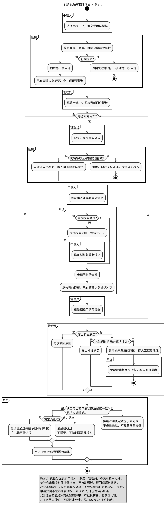

### 6.2 数据采集任务状态图

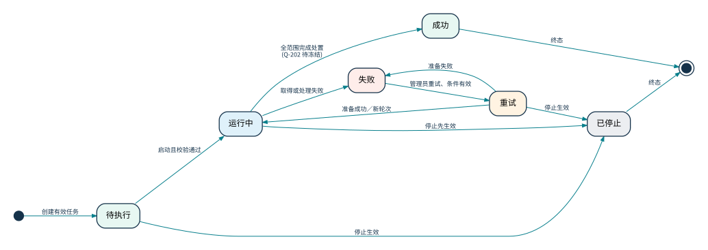

### 6.3 认领申请状态图

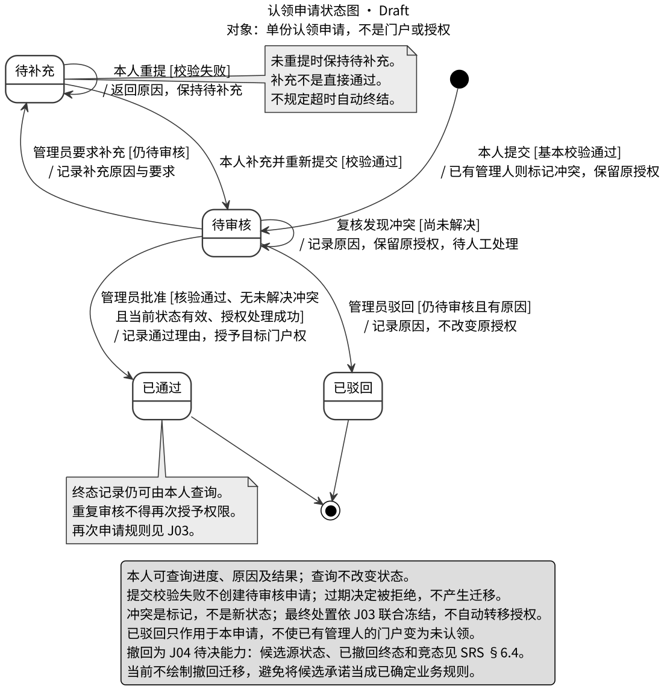

### 6.4 补充模型

统计生效状态仍为Q-2候选模型；时序图仅后续分析参考，不计作本阶段必交。

#### DGM-ACTIVITY-02 DGM-ACTIVITY-02-metrics-refresh

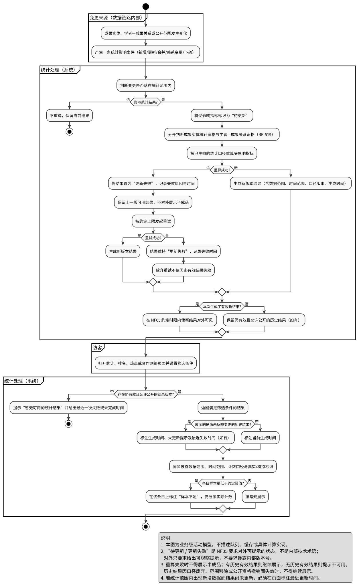

#### DGM-ACTIVITY-03 DGM-ACTIVITY-03-collab-path

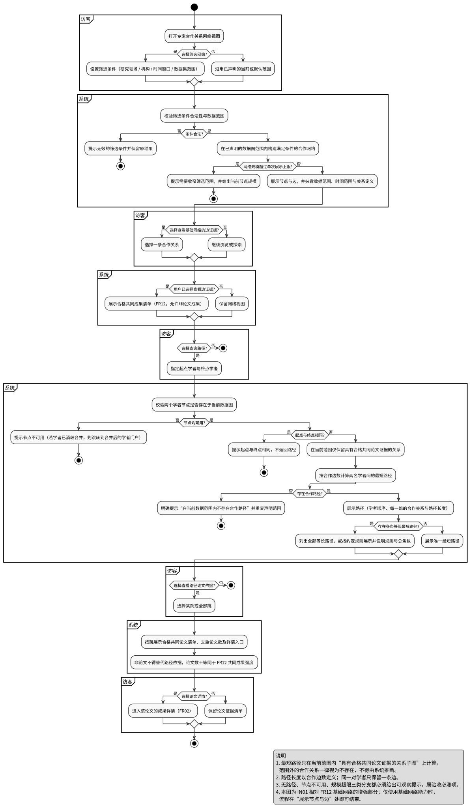

#### DGM-ACTIVITY-04 DGM-ACTIVITY-04-institution-ranking

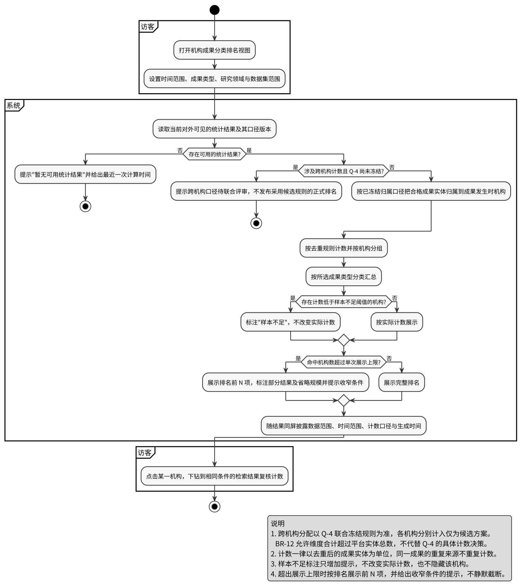

#### DGM-STATE-03 DGM-STATE-03-metrics-visibility

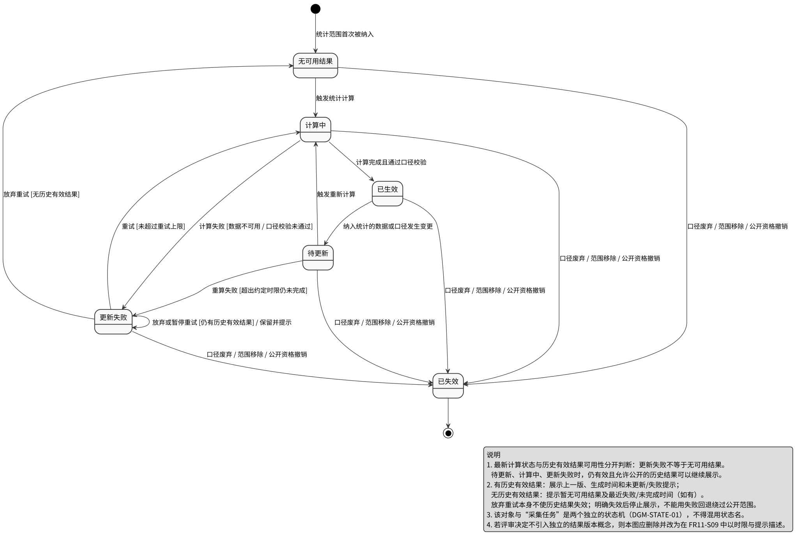

#### DGM-USECASE-02 DGM-USECASE-02-analytics

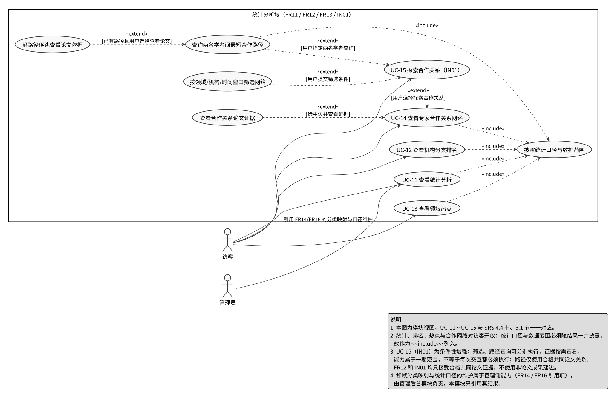

#### DGM-USECASE-03 collection-local-usecase

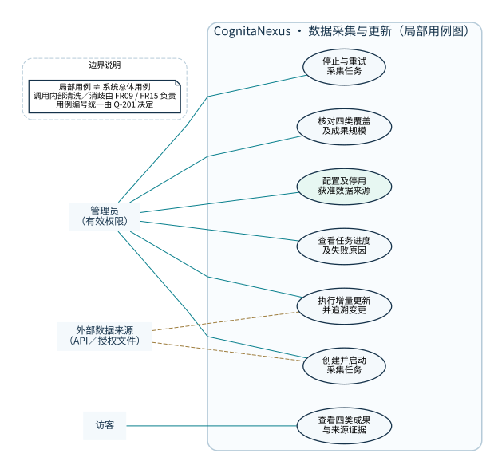

#### DGM-ACTIVITY-05 collection-update-activity

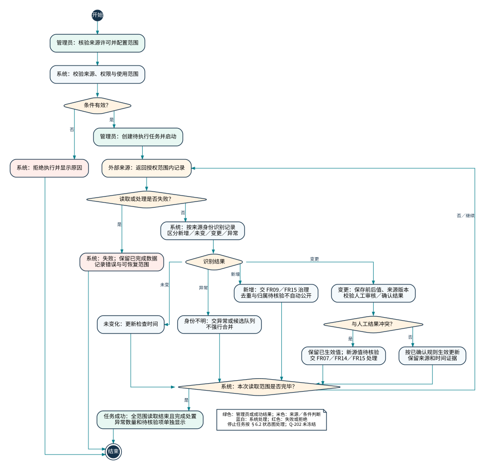

#### DGM-ACTIVITY-08 dedup-candidate-activity


#### DGM-STATE-04 governance-exception-state


#### DGM-ACTIVITY-06 governance-overview-activity


#### DGM-ACTIVITY-07 identity-disambiguation-activity


#### DGM-STATE-05 scholar-achievement-relation-state


### 6.X 双组 UML 图源关系

OvO V0.3 的 `DGM-USECASE-01`、`DGM-STATE-01`、`DGM-STATE-02`、`DGM-ACTIVITY-01` 等引用当前是组二的预留编号，**不是**已验证图源；不得据同号认定图形完全相同。下表保留来源并指向第一组已登记的可审查源图（只是覆盖候选，最终一致性需审图）。

| OvO 引用 | 业务含义/待核对对象 | CognitaNexus 图源 | 审核 |
|---|---|---|---|
| DGM-USECASE-01 | OvO 系统总用例占位 | [overall-usecase.puml](../uml/usecase/overall-usecase.puml) | 待对照 15 个用例 |
| DGM-STATE-01 | 采集任务状态 | [collection-task-state.puml](../uml/collection/collection-task-state.puml) | 核对成功与治理边界 D-04 |
| DGM-STATE-02 | 认领申请状态 | [DGM-STATE-02-claim-request.puml](../uml/claim/DGM-STATE-02-claim-request.puml) | 核对授权争议 D-07 |
| DGM-ACTIVITY-01 | 认领审核活动 | [DGM-ACTIVITY-01-claim-review.puml](../uml/claim/DGM-ACTIVITY-01-claim-review.puml) | 核对状态和权限 |

## 7. 数据需求与业务规则

### 7.1 核心业务对象与状态

| 对象 | 统一表达 | 关键边界 |
| --- | --- | --- |
| 用户账号／学者档案 | 两类独立对象 | 学者档案可先于账号存在；账号登录不自动获得门户管理权 |
| 门户管理授权 | 未认领／已认领 | 一份申请被驳回不撤销他人的生效授权 |
| 单份认领申请 | 待审核／待补充／已通过／已驳回 | 有效补充回到待审核；提交、补充和驳回都不产生管理授权 |
| 学者—成果参与关系 | 自动关联／本人确认／待核验／争议／已排除 | 本人确认必须有本人确认事件；管理员核验单独记录，审核不自动生成本人确认 |
| 成果变更申请 | 待审核／通过／驳回 | 待审版本不覆盖生效公开版本；与认领申请终态用语按各对象区分 |
| 采集任务 | 待执行／运行中／成功／失败／重试／已停止 | 成功按DEC-01判定；不与记录治理状态混用 |
| 异常或待核验处理项 | 待处理／处理中／已处理／已忽略／已转人工复核 | 独立于采集任务，移交后仍可追踪 |
| 成果实体／来源记录／参与关系 | 三种独立对象 | 去重实体一次计数；保留多出处、多作者；解除一条关系不删除实体及他人关系 |
| 来源证据／本人确认／管理员审核 | 三类独立证据 | 不合并为一个“可信”标签；争议保留全部证据 |

无本人确认的待核验／争议关系，经管理员核验归属成立且争议已解决后，按来源建立的关系恢复为自动关联并保留审核证据；有覆盖该关系的有效本人确认时，才可恢复为本人确认。此为DEC-03与FR15-S08证据分离约束的纠错，不新增“管理员审核”状态。


### 7.2 字段语义与公开边界

论文发表时间、专利申请／公开／授权时间、项目起止和获奖年份分别表达，不用采集时间冒充。保留角色、次序、原值、来源、更新时间和真实／模拟标识。专利申请人与发明人不混用；缺失标未知。分类型字段及原始表收入附录成员02／03上下文。

### 7.3 去重规则

稳定标识须同类型且证据相容；标题相似只产生候选，无标识须多证据核验。版本归并须明确依据，实体计数与出处数分开；人工结果不被自动更新覆盖。具体规则见本章规则注册和FR09。

### 7.4 学者消歧与成果归属

姓名相同不足以合并；身份和成果去重独立。认领只授予门户管理权，管理员审核独立留证，不生成本人确认。解除一条关系不删除全局成果及其他参与者关系。

### 7.5 统计口径

DEC-02：有效公开成果按去重实体计数；作者关系资格独立，待核验关系不成边或支持相应机构归属，不连带排除有效成果及其他合格关系。FR12可采用四类共同成果；IN01逐跳仅用共同论文。多机构分配、样本阈值和热点默认指标仍待评审。

### 7.6 数据更新与人工修正

DEC-01：范围读取结束且每条已读取记录有可追踪处置时可成功，人工审核可继续；披露未公开及待核验数。失败或停止保留成功历史；冲突不覆盖公开值；生效一致性按NF05待评审测量范围执行。

### 7.7 全局业务规则

以下为全局唯一语义摘要，分册细化与参数状态按附录保留。编号分配不构成新增功能承诺。

| 编号 | 规则 | 责任来源 |
| --- | --- | --- |
| BR-101 | 普通检索与详情不依赖 O01/O02 是否实施、是否授权或是否成功；推荐失败、行为记录失败不得使 FR01/FR02 不可用。个性化结果不能替代普通检索。 | search-recommendation |
| BR-102 | 检索、详情和推荐只提供平台已收录且允许展示的数据；采用生效的公开关系与版本，不泄露审核材料或未公开信息。来源允许展示且归属证据达到规则要求才公开，冲突进入核验。 | search-recommendation |
| BR-103 | 缺失字段不伪造，未知状态不升级为已确认；不得通过同名、相似标题、当前机构或其他不等价信息补造事实。 | search-recommendation |
| BR-104 | 外部原文不可访问不等于成果不存在。来源失效时保留元数据及更新时间；来源删除、撤稿、外链失败分别表达，一次失败不直接删除成果。 | search-recommendation |
| BR-105 | 审核通过、归属修正和数据更新后，展示与检索应采用已生效信息；正常情况下60秒内与门户、统计一致是 NF05 待评审目标，暂未生效或更新失败须提示。不得让待审版本覆盖公开内容。 | search-recommendation |
| BR-106 | “相似论文”仅表达内容／语义接近，不表示质量、权威性或平台认可研究结论；不以推荐结果直接作出去重合并或归属判定。 | search-recommendation |
| BR-107 | 个性化行为记录与使用须先有本人明确同意；仅处理推荐所需信息。用户可查看、清除本人偏好，清除成功后不得继续以已清除偏好生成后续推荐，不得以立即重建规避清除。 | search-recommendation |
| BR-108 | 统一入口检索成果和学者，结果范围可区分，不要求任何特定界面控件；未认领学者的公开档案仍可检索与访问。 | search-recommendation |
| BR-109 | 适用的类型、年份、领域、机构条件可组合；已接受条件不得静默丢弃，过滤可清除；同维度多选、时间语义与适用性按 A02、A03 冻结。 | search-recommendation |
| BR-110 | 分类浏览使用生效本地分类与来源映射，不能强行归类；允许一成果多领域，下级包含规则须明确；多个来源不生成重复成果结果。 | search-recommendation |
| BR-111 | 成果机构优先采用成果发生时单位，缺失标未知，不静默替换为当前任职机构；学者查询机构口径另按 A03 冻结。 | search-recommendation |
| BR-112 | 排序和分页不改变查询条件含义；固定数据与条件下遍历分页不重复、不遗漏实体；排序并列、缺失与分页边界按 A04 冻结。 | search-recommendation |
| BR-113 | 成功但无匹配与查询执行失败须区分；不自动放宽条件冒充原查询结果，不将旧结果伪装为本次查询成功结果。 | search-recommendation |
| BR-114 | 真实与模拟数据须可区分，模拟不得冒充真实；B §3.3.2 已要求支持过滤，但未指定普通用户搜索页控件或角色。过滤责任与验收必须在 A05 落定。 | search-recommendation |
| BR-115 | 四类成果展示公共与适用专属信息；字段有无、时间语义和参与角色分别表达；数据字段清单不是每条记录的完整性保证。 | search-recommendation |
| BR-116 | 成果与学者导航采用生效且允许公开的关系，不以同名直接关联；无学者关系时可以展示来源参与者名称但不伪造门户导航。 | search-recommendation |
| BR-117 | 来源可追溯，合并后保留的多个公开出处仍可查；时间类型不可混称，缺来源链接不能编造。 | search-recommendation |
| BR-118 | 不保证全文；原站登录、订阅及付费由原站处理；不代理认证、不托管全文、不提供下载代理，不把公开链接解释为可再分发许可。 | search-recommendation |
| BR-119 | 发表、版本、门户认领、学者确认、管理员审核分别表达；业务审核通过不是同行评审或学术质量认证；只有明确来源或审核证据才确认版本关系。 | search-recommendation |
| BR-120 | 引用量是可选信息；有多个来源时分别表达，不求和生成总引用量；项目经费不默认采集或公开。 | search-recommendation |
| BR-121 | O01 全部为 Optional，只针对论文详情；可基于标题、摘要、关键词、领域等内容，不要求论文关系图。 | search-recommendation |
| BR-122 | 相似结果排除当前成果实体本身，不因同一成果多来源而推荐自己；未归并版本及候选关系按 A10 处理，不新增去重规则。 | search-recommendation |
| BR-123 | 内容不足或无候选时不伪造推荐；推荐失败与无候选区分；结果仅引用已有且允许展示的信息。 | search-recommendation |
| BR-124 | O02 全部为 Optional；登录、认领、继续浏览、沉默都不是明确授权；授权不可确认时按未授权处理，未授权行为不得转用个性化。 | search-recommendation |
| BR-125 | 只使用本人授权范围内的近期检索、浏览、收藏等允许行为，不要求实施收藏或完整画像；具体范围与时限须冻结。 | search-recommendation |
| BR-126 | 兴趣以领域／关键词等业务含义及依据类型解释，不混入他人或未授权数据，不推断与推荐无关的敏感属性；数据不足不伪称已有兴趣。 | search-recommendation |
| BR-127 | 用户只能查看／清除本人偏好；清除失败不报告成功，清除与授权撤回语义分开；清除范围、在途结果和旧行为复用边界须按 A09 冻结。 | search-recommendation |
| BR-201 | 来源、获取范围与再展示须获准；停用／条件失效阻断新执行 | collection-update |
| BR-202 | 两个独立来源按提供者或独立集合；同源不同输入方式不重复计 | collection-update |
| BR-203 | 任务快照不可暗改，配置及关键操作记录操作者、时间和变化 | collection-update |
| BR-204 | 六状态、守卫、终态及停止／重试遵循§6.2 | collection-update |
| BR-205 | 失败／停止保留已完成结果，重放不重复成果、业务变更和同版本待办 | collection-update |
| BR-206 | 同源身份及规范化内容判新增／未变／变更，无身份只能候选；无游标说明范围与局限 | collection-update |
| BR-207 | 采集、检查、源更新时间、生效时间分别表达；缺失标未知 | collection-update |
| BR-208 | 不静默覆盖人工确认、排除和审核值；冲突保留原值，交审核；并发生效前复核 | collection-update |
| BR-209 | 四类均有样例，总量按去重实体≥10,000；保留出处，来源／版本不凑数；性质可核对 | collection-update |
| BR-210 | 正常生效结果按NF05在60秒内一致；待核验未生效不替换公开结果，失败有提示 | collection-update |
| BR-211 | 删除、撤稿、外链失败独立，有证据才变更来源状态，单次失败不删除全局成果 | collection-update |
| BR-212 | 类型字段、参与者角色与时间语义独立；未知不编造，不采集非公开敏感字段 | collection-update |
| BR-301 | 同类型稳定标识归一化后完全相等且证据相容，是自动关联既有成果的依据；无标识按FR09-S07的待评审组合条件处理 | governance-dedup |
| BR-302 | 跨来源合并必须保留所有出处 | governance-dedup |
| BR-303 | 无稳定标识时须比较年份、参与者、类型等多项证据 | governance-dedup |
| BR-304 | 不同类型标识不得互相当作同一成果依据 | governance-dedup |
| BR-305 | 标题相似只产生候选，不能单独作为合并依据 | governance-dedup |
| BR-306 | 人工确认或已审核值优先于自动来源值，冲突不得静默覆盖 | governance-dedup |
| BR-307 | 证据不足必须进入待核验，禁止自动合并 | governance-dedup |
| BR-308 | 只有明确来源关系或经审核确认的匹配才能归并版本 | governance-dedup |
| BR-309 | 不同版本不直接增加成果实体总量 | governance-dedup |
| BR-310 | 合并／拆分必须可追溯，保留合并链 | governance-dedup |
| BR-311 | 重复导入、重试与增量重叠不得增加实体或重复计数 | governance-dedup |
| BR-321 | 缺失字段必须显式标明未知，禁止推断填充 | governance-dedup |
| BR-322 | 时间精度与语义必须显式保存 | governance-dedup |
| BR-323 | 无法可靠映射时标注未映射／待分类，禁止强行归类 | governance-dedup |
| BR-324 | 已确认或已审核值不得被自动更新静默覆盖（公共规则） | scholar-disambiguation |
| BR-325 | 来源原始值必须保留并可追溯到来源 | governance-dedup |
| BR-326 | 来源删除、撤回、外链失效分别记录，均不删除成果 | governance-dedup |
| BR-327 | 在NF05约定条件下按待评审60秒目标反映一致结果，失败给出提示（对应 NF05） | scholar-disambiguation |
| BR-341 | 成果实体去重与学者身份合并相互独立，一方证据不足不得连带影响另一方 | scholar-disambiguation |
| BR-342 | 姓名相同不足以判定同一人 | scholar-disambiguation |
| BR-343 | 人员敏感信息不得作为公开消歧依据 | scholar-disambiguation |
| BR-344 | 机构归属优先采用成果发生时的单位，缺失标明未知 | scholar-disambiguation |
| BR-345 | 缩写、译名、相似形式只用于产生候选 | scholar-disambiguation |
| BR-346 | 满足条件（a）外部标识一致或（b）机构＋合作者＋领域支持才可自动合并 | scholar-disambiguation |
| BR-347 | 身份合并必须可追溯，合并后证据为并集 | scholar-disambiguation |
| BR-348 | 争议期间禁止自动合并与自动关联 | scholar-disambiguation |
| BR-349 | 冲突认领不得自动转移原授权；判定不自动改变门户管理权 | scholar-disambiguation |
| BR-350 | 门户认领状态与关系确认状态分别表达 | scholar-disambiguation |
| BR-351 | 认领通过、审核通过均不构成学术质量或真实性认证 | scholar-disambiguation |
| BR-352 | 参与关系必须记录角色与顺序，未知须显式标注 | scholar-disambiguation |
| BR-353 | 同一成果上不同参与者不得合并为一条关系，角色不得混用 | scholar-disambiguation |
| BR-354 | 关系建立必须有可追溯的来源依据 | scholar-disambiguation |
| BR-355 | 来源证据、本人确认、管理员审核是三类独立证据，不得合并为单一标签 | scholar-disambiguation |
| BR-356 | 关系状态五取一，优先级 已排除 > 争议 > 待核验 > 本人确认 > 自动关联 | scholar-disambiguation |
| BR-357 | 纠正后同时保留来源事实与人工修正结论 | scholar-disambiguation |
| BR-358 | 拆分后无法确定的归属必须置为待核验 | scholar-disambiguation |
| BR-359 | 解除个人关联只影响该条关系，不删除成果、出处或他人关系 | scholar-disambiguation |
| BR-360 | 治理结论生效后门户、检索与统计必须一致 | scholar-disambiguation |
| BR-361 | 归属争议期间禁止自动生成新结论 | scholar-disambiguation |
| BR-371 | 不采集手机号、私人邮箱及未公开项目细节作为消歧依据 | scholar-disambiguation |
| BR-381 | 关键治理动作必须留痕 | governance-dedup |
| BR-382 | 历史治理记录只追加不覆盖 | governance-dedup |
| BR-401 | 学者档案可先于账号存在 | scholar-claim |
| BR-402 | 未认领公开门户无需登录可访问 | scholar-claim |
| BR-403 | 门户认领、申请状态、对象授权、成果关系与审核来源分别表达；不得由驳回推导撤销别人授权 | scholar-claim |
| BR-404 | 缺失字段标未知，不编造 | scholar-claim |
| BR-405 | 说明已收录范围，不承诺全球全部成果 | scholar-claim |
| BR-406 | 账号与学者独立，注册不要求已拥有账号 | scholar-claim |
| BR-407 | 操作角色与具体对象授权同时满足才可执行 | scholar-claim |
| BR-408 | 直接受保护请求必须鉴权，前端隐藏不能替代 | scholar-claim |
| BR-409 | 账号状态与会话状态分离；禁用阻止受保护操作；额外状态与会话策略待定 | scholar-claim |
| BR-410 | 认领审核通过仅授予该门户权，不代表法律确权或质量认证 | scholar-claim |
| BR-411 | 冲突认领人工处理，不自动覆盖原授权；未解决不能普通批准 | scholar-claim |
| BR-412 | 待审申请不改变门户公开内容或既有管理授权 | scholar-claim |
| BR-413 | 本人可查申请状态、处理原因、结果及补充要求；审核记录可追溯 | scholar-claim |
| BR-414 | 多证据人工审核；证据方式、字段与边界待冻结，学校邮箱／ORCID／主页／附件仅候选 | scholar-claim |
| BR-415 | 需审核的门户修改通过前不替换公开内容；按冻结字段分类区分直接与待审 | scholar-claim |
| BR-416 | 重要修改与审核保留操作者、时间、关键变化及结果 | scholar-claim |
| BR-417 | 展示设置只控制允许范围，不能公开敏感材料或删除共享成果 | scholar-claim |
| BR-418 | 维护操作持续检查目标授权，无目标权不得写入 | scholar-claim |
| BR-419 | 本人确认只影响所选本人的关系；多人合法作者不是互斥冲突 | scholar-claim |
| BR-420 | 需审核成果变更不提前覆盖公开值；无冲突本人确认不一律待审 | scholar-claim |
| BR-421 | 排除一位学者关系不删全局成果、不改其他合法关系 | scholar-claim |
| BR-422 | 成果操作结果、原因及生效情况可查询可追溯 | scholar-claim |
| BR-423 | 同名或另一作者已确认不足以判定归属；证据不足／真正冲突交核验 | scholar-claim |
| BR-511 | 统计中的"成果数量"均指**去重后的成果实体数量**，不是来源记录条数或版本记录条数 | analytics-graph |
| BR-512 | 学者维度与机构维度的计数合计可分别大于平台成果实体总量；同一成果关联多个领域时在各领域分别计入。该现象必须在口径声明中说明，不得隐藏，也不得为让合计相等而人为去重 | analytics-graph |
| BR-513 | 机构归属取**成果发生时的机构归属**；缺失时标为"机构未知"，不得使用学者当前任职机构代替；"机构未知"不参与机构名次 | analytics-graph |
| BR-514 | 任何统计、排名、热点或网络结果必须与结果同屏披露数据范围、时间范围、计数口径、统计条件与生成时间；模拟数据结果另须标识数据集来源 | analytics-graph |
| BR-515 | 真实数据与模拟数据分开标识、支持过滤；使用模拟数据的结果不得用于描述真实世界的机构排名、热点或合作关系结论 | analytics-graph |
| BR-516 | 同一成果实体的多条来源记录只计一次，且只增加一次关系强度；重试或重复导入不得造成重复计数 | analytics-graph |
| BR-517 | 任意两名学者之间只有一条合作关系边；作者顺序不同、成果不同均不产生新边 | analytics-graph |
| BR-518 | FR12 每条合作关系须可追溯到至少一项合格共同成果；IN01 路径每一跳须有合格共同论文依据，非论文成果不得替代。FR12 共同成果数与 IN01 路径论文证据数分别声明 | analytics-graph |
| BR-519 | 分离成果实体统计资格与学者—成果关系资格（§7.2）：有效公开成果不因部分作者归属待核验而整体退出成果统计；网络仅采用两端均合格的共同成果关联，待核验／争议／已排除关联不成边、不增加强度。实体和关联排除数量分别披露；IN01 路径另限论文 | analytics-graph |
| BR-520 | 计数低于约定阈值 T 的统计条目，或参与成果数量低于 T 的时间点，须标注"样本不足"并仍展示实际计数；不得隐藏、补足或用默认值替代（T 见 Q-1） | analytics-graph |
| BR-521 | 关键词与主题的归一必须基于可查询的规则；规则变更必须触发相关热点结果重算；无法判定时不合并并标注 | analytics-graph |
| BR-522 | 热点指标、关系强度、机构排名均不得被表述或暗示为研究质量、影响力、学术水平或机构优劣的结论；相关页面须固定展示对应声明 | analytics-graph |
| BR-523 | 纳入统计范围的数据或口径变更后，统计、排名、热点与合作网络须在 NF05 约定时限内与检索、门户反映一致结果；未完成或失败时须给出可观察提示并展示上一版可用结果 | analytics-graph |
| BR-524 | IN01 的筛选与最短路径计算只能在已声明的数据图范围内进行；范围外关系视为不存在；不得依据机构、领域、姓名等旁证推断关系 | analytics-graph |
| BR-525 | 路径长度以合作边数定义；存在多条等长最短路径时须全部列出，或按约定规则展示并说明规则与总条数 | analytics-graph |
| BR-526 | 统计、排名、热点、合作网络与路径查询为访客可用的公开能力；访客不得看到待核验／争议关系明细、审核材料、未公开对象与个人敏感字段 | analytics-graph |
| BR-527 | 预印本与正式发表记录被确认同一时按一个成果实体计数；未确认时保留候选关系并分别计数，口径说明给出待确认候选数量 | analytics-graph |
| BR-528 | 统计视图与网络视图须声明单次展示规模上限；超过时提示当前规模并引导收窄；展示子集须标注"部分结果（已声明子集）"，不得描述为完整结果（上限见 Q-6） | analytics-graph |
| BR-529 | 引用量按来源分别展示，不求和生成"总引用量"；本分册任何统计视图若展示引用相关数值须遵守（引用 V1.9 第 5.3 节） | analytics-graph |
| BR-530 | 学者档案被确认合并后，统计、排名、热点与合作网络须使用合并后的学者标识，不得同时保留重复节点，且不得出现自环 | analytics-graph |
| BR-601 | 成果去重保留全部出处，不把来源条数当成果数 | admin-audit |
| BR-602 | 无有效稳定标识只能按多证据候选判定，不得仅凭标题自动合并 | admin-audit |
| BR-603 | 姓名相同不足以自动合并或确认学者归属 | admin-audit |
| BR-604 | 门户授权、认领申请、参与关系及成果变更状态分别表达 | admin-audit |
| BR-605 | 自动更新不得静默覆盖人工确认或审核结果，冲突保留公开版本和来源差异 | admin-audit |
| BR-606 | 来源停用或临时不可用不删除已收录成果，历史数据仍可浏览并标更新时间 | admin-audit |
| BR-608 | 业务审核通过不构成同行评审、学术质量或研究真实性认证 | admin-audit |
| BR-609 | 保留本地分类、来源原分类及映射，无法可靠映射标为待分类 | admin-audit |
| BR-611 | 冲突认领不自动转移管理权，未解决冲突不得普通批准 | admin-audit |
| BR-612 | 公开视图仅展示获准公开的元数据，待核验信息不得冒充已确认；后台受控证据按权限访问 | admin-audit |
| BR-613 | 真实与模拟数据显式标识，不用模拟记录冒充真实科研证据 | admin-audit |
| BR-614 | 数据最小化，认领审核材料受控访问，清理与访问细则待评审 | admin-audit |
| BR-615 | 治理结论生效后展示一致并保留变更记录；60秒仅是NF05约定范围内待评审目标，不是账号权限撤销宽限 | admin-audit |
| BR-616 | O02仅在选择实施且明确同意后使用必要行为，提供本人偏好查看与清除 | admin-audit |


### 7.X OvO 20 条公共 BR 的语义映射（共同候选）

下面的 OvO 原编号**只作为来源别名**；规则定义以第一组全局 BR 注册表及标明待决的业务决议为准。同号不代表同义。

| OvO 原 BR | OvO 定义 | 候选统一 BR | 状态 |
|---|---|---|---|
| BR-01 | 访客只能访问公开信息；审核材料、待审版本和内部治理证据不公开。 | BR-102、BR-612 | 语义映射提议 |
| BR-02 | 用户账号与学者档案分离；档案可在无对应账号时存在。 | BR-401、BR-406 | 语义映射提议 |
| BR-03 | 门户管理权限是对象级授权，只允许管理审核通过的目标门户。 | BR-407、BR-410 | 语义映射提议 |
| BR-04 | 已有管理人的冲突认领不自动转移权限，须进入人工核验。 | BR-411、BR-349 | 语义映射提议 |
| BR-05 | 待审修改不得覆盖当前公开版本；仅审核通过的变更对外生效。 | BR-415、BR-105 | 语义映射提议 |
| BR-06 | 解除某学者与成果的关系不得删除全局成果或其他参与者关系。 | BR-421、BR-359 | 语义映射提议 |
| BR-07 | 每条成果保留来源、来源标识、采集/导入时间和更新时间；跨源合并保留全部出处。 | BR-117、BR-302 | 语义映射提议 |
| BR-08 | 稳定标识归一后优先用于成果去重；仅标题相似不得直接合并。 | BR-301、BR-305 | 语义映射提议 |
| BR-09 | 姓名相同不足以合并学者；证据不足时只生成候选并转人工核验。 | BR-342、BR-345 | 语义映射提议 |
| BR-10 | 自动更新不得静默覆盖已人工确认或审核通过的业务结果。 | BR-306、BR-208 | 语义映射提议 |
| BR-11 | 采集任务至少区分待执行、运行中、成功、失败、重试、已停止；重试不得重复入库。 | BR-204、BR-205 | 语义映射提议 |
| BR-12 | 全平台成果总量按去重后的成果实体计数；来源记录不重复增加总量。 | BR-511、BR-311 | 语义映射提议 |
| BR-13 | 机构统计优先采用成果发生时的机构；缺失时标记未知，不静默使用当前机构。 | BR-513、BR-111 | 语义映射提议 |
| BR-14 | 统计与热点必须披露数据范围、时间范围、筛选条件和计数口径。 | BR-514、BR-526 | 语义映射提议 |
| BR-15 | 合作网络的边必须由共同论文支撑；路径每一跳均可追溯到论文证据。 | BR-518、BR-519 | D-01 冲突：两组并列，待签认 |
| BR-16 | 关键词频次、热点、合作强度和机构排名不代表学术质量评价。 | BR-522 | 语义映射提议 |
| BR-17 | 真实、模拟和混合数据必须显式标识；模拟数据不得用于描述真实世界排名或合作结论。 | BR-515、BR-114 | 语义映射提议 |
| BR-18 | 关键审核、合并、拆分、权限授予和重要修改须记录操作者、时间、前后值和原因。 | BR-381、BR-416 | 语义映射提议 |
| BR-19 | 门户状态、认领申请状态、成果关系状态、成果变更状态和发表状态分别表达。 | BR-403、BR-350 | 语义映射提议 |
| BR-20 | O01/O02 等 Optional 不得成为 FR01～FR16 或 IN01 的前置条件。 | BR-101、BR-121、BR-124 | 语义映射提议 |

## 8. 权限与安全需求

### 8.1 访客权限

仅访问允许公开的成果、学者和统计；不可查看审核附件、凭据、内部处理队列及他人偏好。

### 8.2 登录用户权限

可提交补充并查看本人申请；登录不获得任意门户修改权。

### 8.3 门户管理权限

只维护具体获授权门户；直接修改与需审核字段按待冻结白名单；待审共享字段不能覆盖公开版。

### 8.4 管理员权限

可处理授权范围内待办、配置和审计；不能用审核冒充本人确认、学术认证或未经决议的授权转移。

### 8.5 对象级授权规则

每次受控操作校验角色、账号状态和目标对象；失败不返回受控数据。权限变更生效后后续操作按新权限判定，NF05 60秒数据展示目标不构成权限撤销宽限。材料访问与清理周期保留待评审；详细矩阵及例外已收入附录各成员上下文。

## 9. 非功能需求

NF01～NF08保留原责任条款及AC。度量型模板仅作为Review Candidate变体，未假冒已批准NR-01。NF02/NF05测量条件须先确认；实现、覆盖率、集成及性能验收均为后续活动，当前未执行。

### NF01-S01 免登录完成检索与筛选

**责任来源：** 成员06，nonfunctional分册。

**父需求：** NF01　**类别：** 可用性
- **优先级：** Must
- **需求描述：** 系统应允许访客在无需登录的情况下完成关键词检索与多条件筛选，并进入成果详情或学者门户。
- **度量指标与测量条件：** 未登录状态下可完成的流程步骤：检索 → 筛选 → 详情/门户 → 来源入口；全程不出现登录要求。
- **验收条件：**
  - AC-NF01-S01-01：Given 未登录访客 When 访问检索入口并提交关键词与筛选条件 Then 返回结果或明确的无结果提示，且不要求登录。
  - AC-NF01-S01-02：Given 未登录访客 When 从结果进入成果详情或学者门户 Then 页面正常展示，不跳转到登录页。
- **验证方式：** 未登录状态的端到端操作记录（含无结果与筛选场景）。
- **关联项：** FR01、FR02、FR03；UC-01、UC-02、UC-03；BR-612。


#### 双组共同补充验收与规范来源（Review Candidate）

**OvO 语义细化与对应关系：**

- OvO `NF01-S01` → `NF01-S01`、`NF01-S02`（REFINEMENT）：免登录公开主流程扩展至详情门户统计。

**补充验收条件：**

- **AC-NF01-S01-03（OvO `AC-NF01-S01-01`）**：Given 未登录且甲未认领，When 检索P打开P与甲并查看统计，Then 四个动作均无需登录。 
  - *来源裁决：NEW_REQUIRED_CASE；原父需求 NF01-S01，共同主目标 NF01-S01；待两组评审。*
- **AC-NF01-S01-04（OvO `AC-NF01-S01-02`）**：Given 本条 E1 的异常输入或条件，When 执行主流程触发动作，Then 公开详情不能因门户未认领而拒绝访问。 
  - *来源裁决：NEW_REQUIRED_CASE；原父需求 NF01-S01，共同主目标 NF01-S01；待两组评审。*

以上增补保留第一组原验收文本与编号。原始 OvO AC 对照请查 [逐条双向验收映射](integration/shared-ac-resolution-v1.0-rc.md)，标记并不等于实测 PASS。

### NF01-S02 状态反馈完备

**责任来源：** 成员06，nonfunctional分册。

**父需求：** NF01　**类别：** 可用性
- **优先级：** Must
- **需求描述：** 系统应对加载中、无结果、查询失败、权限不足四类情形给出可区分的反馈；不得把失败显示为“无结果”。
- **度量指标与测量条件：** 四类反馈各自出现的场景与文案可区分；查询失败时必须同时提供重试入口。
- **验收条件：**
  - AC-NF01-S02-01：Given 查询执行失败 When 查看结果区域 Then 显示失败反馈与重试入口，且不显示“无结果”。
  - AC-NF01-S02-02：Given 无任何匹配结果 When 查看结果区域 Then 显示无结果提示及可尝试的调整建议。
  - AC-NF01-S02-03：Given 用户无权访问某受保护内容 When 发起访问 Then 返回权限不足反馈，且不返回受保护数据。
- **验证方式：** 四类场景的界面与响应记录。
- **关联项：** FR01；UC-01、UC-17；FR04-S04／FR14-S09。


#### 双组共同补充验收与规范来源（Review Candidate）

**OvO 语义细化与对应关系：**

- OvO `NF01-S01` → `NF01-S01`、`NF01-S02`（REFINEMENT）：免登录公开主流程扩展至详情门户统计。
- OvO `NF01-S02` → `NF01-S02`（EQUIVALENT）：各反馈状态必须可区分。

**补充验收条件：**

- **AC-NF01-S02-04（OvO `AC-NF01-S02-01`）**：Given 合法查询超时，When 观察反馈，Then 显示失败和重试；成功零条场景显示无匹配和修改条件。 
  - *来源裁决：ENHANCED_CASE；原父需求 NF01-S02，共同主目标 NF01-S02；待两组评审。*
- **AC-NF01-S02-05（OvO `AC-NF01-S02-02`）**：Given 本条 E1 的异常输入或条件，When 执行主流程触发动作，Then 失败时不得把旧数据标成最新或显示成功零条。 
  - *来源裁决：NEW_REQUIRED_CASE；原父需求 NF01-S02，共同主目标 NF01-S02；待两组评审。*

以上增补保留第一组原验收文本与编号。原始 OvO AC 对照请查 [逐条双向验收映射](integration/shared-ac-resolution-v1.0-rc.md)，标记并不等于实测 PASS。

### NF01-S03 过滤可清除与表单缺失项提示

**责任来源：** 成员06，nonfunctional分册。

**父需求：** NF01　**类别：** 可用性
- **优先级：** Must
- **需求描述：** 系统应允许清除单个或全部过滤条件，并在表单提交时指出缺失项。
- **度量指标与测量条件：** 任一筛选条件可单独清除；清除后结果按剩余条件刷新；必填项缺失时提示到具体字段。
- **验收条件：**
  - AC-NF01-S03-01：Given 已应用多个筛选条件 When 清除其中一个 Then 结果按剩余条件刷新，其余条件保持。
  - AC-NF01-S03-02：Given 表单存在必填项未填 When 提交 Then 指出具体缺失项且不提交。
- **验证方式：** 筛选清除与表单校验的场景记录。
- **关联项：** FR01；UC-01、UC-05、UC-07。


#### 双组共同补充验收与规范来源（Review Candidate）

**OvO 语义细化与对应关系：**

- OvO `NF01-S03` → `NF01-S03`（EQUIVALENT）：筛选清除及表单错误提示。

**补充验收条件：**

- **AC-NF01-S03-03（OvO `AC-NF01-S03-01`）**：Given 认领表单目标有效但声明缺失，When 提交并勾选声明再提交，Then 首次指出声明缺失且保留目标，第二次可送审。 
  - *来源裁决：ENHANCED_CASE；原父需求 NF01-S03，共同主目标 NF01-S03；待两组评审。*
- **AC-NF01-S03-04（OvO `AC-NF01-S03-02`）**：Given 本条 E1 的异常输入或条件，When 执行主流程触发动作，Then 不能只显示笼统失败而不指明可修正项。 
  - *来源裁决：NEW_REQUIRED_CASE；原父需求 NF01-S03，共同主目标 NF01-S03；待两组评审。*

以上增补保留第一组原验收文本与编号。原始 OvO AC 对照请查 [逐条双向验收映射](integration/shared-ac-resolution-v1.0-rc.md)，标记并不等于实测 PASS。

### NF01-S04 依赖不可用时的降级可用

**责任来源：** 成员06，nonfunctional分册。

**父需求：** NF01　**类别：** 可用性
- **优先级：** Must
- **需求描述：** 外部来源或统计组件不可用时，已收录数据的检索、详情与门户浏览仍可用，并显示数据更新时间。
- **度量指标与测量条件：** 在来源不可用或统计不可用的条件下，检索与门户主流程仍可完成。
- **验收条件：**
  - AC-NF01-S04-01：Given 外部来源不可用 When 访客检索已收录成果 Then 返回结果并显示数据更新时间。
  - AC-NF01-S04-02：Given 统计组件不可用 When 打开学者门户 Then 门户基本信息与成果列表仍可浏览。
- **验证方式：** 依赖不可用条件下的降级场景记录。
- **关联项：** FR02、FR03；UC-02、UC-03、UC-11；BR-606、NF04。

### NF02-S01 检索响应时间目标

**责任来源：** 成员06，nonfunctional分册。

**父需求：** NF02　**类别：** 性能
- **优先级：** Must
- **需求描述：** 在约定测试条件下，普通检索请求的响应时间应满足约定阈值。
- **度量指标与测量条件：** 数据规模 ≥ 1 万条成果；10 个并发查询用户；固定查询集；预热后持续 5 分钟；记录硬件与资源配置；**目标值（待评审）：检索接口 P95 ≤ 2 秒**。
- **验收条件：**
  - AC-NF02-S01-01：Given 1 万条成果、10 个并发查询用户、固定查询集、预热后持续 5 分钟的约定环境 When 执行检索请求 Then P95 响应时间 ≤ 2 秒且错误率记录在测试报告中（目标值待评审，冻结后即生效）。
  - AC-NF02-S01-02：Given 同一测试条件 When 重复测量 Then 两次结果的测试条件与数据规模一致且可对比。
- **验证方式：** 性能测试报告（环境、数据规模、查询集、并发数、持续时间、P95、错误率）。
- **关联项：** FR01；UC-01；NF02测量条件。


#### 双组共同补充验收与规范来源（Review Candidate）

**补充验收条件：**

- **AC-NF02-S01-03（OvO `AC-NF02-S01-02`）**：Given 本条 E1 的异常输入或条件，When 执行主流程触发动作，Then 无原始记录或遗漏失败请求时不可判定通过；不能仅汇报平均值。 
  - *来源裁决：NEW_REQUIRED_CASE；原父需求 NF02-S01，共同主目标 NF02-S01；待两组评审。*

以上增补保留第一组原验收文本与编号。原始 OvO AC 对照请查 [逐条双向验收映射](integration/shared-ac-resolution-v1.0-rc.md)，标记并不等于实测 PASS。

### NF02-S02 测量条件与记录

**责任来源：** 成员06，nonfunctional分册。

**父需求：** NF02　**类别：** 性能
- **优先级：** Must
- **需求描述：** 系统性能验收必须伴随可复核的测量记录。
- **度量指标与测量条件：** 每次测量记录：硬件与资源规格、数据规模、查询集、并发数、持续时间、预热方式、P95、错误率、测试日期。
- **验收条件：**
  - AC-NF02-S02-01：Given 一次性能测量 When 提交验收证据 Then 上述字段全部可查，其中任一缺失即视为证据不完整。
  - AC-NF02-S02-02：Given 使用模拟数据参与测量 When 报告结论 Then 明确标注真实／模拟数据构成（BR-613）。
- **验证方式：** 测试报告与原始记录核对。
- **关联项：** NF02；NF02测量条件、BR-613。

### NF02-S03 指标冻结流程

**责任来源：** 成员06，nonfunctional分册。

**父需求：** NF02　**类别：** 性能
- **优先级：** Must
- **需求描述：** 性能指标须先通过小规模基准测试确认可行性，再冻结为验收目标。
- **度量指标与测量条件：** 冻结前存在至少一次基准测试记录；冻结后指标不再随测量结果调整。
- **验收条件：**
  - AC-NF02-S03-01：Given 尚未完成基准测试 When 声称性能达标 Then 该结论不被接受（目标值仍为待评审）。
  - AC-NF02-S03-02：Given 已完成基准测试 When 冻结指标 Then 记录冻结日期、测量条件与结论。
- **验证方式：** 基准测试记录与指标冻结记录。
- **关联项：** NF02；NF02测量条件。

### NF02-S04 管理后台与统计查询的响应约定

**责任来源：** 成员06，nonfunctional分册。

**父需求：** NF02　**类别：** 性能
- **优先级：** Must
- **需求描述：** 管理后台列表与统计查询不在 NF02-S01 的 P95 目标范围内，但必须给出可观察的加载反馈，不得无限等待。
- **度量指标与测量条件：** 任一超过约定等待时间的后台或统计请求显示加载状态；失败时给出失败反馈与重试方式。
- **验收条件：**
  - AC-NF02-S04-01：Given 管理后台列表查询耗时较长 When 用户等待 Then 显示加载状态，超时后显示失败反馈与重试入口。
  - AC-NF02-S04-02：Given 统计查询失败 When 查看结果区 Then 显示失败反馈，不显示空结果冒充成功。
- **验证方式：** 后台与统计的加载／超时场景记录。
- **关联项：** FR11～FR14；UC-11、UC-17；统计模块Q-11及JR-P1-07。


#### 双组共同补充验收与规范来源（Review Candidate）

**OvO 语义细化与对应关系：**

- OvO `NF02-S02` → `NF02-S04`（EQUIVALENT）：其他操作不自动套用普通检索SLO。

**补充验收条件：**

- **AC-NF02-S04-03（OvO `AC-NF02-S02-01`）**：Given 检索P95为1秒但网络为5秒，When 出报告，Then 两种结果分列，网络不能被检索平均值掩盖。 
  - *来源裁决：NEW_REQUIRED_CASE；原父需求 NF02-S02，共同主目标 NF02-S04；待两组评审。*

以上增补保留第一组原验收文本与编号。原始 OvO AC 对照请查 [逐条双向验收映射](integration/shared-ac-resolution-v1.0-rc.md)，标记并不等于实测 PASS。

### NF03-S01 凭据保护

**责任来源：** 成员06，nonfunctional分册。

**父需求：** NF03　**类别：** 安全
- **优先级：** Must
- **需求描述：** 登录凭据不得以可还原形式对外暴露，也不得在响应、提示或页面中回显。
- **度量指标与测量条件：** 注册、登录、修改、错误提示四类响应中均不包含凭据内容；受保护内容不因缺少授权而返回。
- **验收条件：**
  - AC-NF03-S01-01：Given 一次登录失败 When 查看响应与提示 Then 不含凭据内容，且提示不区分账号是否存在。
  - AC-NF03-S01-02：Given 非授权用户 When 请求受保护数据 Then 拒绝返回数据内容。
- **验证方式：** 响应与提示内容检查记录。
- **关联项：** FR04；UC-04；FR04-S04／FR14-S09、FR04账号状态约束、FR04登录安全约束。


#### 双组共同补充验收与规范来源（Review Candidate）

**OvO 语义细化与对应关系：**

- OvO `NF03-S01` → `NF03-S01`、`NF03-S03`（REFINEMENT）：凭据保护与材料非公开分项。

**补充验收条件：**

- **AC-NF03-S01-03（OvO `AC-NF03-S01-02`）**：Given 本条 E1 的异常输入或条件，When 执行主流程触发动作，Then 无权响应正文和错误信息均不得包含材料片段。 
  - *来源裁决：NEW_REQUIRED_CASE；原父需求 NF03-S01，共同主目标 NF03-S01；待两组评审。*

以上增补保留第一组原验收文本与编号。原始 OvO AC 对照请查 [逐条双向验收映射](integration/shared-ac-resolution-v1.0-rc.md)，标记并不等于实测 PASS。

### NF03-S02 角色与对象级授权

**责任来源：** 成员06，nonfunctional分册。

**父需求：** NF03　**类别：** 安全
- **优先级：** Must
- **需求描述：** 所有受保护操作由服务端依据“角色 + 对象级授权 + 对象状态”判定；前端隐藏入口不能替代鉴权。
- **度量指标与测量条件：** 覆盖访客、登录用户、门户管理者（本人／他人门户）、管理员、停用账号五类主体的权限测试。
- **验收条件：**
  - AC-NF03-S02-01：Given 普通登录用户 When 直接请求修改他人门户的数据操作 Then 服务端拒绝且不产生数据变更。
  - AC-NF03-S02-02：Given 停用账号 When 登录或执行门户管理操作 Then 被拒绝。
  - AC-NF03-S02-03：Given 非管理员 When 请求管理功能 Then 全部被拒绝。
- **验证方式：** 权限测试用例与结果记录（见 对应负责分册的权限矩阵）。
- **关联项：** FR04、FR05、FR06、FR07、FR14；UC-04、UC-07、UC-17；FR04、FR06～FR07及FR14对象级权限规则。


#### 双组共同补充验收与规范来源（Review Candidate）

**OvO 语义细化与对应关系：**

- OvO `NF03-S02` → `NF03-S02`、`NF03-S04`（REFINEMENT）：角色和对象授权及越权检查分项。

**补充验收条件：**

- **AC-NF03-S02-04（OvO `AC-NF03-S02-01`）**：Given U仅管理甲，When 修改乙并提交后台合并，Then 两者拒绝，乙内容与全局成果数不变。 
  - *来源裁决：NEW_REQUIRED_CASE；原父需求 NF03-S02，共同主目标 NF03-S02；待两组评审。*
- **AC-NF03-S02-05（OvO `AC-NF03-S02-02`）**：Given 本条 E1 的异常输入或条件，When 执行主流程触发动作，Then 乙或后台任一越权成功均判定失败。 
  - *来源裁决：NEW_REQUIRED_CASE；原父需求 NF03-S02，共同主目标 NF03-S02；待两组评审。*
- **AC-NF03-S02-06（OvO `AC-NF03-S02-03`）**：Given 本条 A1 的备选条件，When 执行对应分支，Then 公开读取仍允许。 
  - *来源裁决：NEW_REQUIRED_CASE；原父需求 NF03-S02，共同主目标 NF03-S02；待两组评审。*

以上增补保留第一组原验收文本与编号。原始 OvO AC 对照请查 [逐条双向验收映射](integration/shared-ac-resolution-v1.0-rc.md)，标记并不等于实测 PASS。

### NF03-S03 受控审核材料保护

**责任来源：** 成员06，nonfunctional分册。

**父需求：** NF03　**类别：** 安全
- **优先级：** Must
- **需求描述：** 认领材料等受控审核材料的访问范围限于申请人本人与管理员，并设置访问与清理规则。
- **度量指标与测量条件：** 非授权角色访问返回拒绝且不返回材料内容；材料访问与清理行为可追溯。
- **验收条件：**
  - AC-NF03-S03-01：Given 其他登录用户或门户管理者 When 请求他人认领材料 Then 被拒绝且不返回内容。
  - AC-NF03-S03-02：Given 管理员查看材料 When 记录访问 Then 可追溯到操作者与时间。
  - AC-NF03-S03-03：Given 材料达到约定的清理条件 When 执行清理 Then 材料按规则处理且申请状态与审核结论不受影响。
- **验证方式：** 材料访问控制与清理场景记录。
- **关联项：** FR05、FR14；UC-05、UC-06；BR-614、门户模块J03、J07。


#### 双组共同补充验收与规范来源（Review Candidate）

**OvO 语义细化与对应关系：**

- OvO `NF03-S01` → `NF03-S01`、`NF03-S03`（REFINEMENT）：凭据保护与材料非公开分项。

**补充验收条件：**

- **AC-NF03-S03-04（OvO `AC-NF03-S01-01`）**：Given U申请材料X，When V和匿名用户直接读取X，Then 两者均拒绝且返回不含X内容。 
  - *来源裁决：ENHANCED_CASE；原父需求 NF03-S01，共同主目标 NF03-S03；待两组评审。*

以上增补保留第一组原验收文本与编号。原始 OvO AC 对照请查 [逐条双向验收映射](integration/shared-ac-resolution-v1.0-rc.md)，标记并不等于实测 PASS。

### NF03-S04 越权与安全检查要求

**责任来源：** 成员06，nonfunctional分册。

**父需求：** NF03　**类别：** 安全
- **优先级：** Must
- **需求描述：** 交付前须完成至少一轮覆盖关键越权路径的检查。
- **度量指标与测量条件：** 检查至少覆盖：跨用户修改、他人材料访问、非管理员管理操作、停用账号操作、未登录受保护操作。
- **验收条件：**
  - AC-NF03-S04-01：Given 上述五类越权路径 When 执行检查 Then 全部被拒绝并留有记录。
  - AC-NF03-S04-02：Given 检查结果 When 提交验收 Then 列出未通过项与修复状态，未通过项不得标记为通过。
- **验证方式：** 安全检查清单与结果。
- **关联项：** NF03；FR04～FR07、FR14。


#### 双组共同补充验收与规范来源（Review Candidate）

**OvO 语义细化与对应关系：**

- OvO `NF03-S02` → `NF03-S02`、`NF03-S04`（REFINEMENT）：角色和对象授权及越权检查分项。

以上增补保留第一组原验收文本与编号。原始 OvO AC 对照请查 [逐条双向验收映射](integration/shared-ac-resolution-v1.0-rc.md)，标记并不等于实测 PASS。

### NF03-S05 安全措施实现细化位置

**责任来源：** 成员06，nonfunctional分册。

**父需求：** NF03　**类别：** 安全
- **优先级：** Must
- **需求描述：** 密码策略、会话管理、传输保护等具体安全措施属于 SPEC 与架构范围；本文只要求其可观察结果（拒绝、留痕、不泄露）。
- **度量指标与测量条件：** 本文不出现具体安全技术选型；SPEC 中列出的措施可追溯到本章条目。
- **验收条件：**
  - AC-NF03-S05-01：Given 安全 SPEC When 评审 Then 每条措施可追溯到 NF03-S01～S04 中的至少一条。
- **验证方式：** SPEC 与本章的对应关系检查。
- **关联项：** NF03；R3 §18。

### NF04-S01 来源不可用时的可用性

**责任来源：** 成员06，nonfunctional分册。

**父需求：** NF04　**类别：** 可靠性
- **优先级：** Must
- **需求描述：** 外部来源暂时不可用时，已收录数据仍可浏览，并显示数据更新时间。
- **度量指标与测量条件：** 在来源不可用或采集失败条件下，检索、详情与门户浏览均不受阻。
- **验收条件：**
  - AC-NF04-S01-01：Given 某来源不可用 When 访客检索该来源已收录的成果 Then 结果正常返回并显示数据更新时间与来源状态。
  - AC-NF04-S01-02：Given 来源不可用 When 查看学者门户 Then 门户仍可访问且不显示伪造的更新信息。
- **验证方式：** 来源不可用条件下的浏览记录。
- **关联项：** FR02、FR03、FR16；UC-02、UC-03；BR-606。


#### 双组共同补充验收与规范来源（Review Candidate）

**OvO 语义细化与对应关系：**

- OvO `FR16-S05` → `FR16-S02`、`NF04-S01`（REFINEMENT）：来源离线时保留历史浏览及最后更新时间。
- OvO `NF04-S01` → `NF04-S01`、`NF04-S02`（REFINEMENT）：外源不可用降级与任务恢复分项。

**补充验收条件：**

- **AC-NF04-S01-03（OvO `AC-FR16-S05-03`）**：Given 本条 A1 的备选条件，When 执行对应分支，Then 原站恢复后更新链接状态。 
  - *来源裁决：NEW_REQUIRED_CASE；原父需求 FR16-S05，共同主目标 NF04-S01；待两组评审。*
- **AC-NF04-S01-04（OvO `AC-NF04-S01-01`）**：Given 100条任务已完成60条后断源，When 读历史并恢复剩余，Then 前60条可读，最终总量100且无重复。 
  - *来源裁决：NEW_REQUIRED_CASE；原父需求 NF04-S01，共同主目标 NF04-S01；待两组评审。*
- **AC-NF04-S01-05（OvO `AC-NF04-S01-02`）**：Given 本条 E1 的异常输入或条件，When 执行主流程触发动作，Then 不得因外部访问失败删除已保存历史。 
  - *来源裁决：NEW_REQUIRED_CASE；原父需求 NF04-S01，共同主目标 NF04-S01；待两组评审。*

以上增补保留第一组原验收文本与编号。原始 OvO AC 对照请查 [逐条双向验收映射](integration/shared-ac-resolution-v1.0-rc.md)，标记并不等于实测 PASS。

### NF04-S02 失败任务可恢复且不重复

**责任来源：** 成员06，nonfunctional分册。

**父需求：** NF04　**类别：** 可靠性
- **优先级：** Must
- **需求描述：** 失败任务可恢复处理，重复处理不产生重复成果。
- **度量指标与测量条件：** 失败 → 重试／恢复 → 完成的完整链路可复现；恢复后成果总量与去重前一致（不新增重复实体）。
- **验收条件：**
  - AC-NF04-S02-01：Given 一个失败任务 When 发起重试并完成 Then 任务状态正确迁移，失败原因与处理结果可查。
  - AC-NF04-S02-02：Given 同一批数据被重复处理 When 对比成果总量与来源记录数 Then 成果实体总量不增加，来源记录保留全部出处。
- **验证方式：** 失败恢复与重复处理的核对记录。
- **关联项：** FR08、FR09、FR10；UC-18、UC-09、UC-19；BR-601、BR-602、采集模块Q-202。


#### 双组共同补充验收与规范来源（Review Candidate）

**OvO 语义细化与对应关系：**

- OvO `NF04-S01` → `NF04-S01`、`NF04-S02`（REFINEMENT）：外源不可用降级与任务恢复分项。

**补充验收条件：**

- **AC-NF04-S02-03（OvO `AC-NF04-S01-03`）**：Given 本条 A1 的备选条件，When 执行对应分支，Then 持续来源故障保持失败并给出原因。 
  - *来源裁决：NEW_REQUIRED_CASE；原父需求 NF04-S01，共同主目标 NF04-S02；待两组评审。*

以上增补保留第一组原验收文本与编号。原始 OvO AC 对照请查 [逐条双向验收映射](integration/shared-ac-resolution-v1.0-rc.md)，标记并不等于实测 PASS。

### NF04-S03 备份恢复核验

**责任来源：** 成员06，nonfunctional分册。

**父需求：** NF04　**类别：** 可靠性
- **优先级：** Must
- **需求描述：** 一期至少完成一次备份与恢复核验。
- **度量指标与测量条件：** 核验记录包含：备份范围、恢复步骤、恢复后数据一致性核对结果（成果总量、四类样例、关联关系）。
- **验收条件：**
  - AC-NF04-S03-01：Given 已完成一次备份 When 执行恢复核验 Then 恢复后成果总量与四类样例可核对，且不产生重复成果。
  - AC-NF04-S03-02：Given 核验过程 When 提交证据 Then 步骤、时间与结果可追溯。
- **验证方式：** 备份恢复核验记录。
- **关联项：** NF04；FR16、FR14。


#### 双组共同补充验收与规范来源（Review Candidate）

**OvO 语义细化与对应关系：**

- OvO `NF04-S02` → `NF04-S03`（EQUIVALENT）：备份恢复核验须记录结果。

**补充验收条件：**

- **AC-NF04-S03-03（OvO `AC-NF04-S02-01`）**：Given 备份含P及两个来源和甲P关系，When 恢复并核对，Then P、两个来源和甲P关系均存在且可追溯。 
  - *来源裁决：NEW_REQUIRED_CASE；原父需求 NF04-S02，共同主目标 NF04-S03；待两组评审。*
- **AC-NF04-S03-04（OvO `AC-NF04-S02-02`）**：Given 本条 E1 的异常输入或条件，When 执行主流程触发动作，Then 仅存在备份文件不能算恢复核验完成。 
  - *来源裁决：ENHANCED_CASE；原父需求 NF04-S02，共同主目标 NF04-S03；待两组评审。*

以上增补保留第一组原验收文本与编号。原始 OvO AC 对照请查 [逐条双向验收映射](integration/shared-ac-resolution-v1.0-rc.md)，标记并不等于实测 PASS。

### NF05-S01 生效时限目标

**责任来源：** 成员06，nonfunctional分册。

**父需求：** NF05　**类别：** 一致性
- **优先级：** Must
- **需求描述：** 审核通过或数据更新后，正常情况下应在 60 秒内在检索、门户与统计中反映一致结果。
- **度量指标与测量条件：** 从“审核通过／更新完成”到三处展示一致的耗时；测量条件与数据规模记录在测试报告中；**60 秒为待评审目标**。
- **验收条件：**
  - AC-NF05-S01-01：Given 一次认领或成果变更审核通过 When 在 60 秒内分别查看门户、检索与统计 Then 三处结果一致（目标值待评审，冻结后即生效）。
  - AC-NF05-S01-02：Given 一次数据更新完成 When 在 60 秒内查看相关展示 Then 更新后的结果可见且与已确认数据一致。
  - AC-NF05-S01-03：Given 超过约定时限仍不一致 When 检查系统 Then 可观察到未生效或失败的提示（见 NF05-S03），不得静默不一致。
- **验证方式：** 一致性测试记录（时间戳、三处结果截图或记录）。
- **关联项：** FR06、FR07、FR10、FR11、FR15；UC-08、UC-11；BR-615。


#### 双组共同补充验收与规范来源（Review Candidate）

**OvO 语义细化与对应关系：**

- OvO `FR10-S06` → `FR10-S02`、`NF05-S01`（REFINEMENT）：生效传播含一致性时限跨模块。

**补充验收条件：**

- **AC-NF05-S01-04（OvO `AC-FR10-S06-01`）**：Given P从领域甲核准转乙，When 同步后分别查询两个领域，Then 甲不再含P，乙含P且详情门户一致。 
  - *来源裁决：NEW_REQUIRED_CASE；原父需求 FR10-S06，共同主目标 NF05-S01；待两组评审。*
- **AC-NF05-S01-05（OvO `AC-FR10-S06-02`）**：Given 本条 E1 的异常输入或条件，When 执行主流程触发动作，Then 超出NF05候选目标时显式记录超时，不宣称一致。 
  - *来源裁决：ENHANCED_CASE；原父需求 FR10-S06，共同主目标 NF05-S01；待两组评审。*

以上增补保留第一组原验收文本与编号。原始 OvO AC 对照请查 [逐条双向验收映射](integration/shared-ac-resolution-v1.0-rc.md)，标记并不等于实测 PASS。

### NF05-S02 确认与修改记录保留

**责任来源：** 成员06，nonfunctional分册。

**父需求：** NF05　**类别：** 一致性／可追溯
- **优先级：** Must
- **需求描述：** 系统应保留成果确认与修改的记录，可追溯操作者、时间与关键变化。
- **度量指标与测量条件：** 每条确认或修改记录包含：对象、操作者、时间、变化前后关键值、来源或依据。
- **验收条件：**
  - AC-NF05-S02-01：Given 一次成果确认或字段修改 When 查询该对象记录 Then 可看到操作者、时间与关键变化。
  - AC-NF05-S02-02：Given 一次驳回 When 查询记录 Then 保留驳回原因且公开内容未被替换。
- **验证方式：** 记录查询场景与审计记录核对。
- **关联项：** FR07、FR14；UC-08、UC-17；BR-605、治理结果生效与NF05待评审测量条件。


#### 双组共同补充验收与规范来源（Review Candidate）

**OvO 语义细化与对应关系：**

- OvO `NF05-S02` → `NF05-S02`（EQUIVALENT）：确认审核合并拆分留痕。

**补充验收条件：**

- **AC-NF05-S02-03（OvO `AC-NF05-S02-01`）**：Given P先合并再拆分，When 查询P关联审计，Then 两事件均保留且能还原各自来源归属。 
  - *来源裁决：NEW_REQUIRED_CASE；原父需求 NF05-S02，共同主目标 NF05-S02；待两组评审。*
- **AC-NF05-S02-04（OvO `AC-NF05-S02-02`）**：Given 本条 E1 的异常输入或条件，When 执行主流程触发动作，Then 仅记录成功字样没有对象前后值不算满足。 
  - *来源裁决：NEW_REQUIRED_CASE；原父需求 NF05-S02，共同主目标 NF05-S02；待两组评审。*

以上增补保留第一组原验收文本与编号。原始 OvO AC 对照请查 [逐条双向验收映射](integration/shared-ac-resolution-v1.0-rc.md)，标记并不等于实测 PASS。

### NF05-S03 未生效与失败提示

**责任来源：** 成员06，nonfunctional分册。

**父需求：** NF05　**类别：** 一致性
- **优先级：** Must
- **需求描述：** 变更暂未生效或更新失败时，系统应给出可观察提示，而不是让用户面对不一致结果。
- **度量指标与测量条件：** 未生效与失败两类情形均有明确提示文案与处理入口。
- **验收条件：**
  - AC-NF05-S03-01：Given 变更为待审核状态 When 查看公开页面 Then 仍显示原内容，且管理入口显示待审核状态。
  - AC-NF05-S03-02：Given 更新失败 When 查看相关对象 Then 显示失败提示与恢复入口。
- **验证方式：** 待审与失败场景记录。
- **关联项：** FR06、FR07、FR10；UC-07、UC-08、UC-19；治理结果生效与NF05待评审测量条件。

### NF06-S01 不采集敏感字段

**责任来源：** 成员06，nonfunctional分册。

**父需求：** NF06　**类别：** 隐私
- **优先级：** Must
- **需求描述：** 系统不采集手机号、私人邮箱、未公开项目细节与经费等字段。
- **度量指标与测量条件：** 对成果、学者、账号与申请四类对象的字段清单逐项核对，不含上述字段。
- **验收条件：**
  - AC-NF06-S01-01：Given 学者档案与成果详情 When 检查可展示与可采集字段 Then 不含手机号、私人邮箱、未公开项目细节与经费。
  - AC-NF06-S01-02：Given 来源数据包含上述字段 When 入库 Then 字段不予采集或不予公开，并在验收记录中说明处理方式。
- **验证方式：** 字段清单核对与样例检查。
- **关联项：** FR02、FR03、FR04；BR-614。


#### 双组共同补充验收与规范来源（Review Candidate）

**OvO 语义细化与对应关系：**

- OvO `NF06-S01` → `NF06-S01`（EQUIVALENT）：限制非必要敏感信息采集公开。

**补充验收条件：**

- **AC-NF06-S01-03（OvO `AC-NF06-S01-01`）**：Given 源记录含标题P、私人邮箱和未公开经费，When 导入及打开详情，Then 保留标题，成果记录与页面无邮箱和经费。 
  - *来源裁决：ENHANCED_CASE；原父需求 NF06-S01，共同主目标 NF06-S01；待两组评审。*
- **AC-NF06-S01-04（OvO `AC-NF06-S01-02`）**：Given 本条 E1 的异常输入或条件，When 执行主流程触发动作，Then 不得先公开敏感字段再补写隐藏标签。 
  - *来源裁决：NEW_REQUIRED_CASE；原父需求 NF06-S01，共同主目标 NF06-S01；待两组评审。*
- **AC-NF06-S01-05（OvO `AC-NF06-S01-03`）**：Given 本条 A1 的备选条件，When 执行对应分支，Then 认领证明由独立受控材料流程处理。 
  - *来源裁决：NEW_REQUIRED_CASE；原父需求 NF06-S01，共同主目标 NF06-S01；待两组评审。*

以上增补保留第一组原验收文本与编号。原始 OvO AC 对照请查 [逐条双向验收映射](integration/shared-ac-resolution-v1.0-rc.md)，标记并不等于实测 PASS。

### NF06-S02 审核材料的访问与清理

**责任来源：** 成员06，nonfunctional分册。

**父需求：** NF06　**类别：** 隐私
- **优先级：** Must
- **需求描述：** 认领材料设置访问与清理规则，仅授权角色可见。
- **度量指标与测量条件：** 访问规则可执行；清理规则（触发条件与处理方式）在 SPEC 中明确并可验证。
- **验收条件：**
  - AC-NF06-S02-01：Given 一份已完成的认领申请 When 检查材料可见范围 Then 仅申请人与管理员可见。
  - AC-NF06-S02-02：Given 达到清理条件 When 执行清理 Then 按规则处理且审核结论与申请状态可追溯。
- **验证方式：** 材料访问与清理场景记录。
- **关联项：** FR05、FR14；UC-05、UC-06；门户模块J03、J07。


#### 双组共同补充验收与规范来源（Review Candidate）

**OvO 语义细化与对应关系：**

- OvO `NF06-S02` → `NF06-S02`、`NF06-S03`（REFINEMENT）：材料访问清理与模拟数据标识分项。

**补充验收条件：**

- **AC-NF06-S02-03（OvO `AC-NF06-S02-01`）**：Given 合成材料X达到测试政策清理条件且P为模拟，When 执行清理并查P，Then X内容不可读且清理事件在，P仍显示模拟。 
  - *来源裁决：ENHANCED_CASE；原父需求 NF06-S02，共同主目标 NF06-S02；待两组评审。*
- **AC-NF06-S02-04（OvO `AC-NF06-S02-02`）**：Given 本条 E1 的异常输入或条件，When 执行主流程触发动作，Then 保留期限未由负责人确认不得声称真实材料清理策略已验收。 
  - *来源裁决：NEW_REQUIRED_CASE；原父需求 NF06-S02，共同主目标 NF06-S02；待两组评审。*

以上增补保留第一组原验收文本与编号。原始 OvO AC 对照请查 [逐条双向验收映射](integration/shared-ac-resolution-v1.0-rc.md)，标记并不等于实测 PASS。

### NF06-S03 模拟数据显式标识

**责任来源：** 成员06，nonfunctional分册。

**父需求：** NF06　**类别：** 隐私／数据真实性
- **优先级：** Must
- **需求描述：** 模拟数据必须显式标识，并可与真实数据区分过滤。
- **度量指标与测量条件：** 检索、详情、门户、统计均可识别真实／模拟标识；支持按标识过滤。
- **验收条件：**
  - AC-NF06-S03-01：Given 一条模拟数据 When 在详情或列表查看 Then 显示模拟标识。
  - AC-NF06-S03-02：Given 同时存在真实与模拟数据 When 使用标识过滤 Then 结果只包含所选类别。
- **验证方式：** 标识与过滤场景记录。
- **关联项：** FR16、FR11；UC-02、UC-16、UC-11；BR-613。


#### 双组共同补充验收与规范来源（Review Candidate）

**OvO 语义细化与对应关系：**

- OvO `NF06-S02` → `NF06-S02`、`NF06-S03`（REFINEMENT）：材料访问清理与模拟数据标识分项。

以上增补保留第一组原验收文本与编号。原始 OvO AC 对照请查 [逐条双向验收映射](integration/shared-ac-resolution-v1.0-rc.md)，标记并不等于实测 PASS。

### NF06-S04 个性化推荐的行为授权（仅在实现 O02 时适用）

**责任来源：** 成员06，nonfunctional分册。

**父需求：** NF06　**类别：** 隐私
- **优先级：** Must
- **需求描述：** 若实现 O02，仅在用户明确同意后记录推荐所需行为，并提供偏好查看与清除入口。
- **度量指标与测量条件：** 未同意的用户不产生行为记录；同意后可查看与清除其偏好数据。
- **验收条件：**
  - AC-NF06-S04-01：Given 用户未表示同意 When 使用检索与浏览 Then 不记录用于个性化推荐的行为。
  - AC-NF06-S04-02：Given 用户已同意 When 查看或清除偏好吗 Then 可查看并清除，清除后不再依据该数据推荐。
  - AC-NF06-S04-03：Given 一期未实现 O02 When 验收 Must 功能 Then 不因缺少 O02 而失败（搜索模块A08、A09）。
- **验证方式：** 授权、查看与清除场景记录（若实现 O02）。
- **关联项：** O02；BR-616、搜索模块A08、A09。

### NF07-S01 来源变更不影响主要流程

**责任来源：** 成员06，nonfunctional分册。

**父需求：** NF07　**类别：** 可维护性
- **优先级：** Must
- **需求描述：** 新增或停用数据来源不应改变用户的检索、门户、认领与维护流程。
- **度量指标与测量条件：** 在新增来源与停用来源前后，执行同一组主流程用例，用户操作步骤与入口不变。
- **验收条件：**
  - AC-NF07-S01-01：Given 新增一个来源并完成采集 When 访客检索与查看 Then 使用方式与新增前一致。
  - AC-NF07-S01-02：Given 停用一个来源 When 访客检索 Then 已收录数据仍可检索与浏览。
- **验证方式：** 来源变更前后主流程对照记录。
- **关联项：** FR08、FR16；UC-18、UC-16；BR-606。


#### 双组共同补充验收与规范来源（Review Candidate）

**OvO 语义细化与对应关系：**

- OvO `NF07-S01` → `NF07-S01`（EQUIVALENT）：来源启停不改主要能力语义。

**补充验收条件：**

- **AC-NF07-S01-03（OvO `AC-NF07-S01-01`）**：Given P原来源A，后新增B同标识，When 重放P查询，Then 仍为一个P且能查看A和B来源。 
  - *来源裁决：ENHANCED_CASE；原父需求 NF07-S01，共同主目标 NF07-S01；待两组评审。*
- **AC-NF07-S01-04（OvO `AC-NF07-S01-02`）**：Given 本条 E1 的异常输入或条件，When 执行主流程触发动作，Then 不能要求用户因换源更换检索或认领流程。 
  - *来源裁决：NEW_REQUIRED_CASE；原父需求 NF07-S01，共同主目标 NF07-S01；待两组评审。*

以上增补保留第一组原验收文本与编号。原始 OvO AC 对照请查 [逐条双向验收映射](integration/shared-ac-resolution-v1.0-rc.md)，标记并不等于实测 PASS。

### NF07-S02 交付说明文档

**责任来源：** 成员06，nonfunctional分册。

**父需求：** NF07　**类别：** 可维护性
- **优先级：** Must
- **需求描述：** 项目应提供接口、配置、部署与恢复说明。
- **度量指标与测量条件：** 说明文档覆盖四类内容，且与交付版本一致。
- **验收条件：**
  - AC-NF07-S02-01：Given 交付版本 When 按说明文档部署 Then 步骤可执行且结果可复现。
  - AC-NF07-S02-02：Given 一次失败恢复 When 按说明操作 Then 恢复步骤可执行。
- **验证方式：** 文档与执行记录。
- **关联项：** NF07；FR14。


#### 双组共同补充验收与规范来源（Review Candidate）

**OvO 语义细化与对应关系：**

- OvO `NF07-S02` → `NF07-S02`、`NF07-S03`（REFINEMENT）：运维说明与错误任务定位分项。

**补充验收条件：**

- **AC-NF07-S02-03（OvO `AC-NF07-S02-01`）**：Given 说明指向失效配置路径，When 新成员按说明核对，Then 判文档不通过并记录失效路径，不声明可维护性达标。 
  - *来源裁决：NEW_REQUIRED_CASE；原父需求 NF07-S02，共同主目标 NF07-S02；待两组评审。*
- **AC-NF07-S02-04（OvO `AC-NF07-S02-02`）**：Given 本条 E1 的异常输入或条件，When 执行主流程触发动作，Then 不得用旧README的成功说明替代实际命令与版本核对。 
  - *来源裁决：NEW_REQUIRED_CASE；原父需求 NF07-S02，共同主目标 NF07-S02；待两组评审。*

以上增补保留第一组原验收文本与编号。原始 OvO AC 对照请查 [逐条双向验收映射](integration/shared-ac-resolution-v1.0-rc.md)，标记并不等于实测 PASS。

### NF07-S03 管理员可定位失败任务与记录

**责任来源：** 成员06，nonfunctional分册。

**父需求：** NF07　**类别：** 可维护性
- **优先级：** Must
- **需求描述：** 管理员应能定位失败任务及其原因与影响范围，并找到恢复入口。
- **度量指标与测量条件：** 失败任务列表可按来源、时间、状态筛选；详情展示失败原因与影响范围。
- **验收条件：**
  - AC-NF07-S03-01：Given 存在失败任务 When 管理员筛选查看 Then 可见失败原因、失败阶段与影响范围。
  - AC-NF07-S03-02：Given 已定位失败任务 When 发起重试或恢复 Then 操作可执行并留有记录。
- **验证方式：** 失败任务定位与恢复场景记录。
- **关联项：** FR08、FR10、FR14；UC-18、UC-19、UC-17；NF04-S02。


#### 双组共同补充验收与规范来源（Review Candidate）

**OvO 语义细化与对应关系：**

- OvO `NF07-S02` → `NF07-S02`、`NF07-S03`（REFINEMENT）：运维说明与错误任务定位分项。

以上增补保留第一组原验收文本与编号。原始 OvO AC 对照请查 [逐条双向验收映射](integration/shared-ac-resolution-v1.0-rc.md)，标记并不等于实测 PASS。

### NF08-S01 核心模块覆盖率

**责任来源：** 成员06，nonfunctional分册。

**父需求：** NF08　**类别：** 工程与测试
- **优先级：** Must
- **需求描述：** 核心规则、消歧、排序或统计中至少 3 个模块的行覆盖率达到 80%。
- **度量指标与测量条件：** 覆盖率报告基于约定测试环境与版本，列出模块名、行覆盖率与统计口径。
- **验收条件：**
  - AC-NF08-S01-01：Given 约定的 3 个以上核心模块 When 查看覆盖率报告 Then 每个模块行覆盖率 ≥ 80%。
  - AC-NF08-S01-02：Given 覆盖率报告 When 提交验收 Then 报告与代码版本对应，且说明排除项与原因。
- **验证方式：** 覆盖率报告。
- **关联项：** NF08；FR09、FR15、FR01。


#### 双组共同补充验收与规范来源（Review Candidate）

**补充验收条件：**

- **AC-NF08-S01-03（OvO `AC-NF08-S01-03`）**：Given 本条 A1 的备选条件，When 执行对应分支，Then 本次SRS阶段标记待实现验证。 
  - *来源裁决：NEW_REQUIRED_CASE；原父需求 NF08-S01，共同主目标 NF08-S01；待两组评审。*

以上增补保留第一组原验收文本与编号。原始 OvO AC 对照请查 [逐条双向验收映射](integration/shared-ac-resolution-v1.0-rc.md)，标记并不等于实测 PASS。

### NF08-S02 配套测试

**责任来源：** 成员06，nonfunctional分册。

**父需求：** NF08　**类别：** 工程与测试
- **优先级：** Must
- **需求描述：** 配套提供边界用例、权限测试与集成测试。
- **度量指标与测量条件：** 三类测试均有可执行用例与结果记录；权限测试覆盖 对应负责分册的权限矩阵中的拒绝路径。
- **验收条件：**
  - AC-NF08-S02-01：Given 边界用例集 When 执行 Then 覆盖缺失字段、非法筛选、重复导入、并发审核等场景。
  - AC-NF08-S02-02：Given 权限测试集 When 执行 Then 覆盖跨用户修改、材料访问、非管理员操作、停用账号。
  - AC-NF08-S02-03：Given 集成测试 When 执行 Then 覆盖采集→治理→检索→门户→认领→维护主链路。
- **验证方式：** 测试执行报告。
- **关联项：** NF08；FR01～FR16。

### NF08-S03 工程流程证据

**责任来源：** 成员06，nonfunctional分册。

**父需求：** NF08　**类别：** 工程与测试
- **优先级：** Must
- **需求描述：** 按课程要求完成需求管理、托管、代码检查、构建、测试与流水线部署流程并留存证据。
- **度量指标与测量条件：** 各流程环节均有可查记录；需求、Issue、PR 引用 SRS 编号（如 FR01-S04）。
- **验收条件：**
  - AC-NF08-S03-01：Given 交付版本 When 检查工程流程 Then 需求管理、托管、检查、构建、测试与部署记录齐全。
  - AC-NF08-S03-02：Given 一个已实现功能 When 查看其需求与代码关联 Then 可追溯到对应 SRS 子需求编号。
- **验证方式：** 工程流程记录与编号引用抽查。
- **关联项：** NF08；V1.9 NF08；全部子需求。


#### 双组共同补充验收与规范来源（Review Candidate）

**OvO 语义细化与对应关系：**

- OvO `NF08-S02` → `NF08-S03`、`NF08-S04`（REFINEMENT）：CodeArts流程证据与追踪落位分项。

**补充验收条件：**

- **AC-NF08-S03-03（OvO `AC-NF08-S02-01`）**：Given 抽查FR09-S03，When 从需求查实现测试与流水线，Then 各链接指向同一版本且能查执行结果，缺项记未完成。 
  - *来源裁决：NEW_REQUIRED_CASE；原父需求 NF08-S02，共同主目标 NF08-S03；待两组评审。*
- **AC-NF08-S03-04（OvO `AC-NF08-S02-02`）**：Given 本条 E1 的异常输入或条件，When 执行主流程触发动作，Then 本地截图不能冒充不存在的CodeArts执行记录。 
  - *来源裁决：NEW_REQUIRED_CASE；原父需求 NF08-S02，共同主目标 NF08-S03；待两组评审。*

以上增补保留第一组原验收文本与编号。原始 OvO AC 对照请查 [逐条双向验收映射](integration/shared-ac-resolution-v1.0-rc.md)，标记并不等于实测 PASS。

### NF08-S04 规范到实现的对应关系

**责任来源：** 成员06，nonfunctional分册。

**父需求：** NF08　**类别：** 工程与测试
- **优先级：** Must
- **需求描述：** 核心模块先有 SPEC 再编码，保留规范评审记录，并在根目录维护 AGENTS.md 记录规范到实现的对应关系。
- **度量指标与测量条件：** 每个核心模块存在 SPEC 与其评审记录；AGENTS.md 中的条目可追溯到 SRS 子需求。
- **验收条件：**
  - AC-NF08-S04-01：Given 一个核心模块 When 检查其 SPEC 与评审记录 Then 两者存在且先于该模块编码提交。
  - AC-NF08-S04-02：Given AGENTS.md When 抽查条目 Then 可追溯到 SRS 子需求编号与实现位置。
- **验证方式：** SPEC、评审记录与 AGENTS.md 抽查。
- **关联项：** NF08；SRS规范§18及V1.9 NF08。

## 10. 验收与追踪

### 10.1 验收场景与门槛

覆盖公开检索、详情与原站、未认领门户、认领补充及通过／驳回、越权拒绝、成果纠错、重复导入、同名消歧、失败恢复、统计和逐跳论文路径。采用下表原AC及附录集成场景。依赖A／J／Q候选规则的条目在人工确认之前为BLOCKED，不按任一候选结果提前判通过。

### 10.2 全量需求追踪矩阵

下表按原子子需求列出原AC；原子需求共用模板时仍分别追踪。跨模块UC／BR／图详表保留在附录及来源追踪矩阵。

| 子需求 | 责任成员 | 对应验收条件 | SPEC范围 |
| --- | --- | --- | --- |
| FR01-S01 | 01 | AC-FR01-S01-01、AC-FR01-S01-02 | 核心SPEC：FR01 |
| FR01-S02 | 01 | AC-FR01-S02-01 | 核心SPEC：FR01 |
| FR01-S03 | 01 | AC-FR01-S03-01 | 核心SPEC：FR01 |
| FR01-S04 | 01 | AC-FR01-S04-01 | 核心SPEC：FR01 |
| FR01-S05 | 01 | AC-FR01-S05-01 | 核心SPEC：FR01 |
| FR01-S06 | 01 | AC-FR01-S06-01 | 核心SPEC：FR01 |
| FR01-S07 | 01 | AC-FR01-S07-01 | 核心SPEC：FR01 |
| FR01-S08 | 01 | AC-FR01-S08-01 | 核心SPEC：FR01 |
| FR01-S09 | 01 | AC-FR01-S09-01 | 核心SPEC：FR01 |
| FR01-S10 | 01 | AC-FR01-S10-01、AC-FR01-S10-02 | 核心SPEC：FR01 |
| FR01-S12 | 01 | AC-FR01-S12-01 | 核心SPEC：FR01 |
| FR01-S11 | 01 | AC-FR01-S11-01 | 核心SPEC：FR01 |
| FR01-S13 | 01 | AC-FR01-S13-01 | 核心SPEC：FR01 |
| FR01-S14 | 01 | AC-FR01-S14-01、AC-FR01-S14-02 | 核心SPEC：FR01 |
| FR02-S01 | 01 | AC-FR02-S01-01、AC-FR02-S01-02 | 按对应模块；非核心算法规范不强加 |
| FR02-S06 | 01 | AC-FR02-S06-01 | 按对应模块；非核心算法规范不强加 |
| FR02-S02 | 01 | AC-FR02-S02-01、AC-FR02-S02-02 | 按对应模块；非核心算法规范不强加 |
| FR02-S03 | 01 | AC-FR02-S03-01 | 按对应模块；非核心算法规范不强加 |
| FR02-S04 | 01 | AC-FR02-S04-01 | 按对应模块；非核心算法规范不强加 |
| FR02-S05 | 01 | AC-FR02-S05-01、AC-FR02-S05-02 | 按对应模块；非核心算法规范不强加 |
| FR02-S07 | 01 | AC-FR02-S07-01 | 按对应模块；非核心算法规范不强加 |
| FR02-S08 | 01 | AC-FR02-S08-01、AC-FR02-S08-02 | 按对应模块；非核心算法规范不强加 |
| O01-S02 | 01 | AC-O01-S02-01 | 按对应模块；非核心算法规范不强加 |
| O01-S03 | 01 | AC-O01-S03-01 | 按对应模块；非核心算法规范不强加 |
| O01-S04 | 01 | AC-O01-S04-01 | 按对应模块；非核心算法规范不强加 |
| O01-S01 | 01 | AC-O01-S01-01 | 按对应模块；非核心算法规范不强加 |
| O01-S05 | 01 | AC-O01-S05-01 | 按对应模块；非核心算法规范不强加 |
| O02-S01 | 01 | AC-O02-S01-01 | 按对应模块；非核心算法规范不强加 |
| O02-S07 | 01 | AC-O02-S07-01 | 按对应模块；非核心算法规范不强加 |
| O02-S02 | 01 | AC-O02-S02-01、AC-O02-S02-02 | 按对应模块；非核心算法规范不强加 |
| O02-S03 | 01 | AC-O02-S03-01 | 按对应模块；非核心算法规范不强加 |
| O02-S08 | 01 | AC-O02-S08-01 | 按对应模块；非核心算法规范不强加 |
| O02-S04 | 01 | AC-O02-S04-01、AC-O02-S04-02 | 按对应模块；非核心算法规范不强加 |
| O02-S05 | 01 | AC-O02-S05-01 | 按对应模块；非核心算法规范不强加 |
| O02-S06 | 01 | AC-O02-S06-01、AC-O02-S06-02 | 按对应模块；非核心算法规范不强加 |
| FR08-S01 | 02 | AC-FR08-S01-01、AC-FR08-S01-02、AC-FR08-S01-03 | 按对应模块；非核心算法规范不强加 |
| FR08-S02 | 02 | AC-FR08-S02-01、AC-FR08-S02-02、AC-FR08-S02-03 | 按对应模块；非核心算法规范不强加 |
| FR08-S03 | 02 | AC-FR08-S03-01、AC-FR08-S03-02、AC-FR08-S03-03 | 按对应模块；非核心算法规范不强加 |
| FR08-S04 | 02 | AC-FR08-S04-01、AC-FR08-S04-02、AC-FR08-S04-03、AC-FR08-S04-04 | 按对应模块；非核心算法规范不强加 |
| FR10-S01 | 02 | AC-FR10-S01-01、AC-FR10-S01-02、AC-FR10-S01-03 | 按对应模块；非核心算法规范不强加 |
| FR10-S02 | 02 | AC-FR10-S02-01、AC-FR10-S02-02、AC-FR10-S02-03 | 按对应模块；非核心算法规范不强加 |
| FR10-S03 | 02 | AC-FR10-S03-01、AC-FR10-S03-02、AC-FR10-S03-03、AC-FR10-S03-04 | 按对应模块；非核心算法规范不强加 |
| FR10-S04 | 02 | AC-FR10-S04-01、AC-FR10-S04-02、AC-FR10-S04-03 | 按对应模块；非核心算法规范不强加 |
| FR10-S05 | 02 | AC-FR10-S05-01、AC-FR10-S05-02、AC-FR10-S05-03 | 按对应模块；非核心算法规范不强加 |
| FR16-S01 | 02 | AC-FR16-S01-01、AC-FR16-S01-02、AC-FR16-S01-03 | 按对应模块；非核心算法规范不强加 |
| FR16-S02 | 02 | AC-FR16-S02-01、AC-FR16-S02-02、AC-FR16-S02-03 | 按对应模块；非核心算法规范不强加 |
| FR16-S03 | 02 | AC-FR16-S03-01、AC-FR16-S03-02、AC-FR16-S03-03、AC-FR16-S03-04 | 按对应模块；非核心算法规范不强加 |
| FR09-S01 | 03 | AC-FR09-S01-01、AC-FR09-S01-02、AC-FR09-S01-03、AC-FR09-S01-04 | 核心SPEC：FR09 |
| FR09-S02 | 03 | AC-FR09-S02-01、AC-FR09-S02-02、AC-FR09-S02-03、AC-FR09-S02-04、AC-FR09-S02-05 | 核心SPEC：FR09 |
| FR09-S03 | 03 | AC-FR09-S03-01、AC-FR09-S03-02、AC-FR09-S03-03、AC-FR09-S03-04 | 核心SPEC：FR09 |
| FR09-S04 | 03 | AC-FR09-S04-01、AC-FR09-S04-02、AC-FR09-S04-03、AC-FR09-S04-04 | 核心SPEC：FR09 |
| FR09-S05 | 03 | AC-FR09-S05-01、AC-FR09-S05-02、AC-FR09-S05-03、AC-FR09-S05-04、AC-FR09-S05-05 | 核心SPEC：FR09 |
| FR09-S06 | 03 | AC-FR09-S06-01、AC-FR09-S06-02、AC-FR09-S06-03、AC-FR09-S06-04 | 核心SPEC：FR09 |
| FR09-S07 | 03 | AC-FR09-S07-01、AC-FR09-S07-02、AC-FR09-S07-03、AC-FR09-S07-04 | 核心SPEC：FR09 |
| FR09-S08 | 03 | AC-FR09-S08-01、AC-FR09-S08-02、AC-FR09-S08-03、AC-FR09-S08-04 | 核心SPEC：FR09 |
| FR09-S09 | 03 | AC-FR09-S09-01、AC-FR09-S09-02、AC-FR09-S09-03、AC-FR09-S09-04、AC-FR09-S09-05 | 核心SPEC：FR09 |
| FR09-S10 | 03 | AC-FR09-S10-01、AC-FR09-S10-02、AC-FR09-S10-03、AC-FR09-S10-04 | 核心SPEC：FR09 |
| FR09-S11 | 03 | AC-FR09-S11-01、AC-FR09-S11-02、AC-FR09-S11-03、AC-FR09-S11-04、AC-FR09-S11-05 | 核心SPEC：FR09 |
| FR09-S12 | 03 | AC-FR09-S12-01、AC-FR09-S12-02、AC-FR09-S12-03、AC-FR09-S12-04、AC-FR09-S12-05 | 核心SPEC：FR09 |
| FR15-S01 | 03 | AC-FR15-S01-01、AC-FR15-S01-02、AC-FR15-S01-03、AC-FR15-S01-04 | 核心SPEC：FR15 |
| FR15-S02 | 03 | AC-FR15-S02-01、AC-FR15-S02-02、AC-FR15-S02-03、AC-FR15-S02-04 | 核心SPEC：FR15 |
| FR15-S03 | 03 | AC-FR15-S03-01、AC-FR15-S03-02、AC-FR15-S03-03、AC-FR15-S03-04、AC-FR15-S03-05 | 核心SPEC：FR15 |
| FR15-S04 | 03 | AC-FR15-S04-01、AC-FR15-S04-02、AC-FR15-S04-03、AC-FR15-S04-04 | 核心SPEC：FR15 |
| FR15-S05 | 03 | AC-FR15-S05-01、AC-FR15-S05-02、AC-FR15-S05-03、AC-FR15-S05-04、AC-FR15-S05-05 | 核心SPEC：FR15 |
| FR15-S06 | 03 | AC-FR15-S06-01、AC-FR15-S06-02、AC-FR15-S06-03、AC-FR15-S06-04 | 核心SPEC：FR15 |
| FR15-S07 | 03 | AC-FR15-S07-01、AC-FR15-S07-02、AC-FR15-S07-03、AC-FR15-S07-04 | 核心SPEC：FR15 |
| FR15-S08 | 03 | AC-FR15-S08-01、AC-FR15-S08-02、AC-FR15-S08-03、AC-FR15-S08-04、AC-FR15-S08-05 | 核心SPEC：FR15 |
| FR15-S09 | 03 | AC-FR15-S09-01、AC-FR15-S09-02、AC-FR15-S09-03、AC-FR15-S09-04、AC-FR15-S09-05 | 核心SPEC：FR15 |
| FR15-S10 | 03 | AC-FR15-S10-01、AC-FR15-S10-02、AC-FR15-S10-03、AC-FR15-S10-04、AC-FR15-S10-05 | 核心SPEC：FR15 |
| FR15-S11 | 03 | AC-FR15-S11-01、AC-FR15-S11-02、AC-FR15-S11-03、AC-FR15-S11-04、AC-FR15-S11-05 | 核心SPEC：FR15 |
| FR15-S12 | 03 | AC-FR15-S12-01、AC-FR15-S12-02、AC-FR15-S12-03、AC-FR15-S12-04、AC-FR15-S12-05 | 核心SPEC：FR15 |
| FR15-S13 | 03 | AC-FR15-S13-01、AC-FR15-S13-02、AC-FR15-S13-03、AC-FR15-S13-04、AC-FR15-S13-05 | 核心SPEC：FR15 |
| FR03-S01 | 04 | AC-FR03-S01-01、AC-FR03-S01-02 | 按对应模块；非核心算法规范不强加 |
| FR03-S02 | 04 | AC-FR03-S02-01 | 按对应模块；非核心算法规范不强加 |
| FR03-S03 | 04 | AC-FR03-S03-01 | 按对应模块；非核心算法规范不强加 |
| FR03-S04 | 04 | AC-FR03-S04-01 | 按对应模块；非核心算法规范不强加 |
| FR03-S05 | 04 | AC-FR03-S05-01 | 按对应模块；非核心算法规范不强加 |
| FR04-S01 | 04 | AC-FR04-S01-01 | 按对应模块；非核心算法规范不强加 |
| FR04-S02 | 04 | AC-FR04-S02-01 | 按对应模块；非核心算法规范不强加 |
| FR04-S03 | 04 | AC-FR04-S03-01 | 按对应模块；非核心算法规范不强加 |
| FR04-S04 | 04 | AC-FR04-S04-01、AC-FR04-S04-02 | 按对应模块；非核心算法规范不强加 |
| FR04-S05 | 04 | AC-FR04-S05-01 | 按对应模块；非核心算法规范不强加 |
| FR04-S06 | 04 | AC-FR04-S06-01 | 按对应模块；非核心算法规范不强加 |
| FR05-S01 | 04 | AC-FR05-S01-01、AC-FR05-S01-02 | 按对应模块；非核心算法规范不强加 |
| FR05-S02 | 04 | AC-FR05-S02-01 | 按对应模块；非核心算法规范不强加 |
| FR05-S03 | 04 | AC-FR05-S03-01 | 按对应模块；非核心算法规范不强加 |
| FR05-S04 | 04 | AC-FR05-S04-01、AC-FR05-S04-02 | 按对应模块；非核心算法规范不强加 |
| FR05-S05 | 04 | AC-FR05-S05-01、AC-FR05-S05-02 | 按对应模块；非核心算法规范不强加 |
| FR05-S06 | 04 | AC-FR05-S06-01、AC-FR05-S06-02 | 按对应模块；非核心算法规范不强加 |
| FR05-S07 | 04 | AC-FR05-S07-01、AC-FR05-S07-02 | 按对应模块；非核心算法规范不强加 |
| FR06-S01 | 04 | AC-FR06-S01-01、AC-FR06-S01-02 | 按对应模块；非核心算法规范不强加 |
| FR06-S02 | 04 | AC-FR06-S02-01、AC-FR06-S02-02 | 按对应模块；非核心算法规范不强加 |
| FR06-S03 | 04 | AC-FR06-S03-01、AC-FR06-S03-02 | 按对应模块；非核心算法规范不强加 |
| FR06-S04 | 04 | AC-FR06-S04-01 | 按对应模块；非核心算法规范不强加 |
| FR06-S05 | 04 | AC-FR06-S05-01 | 按对应模块；非核心算法规范不强加 |
| FR07-S01 | 04 | AC-FR07-S01-01、AC-FR07-S01-02、AC-FR07-S01-03 | 按对应模块；非核心算法规范不强加 |
| FR07-S02 | 04 | AC-FR07-S02-01、AC-FR07-S02-02 | 按对应模块；非核心算法规范不强加 |
| FR07-S03 | 04 | AC-FR07-S03-01 | 按对应模块；非核心算法规范不强加 |
| FR07-S04 | 04 | AC-FR07-S04-01、AC-FR07-S04-02 | 按对应模块；非核心算法规范不强加 |
| FR07-S05 | 04 | AC-FR07-S05-01、AC-FR07-S05-02 | 按对应模块；非核心算法规范不强加 |
| FR07-S06 | 04 | AC-FR07-S06-01 | 按对应模块；非核心算法规范不强加 |
| FR11-S01 | 05 | AC-FR11-S01-01、AC-FR11-S01-02、AC-FR11-S01-03 | 按对应模块；非核心算法规范不强加 |
| FR11-S02 | 05 | AC-FR11-S02-01、AC-FR11-S02-02、AC-FR11-S02-03 | 按对应模块；非核心算法规范不强加 |
| FR11-S03 | 05 | AC-FR11-S03-01、AC-FR11-S03-02、AC-FR11-S03-03 | 按对应模块；非核心算法规范不强加 |
| FR11-S04 | 05 | AC-FR11-S04-01、AC-FR11-S04-02、AC-FR11-S04-03 | 按对应模块；非核心算法规范不强加 |
| FR11-S05 | 05 | AC-FR11-S05-01、AC-FR11-S05-02、AC-FR11-S05-03、AC-FR11-S05-04 | 按对应模块；非核心算法规范不强加 |
| FR11-S06 | 05 | AC-FR11-S06-01、AC-FR11-S06-02、AC-FR11-S06-03 | 按对应模块；非核心算法规范不强加 |
| FR11-S07 | 05 | AC-FR11-S07-01、AC-FR11-S07-02、AC-FR11-S07-03 | 按对应模块；非核心算法规范不强加 |
| FR11-S08 | 05 | AC-FR11-S08-01、AC-FR11-S08-02、AC-FR11-S08-03 | 按对应模块；非核心算法规范不强加 |
| FR11-S09 | 05 | AC-FR11-S09-01、AC-FR11-S09-02、AC-FR11-S09-03、AC-FR11-S09-04 | 按对应模块；非核心算法规范不强加 |
| FR11-S10 | 05 | AC-FR11-S10-01、AC-FR11-S10-02、AC-FR11-S10-03 | 按对应模块；非核心算法规范不强加 |
| FR11-S11 | 05 | AC-FR11-S11-01、AC-FR11-S11-02、AC-FR11-S11-03 | 按对应模块；非核心算法规范不强加 |
| FR11-S12 | 05 | AC-FR11-S12-01、AC-FR11-S12-02、AC-FR11-S12-03 | 按对应模块；非核心算法规范不强加 |
| FR12-S01 | 05 | AC-FR12-S01-01、AC-FR12-S01-02、AC-FR12-S01-03 | 按对应模块；非核心算法规范不强加 |
| FR12-S02 | 05 | AC-FR12-S02-01、AC-FR12-S02-02、AC-FR12-S02-03 | 按对应模块；非核心算法规范不强加 |
| FR12-S03 | 05 | AC-FR12-S03-01 | 按对应模块；非核心算法规范不强加 |
| FR12-S03 | 05 | AC-FR12-S03-01、AC-FR12-S03-02 | 按对应模块；非核心算法规范不强加 |
| FR12-S04 | 05 | AC-FR12-S04-01、AC-FR12-S04-02、AC-FR12-S04-03 | 按对应模块；非核心算法规范不强加 |
| FR12-S05 | 05 | AC-FR12-S05-01、AC-FR12-S05-02、AC-FR12-S05-03 | 按对应模块；非核心算法规范不强加 |
| FR12-S06 | 05 | AC-FR12-S06-01、AC-FR12-S06-02 | 按对应模块；非核心算法规范不强加 |
| FR12-S07 | 05 | AC-FR12-S07-01、AC-FR12-S07-02、AC-FR12-S07-03 | 按对应模块；非核心算法规范不强加 |
| FR12-S08 | 05 | AC-FR12-S08-01、AC-FR12-S08-02、AC-FR12-S08-03 | 按对应模块；非核心算法规范不强加 |
| FR12-S09 | 05 | AC-FR12-S09-01、AC-FR12-S09-02、AC-FR12-S09-03 | 按对应模块；非核心算法规范不强加 |
| FR13-S01 | 05 | AC-FR13-S01-01、AC-FR13-S01-02、AC-FR13-S01-03 | 按对应模块；非核心算法规范不强加 |
| FR13-S02 | 05 | AC-FR13-S02-01、AC-FR13-S02-02、AC-FR13-S02-03 | 按对应模块；非核心算法规范不强加 |
| FR13-S03 | 05 | AC-FR13-S03-01、AC-FR13-S03-02 | 按对应模块；非核心算法规范不强加 |
| FR13-S04 | 05 | AC-FR13-S04-01、AC-FR13-S04-02、AC-FR13-S04-03 | 按对应模块；非核心算法规范不强加 |
| FR13-S05 | 05 | AC-FR13-S05-01、AC-FR13-S05-02、AC-FR13-S05-03 | 按对应模块；非核心算法规范不强加 |
| FR13-S06 | 05 | AC-FR13-S06-01、AC-FR13-S06-02 | 按对应模块；非核心算法规范不强加 |
| FR13-S07 | 05 | AC-FR13-S07-01、AC-FR13-S07-02、AC-FR13-S07-03 | 按对应模块；非核心算法规范不强加 |
| FR13-S08 | 05 | AC-FR13-S08-01、AC-FR13-S08-02、AC-FR13-S08-03 | 按对应模块；非核心算法规范不强加 |
| FR13-S09 | 05 | AC-FR13-S09-01、AC-FR13-S09-02、AC-FR13-S09-03 | 按对应模块；非核心算法规范不强加 |
| IN01-S01 | 05 | AC-IN01-S01-01、AC-IN01-S01-02、AC-IN01-S01-03 | 按对应模块；非核心算法规范不强加 |
| IN01-S02 | 05 | AC-IN01-S02-01、AC-IN01-S02-02 | 按对应模块；非核心算法规范不强加 |
| IN01-S03 | 05 | AC-IN01-S03-01、AC-IN01-S03-02、AC-IN01-S03-03 | 按对应模块；非核心算法规范不强加 |
| IN01-S04 | 05 | AC-IN01-S04-01、AC-IN01-S04-02、AC-IN01-S04-03 | 按对应模块；非核心算法规范不强加 |
| IN01-S05 | 05 | AC-IN01-S05-01、AC-IN01-S05-02、AC-IN01-S05-03 | 按对应模块；非核心算法规范不强加 |
| IN01-S06 | 05 | AC-IN01-S06-01、AC-IN01-S06-02 | 按对应模块；非核心算法规范不强加 |
| IN01-S07 | 05 | AC-IN01-S07-01、AC-IN01-S07-02、AC-IN01-S07-03 | 按对应模块；非核心算法规范不强加 |
| IN01-S08 | 05 | AC-IN01-S08-01、AC-IN01-S08-02 | 按对应模块；非核心算法规范不强加 |
| IN01-S09 | 05 | AC-IN01-S09-01、AC-IN01-S09-02、AC-IN01-S09-03 | 按对应模块；非核心算法规范不强加 |
| FR14-S01 | 06 | AC-FR14-S01-01、AC-FR14-S01-02、AC-FR14-S01-03 | 按对应模块；非核心算法规范不强加 |
| FR14-S02 | 06 | AC-FR14-S02-01、AC-FR14-S02-02、AC-FR14-S02-03 | 按对应模块；非核心算法规范不强加 |
| FR14-S03 | 06 | AC-FR14-S03-01、AC-FR14-S03-02、AC-FR14-S03-03 | 按对应模块；非核心算法规范不强加 |
| FR14-S04 | 06 | AC-FR14-S04-01、AC-FR14-S04-02、AC-FR14-S04-03、AC-FR14-S04-04 | 按对应模块；非核心算法规范不强加 |
| FR14-S05 | 06 | AC-FR14-S05-01、AC-FR14-S05-02 | 按对应模块；非核心算法规范不强加 |
| FR14-S06 | 06 | AC-FR14-S06-01、AC-FR14-S06-02、AC-FR14-S06-03 | 按对应模块；非核心算法规范不强加 |
| FR14-S07 | 06 | AC-FR14-S07-01、AC-FR14-S07-02 | 按对应模块；非核心算法规范不强加 |
| FR14-S08 | 06 | AC-FR14-S08-01、AC-FR14-S08-02、AC-FR14-S08-03 | 按对应模块；非核心算法规范不强加 |
| FR14-S09 | 06 | AC-FR14-S09-01、AC-FR14-S09-02、AC-FR14-S09-03 | 按对应模块；非核心算法规范不强加 |
| NF01-S01 | 06 | AC-NF01-S01-01、AC-NF01-S01-02 | 按对应模块；非核心算法规范不强加 |
| NF01-S02 | 06 | AC-NF01-S02-01、AC-NF01-S02-02、AC-NF01-S02-03 | 按对应模块；非核心算法规范不强加 |
| NF01-S03 | 06 | AC-NF01-S03-01、AC-NF01-S03-02 | 按对应模块；非核心算法规范不强加 |
| NF01-S04 | 06 | AC-NF01-S04-01、AC-NF01-S04-02 | 按对应模块；非核心算法规范不强加 |
| NF02-S01 | 06 | AC-NF02-S01-01、AC-NF02-S01-02 | 按对应模块；非核心算法规范不强加 |
| NF02-S02 | 06 | AC-NF02-S02-01、AC-NF02-S02-02 | 按对应模块；非核心算法规范不强加 |
| NF02-S03 | 06 | AC-NF02-S03-01、AC-NF02-S03-02 | 按对应模块；非核心算法规范不强加 |
| NF02-S04 | 06 | AC-NF02-S04-01、AC-NF02-S04-02 | 按对应模块；非核心算法规范不强加 |
| NF03-S01 | 06 | AC-NF03-S01-01、AC-NF03-S01-02 | 按对应模块；非核心算法规范不强加 |
| NF03-S02 | 06 | AC-NF03-S02-01、AC-NF03-S02-02、AC-NF03-S02-03 | 按对应模块；非核心算法规范不强加 |
| NF03-S03 | 06 | AC-NF03-S03-01、AC-NF03-S03-02、AC-NF03-S03-03 | 按对应模块；非核心算法规范不强加 |
| NF03-S04 | 06 | AC-NF03-S04-01、AC-NF03-S04-02 | 按对应模块；非核心算法规范不强加 |
| NF03-S05 | 06 | AC-NF03-S05-01 | 按对应模块；非核心算法规范不强加 |
| NF04-S01 | 06 | AC-NF04-S01-01、AC-NF04-S01-02 | 按对应模块；非核心算法规范不强加 |
| NF04-S02 | 06 | AC-NF04-S02-01、AC-NF04-S02-02 | 按对应模块；非核心算法规范不强加 |
| NF04-S03 | 06 | AC-NF04-S03-01、AC-NF04-S03-02 | 按对应模块；非核心算法规范不强加 |
| NF05-S01 | 06 | AC-NF05-S01-01、AC-NF05-S01-02、AC-NF05-S01-03 | 按对应模块；非核心算法规范不强加 |
| NF05-S02 | 06 | AC-NF05-S02-01、AC-NF05-S02-02 | 按对应模块；非核心算法规范不强加 |
| NF05-S03 | 06 | AC-NF05-S03-01、AC-NF05-S03-02 | 按对应模块；非核心算法规范不强加 |
| NF06-S01 | 06 | AC-NF06-S01-01、AC-NF06-S01-02 | 按对应模块；非核心算法规范不强加 |
| NF06-S02 | 06 | AC-NF06-S02-01、AC-NF06-S02-02 | 按对应模块；非核心算法规范不强加 |
| NF06-S03 | 06 | AC-NF06-S03-01、AC-NF06-S03-02 | 按对应模块；非核心算法规范不强加 |
| NF06-S04 | 06 | AC-NF06-S04-01、AC-NF06-S04-02、AC-NF06-S04-03 | 按对应模块；非核心算法规范不强加 |
| NF07-S01 | 06 | AC-NF07-S01-01、AC-NF07-S01-02 | 按对应模块；非核心算法规范不强加 |
| NF07-S02 | 06 | AC-NF07-S02-01、AC-NF07-S02-02 | 按对应模块；非核心算法规范不强加 |
| NF07-S03 | 06 | AC-NF07-S03-01、AC-NF07-S03-02 | 按对应模块；非核心算法规范不强加 |
| NF08-S01 | 06 | AC-NF08-S01-01、AC-NF08-S01-02 | 按对应模块；非核心算法规范不强加 |
| NF08-S02 | 06 | AC-NF08-S02-01、AC-NF08-S02-02、AC-NF08-S02-03 | 按对应模块；非核心算法规范不强加 |
| NF08-S03 | 06 | AC-NF08-S03-01、AC-NF08-S03-02 | 按对应模块；非核心算法规范不强加 |
| NF08-S04 | 06 | AC-NF08-S04-01、AC-NF08-S04-02 | 按对应模块；非核心算法规范不强加 |
| FR05-S01（条件验收） | 04 | AC-FR05-S01-03 | 冻结前置见附录对应分册 |

### 10.3 决策未决项及签认

### 1. 已明确的整合依据

| 决策 | 依据与结论 | 受影响需求及验收 |
| --- | --- | --- |
| DEC-01 | 组长确认：采集成功表示范围读取结束，全部已读取记录有可追踪处置（入库、异常或转待核验）；人工核验可继续。成功须披露未公开／待核验数量，不表示所有记录已公开、归属可靠或通过审核。失败／停止不撤销已有有效记录。 | FR08-S02/S03、FR10-S05、FR09交接；对应AC、采集六状态图 |
| DEC-02 | 组长确认：满足公开、有效和当前统计条件的去重成果可以计入实体总量；某作者关系待核验不排除整项成果。该关系不得支持对应作者／机构归属或网络边；其他合格关系保留。FR12可采用四类合格共同成果，IN01每跳只采用合格共同论文。 | FR11-S02/S03/S04、FR12-S05、FR13、IN01-S03/S04；固定样例及统计图 |
| DEC-03 | V1.9§5.2、FR05/FR07/FR15及组长确认：认领通过只授予具体门户管理权，不自动本人确认任何成果，不自动转移原管理权。管理员核验是独立证据，不冒充本人确认，也不构成学术质量认证。 | FR05-S05～S07、FR07、FR15-S05/S08/S09/S13、FR14；AC-FR15-S09-02及关系状态图 |
| FIX-01 | 编号整理获得组长明确授权。旧局部编号通过兼容映射转为全局唯一编号；仅改变标识，不改变需求范围。 | 全部UC／BR／DGM及追踪；FR／NF／IN／O／AC标识保留 |
| FIX-02 | NF02 P95及NF05 60秒保留原测量范围与待评审状态。账号权限变更不能套用60秒数据展示目标作撤销宽限。 | NF02/NF05、FR14-S06及各分册映射 |

### 2. 公共对象及状态

| 对象 | 统一表达 | 关键边界 |
| --- | --- | --- |
| 用户账号／学者档案 | 两类独立对象 | 学者档案可先于账号存在；账号登录不自动获得门户管理权 |
| 门户管理授权 | 未认领／已认领 | 一份申请被驳回不撤销他人的生效授权 |
| 单份认领申请 | 待审核／待补充／已通过／已驳回 | 有效补充回到待审核；提交、补充和驳回都不产生管理授权 |
| 学者—成果参与关系 | 自动关联／本人确认／待核验／争议／已排除 | 本人确认必须有本人确认事件；管理员核验单独记录，审核不自动生成本人确认 |
| 成果变更申请 | 待审核／通过／驳回 | 待审版本不覆盖生效公开版本；与认领申请终态用语按各对象区分 |
| 采集任务 | 待执行／运行中／成功／失败／重试／已停止 | 成功按DEC-01判定；不与记录治理状态混用 |
| 异常或待核验处理项 | 待处理／处理中／已处理／已忽略／已转人工复核 | 独立于采集任务，移交后仍可追踪 |
| 成果实体／来源记录／参与关系 | 三种独立对象 | 去重实体一次计数；保留多出处、多作者；解除一条关系不删除实体及他人关系 |
| 来源证据／本人确认／管理员审核 | 三类独立证据 | 不合并为一个“可信”标签；争议保留全部证据 |

无本人确认的待核验／争议关系，经管理员核验归属成立且争议已解决后，按来源建立的关系恢复为自动关联并保留审核证据；有覆盖该关系的有效本人确认时，才可恢复为本人确认。此为DEC-03与FR15-S08证据分离约束的纠错，不新增“管理员审核”状态。

### 3. 保留待确认的事项及推荐方案

| 议题及责任 | 推荐方案 | 状态与受影响验收 |
| --- | --- | --- |
| 认领证据集、重复申请、撤回、申诉、授权转移；04/03/06，J03/J04/J07 | 冻结最小证据集和明确冲突处理；撤回／转移单独评审，未确认前不实施隐式转移 | 待确认；FR05、FR15-S13条件验收不得提前通过 |
| 门户字段白名单、直接修改与审核分类；04/06，J05/J06 | 简介等低影响字段与共享成果字段分级；共享归属变更保留待审版本 | 待确认；FR06/FR07对应AC |
| 检索字段、组合词法、年份、多选、排序分页；01，A01～A06 | 明确字段表与分类型时间语义，固定样例和确定性并列规则；SPEC权重只作候选 | 待确认；FR01及SPEC检索排序AC |
| 无标识合并证据、阈值、误合并容忍率、版本归并；02/03/01，JR-P1-05 | 保守候选与人工复核；无明确版本证据不自动合并 | 待确认；FR09-S07/S08及SPEC DD规则 |
| 真实／模拟／混合、来源独立性及许可；02/03/05，JR-P1-06/08 | 明确标识和分别披露，不用模拟证据声称真实科研关系；逐源验证授权与字段 | 待确认；FR16及相关统计AC |
| 多机构分配、历史机构、领域层级及年份；02/03/05/06，Q-4/Q-5/Q-9/Q-10 | 采用成果发生时机构；分别披露跨机构／跨领域重复计数，缺失标未知 | 待确认；DEC-02不决定多机构各计一次或分数计数 |
| 路径筛选、等长路径上限、网络规模、热点指标及样本阈值；05，Q-1/Q-6/Q-8 | 当前范围内最短路径，逐跳论文证据；边界值通过固定样例后再冻结 | 待确认；IN01及FR11/FR13相关AC |
| 统计生效状态对象；05/06，Q-2 | 先满足用户可观察的未生效／失败反馈，是否增加状态对象继续评审 | 待确认；DGM-STATE-03是候选模型 |
| NF02/NF05测量条件、统计性能、材料清理周期；01/05/06 | 分能力约定数据量、并发、计时点与失败反馈；局部指标不外推 | 待确认；非功能验收不得当作实测通过 |
| Optional O02身份范围、行为授权与清除，外链反馈边界；01/06，A07～A10 | 外链只对本平台可观测错误反馈；O02实施前冻结授权边界，不依赖其完成Must | 待确认；对应条件AC |
| 团队人数、两子组比较、最终联合签认；组长 | 依教师实际通知确认；如实记录成员贡献及评审 | 待确认；不得伪造十一人或六人签字 |

### 4. 验收状态与版本规则

Review Candidate表示整合内容可供评审，不等于Frozen，也不表示系统已实现。待决规则相关的AC完整保留，执行前必须先确定其冻结前置；当前只验证文档静态属性。课堂反馈、六人及另一子组签认均按实际发生记录，不预填通过结论。


## 附录 责任分册上下文与追踪原表

以下完整保留各分册在已提取需求和用例之外的内容，包括字段表、权限矩阵、异常说明、集成场景、原追踪、版本与待决项。原章节号仅用于责任分册内定位；需求本体已编排到第4／5／9章，用例已编排到第3章，不再重复定义。历史自检结论不是本次联合签认。

### 原分册 成员01 search-recommendation

#### 原分册 CognitaNexus 搜索与推荐模块软件需求规格说明书

<!-- CN-SRS-UNIFIED-METADATA 2026-10-11 -->
> **责任范围：** 成员01 / FR01、FR02、O01、O02 ｜ **状态：** Review Candidate，待人工联合评审，未冻结 ｜ **基线：** [V1.9](../requirements/学术成果分享平台需求分析与可行性报告.md) ｜ **统一导航：** [六人模块表](modules/README.md) · [联合评审事项](../reports/srs/joint-review-draft-2026-10-11.md)


- **文档版本：** V0.1
- **状态：** Review Candidate，待人工联合评审，非 Frozen。
- **需求基线：**《学术成果分享平台需求分析与可行性报告》正文 V1.9。
- **负责范围：** FR01、FR02（Must）；O01、O02（Optional）。
- **编写阶段：** 需求建模 / SRS。
- **变更记录：** V0.1，依据 V1.9 提取并细化四项需求，建立验收与追踪；未改变基线和其他模块内容。

#### 原分册 1. 文档目的

规定搜索、成果详情、相似论文推荐和轻量个性化推荐的外部可观察行为、业务数据、权限、异常及验收条件，供开发、测试和共同 SRS 合并使用。本文件不规定技术实现，不代替后续设计。

本文件区分三类内容：

1. **基线约束：** 来自 V1.9，必须保持原业务含义和优先级。
2. **SRS 细化：** 在基线范围内明确流程、失败反馈和可观察结果；全篇为 Draft，须联合评审后冻结。
3. **待决规则：** 第12节 A 类事项，未作出决策前不作为已确定的验收口径。涉及它们的验收条件明确依赖冻结后的规则，不表示目前已具备完整验收条件。

细粒度规则可以与主要流程共用模板，但每个子需求编号都有独立描述、验收编号和第13节追踪落点。主条目中的参与者、前置条件、权限等适用于其明确列出的集中条目；不适用的状态变化写“无”。

#### 原分册 2. 适用范围

#### 原分册 2.1 范围与边界

| 父需求 | 优先级 | 本模块范围 |
|---|---|---|
| FR01 成果与学者检索 | Must | 已收录且允许展示的数据的关键词检索、范围区分、筛选、排序、分页、导航及失败反馈 |
| FR02 成果详情与来源访问 | Must | 四类成果的公共与专属字段、参与者、来源、外部访问、缺失字段及状态／版本展示 |
| O01 相似论文推荐 | Optional | 论文详情中的内容相似论文推荐；不是论文质量评价 |
| O02 轻量个性化推荐 | Optional | 明确授权后的近期行为、可解释兴趣、成果／学者推荐及偏好查看与清除 |

O01、O02 仅在 Must 和创新功能稳定后选择实施，不作为一期基础验收承诺。下文在 Optional 条目中使用“系统应”，均指**选择实施该能力时**应遵循的条件，不使其成为 Must。未实施的 Optional 功能无需预留空入口。

普通检索、成果详情不依赖推荐是否实施、用户是否授权或推荐是否成功。本平台不承诺全网全量实时检索，不提供投稿、出版、学术质量认证、全文托管、下载代理、原站登录代理或付费代理。

#### 原分册 2.2 跨模块责任

- FR03 提供学者门户；本模块只规定导航，不重写门户内容。
- FR04 提供账号与权限能力；本模块不新增注册、登录流程。
- FR06、FR07、FR14 负责维护与审核；本模块读取允许公开的生效信息，不负责审批。
- FR08～FR10、FR15～FR16 提供经治理的数据、归属、来源与更新；本模块不重新执行或定义采集、去重、消歧规则。
- 总体用例图、全局用例编号与公共规则编号由共同 SRS 维护者协调。本文件不创建其他模块图形，也不把全组图形交付视为已完成。

#### 原分册 3. 相关需求基线

#### 原分册 3.1 依据文件与引用约定

| 代号 | 实际文件 | 使用方式 |
|---|---|---|
| B | [需求分析与可行性报告](../requirements/学术成果分享平台需求分析与可行性报告.md) | 正文标注 V1.9 待小组评审；为需求依据 |
| G | [SRS 编写与需求建模规范 V1.0](CognitaNexus_SRS编写与需求建模规范_V1.0.md) | 模板、编号、可验证性与合并规范 |
| R | [调研与可行性论证附录](../requirements/学术成果分享平台调研与可行性论证附录.md) | 历史依据与页面规划；不覆盖 B，不单独产生 Must |

后文“B §…”引用基线章节。G 中带版本后缀的基线文件名与仓库实际路径不同，以上使用实际路径。基线 §2.1 的带版本附录链接不存在，不在本次修改。

#### 原分册 3.2 原始定义与验证边界摘录

**FR01，B §4.1.1：**

> 系统应允许访客在统一入口按关键词检索已收录成果和学者，并按成果类型、年份、研究领域、机构等条件缩小结果范围；用户应能够从检索结果进入成果详情或学者门户。
>
> 无需登录即可完成关键词查询和多条件筛选；无结果时有明确反馈；分页、排序和具体相关性规则在SRS／SPEC中细化。

**FR02，B §4.1.1：**

> 系统应展示成果的公共字段和适用的类型专属字段，包括名称、类型、作者或参与者、机构、时间、来源及可获得的状态或版本信息，并提供可追溯的数据来源入口；原站存在可用外部访问链接时可提供跳转。
>
> 缺失字段不得编造；外链失效应有反馈；不保证每条成果均有全文，不代理原站认证、付费或全文托管。

**O01，B §4.2：**

> 用户查看论文详情时，系统可依据论文标题、摘要、关键词、领域等内容特征展示若干相似论文，并说明推荐结果仅代表内容或语义接近，不代表论文质量高低。第一版不要求构建论文关系图。

**O02，B §4.2：**

> 在用户明确同意记录相关行为的前提下，可根据近期检索、浏览、收藏等行为形成可解释的兴趣偏好，用于成果或学者的个性化召回与排序。用户应能够查看或清除相关偏好数据；一期不要求建立完整用户画像系统，也不以个性化推荐替代普通检索结果。

#### 原分册 3.3 业务数据及字段语义

以下描述业务信息，不规定存储结构。字段存在于数据需求中不等于每条记录必须具备，也不等于内部信息全部公开。

| 对象 | 本模块使用的信息与约束 | 依据 |
|---|---|---|
| 成果公共信息 | 标题、类型、时间及语义、领域、来源链接与标识、入库与更新时间、真实／模拟标识 | B §5.1、FR16 |
| 学者 | 姓名及别名、机构、研究领域、简介、认领状态、外部标识；学者档案可先于账号存在 | B §1.4、§5.1、FR03 |
| 论文 | DOI、作者及顺序、发表载体、发表日期、摘要、关键词、预印本／发表状态；引用量及来源为可选信息 | B §5.1 |
| 专利 | 申请号、公开号、申请人、发明人、申请日、公开日、可选授权日、IPC、状态及其来源日期；申请人与发明人不混用 | B §5.1 |
| 科研项目 | 编号、名称、负责人、承担单位、类别、起止时间、项目状态、来源；不默认采集或公开经费 | B §5.1 |
| 获奖 | 奖项、年度、等级、授奖单位、获奖成果、人员或团队、来源；获奖人和获奖项目分别表达 | B §5.1 |
| 机构与领域 | 规范名、别名、层级、本地分类与来源分类映射；无法可靠映射时待分类 | B §5.1、§5.3 |
| 参与关系与版本 | 参与者角色及顺序、归属／确认状态、版本标识、来源及关系证据；不自行推断关联 | B §5.2、§5.4 |
| 用户及授权 | 本人身份或其他经评审确认的偏好归属依据、是否明确授权、授权覆盖的行为范围 | B O02、NF03、NF06；身份方案见 A08 |
| 近期行为与兴趣偏好 | 已授权范围内的近期检索、浏览、收藏等行为，以及可解释的领域／关键词兴趣；不是完整用户画像 | B O02、NF06；范围和时限见 A08 |

查询条件与分页位置属于本次交互上下文，不改变成果、学者或归属状态。普通检索不得因 O02 的存在而默认产生个性化行为记录。一般安全审计与个性化行为记录不是同一用途，本模块不授权将其他用途的数据转用作推荐。

#### 原分册 4. 参与者

| 名称 | 定义与本模块边界 |
|---|---|
| Visitor（访客） | 使用公开检索、详情、来源访问；无需登录；O01 若实施，面向公开论文详情提供能力 |
| Logged-in User（登录用户） | 可使用公开能力；账号存在和登录状态不等于个性化授权 |
| Portal Manager（门户管理者） | 已获得特定门户管理权的用户；在本模块使用公开能力，不因管理某门户而获得他人偏好访问权 |
| Admin（管理员） | 在本模块使用公开能力；治理权限由其他模块规定，不新增偏好查看或代替用户同意的权限 |
| 推荐使用者 | O02 的用户，须能确认偏好归属；是否限登录用户尚待 A08 决定，不新增独立账号角色 |
| 外部来源服务 | 提供成果来源或原文访问；其账号、订阅、付费、运行状态由原站负责 |

“系统”可作为执行业务规则的一方，但不是享有用户权限的人类角色。

#### 原分册 5. FR01 成果与学者检索（Must）

#### 原分册 6. FR02 成果详情与来源访问（Must）

#### 原分册 7. O01 相似论文推荐（Optional）

#### 原分册 8. O02 轻量个性化推荐（Optional）

#### 原分册 9. 搜索与推荐公共业务规则

规则集中在本节定义，各条目只引用。规则编号采用本模块前缀，作为 Draft 稳定标识；共同 SRS 的全局 BR 编号协调见 A12，不自行覆盖其他成员规则。

| 编号 | 统一业务规则 | 依据及性质 |
|---|---|---|
| BR-101 | 普通检索与详情不依赖 O01/O02 是否实施、是否授权或是否成功；推荐失败、行为记录失败不得使 FR01/FR02 不可用。个性化结果不能替代普通检索。 | B §3.3.3、§4.2；失败隔离为范围约束的 SRS 细化 |
| BR-102 | 检索、详情和推荐只提供平台已收录且允许展示的数据；采用生效的公开关系与版本，不泄露审核材料或未公开信息。来源允许展示且归属证据达到规则要求才公开，冲突进入核验。 | B D03、NF03、FR01、FR07 |
| BR-103 | 缺失字段不伪造，未知状态不升级为已确认；不得通过同名、相似标题、当前机构或其他不等价信息补造事实。 | B §3.5、§5.1～§5.3 |
| BR-104 | 外部原文不可访问不等于成果不存在。来源失效时保留元数据及更新时间；来源删除、撤稿、外链失败分别表达，一次失败不直接删除成果。 | B §3.4、§3.5、§5.2、NF04 |
| BR-105 | 审核通过、归属修正和数据更新后，展示与检索应采用已生效信息；正常情况下60秒内与门户、统计一致是 NF05 待评审目标，暂未生效或更新失败须提示。不得让待审版本覆盖公开内容。 | B §5.4、FR10、FR15、NF05 |
| BR-106 | “相似论文”仅表达内容／语义接近，不表示质量、权威性或平台认可研究结论；不以推荐结果直接作出去重合并或归属判定。 | B O01、§5.2；解释边界细化 |
| BR-107 | 个性化行为记录与使用须先有本人明确同意；仅处理推荐所需信息。用户可查看、清除本人偏好，清除成功后不得继续以已清除偏好生成后续推荐，不得以立即重建规避清除。 | B O02、NF06；清除可验证语义细化，详细范围见 A08、A09 |
| BR-108 | 统一入口检索成果和学者，结果范围可区分，不要求任何特定界面控件；未认领学者的公开档案仍可检索与访问。 | B FR01、FR03；G 拆分示例；范围区分为细化 |
| BR-109 | 适用的类型、年份、领域、机构条件可组合；已接受条件不得静默丢弃，过滤可清除；同维度多选、时间语义与适用性按 A02、A03 冻结。 | B FR01、NF01 |
| BR-110 | 分类浏览使用生效本地分类与来源映射，不能强行归类；允许一成果多领域，下级包含规则须明确；多个来源不生成重复成果结果。 | B §5.2、§5.3、FR09 |
| BR-111 | 成果机构优先采用成果发生时单位，缺失标未知，不静默替换为当前任职机构；学者查询机构口径另按 A03 冻结。 | B §5.3 |
| BR-112 | 排序和分页不改变查询条件含义；固定数据与条件下遍历分页不重复、不遗漏实体；排序并列、缺失与分页边界按 A04 冻结。 | B FR01；SRS 细化 |
| BR-113 | 成功但无匹配与查询执行失败须区分；不自动放宽条件冒充原查询结果，不将旧结果伪装为本次查询成功结果。 | B FR01、NF01；反馈语义细化 |
| BR-114 | 真实与模拟数据须可区分，模拟不得冒充真实；B §3.3.2 已要求支持过滤，但未指定普通用户搜索页控件或角色。过滤责任与验收必须在 A05 落定。 | B §3.3.2、FR16、NF06 |
| BR-115 | 四类成果展示公共与适用专属信息；字段有无、时间语义和参与角色分别表达；数据字段清单不是每条记录的完整性保证。 | B FR02、§5.1 |
| BR-116 | 成果与学者导航采用生效且允许公开的关系，不以同名直接关联；无学者关系时可以展示来源参与者名称但不伪造门户导航。 | B FR03、FR15、§5.2；导航异常细化 |
| BR-117 | 来源可追溯，合并后保留的多个公开出处仍可查；时间类型不可混称，缺来源链接不能编造。 | B §3.5、§5.1、§5.2、FR16 |
| BR-118 | 不保证全文；原站登录、订阅及付费由原站处理；不代理认证、不托管全文、不提供下载代理，不把公开链接解释为可再分发许可。 | B §3.3.4、§3.5、FR02 |
| BR-119 | 发表、版本、门户认领、学者确认、管理员审核分别表达；业务审核通过不是同行评审或学术质量认证；只有明确来源或审核证据才确认版本关系。 | B §5.2、§5.4 |
| BR-120 | 引用量是可选信息；有多个来源时分别表达，不求和生成总引用量；项目经费不默认采集或公开。 | B §5.1、§5.3 |
| BR-121 | O01 全部为 Optional，只针对论文详情；可基于标题、摘要、关键词、领域等内容，不要求论文关系图。 | B §3.3.3、§4.2 |
| BR-122 | 相似结果排除当前成果实体本身，不因同一成果多来源而推荐自己；未归并版本及候选关系按 A10 处理，不新增去重规则。 | O01 范围内经本次编写确认的 SRS 细化 |
| BR-123 | 内容不足或无候选时不伪造推荐；推荐失败与无候选区分；结果仅引用已有且允许展示的信息。 | B O01、NF01、FR02；SRS 细化 |
| BR-124 | O02 全部为 Optional；登录、认领、继续浏览、沉默都不是明确授权；授权不可确认时按未授权处理，未授权行为不得转用个性化。 | B O02、NF06；明确同意语义细化 |
| BR-125 | 只使用本人授权范围内的近期检索、浏览、收藏等允许行为，不要求实施收藏或完整画像；具体范围与时限须冻结。 | B §3.3.3、§4.2、NF06 |
| BR-126 | 兴趣以领域／关键词等业务含义及依据类型解释，不混入他人或未授权数据，不推断与推荐无关的敏感属性；数据不足不伪称已有兴趣。 | B O02、NF06；可解释性细化 |
| BR-127 | 用户只能查看／清除本人偏好；清除失败不报告成功，清除与授权撤回语义分开；清除范围、在途结果和旧行为复用边界须按 A09 冻结。 | B O02、NF03、NF06；隐私和清除语义细化 |

#### 原分册 10. 权限说明

| 能力 | Visitor | Logged-in User | Portal Manager | Admin |
|---|---|---|---|---|
| FR01 公开检索、筛选、分页、导航 | 允许 | 允许 | 允许 | 允许 |
| FR02 公开详情与来源入口 | 允许 | 允许 | 允许 | 允许 |
| O01 公开论文相似推荐（若实施） | 允许 | 允许 | 允许 | 允许 |
| O02 授权、偏好及推荐（若实施） | 是否支持非登录用户待 A08；未授权不得记录／使用行为 | 仅本人且需明确授权；查看／清除既有偏好不强迫新授权 | 与登录用户相同，不因门户权限扩大 | 与本人普通用户能力相同，不新增他人偏好管理权 |
| 修改成果、审核、采集管理 | 本模块不提供 | 本模块不提供 | 由负责模块按对象授权 | 由负责模块按管理权限 |
| 他人偏好及公开详情中的审核材料 | 不允许 | 不允许 | 不因门户授权而允许 | 本模块不提供；独立审核能力由其他模块定义 |

原站是否允许阅读全文不由本表决定。公开入口不是平台授予外部访问权限的凭据。对象变为受限后，旧检索或推荐入口不得绕过权限。

#### 原分册 11. 非功能需求映射与模块验收

#### 原分册 11.1 NF01～NF08 映射

本节引用既有 NF，不创建另一套性能、隐私或可用性标准。Optional 的相关验证仅在选择实施时执行。

| NF编号 | 对本模块的影响 | 对应 SRS 子需求 | 验证边界 |
|---|---|---|---|
| NF01 可用性 | 无需登录检索；加载、无结果、失败、权限不足反馈；过滤可清除 | FR01-S01、S07、S10～S13；FR02-S01、S05～S07；O01-S04；O02-S05～S08 | 依条目区分空结果、失败、未授权和无数据；不把未授权当作普通搜索失败 |
| NF02 性能 | 至少1万条成果、10个并发查询用户、固定查询集、预热后持续5分钟，检索 P95≤2秒；记录硬件、错误率和测试数据 | FR01-S01～S09、S12 | **2秒为待评审目标**，A11 冻结；不擅自扩大到原站访问、全部详情或 Optional 推荐 |
| NF03 安全与权限 | 按角色及对象控制公开访问，不泄露审核材料；偏好只处理本人数据 | FR01-S01、S10；FR02-S01～S08；O01-S01、S03；O02-S01～S07 | 验证未登录公开浏览、受限对象拒绝和跨用户偏好访问拒绝；审核凭据管理仍由负责模块承担 |
| NF04 可靠性 | 外部来源不可用时已收录数据可浏览；依赖恢复后可继续使用 | FR01-S01、S12；FR02-S01、S04、S05、S07 | 外部故障样例中历史检索／详情可用；采集重试、重复处理与备份恢复为项目级关联，不复制到本模块实施范围 |
| NF05 一致性与追踪 | 审核／更新后检索、门户、统计采用一致生效结果；暂未生效或失败有提示 | FR01-S01、S03～S10；FR02-S01～S04、S08 | **正常情况下60秒为待评审目标**，A11 冻结；推荐数据不得泄露待审内容，但不擅自为推荐设同一刷新时限 |
| NF06 数据最小化 | 不采集手机号、私人邮箱、未公开项目细节；模拟标识明确；O02 先同意后记录、可查看清除偏好 | FR01-S14；FR02-S01、S02、S06；O02-S01～S08 | 授权前记录不得增加；范围外行为不得用于个性化；清除成功后不继续使用旧偏好 |
| NF07 可维护性 | 新增或停用来源不改变主要检索／详情流程；问题可由负责模块定位 | FR01-S01、S10；FR02-S04、S05、S07 | 来源增停场景仍按检索—详情—来源流程使用；运维文档等由后续阶段及负责成员交付 |
| NF08 工程与测试 | 边界、权限、集成测试，核心规则可追踪 | 全部子需求；重点 FR01-S07～S09、FR02-S07～S08、O02 授权与清除 | 项目至少3个核心模块行覆盖率80%，不等于所有本模块条目或 Optional 均必须达到；模块分配由组内决定 |

#### 原分册 11.2 集成验收场景

以下不替代各条 AC；A 类规则未冻结时，其依赖用例记为待决，不填“通过”。

| 编号 | Given / When / Then | 覆盖 |
|---|---|---|
| MOD-AC-01 | Given 四类公开成果与关联学者样例，When 访客不登录完成关键词、多条件筛选、打开详情、选择来源和学者，Then 每个目标与选择一致，四类均可查，未认领公开门户可访问，无登录前置要求 | FR01、FR02、FR03 联调 |
| MOD-AC-02 | Given O01/O02 未实施，另以已实施但故障两组场景测试，When 用户检索并查看详情及来源，Then FR01/FR02 均不因推荐缺席或失败中断 | Optional 非依赖性 |
| MOD-AC-03 | Given 元数据已收录且来源停用、某原文链接按 A07 判定失效，When 查询并查看，Then 历史元数据与更新时间仍在，外部失败有反馈，不出现本平台全文保证 | FR01-S01、FR02-S04～S07 |
| MOD-AC-04 | Given 待审修正与随后生效的修正，When 分别在生效前后查询和查看，Then 生效前保留公开旧值，生效后按 NF05 冻结的时间口径与门户、统计一致；延迟／失败场景有提示 | FR01、FR02 与 FR07、FR10、FR15 联调 |
| MOD-AC-05 | Given O02 已实施且用户未授权，When 搜索、浏览并核对推荐用途业务记录，Then 普通功能可用且无新增推荐行为；明确授权后，仅允许范围内行为形成兴趣，清除后按 AC-O02-S06-01 验证 | O02 授权—兴趣—清除闭环 |
| MOD-AC-06 | Given 至少1万条成果及 NF02 冻结的测试环境、查询集，When 按 NF02 并发、预热和持续时间执行测试，Then 报告 P95、错误率、硬件与样例规模，并对照冻结阈值判定；未冻结前只记录实测，不宣称基线目标已通过 | FR01、NF02 |

#### 原分册 11.3 文档自检

本节为文档审查结果，不代表功能已经实现或测试通过。

- [x] FR01 全部能力已覆盖，包括范围区分、过滤清除及真实／模拟标识。
- [x] FR02 全部能力已覆盖，包括缺失、外链失效、状态与版本边界。
- [x] O01 所有子需求均为 Optional。
- [x] O02 所有子需求均为 Optional。
- [x] 每个核心流程有对应异常处理；细规则集中描述且有独立验收落点。
- [x] 每个子需求至少有一个 Given / When / Then 验收条件；依赖待决规则的条件已显式标注。
- [x] 未增加基线范围以外的 Must；未把收藏、推荐、完整画像或论文关系图变为强制依赖。
- [x] 未修改或覆盖 V1.9；真实／模拟过滤能力没有因公开控件未定而被删除。
- [x] 无技术实现方案混入功能要求；实现事项只作为后续阶段责任列在第12.2节。
- [x] 未以“合理”“友好”“准确”“性能优秀”等不可测试措辞作为验收结论。
- [x] 子需求定义和验收编号唯一；重复引用不重复定义。
- [x] 每个子需求均可追踪至 FR01、FR02、O01 或 O02。
- [x] 未改写 FR03 等其他成员需求，只记录依赖和联合验收边界。
- [x] 已列出须合并前冻结的业务规则、编号协调及可后移的设计事项。

#### 原分册 12. 待联合 SRS 评审事项

#### 原分册 12.1 A 类：必须在共同 SRS 合并前冻结的业务规则

以下是待决项，不是已经选定的业务规则。选择不实施 Optional 时，应记录不实施结论；选择纳入共同 SRS 的 Optional 条目时，应冻结其业务边界，不能把未定义语义伪装成可直接开发的确定需求。

| 编号 | 须冻结事项 | 影响及责任协作 |
|---|---|---|
| A01 | 关键词可检索字段、空输入／仅筛选查询、匹配的用户可观察语义、合法输入边界及固定匹配样例 | FR01-S01、S11、S12；搜索负责人、测试负责人 |
| A02 | 成果与学者范围的默认规则，条件适用性；范围改变后原条件保留规则；年份／类型如何作用于学者查询 | FR01-S02～S07；搜索与门户负责人；不规定界面控件 |
| A03 | 四类成果的年份语义、端点和缺失时间处理；同维度多选；领域下级包含、机构层级及别名、学者机构口径 | FR01-S03～S07；搜索、数据、门户及统计负责人；须复用公共分类和归属规则 |
| A04 | 默认排序、可选择的排序能力是否提供、并列／缺失规则；分页容量、越界行为、条件改变／清除后的页位置、更新中分页语义；清除是否保留关键词和范围 | FR01-S08、S09、S13；搜索与测试负责人。用户可观察的顺序和边界不能仅留给后续设计自行决定 |
| A05 | 保留 B §3.3.2“支持过滤”的要求，明确真实／模拟过滤的角色、责任模块、入口范围及验收落点；是否向普通用户开放筛选能力；缺失／冲突标识的展示许可 | FR01-S14、FR16；搜索、数据与总 SRS 维护者。不能删掉过滤能力，也不能直接认定普通搜索页须有显式控件 |
| A06 | 结果与各类详情最小公开字段集合；多来源冲突的公开值展示；待核验／争议关系、状态及版本的可公开粒度 | FR01-S10、FR02；数据、门户、审核与搜索负责人。D03 是现有执行约束，不以本项重新放宽公开范围 |
| A07 | 链接失效的业务判定范围、反馈时点、用户离开平台后的反馈责任边界及相关模块协作 | FR02-S05、S07；搜索与来源负责人。必须保留失效反馈和元数据，不承诺感知所有原站访问失败 |
| A08 | O02 是否限登录用户、本人归属与访问控制；告知和授权范围、有效期、撤回语义；允许行为、最小记录内容、近期窗口、保存和过期规则 | O02-S01、S02、S07；搜索、账号权限、隐私及测试负责人。明确同意不是待选项，不得变为默认授权 |
| A09 | 兴趣形成最低条件、解释粒度；推荐成果／学者的范围、最小结果信息及数量；冷启动和无候选反馈边界；清除对原始行为／衍生兴趣、在途推荐的范围及生效时限，旧行为重新使用的规则 | O02-S03～S06、S08；搜索、隐私与测试负责人。清除成功后不得继续使用旧偏好，也不得立即重建来规避清除 |
| A10 | O01 数量上限、最低结果字段、候选和内容不足边界、版本排除口径及可复核的相似推荐业务样例 | O01-S01～S05；搜索、数据与测试负责人。排除当前实体不等于擅自合并候选版本；不新增论文质量指标 |
| A11 | NF02 的2秒、NF05 的60秒待评审目标是否冻结；测试环境、固定查询集、正常情况定义、一致性生效观察点和失败提示责任 | FR01、FR02 联调；总 SRS、数据、测试负责人。不得自行改成已达标事实，也不套用到全部推荐与原站访问 |
| A12 | 本模块 BR 前缀与 G 的全局 BR 编号映射、全局用例编号、公共术语归属、模块章节并入总 SRS 的映射、集中条目格式的合并确认 | 总 SRS 维护者与两组负责人；维护稳定子需求和 AC 引用，不重写业务含义 |

#### 原分册 12.2 B 类：可以留到后续设计阶段的事项

这些是后续工作的范围说明，不是新增功能承诺，不参与当前功能验收。不得用实现选择回避 A 类业务决策。

| 编号 | 后续事项 | 所属阶段与约束 |
|---|---|---|
| B01 | 关键词匹配、排序、相似内容计算、兴趣提取与更新的具体方法 | SPEC；必须满足 A01、A04、A09、A10 冻结后的业务口径与样例，不在 SRS 规定计算权重 |
| B02 | 范围区分、筛选、分页、推荐与偏好入口的界面布局、控件、文案及加载表现 | UI / 构件设计；不得改变公开权限、过滤能力、空结果与失败的语义区别 |
| B03 | 来源可达性确认、更新传播、失败恢复及功能隔离的具体机制 | SPEC / 架构 / 构件设计；须满足 A07、NF04、NF05 与 Optional 非依赖约束 |
| B04 | 测试数据准备、授权与偏好使用的测试观察工具、性能测量和自动化验证方式 | SPEC / 测试设计；用业务样例核对结果，不能声称无测试入口就免验授权和清除 |
| B05 | 数据组织、组件职责、内部交互和资源配置的具体设计 | 架构 / 构件设计；不在本文选型，不改变数据最小化、来源追溯和公开展示规则 |

#### 原分册 12.3 基线与编写规范核对

1. **未发现四项父需求的范围、优先级与 V1.9 存在实质冲突。** O01/O02 始终为 Optional；没有新增全文服务或其他强制业务。
2. **真实／模拟过滤需要保留：** V1.9 不仅要求标识和区分，§3.3.2 还明确“支持过滤”。本文保留该约束，未指定普通用户必须使用显式控件，公开能力及责任在 A05 冻结。
3. **公开策略文本状态差异：** B §2.3 仍写取舍待评审，B §9.1 D03 已写当前执行约定。本文按 D03 执行，并记录差异，不修改基线。
4. **规范格式差异：** G 使用全局 BR 编号、统一总 SRS 十章结构并要求每条复制模板；本次模块允许细规则集中描述，并采用模块 BR 前缀。本文保留全部模板字段、子需求落点和验收编号，合并格式与编号映射由 A12 确认，不自行修改 G。
5. **文件引用差异：** G 的基线文件名及 B §2.1 的附录链接与仓库实际名称不一致；本文使用实际文件并注明正文版本，未修复其他文件。
6. **总 SRS 合并位置：** 本文第5、6节对应总 SRS 功能规格，第7、8节对应可选需求，第3.3、9节对应数据与业务规则，第10节对应权限，第11节对应非功能与验收，第12、13节对应内部问题与追踪。总体用例图及其他模块状态图仍由全组统一交付，不在本文件假称完成。

#### 原分册 13. 需求追踪矩阵

“Draft”表示文档条目已编写但尚未联合冻结；带 A 编号表示相应业务细节仍待决。表中验收均定位到本文的唯一 AC 定义。Optional 未选择实施时不纳入一期基础验收。

| 基线需求 | SRS 子需求 | 优先级 | 状态 | 正文落点 | 验收条件 | 基线／NF补充依据与待决项 |
|---|---|---|---|---|---|---|
| FR01 | FR01-S01 | Must | Draft | §5.1 | AC-FR01-S01-01～02 | B FR01、D03、NF01/02/04；A01 |
| FR01 | FR01-S02 | Must | Draft | §5.2 | AC-FR01-S02-01 | B FR01、FR03；A02 |
| FR01 | FR01-S03 | Must | Draft | §5.3 | AC-FR01-S03-01 | B FR01、§5.1；A02、A03 |
| FR01 | FR01-S04 | Must | Draft | §5.4 | AC-FR01-S04-01 | B FR01、§5.1；A02、A03 |
| FR01 | FR01-S05 | Must | Draft | §5.5 | AC-FR01-S05-01 | B FR01、§5.3；A03 |
| FR01 | FR01-S06 | Must | Draft | §5.6 | AC-FR01-S06-01 | B FR01、§5.3；A03 |
| FR01 | FR01-S07 | Must | Draft | §5.7 | AC-FR01-S07-01 | B FR01、NF01；A02、A03 |
| FR01 | FR01-S08 | Must | Draft | §5.8 | AC-FR01-S08-01 | B FR01、§4.3；A04 |
| FR01 | FR01-S09 | Must | Draft | §5.9 | AC-FR01-S09-01 | B FR01、§4.3；A04 |
| FR01 | FR01-S10 | Must | Draft | §5.10 | AC-FR01-S10-01～02 | B FR01、FR02、FR03、FR15 |
| FR01 | FR01-S11 | Must | Draft | §5.11 需求描述、备选流程 | AC-FR01-S11-01 | B FR01、NF01 |
| FR01 | FR01-S12 | Must | Draft | §5.11 需求描述、异常流程 | AC-FR01-S12-01 | B NF01、NF04 |
| FR01 | FR01-S13 | Must | Draft | §5.12 | AC-FR01-S13-01 | B NF01；A04 |
| FR01 | FR01-S14 | Must | Draft | §5.13 | AC-FR01-S14-01～02 | B §3.3.2、FR16、NF06；A05 |
| FR02 | FR02-S01 | Must | Draft | §6.1 需求描述与主流程 | AC-FR02-S01-01～02 | B FR02、FR16、NF03/04/06；A06 |
| FR02 | FR02-S02 | Must | Draft | §6.2 | AC-FR02-S02-01～02 | B §5.1、§5.3；A06 |
| FR02 | FR02-S03 | Must | Draft | §6.3 | AC-FR02-S03-01 | B FR02、FR03、FR15；A06 |
| FR02 | FR02-S04 | Must | Draft | §6.4 | AC-FR02-S04-01 | B §5.2、FR16、NF04；A06 |
| FR02 | FR02-S05 | Must | Draft | §6.5 主流程、备选流程 | AC-FR02-S05-01～02 | B §3.5、FR02；A07 |
| FR02 | FR02-S06 | Must | Draft | §6.1 缺失需求与备选流程；复用于§6.2～6.6 | AC-FR02-S06-01 | B §3.5、FR02 |
| FR02 | FR02-S07 | Must | Draft | §6.5 失效需求与异常流程 | AC-FR02-S07-01 | B §3.5、§5.2、NF04；A07 |
| FR02 | FR02-S08 | Must | Draft | §6.6 | AC-FR02-S08-01～02 | B §5.2、§5.4；A06 |
| O01 | O01-S01 | Optional | Draft | §7.1 需求描述、主流程 | AC-O01-S01-01 | B §3.3.3、§4.2；A10 |
| O01 | O01-S02 | Optional | Draft | §7.1 排除自身；BR-122 | AC-O01-S02-01 | O01 范围内细化，采用生效实体关系；A10 |
| O01 | O01-S03 | Optional | Draft | §7.1 信息展示、导航 | AC-O01-S03-01 | B O01、FR02 缺失规则；A10 |
| O01 | O01-S04 | Optional | Draft | §7.1 备选及异常流程 | AC-O01-S04-01 | B O01、NF01 的反馈约束；A10 |
| O01 | O01-S05 | Optional | Draft | §7.1 解释边界；BR-106 | AC-O01-S05-01 | B O01、§3.3.4 |
| O02 | O02-S01 | Optional | Draft | §8.1 授权主流程 | AC-O02-S01-01 | B O02、NF06；A08 |
| O02 | O02-S02 | Optional | Draft | §8.2 | AC-O02-S02-01～02 | B O02、NF06；A08 |
| O02 | O02-S03 | Optional | Draft | §8.3 | AC-O02-S03-01 | B O02、NF06；A09 |
| O02 | O02-S04 | Optional | Draft | §8.4 推荐主流程及异常 | AC-O02-S04-01～02 | B O02；A09 |
| O02 | O02-S05 | Optional | Draft | §8.5 查看流程 | AC-O02-S05-01 | B O02、NF03/06；A08、A09 |
| O02 | O02-S06 | Optional | Draft | §8.5 清除流程及异常 | AC-O02-S06-01～02 | B O02、NF06；A09 |
| O02 | O02-S07 | Optional | Draft | §8.1 未授权需求及备选流程 | AC-O02-S07-01 | B O02、NF06；A08 |
| O02 | O02-S08 | Optional | Draft | §8.4 冷启动需求及备选流程 | AC-O02-S08-01 | B O02 范围内异常细化；A09 |

合计：FR01 14项、FR02 8项、O01 5项、O02 8项，共35个子需求。后续 SPEC、测试用例及变更记录应继续引用这些编号；全局用例编号与 BR 映射由 A12 统一分配。


#### 原分册 整合修订记录 2026年10月12日

本分册保留责任成员的需求及 AC 标识。UC、BR、DGM 按[全局编号注册表](global-id-registry.md)统一；业务公共边界及本次组长确认见[联合整合决策](review/integration-decisions-2026-10-12.md)。编号修正不代表业务参数已冻结。

#### 原分册 全局关键用例规格


### 原分册 成员02 collection-update

#### 原分册 CognitaNexus 软件需求规格说明书：数据采集与更新模块

<!-- CN-SRS-UNIFIED-METADATA 2026-10-11 -->
> **责任范围：** 成员02 / FR08、FR10、FR16 ｜ **状态：** Review Candidate，待人工联合评审，未冻结 ｜ **基线：** [V1.9](../requirements/学术成果分享平台需求分析与可行性报告.md) ｜ **统一导航：** [六人模块表](modules/README.md) · [联合评审事项](../reports/srs/joint-review-draft-2026-10-11.md)


**版本：V1.0-r3 审阅修订稿（Draft，待联合评审）**  
**日期：2026-10-11**  
**责任范围：六人分工第②项，FR08、FR10、FR16**  
**编制人／学号：待填写**  
**基线：** `docs/requirements/学术成果分享平台需求分析与可行性报告.md`，正文 V1.9

#### 原分册 1. 引言

#### 原分册 1.1 文档目的

本模块是共同 SRS 的可合并分册。细化来源接入、采集任务、增量更新、四类成果覆盖与来源追踪，交付可测试子需求、关键用例、业务状态、权限和追踪。仅描述业务可观察行为，不规定架构、数据库、接口实现、算法代码或技术栈。

#### 原分册 1.2 系统范围

负责 FR08、FR10、FR16，共12条子需求。FR09 清洗去重和 FR15 消歧由第③成员负责；FR02 详情、FR03 门户、FR07 变更申请、FR11～FR13 分析及 FR14 审计由相应成员负责。本模块定义交接时应保持的业务约束，不替代其完整规格。

#### 原分册 1.3 术语与缩写

| 术语 | 含义 |
| --- | --- |
| 独立来源 | 数据提供者或独立数据集合不同；同一来源的 API 与文件、分页或两次导入不算两个来源 |
| 来源记录 | 一个来源提供的一条记录，与去重后的成果实体不是一对一关系 |
| 检查时间 | 本次成功取得并比较来源记录的时间；未变化也可更新检查时间 |
| 来源更新时间 | 来源明确提供的变更时间；缺失时标记未知，不以采集时间冒充 |
| 平台生效时间 | 新增或变更业务结果实际生效的时间，区别于采集和检查时间 |
| 人工业务结果 | 本人确认、排除意见及管理员审核生效的字段、归属或版本结果；其来源区别保留 |
| 完成处置 | 记录已接收并完成本模块处理，或已明确交给异常／冲突／待核验流程；不等于全部公开或全部归属可靠 |

#### 原分册 1.4 参考文档

1. [需求基线 V1.9](../requirements/学术成果分享平台需求分析与可行性报告.md)：§3.2～3.5、§4.1表4-2、§5.1～5.4、§6、§8.2、§9.1 D02/D03/D06。
2. [SRS 编写与需求建模规范 V1.0](CognitaNexus_SRS编写与需求建模规范_V1.0.md)：目录、子需求模板、用例模板、PlantUML及图形边界。
3. [调研与可行性论证附录](../requirements/学术成果分享平台调研与可行性论证附录.md)：§2.5、§7.1，来源风险与历史变更发现局限。

本分册引用仓库 `docs/requirements/` 的实际基线文件，正文为 V1.9，项目按 `AGENTS.md` 组织。图的临时资产名不等于最终图编号。

#### 原分册 1.5 版本历史

| 版本 | 日期 | 内容 | 状态 |
| --- | --- | --- | --- |
| V1.0 | 2026-10-11 | 成员02原稿：12条子需求、3个用例、图号与追踪引用 | 待小组评审，未冻结 |
| V1.0-r1 | 2026-10-11 | 审核：校正基线路径、标注编号冲突及待决验收口径 | Draft |
| V1.0-r2 | 2026-10-11 | 补齐局部用例、增量更新活动、采集任务状态三张源图及SVG；使用避免重号的临时资产文件名 | Draft，图文待成员02核验 |
| V1.0-r3 | 2026-10-11 | 接收成员02新版 PlantUML 图源及对应 PNG，核对图像内嵌源码与图源一致；归档独立需求追踪矩阵；保留已审未决限制 | Draft，SVG 待 PlantUML CLI 重渲染，编号待联合统一 |

#### 原分册 2. 系统总体说明

#### 原分册 2.1 产品定位与边界

采集已获准的公开元数据或文件，支持论文、专利、科研项目和获奖，不采集全文，不做全网实时同步，不支持用户安装任意第三方插件。来源失败不影响历史数据浏览。稳定来源接入条件尚未验证时采用获准离线数据或明确标识的模拟数据，并保留至少一条真实公开来源采集演示链。

#### 原分册 2.2 用户角色

| 参与者 | 本模块能力 |
| --- | --- |
| 管理员 | 配置来源；创建、启动、停止、重试任务；查看任务与更新结果、冲突和错误 |
| 外部数据来源 | 提供约定范围的元数据或获准文件；平台不控制其账号、计费和可用性 |
| 访客（含登录用户和门户管理者的公开浏览场景） | 查看允许公开的四类成果、来源、采集／更新时间、真实／模拟标识 |

系统是业务处理主体，不作为自身用例的外部参与者；采集调度器属于系统内部，不画成具有权限的角色。

#### 原分册 2.3 运行场景与外部依赖

管理员按已启用来源创建首次采集或更新任务。系统接收记录，交由 FR09/FR15 治理，依据 FR10 区分新增、未变和变更，再将允许生效的结果提供给检索、门户、统计。FR16 贯穿来源证据和数据覆盖。每个来源须说明可取得的字段、获取方式、范围、更新能力及局限；不承诺特定供应商一定可用。

#### 原分册 2.4 约束与假设

- 两种独立来源输入是小组验收基线，不是课程规定的来源数量，也不是四类各两个来源。
- 全平台清洗去重后成果不少于10,000条，四类均有可查询样例；不要求每类10,000条，也不固定9000/500/300/200配比。
- 本阶段只定义一次性手动任务及管理员发起的更新／重试。周期调度和自动重试不是本分册的新增承诺。
- NF05 的正常情况下60秒一致性沿用 V1.9 待评审目标，起点为业务结果生效，而非开始采集；NF02 的性能目标不移植为采集速度指标。
- 非登录公开行为仍须满足许可范围、展示设置及归属规则；“任务成功”不授权公开冲突数据。

**图形交付说明：** 以下三张图采用成员02于2026-10-11回交的 PlantUML 源码与PNG，不复用先前临时 DOT 图。新版 SVG 需具备 PlantUML CLI 的环境重新渲染后再入库。

#### 原分册 3. 用例模型

#### 原分册 3.1 参与者定义

参见§2.2。现行用例为 UC-18、UC-19、UC-16，规则为 BR-201～BR-212；图号已按全局注册表统一。旧局部号只在兼容映射中保留，不再作为共同 SRS 的引用。

#### 原分册 3.2 系统总体用例图

本分册新增**采集与更新局部用例图**用于支持后续全组汇总，不冒充完整系统图；成员02已提供源图及PNG；图号已登记；本次采集成功口径由组长确认（DEC-01），其他业务待决仍保留。


源码：[成员02版采集局部用例图](../uml/collection/collection-local-usecase.puml)。图中只展示管理员和访客目标及外部来源参与，不以 include/extend 表示内部处理调用。**模块图临时文件名用于避让成员05的 `DGM-USECASE-03`，全组用例编号仍按 Q-201 联合确定。**

#### 原分册 3.3 用例清单

| 编号 | 目标 | 需求 | 图 |
| --- | --- | --- | --- |
| UC-18 | 管理数据来源与采集任务 | FR08-S01～S04 | DGM-USECASE-03、DGM-ACTIVITY-05、DGM-STATE-01 |
| UC-19 | 更新来源数据并处理变更 | FR10-S01～S05 | DGM-USECASE-03、DGM-ACTIVITY-05、DGM-STATE-01 |
| UC-16 | 查看四类成果与来源证据 | FR16-S01～S03 | DGM-USECASE-03 |

#### 原分册 3.4 关键用例规格

#### 原分册 4. 功能需求规格

#### 原分册 4.1 FR01～FR02 检索与成果详情

本分册不负责细化；FR16需要其展示来源、类型字段、时间与真实／模拟标签，参见§10.2交接表。

#### 原分册 4.2 FR03～FR07 学者门户、认领与维护

本分册不负责细化；FR10须保护人工结果，审核和关系生效规则引用共同基线。

#### 原分册 4.3 FR08～FR10 数据采集、治理与更新

#### 原分册 4.4 FR11～FR13 统计、热点与专家网络

由第⑤成员细化。更新与来源证据需供其采用，来源重复不增加计数，真实和模拟数据不得混算真实世界结果。

#### 原分册 4.5 FR14 管理后台与审计

由第⑥成员细化。本文的任务和来源关键操作、核验决定、变更轨迹须可从统一后台查询，审计规则引用§8及BR-203/208。

#### 原分册 4.6 FR15～FR16 消歧、归属与来源追踪

FR15由第③成员细化。以下为FR16全部细化。

#### 原分册 5. 创新与可选需求

#### 原分册 5.1 IN01 合作关系探索
由第⑤成员细化；本模块提供可追踪论文与已生效参与者关系，不把路径算法列为采集需求。

#### 原分册 5.2 O01 相似论文推荐（Optional）
由第①成员细化，不是采集与更新的前置条件。

#### 原分册 5.3 O02 轻量个性化推荐（Optional）
由第①成员细化，不在本模块采集用户推荐行为。

#### 原分册 6. 业务流程与状态模型

#### 原分册 6.1 门户认领审核活动图

由第④成员负责，本分册不重画、不定义另一个认领模型。以下为本模块补充的**采集与增量更新业务活动图**，不替代全组必交的认领活动图。


源码：[成员02版采集与增量更新活动图](../uml/collection/collection-update-activity.puml)。图以泳道分区区分管理员、系统、外部来源的责任；FR09/FR15只出现业务交接，不画内部服务调用。**图中“交接成功则任务可以成功”的边界按组长确认的DEC-01执行；Q-202其余计数细则保留；停止与竞争转移详见§6.2。**

#### 原分册 6.2 数据采集任务状态图


源码：[成员02版采集任务状态图](../uml/collection/collection-task-state.puml)。六种状态和§6.2转移表一致；图为Review Candidate，已登记为DGM-STATE-01唯一维护源；Q-205竞争转移细则仍待评审。

| 状态 | 精确定义 | 可用操作 |
| --- | --- | --- |
| 待执行 | 已保存有效任务，尚未开始本轮接收 | 启动、停止 |
| 运行中 | 已开始执行，本轮范围仍在读取或处置 | 查看、停止 |
| 成功 | 全范围读取结束且每条已读记录已完成处置；异常／冲突可已交待核验队列 | 查看；再次采集另建任务 |
| 失败 | 读取、处理或重试准备失败，存在未完成范围 | 查看、重试；不支持直接启动 |
| 重试 | 已接受失败任务重试，等待准备及重新执行 | 查看、停止；准备通过进入运行中 |
| 已停止 | 停止已生效，不再接收本轮新记录；已完成结果保留 | 查看；恢复另建关联任务 |

| 转移 | 触发与守卫条件 | 结果／验收依据 |
| --- | --- | --- |
| 初始→待执行 | 管理员创建，权限、来源、范围有效 | 保存快照；AC-FR08-S02-01 |
| 待执行→运行中 | 启动时权限、来源、范围仍有效 | 记录开始时间；AC-FR08-S02-01/02 |
| 待执行→已停止 | 管理员停止生效 | 未取得记录，不删除历史数据；FR08-S04 |
| 运行中→成功 | 全范围读完且所有已读记录完成处置 | 保存汇总；AC-FR08-S03-01 |
| 运行中→失败 | 取得／处理失败且未全部完成 | 保存错误及恢复范围；AC-FR08-S03-02 |
| 运行中→已停止 | 管理员停止先于完成生效 | 保留完成项；AC-FR08-S04-01 |
| 失败→重试 | 管理员发起且权限、来源、范围有效 | 保留历史轮次；AC-FR08-S04-02 |
| 重试→运行中 | 恢复准备通过，执行条件仍有效 | 开始新轮次；AC-FR08-S04-02 |
| 重试→失败 | 恢复准备失败 | 记录本轮错误；FR08-S04 E1 |
| 重试→已停止 | 管理员停止生效 | 不进入运行中；AC-FR08-S04-04 |
| 成功／已停止→终点 | 生命周期结束 | 无直接重启；AC-FR08-S04-03 |

任何表外转移均拒绝，并返回当前状态和原因。“停止请求未生效”作为操作反馈，不增设第七个任务状态。每轮进度与累计成果实体数分别展示；旧轮次失败不能被新轮次成功抹除。

#### 原分册 6.3 认领申请状态图

由第④成员负责。任务状态与来源事件、变更处置、认领申请状态不同；本模块不改变申请或门户认领状态。

#### 原分册 7. 数据需求与业务规则

#### 原分册 7.1 核心业务对象

| 对象 | 本模块要求保留的业务信息 |
| --- | --- |
| 数据来源 | 提供者、名称、使用依据、方式、启停、类型与范围、字段覆盖、更新能力、性质 |
| 采集任务及轮次 | 标识、来源、目的、参数快照、操作者、创建／开始／结束时间、状态、计数、错误、恢复范围、原任务关联 |
| 来源记录与版本 | 来源身份、原记录标识或文件行定位、原字段证据、采集／检查／源更新时间、真实／模拟属性、任务关联 |
| 成果实体 | 四类公共和专属信息、全部出处、平台生效时间、既有人工结果和状态引用 |
| 来源变更／事件 | 前后值、差异、来源版本、删除／撤稿／访问失败证据、处理结果、核验决定引用 |
| 覆盖核对结果 | 截止时间、范围、四类数量、实体总量、性质分组、独立来源、真实链和样例证据 |

这里只规定信息语义，不规定表、字段类型、索引、存储或接口数据结构。

#### 原分册 7.2 关键字段语义

公共必要信息为标题／名称、四类之一的类型、可追踪来源身份与数据性质；系统生成内部标识和采集时间。成果发生时间、领域及来源专属标识无法取得时标未知或待分类，不能凭空补值。时间用来源明确语义，不将检查时间当发表时间。

| 类型 | 应保留的可得专属信息 | 禁止混淆 |
| --- | --- | --- |
| 论文 | DOI、作者及顺序、载体、发表日期、摘要、关键词、预印本／发表状态、可选引用量及其来源日期 | 平台审核≠同行评审；版本不能直接重复计实体；基金编号≠完整项目 |
| 专利 | 申请号、公开号、申请人、发明人、申请／公开／可选授权日期、IPC、状态及来源日期 | 申请人≠发明人；不同公开号保留关系，不按标题强合并 |
| 科研项目 | 编号、名称、负责人、承担单位、类别、起止时间、状态、来源 | 不默认采集或公开经费、未公开项目细节 |
| 获奖 | 奖项、年度、等级、授奖单位、获奖成果、人员或团队、来源 | 获奖人≠获奖成果；院士／Fellow等荣誉不冒充奖项 |

#### 原分册 7.3 去重规则

引用V1.9 §5.2条1/2/7，由FR09细化：稳定标识优先；标题相似仅候选；跨源合并保留出处；版本归并须有证据。FR10不自行实现另一套去重规则，FR16实体数采用FR09结果。

#### 原分册 7.4 学者消歧与成果归属规则

引用V1.9 §5.2条3/4/8、D03，由FR15细化：同名不自动同人；证据不足待核验；认领、关系确认、变更审核、发表状态分别表示。任务成功不代表完成身份核验。

#### 原分册 7.5 统计口径

引用V1.9 §5.3，由FR11～FR13细化。本模块提供去重实体、来源性质和生效结果；机构／领域合计可能超过平台总量，引用量不跨源求和。为本分册提出的核对口径：真实＝仅真实证据，模拟＝仅模拟证据，混合＝兼有两种证据，三个实体组互斥；混合字段来源须可见。该口径需与FR09、FR11、NF06共同评审确认，未确认前不标全组规则已冻结。

#### 原分册 7.6 数据更新与人工修正规则

以下BR编号为本模块提案；基线已有约束直接继承，跨模块细化项在§10.3列出评审责任，不作为未经讨论的全组最终决定。

| 编号 | 规则 | 追溯及性质 |
| --- | --- | --- |
| BR-201 | 来源、获取范围与再展示须获准；停用／条件失效阻断新执行 | V1.9 §3.5、§7.2、D06；继承并细化FR08 |
| BR-202 | 两个独立来源按提供者或独立集合；同源不同输入方式不重复计 | V1.9 §3.3.1、§8.2；来源独立性细化提案 |
| BR-203 | 任务快照不可暗改，配置及关键操作记录操作者、时间和变化 | V1.9 FR08/FR14、NF05；与FR14合并 |
| BR-204 | 六状态、守卫、终态及停止／重试遵循§6.2 | V1.9 §5.4；参照规范§11，补重试停止及竞争裁定 |
| BR-205 | 失败／停止保留已完成结果，重放不重复成果、业务变更和同版本待办 | V1.9 FR08/FR10、§8.2、NF04；与FR09交接 |
| BR-206 | 同源身份及规范化内容判新增／未变／变更，无身份只能候选；无游标说明范围与局限 | V1.9 FR10、附录§2.5；与FR09确认比较口径 |
| BR-207 | 采集、检查、源更新时间、生效时间分别表达；缺失标未知 | V1.9 FR10/FR16、§5.1；时间语义细化 |
| BR-208 | 不静默覆盖人工确认、排除和审核值；冲突保留原值，交审核；并发生效前复核 | V1.9 §5.2条5、FR07/FR10；与FR07/FR14/FR15确认 |
| BR-209 | 四类均有样例，总量按去重实体≥10,000；保留出处，来源／版本不凑数；性质可核对 | V1.9 FR16、§3.3.2、D02；混合细分为评审提案 |
| BR-210 | 正常生效结果按NF05在60秒内一致；待核验未生效不替换公开结果，失败有提示 | V1.9 NF05及FR10；目标待评审，与公共NF合并 |
| BR-211 | 删除、撤稿、外链失败独立，有证据才变更来源状态，单次失败不删除全局成果 | V1.9 §5.2条6/8、FR02/FR10/FR16 |
| BR-212 | 类型字段、参与者角色与时间语义独立；未知不编造，不采集非公开敏感字段 | V1.9 §5.1、NF06 |

#### 原分册 8. 权限与安全需求

#### 原分册 8.1 访客权限
只读允许公开的成果、出处、类型字段及真实／模拟标识，可按性质筛选；无任务、来源配置、原始异常和审核材料访问权。

#### 原分册 8.2 登录用户权限
本模块与访客相同，登录不赋予来源或任务管理权。

#### 原分册 8.3 门户管理权限
仅在FR06/FR07授权对象范围维护；不能管理采集任务或绕过人工冲突审核。其确认和排除结果受FR10保护。

#### 原分册 8.4 管理员权限
有效管理员可配置来源和管理任务、查看错误与轨迹；治理／审核操作仍按FR14对象及功能授权。源凭据、受控文件定位及审核材料不进入公开页面和错误信息。

#### 原分册 8.5 对象级授权规则

| 操作 | 访客 | 普通登录用户 | 门户管理者 | 有对应权限的有效管理员 |
| --- | --- | --- | --- | --- |
| 查看公开成果及来源／性质 | 允许 | 允许 | 允许 | 允许 |
| 配置启停来源 | 拒绝 | 拒绝 | 拒绝 | 允许 |
| 创建／启动／停止／重试任务 | 拒绝 | 拒绝 | 拒绝 | 允许 |
| 查看任务明细及受控来源轨迹 | 拒绝 | 拒绝 | 拒绝 | 允许 |
| 审核更新冲突 | 拒绝 | 拒绝 | 不因门户授权自动获得 | 按FR14审核授权 |

每次受保护操作校验当前权限，包括直接请求操作的场景；隐藏入口不能替代授权。拒绝时不改变来源、任务或成果，记录按FR14审计规则处理。

#### 原分册 9. 非功能需求

#### 原分册 9.1 可用性
引用NF01：校验指明缺失项；任务无记录、失败、权限不足明确反馈；未知总量不造百分比。

#### 原分册 9.2 性能
引用NF02：1万条、10并发查询、预热后5分钟、P95≤2秒为待评审检索目标，由公共NF负责人细化；本文不承诺采集吞吐和全网时效。

#### 原分册 9.3 安全
引用NF03：受控操作校验权限，凭据及审核材料受保护，拒绝跨对象访问。

#### 原分册 9.4 可靠性与恢复
引用NF04：源不可用时历史可浏览，失败任务恢复且重复处理不增加成果。全平台备份恢复由公共NF负责人细化，不以本模块重试替代备份验收。

#### 原分册 9.5 一致性
引用NF05：生效后60秒正常目标，源版本、人工结果及待核验相互区分，未生效或失败有提示。

#### 原分册 9.6 隐私与数据最小化
引用NF06：不采集手机号、私人邮箱或未公开项目细节；模拟显式标识；本模块不采集O02推荐行为。

#### 原分册 9.7 可维护性与测试
引用NF07/NF08：新增／停用来源不改变用户检索、门户主要流程，管理员可定位错误。后续实现测试使用§10.1边界场景，行覆盖率与CodeArts要求由公共NF负责人完整细化；本阶段无实现代码和覆盖率测量。

#### 原分册 10. 验收与追踪

#### 原分册 10.1 验收场景

以下是**待实现的验收设计**，不是已完成系统测试。每条AC已给出可观察通过标准；不使用文档自检代替功能验收。

| 场景 | 固定输入及操作 | 核对内容 | 覆盖子需求 |
| --- | --- | --- | --- |
| AT-201 来源与权限 | A的API及导出文件、独立B、缺使用依据C；各角色请求受控操作 | 独立来源2而非3；C不能启用；非管理员拒绝且无数据变化 | FR08-S01/S02，FR16-S03 |
| AT-202 正常任务 | 10条：新增4、未变3、变更2、异常1；全范围读完 | 六状态行为、成功与治理待办区别、计数合计10、所有异常可定位 | FR08-S02/S03，FR10-S01 |
| AT-203 失败恢复 | 10条中6条完成后源故障；恢复重读10条；再注入一次失败 | 历史可浏览、轮次与错误保留、无重复实体／变更／冲突项 | FR08-S04，FR10-S05 |
| AT-204 停止竞争 | 分别对待执行、运行中、重试停止；模拟成功先于停止 | 合法转移符合§6.2；保留完成项，终态不能重启 | FR08-S04 |
| AT-205 增量时间 | 原值、仅空白差异、改值、新ID、无身份输入、无游标来源 | 三类及异常；检查／源更新／生效时间分离、范围局限可查 | FR10-S01/S02 |
| AT-206 人工保护 | 人工标题A与源B冲突、已排除作者、同版本重试、并发确认 | 原公开结果不被覆盖、差异可审核、无重复待办、生效前复核 | FR10-S03 |
| AT-207 来源事件 | 超时、含糊404、明确删除、明确撤稿、另一源可用 | 不误删／误标撤稿；事件语义及出处分别保留 | FR10-S04，FR16-S02 |
| AT-208 四类语义 | 四类正常和缺失样例；申请人≠发明人；论文基金号；荣誉头衔 | 四类可查，未知不造值，角色不混，异常说明缺项 | FR16-S01 |
| AT-209 覆盖与性质 | 9999／10000实体边界、重复来源／版本、缺一类、8000真+1900模拟+100混合 | 规模与四类独立判定、性质可复算可过滤、模拟不伪装真实 | FR16-S02/S03 |
| AT-210 展示一致性 | 一条允许生效的新成果和一条审核通过修改，正常环境并记录时间 | 依据NF05从生效起核对检索／门户／统计；待核验不提前公开 | FR10-S02/S03/S05，FR16-S01 |

#### 原分册 10.2 需求追踪矩阵

成员02已经提交独立的[需求追踪矩阵](modules/collection-update-traceability.md)（12条子需求，含基线、UC、BR、NF、图号、AC、AT交叉索引）。矩阵中的UC／BR／DGM已同步全局注册表；旧局部号仅保留在历史映射中。

#### 原分册 10.3 内部问题与变更记录

| 编号 | 需联合确认的细化 | 建议第一版口径 | 责任成员 | 未确认影响 |
| --- | --- | --- | --- | --- |
| Q-201 | BR、UC及图编号占用 | 已通过全局注册表、源图与追踪同步解决；旧 UC-08/10 分别映射 UC-18/19 | 第②⑤⑥成员＋全组 | 编号已统一，见全局注册表 |
| Q-202（DEC-01已确认任务成功边界，其余计数细则保留） | 成功任务含异常／待核验 | 所有输入完成处置即可成功；另显异常及待核验数量，队列交接失败仍为任务失败 | 第②③⑥成员 | 任务完成口径及后台需一致 |
| Q-203 | 人工保护的字段和关系 | 本人确认／排除及管理员审核值全部保护；业务审核由FR07/FR14/FR15定 | 第②③④⑥成员 | 不得在实现时新增自动覆盖路径 |
| Q-204 | 真实／模拟混合证据及去重 | 保留来源与字段性质，实体核对三互斥组，真实统计不混入模拟；是否跨性质合并由FR09确认 | 第②③⑤⑥成员 | 覆盖计数与统计过滤须统一 |
| Q-205 | 六状态及停止竞争 | §6.2；成功／已停止另建任务，失败才重试，竞争取先生效转移 | 第②⑥成员 | 文本、图、任务管理需同步 |
| Q-206 | 一致性目标冻结 | 沿用NF05正常生效后60秒待评审目标 | 第②④⑤⑥成员 | 目标未冻结，不宣称性能已验证 |
| Q-207 | 首批来源与更新范围 | 不强绑供应商，逐源记录可用性及历史变更局限；两种独立来源为V1.9小组验收基线；“至少一条真实公开采集演示链”是否作为单独硬性门槛待组内确认 | 第②成员＋组长 | 尚无来源实测，不宣称接入完成；真实链门槛不能未经确认直接判失败 |

这些是第一版内部评审事项，不是外部审批，也不改变V1.9 Must范围。确认后由第⑥成员将公共BR集中在共同SRS，第②成员同步修改子需求、图和AC。全组四张必交图中的总体用例、认领活动和认领状态由各责任成员维护。本分册现已接收成员02提供的三张**PlantUML图源与对应PNG**，并归档独立追踪矩阵；图像中内嵌的源码与附录源码一致。2026-10-12已使用PlantUML CLI生成三张SVG并刷新PNG，编号已统一；DEC-01确认任务成功与人工审核完成分开，其余Q事项仍按决策记录等待评审。

#### 原分册 整合修订记录 2026年10月12日

本分册保留责任成员的需求及 AC 标识。UC、BR、DGM 按[全局编号注册表](global-id-registry.md)统一；业务公共边界及本次组长确认见[联合整合决策](review/integration-decisions-2026-10-12.md)。编号修正不代表业务参数已冻结。


### 原分册 成员03 governance-dedup

#### 原分册 CognitaNexus SRS · 成员03 · FR09（数据治理与归属）

<!-- CognitaNexus 统一模块头：2026-10-11 -->
> **责任范围：** 成员03 / FR09 ｜ **状态：** Review Candidate，待人工联合评审，未冻结 ｜ **基线：** [V1.9](../requirements/学术成果分享平台需求分析与可行性报告.md) ｜ **规范：** [SRS V1.0](CognitaNexus_SRS编写与需求建模规范_V1.0.md)  
> **追踪：** [治理关键用例](review/member03-governance-usecases.md) · [公共规则建议与待决](review/member03-governance-rules.md) · [联合评审登记](../reports/srs/joint-review-draft-2026-10-11.md)  
> **说明：** 本文尽量保留成员03的需求与验收原文；旧 UC、DGM 编号只是成员原稿标识，编号已按全局注册表统一，业务仍待联合评审。不得直接将局部术语和规则视为全组已冻结的权威定义。


> **本文件所属交付：** CognitaNexus SRS 第一版（6 人组）
> **模块负责人：** ③ 数据治理／去重／消歧
> **对应 SRS 章节：** 4.3 FR08～FR10 数据采集、治理与更新
> **版本：** V0.1（第一版，待组内 Review 与跨组 Review）

---

#### 原分册 0. 模块说明

#### 原分册 0.1 追踪来源

本模块细化 V1.9 基线中的 **FR09 数据清洗、规范化与成果去重**。对应基线位置：

| 基线位置 | 内容 | 本模块覆盖方式 |
| --- | --- | --- |
| 表4-2 `FR09` 行 | 原子需求定义与本期验证边界 | 拆为 FR09-S01～S12 |
| 5.2 第1条 | 标识按类型归一化后匹配；跨源合并保留所有出处 | FR09-S03、FR09-S09 |
| 5.2 第2条 | 标题相似只产生候选，再比较年份、参与者和类型 | FR09-S07 |
| 5.2 第5条 | 自动更新不能静默覆盖人工审核值，冲突进入处理队列 | FR09-S05、FR09-S11 |
| 5.2 第6条 | 来源删除、撤稿、外链失效分别记录，不因一次失败删除成果 | FR09-S11、FR09-S12 |
| 5.2 第7条 | 预印本／修订版／正式发表保留版本标识与关联证据；不同版本不直接增加实体总量 | FR09-S08 |
| 5.3 | 全平台成果总量按去重实体计数 | FR09-S06、FR09-S10 |
| 5.4 采集任务行 | 重试不得造成重复入库 | FR09-S10 |
| 8.2「新数据进入平台」「数据来源」 | 重复导入不增加重复成果；来源故障不影响历史数据 | FR09-S10、FR09-S11 |
| NF04、NF07 | 重复处理不产生重复成果；管理员可定位失败任务和记录 | FR09-S10、FR09-S11、FR09-S12 |

#### 原分册 0.2 本模块职责边界（重要）

本模块**只定义记录级清洗、成果去重与治理留痕**，不定义以下内容（避免与其它模块重复或冲突）：

<!-- 以下插图由交付打包时添加 -->
#### 原分册 图：数据治理总体流程（DGM-ACTIVITY-06）


> 从"取得来源记录批次"起到"使检索、门户与统计反映一致结果"止，覆盖 FR09-S01～S12 的清洗、去重、字段合并、人工处置与留痕生效全过程。图中泳道区分系统与管理员职责。

| 不属本模块 | 归属 | 本模块的处理方式 |
| --- | --- | --- |
| 采集任务创建、停止、重试、调度与任务状态机 | ② FR08、FR10 | 仅作为前置条件与输入引用；`DGM-STATE-01` 由②负责，本模块不重画、不重定义状态 |
| 增量识别“新增／未变化／已变化”与更新轨迹 | ② FR10 | 本模块消费其输出（到达治理的记录），只规定“自动更新不得静默覆盖已确认值”（FR09-S05） |
| 四类成果专属字段清单与来源展示字段 | ② FR16 | 本模块只按 FR16 定义的字段集合做规范化，不新增、不删减字段语义 |
| 机构规范名、领域分类树的维护入口 | ⑥ FR14 | 本模块只消费其映射结果（FR09-S04、FR15-S01），映射维护不在此定义 |
| 后台异常处置界面、审核队列操作与审计呈现 | ⑥ FR14 | 本模块只定义“什么情况必须进入队列”“结果必须可追溯”（FR09-S11、S12） |
| 学者身份判定与学者—成果关系 | ③ FR15 | 见 [`FR15-disambiguation-attribution.md`](modules/scholar-disambiguation.md) |
| 检索、门户、统计如何反映治理结果 | ①②⑤ | 本模块只提出“生效后一致”的要求，具体展示规则由对应 FR 定义 |

#### 原分册 0.3 参与者

| 参与者 | 类型 | 在本模块中的职责 |
| --- | --- | --- |
| 系统 | 系统参与者（非人类角色） | 执行校验、规范化、匹配、合并、路由；不自行扩大自动合并范围 |
| 管理员 | 人类参与者 | 处置异常与待核验记录，确认合并／拆分，维护可解释结果 |
| 外部数据来源 | 外部系统 | 提供来源记录；其字段质量不构成平台放弃校验的理由 |
| 成果来源方 | 相关参与者 | 来源记录的提供者，不作为权限主体 |

> 采集调度器与治理处理流程均为系统内部职责，不构成独立人类角色（V1.9 3.2）。

#### 原分册 0.4 术语（本模块局部补充）

完整术语表见公共文件 §2。本模块使用的关键术语：

| 术语 | 含义 |
| --- | --- |
| 来源记录 | 某数据源提供的一条原始记录，是治理的最小输入单位 |
| 规范化记录 | 通过本模块校验与规范化后、具备参与匹配条件的记录 |
| 成果实体 | 完成去重后代表一项成果的业务对象，全平台按实体计数 |
| 出处 | 成果实体与其来源记录之间的保留关系 |
| 稳定标识 | 由来源或权威体系分配的、可唯一指向成果的标识（如数字对象标识、来源自有 ID、申请号、公开号、项目编号） |
| 候选匹配 | 存在相同可能的记录组合，在证据不足时不得直接合并 |
| 异常记录 | 校验失败或无法规范化的记录 |
| 待核验记录 | 规范化成功但去重证据不足或冲突，需要人工判定的记录 |

---

#### 原分册 附录 A　本模块关键业务规则清单

> 编号段与公共文件 [`../review/member03-governance-rules.md`](review/member03-governance-rules.md) §3 保持一致；跨模块规则在公共文件中定义一次，此处只引用。

| 编号 | 规则 | 来源基线 |
| --- | --- | --- |
| BR-301 | 同类型稳定标识归一化后完全相等且证据相容，是自动关联既有成果的依据；无标识按FR09-S07的待评审组合条件处理 | 5.2-1 |
| BR-302 | 跨来源合并必须保留所有出处 | 5.2-1 |
| BR-303 | 无稳定标识时须比较年份、参与者、类型等多项证据 | 5.2-2 |
| BR-304 | 不同类型标识不得互相当作同一成果依据 | 5.1、5.2-1 |
| BR-305 | 标题相似只产生候选，不能单独作为合并依据 | 5.2-2 |
| BR-306 | 人工确认或已审核值优先于自动来源值，冲突不得静默覆盖 | 5.2-5 |
| BR-307 | 证据不足必须进入待核验，禁止自动合并 | 5.2-3、5.4 |
| BR-308 | 只有明确来源关系或经审核确认的匹配才能归并版本 | 5.2-7 |
| BR-309 | 不同版本不直接增加成果实体总量 | 5.2-7、5.3 |
| BR-310 | 合并／拆分必须可追溯，保留合并链 | FR09 本期验证边界 |
| BR-311 | 重复导入、重试与增量重叠不得增加实体或重复计数 | FR09、5.4、NF04 |
| BR-321 | 缺失字段必须显式标明未知，禁止推断填充 | FR02、5.1 |
| BR-322 | 时间精度与语义必须显式保存 | 5.1 |
| BR-323 | 无法可靠映射时标注未映射／待分类，禁止强行归类 | 5.3 |
| BR-325 | 来源原始值必须保留并可追溯到来源 | 5.2-1、FR16 |
| BR-326 | 来源删除、撤回、外链失效分别记录，均不删除成果 | 5.2-6 |
| BR-381 | 关键治理动作必须留痕 | FR14 本期验证边界 |
| BR-382 | 历史治理记录只追加不覆盖 | NF05 |

> `BR-324` 为“已确认值不得被自动更新静默覆盖”的跨模块规则，在公共文件定义；本模块在 FR09-S05 引用。

#### 原分册 附录 B　与相邻模块的接口约定（摘要）

完整版见公共文件 §4。

| 方向 | 接口 | 提供方 | 消费方 | 本模块的依赖形式 |
| --- | --- | --- | --- | --- |
| 入 | 采集任务完成后交付的来源记录批次 | ② FR08、FR10 | 本模块 | 前置条件；任务状态机不由本模块定义 |
| 入 | 四类成果的字段集合与版本／来源字段定义 | ② FR16 | 本模块 | 规范化依据；字段语义不在此变更 |
| 入 | 机构规范名与别名、领域分类映射 | ⑥ FR14 | 本模块 | FR09-S04 A2 定义不可用时的降级 |
| 出入 | 异常与待核验处理队列的处置入口与审计呈现 | 本模块提出、⑥ FR14 实现 | 双方 | 本模块定义“必须进入队列的条件”与“留痕内容” |
| 出 | 去重后的成果实体、出处、版本关系 | 本模块 | ① FR01/FR02、③ FR15、⑤ FR11～FR13 | 本模块保证实体唯一与出处完整 |
| 出 | 治理结论生效一致性要求 | 本模块提出 | ①②⑤ | 引用 NF05，不定义展示规则 |

#### 原分册 附录 C　变更记录

| 版本 | 日期 | 说明 |
| --- | --- | --- |
| V0.1 | 2026-10-11 | 首次编写：FR09-S01～S12 子需求、业务规则与验收条件；待组内 Review |

#### 原分册 整合修订记录 2026年10月12日

本分册保留责任成员的需求及 AC 标识。UC、BR、DGM 按[全局编号注册表](global-id-registry.md)统一；业务公共边界及本次组长确认见[联合整合决策](review/integration-decisions-2026-10-12.md)。编号修正不代表业务参数已冻结。


### 原分册 成员03 scholar-disambiguation

#### 原分册 CognitaNexus SRS · 成员03 · FR15（数据治理与归属）

<!-- CognitaNexus 统一模块头：2026-10-11 -->
> **责任范围：** 成员03 / FR15 ｜ **状态：** Review Candidate，待人工联合评审，未冻结 ｜ **基线：** [V1.9](../requirements/学术成果分享平台需求分析与可行性报告.md) ｜ **规范：** [SRS V1.0](CognitaNexus_SRS编写与需求建模规范_V1.0.md)  
> **追踪：** [治理关键用例](review/member03-governance-usecases.md) · [公共规则建议与待决](review/member03-governance-rules.md) · [联合评审登记](../reports/srs/joint-review-draft-2026-10-11.md)  
> **说明：** 本文保留成员03需求与原有验收编号；对认领申请驳回、权限转移、撤回及未冻结提醒时限做联合审核前的局部修正，见审核报告 JR-P0-03。UC／DGM已按注册表统一，公共业务细则尚待联合评审。


> **本文件所属交付：** CognitaNexus SRS 第一版（6 人组）
> **模块负责人：** ③ 数据治理／去重／消歧
> **对应 SRS 章节：** 4.6 FR15～FR16 消歧、归属与来源追踪
> **配套模块：** [`governance-dedup.md`](modules/governance-dedup.md)
> **版本：** V0.1（第一版，待组内 Review 与跨组 Review）

---

#### 原分册 0. 模块说明

#### 原分册 0.1 追踪来源

本模块细化 V1.9 基线中的 **FR15 学者身份消歧与成果归属**。对应基线位置：

| 基线位置 | 内容 | 本模块覆盖方式 |
| --- | --- | --- |
| 表4-2 `FR15` 行 | 结合公开机构信息、外部标识、合作关系、研究领域等证据区分同名或不同表达的学者；证据不足不得仅凭姓名自动合并 | 拆为 FR15-S01～S13 |
| 5.2 第3条 | 姓名相同不足以合并学者；不使用私人联系方式作为公开消歧字段 | FR15-S03、FR15-S04 |
| 5.2 第4条 | 认领状态、关联确认状态、修改审核状态分别保存 | FR15-S06、FR15-S08、FR15-S09 |
| 5.2.1 | 同名不同人、同人不同表达、归属确认只影响本人参与关系 | FR15-S03、FR15-S07、FR15-S10 |
| 5.3 | 机构归属优先采用成果发生时的单位，缺失时标明未知，不静默使用当前任职机构 | FR15-S01、FR15-S07 |
| 5.4 学者门户行 | 未认领／认领申请待审／已认领／申请驳回，认领通过只授予管理权 | FR15-S06 |
| 5.4 学者—成果关系行 | 自动关联、本人确认、待核验、争议／已排除 | FR15-S09 |
| 8.2「学者成果匹配」「科研人员认领」 | 同名冲突、同人不同表达、多作者、待核验及人工修正样例通过；修正后门户与统计一致 | FR15-S03、S04、S07、S10、S12 |

#### 原分册 0.2 本模块职责边界（重要）

| 不属本模块 | 归属 | 本模块的处理方式 |
| --- | --- | --- |
| 成果记录去重与成果实体唯一性 | ③ FR09 | 本模块把学者关联建立到 FR09 去重后的成果实体上，不重新判定实体 |
| 采集任务与增量更新 | ② FR08、FR10 | 仅作为证据到达来源引用 |
| 认领申请的提交、审核流程与门户管理权授予 | ④ FR04、FR05 | 本模块只规定“认领状态与关系确认状态分别表达”（FR15-S06） |
| 门户信息编辑、成果确认／补录／纠错的**用户操作流程** | ④ FR06、FR07 | 本模块定义这些操作在**归属判定与证据**层面的要求与结果 |
| 账号、角色与门户管理权的实现 | ④ FR04、⑥ FR14 | 本模块只声明权限边界 |
| 检索、门户、统计的具体展示规则 | ①②⑤ | 本模块只提出一致性与生效时限要求 |
| 机构规范名与领域分类维护 | ⑥ FR14 | 本模块消费其映射结果（FR15-S01） |

> **关键区分（写入公共规则 BR-341）：** 成果实体去重（FR09）与学者身份合并（FR15）是两个独立判定。**一方证据不足不得连带影响另一方**；合并成果不自动合并学者，合并学者不自动归并成果实体。

<!-- 以下插图由交付打包时添加 -->
#### 原分册 图：学者消歧与归属判定（DGM-ACTIVITY-07）


> 从人员证据收集与隐私剔除起，经姓名表达归一、身份判定（条件 a／b）、参与关系建立、三类证据记录、关系状态计算，到冲突处理与结果传播。对应 FR15-S01～S13。

#### 原分册 0.3 参与者

| 参与者 | 类型 | 在本模块中的职责 |
| --- | --- | --- |
| 系统 | 系统参与者 | 收集证据、生成候选、执行满足条件的自动关联，并维持证据可核验 |
| 管理员 | 人类参与者 | 核验候选、确认或纠正归属、处理争议 |
| 相关学者 | 人类参与者（已认领门户管理者） | 提交本人相关成果的确认、补录、纠错与解除关联申请；不得直接改写判定 |
| 登录用户 | 人类参与者 | 提交认领申请（FR05）；认领通过前不得维护任何门户 |
| 访客 | 人类参与者 | 查看公开的归属状态说明；不可见核验材料与争议细节 |

#### 原分册 0.4 术语（本模块局部补充）

完整术语表见公共文件 §2。

| 术语 | 含义 |
| --- | --- |
| 学者档案 | 平台中的科研人员信息实体，可先于用户账号存在 |
| 身份候选 | 存在可能属于同一人的学者档案组合，尚不足以自动合并 |
| 参与关系 | 学者与成果实体之间的关联，含角色与顺序，可带确认状态 |
| 关系证据 | 支撑一条参与关系的来源、本人确认或管理员审核记录 |
| 归属争议 | 同一成果上出现的冲突归属主张（多学者主张、或来源与确认冲突） |

<!-- 以下插图由交付打包时添加 -->
#### 原分册 图：学者与成果关系状态图（DGM-STATE-05）


> 参与关系的五个状态与合法转移：**自动关联／本人确认／待核验／争议／已排除**，优先级 已排除 > 争议 > 待核验 > 本人确认 > 自动关联（BR-356）。与"认领申请状态机"是两个不同对象，不得混用。

---

#### 原分册 附录 A　本模块关键业务规则清单

| 编号 | 规则 | 来源基线 |
| --- | --- | --- |
| BR-341 | 成果实体去重与学者身份合并相互独立，一方证据不足不得连带影响另一方 | FR09／FR15 边界 |
| BR-342 | 姓名相同不足以判定同一人 | 5.2-3 |
| BR-343 | 人员敏感信息不得作为公开消歧依据 | 5.2-3、NF06 |
| BR-344 | 机构归属优先采用成果发生时的单位，缺失标明未知 | 5.3 |
| BR-345 | 缩写、译名、相似形式只用于产生候选 | 5.2-3 |
| BR-346 | 满足条件（a）外部标识一致或（b）机构＋合作者＋领域支持才可自动合并 | FR15 本期验证边界 |
| BR-347 | 身份合并必须可追溯，合并后证据为并集 | FR15 本期验证边界 |
| BR-348 | 争议期间禁止自动合并与自动关联 | 5.4 |
| BR-349 | 冲突认领不得自动转移原授权；判定不自动改变门户管理权 | D04 |
| BR-350 | 门户认领状态与关系确认状态分别表达 | 5.2-4、5.4 |
| BR-351 | 认领通过、审核通过均不构成学术质量或真实性认证 | 5.2-8 |
| BR-352 | 参与关系必须记录角色与顺序，未知须显式标注 | 5.1 |
| BR-353 | 同一成果上不同参与者不得合并为一条关系，角色不得混用 | 5.1 |
| BR-354 | 关系建立必须有可追溯的来源依据 | 5.2-1 |
| BR-355 | 来源证据、本人确认、管理员审核是三类独立证据，不得合并为单一标签 | 5.2-4、5.2-8 |
| BR-356 | 关系状态五取一，优先级 已排除 > 争议 > 待核验 > 本人确认 > 自动关联 | 5.4 |
| BR-357 | 纠正后同时保留来源事实与人工修正结论 | 5.2-1、5.2-5 |
| BR-358 | 拆分后无法确定的归属必须置为待核验 | 5.2-2 |
| BR-359 | 解除个人关联只影响该条关系，不删除成果、出处或他人关系 | FR07 本期验证边界 |
| BR-360 | 治理结论生效后门户、检索与统计必须一致 | NF05 |
| BR-361 | 归属争议期间禁止自动生成新结论 | 5.4 |
| BR-371 | 不采集手机号、私人邮箱及未公开项目细节作为消歧依据 | NF06 |
| BR-324 | 已确认或已审核值不得被自动更新静默覆盖（公共规则） | 5.2-5 |
| BR-327 | 在NF05约定条件下按待评审60秒目标反映一致结果，失败给出提示（对应 NF05） | NF05 |

#### 原分册 附录 B　与相邻模块的接口约定（摘要）

| 方向 | 接口 | 提供方 | 消费方 | 本模块的依赖形式 |
| --- | --- | --- | --- | --- |
| 入 | 去重后的成果实体与出处 | ③ FR09 | 本模块 | 关系建立在实体上，不重新判定实体 |
| 入 | 认领审核结果与门户管理权授予 | ④ FR05 | 本模块 | 只消费结果；FR15-S06 规定不得推导关系确认 |
| 入 | 学者提交的确认、补录、纠错、解除申请 | ④ FR07 | 本模块 | 本模块定义判定与证据要求与结果状态 |
| 入 | 机构规范名与别名、领域分类映射 | ⑥ FR14 | 本模块 | FR15-S01 A2 定义降级行为 |
| 出 | 关系状态与证据链 | 本模块 | ① FR01/FR02、④ FR03/FR06 | 展示规则由①②④定义 |
| 出 | 冲突处理项与判定留痕 | 本模块提出、⑥ FR14 承载 | 双方 | 本模块定义进入条件与留痕内容 |
| 出 | 专家关系网络的边与依据 | 本模块（关系状态） | ⑤ FR12、IN01 | ⑤ 只把有效关系作为边依据（见公共文件 §4） |

#### 原分册 附录 C　变更记录

| 版本 | 日期 | 说明 |
| --- | --- | --- |
| V0.1 | 2026-10-11 | 首次编写：FR15-S01～S13 子需求、业务规则与验收条件；待组内 Review |

#### 原分册 整合修订记录 2026年10月12日

本分册保留责任成员的需求及 AC 标识。UC、BR、DGM 按[全局编号注册表](global-id-registry.md)统一；业务公共边界及本次组长确认见[联合整合决策](review/integration-decisions-2026-10-12.md)。编号修正不代表业务参数已冻结。


### 原分册 成员04 scholar-claim

#### 原分册 CognitaNexus 软件需求规格说明书：学者门户、认领与维护

<!-- CN-SRS-UNIFIED-METADATA 2026-10-11 -->
> **责任范围：** 成员04 / FR03～FR07 ｜ **状态：** Review Candidate，待人工联合评审，未冻结 ｜ **基线：** [V1.9](../requirements/学术成果分享平台需求分析与可行性报告.md) ｜ **统一导航：** [六人模块表](modules/README.md) · [联合评审事项](../reports/srs/joint-review-draft-2026-10-11.md)


- **版本：** V0.1 修订初稿。
- **状态：** Review Candidate，待人工联合评审，非 Frozen。
- **负责人：** 成员04；范围仅 FR03～FR07（Must）。
- **阶段：** 需求建模；不含架构、数据库、API、代码或后续分析模型。

#### 原分册 1. 引言

#### 原分册 1.1 文档目的
审核并修订成员04交付，保留其29个子需求与29个原有验收编号，细化对象、权限、流程和可观察结果。本文的基线约束来自 V1.9；流程细化仍为 Draft；带 J 编号的规则为待决，相关验收须先冻结规则，不能以候选方案判定通过。

#### 原分册 1.2 系统范围
FR03 公开门户浏览；FR04 注册、登录、退出及权限；FR05 认领申请与审核；FR06 门户信息维护；FR07 成果确认、补录、纠错及解除个人关联。不增加投稿、发表、全文托管、法律确权或学术质量认证能力。

#### 原分册 1.3 术语与缩写
- **账号：** 登录身份，独立于学者档案；门户管理者是持有具体门户授权的业务身份，不强制新增账号角色。
- **申请状态：** 某一认领申请的待审核、待补充、已通过、已驳回；不是门户管理权。
- **门户认领状态：** 门户是否已有生效管理授权（未认领／已认领）。V1.9 §5.4 的“认领申请待审／申请驳回”保留为申请维度的提示，不把某一申请结果当成门户全局授权状态；此对象划分按规范 §11.3 细化，公共术语待 J01 联合确认。
- **管理授权：** 用户对具体门户的管理资格；提交、补充、驳回都不产生授权，也不撤销他人的既有授权。
- **成果关系：** 一位学者与一项成果的参与关系；自动关联、本人确认、待核验、争议、已排除与管理员审核来源分别表达。多作者允许多条合法关系。
- **公开版本／待审版本：** 已生效且允许公开的信息，与尚未获准替换它的变更内容；两者不得混用。

#### 原分册 1.4 参考文档与原稿来源
1. [项目协作规范](../../AGENTS.md)。
2. [需求基线正文](../requirements/学术成果分享平台需求分析与可行性报告.md)，正文 V1.9 待小组评审，重点 §3.2、§4.1.1、§5、NF03～NF06、D03、D04。
3. [SRS 编写规范](CognitaNexus_SRS编写与需求建模规范_V1.0.md)。本文采用十章语义和逐条模板。
4. [搜索与推荐](modules/search-recommendation.md)、[统计与合作网络](modules/analytics-graph.md)：仅核对跨模块约束，不修改。
5. [系统总体用例图](../uml/usecase/overall-usecase.puml)：由组长维护，本次不修改、不另建副本。
6. 原稿实际读取位置：`docs/srs/incoming/member04/FR03-FR07-scholar-original.md`，SHA-256：`5adff2b625ee3ecf936319c232ceb162018226694c770d539bbafe8008adff13`。用户指定的 `.local/submissions/member04/FR03-FR07-scholar-original.md` 本次检查不存在；实际原稿内容与成员04范围相符，作为未审核来源使用，未移动、覆盖或修改。归档路径差异见 J10；不以成员05交付代替成员04原稿。

#### 原分册 1.5 版本历史
| 版本 | 来源与修改 | 审核状态 |
| --- | --- | --- |
| 原稿 | 成员04提交：5组功能规格、6个用例、23条BR、3段内嵌PlantUML | 未审核原始交付 |
| V0.1 | 保留编号并拆成独立模板；分离状态；修正审核与多作者语义；补充AC、追踪和两张正式图 | Draft，待联合评审 |

#### 原分册 2. 系统总体说明

#### 原分册 2.1 产品定位与边界
学者档案可先于账号存在；公开浏览不依赖认领。认领只授予管理权，不批量确认成果。门户仅展示本平台已收录、按生效规则关联且允许公开的成果，不承诺全球完整收录。

#### 原分册 2.2 用户角色
访客可公开浏览、注册和发起登录；可用账号的有效登录用户可申请认领并查看本人申请；门户管理者可维护已授权对象；管理员按治理权限审核，不冒充学者作“本人确认”。权限矩阵见第8章。

#### 原分册 2.3 运行场景与外部依赖
FR01／FR02 提供检索和成果详情导航；FR09／FR15 提供去重、身份和关系证据；FR10／FR16 提供来源和更新；FR14 提供审核工作台、账号管理和审计。外部来源失败不阻断已有公开信息浏览。学校邮箱、ORCID、个人主页只作为原稿提出的证据候选，不承诺外部认证接入。

#### 原分册 2.4 约束与假设
D03 限定公开资格，D04 禁止冲突认领自动转移授权。NF05 的60秒是待评审目标，非已冻结时限。原稿的并发登录、未验证账号、恢复默认设置、撤回等具体能力不能因写在原稿里就成为新增 Must。待决规则未冻结前不得由实现者默选。

#### 原分册 3. 用例模型

#### 原分册 3.1 参与者定义
采用第2.2节四类参与者；系统执行校验不是新增人类角色。用户可以同时以访客身份浏览和以门户管理者身份维护不同对象。

#### 原分册 3.2 系统总体用例图维护边界
仅引用组长维护的总体图。原稿三条关系不导入任何正式组级图：

| 原稿关系 | 审核与本模块表达 |
| --- | --- |
| 查看门户 → 提交认领 `extend` | 方向及含义错误；浏览不是认领的扩展。两者独立目标；若以后采用扩展，只能在“登录用户选择认领”的明确扩展点由认领指向浏览，由组长决定；本次不画。 |
| 提交认领 → 审核认领 `include` | 提交成功不必然同步执行管理员审核。两个角色的独立目标，通过申请状态衔接，不用 include 表达先后流程。 |
| 维护门户 → 维护成果 `extend` | 两者可独立执行，不构成必然或已定义条件扩展；本模块删除该依赖语义，不改总体图。 |

#### 原分册 3.3 用例清单
UC-03～UC-08 为当前全局注册的门户与账号用例；旧局部号与全局号映射见注册表。

| 用例 | 目标 | 对应需求 |
| --- | --- | --- |
| UC-03 | 查看学者门户 | FR03 |
| UC-04 | 注册、登录、退出与权限校验（保留原UC-04，扩清名称） | FR04 |
| UC-05 | 提交、补充并查看本人认领申请 | FR05-S01、S02、S04 |
| UC-06 | 审核门户认领申请 | FR05-S03～S07 |
| UC-07 | 维护学者门户 | FR06 |
| UC-08 | 确认／补录／纠正成果 | FR07 |

#### 原分册 3.4 关键用例规格
以下 BR-401～BR-423 为全局登记的门户模块规则，定义见第7章。

#### 原分册 4. 功能需求规格

#### 原分册 4.2 FR03～FR07 学者门户、认领与维护
本章按原子子需求展开。每条适用第8章权限边界；“BR-xx”仅指本稿第7章局部定义。J 类冻结前置只阻塞依赖该决策的验收，不解除基线已有安全约束。

#### 原分册 5. 创新与可选需求
本模块不新增 Innovation 或 Optional；O01、O02、收藏、邮件订阅等均不是 FR03～FR07 的依赖。学校邮箱验证、外部标识认证、撤回等未确定承诺不因原稿出现而自动升为 Must。

#### 原分册 6. 业务流程与状态模型

#### 原分册 6.1 门户认领审核活动图
- 图编号：DGM-ACTIVITY-01。
- [唯一图源](../uml/claim/DGM-ACTIVITY-01-claim-review.puml)；[生成SVG](../uml/claim/generated/DGM-ACTIVITY-01-claim-review.svg)。
- 三方责任分区（partition）：申请人、系统、管理员。有效提交→待审核→核验；要求补充→待补充→本人补充→有效重提→待审核，闭环可重复。通过与驳回分别结束，不误入补充流程。
- 冲突未解决时停留待审核，结束的是本次处理，不是申请生命周期。再次处理前复核授权；不得强行批准。撤回未冻结，只在图注中说明，不画为既定分支。

#### 原分册 6.2 数据采集任务状态图
不属于本次范围；不导入或修改成员05参考图，不接管采集负责人资产。

#### 原分册 6.3 认领申请状态图
- 图编号：DGM-STATE-02。
- [唯一图源](../uml/claim/DGM-STATE-02-claim-request.puml)；[生成SVG](../uml/claim/generated/DGM-STATE-02-claim-request.svg)。
- 图只描述一份认领申请。校验中是提交动作而非持久申请状态，校验失败不创建待审核申请；不新增“草稿”持久化承诺。

| 源状态 | 事件及守卫 | 目标状态 | 授权影响 |
| --- | --- | --- | --- |
| 无 | 本人有效提交，基本校验通过 | 待审核 | 无；有原管理人则标冲突 |
| 待审核 | 管理员要求补充，记录原因 | 待补充 | 无 |
| 待补充 | 本人补充并重新提交，校验通过 | 待审核 | 无 |
| 待补充 | 重新提交校验失败 | 待补充 | 无；指出缺项 |
| 待审核 | 核验通过，当前无未解决冲突，授权处理成功 | 已通过 | 授予具体门户权；不确认所有成果 |
| 待审核 | 管理员驳回并记录原因 | 已驳回 | 不授予、不撤销原授权 |
| 待审核 | 发现／复核冲突，尚未解决 | 待审核 | 保留原授权，留人工处理 |
| 已通过／已驳回 | 查询结果 | 原状态 | 无；重复审核不得再次授予或撤销 |

终态不可按旧申请继续补充；驳回后的再次申请规则、重复申请规则见 J03，未预设允许重开原申请。管理员无效或过期决定被拒绝，不作为合法迁移。

#### 原分册 6.4 撤回及其他待决状态
原稿 FR05、UC-05 提及撤回但没有源状态、终态或权限规则；FR07 也提及撤回但未定义。它们均不是 V1.9 已明确的必达能力。

**J04 候选方案（不是已采用规则）：** 仅本人可从待审核／待补充撤回，进入独立“已撤回”终态，不删除记录、不改变原管理授权；已通过／已驳回不得撤回；与审核并行时以复核后的单一有效结果为准，不能同时已通过和已撤回；是否允许再次申请、材料保留、可撤回时点须一起决定。未冻结前不增加正式状态节点或确定性验收。

- AC-FR05-S01-03（条件验收，J04）：Given 联合评审已决定提供撤回并冻结源状态及竞态规则，When 本人从允许状态撤回，Then 按冻结规则进入已撤回、记录可追溯且原授权不变；禁止状态、非本人及并行审核样例分别按冻结结果拒绝或完成唯一结果。若不采纳撤回，保留本编号标“不纳入”及评审记录，不能填通过。

成果变更当前只定义待审核／通过／驳回；补充及撤回的额外状态与闭环另见 J06，不直接复用认领状态机。

#### 原分册 6.5 账号与公开版本状态边界
账号可用／禁用由 FR14 管理，登录不改变该状态；会话有效／失效由登录、退出及已冻结过期规则决定。账号禁用要阻止受保护操作，但不等于自动撤销历史门户授权。门户维护和成果变更的“待审”修饰修改申请，不把整个门户变成不可浏览；只读公开版本仍按公开资格展示。

#### 原分册 7. 数据需求与业务规则

#### 原分册 7.1 核心业务对象与字段语义
| 对象 | 业务信息 | 边界 |
| --- | --- | --- |
| 账号、会话 | 身份、角色、账号可用性、当前登录是否有效 | 分开表达，不规定存储或会话机制 |
| 学者与门户授权 | 姓名／别名、机构、领域、简介；用户与目标门户的授权关系 | 账号不是学者；当前机构不是成果历史机构 |
| 认领申请 | 本人、目标门户、说明、证据、状态、冲突标记、处理原因与时间 | 一人申请被驳回不改变其他人授权 |
| 成果及参与关系 | 四类成果、来源、时间语义、真实／模拟标识、参与角色；具体学者的归属状态与确认来源 | 成果实体不等于某一作者关系；不得把专利申请人和发明人混用 |
| 维护／成果变更申请 | 目标、操作类别、新旧值、依据、状态、处理结果、生效情况 | 待审不替换公开版本 |
| 审核记录 | 操作者、时间、理由、关键变化 | 受控查询，保留与清理规则 J07 |

去重和消歧由 FR09／FR15 负责，本文不发明匹配阈值。统计使用生效的成果实体与合格关系，移除一人关系不等于取消成果全部统计资格；不直接编辑统计数值。

#### 原分册 7.2 操作分类与生效规则
| 操作 | 当前可确定行为 | 待冻结边界 |
| --- | --- | --- |
| 简介／领域／展示设置 | 支持维护；分类为直接类则有效保存即生效，审核类则提交仅待审，通过后生效，驳回保留旧值 | V1.9 未指定逐字段审核范围。J05 须为每项允许字段给出唯一分类、校验及重要修改标记。候选：简介和非敏感展示偏好可直接，身份关联等重要公开修改需审；不得把候选当成实施清单 |
| 本人确认无争议候选 | 可逐项／批量记录本人确认，不无条件要求管理员审批；不替其他作者确认 | J06 与 FR15 冻结无冲突证据边界与直接确认样例 |
| 本人成果平台未收录 | 元数据补录申请待审核，治理核对重复，通过后生效 | J06 与 FR16 冻结四类字段及材料要求 |
| 错误共享字段 | 提出变更申请待审核，不立即覆盖公开字段 | J06 冻结可改字段与校验 |
| 错误本人关系排除 | 不删除全局成果；非争议直接排除类与需审核类必须区分，不能全部无条件审核，也不能让争议意见直接生效 | J06 冻结排除分类、已人工审核关系的冲突保护和批量逐项结果 |
| 真正归属／身份争议 | 人工审核；如稳定标识或人工核验依据矛盾，未解决不升级为已确认 | J06 冻结争议判定样例；“其他合法作者已确认”本身绝不是冲突 |

#### 原分册 7.3 业务规则清单（成员04作用域）
BR-401～BR-423 对应原稿 BR-01～BR-23，现已全局唯一登记，业务语义和 FR／AC 追踪保持。

| 局部编号 | 修订后规则 | 来源性质 |
| --- | --- | --- |
| BR-401 | 学者档案可先于账号存在 | V1.9 FR03 |
| BR-402 | 未认领公开门户无需登录可访问 | V1.9 FR03 |
| BR-403 | 门户认领、申请状态、对象授权、成果关系与审核来源分别表达；不得由驳回推导撤销别人授权 | V1.9 §5.2、D04；对象细化 J01 |
| BR-404 | 缺失字段标未知，不编造 | V1.9 §3.5 |
| BR-405 | 说明已收录范围，不承诺全球全部成果 | V1.9 §3.1.1 |
| BR-406 | 账号与学者独立，注册不要求已拥有账号 | V1.9 FR04；流程纠正 |
| BR-407 | 操作角色与具体对象授权同时满足才可执行 | V1.9 NF03 |
| BR-408 | 直接受保护请求必须鉴权，前端隐藏不能替代 | V1.9 FR04 |
| BR-409 | 账号状态与会话状态分离；禁用阻止受保护操作；额外状态与会话策略待定 | V1.9 FR04；J02 |
| BR-410 | 认领审核通过仅授予该门户权，不代表法律确权或质量认证 | V1.9 §1.4、§5.2 |
| BR-411 | 冲突认领人工处理，不自动覆盖原授权；未解决不能普通批准 | V1.9 D04；J03 |
| BR-412 | 待审申请不改变门户公开内容或既有管理授权 | V1.9 FR05、D04 |
| BR-413 | 本人可查申请状态、处理原因、结果及补充要求；审核记录可追溯 | V1.9 FR05 |
| BR-414 | 多证据人工审核；证据方式、字段与边界待冻结，学校邮箱／ORCID／主页／附件仅候选 | V1.9 D04；原稿过度承诺降为 J03 |
| BR-415 | 需审核的门户修改通过前不替换公开内容；按冻结字段分类区分直接与待审 | V1.9 FR06；J05 |
| BR-416 | 重要修改与审核保留操作者、时间、关键变化及结果 | V1.9 FR06、FR14 |
| BR-417 | 展示设置只控制允许范围，不能公开敏感材料或删除共享成果 | V1.9 FR06、NF06；J05 |
| BR-418 | 维护操作持续检查目标授权，无目标权不得写入 | V1.9 FR06、NF03 |
| BR-419 | 本人确认只影响所选本人的关系；多人合法作者不是互斥冲突 | V1.9 §5.2.1、§5.3、FR15 |
| BR-420 | 需审核成果变更不提前覆盖公开值；无冲突本人确认不一律待审 | V1.9 FR07、§5.4；J06 |
| BR-421 | 排除一位学者关系不删全局成果、不改其他合法关系 | V1.9 FR07 |
| BR-422 | 成果操作结果、原因及生效情况可查询可追溯 | V1.9 FR07、NF05 |
| BR-423 | 同名或另一作者已确认不足以判定归属；证据不足／真正冲突交核验 | V1.9 FR15、D03；J06 |

#### 原分册 8. 权限与安全需求

| 操作 | 访客 | 登录用户 | 门户管理者 | 管理员 |
| --- | --- | --- | --- | --- |
| 公开浏览 | 允许 | 允许 | 允许 | 允许 |
| 注册／登录 | 可发起，无需先登录 | 按对应前置 | 按对应前置 | 按对应前置 |
| 退出 | 无有效会话时不适用 | 当前本人会话 | 当前本人会话 | 当前本人会话 |
| 认领／补充 | 不允许 | 本人申请 | 以本人用户身份，按提交约束 | 以本人用户身份，不因管理员而自动通过 |
| 查看申请进度、原因、结果 | 不允许 | 本人 | 本人 | 有审核权的目标范围 |
| 审核认领与需审变更 | 不允许 | 不允许 | 不允许 | 有治理审核权者 |
| 维护门户、确认本人成果 | 不允许 | 无对象授权不允许 | 仅已授权门户 | 治理与审核按权限；不得冒充本人确认 |
| 查看证明材料 | 不允许 | 本人提交信息范围待 J07；不能看他人材料 | 不因门户权读取其他申请人材料 | 审核所需范围 |
| 账号管理及审计 | 不允许 | 不允许 | 不允许 | 引用 FR14，不在本模块扩展治理范围 |

拒绝越权后公开内容及待审记录不被修改。申请人查询状态的权利不以申请已经通过为前提；不要求申请人重新同意额外数据采集。审核材料不是公开全文资源。账号禁用、会话失效、无目标权分别核验；任何一项不能确认都不得放行受保护操作。

#### 原分册 9. 非功能需求

| 基线 | 本模块适用及验证边界 |
| --- | --- |
| NF01 可用性 | 未登录浏览、空成果、缺字段、校验失败、处理失败、权限不足明确反馈；见 FR03、FR04、FR05-S04 |
| NF02 性能 | V1.9 检索 P95≤2秒有数据规模、并发、预热和持续时间条件且仍待评审；不外推至登录、认领、门户保存或审核。未新增本模块数值 |
| NF03 安全 | 角色和对象双重校验，直接请求拒绝越权；凭据及材料受保护；见 FR04-S04～S06、FR06-S05 |
| NF04 可靠性 | 来源不可用仍浏览历史公开信息；失败不伪报生效；项目级恢复核验由负责模块协调，本次无实现测试 |
| NF05 一致性 | 审核／变更生效后门户、检索、统计采用相同生效结果；正常情况下60秒是待评审目标，J09 冻结条件和观察点；暂未生效／失败提示并保留记录 |
| NF06 最小化 | 不采集手机号、私人邮箱及未公开项目细节；认领材料访问与清理须 J07；真实／模拟标识引用 FR16，不自行取消过滤要求 |
| NF07 可维护性 | 新增停用来源不改变门户主要流程；审核异常及操作可定位，具体运维设计后续处理 |
| NF08 工程测试 | 后续执行权限、边界与集成验收；项目至少3个核心模块80%覆盖率，不外推为本模块每项均需80%；当前为文档检查，不是功能验收 |

#### 原分册 10. 验收与追踪

#### 原分册 10.1 验收场景与冻结门槛
- 公开浏览：无账号＋未认领＋空成果；四类可区分；多作者双向导航、状态分离（FR03 全部AC）。
- 安全：无账号注册；禁用账号旧会话拒绝；管理甲不得修改乙；直接请求他人材料拒绝（FR04 全部AC、FR06-S05）。
- 认领闭环：提交→补充→无效重提留待补充→有效重提→通过；另测驳回、冲突未解决、原授权保留以及本人进度／原因／结果查询（FR05 全部AC）。
- 门户维护：J05 冻结后分别准备直接类与审核类样例；前者成功即生效，后者待审保留旧版本、通过生效、驳回不生效，不能用任意分支都算通过。
- 成果维护：J06 冻结后验证无冲突确认、多作者不互斥、补录重复检查、共享字段待审、排除单人关系保护实体与他人关系、批量逐项反馈和查询（FR07 全部AC）。
- 待决事项未冻结：标记“待决／不可判定”，不是“已通过”；撤回不纳入基线已确定验收，见条件AC。

#### 原分册 10.2 需求追踪矩阵
下表每行子需求在第4章有唯一条目；AC 均有完整定义，后缀范围指该行子需求的AC。第6.4节另定义条件撤回AC。所有用例与BR均为本模块局部引用，公共映射待 J08。后续 SPEC 与测试尚未开展。

| 父需求 | 子需求 | 用例 | BR（成员04） | AC 后缀 | 待决／图 | SPEC／测试 |
| --- | --- | --- | --- | --- | --- | --- |
| FR03 | FR03-S01 | UC-03 | 01、03、04 | 01～02 | J01 | 待补 |
| FR03 | FR03-S02 | UC-03 | 03～05 | 01 | J01 | 待补 |
| FR03 | FR03-S03 | UC-03 | 02、03、23 | 01 | 无 | 待补 |
| FR03 | FR03-S04 | UC-03 | 01、02 | 01 | 无 | 待补 |
| FR03 | FR03-S05 | UC-03 | 03～05 | 01 | J01 | 待补 |
| FR04 | FR04-S01 | UC-04 | 06、09 | 01 | J02 | 待补 |
| FR04 | FR04-S02 | UC-04 | 06、09 | 01 | J02 | 待补 |
| FR04 | FR04-S03 | UC-04 | 08、09 | 01 | J02 | 待补 |
| FR04 | FR04-S04 | UC-04 | 09 | 01～02 | J02 | 待补 |
| FR04 | FR04-S05 | UC-04 | 07、08 | 01 | 无 | 待补 |
| FR04 | FR04-S06 | UC-04 | 07～09 | 01 | J07 | 待补 |
| FR05 | FR05-S01 | UC-05 | 10～13 | 01～03 | J03、J04；ACTIVITY-01／STATE-02 | 待补 |
| FR05 | FR05-S02 | UC-05 | 13、14 | 01 | J03、J07 | 待补 |
| FR05 | FR05-S03 | UC-06 | 11、13、14 | 01 | J07 | 待补 |
| FR05 | FR05-S04 | UC-05、UC-06 | 12～14 | 01～02 | ACTIVITY-01／STATE-02 | 待补 |
| FR05 | FR05-S05 | UC-06 | 10、11、13 | 01～02 | J03；ACTIVITY-01／STATE-02 | 待补 |
| FR05 | FR05-S06 | UC-06 | 11、13 | 01～02 | J03；ACTIVITY-01／STATE-02 | 待补 |
| FR05 | FR05-S07 | UC-06 | 11～13 | 01～02 | J03；ACTIVITY-01／STATE-02 | 待补 |
| FR06 | FR06-S01 | UC-07 | 15、16、18 | 01～02 | J05 | 待补 |
| FR06 | FR06-S02 | UC-07 | 15、16、18 | 01～02 | J05 | 待补 |
| FR06 | FR06-S03 | UC-07 | 15、17、18 | 01～02 | J05 | 待补 |
| FR06 | FR06-S04 | UC-07 | 16 | 01 | J05、J07 | 待补 |
| FR06 | FR06-S05 | UC-07 | 07、08、18 | 01 | 无 | 待补 |
| FR07 | FR07-S01 | UC-08 | 19、20、23 | 01～03 | J06 | 待补 |
| FR07 | FR07-S02 | UC-08 | 20、22、23 | 01～02 | J06 | 待补 |
| FR07 | FR07-S03 | UC-08 | 20、21、23 | 01 | J06 | 待补 |
| FR07 | FR07-S04 | UC-08 | 20～22 | 01～02 | J06、J09 | 待补 |
| FR07 | FR07-S05 | UC-08 | 20～23 | 01～02 | J06 | 待补 |
| FR07 | FR07-S06 | UC-08 | 20、22 | 01 | J07 | 待补 |

#### 原分册 10.3 编号兼容与审核问题记录
**编号映射：** 原稿 FR03-S01～S05、FR04-S01～S06、FR05-S01～S07、FR06-S01～S05、FR07-S01～S06 共29项一对一保留，原有每项 `AC-<子需求>-01` 共29项全部保留，无失效编号。新增AC使用原子需求后缀递增。FR05-S02-01 从未冻结“学校邮箱或上传”改为冻结证据集；FR06-S01／S02／S03 的原AC限定直接类，新增 -02 覆盖审核类；FR07-S01-01 明确无冲突前提；这些是原编号语义纠错，不用重编号掩盖变化。

| 审核问题 | 本次处理及状态 |
| --- | --- |
| 门户待审／驳回混同全局管理权 | 第1、6章分离对象，AC-FR03-S01-02、AC-FR05-S06-02 验证原授权保留；公共展示词 J01 |
| 注册已拥有账号前置、账号与会话混合 | FR04 独立条目及用例修正；并发踢出、未验证等机制转 J02 |
| 角色与对象权限、直接调用越权 | FR04-S05／S06、FR06-S05 明确双重约束和拒绝后不变 |
| 认领补充缺闭环 | FR05-S04、两张正式图补齐重提校验闭环，通过／驳回不走补充 |
| 冲突自动覆盖、驳回撤销原权 | FR05-S05～S07 阻止；最终争议授权方案 J03，不预设共管或转移 |
| 原稿撤回缺状态 | 第6.4节登记完整候选边界与条件AC；J04 未冻结，不能称撤回已定义完成 |
| 本人查看进度、原因、结果缺验收 | FR05-S01-02、S04-02、S05-02、S06-01 明确，越权查询拒绝 |
| 门户“保存成功或待审”无法判定 | J05 字段分类＋FR06 分支AC；具体字段清单仍待业务评审，不假装已解决 |
| 他人确认成果一律冲突 | 删除互斥语义，FR07-S01-02 验证真实多作者；身份依据冲突另审核 |
| 所有成果操作一律管理员审核 | FR07 及第7.2节分类，确认与争议不同；排除分类 J06 必须冻结 |
| 待审提前生效、解除关系误删实体 | FR06、FR07 及对应AC明确公开旧版保留、其他作者与实体保留 |
| 三条错误 include／extend | 第3.2节逐条纠正含义；不创建总体图、不修改组长资产 |
| 原稿非基线附加能力 | 同机构其他学者入口、任意年份筛选、恢复默认、外部验证渠道不纳入本次必达；确需增加由 J05／J03 评审 |
| 源路径与提交目录差异 | 实际来源已留路径及摘要，不移动原始文件；J10 请求负责人确认归档 |

**公共编号修复：** 原稿 BR-01～23 与统计 BR-11～30 的13个同号异义已通过全局号段分配解决。UC-08 保留为成果维护，采集用例改为UC-18。完整映射见全局注册表；编号统一不代表未决业务已签认。

#### 原分册 10.4 待联合 SRS 评审事项
下表的AC按完整前缀引用；“全部”表示该子需求下所有AC。联合决策后同步本稿、图及受影响模块，由各负责人授权修改。

| 编号 | 待决内容与不可越过的约束 | 评审责任 | 影响验收 |
| --- | --- | --- | --- |
| J01 | 公共对象／状态词汇、申请提示对外粒度、待核验／争议关系的公开粒度；不得混淆认领与归属、不得因某申请驳回撤销原授权。对齐搜索 A06 与统计 Q-3；V1.9 §5.4 混列状态按规范 §11.3 拆对象，须共同确认措辞 | 成员04、03、01、05、06及组长 | AC-FR03-S01-01～02、S02-01、S05-01；FR05-S06-02、S07-01的公共呈现部分（均按各自完整前缀解析） |
| J02 | 注册最小字段、合法边界、初始可用性、额外账号状态及限制、会话过期与多端／并发策略；不默认后登录踢前登录，不收集私人联系方式作必需账号字段 | 成员04、06、业务与安全负责人 | AC-FR04-S01-01、S02-01、S03-01、S04-01～02 |
| J03 | 多证据集合、必填校验、重复／再次申请、冲突核验证据、最终授权处置及并行申请处理；保留 D04，不自动转移，未解决不普通批准；通知通道是否超出本人结果入口 | 成员04、03、06、组长与业务负责人 | AC-FR05-S01-01、S02-01、S05-01～02、S06-01、S07-01～02；两图冲突守卫 |
| J04 | 是否提供认领撤回；若采纳须一起冻结第6.4节源状态、终态、竞态、保留及再次申请规则；不采纳须说明原稿能力未纳入 | 成员04、06、业务负责人 | AC-FR05-S01-03；采纳后须更新两图，当前仅注释 |
| J05 | 逐字段编辑白名单、简介／领域／展示设置的直接与审核分类、格式校验、重要修改范围、隐藏边界、并行版本冲突、恢复默认是否纳入；不得用任意分支都合格掩盖未决 | 成员04、06、01、分类负责人及业务负责人 | AC-FR06-S01-01～02、S02-01～02、S03-01～02、S04-01；分类未出现的分支须明确不适用并保留映射 |
| J06 | 成果确认与排除的证据／冲突分类、四类补录字段、遗漏关联路径、批量逐项反馈、已人工审核关系保护；成果变更补充／撤回是否提供及状态闭环。其他作者合法确认不是冲突，不能变成全操作无条件审核 | 成员04、03、02、06及业务负责人 | AC-FR07-S01-01～03、S02-01～02、S03-01、S04-01～02、S05-01～02；新增状态须另留AC映射 |
| J07 | 证明材料和审计最小范围、本人可见部分、访问与清理／保留期限；保护凭据，不扩大公开权限 | 成员04、06、隐私与业务负责人 | AC-FR05-S02-01、S03-01；AC-FR06-S04-01；AC-FR07-S06-01；AC-FR04-S06-01保护约束仍必须满足 |
| J08 | 编号已按组长授权统一；公共语义去重及另一小组协调仍待联合评审 | 组长、六名成员及另一组负责人 | 全部条目的追踪；不改变既有FR／AC业务含义 |
| J09 | NF05 正常情况定义、更新观察点、60秒待评审目标及失败反馈责任；不得将 NF02 检索2秒外推 | 成员04、01、02、03、05、06及测试负责人 | AC-FR07-S04-01、FR06生效一致性集成场景；冻结前不判时限通过 |
| J10 | 用户指定.local路径缺失，原稿实际在incoming；原稿归档位置确认。未经授权不迁移，不纳入本次提交 | 成员04与组长 | 来源追溯，不改变业务AC |

#### 原分册 10.5 基线与跨模块核对结论
未发现本次修订需要改变 FR03～FR07 的 V1.9 业务范围或优先级；保留 D03／D04 及待审不公开、关系排除不删实体等约束。尚有**公共语义待协调**而非擅自宣布无差异：V1.9 §5.4 把申请提示列在门户行，本稿按 SRS 规范拆对象；统计 §6.3 仍把这些称为门户状态，须 J01 同步。V1.9 §2.3 仍称公开取舍待评审而 D03 为当前执行约定，本稿遵循 D03，不改基线。具体审核分类、证据与撤回的业务空缺已转 J 项，不留实现者默选。

#### 原分册 10.6 验证与渲染方式
从仓库根目录仅渲染本次两张图，不运行 incoming 全仓脚本：

```bash
plantuml -charset UTF-8 -tsvg -failfast2 -o generated docs/uml/claim/DGM-ACTIVITY-01-claim-review.puml docs/uml/claim/DGM-STATE-02-claim-request.puml
```

本次文档检查：29个子需求定义唯一；原29个AC全部保留，新增16个（含1个撤回条件AC），共45个AC定义唯一；逐条模板字段和本稿相对链接检查通过。公共BR及UC已按全局注册表统一，业务待决依§10.3保留。两图由 PlantUML 1.2020.02 实际生成SVG，并检查XML、错误标记、中文字体与渲染预览；活动图调整为责任分区以减少泳道交叉长线。以上只属于文档与图形检查，不代表联合评审或业务验收通过。无代码变更，未执行单元、集成或性能实测。


#### 原分册 整合修订记录 2026年10月12日

本分册保留责任成员的需求及 AC 标识。UC、BR、DGM 按[全局编号注册表](global-id-registry.md)统一；业务公共边界及本次组长确认见[联合整合决策](review/integration-decisions-2026-10-12.md)。编号修正不代表业务参数已冻结。


### 原分册 成员05 analytics-graph

#### 原分册 CognitaNexus 学术成果分享平台 — 软件需求规格说明书

<!-- CN-SRS-UNIFIED-METADATA 2026-10-11 -->
> **责任范围：** 成员05 / FR11～FR13、IN01 ｜ **状态：** Review Candidate，待人工联合评审，未冻结 ｜ **基线：** [V1.9](../requirements/学术成果分享平台需求分析与可行性报告.md) ｜ **统一导航：** [六人模块表](modules/README.md) · [联合评审事项](../reports/srs/joint-review-draft-2026-10-11.md)


#### 原分册 分册 05：统计分析、机构分类排名、领域热点与专家合作网络（FR11～FR13、IN01）

| 项目 | 内容 |
| --- | --- |
| 系统名称 | CognitaNexus 学术成果分享平台 |
| 分册编号 | 05 |
| 本分册内容 | 成果统计与机构分类排名、基础专家合作关系网络、领域热点分析、合作关系探索（创新） |
| 覆盖基线需求 | FR11、FR12、FR13、IN01 |
| 需求基线 | 《学术成果分享平台需求分析与可行性报告》V1.9（2026-10-07） |
| 编写规范 | 《CognitaNexus SRS 编写与需求建模规范》V1.0 |
| 负责成员 | 成员⑤ |
| 文档版本 | V1.1 修订草案 |
| 阶段边界 | 需求建模 / SRS 阶段；不含架构设计、数据库设计、接口实现与编码 |

**状态：** Review Candidate，待人工联合评审，非 Frozen。

**原始材料：** `docs/srs/incoming/member05/需求规格说明书交付_成员05_统计分析专家网络与创新/`。本稿为原 Markdown 的局部修订，不替换原始交付及其他负责人维护的文档、图。

#### 原分册 版本历史

| 版本 | 日期 | 编制人 | 审核人 | 说明 |
| --- | --- | --- | --- | --- |
| V1.0 | 2026-10-08 | 成员⑤ | 待评审 | 首次提交 FR11～FR13、IN01 的 SRS 细化：39 条子需求、5 个关键用例规格、20 条业务规则、9 张 PlantUML 图、权限矩阵、验收条件与需求追踪矩阵 |
| V1.1 | 本次审核 | 成员05交付修订 | 待联合评审 | 修正论文路径证据、实体与关系统计资格、跨机构验收、性能边界及模块图；4 张全局／其他模块图仅作参考；保留原需求与验收编号 |

---

#### 原分册 0. 本分册说明

#### 原分册 0.1 范围

本分册细化下列 4 条基线需求，不重新解释其业务语义：

| 基线编号 | 需求名称 | 子需求 | 用例 |
| --- | --- | --- | --- |
| FR11 | 成果统计与机构分类排名 | FR11-S01 ～ FR11-S12 | UC-11、UC-12 |
| FR12 | 基础专家合作关系网络 | FR12-S01 ～ FR12-S09 | UC-14 |
| FR13 | 领域热点分析 | FR13-S01 ～ FR13-S09 | UC-13 |
| IN01 | 合作关系探索（本期创新） | IN01-S01 ～ IN01-S09 | UC-15 |

范围外内容只在需要处引用，本分册不定义：检索与成果详情（FR01～FR02，成员①）；学者门户、认领与成果维护（FR03～FR07，成员④）；采集、增量更新与来源追踪（FR08、FR10、FR16，成员②）；去重、消歧与成果归属（FR09、FR15，成员③）；管理后台、公共权限、NF01～NF08 与文档整合（FR14，成员⑥）；O01、O02（Optional，不作为本分册任何 Must 能力的依赖）；架构、数据库、接口 SPEC 与编码。

本分册 39 条子需求中有 14 条依赖其他分册先行或同步定义的对象与规则，清单见附录 B。

#### 原分册 0.2 本分册提供的图

原交付含下列 9 张图。本次只整理成员 05 负责的 5 张模块图，源码位于 `docs/uml/analytics/`，生成 SVG 位于其 `generated/` 子目录，PlantUML 为唯一真源。其余 4 张图（总体用例、认领审核活动、采集任务状态、认领申请状态）仅留在 incoming 作为参考，不作为本稿正式图，不覆盖现有负责人维护的版本。下表“组级必交”仅表示原交付分类，不表示本成员完成或接管全组图的交付。

| 图编号 | 文件名 | 类型 | 级别 | 内容 |
| --- | --- | --- | --- | --- |
| DGM-USECASE-01 | DGM-USECASE-01-system.puml | 用例图 | 组级必交 | 系统总体用例图，含全部 5 个参与者与 17 个用例 |
| DGM-USECASE-02 | DGM-USECASE-02-analytics.puml | 用例图 | 模块 | 统计分析域用例图：UC-11 ～ UC-15 及其 include / extend 关系 |
| DGM-ACTIVITY-01 | DGM-ACTIVITY-01-claim-review.puml | 活动图 | 组级必交 | 门户认领审核活动图，状态名与 DGM-STATE-02 一致 |
| DGM-ACTIVITY-02 | DGM-ACTIVITY-02-metrics-refresh.puml | 活动图 | 模块 | 统计指标生成与口径披露活动图 |
| DGM-ACTIVITY-03 | DGM-ACTIVITY-03-collab-path.puml | 活动图 | 模块 | 合作关系探索活动图（IN01） |
| DGM-ACTIVITY-04 | DGM-ACTIVITY-04-institution-ranking.puml | 活动图 | 模块 | 机构成果分类排名生成活动图（FR11-S05、FR11-S08） |
| DGM-STATE-01 | DGM-STATE-01-collection-task.puml | 状态图 | 组级必交 | 数据采集任务状态图，6 个状态与 V1.9 第 5.4 节一致 |
| DGM-STATE-02 | DGM-STATE-02-claim-request.puml | 状态图 | 组级必交 | 认领申请状态图，与学者门户的认领状态严格区分 |
| DGM-STATE-03 | DGM-STATE-03-metrics-visibility.puml | 状态图 | 模块 | 统计结果生效状态图，保留与否见待决项 Q-2 |

#### 原分册 0.3 术语补充

| 术语 | 本分册含义 |
| --- | --- |
| 统计条件 | 一次统计所限定的数据范围、时间范围、成果类型、领域、机构与数据集范围的组合 |
| 统计口径 | 计数单位、纳入与排除规则、归属规则、多值维度处理方式与并列规则的总称 |
| 生成时间 | 当前对外可见的统计结果所依据的数据截止时间与计算完成时间 |
| 数据图范围 | 网络筛选覆盖合格共同成果关系；IN01 路径覆盖其中具有合格共同论文证据的关系，二者范围须分别显式声明 |
| 关系强度 | 两名学者之间合作关系的量化表示，本分册定义为共同成果实体数 |
| 待核验 / 争议 / 已排除 | 学者—成果关联的三种非确认状态（定义权属 FR15、成员③），本分册只引用 |
| 样本不足 | 某统计条目计数低于约定阈值时的标注，不改变实际计数的展示 |
| 集群（网络规模） | 单次网络视图中可展示的节点数与边数上限 |

---

#### 原分册 1. 引言

#### 原分册 1.1 文档目的

本分册把 V1.9 中的 FR11、FR12、FR13、IN01 细化到可开发、可测试的程度：为每条子需求给出参与者、前置条件、触发条件、主成功流程、备选流程、异常流程、输入与输出、状态变化、权限规则、业务规则与可执行的验收条件，并给出可追踪的用例、业务规则、图与验收条件编号。本分册不规定技术实现（检索与聚合组件、索引、缓存、任务队列、算法实现、接口 URL、表结构均不在此定义）。

#### 原分册 1.2 系统范围

系统定位、边界与明确不做的范围见 V1.9 第 3 章。与本分册直接相关的边界是：

1. 统计、排名、热点与合作网络面向访客开放，无需登录。
2. 统计只纳入已收录且满足统计条件的成果实体；范围外数据一律视为不存在，不得推断。
3. 不提供学术质量认证、个人综合学术排名与复杂报表导出。
4. 不采集用户行为数据；O02 若实现，只在用户明确同意后记录，且不作为本分册任何 Must 能力的依赖。

#### 原分册 1.3 术语与编号

完整术语见 V1.9 第 1.4 节与规范第 4 节，本分册新增术语见 0.3 节。编号体系：

| 类型 | 格式 | 本分册实例 |
| --- | --- | --- |
| SRS 子需求 | `FRxx-Syy` / `INxx-Syy` | `FR11-S03`、`IN01-S05` |
| 用例 | `UC-xx` | `UC-11` ～ `UC-15` |
| 业务规则 | `BR-xx` | `BR-511` ～ `BR-530` |
| 验收条件 | `AC-<需求>-xx` | `AC-FR11-S05-02` |
| 图 | `DGM-类型-xx` | `DGM-STATE-03` |
| 待决问题 | `Q-x` | `Q-1` ～ `Q-11` |

#### 原分册 1.4 参考文档

| 标识 | 文档 |
| --- | --- |
| [V1.9] | 《学术成果分享平台需求分析与可行性报告》V1.9，2026-10-07 |
| [APX] | 《学术成果分享平台调研与可行性论证附录》，V1.9 对应版 |
| [SPEC] | 《CognitaNexus SRS 编写与需求建模规范》V1.0 |
| [T1] | 《软件系统分析与设计》实践任务书（一）学术成果分享平台 |
| [P1] | 需求调研一手材料：6 份匿名访谈记录 P1 ～ P6、24 行问卷答卷 |

#### 原分册 1.5 版本历史

见文首"版本历史"表。

---

#### 原分册 2. 系统总体说明

#### 原分册 2.1 产品定位与边界

以学者为中心的学术成果聚合、共享与管理平台。本分册承担"让聚合后的数据可被理解和评估"这一职责：把分散的成果实体按类型、年度、领域与机构聚合为可复核的统计结果，把学者—成果关联还原为可追溯的合作关系，把已收录数据中的高频主题整理为可解释的热点指标，并在基础网络之上提供合作路径探索作为本期创新。

#### 原分册 2.2 用户角色（本分册相关）

| 参与者 | 在本分册中的能力 |
| --- | --- |
| 访客 | 查看统计分布、机构分类排名、领域热点、基础合作网络与合作路径；查看统计口径与数据范围；从统计条目下钻到检索结果、从网络节点进入学者门户、从成果依据进入成果详情 |
| 管理员（相关参与者） | 维护领域分类映射与统计口径的生效版本（能力属 FR14／FR16，本分册引用其结果）；查看统计失败与异常（属 FR14） |

本分册不新增参与者，不引入"数据科学家""运营人员"等 V1.9 之外的账号角色。

#### 原分册 2.3 运行场景与外部依赖

| 场景 | 说明 |
| --- | --- |
| 公开浏览统计 | 访客无需登录，打开统计视图即可看到分布、排名、热点与合作网络，并同时看到口径声明 |
| 数据变更后的可见性 | 成果实体或学者—成果关系发生变化后，统计视图须在约定时限内反映一致结果 |
| 外链与来源不可用 | 统计与网络不依赖外部来源实时可用；来源不可用时已收录数据仍可统计，需标注最近更新时间 |
| 依赖其他分册 | 计数单位依赖 FR09 的成果去重实体；关系维度及网络资格依赖 FR15，不据此整体排除有效成果；领域与机构依赖 FR14／FR16 的分类映射；时限依赖 NF05 |

#### 原分册 2.4 约束与假设

| 编号 | 约束 / 假设 | 影响 |
| --- | --- | --- |
| C-1 | V1.9 为当前需求依据（正文标注待小组评审），FR11～FR13、IN01 的业务语义不得自行改变 | 本分册只做细化，不宣称共同 SRS 已冻结 |
| C-2 | 一期成果总量不少于 1 万条，含论文、专利、科研项目、获奖四类 | 影响样本不足阈值与性能测试集 |
| C-3 | 真实与模拟数据分开标识并支持过滤 | 影响 BR-515 |
| C-4 | 一期不训练预测模型，热点指标为可手算复核的计数型指标 | 影响 FR13-S01 |
| C-5 | 假设 FR09 能提供稳定的成果去重实体标识 | 若不能，FR11-S07、FR12-S04 无法验收 |
| C-6 | FR15提供五种关系状态（自动关联／本人确认／待核验／争议／已排除） | 若不能，BR-519 无法验收 |
| C-7 | 假设领域分类采用一套本地分类树并保留来源原分类与映射关系 | 影响 FR11-S04、FR13-S03、IN01-S01 |

---


#### 原分册 3. 用例模型

#### 原分册 3.1 参与者定义

| 参与者 | 说明 | 本分册用例 |
| --- | --- | --- |
| 访客 | 未登录用户，可访问全部公开统计能力 | UC-11～UC-15 |
| 管理员 | 平台治理角色；在本分册中作为**相关参与者**出现，只维护统计口径与分类映射（FR14／FR16），不直接查看或修改统计结果 | 引用 UC-11 的口径来源 |

"门户管理者"与"登录用户"在本分册中与访客能力相同：统计分析为公开能力，不以登录为前置。登录用户不因登录而获得额外统计数据。

#### 原分册 3.2 统计分析域用例图

- **图编号：** DGM-USECASE-01
- **参考源码：** 原始交付 `图/DGM-USECASE-01-system.puml`（仅参考，不导入）。
- **说明：** 系统总体用例图由共同 SRS 负责人维护；本次不修改 `docs/uml/usecase/overall-usecase.puml` 及其 SVG。原交付的全局用例编号不据此冻结。

- **图编号：** DGM-USECASE-02
- **源码：** [DGM-USECASE-02-analytics.puml](../uml/analytics/DGM-USECASE-02-analytics.puml)
- **渲染：** [SVG](../uml/analytics/generated/DGM-USECASE-02-analytics.svg)
- **说明：** 统计分析域用例图，展示 UC-11～UC-15 及其 `<<include>>` / `<<extend>>` 关系。

模块图渲染产物位于 `docs/uml/analytics/generated/`。`include` 仅用于随结果必然披露的口径；筛选、路径查询、按需证据查看使用有触发条件的 `extend`，不要求每次访问全部执行。

#### 原分册 3.3 用例清单

| 用例 | 名称 | 对应需求 | 主要参与者 | 前置条件摘要 |
| --- | --- | --- | --- | --- |
| UC-11 | 查看统计分析 | FR11 | 访客 | 存在满足条件的成果实体 |
| UC-12 | 查看机构分类排名 | FR11-S05、FR11-S08 | 访客 | 机构归属可用或可标注为未知 |
| UC-13 | 查看领域热点 | FR13 | 访客 | 存在可用的热点指标结果 |
| UC-14 | 查看专家合作关系网络 | FR12 | 访客 | 存在至少一条满足条件的合作关系 |
| UC-15 | 探索合作关系 | IN01 | 访客 | UC-14 的基础网络可用 |

#### 原分册 3.4 关键用例规格

#### 原分册 4. 功能需求规格

本章按规范第 5 节的单条 SRS 子需求模板逐条给出。字段不适用的写"无"或"本条不涉及"，不删除字段。

编号与 V1.9 对应关系：4.4 节对应 V1.9 第 4 章的"统计分析"能力域（FR11～FR13），5.1 节对应 IN01 创新需求。

#### 原分册 4.4 FR11～FR13 统计、网络与热点

#### 原分册 4.4.1 FR11 成果统计与机构分类排名

**基线语义（V1.9 原文）：** 系统应基于已收录且满足统计条件的数据提供成果类型、年份、领域等分布统计，并提供机构成果分类排名；统计结果应说明数据范围、时间范围和计数口径。
**本期验证边界（V1.9 原文）：** 固定样例集可人工复核；同一成果的重复来源不得造成重复计数；跨机构、跨领域及筛选口径按第 5 章规则和后续 SRS 统一。


#### 原分册 4.4.2 FR12 基础专家合作关系网络

**基线语义（V1.9 原文）：** 系统应基于可追溯的共同成果关系构建基础专家网络，以学者为节点、明确的合作关系为边，并能够展示构成关系的成果依据；关系强度如采用共同成果数，应能够解释其含义。
**本期验证边界（V1.9 原文）：** 同一成果的重复来源不得重复增加关系；基础网络必须能追溯到成果证据；机构／领域筛选和两学者最短路径属于 IN01 增强。


#### 原分册 4.4.3 FR13 领域热点分析

**基线语义（V1.9 原文）：** 系统应在明确的数据范围和时间窗口内，对领域相关成果中的关键词、主题或其他约定指标进行汇总，展示热点或变化趋势，并说明指标来源和统计口径。
**本期验证边界（V1.9 原文）：** 固定样例集上结果可复核；应展示时间和数据范围；不得把关键词频次或热点指标直接解释为研究质量。


#### 原分册 5. 创新与可选需求

#### 原分册 5.1 IN01 合作关系探索（本期创新）

**基线语义（V1.9 原文）：** 在基础专家关系网络之上，支持按领域或机构筛选、查询两名学者间的合作路径，并能查看构成路径的论文依据；无路径时明确提示。IN01 作为本期创新功能纳入实现与验收范围。

**创新边界（项目约定 D05）：** IN01 固定为"基础合作网络之上的领域／机构筛选、两学者最短合作路径及路径成果证据展示"，不扩展为论文关系图、推荐系统或影响力分析。

**与 FR12 的区分：** FR12 的基础网络采用合格共同成果证据，可覆盖四类成果；IN01 提供筛选和路径探索，其中路径每一跳必须有论文依据。D05 的“成果证据”概括不得覆盖 V1.9 §4.2 明确的“论文依据”：IN01 最短路径在当前范围内有合格共同论文支撑的关系子图上计算，不能先用专利／项目／获奖连通再以任意成果替代论文。筛选基础网络不改变 FR12 的证据范围。关闭 IN01 全部增强后，FR12 仍须完整可用与可验收（IN01-S09）。


#### 原分册 5.2 O01 相似论文推荐（Optional）

O01 的实现规格由成员①（检索与推荐方向）负责编写。本分册只声明以下接口约束，供联合评审确认：

1. O01 不得成为 FR11～FR13、IN01 任何子需求的前置条件（V1.9 4.2、3.3.3）。
2. O01 若在成果详情展示推荐结果，其推荐理由须声明"仅代表内容或语义接近，不代表论文质量高低"，与本分册 BR-522 的表述保持一致。
3. O01 不得使用本分册定义的统计、热点或合作网络结果作为 Must 依赖。

#### 原分册 5.3 O02 轻量个性化推荐（Optional）

O02 的实现规格由成员①负责编写。本分册只声明以下接口约束：

1. O02 不得成为本分册任何子需求的前置条件。
2. 若实现 O02，行为记录的采集必须先获得用户明确同意，并提供偏好查看或清除入口（NF06）；本分册的统计与热点结果不得与个人偏好数据混合展示或用于对外结论。
3. 一期不建立完整用户画像系统；本分册不依赖任何画像数据。

---
#### 原分册 6. 业务流程与状态模型

本章仅 §6.4～§6.7 的成员 05 模块图纳入 `docs/uml/analytics/`，SVG 位于 `generated/`。§6.1～§6.3 仅记录 incoming 参考图与职责边界，不替代负责人正式图；附录 A 的这类条目仅供转交审核。

#### 原分册 6.1 门户认领审核活动图（组级必交图）

- **图编号：** DGM-ACTIVITY-01
- **参考源码：** incoming 原交付 `图/DGM-ACTIVITY-01-claim-review.puml`，不复制、不修改，正式图由成员④维护。
- **对应需求：** FR04、FR05、FR07（主体责任在成员④分册）、FR14 的审核留痕（成员⑥分册）
- **责任方泳道：** 登录用户 / 系统 / 管理员
- **分支说明：** 前置校验失败、冲突认领、需补充材料（循环）、审核通过、审核驳回
- **审核发现（转交成员④，不修改原图）：** 原图通过／驳回分支仍无条件进入“补充并重新提交材料”，应只让待补充分支进入补充流程，重新提交后回到待审核；通过／驳回应进入结果处理。原图驳回后统一把门户置为“未认领”也不正确：冲突申请驳回不得改变原门户认领状态或原管理权，应只更新该申请及留痕。状态名称一致不代表控制流正确。
- **重要约定：** 冲突认领只改变申请标记，保留原管理人授权，不自动转移（项目约定 D04）。

#### 原分册 6.2 数据采集任务状态图（组级必交图）

- **图编号：** DGM-STATE-01
- **参考源码：** incoming 原交付 `图/DGM-STATE-01-collection-task.puml`，不复制、不修改，正式图由采集负责人维护。
- **对应需求：** FR08（主体责任在成员②分册）
- **状态集合：** 待执行、运行中、成功、失败、重试、已停止（与 V1.9 第 5.4 节完全一致，不增不减）
- **转移条件：** 各转移线上均给出守卫条件（如"来源与任务参数有效""失败原因被判定为可恢复"）
- **边界说明：** 失败与已停止均不视为成功完成；重试不得造成成果重复入库（BR-516）；失败或停止不删除已成功处理的历史数据。
- **待评审项：** 若后续需要"已停止任务重新启动"，须先修改业务规则再修改本图。

#### 原分册 6.3 认领申请状态图（组级必交图）

- **图编号：** DGM-STATE-02
- **参考源码：** incoming 原交付 `图/DGM-STATE-02-claim-request.puml`，不复制、不修改，正式图由成员④维护。
- **对应需求：** FR05（主体责任在成员④分册）
- **状态集合：** 待审核、待补充、已通过、已驳回
- **严格区分：** "未认领／申请待审／已认领／申请驳回"是**学者门户**的认领状态（V1.9 第 5.4 节），与 ClaimRequest 的申请状态不是同一个状态机，禁止合并。

#### 原分册 6.4 统计指标生成与口径披露活动图（本模块）

- **图编号：** DGM-ACTIVITY-02
- **源码：** [DGM-ACTIVITY-02-metrics-refresh.puml](../uml/analytics/DGM-ACTIVITY-02-metrics-refresh.puml)
- **渲染：** [SVG](../uml/analytics/generated/DGM-ACTIVITY-02-metrics-refresh.svg)
- **对应需求：** FR11-S01、FR11-S06、FR11-S09、FR11-S10、FR12-S08、FR13-S09
- **泳道：** 变更来源（数据链路内部） / 统计处理（系统） / 访客
- **必须体现的分支：** 变更不影响统计（不重算）、重算成功、重算失败并重试、重试仍失败、无可用的结果版本、样本不足标注
- **对应验收：** AC-FR11-S01-02、AC-FR11-S09-02、AC-FR11-S09-03、AC-FR11-S10-02

#### 原分册 6.5 合作关系探索活动图（IN01，本模块）

- **图编号：** DGM-ACTIVITY-03
- **源码：** [DGM-ACTIVITY-03-collab-path.puml](../uml/analytics/DGM-ACTIVITY-03-collab-path.puml)
- **渲染：** [SVG](../uml/analytics/generated/DGM-ACTIVITY-03-collab-path.svg)
- **对应需求：** IN01-S01～IN01-S06
- **泳道：** 访客 / 系统
- **必须体现的分支：** 可跳过筛选、可只浏览网络、条件非法、规模超限后结束本次操作、节点不可用（含已合并）、无论文路径、多条等长最短路径、按需论文证据查看
- **对应验收：** AC-IN01-S01-03、AC-IN01-S03-01、AC-IN01-S05-01、AC-IN01-S07-01、AC-IN01-S08-01

#### 原分册 6.6 统计结果生效状态图（本模块）

- **图编号：** DGM-STATE-03
- **源码：** [DGM-STATE-03-metrics-visibility.puml](../uml/analytics/DGM-STATE-03-metrics-visibility.puml)
- **渲染：** [SVG](../uml/analytics/generated/DGM-STATE-03-metrics-visibility.svg)
- **对应需求：** FR11-S09、FR12-S08、FR13-S09
- **状态集合与转移：**

| 状态 | 含义 | 对访客的可观察表现 |
| --- | --- | --- |
| 无可用结果 | 从未成功生成，或没有仍有效且允许公开的历史结果 | 提示“暂无可用的统计结果”及最近失败／未完成时间（如有） |
| 计算中 | 最新一次计算进行中；历史结果可用性独立判断 | 有历史有效结果则展示并提示更新中；否则提示正在生成 |
| 已生效 | 新结果已通过校验且可公开 | 正常展示结果 + 生成时间 |
| 待更新 | 数据或口径已变更，历史有效结果尚未反映变更 | 展示历史有效结果 + “结果可能未反映最新变更” |
| 更新失败 | 最新一次计算失败或未完成，不等于历史结果不存在 | 有历史有效结果则继续展示并标注时间与失败；无历史有效结果则提示不可用 |
| 已失效 | 口径版本废弃或统计范围被移除 | 不再展示该口径下的结果 |

| 源状态 | 目标状态 | 触发事件 | 守卫条件 |
| --- | --- | --- | --- |
| （初始） | 无可用结果 | 统计范围首次被纳入 | — |
| 无可用结果 | 计算中 | 触发统计计算 | — |
| 计算中 | 已生效 | 计算完成且通过口径校验 | 口径校验通过 |
| 计算中 | 更新失败 | 计算失败 | 数据不可用或口径校验未通过 |
| 已生效 | 待更新 | 纳入统计的数据或口径发生变更 | 变更落在统计范围内 |
| 待更新 | 计算中 | 触发重新计算 | — |
| 待更新 | 更新失败 | 重算失败 | 超出约定时限仍未完成 |
| 更新失败 | 计算中 | 重试 | 未超过重试上限 |
| 更新失败 | 更新失败 | 放弃／暂停重试 | 仍有历史有效结果，继续保留并提示 |
| 更新失败 | 无可用结果 | 放弃重试 | 无历史有效结果 |
| 已生效／待更新／计算中／更新失败／无可用结果 | 已失效 | 口径版本明确废弃、统计范围移除或公开资格撤销 | 该范围结果不再有效或不再允许公开，停止展示 |
| 已失效 | （终止） | — | — |

- **对外声明原则：** 最新计算状态与历史结果可用性分开判断。失败、超时、放弃重试本身均不使历史有效结果消失；只有明确失效／撤销公开资格等原因才停止展示，不得将失败直接解释为无结果。更新中／失败时，仅可展示仍有效且允许公开的历史结果，并带生成时间与未更新提示；此限定同样适用于 FR11-S09、FR12-S08、FR13-S09、BR-523、§9.4～§9.5，不能借历史回退继续泄露已撤销公开资格的数据。
- **补充验收样例（复用 AC-FR11-S09-02／03、AC-FR12-S08-02、AC-FR13-S09-03）：** 有历史有效结果＋失败后放弃重试，仍可查上一版并见提示；从未成功＋失败后放弃重试，显示暂无结果；口径明确废弃／范围移除／公开资格撤销后，不再展示受影响结果。
- **与 DGM-STATE-01 的关系：** 采集任务状态机描述采集任务；本图描述统计结果的可见性，两者是独立对象，禁止混用状态名。

---

#### 原分册 6.7 机构成果分类排名活动图（本模块）

- **图编号：** DGM-ACTIVITY-04
- **源码：** [DGM-ACTIVITY-04-institution-ranking.puml](../uml/analytics/DGM-ACTIVITY-04-institution-ranking.puml)
- **渲染：** [SVG](../uml/analytics/generated/DGM-ACTIVITY-04-institution-ranking.svg)
- **对应需求：** FR11-S05、FR11-S08；辅助 FR11-S07、FR11-S10
- **泳道：** 访客 / 系统
- **必须体现的分支：** 无可用的统计结果、样本不足标注、命中机构数超过单次展示上限、按下钻条件复核计数
- **与业务规则的一致性：** 跨机构分配依赖 Q-4 联合冻结，未冻结不输出采用候选规则的正式排名；机构归属取成果发生时机构（BR-513）；计数单位是去重成果实体（BR-511、BR-516）。BR-512 不替代 Q-4 决策。
- **对应验收：** AC-FR11-S05-01、AC-FR11-S05-04、AC-FR11-S08-01、AC-FR11-S10-02

---

#### 原分册 7. 数据需求与业务规则

#### 原分册 7.1 核心业务对象（本分册使用）

本分册不新增业务对象，只引用 V1.9 表 5-1 中的对象并明确其在统计场景下的字段语义：

| 对象 | 本分册使用的字段／关系 | 定义责任 |
| --- | --- | --- |
| 成果（公共信息） | 内部 ID（去重实体标识）、标题、类型、时间及时间语义、领域、来源链接、来源 ID、入库与更新时间、真实／模拟标识 | FR16、FR10（成员②） |
| 论文 | 摘要、关键词、预印本／发表状态、版本关系 | FR16（成员②） |
| 专利／项目／获奖 | 类型专属字段（本分册只用于分类计数与时间语义，不用其字段作指标） | FR16（成员②） |
| 学者 | 内部 ID、姓名及别名、机构关系、研究领域、认领状态、合并关系 | FR15、FR03（成员③／④） |
| 机构与领域 | 机构规范名与别名、领域代码与父级、来源分类与本地分类的映射 | FR14、FR16（成员⑥／②） |
| 成果参与者与关系 | 参与者角色与顺序、学者—成果关系状态（自动关联／本人确认／待核验／争议／已排除） | FR09、FR15（成员③） |
| 来源记录 | 来源版本、采集或导入时间 | FR16（成员②） |

#### 原分册 7.2 统计可纳入范围定义（BR-519 展开）

统计资格分为两层，不得因某个作者的归属待核验而排除整个有效成果：

1. **成果实体资格（FR11／FR13）**：已收录、完成清洗去重、允许公开，且满足本次统计条件；真实／模拟标识参与过滤，标识缺失按“未知”单独说明，不计为真实数据。类型、年份、领域等按各自有效字段纳入；热点按其来源字段与时间窗口纳入（FR13-S01、S02）。部分作者关联待核验／争议／已排除，不自动取消成果的总量、类型、年度、领域及热点统计资格。
2. **归属维度资格**：学者、机构维度仅采用经治理可用的归属证据，缺失或不确定的归属按相应未知规则处理，不推断到具体机构或学者；不确定关系的排除不等于删除成果实体。跨机构分配仍待 Q-4 冻结。
3. **合作关系资格（FR12／IN01）**：成果符合实体资格后，逐条检验学者—成果关系及公开范围。只有证据达到 FR15／D03 要求的自动关联或本人确认等合格关系可作为合作证据；待核验／争议／已排除关系不参与成边与强度。每条边要求两端学者对同一成果均有合格关系；不要求该成果所有作者均已核验。FR12 可用合格共同成果，IN01 路径每跳进一步要求共同论文。

未纳入数量应分开说明“被排除的成果实体”和“被排除的关联”，不能混为一个成果数；访客仅见允许公开的汇总，受保护明细由 FR14 管理。Q-3 只讨论关系提示方式，不得放宽实体与关系资格的区分。

**固定复核样例（复用既有验收编号）**：一篇允许公开、已去重且类型／年份／领域／关键词均有效的论文 T，A-T、B-T 合格，C-T 待核验，统计条件均命中。AC-FR11-S02-01、AC-FR11-S03-01、AC-FR11-S04-01、AC-FR13-S01-02 应仍纳入 T（平台总量计 1，维度按各自口径）；AC-FR12-S05-01 应允许 T 支撑 A-B，但不能凭 T 生成 A-C 或 B-C，也不计入这些边的强度。若 B-T 也待核验，则 T 仍可参与成果统计，但不能凭 T 成边。

#### 原分册 7.3 去重与计数规则

1. 计数单位是**成果实体**，不是来源记录、不是版本记录（BR-511、BR-516）。
2. 同一成果实体由多个来源提供时，只计一次；跨源合并保留所有出处。
3. 预印本与正式发表记录在被确认属于同一成果时合并为一个实体；未确认时保持候选关系并分别计数，口径说明中给出待确认候选数量（BR-527）。
4. 重试、重复导入、重放均不得造成重复计数（与 FR08／FR10 的重试规则一致）。
5. 无法判定唯一性的成果实体不纳入统计，并在口径说明中给出未纳入数量，保证总数可复核。

#### 原分册 7.4 归属口径

1. 机构归属取**成果发生时的机构归属**；缺失时标为"机构未知"，不得使用学者当前任职机构代替（BR-513）。
2. "机构未知"不参与机构名次，单独展示。
3. 同一成果关联多位不同机构参与者时，按 Q-4 联合冻结的归属分配规则计数并声明；“各机构分别计入”仅为候选方案，不是已确认结论。基线允许学者维度与机构维度的合计分别大于平台成果实体总量（BR-512）。
4. 同一成果关联多个领域时，在各领域分别计入，各领域计数之和可大于成果实体总数（BR-512）。
5. 引用量按来源分别展示，不求和生成"总引用量"（BR-529，引用 V1.9 5.3）。

#### 原分册 7.5 合作网络与路径规则

1. **节点**：通过 BR-519 合格关系参与成果且允许公开的学者；孤立节点按 FR12-S07。
2. **边**：两位不同学者对同一合格成果均有合格关联（BR-517、BR-518、BR-519），不能仅凭参与者姓名列表成边。
3. **边唯一且无向**：任意两名学者之间只有一条边，与作者顺序、成果数量、方向无关。
4. **关系强度**：该边的共同成果实体数；必须与成果依据清单条数一致（FR12-S03）。
5. **无合作学者**：不作为有边节点出现（或单独标注，二者取一并全站一致），且必须与"数据缺失"区分（FR12-S07）。
6. **数据图范围**：基础网络筛选采用当前条件下的合格共同成果关系；IN01 路径进一步限定为有合格共同论文支撑的关系子图。两者分别披露成果类型与证据范围；范围外关系不参与本次计算，也不代表现实中不存在（BR-524）。
7. **路径长度**：以合作边数定义；多条等长最短路径须全部列出或按约定规则展示并说明（BR-525）。
8. **规模上限**：单次展示的节点与边存在上限，超过时提示收窄（BR-528、Q-6）。

#### 原分册 7.6 热点指标口径

1. 指标构成：一期采用计数型指标，默认"关键词出现频次"，可扩展为约定的主题指标；不训练预测模型（C-4）。
2. 统计单位：某关键词在一条成果的关键词字段中出现一次记 1；同一成果内重复出现不重复计（规则须在口径说明中写明，见 FR13-S01）。
3. 归一规则：大小写、单复数、常见缩写与同义表达按可查询规则合并；无法判定不合并并标注（BR-521）。
4. 时间窗口：按成果时间字段的年度归属；时间未知成果不计入任何窗口（FR13-S02）。
5. 数据范围：可叠加领域、机构、成果类型与数据集范围；真实与模拟分开（BR-515）。
6. 趋势：必须声明比较基线；样本不足或无数据的时间点须标注，不得插值、平滑或补零（FR13-S05）。
7. 声明：热点指标不代表研究质量、影响力或学术水平（BR-522）。

#### 原分册 7.7 业务规则清单

本分册在大组统一编号中占用 BR-511 ～ BR-530 区间（区间划分见附录 B）。若大组已冻结其他编号方案，须整体平移并同步更新所有引用。

| 编号 | 规则 | 适用需求 |
| --- | --- | --- |
| BR-511 | 统计中的"成果数量"均指**去重后的成果实体数量**，不是来源记录条数或版本记录条数 | FR11 全部、FR12、FR13 |
| BR-512 | 学者维度与机构维度的计数合计可分别大于平台成果实体总量；同一成果关联多个领域时在各领域分别计入。该现象必须在口径声明中说明，不得隐藏，也不得为让合计相等而人为去重 | FR11-S04、FR11-S08 |
| BR-513 | 机构归属取**成果发生时的机构归属**；缺失时标为"机构未知"，不得使用学者当前任职机构代替；"机构未知"不参与机构名次 | FR11-S05、FR11-S08、IN01-S02 |
| BR-514 | 任何统计、排名、热点或网络结果必须与结果同屏披露数据范围、时间范围、计数口径、统计条件与生成时间；模拟数据结果另须标识数据集来源 | 本分册全部 |
| BR-515 | 真实数据与模拟数据分开标识、支持过滤；使用模拟数据的结果不得用于描述真实世界的机构排名、热点或合作关系结论 | FR11-S12、FR13-S03 |
| BR-516 | 同一成果实体的多条来源记录只计一次，且只增加一次关系强度；重试或重复导入不得造成重复计数 | FR11-S02、FR11-S07、FR12-S04 |
| BR-517 | 任意两名学者之间只有一条合作关系边；作者顺序不同、成果不同均不产生新边 | FR12-S04 |
| BR-518 | FR12 每条合作关系须可追溯到至少一项合格共同成果；IN01 路径每一跳须有合格共同论文依据，非论文成果不得替代。FR12 共同成果数与 IN01 路径论文证据数分别声明 | FR12-S02、FR12-S03、IN01-S04 |
| BR-519 | 分离成果实体统计资格与学者—成果关系资格（§7.2）：有效公开成果不因部分作者归属待核验而整体退出成果统计；网络仅采用两端均合格的共同成果关联，待核验／争议／已排除关联不成边、不增加强度。实体和关联排除数量分别披露；IN01 路径另限论文 | FR11、FR13、FR12-S05、IN01 |
| BR-520 | 计数低于约定阈值 T 的统计条目，或参与成果数量低于 T 的时间点，须标注"样本不足"并仍展示实际计数；不得隐藏、补足或用默认值替代（T 见 Q-1） | FR11-S10、FR13-S04、FR13-S05、FR13-S08 |
| BR-521 | 关键词与主题的归一必须基于可查询的规则；规则变更必须触发相关热点结果重算；无法判定时不合并并标注 | FR13-S01、FR13-S07、FR13-S09 |
| BR-522 | 热点指标、关系强度、机构排名均不得被表述或暗示为研究质量、影响力、学术水平或机构优劣的结论；相关页面须固定展示对应声明 | FR12-S03、FR13-S06 |
| BR-523 | 纳入统计范围的数据或口径变更后，统计、排名、热点与合作网络须在 NF05 约定时限内与检索、门户反映一致结果；未完成或失败时须给出可观察提示并展示上一版可用结果 | FR11-S09、FR12-S08、FR13-S09 |
| BR-524 | IN01 的筛选与最短路径计算只能在已声明的数据图范围内进行；范围外关系视为不存在；不得依据机构、领域、姓名等旁证推断关系 | IN01-S03、IN01-S05、IN01-S06 |
| BR-525 | 路径长度以合作边数定义；存在多条等长最短路径时须全部列出，或按约定规则展示并说明规则与总条数 | IN01-S03、IN01-S08 |
| BR-526 | 统计、排名、热点、合作网络与路径查询为访客可用的公开能力；访客不得看到待核验／争议关系明细、审核材料、未公开对象与个人敏感字段 | 本分册全部 |
| BR-527 | 预印本与正式发表记录被确认同一时按一个成果实体计数；未确认时保留候选关系并分别计数，口径说明给出待确认候选数量 | FR11-S07 |
| BR-528 | 统计视图与网络视图须声明单次展示规模上限；超过时提示当前规模并引导收窄；展示子集须标注"部分结果（已声明子集）"，不得描述为完整结果（上限见 Q-6） | FR11-S10、FR12-S06、IN01-S01 |
| BR-529 | 引用量按来源分别展示，不求和生成"总引用量"；本分册任何统计视图若展示引用相关数值须遵守（引用 V1.9 第 5.3 节） | FR11 相关视图 |
| BR-530 | 学者档案被确认合并后，统计、排名、热点与合作网络须使用合并后的学者标识，不得同时保留重复节点，且不得出现自环 | FR12-S04、FR12-S08、FR12-S09、IN01-S07 |

---

#### 原分册 8. 权限与安全需求

#### 原分册 8.1 访客权限

访客无需登录即可使用 FR11～FR13 与 IN01 的全部对外能力（V1.9 3.2、NF01）。访客**不得**访问：

- 处于"待核验／争议／已排除"状态的学者—成果关联明细；
- 任何审核材料（认领证明附件等）；
- 未公开的学者档案与未公开成果；
- 个人敏感字段（手机号、私人邮箱、未公开项目细节）；
- 统计计算的失败明细与内部错误信息。

#### 原分册 8.2 登录用户权限

登录用户在本分册范围内的权限与访客相同。登录不扩大统计数据的可见范围，也不使登录用户获得任何额外统计口径或明细。

#### 原分册 8.3 门户管理权限

门户管理者在本分册范围内无额外权限。其维护动作（FR06、FR07）对统计的影响路径是：修改生效 → 触发统计更新 → 在 NF05 时限内反映（BR-523），而不是直接修改统计结果。

#### 原分册 8.4 管理员权限

管理员在本分册范围内可以：

- 维护领域分类映射与统计口径的生效版本（能力属 FR14／FR16，本分册引用其结果）；
- 查看统计计算失败与异常明细（FR14），用于定位失败任务与异常数据；
- 查看被排除出统计的关系明细（BR-519 的排除项）。

管理员**不得**直接编辑统计结果数值；统计结果必须由口径与数据驱动，不得手工改动（若评审需要覆盖能力，须作为新需求提出）。

#### 原分册 8.5 对象级授权规则（本分册）

| 规则 | 说明 |
| --- | --- |
| 对象级边界天然成立 | 本分册全部能力为公开只读聚合能力，不涉及对具体对象的写操作，因此不存在跨用户越权修改的场景 |
| 聚合不泄露明细 | 聚合结果不得被用于反推未公开对象；当某分组仅含极少对象时，按 BR-520 标注"样本不足"，不得通过组合查询逐步逼近明细 |
| 后端鉴权 | 前端隐藏不等于鉴权；任何受保护对象（待核验／争议关系明细、失败明细）的直接访问都必须被后端拒绝（NF03） |
| 参数校验 | 全部筛选参数、时间窗口、学者标识与路径参数必须做合法性校验，非法输入被拒绝并给出可读提示 |

#### 原分册 8.6 权限矩阵

| 能力 | 访客 | 登录用户 | 门户管理者 | 管理员 |
| --- | :---: | :---: | :---: | :---: |
| 查看成果类型／年度／领域分布（FR11） | ✓ | ✓ | ✓ | ✓ |
| 查看机构分类排名（FR11-S05） | ✓ | ✓ | ✓ | ✓ |
| 查看统计口径与数据范围（FR11-S01） | ✓ | ✓ | ✓ | ✓ |
| 查看领域热点与趋势（FR13） | ✓ | ✓ | ✓ | ✓ |
| 查询关键词归一规则与明细（FR13-S07） | ✓ | ✓ | ✓ | ✓ |
| 查看基础专家合作网络（FR12） | ✓ | ✓ | ✓ | ✓ |
| 查看合作关系的成果依据（FR12-S02） | ✓ | ✓ | ✓ | ✓ |
| 使用领域／机构筛选与路径查询（IN01） | ✓ | ✓ | ✓ | ✓ |
| 查看待核验／争议关系的明细 | ✗ | ✗ | ✗ | ✓ |
| 查看统计失败明细与异常数据 | ✗ | ✗ | ✗ | ✓ |
| 维护领域分类映射与统计口径 | ✗ | ✗ | ✗ | ✓（FR14／FR16 能力） |
| 直接修改统计结果数值 | ✗ | ✗ | ✗ | ✗ |
| 导出统计报表 | 本期不做（Optional，V1.9 4.2） | — | — | — |

---

#### 原分册 9. 非功能需求

以下把 NF01～NF08 在本分册范围内具体化。NF 的最终取值范围由成员⑥统一冻结；本分册给出的数值均为**待评审目标**，不得在冻结前写成已有测量结果（V1.9 第 6 章）。

#### 原分册 9.1 可用性（NF01）

| 场景 | 本分册要求 |
| --- | --- |
| 无结果 | 统计、排名、热点、网络均有明确无结果提示并保留条件（FR11-S10、FR13-S08） |
| 加载 | 计算与查询过程中给出加载状态；规模超限或超时给出提示而非无限加载（FR12-S06、IN01-S03） |
| 失败 | 统计结果不可用时给出可识别提示与最近更新时间，不影响其他公开能力（FR11-S09） |
| 权限不足 | 访问受保护对象时给出明确拒绝提示，不出现空白页（8.5 节） |
| 条件可清除 | 统计与热点视图的筛选条件支持一键清除并恢复默认（FR11-S06） |
| 表单指出缺失项 | 时间窗口等条件非法时明确指出无效项（FR11-S06、FR13-S02） |

#### 原分册 9.2 性能（NF02）

1. **基线边界：** V1.9 NF02 的“至少 1 万条成果、10 个并发查询用户、固定查询集、预热后持续 5 分钟、P95≤2 秒”仅适用于检索接口，且 2 秒仍是待评审目标；不得直接套用于统计／排名页面、热点、合作网络或最短路径查询。
2. **评审建议而非强制指标：** 可讨论以 P95≤2 秒作为本模块部分查询的候选目标，但须按能力分别评估并联合冻结（Q-11）；页面加载、结果查询、重新计算的测量边界不得混用。未冻结前只记录实测值，不据此判定通过或失败。
3. **待冻结条件：** 各能力的测量起止点、数据规模及分布、网络节点／边数、路径查询样例、并发、预热与持续时间、硬件、错误率、超时与规模上限。检索指标的调整不自动改变本模块指标。
4. 无论性能数值是否冻结，仍须符合 NF01 的加载／失败反馈及 BR-528 的超限提示，不以无限加载替代结果；相关子需求引用 NF02 不表示已经获得 2 秒强制指标。

#### 原分册 9.3 安全与权限（NF03）

1. 本分册全部能力为公开只读，因此安全重点在"不泄露"：受保护对象明细、审核材料、失败明细必须经后端鉴权拒绝。
2. 统计与网络不得包含个人敏感字段（NF06）。
3. 参数校验覆盖全部对外查询入口。
4. 聚合展示不得被用于反推未公开对象（8.5 节）。

#### 原分册 9.4 可靠性与恢复（NF04）

1. 外部来源暂时不可用时，已收录数据的统计、排名、热点与网络仍可浏览，并显示数据更新时间（V1.9 3.4、NF04）。
2. 统计结果重算失败时必须保留上一版可用结果，可恢复；重试不得产生重复计数（BR-516）。
3. 完成一次备份恢复核验后，统计结果应能由数据重新生成且与恢复前一致（配合 FR14／⑥的备份恢复核验）。

#### 原分册 9.5 一致性与追踪（NF05）

1. 审核通过或数据更新后，正常情况下 **60 秒内**（待评审目标）在检索、门户与统计中反映一致结果。
2. 暂未生效或更新失败时必须给出提示，并展示上一版可用结果与最近更新时间（FR11-S09、FR12-S08、FR13-S09）。
3. 保留确认与修改记录，使统计结果的变化可追溯到触发变更（配合 FR14 审计）。

#### 原分册 9.6 数据最小化与隐私（NF06）

1. 统计只展示聚合结果与公开字段，不展示手机号、私人邮箱、未公开项目细节与项目经费。
2. 本分册不采集任何用户行为数据，不建立用户画像。若实现 O02，其行为记录须在用户明确同意后采集，并提供偏好查看或清除入口；本分册不读取该数据作为 Must 依赖。
3. 模拟数据必须显式标识，不得与真实数据混合展示为真实结论（BR-515）。

#### 原分册 9.7 可维护性与测试（NF07、NF08）

| 要求 | 本分册落实方式 |
| --- | --- |
| 新增或停用来源不改变用户主要流程（NF07） | 统计、网络与热点的使用方式不依赖具体来源；新增来源只改变纳入的数据集合，不新增用户必填步骤 |
| 口径与分类映射可配置且变更留痕 | 口径版本与映射变更须记录，变更后触发重算（BR-521、BR-523） |
| 管理员可定位失败任务与异常 | 统计失败与异常明细在管理后台可查（FR14 接口在联合评审确认） |
| 覆盖率（NF08） | 统计口径计算、合作关系去重与最短路径三类核心规则须作为三个模块之一达到行覆盖率 80%，并配套边界用例、权限测试与集成测试 |
| 图可从源码重建 | 5 张模块图以 `docs/uml/analytics/*.puml` 为真源，从仓库根目录运行 `plantuml -charset UTF-8 -tsvg -o generated docs/uml/analytics/*.puml` 生成 SVG；不调用 incoming 的全图脚本以免覆盖其他负责人的图 |

---
#### 原分册 10. 验收与追踪

#### 原分册 10.1 验收场景（本分册）

| 编号 | 场景 | 通过标准 | 关联需求 | 关键验收条件 |
| --- | --- | --- | --- | --- |
| S-01 | 统计口径与去重复核 | 六项口径信息同屏可见；同一论文两种来源计数为 1；统计计数与检索复核一致 | FR11-S01、S02、S07、S11 | AC-FR11-S01-01、AC-FR11-S02-03、AC-FR11-S07-01、AC-FR11-S11-01 |
| S-02 | 年度分布与时间未知 | 年度计数之和 + 时间未知 = 实体总数；时间未知不落入任何年度 | FR11-S03 | AC-FR11-S03-01、-02 |
| S-03 | 多领域重复计入 | 多领域成果在各领域各计一次；说明中给出可复算解释 | FR11-S04、S11 | AC-FR11-S04-01、AC-FR11-S11-02 |
| S-04 | 机构排名与并列 | 计数与检索复核一致；并列同名次且跳号；机构未知不参与名次 | FR11-S05 | AC-FR11-S05-01～-03 |
| S-05 | 跨机构归属 | 采用成果发生时机构，不随调岗转移；多机构分配待 Q-4 冻结后复核 | FR11-S05、S08 | AC-FR11-S05-04、AC-FR11-S08-01～-03 |
| S-06 | 条件非法与空结果 | 时间范围无效被拒绝且不清空结果；空结果有提示并保留条件 | FR11-S06、S10、FR13-S02、S08 | AC-FR11-S06-01、AC-FR11-S10-01、AC-FR13-S02-01 |
| S-07 | 样本不足与规模保护 | 低于阈值条目标注"样本不足"仍显示计数；超限时提示收窄且不称"完整结果" | FR11-S10、FR12-S06 | AC-FR11-S10-02、AC-FR12-S06-01 |
| S-08 | 真实／模拟数据隔离 | 数据集标识可见；仅模拟数据时出现"不得用于描述真实世界"声明 | FR11-S12、FR13-S03 | AC-FR11-S12-01～-03 |
| S-09 | 合作网络与成果依据 | 边可追溯至成果；关系强度等于成果依据条数；无证据无边 | FR12-S01～S03 | AC-FR12-S01-01、AC-FR12-S02-01、AC-FR12-S03-01 |
| S-10 | 关系去重与对称 | 同成果多来源强度仍为 1；作者顺序互换仍只有一条边 | FR12-S04 | AC-FR12-S04-01、-02 |
| S-11 | 实体与关系资格分离 | §7.2 的论文 T 仍参与成果统计；待核验关联不成边、不计强度，其他合格作者关系保留；排除规则可见 | FR11、FR13、FR12-S05 | AC-FR11-S02-01、AC-FR13-S01-02、AC-FR12-S05-01～-03 |
| S-12 | 无合作学者处理 | 无合作学者不被虚构连线；处理方式与口径一致；区分数据缺失 | FR12-S07 | AC-FR12-S07-01～-03 |
| S-13 | 热点指标与口径 | 指标五项定义可见；复算一致；来源字段缺失数量可见 | FR13-S01 | AC-FR13-S01-01～-03 |
| S-14 | 热点排名、趋势与质量声明 | 降序正确、并列跳号；无数据点不插值；质量声明无需点击即可读 | FR13-S04～S06 | AC-FR13-S04-01、AC-FR13-S05-01、AC-FR13-S06-01 |
| S-15 | 关键词归一 | 大小写／单复数合并计数；归一明细求和等于热点项计数 | FR13-S07 | AC-FR13-S07-01～-03 |
| S-16 | IN01 领域与机构筛选 | 筛选结果与声明口径一致；无结果有提示；三处机构口径一致 | IN01-S01、S02 | AC-IN01-S01-01～-03、AC-IN01-S02-01～-02 |
| S-17 | IN01 最短路径、论文依据与多解 | 在论文证据子图上求最短路径，非论文不得替代；逐跳可看论文与详情，多解按规则说明 | IN01-S03、S04、S08 | AC-IN01-S03-01、AC-IN01-S04-01～-03、AC-IN01-S08-01～-02 |
| S-18 | IN01 无路径分支 | 出现明确无路径文字 + 范围重复声明；页面非空白非报错 | IN01-S05 | AC-IN01-S05-01～-03 |
| S-19 | IN01 范围不可推断 | 范围声明可见；仅有非论文共同成果且无间接论文路径时不返回 IN01 路径，FR12 可保留合格成果边 | IN01-S06 | AC-IN01-S06-01～-02 |
| S-20 | 节点不可用与消歧合并 | 已合并有提示与跳转；网络无重复节点、无自环 | IN01-S07、FR12-S04、S08 | AC-IN01-S07-01～-03、AC-FR12-S04-03 |
| S-21 | 更新一致性时限 | 变更后 60 秒内（待评审目标）结果一致且生成时间更新 | FR11-S09、FR12-S08、FR13-S09 | AC-FR11-S09-01、AC-FR12-S08-03 |
| S-22 | 更新失败回退 | 有历史有效结果时，失败／放弃重试仍展示上一版并提示；无半成品；明确失效／公开资格撤销后停止展示 | FR11-S09、FR12-S08、FR13-S09 | AC-FR11-S09-02、AC-FR12-S08-02、AC-FR13-S09-03；§6.6 补充样例 |
| S-23 | 从未生成过结果 | 出现"暂无可用的统计结果"提示与失败时间，无空图表 | FR11-S09 | AC-FR11-S09-03 |
| S-24 | 权限与越权 | 访客无法访问待核验／争议明细、审核材料、失败明细 | 8.1～8.6 节、NF03 | 8.5 节规则 1～4 |
| S-25 | 创新独立性 | 关闭 IN01 后 FR12 验收全部通过；创新场景可单独演示 | IN01-S09 | AC-IN01-S09-01～-03 |

#### 原分册 10.2 需求追踪矩阵

#### 原分册 10.2.1 本分册追踪矩阵

| 基线需求 | 分册 | SRS 子需求 | 用例 | 业务规则 | 验收条件 | 图 | 后续 SPEC | 测试用例 |
| --- | --- | --- | --- | --- | --- | --- | --- | --- |
| FR11 | 05 | FR11-S01～S12（12 条） | UC-11、UC-12 | BR-511～BR-516、BR-520、BR-523、BR-526、BR-527、BR-529 | AC-FR11-S01-01 ～ AC-FR11-S12-03（38 条） | DGM-USECASE-02、DGM-ACTIVITY-02、DGM-ACTIVITY-04、DGM-STATE-03 | 待补 | 待补 |
| FR12 | 05 | FR12-S01～S09（9 条） | UC-14 | BR-514、BR-516～BR-519、BR-523、BR-526、BR-528、BR-530 | AC-FR12-S01-01 ～ AC-FR12-S09-03（25 条） | DGM-USECASE-02、DGM-ACTIVITY-03、DGM-STATE-03 | 待补 | 待补 |
| FR13 | 05 | FR13-S01～S09（9 条） | UC-13 | BR-514、BR-515、BR-520～BR-523、BR-526 | AC-FR13-S01-01 ～ AC-FR13-S09-03（25 条） | DGM-USECASE-02、DGM-ACTIVITY-02、DGM-STATE-03 | 待补 | 待补 |
| IN01 | 05 | IN01-S01～S09（9 条） | UC-15 | BR-514、BR-515、BR-517～BR-519、BR-524～BR-526、BR-528、BR-530 | AC-IN01-S01-01 ～ AC-IN01-S09-03（24 条） | DGM-USECASE-02、DGM-ACTIVITY-03 | 待补 | 待补 |

#### 原分册 10.2.2 系统级追踪矩阵（骨架，供组长合并用）

| 基线需求 | 责任成员 | 分册 | SRS 子需求 | 用例 | 图 |
| --- | --- | --- | --- | --- | --- |
| FR01、FR02、O01、O02 | ① | 01 | 待补 | UC-01、UC-02 | DGM-USECASE-01 |
| FR08、FR10、FR16 | ② | 02 | 待补 | UC-18、UC-19、UC-16 | DGM-USECASE-01、DGM-STATE-01 |
| FR09、FR15 | ③ | 03 | 待补 | UC-09、UC-10 | DGM-USECASE-01 |
| FR03、FR04、FR05、FR06、FR07 | ④ | 04 | 待补 | UC-03～UC-08 | DGM-USECASE-01、DGM-ACTIVITY-01、DGM-STATE-02 |
| **FR11、FR12、FR13、IN01** | **⑤** | **05（本分册）** | **FR11-S01～S12、FR12-S01～S09、FR13-S01～S09、IN01-S01～S09（39 条）** | **UC-11～UC-15** | **DGM-USECASE-02、DGM-ACTIVITY-02、DGM-ACTIVITY-03、DGM-STATE-03** |
| FR14、公共权限、NF01～NF08、文档整合 | ⑥ | 06 | 待补 | UC-17 | DGM-USECASE-01 |
| 组级必交图 | 现有各负责人维护；⑤ 原交付仅供参考 | — | — | DGM-USECASE-01、DGM-ACTIVITY-01、DGM-STATE-01、DGM-STATE-02（本次不导入） | — |

本骨架中 FR01～FR16、IN01、NF01～NF08、O01、O02 均有对应的责任成员与分册，无空缺编号。NF01～NF08 由成员⑥汇总并经联合评审冻结，本分册第 9 章给出模块级具体化。

#### 原分册 10.3 验收条件分布

本分册共 112 条验收条件，全部采用 Given / When / Then 结构，均可用固定样例集手工复核；逐条内容见第 4、5 章各子需求的"验收条件"字段。

| 基线需求 | 子需求数 | 验收条件数 | 编号区间 |
| --- | ---: | ---: | --- |
| FR11 | 12 | 38 | AC-FR11-S01-01 ～ AC-FR11-S12-03 |
| FR12 | 9 | 25 | AC-FR12-S01-01 ～ AC-FR12-S09-03 |
| FR13 | 9 | 25 | AC-FR13-S01-01 ～ AC-FR13-S09-03 |
| IN01 | 9 | 24 | AC-IN01-S01-01 ～ AC-IN01-S09-03 |
| 合计 | 39 | 112 | — |

#### 原分册 10.4 内部问题与变更记录

下列 Q-1～Q-11 须联合评审确定。“当前取法”均为候选方案，不是已冻结规则。正文涉及待决事项的数值、规则和验收须以联合冻结结果为前置；未决时记录为待决，不得提前宣称通过，尤其 AC-FR11-S08-02 不预定跨机构计数结论。

| 编号 | 问题 | 当前取法 | 涉及子需求 | 处理方式 |
| --- | --- | --- | --- | --- |
| Q-1 | "样本不足"阈值 T 的取值（BR-520） | 机构排名计数 < 5、热点项计数 < 3、时间点参与成果数 < 10 时标注 | FR11-S10、FR13-S04、S05、S08 | 联合评审确定，写入口径配置并留痕 |
| Q-2 | 是否引入"统计结果生效状态"对象（DGM-STATE-03） | 保留，用于支撑 NF05 的"未生效／失败须提示" | FR11-S09、FR12-S08、FR13-S09 | 若不引入该对象，须删除 DGM-STATE-03 并改为纯时限＋提示描述 |
| Q-3 | "待核验"关系在网络中的呈现方式 | 不计入强度，不在访客视图呈现；仅在证据清单与口径说明中体现排除规则 | FR12-S05、BR-519 | 联合评审决定是否增加"仅作提示"图层；若增加须同步 FR12-S05 与图 |
| Q-4 | IN01 机构筛选的“相关”口径，以及同一成果多机构参与者时的归属分配 | 候选：边任一端学者的成果发生时机构命中；多机构分别计入。两项分别明确语义并联合冻结，均非已确认结论，BR-512 不替代该决策 | FR11-S05、FR11-S08、IN01-S02、DGM-ACTIVITY-04 | 与治理、检索、门户和统计负责人对齐成果归属事实、计数及筛选语义；冻结前不得用候选结果作正式验收 |
| Q-5 | 领域筛选所用分类（本地分类树是否含下级分类、与来源原分类的关系） | 使用本地分类树并默认包含下级分类，规则在口径说明中回显 | FR11-S04、FR13-S03、IN01-S01 | 与 FR14／FR16 的分类映射口径对齐 |
| Q-6 | 统计与网络单次展示规模上限（BR-528） | 网络节点 ≤ 150、边 ≤ 400；统计排名默认展示前 50 项 | FR12-S06、IN01-S01 | 联合评审确定并在图与文本同步 |
| Q-7 | 统计是否展示引用量相关指标 | 本分册不主动展示；若展示须遵守 BR-529（分来源展示、不求和） | FR11 相关视图、BR-529 | 联合评审决定 |
| Q-8 | 热点指标的默认指标与默认时间窗口 | 默认指标＝论文关键词出现频次；默认窗口＝最近 3 个完整年度 | FR13-S01、FR13-S02 | 联合评审确定 |
| Q-9 | 多领域成果在领域分布中的重复计数是否对外可见 | 对外可见并在口径说明中解释（BR-512） | FR11-S04、FR11-S11 | 联合评审确认 |
| Q-10 | 合作网络节点上展示的机构是"当前任职机构"还是"成果发生时机构" | 展示成果发生时机构，与 BR-513 一致；若同时展示需分别标注 | FR12-S01、IN01-S02 | 联合评审确定 |
| Q-11 | 本模块各能力的性能目标、测量边界与测试条件 | §9.2 的 P95≤2 秒仅为评审建议，不沿用检索 NF02 作为强制指标 | FR11～FR13、IN01、NF02 | 与公共 NF、测试负责人联合评审，按能力分别冻结 |

#### 原分册 本次八项审核记录

| 问题 | 处理结果 |
| --- | --- |
| IN01-S04 通用成果证据越界 | 改为逐跳论文依据，同步 UC-15、IN01-S03／S06／S08、BR-518、模块图及验收；FR12 保留共同成果证据 |
| BR-519 误排整个成果 | 分离实体与关系资格；§7.2 固定样例覆盖部分作者待核验但有效成果及其他合格作者关系保留 |
| FR11-S08 与 Q-4 冲突 | 保留 AC-FR11-S08-02 编号，改为冻结后按规则复核；同步机构排名活动图，未预设各机构各计一次 |
| §9.2 性能外推 | 明确检索指标边界，本模块目标仅为 Q-11 待评审建议 |
| DGM-USECASE-02 强制串联 | 筛选、路径、证据查看改为条件扩展；同步 UC-15 与 DGM-ACTIVITY-03 的可选分支 |
| DGM-STATE-03 失败即无结果 | 失败与历史可用性分离；仅无历史有效结果时允许放弃重试转无结果，补充文本及验收样例 |
| DGM-ACTIVITY-01 越责及流程错误 | 仅记录并转交成员④：通过／驳回不能无条件补充；补充提交应回待审核；冲突申请驳回不改变原门户状态和授权，不修改原图 |
| 全局图职责边界 | 4 张非本模块图仅留 incoming 参考；不覆盖总体用例、采集、认领正式图 |

变更记录：

| 序号 | 日期 | 提出人 | 变更内容 | 处理状态 |
| --- | --- | --- | --- | --- |
| 1 | 2026-10-08 | 成员⑤ | 首次提交 FR11～FR13、IN01 细化 | 待组内 Review |
| 2 | 2026-10-08 | 成员⑤ | 提出 Q-1～Q-10 待联合评审 | 待联合评审 |
| 3 | 2026-10-08 | 成员⑤ | 附带提供 4 张组级必交图 | 仅作为 incoming 参考，不能直接替代负责人版本 |
| 4 | 本次审核 | 成员05交付修订 | 完成上述八项局部修订，整理 5 张模块图；未修改基线、规范及其他模块 | 待联合 SRS 评审 |

---

#### 原分册 11. 组内 Review 记录

按规范第 17 节逐项检查，评审结论由评审人在组内评审时填写。

| # | 检查项 | 核查位置 | 评审结论 |
| --- | --- | --- | --- |
| 1 | 所有条目都能追溯到 FR／IN／NF | 0.1 节、10.2 节 | |
| 2 | 未改变 V1.9 中 FR 的原始业务语义 | 4.4 节、5.1 节各条的基线语义 | |
| 3 | 主成功流程完整 | 各子需求的"主成功流程"字段 | |
| 4 | 关键失败与异常分支有说明 | 各子需求的"备选流程／异常流程"字段 | |
| 5 | 权限边界明确 | 8.1 ～ 8.6 节 | |
| 6 | 状态变化与状态图一致 | 6.6 节、6.7 节、附录 A | |
| 7 | 未把技术实现写成需求 | 全文；边界说明见 6.6 节 | |
| 8 | 验收条件可观察、可测试 | 10.3 节、各子需求的"验收条件"字段 | |
| 9 | Optional 未成为 Must 的隐式依赖 | 5.2 节、5.3 节、IN01-S09 | |
| 10 | 跨模块规则未由单个成员自行决定 | 附录 B、10.4 节 | |
| 11 | `.puml` 源文件已整理 | `docs/uml/analytics/`（5 个 `.puml`，未自动 Git 提交） | 已整理 |
| 12 | UML 图可从源码重新生成 | §9.7 的 PlantUML 命令；5 张 SVG 均生成成功并通过 XML／错误标记检查 | 已核查（PlantUML 1.2020.02） |
| 13 | 图中术语与 SRS 正文一致 | 附录 A | |

结论栏填写"通过"或"需修改（注明章节与子需求编号）"。

---

#### 原分册 附录 A 图与文本一致性对照表

下表逐元素给出图中出现的名词、状态与分支在正文中的对应位置，用于核对图与文本的一致性。

| 图编号 | 图元素 | 对应文本位置 |
| --- | --- | --- |
| DGM-USECASE-01 | 参与者：访客、登录用户、门户管理者、管理员、外部数据来源 | 3.1 节；V1.9 3.2；规范 9.1 |
| DGM-USECASE-01 | 参与者继承：登录用户继承访客，门户管理者继承登录用户 | 3.1 节；规范 9.1 |
| DGM-USECASE-01 | UC-01～UC-10、UC-16～UC-21 | 其他分册（①～④、⑥） |
| DGM-USECASE-01 | UC-11～UC-15 | 本分册 3.3 节、3.4 节、4.4 节、5.1 节 |
| DGM-USECASE-01 | UC-15 为独立创新用例，不强制依赖UC-14 | 5.1 节与 FR12 的区分；IN01-S09 |
| DGM-USECASE-02 | UC-11 查看统计分析 / UC-12 查看机构分类排名 | 3.4 节；4.4.1 节；FR11-S05、S08 |
| DGM-USECASE-02 | UC-13 查看领域热点 / UC-14 查看专家合作关系网络 / UC-15 探索合作关系 | 3.4 节；4.4.2 节、4.4.3 节、5.1 节 |
| DGM-USECASE-02 | include：披露统计口径与数据范围 | FR11-S01、FR12-S01、FR13-S01 |
| DGM-USECASE-02 | extend：用户选择边后查看共同成果证据 | FR12-S02 |
| DGM-USECASE-02 | extend：选择筛选／路径查询时分别扩展探索合作关系；有路径且选择查看时扩展论文证据查看 | IN01-S01、IN01-S02、IN01-S03、IN01-S04；无需每次全部执行 |
| DGM-USECASE-02 | 管理员引用 FR14／FR16 的分类映射与口径维护 | 8.4 节；7.1 节定义责任列 |
| DGM-ACTIVITY-01 | 泳道：登录用户 / 系统 / 管理员 | 6.1 节 |
| DGM-ACTIVITY-01 | 前置校验失败、冲突认领标记（保留原管理人授权） | 6.1 节；成员④分册 FR05；项目约定 D04 |
| DGM-ACTIVITY-01 | 循环：待补充 → 补充并重新提交 → 待审核 | 6.1 节；DGM-STATE-02 |
| DGM-ACTIVITY-01（参考） | 原图错误：通过／驳回后无条件补充；驳回后统一“未认领” | §6.1 审核记录；交成员④修正，不改变冲突申请原门户状态和授权 |
| DGM-ACTIVITY-01 | 写入审计记录 | 6.1 节；FR14（成员⑥） |
| DGM-ACTIVITY-02 | 泳道：变更来源 / 统计处理（系统） / 访客 | 6.4 节 |
| DGM-ACTIVITY-02 | 变更不影响统计则不重算 | 6.4 节；FR11-S09 备选 A1 |
| DGM-ACTIVITY-02 | 重算失败 → 更新失败 → 保留上一版 → 重试；重试仍失败则标注失败时间 | AC-FR11-S09-02、AC-FR11-S09-03；DGM-STATE-03 |
| DGM-ACTIVITY-02 | 无可用的结果版本 → 提示并给出最近失败时间 | AC-FR11-S09-03 |
| DGM-ACTIVITY-02 | 展示数据范围／时间范围／计数口径／真实与模拟标识 | FR11-S01；BR-514、BR-515 |
| DGM-ACTIVITY-02 | 样本量低于阈值 → 标注"样本不足"仍展示实际计数 | FR11-S10；BR-520；Q-1 |
| DGM-ACTIVITY-02 | 在 NF05 约定时限内使结果对外可见 | FR11-S09；BR-523；NF05 |
| DGM-ACTIVITY-03 | 泳道：访客 / 系统 | 6.5 节 |
| DGM-ACTIVITY-03 | 可设置筛选条件，也可沿用当前／默认范围；可只浏览不查路径 | UC-15、IN01-S01、IN01-S02、FR11-S06 |
| DGM-ACTIVITY-03 | 条件非法 → 提示并保留原结果 | FR11-S06 异常 E1；NF01 |
| DGM-ACTIVITY-03 | 网络规模超过上限 → 提示收窄并给出当前规模 | FR12-S06；BR-528；Q-6 |
| DGM-ACTIVITY-03 | 展示节点与边并披露范围与关系定义 | FR12-S01；BR-514 |
| DGM-ACTIVITY-03 | 查看一条合作关系的成果依据 | FR12-S02 |
| DGM-ACTIVITY-03 | 节点不可用（含已合并跳转） | IN01-S07；BR-530 |
| DGM-ACTIVITY-03 | 在当前论文证据关系子图计算最短路径（以合作边数计） | IN01-S03；BR-518、BR-525 |
| DGM-ACTIVITY-03 | 不存在路径 → 明确提示并重复声明范围 | IN01-S05；BR-524 |
| DGM-ACTIVITY-03 | 多条等长最短路径 → 全部列出或说明规则 | IN01-S08；BR-525 |
| DGM-ACTIVITY-03 | 有路径且用户选择查看 → 逐跳论文依据 → 可进入 FR02 | IN01-S04 |
| DGM-ACTIVITY-04 | 访客设置统计条件 | FR11-S06；6.7 节 |
| DGM-ACTIVITY-04 | "无可用的统计结果"分支 | FR11-S01 异常 E1；FR11-S09 |
| DGM-ACTIVITY-04 | 归属与去重计数 | BR-511、BR-512、BR-513、BR-516；7.3 节、7.4 节 |
| DGM-ACTIVITY-04 | 样本不足标注 | BR-520；FR11-S10 |
| DGM-ACTIVITY-04 | 展示规模上限与收窄提示 | BR-528；FR11-S10 |
| DGM-ACTIVITY-04 | 同屏披露口径与生成时间 | BR-514；FR11-S01 |
| DGM-ACTIVITY-04 | 下钻复核计数 | FR11-S11 |
| DGM-STATE-01 | 状态：待执行、运行中、成功、失败、重试、已停止 | 6.2 节；V1.9 5.4 |
| DGM-STATE-01 | 转移与守卫条件 | 6.2 节；`.puml` 源码 |
| DGM-STATE-01 | 重试不得造成重复入库；失败或停止不删除已成功历史数据 | BR-516；FR08 验收边界；6.2 节；NF04 |
| DGM-STATE-02 | 状态：待审核、待补充、已通过、已驳回；待补充 ↔ 待审核 循环 | 6.3 节；DGM-ACTIVITY-01 |
| DGM-STATE-02 | 与学者门户认领状态的严格区分 | 6.3 节；V1.9 5.4 |
| DGM-STATE-03 | 状态集合与含义表、转移与守卫条件表 | 6.6 节 |
| DGM-STATE-03 | 最新计算失败与历史有效结果可用性独立；放弃重试不自动失效 | 6.6 节；FR11-S01、FR11-S09 |
| DGM-STATE-03 | 与采集任务状态机的区分；保留与否的决策 | 6.6 节、6.2 节；10.4 节 Q-2 |

---

#### 原分册 附录 B 跨模块接口与冲突清单

本附录列出跨分册的依赖项、需与他人统一的规则，以及需集体决策的事项，供组内与跨组评审使用。

#### 原分册 B.1 本分册依赖其他分册的项（14 项）

| # | 依赖项 | 提供方 | 本分册使用位置 | 若未定义的影响 |
| --- | --- | --- | --- | --- |
| D-01 | 成果去重实体标识 | ③（FR09） | BR-511、BR-516、FR11-S07、FR12-S04 | 统计与关系强度无法去重，去重复核类验收条件无法执行 |
| D-02 | 学者—成果关系状态及其证据资格 | ③（FR15） | BR-519、FR12-S05 | 关系维度及网络资格无法判定，不等于成果整体无统计资格 |
| D-03 | 学者消歧合并语义与合并后标识 | ③（FR15） | BR-530、FR12-S08、IN01-S07 | 重复节点、自环与跳转规则无法验收 |
| D-04 | 机构规范名与别名 | ⑥／②（FR14／FR16） | BR-513、FR11-S05、IN01-S02 | 机构排名出现重复行 |
| D-05 | 领域分类树与来源分类映射 | ⑥／②（FR14／FR16） | FR11-S04、FR13-S03、IN01-S01 | 领域分布与热点筛选不可用 |
| D-06 | 四类成果的时间字段语义 | ②（FR16） | FR11-S03、FR13-S02 | 年度分布与时间窗口无法验收 |
| D-07 | 真实／模拟数据标识 | ②（FR16） | BR-515、FR11-S12 | 数据集隔离无法验收 |
| D-08 | 论文关键词／摘要字段可用性 | ②（FR16） | FR13-S01、FR13-S07 | 热点指标无数据来源 |
| D-09 | 成果来源链接与来源不可用标记 | ①（FR02） | FR12-S02、IN01-S04 | 成果依据清单字段不全 |
| D-10 | 学者门户可访问性（含未认领门户） | ④（FR03） | FR12-S09、IN01-S07 | 节点导航无法验收 |
| D-11 | 检索条件与分类浏览复用 | ①（FR01） | FR11-S11（下钻复核） | 统计结果可复核性无法通过 |
| D-12 | 审核通过／纠错生效事件 | ④、⑥（FR07／FR14） | BR-523、FR11-S09 | 一致性时限无法验收 |
| D-13 | 统计失败与异常在管理后台的可查性 | ⑥（FR14） | FR11-S09 异常 E2、9.7 节 | 管理员无法定位失败 |
| D-14 | 本模块性能目标与测量条件的联合冻结（不直接沿用检索阈值） | ⑥、⑤、测试负责人 | 9.2 节、Q-11 | 未冻结前仅记录实测，不能据 2 秒判定本模块性能验收 |

#### 原分册 B.2 需与他人统一的规则（6 项）

| # | 需统一的规则 | 相关成员 | 本分册立场 |
| --- | --- | --- | --- |
| U-01 | BR 编号区间划分 | 全部 | 已按全局注册表分配，统计为BR-511～530，门户为BR-401～423；原建议区间不再使用 |
| U-02 | 术语表的唯一版本 | 全部（⑥整合） | 本分册新增术语见 0.3 节，请并入大组术语表；"统计口径""数据范围""生成时间""样本不足""数据集范围"须全组同义 |
| U-03 | "统计"与"门户内个人成果统计"的口径区分 | ④ | 平台统计面向全平台去重实体；门户内统计面向该学者关联的成果，两者口径不同、必须分别声明，不得互相引用数值 |
| U-04 | 机构口径（成果发生时 vs 当前任职） | ③④ | 本分册统一采用"成果发生时机构"（BR-513）；若其他分册采用当前任职，必须在联合评审中形成唯一决策 |
| U-05 | 待核验关系是否对外可见 | ③④⑥ | 本分册默认不可见于访客视图（Q-3）；若决定可见，须同步 FR12-S05、DGM-STATE-03 与权限矩阵 |
| U-06 | 一致性时限的统一表述 | ⑥（NF05） | 本分册统一使用 NF05 的 60 秒待评审目标，不单独设定阈值 |

#### 原分册 B.3 与各分册的具体接口说明

| 对方分册 | 本分册需要 | 本分册承诺 | 冲突点 |
| --- | --- | --- | --- |
| ① 检索与推荐（FR01／FR02、O01／O02） | 检索侧支持按统计条件过滤并能回显条件；成果详情提供来源入口与来源不可用标记 | O01／O02 不成为 FR11～FR13、IN01 的依赖；统计与热点结果的表述不与之冲突（统一采用 BR-522 措辞） | 统计条目下钻到检索结果时，筛选条件的表达形式须与检索页一致，需约定统一的"条件回显"字段集合 |
| ② 采集与更新（FR08／FR10／FR16） | 成果去重标识、类型与时间语义、真实／模拟标识、关键词字段可用性 | 重试与重复导入不造成重复计数（BR-516），与 FR08／FR10 的重试语义一致 | 若 FR16 的时间字段按类型多样化，年度分布的口径声明须逐类写明，否则 FR11-S03 与 FR13-S02 无法验收 |
| ③ 治理、去重与消歧（FR09／FR15） | 去重实体标识；四种关系状态；消歧合并语义与合并后标识 | 统计不对关系状态做二次解释，只按 BR-519 过滤；合并后一律采用合并后标识 | 待核验关系的展示方式（Q-3）、关系维度资格与多机构分配（Q-4）须与 FR15 对齐；不得因局部关联待核验排除整个有效成果 |
| ④ 门户、认领与维护（FR03～FR07） | 学者门户可访问性（含未认领门户）；审核通过／纠错生效事件；门户维护不直接改动统计结果 | 门户维护生效后在 NF05 时限内反映到统计；节点导航不绕过门户自身的公开范围 | 门户内的个人成果统计与平台统计口径不同，须分别声明（U-03） |
| ⑥ 管理后台、公共权限、NF01～NF08、文档整合 | 分类映射与口径维护入口；失败与异常的可见性；NF02／NF05／NF08 的最终阈值 | 第 9 章的模块级细化及建议须联合评审后整合，不将 §9.2 建议直接作为强制指标；图可由源码重建 | BR 编号区间、术语表唯一版本、一致性时限的统一表述，需⑥在整合时统一（U-01、U-02、U-06） |

#### 原分册 B.4 对另一组的交叉 Review 要点

按规范第 15 节，两组的 SRS 需交叉 Review 并形成冲突与遗漏清单。优先核对：

1. 4 张组级必交图是否一致（尤其采集任务状态图的 6 个状态、认领申请状态图与门户认领状态的区分）。
2. 统计的计数单位与去重规则是否一致（BR-511、BR-516、BR-527）。
3. 机构归属口径是否一致（BR-513）。
4. 是否分离成果实体统计资格与关系／网络资格（BR-519），待核验关联不应导致整个有效成果被排除；Q-3 只涉及提示方式。
5. 最短合作路径的长度定义与多解展示规则是否一致（BR-525、IN01-S08）。
6. 热点指标的构成与归一规则是否一致（BR-521、FR13-S01）。

---


#### 原分册 整合修订记录 2026年10月12日

本分册保留责任成员的需求及 AC 标识。UC、BR、DGM 按[全局编号注册表](global-id-registry.md)统一；业务公共边界及本次组长确认见[联合整合决策](review/integration-decisions-2026-10-12.md)。编号修正不代表业务参数已冻结。


### 原分册 成员06 admin-audit

#### 原分册 CognitaNexus SRS · 成员06 · FR14（管理后台与审计）

> **责任范围：** 成员06 / FR14 ｜ **状态：** Review Candidate，待人工联合评审，未冻结 ｜ **基线：** [V1.9](../requirements/学术成果分享平台需求分析与可行性报告.md) ｜ **规范：** [SRS V1.0](CognitaNexus_SRS编写与需求建模规范_V1.0.md)  
> **来源说明：** 仅摘录成员06独立完整稿中属于其分工的 FR14-S01～S09；其余模块不得以成员06稿替换正式成员稿。  
> **跨模块约束：** 本文件只定义统一后台入口、权限与审计；采集过程参见[成员02](modules/collection-update.md)，数据治理参见[成员03](modules/governance-dedup.md)，认领审批业务参见[成员04](modules/scholar-claim.md)。

#### 原分册 1. 引言
本文为 FR14 的模块独立分册，尚非全组审批通过的 SRS。

#### 原分册 2. 系统总体说明
管理员可以汇总查询处理范围内的待办；业务对象的状态、审核结论与授权仍遵守对应负责模块，不因统一入口改变。

#### 原分册 3. 用例模型
管理后台操作由管理员发起，统一工作台为 UC-17；业务处理分别引用 UC-06、UC-08、UC-09、UC-10、UC-18、UC-19，遵守全局注册表。

#### 原分册 4. 功能需求规格

**FR14 管理后台与审计（V1.9 基线语义）**

> 基线原文（V1.9 表4-2）：“系统应提供统一管理后台，使管理员能够查看和处理采集状态、异常数据、待核验关系、认领申请和成果变更申请，并完成分类、账号及必要的数据源配置管理；关键审核、合并和重要修改应留痕。”
> 本期验证边界：“主要待办能够查询和处理；失败有明确反馈；审计记录可追溯操作者、时间及关键变化；非管理员不得执行管理操作。”

本模块覆盖 FR14-S01～FR14-S09：统一管理工作台与待办队列、采集状态与异常数据处理、待核验关系处理、认领与成果变更申请审核入口、分类管理与待分类处理、账号管理与账号状态、数据来源配置管理、关键操作审计留痕、非管理员拒绝管理操作。管理范围以 V1.9 表4-2 与本模块列出的对象为限，不包含投稿、审稿、出版、全文托管与下载代理、付费交易、社交私信等一期范围之外的管理能力。

#### 原分册 5. 创新与可选需求
本分册不定义创新／可选需求；若有 O02 的管理员治理，仅在 O02 实施并获得授权时依公共基线执行。

#### 原分册 6. 业务流程与状态模型
沿用各负责模块唯一状态图；本分册不复制认领和采集状态机。

#### 原分册 7. 数据需求与业务规则
沿用公共业务对象定义，成员06整套 SRS 自拟全局 BR 仅作为待评审参考，不自动替换既有局部 BR。

#### 原分册 8. 权限与安全需求
管理员应完成角色及对象级权限校验，审计记录和审核附件受控访问。

#### 原分册 9. 非功能需求
详见[成员06 非功能约束独立分册](modules/nonfunctional.md)。

#### 原分册 10. 验收与追踪
详见上述 FR14-S01～S09 对应验收条件；跨模块待决见[联合评审](../reports/srs/joint-review-draft-2026-10-11.md)。

#### 原分册 整合修订记录 2026年10月12日

本分册保留责任成员的需求及 AC 标识。UC、BR、DGM 按[全局编号注册表](global-id-registry.md)统一；业务公共边界及本次组长确认见[联合整合决策](review/integration-decisions-2026-10-12.md)。编号修正不代表业务参数已冻结。


#### 原分册 后台引用规则定义

以下条目从本模块原有业务规则文字及NF引用提取；来源为V1.9相应FR／NF，不引入成员06完整生成稿的其它功能。具体字段和阈值仍待各负责模块评审。

| 编号 | 规则 | 依据 |
| --- | --- | --- |
| BR-601 | 成果去重保留全部出处，不把来源条数当成果数 | V1.9 FR09／FR15／FR14／NF03～NF06；DEC-01～03 |
| BR-602 | 无有效稳定标识只能按多证据候选判定，不得仅凭标题自动合并 | V1.9 FR09／FR15／FR14／NF03～NF06；DEC-01～03 |
| BR-603 | 姓名相同不足以自动合并或确认学者归属 | V1.9 FR09／FR15／FR14／NF03～NF06；DEC-01～03 |
| BR-604 | 门户授权、认领申请、参与关系及成果变更状态分别表达 | V1.9 FR09／FR15／FR14／NF03～NF06；DEC-01～03 |
| BR-605 | 自动更新不得静默覆盖人工确认或审核结果，冲突保留公开版本和来源差异 | V1.9 FR09／FR15／FR14／NF03～NF06；DEC-01～03 |
| BR-606 | 来源停用或临时不可用不删除已收录成果，历史数据仍可浏览并标更新时间 | V1.9 FR09／FR15／FR14／NF03～NF06；DEC-01～03 |
| BR-608 | 业务审核通过不构成同行评审、学术质量或研究真实性认证 | V1.9 FR09／FR15／FR14／NF03～NF06；DEC-01～03 |
| BR-609 | 保留本地分类、来源原分类及映射，无法可靠映射标为待分类 | V1.9 FR09／FR15／FR14／NF03～NF06；DEC-01～03 |
| BR-611 | 冲突认领不自动转移管理权，未解决冲突不得普通批准 | V1.9 FR09／FR15／FR14／NF03～NF06；DEC-01～03 |
| BR-612 | 公开视图仅展示获准公开的元数据，待核验信息不得冒充已确认；后台受控证据按权限访问 | V1.9 FR09／FR15／FR14／NF03～NF06；DEC-01～03 |
| BR-613 | 真实与模拟数据显式标识，不用模拟记录冒充真实科研证据 | V1.9 FR09／FR15／FR14／NF03～NF06；DEC-01～03 |
| BR-614 | 数据最小化，认领审核材料受控访问，清理与访问细则待评审 | V1.9 FR09／FR15／FR14／NF03～NF06；DEC-01～03 |
| BR-615 | 治理结论生效后展示一致并保留变更记录；60秒仅是NF05约定范围内待评审目标，不是账号权限撤销宽限 | V1.9 FR09／FR15／FR14／NF03～NF06；DEC-01～03 |
| BR-616 | O02仅在选择实施且明确同意后使用必要行为，提供本人偏好查看与清除 | V1.9 FR09／FR15／FR14／NF03～NF06；DEC-01～03 |

#### 原分册 全局关键用例规格


### 原分册 成员06 nonfunctional

#### 原分册 CognitaNexus SRS · 成员06 · NF01～NF08（非功能需求）

> **责任范围：** 成员06 / NF01～NF08 ｜ **状态：** Review Candidate，待人工联合评审，未冻结 ｜ **基线：** [V1.9](../requirements/学术成果分享平台需求分析与可行性报告.md) ｜ **规范：** [SRS V1.0](CognitaNexus_SRS编写与需求建模规范_V1.0.md)  
> **来源说明：** 仅从成员06独立完整稿抽取其实际负责的 NF01～NF08，不采纳它对其他成员功能需求的重写。  
> **冻结限制：** NF02 的检索 P95≤2s、NF05 的 60s 一致性为 V1.9 待评审目标；不等于已经压测通过，也不得强制套用到后台列表和外部来源响应。

#### 原分册 1. 引言
定义全组共享的非功能要求和可复核验收条件。

#### 原分册 2. 系统总体说明
适用于各模块；NF08 中实现阶段测试活动仅作后续交付目标，不宣称当前需求建模阶段已完成。

#### 原分册 3. 用例与流程范围
非功能约束不独立创建全系统用例，不新增角色或 UML 图。

#### 原分册 4. 功能需求依赖
FR01～FR16、IN01 依 V1.9 和各负责成员规格；O01/O02 若实施需满足适用的 NF 约束。

#### 原分册 5. 创新与可选依赖
O02 的用户行为收集仅在明确授权后进行；未实施 O02 不要求建立默认行为画像。

#### 原分册 6. 状态与异常边界
失败、待审核、待核验和已生效不混用；已保存历史不能因外部来源短时失败消失。

#### 原分册 7. 数据规则
公开元数据与内部审核材料分离；已收录、已审核、模拟、真实均保留可解释的出处和语义。

#### 原分册 8. 权限与安全
非功能条款优先约束数据访问、凭据保护、最小化采集和越权拒绝。

#### 原分册 9. 非功能需求

本章把 V1.9 表6-1 的 NF01～NF08 细化为可测度的子需求。非功能子需求使用**度量型模板**：`父需求 / 优先级 / 类别 / 需求描述 / 度量指标与测量条件 / 验收条件 / 验证方式 / 关联项`。

**模板变体说明（待联合评审 NR-01）：** NF 子需求是约束型条目，不描述人类参与者的操作流程，因此**不设“主要参与者／相关参与者”两个功能类字段**，其作用范围（受影响角色与对象）在各条的需求描述、度量指标与验证方式中写明；`优先级` 统一为 `Must`（NF01～NF08 均属一期必须）。该变体适用于第 9 章全部 30 条 NF 子需求，功能类子需求仍严格执行规范§5 的 4 个头字段 + 13 个字段模板（本次不沿用原包对114条功能需求的机器检查结论）。

**通用规则：**

1. 标注为“待评审目标”的指标（NF02 的 P95、NF05 的 60 秒）为拟采用的目标值，须在约定测试环境完成基准测试后再冻结；**不得**把目标写成已有测量结果（V1.9 第 6 章末、NF02、NF05的待评审条件）。
2. 所有指标必须写明测量条件（数据规模、并发、查询集、持续时间、环境），否则不得作为验收依据。
3. 生产级全天候可用性、全国并发规模与严格服务等级协议不在课程承诺范围内（V1.9 第 6 章末）。

#### 原分册 9.1 可用性（NF01）

#### 原分册 9.2 性能（NF02）

#### 原分册 9.3 安全与权限（NF03）

#### 原分册 9.4 可靠性与恢复（NF04）

#### 原分册 9.5 一致性与追踪（NF05）

#### 原分册 9.6 隐私与数据最小化（NF06）

#### 原分册 9.7 可维护性与测试（NF07、NF08）

#### 原分册 10. 验收与追踪
非功能验收追踪以第9章逐条 NF-S 条目为准；待评审指标必须先经全组确认测量条件，不能以起草版本自动宣布通过。

#### 原分册 整合修订记录 2026年10月12日

本分册保留责任成员的需求及 AC 标识。UC、BR、DGM 按[全局编号注册表](global-id-registry.md)统一；业务公共边界及本次组长确认见[联合整合决策](review/integration-decisions-2026-10-12.md)。编号修正不代表业务参数已冻结。


### 成员02独立追踪矩阵

#### 原追踪 第②成员需求追踪矩阵（SRS V1.0）

**基线：** [V1.9 需求基线](../requirements/学术成果分享平台需求分析与可行性报告.md)。  
**状态：** 2026-10-11 成员02提供初稿，审阅后归档（Draft，待联合评审；公共 UC、DGM 编号未冻结）。  
**功能正文：** [数据采集与更新模块](modules/collection-update.md)。

#### 原追踪 1. 本人负责需求的正向／反向追踪

矩阵中的每个AC完整定义均在对应子需求下；图源码是唯一真源。可由父FR查到子需求、用例、图及验收，也可由AC编号直接反查子需求和V1.9。

| 子需求 | V1.9原文锚点 | 用例 | 规则 | NF约束 | 图 | 验收条件 | 综合场景 |
| --- | --- | --- | --- | --- | --- | --- | --- |
| FR08-S01 配置与启停获准来源 | FR08；§3.5、D06、§8.2数据来源 | UC-18 | BR-201/202/203 | NF01/03/04/06/07 | DGM-USECASE-03、DGM-ACTIVITY-05 | AC-FR08-S01-01～03 | AT-201 |
| FR08-S02 创建与启动任务 | FR08；§5.4采集任务、§8.2新数据 | UC-18、UC-19 | BR-201/203/204 | NF01/03/07 | DGM-USECASE-03、DGM-ACTIVITY-05、DGM-STATE-01 | AC-FR08-S02-01～03 | AT-201/202 |
| FR08-S03 查看进度与错误 | FR08；§4.1任务参数与状态、§8.2新数据 | UC-18、UC-19 | BR-204/209 | NF01/03/07 | DGM-USECASE-03、DGM-ACTIVITY-05、DGM-STATE-01 | AC-FR08-S03-01～03 | AT-202 |
| FR08-S04 停止与重试 | FR08；§5.4六状态、§8.2更新失败 | UC-18、UC-19 | BR-204/205 | NF03/04/07 | DGM-USECASE-03、DGM-ACTIVITY-05、DGM-STATE-01 | AC-FR08-S04-01～04 | AT-203/204 |
| FR10-S01 增量三类判定 | FR10；§4.1新增未变变更；附录§2.5更新游标 | UC-19 | BR-206/209 | NF04/05/07 | DGM-USECASE-03、DGM-ACTIVITY-05 | AC-FR10-S01-01～03 | AT-202/205 |
| FR10-S02 时间与变更轨迹 | FR10；§5.1来源版本与时间、NF05 | UC-19、UC-16 | BR-207/208/210 | NF03/05/07 | DGM-USECASE-03、DGM-ACTIVITY-05 | AC-FR10-S02-01～03 | AT-205/210 |
| FR10-S03 人工结果保护 | FR10；§5.2条5、§5.4待审不替换 | UC-19 | BR-208/210 | NF03/04/05 | DGM-USECASE-03、DGM-ACTIVITY-05 | AC-FR10-S03-01～04 | AT-206/210 |
| FR10-S04 来源事件区别 | FR10；§5.2条6/8、§3.5失效反馈 | UC-19、UC-16 | BR-208/211 | NF01/04/05 | DGM-USECASE-03、DGM-ACTIVITY-05 | AC-FR10-S04-01～03 | AT-207 |
| FR10-S05 更新失败恢复 | FR10；§8.2更新失败、NF04 | UC-18、UC-19 | BR-205/206/208 | NF04/05/07/08 | DGM-USECASE-03、DGM-ACTIVITY-05、DGM-STATE-01 | AC-FR10-S05-01～03 | AT-203/210 |
| FR16-S01 四类与类型字段 | FR16；§5.1表5-1、D02、NF06 | UC-18/16 | BR-209/212 | NF01/05/06 | DGM-USECASE-03、DGM-ACTIVITY-05 | AC-FR16-S01-01～03 | AT-208/210 |
| FR16-S02 多来源与性质 | FR16；§5.2条1、§3.3.2、§3.5、D02 | UC-18、UC-19、UC-16 | BR-201/209/211 | NF01/03/04/05/06 | DGM-USECASE-03、DGM-ACTIVITY-05 | AC-FR16-S02-01～03 | AT-207/209 |
| FR16-S03 覆盖与规模核对 | FR16；§3.1、§3.3.1/2、§8.2规模、D02 | UC-16 | BR-202/209/212 | NF01/04/05/06/08 | DGM-USECASE-03、DGM-ACTIVITY-05 | AC-FR16-S03-01～04 | AT-201/209 |

图编号均省略共同前缀`DGM-`，**是成员提交稿暂用编号**；其中 UC-18 与成员04、DGM-USECASE-03 与 DGM-ACTIVITY-05 与成员05存在冲突，详见[对应模块图源与业务说明](modules/collection-update.md) §10.3 Q-201。正文有12条子需求、39条AC、3个UC和12条BR提案。

#### 原追踪 2. 全组编号覆盖与责任索引

此表是**无遗漏检查入口**，不是全组功能已细化完成证明。只有本人FR08、FR10、FR16在本交付中具备完整规格。其他成员完成并经整合评审后，才能宣布全部FR、IN和NF无遗漏、无冲突。NF的关联引用不等于NF细化完成。

| V1.9编号 | 基线名称 | 责任人 | 本交付状态／跨模块交接 |
| --- | --- | --- | --- |
| FR01 | 成果与学者检索 | ① | 待其细化；采用更新生效结果、四类与性质过滤 |
| FR02 | 成果详情与来源访问 | ① | 待其细化；接收全部出处、各时间语义、类型字段及来源失败反馈 |
| FR03 | 学者门户浏览 | ④ | 待其细化；采用更新生效且满足归属规则的成果 |
| FR04 | 账号登录与权限校验 | ④（公共授权与⑥协同） | 待其细化；采集操作复核当前管理员授权 |
| FR05 | 门户认领申请与审核 | ④ | 待其细化；不与采集任务或发表状态混淆 |
| FR06 | 学者门户信息维护 | ④ | 待其细化；人工公开值不被源更新覆盖 |
| FR07 | 学者成果确认、补录与纠错 | ④ | 待其细化；更新冲突引用人工决定，排除关系受保护 |
| FR08 | 数据源接入与采集任务管理 | ②（本人） | 已出第一版：FR08-S01～S04；待评审 |
| FR09 | 数据清洗、规范化与成果去重 | ③ | 待其细化；明确来源身份、业务内容规范化、重复输入与版本计数，确认混合性质口径 |
| FR10 | 增量更新与变更处理 | ②（本人） | 已出第一版：FR10-S01～S05；待评审 |
| FR11 | 成果统计与机构分类排名 | ⑤ | 待其细化；去重实体计数、性质过滤、生效口径与NF05一致 |
| FR12 | 基础专家合作关系网络 | ⑤ | 待其细化；只采用有证据的生效关系，来源重复不增加关系 |
| FR13 | 领域热点分析 | ⑤ | 待其细化；披露数据范围及真实／模拟性质，采用生效结果 |
| FR14 | 管理后台与审计 | ⑥ | 待其细化；集成来源配置、任务明细、异常队列及操作者／时间／变化轨迹 |
| FR15 | 学者身份消歧与成果归属 | ③ | 待其细化；不以任务成功替代归属核验，不自动恢复人工排除 |
| FR16 | 四类成果覆盖与来源追踪 | ②（本人） | 已出第一版：FR16-S01～S03；待评审 |
| IN01 | 合作关系探索 | ⑤ | 待其细化；固定为筛选、最短路径及论文证据，本文不改变创新范围 |
| NF01 | 可用性 | ⑥ | 待其细化；本模块引用校验、未知、无数据、失败和权限反馈 |
| NF02 | 性能 | ⑥ | 待其细化；检索基线目标保留，不扩大为采集吞吐承诺 |
| NF03 | 安全与权限 | ⑥ | 待其细化；管理员授权、凭据保护及公开／受控内容边界 |
| NF04 | 可靠性 | ⑥ | 待其细化；历史可浏览、失败恢复及全平台备份恢复 |
| NF05 | 一致性与追踪 | ⑥ | 待其细化并冻结60秒目标；时间起点为生效，保留轨迹和失败提示 |
| NF06 | 数据最小化 | ⑥ | 待其细化；敏感信息排除、模拟标签、混合字段证据及过滤 |
| NF07 | 可维护性 | ⑥ | 待其细化；来源启停不改变用户主要流程，任务错误可定位 |
| NF08 | 工程与测试 | ⑥ | 待其细化；本模块提供验收设计，不声称已有代码／覆盖率／CodeArts结果 |
| O01 | 相似论文推荐（Optional） | ① | 待其细化；不是采集前置条件 |
| O02 | 轻量个性化推荐（Optional） | ① | 待其细化；本文不采集推荐用户行为 |

#### 原追踪 3. 证据边界

已完成的是需求规格和图形资产，不是来源实测、系统功能或数据规模验收。本文没有证明已有10,000条数据、两种来源接入、60秒展示一致、覆盖率或性能达标。所有这些须在后续实现阶段用AC及公共NF测试提交证据。

### 10.X 双组共同验收裁决、冲突及旧编号保存

- 第一组起始 **445** 条唯一 AC 和 **179** 个子需求编号继续作为稳定主注册表，已存在的编号不因 OvO 同号而被覆盖。
- OvO **124** 条需求和 **287** 条 AC 均已建立双向来源登记。285 以内各类子需求之间不是 1:1；一个 OvO 要求可能跨多个第一组目标。实际裁决明细：[124 条语义映射](integration/ovo-semantic-map-v0.1.md)、[287 条 AC 双向裁决](integration/shared-ac-resolution-v1.0-rc.md)、[机器可核对 JSON](integration/shared-ac-resolution-v1.0-rc.json)。
- 本版保留 **24 条** AC 的待决口径，不作为已批准验收条件；其余新补充条目全部标为 Review Candidate。第一组旧 AC 加新增条目并不表示执行测试或者技术实现完成。
- OvO 旧源 V0.3 保留在 [OvO 原仓库](https://github.com/FloatingSoul423/OvO_-/tree/dfc27e9cc6de744f5f11819c832a2d7baf24c230/docs/srs)，第一组原稿保留 `docs/srs/CognitaNexus-SRS-V1.0.md`，不覆盖历史。

**待决 OvO 验收原文（不得强制纳入共同标准）：**

- `AC-FR05-S06-01`（FR05-S06，拟关联 FR05-S07）：Given 甲由U管理，V提交甲认领，When 管理员打开申请并尝试直接通过，Then 原授权仍属于U，V未获权且冲突原因可查。。**争议：**关联未签认的 竞争认领的授权保留和转移条件依D-07待两组签认；此 AC 保留两组口径，不进入可执行共同基线。
- `AC-FR05-S06-02`（FR05-S06，拟关联 FR05-S07）：Given 本条 E1 的异常输入或条件，When 执行主流程触发动作，Then 冲突未解决时禁止通过操作；本版不定义强制转移授权。。**争议：**关联未签认的 竞争认领的授权保留和转移条件依D-07待两组签认；此 AC 保留两组口径，不进入可执行共同基线。
- `AC-FR05-S06-03`（FR05-S06，拟关联 FR05-S07）：Given 本条 A1 的备选条件，When 执行对应分支，Then 冲突事实经核验不存在时可回到普通审核。。**争议：**关联未签认的 竞争认领的授权保留和转移条件依D-07待两组签认；此 AC 保留两组口径，不进入可执行共同基线。
- `AC-FR11-S05-01`（FR11-S05，拟关联 FR11-S12）：Given P真实Q模拟R混合，When 打开默认现实机构排名，Then 仅P参与，演示模式纳入Q或R时标签明确。。**争议：**关联未签认的 默认现实统计排除模拟混合数据依D-05待签；此 AC 保留两组口径，不进入可执行共同基线。
- `AC-FR11-S05-02`（FR11-S05，拟关联 FR11-S12）：Given 本条 E1 的异常输入或条件，When 执行主流程触发动作，Then 混合实体不可默认算作真实。。**争议：**关联未签认的 默认现实统计排除模拟混合数据依D-05待签；此 AC 保留两组口径，不进入可执行共同基线。
- `AC-FR11-S05-03`（FR11-S05，拟关联 FR11-S12）：Given 本条 A1 的备选条件，When 执行对应分支，Then 全为模拟时可展示演示排名但无现实排名结论。。**争议：**关联未签认的 默认现实统计排除模拟混合数据依D-05待签；此 AC 保留两组口径，不进入可执行共同基线。
- `AC-FR12-S01-01`（FR12-S01，拟关联 FR12-S01）：Given 甲乙共同署名P，甲丙仅共同专利Q，When 查看论文合作网，Then 有甲乙边，无由Q产生的甲丙边。。**争议：**关联未签认的 仅共同论文产生全部FR12网络边与候选A四类成果冲突D-01；此 AC 保留两组口径，不进入可执行共同基线。
- `AC-FR12-S01-02`（FR12-S01，拟关联 FR12-S01）：Given 本条 E1 的异常输入或条件，When 执行主流程触发动作，Then 专利项目获奖关系不能作为本期论文合作边。。**争议：**关联未签认的 仅共同论文产生全部FR12网络边与候选A四类成果冲突D-01；此 AC 保留两组口径，不进入可执行共同基线。
- `AC-FR12-S02-01`（FR12-S02，拟关联 FR12-S02）：Given 甲乙共同P且P有两个来源，When 展开甲乙边，Then 只列一个P并能进入其详情。。**争议：**关联未签认的 每条基础边都必须是论文与候选A冲突；IN01每跳论文另行保留；此 AC 保留两组口径，不进入可执行共同基线。
- `AC-FR12-S02-02`（FR12-S02，拟关联 FR12-S02）：Given 本条 E1 的异常输入或条件，When 执行主流程触发动作，Then 已撤销归属导致无证据时不继续展示确定合作边。。**争议：**关联未签认的 每条基础边都必须是论文与候选A冲突；IN01每跳论文另行保留；此 AC 保留两组口径，不进入可执行共同基线。
- `AC-FR12-S02-03`（FR12-S02，拟关联 FR12-S02）：Given 本条 A1 的备选条件，When 执行对应分支，Then 多篇共同论文全部可分页查看。。**争议：**关联未签认的 每条基础边都必须是论文与候选A冲突；IN01每跳论文另行保留；此 AC 保留两组口径，不进入可执行共同基线。
- `AC-FR12-S03-01`（FR12-S03，拟关联 FR12-S03）：Given 甲乙共有P和Q，P来自两源，When 查看强度，Then 强度为2且明细恰为P和Q。。**争议：**关联未签认的 以共同论文数计边强度不等于四类合法共同成果口径；此 AC 保留两组口径，不进入可执行共同基线。
- `AC-FR12-S03-02`（FR12-S03，拟关联 FR12-S03）：Given 本条 E1 的异常输入或条件，When 执行主流程触发动作，Then 不得把多个来源或同一已关联版本重复算入强度。。**争议：**关联未签认的 以共同论文数计边强度不等于四类合法共同成果口径；此 AC 保留两组口径，不进入可执行共同基线。
- `AC-FR12-S03-03`（FR12-S03，拟关联 FR12-S03）：Given 本条 A1 的备选条件，When 执行对应分支，Then 只有一篇论文强度为1。。**争议：**关联未签认的 以共同论文数计边强度不等于四类合法共同成果口径；此 AC 保留两组口径，不进入可执行共同基线。
- `AC-FR12-S04-01`（FR12-S04，拟关联 FR12-S04）：Given 论文P作者为甲乙丙且甲重复录入一次，When 构图，Then 仅甲乙甲丙乙丙三条边，各强度1且无甲甲边。。**争议：**关联未签认的 无向去重可吸收但论文限定依D-01不可冻结；此 AC 保留两组口径，不进入可执行共同基线。
- `AC-FR12-S04-02`（FR12-S04，拟关联 FR12-S04）：Given 本条 E1 的异常输入或条件，When 执行主流程触发动作，Then 不能把甲乙和乙甲作为两条不同合作边。。**争议：**关联未签认的 无向去重可吸收但论文限定依D-01不可冻结；此 AC 保留两组口径，不进入可执行共同基线。
- `AC-NF02-S01-01`（NF02-S01，拟关联 NF02-S01）：Given 100次成功请求中94次1秒、6次3秒且原始记录完整，When 按上述口径计算，Then P95为3秒，未达到2秒候选目标。。**争议：**关联未签认的 P95两秒与一万成果10并发5分钟测量范围未经共同冻结D-10；此 AC 保留两组口径，不进入可执行共同基线。
- `AC-NF02-S01-03`（NF02-S01，拟关联 NF02-S01）：Given 本条 A1 的备选条件，When 执行对应分支，Then 阈值未冻结时只报告与2秒候选目标的比较。。**争议：**关联未签认的 P95两秒与一万成果10并发5分钟测量范围未经共同冻结D-10；此 AC 保留两组口径，不进入可执行共同基线。
- `AC-NF02-S02-02`（NF02-S02，拟关联 NF02-S04）：Given 本条 E1 的异常输入或条件，When 执行主流程触发动作，Then 不能套用普通检索2秒阈值声称其他操作已达标。。**争议：**数值目标或测试范围尚待联合评审；当前保留为待决验收。
- `AC-NF05-S01-01`（NF05-S01，拟关联 NF05-S01）：Given P年份在t0从2024改2025，When t0加60秒核对四视图，Then 四者均2025或报告具体未同步视图，后者不通过候选目标。。**争议：**关联未签认的 60秒一致性测试起止及正常条件仍待共同评审D-10；此 AC 保留两组口径，不进入可执行共同基线。
- `AC-NF05-S01-02`（NF05-S01，拟关联 NF05-S01）：Given 本条 E1 的异常输入或条件，When 执行主流程触发动作，Then 60秒后仍旧值必须记录超时，不能以刷新成功代替内容一致。。**争议：**关联未签认的 60秒一致性测试起止及正常条件仍待共同评审D-10；此 AC 保留两组口径，不进入可执行共同基线。
- `AC-NF05-S01-03`（NF05-S01，拟关联 NF05-S01）：Given 本条 A1 的备选条件，When 执行对应分支，Then 目标未冻结时只记录与60秒候选值的比较。。**争议：**关联未签认的 60秒一致性测试起止及正常条件仍待共同评审D-10；此 AC 保留两组口径，不进入可执行共同基线。
- `AC-NF08-S01-01`（NF08-S01，拟关联 NF08-S01）：Given 三模块覆盖率90%、85%、70%，When 验收，Then 判未达到三个模块均80%的要求。。**争议：**关联未签认的 三个核心模块80%覆盖目标须核对课程要求和双方适用范围；此 AC 保留两组口径，不进入可执行共同基线。
- `AC-NF08-S01-02`（NF08-S01，拟关联 NF08-S01）：Given 本条 E1 的异常输入或条件，When 执行主流程触发动作，Then 总体均值超过80%不能掩盖任一选定模块不足。。**争议：**关联未签认的 三个核心模块80%覆盖目标须核对课程要求和双方适用范围；此 AC 保留两组口径，不进入可执行共同基线。

**责任与签认：** D-01 FR12 合作边；D-04 采集成功边界；D-05 真实/模拟/混合资格；D-06 多机构计数；D-07 授权争议；D-08 注册材料边界；D-09 等长路径；D-10 NF02/NF05 测量；D-11 可选需求。全部仍需两组真实联合评审。当前不得标记 Frozen。

### 第一组历史生成校验与共同版来源说明

下表的 SHA256 仅验证第一组八份历史构建源，不是共同版加入 OvO 后的完整内容摘要。新生成的共同版校验见独立报告。


[UC／BR／DGM注册表](global-id-registry.md)及[旧号兼容映射](global-id-mapping.json)供维护追踪；本文已嵌入全部用例、需求和规则，不依赖该链接才能阅读。

| 权威输入 | SHA256 |
| --- | --- |
| search-recommendation.md | 1e9c338aee2aeb0ddc477b7c1ea67e0786cc2543d38121940d094bc95f8dbc4d |
| collection-update.md | b597cf94499c67dcadb2244012a1780d7753412a04d9334e3da0d73cf50e98a4 |
| governance-dedup.md | becef6a262fb3cdb2a01042f9b4469246dbe175fe89c2467d184c9ff75554914 |
| scholar-disambiguation.md | d476128ee8d55f6f76af9571f553a6634426b882e669cf2c0da11e620fe76608 |
| scholar-claim.md | c5ab74baa075361bc21dcb907d08fbcdf7bc9a27d15d72a295401c5ecb74823e |
| analytics-graph.md | 95096ebaba6c8368d1436fee0c0127d56e2669cd562d1a695d1f07ac05385f7b |
| admin-audit.md | 572b7e7bfe586420b23de0e2296a36123e3ed2881b2936c22a2fd4e2951c4fe5 |
| nonfunctional.md | 9dd7b7b3e01a1eeabc57668aecb8ffec8be3492ddd9df5f193965f006fd6c37f |

#### 双组共同补充验收与规范来源（Review Candidate）

**OvO 语义细化与对应关系：**

- OvO `NF08-S02` → `NF08-S03`、`NF08-S04`（REFINEMENT）：CodeArts流程证据与追踪落位分项。

以上增补保留第一组原验收文本与编号。原始 OvO AC 对照请查 [逐条双向验收映射](integration/shared-ac-resolution-v1.0-rc.md)，标记并不等于实测 PASS。

