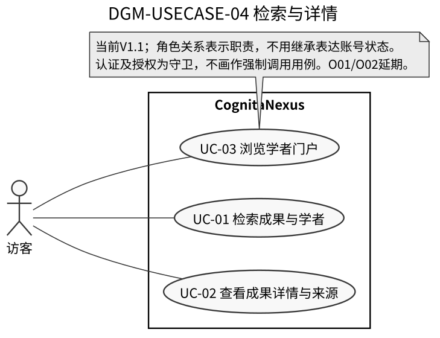
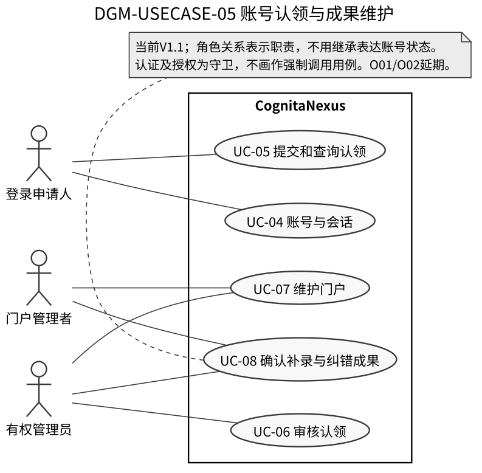
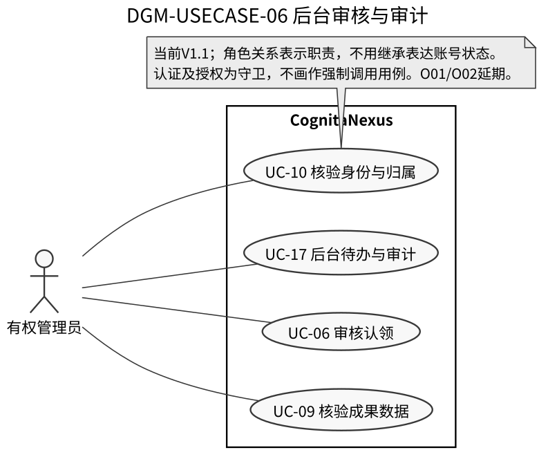

> **HISTORICAL（2026-10-20）：** 本文件是59 AC整改候选，已由 [SRS V2.2（69 AC 权威基线）](CognitaNexus-Shared-SRS-V2.2-69AC.md) 取代；仅用于来源追溯，不并列作为当前验收依据。

# CognitaNexus × OvO 工程可实施共同 SRS V1.1（Review Candidate）

> **单一实施候选主稿，不是 Frozen、未经两组签认。** V1.9及小组已评审V2.0规模修订作为上位需求依据，本文明确唯一实现口径并控制细化复杂度；旧 514 页 V1.0 汇编、两组各自 SRS 不再是现行开发指令，但永久保留作为追溯。本文自 2026-10-12 开始作为工程评审草案，2026-10-17按评审意见整改。禁止把文档生成与后续系统测试混为一谈。

## 1. 引言

### 1.1 目的与优先级

规范本期学术成果分享平台对外可观察的业务行为和明确的验收边界。课程任务书确定的硬要求高于本文；仓库 [需求基线 V2.0（承接V1.9）](../requirements/学术成果分享平台需求分析与可行性报告.md) 决定 FR、NF、IN、O 父需求的语义和优先级；本文是两组提出的**最小充分实现**候选，承接而非篡改上位基线。工程取舍理由见 [可行性报告](../reports/srs/engineering-feasibility-scope-review-2026-10-12.md)。

### 1.2 编号与效力

**父需求 FR01～FR16 全为 Must；NF01～NF08 全为必须考虑的非功能要求；IN01 为当前至少一项创新的交付候选；O01/O02 仍为 Optional 且不排进一期验收。** 本文使用独立 `AC-IMPL-<父需求>-NN` 命名空间，避免与两组同号异义的 `AC-FRxx-Sxx-nn` 冲突。旧号只在历史映射文件出现，不可用同号直接改变业务意思。每条 AC 为未来测试判据，测试尚未执行。

### 1.3 范围状态与签署

**范围收敛选择：** 本期共支持四类成果的元数据、维护、统计和来源；合作网络在当前实施候选中只用有论文证据的共同作者关系；推荐、论文全文、交易、全部等长最短路径、非论文跨类型建边不承诺实现。决策为工程实施建议，仍需两组签认。当前不提交已批准 / Frozen 的虚假状态。

## 2. 系统总体说明

### 2.1 产品、数据与界面边界

学者为中心，以公开、获准的成果元数据和生效关系提供检索与门户；管理员对来源、清洗、重复、学者身份与审核结果负责。数据类别为论文、专利、科研项目、获奖；至少两种独立来源输入是现有小组拟定的验收基线，不是已经实测通过。功能联调不少于 **10,000 条去重成果实体**；已评审V2.0要求容量验收不少于 **100,000 条去重可检索成果实体**、至少 **100个同时活跃的查询用户**，P95≤2秒仍待签认、待实测：按来源许可及数据性质单列实际数字，模拟记录不得冒充已完成真实数据目标。

明确不建设论文投稿/发表、托管付费全文、第三方订阅代理、专利交易、支付、个人综合学术排名、实时全网搜索、通用科研问答或完整社交系统。

### 2.2 用户与业务角色

访客访问公开检索、门户、统计、网络；登录用户提交本人的认领申请；门户管理者仅可操作被授予的具体门户；管理员按具体权限管理来源、核验和审核；系统采集任务不具有人的门户授权；外部来源只提供获准的数据和原站地址。账号、学者档案、学者成果关系、门户授权是四种独立对象，不互相推导。

### 2.3 有条件可行性

团队六人/15周/每人每周6–8小时的基线资源对应540–720人时的规划假设，不是进度承诺。万条数据合法可获得性、协作联调与 CodeArts 工程验收是最大风险。2026-10-13/14 课程展示只陈述需求阶段实况；后续工程周次按 [可行性评审](../reports/srs/engineering-feasibility-scope-review-2026-10-12.md) 重排。

## 3. 用例模型

### 3.1 用例标识与业务归属

现行用例采用 CognitaNexus 已登记 UC；OvO 旧用例仅作来源别名。十五个 OvO 用例的语义对应（避免 UC-08/09/10/12/14 同号异义）：

| OvO 旧用例 | 本文统一 UC | 对应父需求 |
|---|---|---|
| OvO UC-01 | UC-01 | FR01 |
| OvO UC-02 | UC-02、UC-16 | FR02/FR16 |
| OvO UC-03 | UC-03 | FR03 |
| OvO UC-04 | UC-04 | FR04 |
| OvO UC-05 | UC-05 | FR05 |
| OvO UC-06 | UC-06 | FR05 |
| OvO UC-07 | UC-07 | FR06 |
| OvO UC-08 | UC-08 | FR07 |
| OvO UC-09 | UC-18 | FR08 |
| OvO UC-10 | UC-09、UC-10 | FR09/FR15 |
| OvO UC-11 | UC-11、UC-12 | FR11 |
| OvO UC-12 | UC-14 | FR12 |
| OvO UC-13 | UC-13 | FR13 |
| OvO UC-14 | UC-17 | FR14 |
| OvO UC-15 | UC-15 | IN01 |

### 3.2 关键用例与异常闭环

- **UC-01 / UC-02 / UC-03：** 访客查询公开实体→筛选和稳定分页→打开详情/门户→查看来源；空结果与失败不同。
- **UC-04～UC-08：** 登录→发起认领→管理员审核/补证→授权或驳回→维护门户及确认/纠正本人关联；竞争认领不改变已有授权。
- **UC-18 / UC-09 / UC-10 / UC-19 / UC-17：** 管理员运行获准采集→清洗去重→候选人工核验→增量同步→后台审计；“采集成功”不等于“治理全部通过”。
- **UC-11～UC-15：** 真实合格数据的统计/排名/关键词热点/论文合作网，以及 IN01 在论文无向图的筛选和最短路径。
- **UC-20/UC-21：** O01/O02 Optional 用例保留历史追踪，但本期无交付前置，未实现不能拖累 Must。

**系统总体用例图（以 PlantUML 为维护源，Optional 已单独标记）：**

[总体用例图独立矢量原件](../uml/usecase/generated/overall-usecase.svg)随交付包提供，可放大核对全部UC及连线；下列局部图用于正文阅读，不把21个用例压缩到不可辨识的A4缩略图。

### 3.3 用例边界与局部图

用例表示外部角色的完整业务目标；清洗、去重、身份比对等内部算法步骤不单独提升为外部业务用例。UC-09/10仅表示有权管理员核验并处理数据质量/归属待办。角色关联表示业务参与，不用继承描述登录/认领状态转换；本期没有需要新增的include/extend依赖。

[检索局部图](../uml/search/generated/DGM-USECASE-04-search.svg)、[账号认领维护图](../uml/claim/generated/DGM-USECASE-05-claim.svg)、[采集更新图](../uml/collection/generated/collection-local-usecase.svg)、[统计网络图](../uml/analytics/generated/DGM-USECASE-02-analytics.svg)、[后台图](../uml/admin/generated/DGM-USECASE-06-admin.svg)均沿用现行UC编号。DGM-USECASE-04/05/06为本次新增图视图编号，不新增FR或UC。

## 4. 功能需求规格（必须实现）

### FR01 公开检索、组合筛选与稳定分页（Must）

**参与者：** 访客。**执行前提：** 对应对象、来源或账号满足已生效的公开/授权要求；权限失败不得修改任何业务实体。**规范性要求：** 可检索当前公开有效的成果与学者；成果支持类型、年份（两端含）、领域、发生时机构筛选；多维条件取交集。排序按选定字段后接稳定实体ID打破并列；切页保留查询上下文。不承诺实时全网检索。

**验收条件（需求层面的 Given/When/Then；未执行）：**

- **AC-IMPL-FR01-01**：Given 同词匹配一成果一学者，When 仅在成果范围查询，Then 只返回公开成果，不返回学者或待审成果。
- **AC-IMPL-FR01-02**：Given 同时选论文、2025年、机构甲，When 返回结果及下一页，Then 所有行符合全部条件、页间不重不漏、返回后筛选保留。
- **AC-IMPL-FR01-03**：Given 无匹配或依赖超时，When 查询，Then 分别返回无结果与执行失败，不混淆。

**来源追踪：** CognitaNexus [对应模块 SRS](modules/README.md)、OvO V0.3 [详细分册](https://github.com/FloatingSoul423/OvO_-/tree/dfc27e9cc6de744f5f11819c832a2d7baf24c230/docs/srs/modules/detailed)（原编号与旧 AC 溯源详见 [收敛映射](integration/engineering-scope-trace-v1.1-rc.md)）。该父需求作为唯一现行实现功能定义；旧 Sxx 不按号复用。

### FR02 四类成果详情和来源访问（Must）

**参与者：** 访客。**执行前提：** 对应对象、来源或账号满足已生效的公开/授权要求；权限失败不得修改任何业务实体。**规范性要求：** 按第7.1节唯一字段表展示公共及四类适用字段、时间语义、参与者角色、全部可公开来源及更新时间；来源外链只跳原站，不承诺全文。预印本/正式发表须有证据才显示版本关系。

**验收条件（需求层面的 Given/When/Then；未执行）：**

- **AC-IMPL-FR02-01**：Given 同成果有两条许可来源，When 打开详情，Then 一条成果实体展示两条来源，字段缺失标未知。
- **AC-IMPL-FR02-02**：Given 原站外链失效，When 打开已收录详情，Then 元数据仍可读，外链明确失败而非删除成果。

**来源追踪：** CognitaNexus [对应模块 SRS](modules/README.md)、OvO V0.3 [详细分册](https://github.com/FloatingSoul423/OvO_-/tree/dfc27e9cc6de744f5f11819c832a2d7baf24c230/docs/srs/modules/detailed)（原编号与旧 AC 溯源详见 [收敛映射](integration/engineering-scope-trace-v1.1-rc.md)）。该父需求作为唯一现行实现功能定义；旧 Sxx 不按号复用。

### FR03 学者门户浏览（Must）

**参与者：** 访客。**执行前提：** 对应对象、来源或账号满足已生效的公开/授权要求；权限失败不得修改任何业务实体。**规范性要求：** 展示公开学者身份、机构/领域/简介、认领摘要与已生效的四类成果关系；未认领门户可见；不得根据姓名直接建立关系。成果分类分页可按已实现的通用查询复用，不单独强制复杂内页筛选。

**验收条件（需求层面的 Given/When/Then；未执行）：**

- **AC-IMPL-FR03-01**：Given 学者未认领且有已生效成果，When 访客打开门户，Then 可以浏览并看到未认领提示。
- **AC-IMPL-FR03-02**：Given 一名学者关联待核验成果，When 查看公开关系，Then 待核验不得显示成已确认合作或本人确认。

**来源追踪：** CognitaNexus [对应模块 SRS](modules/README.md)、OvO V0.3 [详细分册](https://github.com/FloatingSoul423/OvO_-/tree/dfc27e9cc6de744f5f11819c832a2d7baf24c230/docs/srs/modules/detailed)（原编号与旧 AC 溯源详见 [收敛映射](integration/engineering-scope-trace-v1.1-rc.md)）。该父需求作为唯一现行实现功能定义；旧 Sxx 不按号复用。

### FR04 账号、会话和对象级授权（Must）

**参与者：** 访客/登录用户/管理员。**执行前提：** 对应对象、来源或账号满足已生效的公开/授权要求；权限失败不得修改任何业务实体。**规范性要求：** 实现注册、登录、退出、账号停用与角色校验；每次受保护写请求同时检查会话、账号有效性、操作能力、目标门户授权与对象当前状态。密码不在公开响应或日志出现。

**验收条件（需求层面的 Given/When/Then；未执行）：**

- **AC-IMPL-FR04-01**：Given 登录用户有门户甲授权而无门户乙授权，When 修改乙，Then 拒绝且不写入；前端隐藏入口不能取代拒绝。
- **AC-IMPL-FR04-02**：Given 账号被停用或已退出，When 发起受保护请求，Then 拒绝而不删除该用户关联的学者公开档案。

**来源追踪：** CognitaNexus [对应模块 SRS](modules/README.md)、OvO V0.3 [详细分册](https://github.com/FloatingSoul423/OvO_-/tree/dfc27e9cc6de744f5f11819c832a2d7baf24c230/docs/srs/modules/detailed)（原编号与旧 AC 溯源详见 [收敛映射](integration/engineering-scope-trace-v1.1-rc.md)）。该父需求作为唯一现行实现功能定义；旧 Sxx 不按号复用。

### FR05 门户认领与审核（Must）

**参与者：** 登录用户/审核管理员。**执行前提：** 对应对象、来源或账号满足已生效的公开/授权要求；权限失败不得修改任何业务实体。**规范性要求：** 用户选目标学者提交本人声明和可核验证据引用/说明；审核支持待审核、待补充、通过、驳回、争议。只在无冲突审核通过后授予单门户对象级权限；竞争认领保留既有授权，不提供一期自动转移。无需强制实现附件上传。

**验收条件（需求层面的 Given/When/Then；未执行）：**

- **AC-IMPL-FR05-01**：Given 申请缺必要证据，When 提交，Then 不进入审核或标待补充并说明缺失。
- **AC-IMPL-FR05-02**：Given 管理员通过无冲突申请，When 事务生效，Then 新授权仅对目标门户有效，申请人可查询决定。
- **AC-IMPL-FR05-03**：Given 门户已有有效授权且他人争议申请，When 提交与处理，Then 原授权不转移，争议进入受控待办。

**来源追踪：** CognitaNexus [对应模块 SRS](modules/README.md)、OvO V0.3 [详细分册](https://github.com/FloatingSoul423/OvO_-/tree/dfc27e9cc6de744f5f11819c832a2d7baf24c230/docs/srs/modules/detailed)（原编号与旧 AC 溯源详见 [收敛映射](integration/engineering-scope-trace-v1.1-rc.md)）。该父需求作为唯一现行实现功能定义；旧 Sxx 不按号复用。

### FR06 门户字段修改与版本（Must）

**参与者：** 已获授权的门户管理者/具备相应权限的管理员。**执行前提：** 对应对象、来源或账号满足已生效的公开/授权要求；权限失败不得修改任何业务实体。**规范性要求：** 可修改简介、公开领域、展示顺序等允许字段；不改变事实的展示设置可直接生效，影响身份/归属或来源事实的字段须审批；待审版本绝不覆盖已公开版本，所有关键操作有审计。

**验收条件（需求层面的 Given/When/Then；未执行）：**

- **AC-IMPL-FR06-01**：Given 门户管理者提交重要机构变更，When 尚未审批，Then 公开仍为旧机构，申请人可查待审状态。
- **AC-IMPL-FR06-02**：Given 未授权用户试图修改，When 直接调用接口，Then 无变更并有越权结果。

**来源追踪：** CognitaNexus [对应模块 SRS](modules/README.md)、OvO V0.3 [详细分册](https://github.com/FloatingSoul423/OvO_-/tree/dfc27e9cc6de744f5f11819c832a2d7baf24c230/docs/srs/modules/detailed)（原编号与旧 AC 溯源详见 [收敛映射](integration/engineering-scope-trace-v1.1-rc.md)）。该父需求作为唯一现行实现功能定义；旧 Sxx 不按号复用。

### FR07 已收录成果确认、补录与纠错（Must）

**参与者：** 已授权学者/审核管理员。**执行前提：** 对应对象、来源或账号满足已生效的公开/授权要求；权限失败不得修改任何业务实体。**规范性要求：** 本人可确认待选成果关系、录入可核验的已发表成果元数据、申请修改误归属/字段；只修改自己的参与关系不影响他人。共享字段和争议归属进入审核；不提供论文投稿或出版功能。

**验收条件（需求层面的 Given/When/Then；未执行）：**

- **AC-IMPL-FR07-01**：Given 甲解除与成果P的误关联，When 审核通过，Then P与其他合法参与者关系仍保留，甲关系更新。
- **AC-IMPL-FR07-02**：Given 甲提交共享成果字段修改，When 审核未通过，Then 公开旧值不变且处理过程可查。

**来源追踪：** CognitaNexus [对应模块 SRS](modules/README.md)、OvO V0.3 [详细分册](https://github.com/FloatingSoul423/OvO_-/tree/dfc27e9cc6de744f5f11819c832a2d7baf24c230/docs/srs/modules/detailed)（原编号与旧 AC 溯源详见 [收敛映射](integration/engineering-scope-trace-v1.1-rc.md)）。该父需求作为唯一现行实现功能定义；旧 Sxx 不按号复用。

### FR08 有限数据来源与采集任务（Must）

**参与者：** 管理员/系统。**执行前提：** 对应对象、来源或账号满足已生效的公开/授权要求；权限失败不得修改任何业务实体。**规范性要求：** 一期先验证两种独立且获准来源输入（API/文件任选）；支持配置来源、启动、进度、停止、失败恢复和重试。批次成功仅表示处理与异常移交完毕，待核验计数独立；不得误称人工治理已完成。

**验收条件（需求层面的 Given/When/Then；未执行）：**

- **AC-IMPL-FR08-01**：Given 来源A获准且记录中有异常，When 处理到批次末尾，Then 任务可成功并单列待核验数量，异常不得直接成为已公开成果。
- **AC-IMPL-FR08-02**：Given 任务第10项失败，When 重试，Then 历史成功记录保留、不会新增重复实体，能定位失败点。

**来源追踪：** CognitaNexus [对应模块 SRS](modules/README.md)、OvO V0.3 [详细分册](https://github.com/FloatingSoul423/OvO_-/tree/dfc27e9cc6de744f5f11819c832a2d7baf24c230/docs/srs/modules/detailed)（原编号与旧 AC 溯源详见 [收敛映射](integration/engineering-scope-trace-v1.1-rc.md)）。该父需求作为唯一现行实现功能定义；旧 Sxx 不按号复用。

### FR09 确定性清洗与成果去重（Must）

**参与者：** 系统/治理管理员。**执行前提：** 对应对象、来源或账号满足已生效的公开/授权要求；权限失败不得修改任何业务实体。**规范性要求：** 按类型校验最小字段，保留来源原值与时间精度；DOI/专利申请号/项目号在各自作用域归一匹配；成果稳定ID一致且证据相容才自动关联既有成果实体；学者身份及参与关系的判定主责为FR15。缺稳定ID仅生成多证据候选，标题相似本身不能自动合并；人工合并/拆分留痕。

**验收条件（需求层面的 Given/When/Then；未执行）：**

- **AC-IMPL-FR09-01**：Given 同DOI的两个来源论文，When 导入，Then 形成一个去重成果并保留两个出处。
- **AC-IMPL-FR09-02**：Given 两论文仅标题接近而参与者/年份冲突，When 比对，Then 进入候选/待核验而非自动合并。
- **AC-IMPL-FR09-03**：Given 批次重复输入，When 再次处理，Then 去重成果数与唯一出处数均不增加，允许追加独立到达事件且可追溯。
- **AC-IMPL-FR09-04**：Given 必需名称缺失或可选摘要缺失的两记录，When 清洗，Then 前者不产生公开有效实体且保留异常，后者标未知，均不得补造字段。
- **AC-IMPL-FR09-05**：Given 仅年份、非法日期和日月顺序不明日期，When 清洗，Then 保留原值和年精度，不臆造月日；非法或歧义项标异常/待核验。
- **AC-IMPL-FR09-06**：Given 已确认载体A与新来源B冲突，When 更新，Then 继续展示A、保留B证据与待办，原始来源不改写。
- **AC-IMPL-FR09-07**：Given 专利号辖区未知或属于不同标识体系，When 匹配，Then 不生成可自动合并稳定键，不跨体系合并，原值与原因可查。
- **AC-IMPL-FR09-08**：Given 来源明确证明预印本与正式版属于同一成果，When 归入版本清单，Then 版本数增加而成果实体数不增加；无明示证据不自动归并。

**来源追踪：** CognitaNexus [对应模块 SRS](modules/README.md)、OvO V0.3 [详细分册](https://github.com/FloatingSoul423/OvO_-/tree/dfc27e9cc6de744f5f11819c832a2d7baf24c230/docs/srs/modules/detailed)（原编号与旧 AC 溯源详见 [收敛映射](integration/engineering-scope-trace-v1.1-rc.md)）。该父需求作为唯一现行实现功能定义；旧 Sxx 不按号复用。

### FR10 增量变更与安全恢复（Must）

**参与者：** 系统/管理员。**执行前提：** 对应对象、来源或账号满足已生效的公开/授权要求；权限失败不得修改任何业务实体。**规范性要求：** 在已核验来源域按来源ID与上次版本区分新增、未变、变更、失效；保留检查与生效时间。来源失败不删除旧成果；更新不得覆盖人工审核字段；并发冲突进入治理待办。采用批次复跑/安全检查点，不强制实时流式同步。

**验收条件（需求层面的 Given/When/Then；未执行）：**

- **AC-IMPL-FR10-01**：Given 已审核标题为B而来源更新为C，When 同步，Then 公开仍为B并出现待核验字段冲突。
- **AC-IMPL-FR10-02**：Given 来源暂时断连或删除报告，When 更新失败，Then 已收录数据仍可查询，留存失败状态与恢复入口。

**来源追踪：** CognitaNexus [对应模块 SRS](modules/README.md)、OvO V0.3 [详细分册](https://github.com/FloatingSoul423/OvO_-/tree/dfc27e9cc6de744f5f11819c832a2d7baf24c230/docs/srs/modules/detailed)（原编号与旧 AC 溯源详见 [收敛映射](integration/engineering-scope-trace-v1.1-rc.md)）。该父需求作为唯一现行实现功能定义；旧 Sxx 不按号复用。

### FR11 可复核统计与机构排名（Must）

**参与者：** 访客。**执行前提：** 对应对象、来源或账号满足已生效的公开/授权要求；权限失败不得修改任何业务实体。**规范性要求：** 按去重实体统计类型/年份/领域和机构类别排名；默认现实视图只采用真实、公开、生效且合格数据。机构优先采用成果发生时有证据的机构，一成果同一机构计一次、跨机构各一次，未知不进入已知名次，显示范围、口径和更新时间。

**验收条件（需求层面的 Given/When/Then；未执行）：**

- **AC-IMPL-FR11-01**：Given 同成果跨源重复且涉及机构甲乙，When 按机构统计，Then 甲乙各+1，平台去重总成果+1。
- **AC-IMPL-FR11-02**：Given 真实P、模拟Q、混合R，When 查看默认现实排名，Then 只纳入合格P；演示模式必须标识Q/R。

**来源追踪：** CognitaNexus [对应模块 SRS](modules/README.md)、OvO V0.3 [详细分册](https://github.com/FloatingSoul423/OvO_-/tree/dfc27e9cc6de744f5f11819c832a2d7baf24c230/docs/srs/modules/detailed)（原编号与旧 AC 溯源详见 [收敛映射](integration/engineering-scope-trace-v1.1-rc.md)）。该父需求作为唯一现行实现功能定义；旧 Sxx 不按号复用。

### FR12 基于共同论文的基础专家网络（Must）

**参与者：** 访客。**执行前提：** 对应对象、来源或账号满足已生效的公开/授权要求；权限失败不得修改任何业务实体。**规范性要求：** 一期仅在真实、公开、已核验的共同**论文**中，按两名合法作者生成无向合作边；同一去重论文同一作者对只计一次；强度为共同去重论文数。专利/科研项目/获奖继续收录、检索、统计，但不参与一期合作建边；每条边可打开论文证据。网络筛选与最短路径由IN01承载；图规则见[合作图SPEC](../spec/FR12-IN01-合作图与最短路径规范.md)。

**验收条件（需求层面的 Given/When/Then；未执行）：**

- **AC-IMPL-FR12-01**：Given 甲乙共同论文P，甲丙仅共同专利Q，When 查看基础网络，Then 仅有甲乙边；甲丙不得仅因Q产生边。
- **AC-IMPL-FR12-02**：Given 甲乙共同论文P来自两个来源，When 查看网络，Then 仅一条甲乙边、强度为1，可跳P详情。
- **AC-IMPL-FR12-03**：Given 甲乙有两篇不同的合格共同论文及重复出处，When 统计边强度，Then 仅一条无向边、强度为2，不按出处重复累加。
- **AC-IMPL-FR12-04**：Given 一端关系待核验、争议或已排除，When 建边，Then 该论文不贡献该作者对；其他合格作者对仍可建边。
- **AC-IMPL-FR12-05**：Given 两人只有同机构/同领域而无共同论文，When 查看网络，Then 无合作边，不推断共同成果。

**来源追踪：** CognitaNexus [对应模块 SRS](modules/README.md)、OvO V0.3 [详细分册](https://github.com/FloatingSoul423/OvO_-/tree/dfc27e9cc6de744f5f11819c832a2d7baf24c230/docs/srs/modules/detailed)（原编号与旧 AC 溯源详见 [收敛映射](integration/engineering-scope-trace-v1.1-rc.md)）。该父需求作为唯一现行实现功能定义；旧 Sxx 不按号复用。

### FR13 有限关键词热点与时间窗口（Must）

**参与者：** 访客。**执行前提：** 对应对象、来源或账号满足已生效的公开/授权要求；权限失败不得修改任何业务实体。**规范性要求：** 在明确领域、年份窗与数据类别下，以公开真实的论文关键词/已登记主题计数生成热点排序；同义词映射有凭证才合并，按计数降序+规范词升序破并列。不做语义主题模型、趋势预测或质量评价。

**验收条件（需求层面的 Given/When/Then；未执行）：**

- **AC-IMPL-FR13-01**：Given 2024–25关键词AI出现3次、CV出现2次，When 请求热点，Then 输出3与2并披露样本与时间窗。
- **AC-IMPL-FR13-02**：Given 数据稀疏或没有关键词，When 查询，Then 显示无数据/样本有限，不编造学术质量结论。

**来源追踪：** CognitaNexus [对应模块 SRS](modules/README.md)、OvO V0.3 [详细分册](https://github.com/FloatingSoul423/OvO_-/tree/dfc27e9cc6de744f5f11819c832a2d7baf24c230/docs/srs/modules/detailed)（原编号与旧 AC 溯源详见 [收敛映射](integration/engineering-scope-trace-v1.1-rc.md)）。该父需求作为唯一现行实现功能定义；旧 Sxx 不按号复用。

### FR14 管理待办与审计（Must）

**参与者：** 管理员。**执行前提：** 对应对象、来源或账号满足已生效的公开/授权要求；权限失败不得修改任何业务实体。**规范性要求：** 提供采集、异常治理、学者核验、认领审核、成果变更和账号/分类/来源维护统一入口；关键批准、拒绝、合并、拆分、授权事件记录操作者/对象/时间/前后值/原因。不同管理员仍遵守对应权限，不做通用工作流引擎。

**验收条件（需求层面的 Given/When/Then；未执行）：**

- **AC-IMPL-FR14-01**：Given 普通登录用户直接访问管理操作，When 提交，Then 拒绝且不产生业务变更。
- **AC-IMPL-FR14-02**：Given 管理员批准关系修正，When 查询审计，Then 可定位操作者、对象、时间、前后值、理由且不可由普通用户查看证明原文。

**来源追踪：** CognitaNexus [对应模块 SRS](modules/README.md)、OvO V0.3 [详细分册](https://github.com/FloatingSoul423/OvO_-/tree/dfc27e9cc6de744f5f11819c832a2d7baf24c230/docs/srs/modules/detailed)（原编号与旧 AC 溯源详见 [收敛映射](integration/engineering-scope-trace-v1.1-rc.md)）。该父需求作为唯一现行实现功能定义；旧 Sxx 不按号复用。

### FR15 保守的学者身份与成果归属（Must）

**参与者：** 系统/管理员/相关学者（本人操作仍须对象授权）。**执行前提：** 对应对象、来源或账号满足已生效的公开/授权要求；权限失败不得修改任何业务实体。**规范性要求：** 学者档案与账号分离，姓名别名归一只产候选；外部稳定标识和机构任职期/合作者等证据支持人工或保守自动判定；同名不是同人证据。关系保存角色、顺序、来源、自动关联/本人确认/待核验/争议/已排除独立状态；人工修订向展示传播。

**验收条件（需求层面的 Given/When/Then；未执行）：**

- **AC-IMPL-FR15-01**：Given 两个同名王伟无一致稳定证据，When 导入，Then 不自动并成一人，成果关系进入候选。
- **AC-IMPL-FR15-02**：Given 经审核改归属，When 查看门户和统计，Then 采用生效关系且来源/审计可追溯。
- **AC-IMPL-FR15-03**：Given 中文名与拼音仅拼写相似且自动规则未冻结，When 消歧，Then 仅形成候选并转待核验，不自动认定同一学者。
- **AC-IMPL-FR15-04**：Given 管理员审核一项关系或通过门户认领，When 查询关系，Then 不冒充本人确认、不批量确认其他成果；独立审核证据可追溯。
- **AC-IMPL-FR15-05**：Given 关系已排除且同源再次到达，When 处理，Then 不自动恢复；恢复须有权人工核验新证据、生效决定和审计。

**来源追踪：** CognitaNexus [对应模块 SRS](modules/README.md)、OvO V0.3 [详细分册](https://github.com/FloatingSoul423/OvO_-/tree/dfc27e9cc6de744f5f11819c832a2d7baf24c230/docs/srs/modules/detailed)（原编号与旧 AC 溯源详见 [收敛映射](integration/engineering-scope-trace-v1.1-rc.md)）。该父需求作为唯一现行实现功能定义；旧 Sxx 不按号复用。

### FR16 四类成果与可追溯规模（Must）

**参与者：** 系统/管理员/访客。**执行前提：** 对应对象、来源或账号满足已生效的公开/授权要求；权限失败不得修改任何业务实体。**规范性要求：** 四类公共及专属字段统一按第7.1节，不在本节另列字段；来源可追溯。功能联调按去重成果实体核对≥10,000条；容量验收按已评审V2.0核对≥100,000条可检索去重成果与≥100活跃查询用户；明确展示真实/模拟/混合分组，不把模拟冒充真实合规来源。

**验收条件（需求层面的 Given/When/Then；未执行）：**

- **AC-IMPL-FR16-01**：Given 四类各有一条可公开样例，When 分别检索详情，Then 四类可识别且显示合法来源。
- **AC-IMPL-FR16-02**：Given 一成果跨两个来源且有版本关联，When 做规模核对，Then 按去重实体不按来源数/版本数计；真实数单列。

**来源追踪：** CognitaNexus [对应模块 SRS](modules/README.md)、OvO V0.3 [详细分册](https://github.com/FloatingSoul423/OvO_-/tree/dfc27e9cc6de744f5f11819c832a2d7baf24c230/docs/srs/modules/detailed)（原编号与旧 AC 溯源详见 [收敛映射](integration/engineering-scope-trace-v1.1-rc.md)）。该父需求作为唯一现行实现功能定义；旧 Sxx 不按号复用。

## 5. 创新与可选需求

### 5.1 IN01 合作关系探索（Innovation，本期候选）

- **IN01-R1**：给公开真实论文合作网络提供按论文发生时已核验机构/领域证据筛选；不以学者当前单位替代历史信息，并提供和两名已消歧学者之间最短路径查询；图节点只来自已公开可用的人，边只来自合格共同论文。
- **IN01-R2**：同一过滤条件、相同图版本下，以 BFS 的边数计算最短路径；等长路径按学者canonical_id序列的字典序选择一条；ID比较规则、筛选依据及规模门禁见[合作图SPEC](../spec/FR12-IN01-合作图与最短路径规范.md)。
- **IN01-R3**：每一跳展示至少一篇可点击的共同去重论文证据；无路径、无效端点和超规模明确反馈，不推断同机构必合作。

**验收条件：**

- **AC-IMPL-IN01-01**：Given 甲乙及乙丙各有一篇合格共同论文，When 甲查丙，Then 返回甲→乙→丙，两跳，分别展示可点击论文证据。
- **AC-IMPL-IN01-02**：Given 存在两条等长最短路径，When 固定图版本和查询条件，Then 根据学者稳定标识字典序返回同一条并说明此决定规则。
- **AC-IMPL-IN01-03**：Given 筛选导致断开或节点无效，When 查询，Then 提示当前范围无路径/节点不可用，不产生跨范围推断。
- **AC-IMPL-IN01-04**：Given 筛选图超过10000节点或100000边，When 查询路径，Then 明确超规模并披露规模/上限，不在截断图上伪报全范围最短；范围内按已确认协议测量路径P95≤2秒。（运行未执行）

### 5.2 O01、O02（Optional，暂不列一期实现）

O01 只允许在论文详情中提供内容相似论文推荐，不评价质量，不要求知识图；O02 只有用户明确同意后才能使用近期行为形成轻量偏好，并提供查看和清除入口。**本期明确延期，两项不成为 FR01、FR02、FR12 或 IN01 的依赖条件**。不要求一期预建假入口、行为埋点或画像服务。

## 6. 业务流程与状态模型

### 6.1 数据管线与生命周期

获准来源→来源记录（保留原值）→结构校验→按稳定ID匹配/候选→学者证据和参与关系核验→发布合格实体与生效关系→检索、门户、统计和论文网络读取。不存在自动“采集过=已审核”的状态跳跃。

### 6.2 采集任务六状态与守卫

`待执行 → 运行中 → 成功/失败/已停止`；`失败 → 重试 → 运行中/失败`。每次重试保留检查点与任务历史；只有本轮范围读取结束且全部已读记录均完成入库、异常移交或转待核验等可追踪处置后才可成功；队列交接失败不算完成。异常待治理数量须披露，单次成功不暗示全部人工核验通过。停止后保留历史成果；不得重复计算实体。

### 6.3 认领与门户授权

`待审核 → 待补充 → 待审核` 或 `待审核 → 已通过/已驳回/争议`；争议由有权管理员核验：证据不足保持争议并说明原因；需要补证转待补充；有依据驳回转已驳回；仅冲突消除且无既有授权冲突时重新审核、授权成功后转已通过。一期不支持原授权自动转移。过期审核或授权失败保持先前状态，不虚报通过。申请状态不等于门户公开状态；审核通过只授予对象级管理权，不代表任何成果真实或被本人逐条确认。门户已有授权则继续公开显示为已认领，不因竞争申请自动转未认领。

### 6.4 公开变更及成果关联

重要字段待审旧值继续公开；通过才生成生效版本。学者成果关系在自动关联、本人确认、待核验、争议、已排除中有确定有效状态；待核验/争议/已排除不得成为确定合作边。解除一人关联不删除共享成果、其来源或其他合法参与关系。历史审计保留可追踪前后值。

**合作路径活动图（V1.1 论文限定实施口径）：**

### 6.5 关系状态迁移及下游资格

状态对象为单条学者—成果参与关系，管理员审核是独立证据事件，不是第六种关系状态。

| 当前状态 | 退出条件与目标 | 责任方 | 时限与未决兜底 |
| --- | --- | --- | --- |
| 待核验 | 本人有权确认且无冲突→本人确认；有权管理员核实归属→自动关联并保留人工核验事件；证据否定→已排除；证据冲突→争议 | 本人/治理管理员 | 处理SLA待签认；超时保留原状态及待办，不自动确认 |
| 自动关联 | 本人有效确认→本人确认；新矛盾证据→待核验/争议；有权纠错→已排除 | 本人/治理管理员 | 自动规则未冻结时不产生新自动关联，改转待核验 |
| 本人确认 | 新冲突进入争议或有权纠错进入已排除；不得由来源更新静默逆转 | 本人/治理管理员 | 未作出生效决定时保留证据，不把有争议关系计为合格合作边 |
| 争议 | 人工结论及证据支持恢复原合格状态/排除；只有本人事件可进入本人确认 | 治理管理员；本人确认须本人 | 无结论继续争议，仲裁及SLA待签认，不自动转移门户权限 |
| 已排除 | 有权人工复核新证据后转待核验，再按上述规则决定 | 治理管理员 | 重采、重试、同名或单次认领均不恢复 |

实体有效且允许公开即可独立参与成果总量。关系参与作者/机构统计及合作建边须身份、归属、来源、公开与数据性质均合格，且状态为本人确认或有可追溯已批准自动规则/独立人工核验依据的自动关联；不能仅凭状态标签认定合格。待核验/争议/已排除关系不参与相应归属统计和网络边，不连带排除整个成果。纠错重算受影响作者及机构统计、门户列表、论文边强度、筛选图和路径结果；保留旧版本及审计。性能时限由NF05候选条件约束，未实测不宣称达标。

本次流程图与当前状态定义同步：

## 7. 数据需求与统一业务规则

**本章为当前实施候选单一业务口径。** 第一组原 `BR-xxx` 和 OvO 原 `BR-01～20` 保留为来源索引，不是可替代本章判据的现行定义。

| 规则 | 唯一实施候选定义 | 关联 |
|---|---|---|
| BR-IMP-01 公开权限 | 只公开许可允许且当前生效的实体与合格关系；待审/争议/敏感证据不公开 | FR01～03、FR15 |
| BR-IMP-02 成果去重 | 稳定类型标识优先且须证据相容；仅标题相似不得自动合并；所有来源保留，重复来源不增加实体数 | FR09/16 |
| BR-IMP-03 学者区分 | 同名不自动合并；只凭 ORCID等稳定标识及充分可核验事实支持判断，证据不足转人工 | FR03/15 |
| BR-IMP-04 来源更新 | 失败/停用不删除历史；人工确认值不被自动覆盖；时间含义分开 | FR08/10 |
| BR-IMP-05 对象授权 | 账号角色及具体门户授权同时校验；已认领门户争议保留原授权，不实施转移 | FR04～07/14 |
| BR-IMP-06 统计数量 | 平台实体按去重成果计数；成果发生时多机构各一次、单机构一次、未知单列；明示合计可大于实体数 | FR11 |
| BR-IMP-07 数据性质 | 真实/模拟/混合互斥标识；默认现实排名和网络仅真实合格数据；模拟只可显式演示 | FR11～13/16 |
| BR-IMP-08 论文合作边 | **仅合格共同论文**生成无向边；每篇去重论文对作者对贡献1个强度单位，不以专利项目获奖、同机构或同领域推断边 | FR12/IN01 |
| BR-IMP-09 最短路径 | 仅在当前范围论文图中 BFS 按边数求最短；等长按稳定ID序列取一条；每跳保留论文证据 | IN01 |
| BR-IMP-10 审计与生效 | 受保护写入有身份、理由、前后值和时间；待审不替代公开版本；跨视图使用生效数据 | FR05～10/14/15 |
| BR-IMP-11 数据最小化 | 不默认采集私人手机号/邮箱和非公开科研材料；证明材料本人和有权审核者可见 | NF03/NF06 |
| BR-IMP-12 Optional 隔离 | O01/O02 不实现不影响任何 Must 或 IN01，行为日志不得暗用于推荐 | O01/O02 |

### 7.1 数据字段与来源

每个成果：内部稳定ID、类型、标题、来源ID、来源域/使用许可、采集/来源更新时间（不可混称）、真实/模拟/混合标识、公开生效状态。论文：DOI、作者顺序、发表年份/载体/版本证据；专利：辖区、标识体系、申请号/公开号/授权号、发明人、申请/公开/授权日期；项目：项目编号、负责人及承担单位、起止时间；获奖：年度、奖项、获奖人员/团队。不存在的专属字段标未知，不造默认值。

### 7.2 保留与一致性不变量

原始来源事实不被人工修订覆盖，公开规范值与审核记录独立；一个作者同一论文只能形成一条本人关系；重复来源不增加统计或图关系强度；公开实体存在不意味着每一个作者关联都合格；归属纠正可能改变论文合作图，但不得擦除历史证据。

## 8. 权限与安全需求

| 操作 | 访客 | 登录用户 | 对象授权门户管理者 | 管理员 | 核心守卫 |
|---|---|---|---|---|---|
| 公开检索/详情/门户/统计/网络 | 读 | 读 | 读 | 读 | 仅当前公开数据 |
| 本人认领申请/查看私有结果 | — | 本人提交/读 | 本人提交/读 | 审核权限 | 私有材料不得在门户公开 |
| 维护指定门户 | — | — | 仅其授权对象 | 对应管理权限 | 账号状态＋角色＋对象许可 |
| 确认/纠错本人关系 | — | — | 仅本人与合法关系 | 对应治理权限 | 待审不得覆盖公开关系 |
| 数据来源/采集/去重/消歧/后台审计 | — | — | — | 具体管理权限 | 操作记录理由与前后值 |

每次操作的权限判断在服务端执行，不以页面入口是否可见为授权证明。关键秘密不写入公开 API 或安全审计。门户未认领仍允许公开读。

## 9. 非功能要求与验收目标

现行子需求使用NFxx-Syy，AC沿用AC-IMPL命名空间；不与历史分册同号自动等价。2026-10-17组长明确告知双方评审通过的参数为：预热2分钟、测量5分钟、100活跃用户闭环、错误率≤1%、单请求超时5秒；图上限1万节点/10万边、路径P95≤2秒；RTO≤30分钟、RPO≤24小时。此确认不代表系统已达标或整份SRS已Frozen。量化测量方案见[非功能验收方案](../spec/NF-验收测量方案.md)，尚未签认的参数不构成已冻结承诺。

### NF01 基础可用性

- **NF01-S01**：公开检索、门户、统计无需登录；加载、空结果、错误、越权和处理中可区分，表单指出错误字段。
- **AC-IMPL-NF01-01**：Given 空库、加载中、执行失败、无权请求和错误表单，When 分别操作，Then 显示对应状态且不把失败写成成功零条。（未执行）

### NF02 普通检索性能

- **NF02-S01**：按小组已评审V2.0，容量≥10万条去重可检索成果、≥100同时活跃查询用户；联调≥1万条不能替代容量验收。P95≤2秒待签认、待实测。
- **NF02-S02**：以冻结的数据快照、查询集、操作边界、负载模型、预热、错误率/超时阈值和机器环境出具报告；缺参数或未执行为NOT RUN。
- **AC-IMPL-NF02-01**：Given 已签认测量方案，When 在≥10万条/≥100活跃用户下执行，Then 各被测操作的P95、错误率、超时率和吞吐量均可复核；全部门槛满足才PASS，否则FAIL。（未执行）
- **AC-IMPL-NF02-02**：Given 小样本测试、未冻结条件或缺报告，When 评定容量/性能，Then 为NOT RUN，不以小样本或文档检查宣称最终达标。（未执行）

### NF03 安全及权限

- **NF03-S01**：服务端每次校验账号、角色和对象授权；凭据/审核证明受控，日志和公开响应不含秘密。
- **AC-IMPL-NF03-01**：Given 跨用户写入、停用账号、未授权读取审核材料和日志检查，When 执行，Then 前三类被拒绝、公开响应及日志无凭据和证明原文。（未执行）

### NF04 可靠性与恢复

- **NF04-S01**：来源离线历史成果可读；批次可恢复且幂等；备份恢复核对实体、唯一出处、权限和审计。
- **NF04-S02**：RTO≤30分钟、RPO≤24小时已由组长告知双方评审通过；测量起止见非功能方案，未演练不得称达标。
- **AC-IMPL-NF04-01**：Given 备份和故障样例，When 恢复，Then 记录实际恢复用时、可恢复时间点、丢失范围及前后核对；未执行恢复演练为NOT RUN。（未执行）

### NF05 生效一致性与审计

- **NF05-S01**：审核生效后详情、门户、检索、统计和合作网络使用同一生效版本；路径基于指定图版本，旧结果明确版本或失效。60秒为待签认传播目标，从业务决定提交成功至各适用视图可见计时。
- **AC-IMPL-NF05-01**：Given 归属修正或论文排除，When 生效后逐视图核对，Then 详情/门户/检索/统计/网络及路径证据同步反映版本，分别记录延迟；待审不提前公开。（未执行；60秒待签认）

### NF06 隐私与数据最小化

- **NF06-S01**：不默认采集私人邮箱、手机号、未公开项目细节；证明仅本人及有权审核者可见；一期不采集延期推荐的行为画像。
- **NF06-S02**：证明按处理目的最小保留，明确到期清理/删除方式、审计摘要及备份清理边界；期限和例外未签认前保留为待决，不承诺永久保留。
- **AC-IMPL-NF06-01**：Given 他人申请证明、到期证明和保留例外样例，When 访问或执行清理，Then 无权读取被拒绝，按已签认期限清理原件并保留必要审计；期限未签认的清理验收NOT RUN。（未执行）

### NF07 来源与配置可维护性

- **NF07-S01**：停用/更换来源不改变公开查询语义；部署和任务恢复说明可复现，异常可定位。
- **AC-IMPL-NF07-01**：Given 已收录数据，When 停用来源并按说明恢复任务，Then 历史公开成果可读、错误可追踪，重复处置不增实体/出处。（未执行）

### NF08 代码质量和课程流程

- **NF08-S01**：拟选FR09清洗去重、FR15身份归属、FR01检索排序三个核心模块分别核对行覆盖率≥80%，不得用平均值替代；选定模块待双方签认。
- **NF08-S02**：保留边界/权限/集成及CodeArts导入、编辑、重导出证据；平台验证只能按实际操作记录。
- **AC-IMPL-NF08-01**：Given 三个已签认模块和实现版本，When 检查测试覆盖与平台证据，Then 分别报告模块覆盖率及真实操作结果；未实现或未操作为NOT RUN/NOT VERIFIED。（未执行）

## 10. 验收、追踪、变更控制

### 10.1 本期统一需求检查表

- 父级功能：FR01～FR16 共16项，未删除或改为 Optional；核心 SPEC 覆盖清洗/去重/消歧/检索及合作图/最短路径。
- 创新：IN01三类核心行为及规模门禁；若课程最终不批准 IN01，需另提至少一项经确认的创新，不得以基础 FR12 替代。
- 非功能：NF01～NF08 各具候选可执行检查；NF02/NF05 数值测试环境未冻结，NF08 覆盖率与 CodeArts 只能在实现阶段确认。
- Optional：O01/O02 保留独立定义、不实现不会使 Must 失败。
- 规模与数据：四类成果有真实、合法来源的可访问证据，功能联调去重后≥1万；容量≥10万/≥100活跃查询用户，P95待签认待实测；至少两独立获准来源按小组基线核对；现实统计默认不掺入模拟。

### 10.2 双组编号与历史材料

[工程可行性及12项决策](../reports/srs/engineering-feasibility-scope-review-2026-10-12.md)、[逐条 OvO 需求/AC 来源处理表](integration/engineering-scope-trace-v1.1-rc.md)；原 [287 AC 判定表](integration/shared-ac-resolution-v1.0-rc.md) 是 V1.0 汇编的历史候选，不再是本版规范 AC 清单。第一组六人 [V1.0 SRS](CognitaNexus-SRS-V1.0.md)、两组汇编 [V1.0 514页](CognitaNexus-Shared-SRS-V1.0-RC.md)、OvO V0.3 及其 Git 历史完整保留。

### 10.3 变更与签认门槛

当前本文唯一现行**工程实施候选**规则如第7章；历史冲突方案没有规范性实施效力。若两组不批准任一取舍，必须回到本版登记，明确修改父需求、AC、UC、BR、UML、SPEC 与 Word，再发新 RC。签认栏：CognitaNexus 组长＿＿；OvO 组长＿＿；各模块负责人＿＿；签认日期＿＿。**空白即未签认，严禁自动写 Frozen。**

### 10.4 当前验证事实

截至本稿仅进行文档范围和静态编号检查；**没有部署业务系统、采集1万条真实有效成果或执行代码覆盖率/CodeArts/性能压测的证据**。合格的文档 CI 不等于以上业务测试通过。

### 10.5 本次整改记录 2026-10-17

上位需求规模由组长指定已评审V2.0同步，替代旧1万/10并发性能候选和500万草案；FR06补回有权管理员、FR15补回相关学者。新增FR09五项、FR12三项、FR15三项及NF02一项验收，原46项增为59项（增加IN01规模门禁），既有AC不重编号。NF拆12条子需求；认领争议及关系状态分别建模。其余新增规则及未决参数仍待双组复审；第9章列明的量化参数已获本次用户告知双组确认，整体SRS未Frozen，运行测试未执行。详见[整改记录](../reports/srs/review-remediation-2026-10-17.md)及[现行验收追踪](integration/current-acceptance-trace-2026-10-17.md)。
