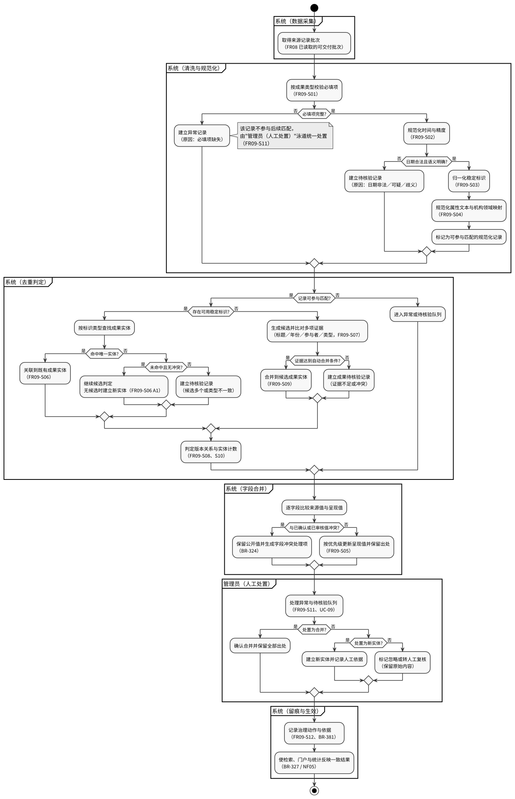
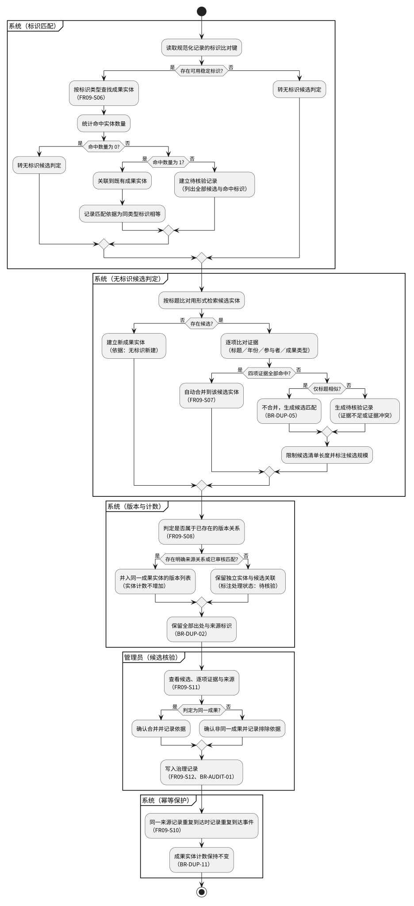
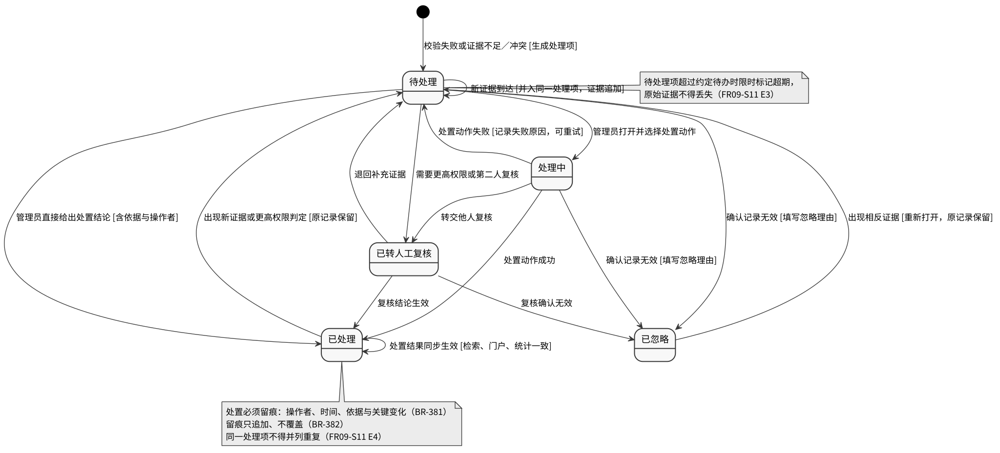

# CognitaNexus SRS · 成员03 · FR09（数据治理与归属）

<!-- CognitaNexus 统一模块头：2026-10-11 -->
> **模块：** 成员03 / FR09 ｜ **状态：** Draft，联合评审前不得冻结 ｜ **基线：** [V1.9](../../requirements/学术成果分享平台需求分析与可行性报告.md) ｜ **规范：** [SRS V1.0](../CognitaNexus_SRS编写与需求建模规范_V1.0.md)  
> **追踪：** [治理关键用例](../review/member03-governance-usecases.md) · [公共规则建议与待决](../review/member03-governance-rules.md) · [联合评审登记](../../reports/srs/joint-review-draft-2026-10-11.md)  
> **说明：** 本文尽量保留成员03的需求与验收原文；旧 UC、DGM 编号只是成员原稿标识，全局唯一编号待联合评审。不得直接将局部术语和规则视为全组已冻结的权威定义。

> **本文件所属交付：** CognitaNexus SRS 第一版（6 人组）
> **模块负责人：** ③ 数据治理／去重／消歧
> **对应 SRS 章节：** 4.3 FR08～FR10 数据采集、治理与更新
> **版本：** V0.1（第一版，待组内 Review 与跨组 Review）

---

## 0. 模块说明

### 0.1 追踪来源

本模块细化 V1.9 基线中的 **FR09 数据清洗、规范化与成果去重**。对应基线位置：

| 基线位置 | 内容 | 本模块覆盖方式 |
| --- | --- | --- |
| 表4-2 `FR09` 行 | 原子需求定义与本期验证边界 | 拆为 FR09-S01～S12 |
| 5.2 第1条 | 标识按类型归一化后匹配；跨源合并保留所有出处 | FR09-S03、FR09-S09 |
| 5.2 第2条 | 标题相似只产生候选，再比较年份、参与者和类型 | FR09-S07 |
| 5.2 第5条 | 自动更新不能静默覆盖人工审核值，冲突进入处理队列 | FR09-S05、FR09-S11 |
| 5.2 第6条 | 来源删除、撤稿、外链失效分别记录，不因一次失败删除成果 | FR09-S11、FR09-S12 |
| 5.2 第7条 | 预印本／修订版／正式发表保留版本标识与关联证据；不同版本不直接增加实体总量 | FR09-S08 |
| 5.3 | 全平台成果总量按去重实体计数 | FR09-S06、FR09-S10 |
| 5.4 采集任务行 | 重试不得造成重复入库 | FR09-S10 |
| 8.2「新数据进入平台」「数据来源」 | 重复导入不增加重复成果；来源故障不影响历史数据 | FR09-S10、FR09-S11 |
| NF04、NF07 | 重复处理不产生重复成果；管理员可定位失败任务和记录 | FR09-S10、FR09-S11、FR09-S12 |

### 0.2 本模块职责边界（重要）

本模块**只定义记录级清洗、成果去重与治理留痕**，不定义以下内容（避免与其它模块重复或冲突）：

<!-- 以下插图由交付打包时添加 -->
### 图：数据治理总体流程（DGM-ACTIVITY-02）

> 从"取得来源记录批次"起到"使检索、门户与统计反映一致结果"止，覆盖 FR09-S01～S12 的清洗、去重、字段合并、人工处置与留痕生效全过程。图中泳道区分系统与管理员职责。

| 不属本模块 | 归属 | 本模块的处理方式 |
| --- | --- | --- |
| 采集任务创建、停止、重试、调度与任务状态机 | ② FR08、FR10 | 仅作为前置条件与输入引用；`DGM-STATE-01` 由②负责，本模块不重画、不重定义状态 |
| 增量识别“新增／未变化／已变化”与更新轨迹 | ② FR10 | 本模块消费其输出（到达治理的记录），只规定“自动更新不得静默覆盖已确认值”（FR09-S05） |
| 四类成果专属字段清单与来源展示字段 | ② FR16 | 本模块只按 FR16 定义的字段集合做规范化，不新增、不删减字段语义 |
| 机构规范名、领域分类树的维护入口 | ⑥ FR14 | 本模块只消费其映射结果（FR09-S04、FR15-S01），映射维护不在此定义 |
| 后台异常处置界面、审核队列操作与审计呈现 | ⑥ FR14 | 本模块只定义“什么情况必须进入队列”“结果必须可追溯”（FR09-S11、S12） |
| 学者身份判定与学者—成果关系 | ③ FR15 | 见 [`FR15-disambiguation-attribution.md`](scholar-disambiguation.md) |
| 检索、门户、统计如何反映治理结果 | ①②⑤ | 本模块只提出“生效后一致”的要求，具体展示规则由对应 FR 定义 |

### 0.3 参与者

| 参与者 | 类型 | 在本模块中的职责 |
| --- | --- | --- |
| 系统 | 系统参与者（非人类角色） | 执行校验、规范化、匹配、合并、路由；不自行扩大自动合并范围 |
| 管理员 | 人类参与者 | 处置异常与待核验记录，确认合并／拆分，维护可解释结果 |
| 外部数据来源 | 外部系统 | 提供来源记录；其字段质量不构成平台放弃校验的理由 |
| 成果来源方 | 相关参与者 | 来源记录的提供者，不作为权限主体 |

> 采集调度器与治理处理流程均为系统内部职责，不构成独立人类角色（V1.9 3.2）。

### 0.4 术语（本模块局部补充）

完整术语表见公共文件 §2。本模块使用的关键术语：

| 术语 | 含义 |
| --- | --- |
| 来源记录 | 某数据源提供的一条原始记录，是治理的最小输入单位 |
| 规范化记录 | 通过本模块校验与规范化后、具备参与匹配条件的记录 |
| 成果实体 | 完成去重后代表一项成果的业务对象，全平台按实体计数 |
| 出处 | 成果实体与其来源记录之间的保留关系 |
| 稳定标识 | 由来源或权威体系分配的、可唯一指向成果的标识（如数字对象标识、来源自有 ID、申请号、公开号、项目编号） |
| 候选匹配 | 存在相同可能的记录组合，在证据不足时不得直接合并 |
| 异常记录 | 校验失败或无法规范化的记录 |
| 待核验记录 | 规范化成功但去重证据不足或冲突，需要人工判定的记录 |

---

## FR09-S01 必填项校验与规范化

- **父需求：** FR09
- **优先级：** Must
- **主要参与者：** 系统
- **相关参与者：** 管理员

#### 需求描述

系统应对每条来源记录按成果类型校验必填项的存在性与可比对性；对通过校验的记录执行等价写法归一（去除首尾与重复空白、全角／半角统一、大小写统一到比对用形式）；对未通过校验的记录标明缺失字段并路由至异常处理，**不得以任何方式补造或从其它记录推断填充缺失字段**。

#### 前置条件

1. 采集任务已成功结束（FR08），来源记录已被保存且可读取。
2. 该记录的成果类型已确定为论文、专利、科研项目、获奖之一。
3. 该类型对应的必填字段集合已按 FR16 与 V1.9 表5-1 定义并可用。

#### 触发条件

来源记录进入治理处理（首次导入或增量更新后）。

#### 主成功流程

1. 系统读取来源记录及其成果类型。
2. 系统按该类型必填字段集合逐项检查存在性。
3. 系统对存在的字段执行等价写法归一，生成规范化记录。
4. 系统记录本记录的规范化结果与被归一的具体字段。
5. 系统将规范化记录交付去重匹配（FR09-S03、S06）。

#### 备选流程

- A1：来源记录含类型专属可选字段（如摘要、关键词、IPC）但为空——系统保留为空，按“无该信息”处理，不判为异常。
- A2：来源记录存在多个同义字段（如来源同时给出“公开日”与“公告日”）——系统仅按 FR16 定义的主字段取值，其余作为来源原始字段保留，不参与主流程判断。

#### 异常流程

- E1：标题缺失或归一后为空——系统将该记录判为异常记录，异常原因为“必填项缺失：标题”，不进入公开检索与统计。
- E2：成果类型无法确定或不在四类之内——系统判为异常记录，原因为“成果类型不可识别”。
- E3：全部必填字段均缺失——系统判为异常记录并标注“疑似无效记录”，保留原始内容以便复核。
- E4：同一记录中字段值互相矛盾（如专利的申请日晚于公开日）——系统判为待核验记录，不自动删除字段。

#### 输入/业务数据

- 来源记录（原始字段值、来源标识、采集或导入时间）
- 成果类型
- 该类型的必填字段集合

#### 输出/可观察结果

- 规范化记录（含归一后的字段值）
- 异常记录（含异常原因与原始内容）
- 每条记录的规范化处置结果记录

#### 状态变化

- 对象：来源记录
- 原状态：已接收（未治理）
- 目标状态：规范化完成，或异常待处理（见 `DGM-STATE-04`）

#### 权限规则

- 执行主体为系统，不需要用户权限。
- 缺失字段的补录只能由管理员在后台执行（FR14），且须留痕；登录用户与访客不得补录。

#### 业务规则

- BR-DATA-01：缺失字段必须显式标明为未知，禁止推断填充。
- BR-DATA-05：字段值的规范形式只在治理内部用于比对，来源原始值必须保留。

#### 验收条件

- AC-FR09-S01-01：Given 一条标题为“ Attention  Is All You Need ”的来源记录，When 治理处理完成，Then 该记录标题的比对用规范形式为“Attention Is All You Need”，且来源原始值仍可查询。
- AC-FR09-S01-02：Given 一条缺失标题的来源记录，When 治理处理完成，Then 该记录状态为异常待处理且异常原因为“必填项缺失：标题”，并且该记录不出现在访客检索结果中。
- AC-FR09-S01-03：Given 一条缺失摘要与关键词的论文记录且其余必填项完整，When 治理处理完成，Then 该记录正常完成规范化，其摘要与关键词显示为“未知”，且不产生异常记录。
- AC-FR09-S01-04：Given 一条标题缺失但可通过其它记录推断标题的记录，When 治理处理完成，Then 系统不写入任何推断标题，且记录仍为异常待处理。

#### 关联项

- 关联用例：UC-09
- 关联非功能需求：NF04、NF07
- 关联数据对象：来源记录、成果实体、异常记录
- 关联图：`DGM-ACTIVITY-02`（治理总体流程）

---

## FR09-S02 时间与日期语义规范化

- **父需求：** FR09
- **优先级：** Must
- **主要参与者：** 系统
- **相关参与者：** 管理员

#### 需求描述

系统应将来源记录中的日期与时间字段规范化为统一表示，并**保留并标明时间精度与时间语义**（成果发生时间、来源公布时间、平台入库时间、平台更新时间分别表达）；对无法确定语义或超出可接受范围的日期，系统应判为待核验或异常，不得默认取某一天填充。

#### 前置条件

1. 记录已通过 FR09-S01 的必填项校验。
2. 字段的时间语义已按 FR16 定义可区分。

#### 触发条件

记录中存在日期或时间字段。

#### 主成功流程

1. 系统识别每个日期字段的语义（发生时间／公布时间／入库时间／更新时间）。
2. 系统按统一表示解析日期，并记录其精度（年／月／日）。
3. 系统保留来源原始日期字符串作为出处证据。
4. 系统将规范化日期与精度写入规范化记录。

#### 备选流程

- A1：来源只提供年份——系统按“精度＝年”保存，不补全为某月某日。
- A2：来源只提供年月——系统按“精度＝月”保存。
- A3：同一成果存在多个语义不同的日期（如专利申请日与公开日）——系统分别保存，不合并为单一日期。

#### 异常流程

- E1：日期不存在（如 2023-02-30）或月份超出 1～12——系统判为异常记录，原因为“日期非法”，保留原始字符串。
- E2：日期格式歧义且来源未标明顺序（如 05/06/2023）——系统判为待核验记录，不按任一解释写入生效日期。
- E3：日期明显超出可接受范围（晚于当前年份加一年，或早于该成果类型可存在的起始年份）——系统判为待核验记录，原因为“日期可疑”，进入人工确认。
- E4：来源未提供任何发生时间——系统标明“发生时间未知”，记录仍可进入检索，但参与时间范围筛选时按“未知”处理，不计入任一年份区间。

#### 输入/业务数据

- 来源记录中的日期／时间字段及来源标注的语义

#### 输出/可观察结果

- 规范化日期值（含精度标识）
- 时间语义标识
- 异常或待核验记录（含原因）
- 来源原始日期字符串（作为出处保留）

#### 状态变化

- 对象：来源记录
- 原状态：已通过必填项校验
- 目标状态：时间规范化完成，或异常待处理，或待核验

#### 权限规则

- 日期语义判定由系统执行；语义修正由管理员在后台执行并留痕。
- 已认领门户管理者可对本人相关成果提出日期纠错申请（FR07），不得直接改写规范化结果。

#### 业务规则

- BR-DATA-02：时间精度与语义必须显式保存，禁止把“只有年份”补全为具体日期。
- BR-DATA-01：日期未知时标明未知，不推断。

#### 验收条件

- AC-FR09-S02-01：Given 一条来源日期为“2023”的论文记录，When 治理处理完成，Then 该记录的时间精度为“年”，且其发生时间不显示为 2023-01-01。
- AC-FR09-S02-02：Given 一条来源日期为“2023/5/9”的记录，When 治理处理完成，Then 规范化的发生时间为 2023-05-09 且精度为“日”，来源原始字符串“2023/5/9”仍可查询。
- AC-FR09-S02-03：Given 一条发生时间为“2023-02-30”的记录，When 治理处理完成，Then 该记录为异常待处理且原因为“日期非法”，并且不写入任何生效日期。
- AC-FR09-S02-04：Given 一条仅有“05/06/2023”且来源未标明顺序的记录，When 治理处理完成，Then 该记录为待核验且不写入生效发生时间，直到管理员确认。
- AC-FR09-S02-05：Given 一条来源日期为 2099 年的论文记录，When 治理处理完成，Then 该记录为待核验且原因为“日期可疑”。

#### 关联项

- 关联用例：UC-09
- 关联非功能需求：NF05、NF07
- 关联数据对象：来源记录、成果实体、异常记录
- 关联图：`DGM-ACTIVITY-02`

---

## FR09-S03 标识符归一化与等价识别

- **父需求：** FR09
- **优先级：** Must
- **主要参与者：** 系统
- **相关参与者：** 管理员

#### 需求描述

系统应按标识类型对稳定标识执行归一化（去空格、统一大小写、去除访问前缀、统一连字符与校验位写法），使同一标识的不同书写形式归一为同一比对键；系统应**按标识类型分别建索引并按类型匹配**，不得跨类型（如专利申请号与公开号）直接判为同一成果。

#### 前置条件

1. 记录已通过 FR09-S01 校验。
2. 标识字段已按 FR16 定义可识别其类型。

#### 触发条件

记录中存在一个或多个稳定标识字段。

#### 主成功流程

1. 系统识别记录中的标识及其类型。
2. 系统按该类型的归一规则生成比对键。
3. 系统记录归一前后对照（归一动作，不覆盖来源原始值）。
4. 系统将比对键交付 FR09-S06 匹配。

#### 备选流程

- A1：同一记录含多个同类型标识（如两个公开号）——系统保留全部，且任一命中均视为同一成果候选，需按 FR09-S06 判定。
- A2：标识缺少校验位或格式不完整（如 DOI 缺前缀）——系统保留原值，该标识不参与自动匹配，记录进入待核验。

#### 异常流程

- E1：标识格式明显非法（如包含空格与非法字符的申请号）——系统判为异常记录，原因为“标识非法”。
- E2：不同类型标识指向不同成果（如 DOI 指向成果 A、来源 ID 指向成果 B）——系统不得自动合并，判为待核验并保留双方证据。
- E3：标识为空字符串或占位值（如“N/A”“-”“待补”）——系统按“无标识”处理，不生成比对键。

#### 输入/业务数据

- 来源记录中的标识字段及其类型

#### 输出/可观察结果

- 各类型标识的归一化比对键
- 归一动作记录
- 异常或待核验记录（含原因与冲突标识）

#### 状态变化

- 对象：来源记录
- 原状态：已通过必填项与时间校验
- 目标状态：标识归一完成，或异常待处理，或待核验

#### 权限规则

- 标识归一由系统执行。
- 标识的人工修正由管理员执行并留痕；已认领学者可提出纠错申请（FR07），不得直接改写。

#### 业务规则

- BR-DUP-01：稳定标识按类型归一化后完全相等，是判定同一成果的唯一自动依据。
- BR-DUP-04：不同类型标识不得直接互相当作同一成果的证据。
- BR-DATA-05：来源原始标识值必须保留。

#### 验收条件

- AC-FR09-S03-01：Given 两条记录分别给出同一数字对象标识的“https://doi.org/10.1000/ABC”与“10.1000/abc”，When 治理处理完成，Then 两条记录的标识比对键相同。
- AC-FR09-S03-02：Given 一条记录的标识为“N/A”，When 治理处理完成，Then 该记录被视为无稳定标识，且不产生匹配命中。
- AC-FR09-S03-03：Given 同一记录的专利公开号标识指向成果 A、数字对象标识指向成果 B，When 治理处理完成，Then 系统不合并，该记录为待核验并保留两个标识。
- AC-FR09-S03-04：Given 一条标识含非法字符的记录，When 治理处理完成，Then 该记录为异常待处理且原因为“标识非法”。

#### 关联项

- 关联用例：UC-09
- 关联非功能需求：NF04、NF07
- 关联数据对象：来源记录、成果实体、出处
- 关联图：`DGM-ACTIVITY-02`

---

## FR09-S04 属性文本规范化

- **父需求：** FR09
- **优先级：** Must
- **主要参与者：** 系统
- **相关参与者：** 管理员

#### 需求描述

系统应对标题、人名、机构名、领域名等属性文本执行规范化：去除控制字符、统一空白与标点形态、统一全角半角、按既有别名映射替换为规范名；规范化**只用于生成比对用形式，不覆盖来源原文**；无法映射到既有规范名的取值应保留原值并标注“未映射”，不得强行归入相近机构或领域。

#### 前置条件

1. 记录已通过 FR09-S01 校验。
2. 机构规范名与别名映射、领域分类映射已由 FR14 维护并可用（不可用时按 A2 降级）。

#### 触发条件

记录中存在标题、人名、机构名或领域名文本字段。

#### 主成功流程

1. 系统对文本字段执行字符级与空白级归一，生成文本比对用形式。
2. 系统用机构／领域别名映射将可识别取值替换为规范名，并保留来源原值。
3. 系统对未能映射的机构或领域标注“未映射／待分类”。
4. 系统记录本记录的规范化动作。

#### 备选流程

- A1：一个文本字段包含多个值（多机构、多领域）——系统按分隔规则拆分后逐项映射并保留顺序。
- A2：机构或领域映射不可用——系统只做字符级归一，全部机构／领域标注“未映射”，并向管理员产生配置缺失提示。
- A3：标题含副标题或补充说明——系统保留完整标题用于展示，比对用形式按去标点后的完整字符串生成。

#### 异常流程

- E1：文本归一后为空——按 FR09-S01 E1 处理为异常记录。
- E2：人名文本含不可见字符导致同一姓名出现多个形式——系统判为待核验记录，原因为“人名文本异常”。
- E3：同一字段的多个值互相冲突且无法并存（如同一作者顺序重复）——系统判为待核验记录，保留全部原始取值。

#### 输入/业务数据

- 标题、人名、机构名、领域名等文本字段
- 机构别名映射表、领域分类映射表

#### 输出/可观察结果

- 文本比对用形式
- 规范机构名、规范领域名（或“未映射／待分类”标注）
- 未映射清单（供管理员处理）
- 来源原值保留

#### 状态变化

- 对象：来源记录
- 原状态：已通过前置校验
- 目标状态：文本规范化完成，或异常待处理，或待核验

#### 权限规则

- 规范化由系统执行。
- 机构与领域映射的建立与修正由管理员执行（FR14），本模块不提供映射维护入口。
- 普通用户与访客不得修改任何规范化结果。

#### 业务规则

- BR-DATA-03：无法可靠映射时必须标为“未映射／待分类”，禁止强行归类。
- BR-DATA-05：来源原文必须保留。
- BR-DUP-05：标题相似只用于生成候选，不作为合并依据。

#### 验收条件

- AC-FR09-S04-01：Given 一条机构文本为“清华大学 ”（含尾随空格）的记录，When 映射表存在该机构别名，Then 规范化机构名为映射表中的规范名，且来源原值仍可查询。
- AC-FR09-S04-02：Given 一条机构文本为映射表中不存在的机构，When 治理处理完成，Then 该机构标注为“未映射”，且不出现任何被替代为相近机构的规范名。
- AC-FR09-S04-03：Given 一条标题为“Deep Learning：A Survey”的记录，When 治理处理完成，Then 展示标题保留原标点，比对用形式去除标点差异后可与“Deep Learning: A Survey”生成的比对用形式相同。
- AC-FR09-S04-04：Given 机构与领域映射表不可用，When 治理处理完成，Then 处理不中断，所有机构与领域标注“未映射”，并产生一条面向管理员的配置缺失提示。

#### 关联项

- 关联用例：UC-09
- 关联非功能需求：NF07
- 关联数据对象：来源记录、机构、领域、成果实体
- 关联图：`DGM-ACTIVITY-02`

---

## FR09-S05 多来源字段优先级与冲突保留

- **父需求：** FR09
- **优先级：** Must
- **主要参与者：** 系统
- **相关参与者：** 管理员

#### 需求描述

当同一成果实体获得多条来源记录时，系统应按**确定的字段优先级**选取对外呈现的字段值，并**保留各来源的原始取值与来源归属**；当来源取值与已人工确认或已审核的值冲突时，系统**不得静默覆盖**，应保留公开版本与来源版本差异并进入处理队列。

#### 前置条件

1. 该成果实体已存在，或本次处理将建立实体（FR09-S09）。
2. 已完成 FR09-S01～S04 的规范化。
3. 字段优先级规则（见业务规则）已生效。

#### 触发条件

同一成果实体新增或更新一条来源记录，且该记录与现有值存在差异。

#### 主成功流程

1. 系统逐字段比较新来源值与当前呈现值。
2. 系统按优先级规则确定差异字段的呈现值。
3. 系统保存新来源原始值、来源标识与到达时间，并保留旧值的出处。
4. 系统记录本次字段变更的来源与依据（若判定为冲突则见 E1）。

#### 备选流程

- A1：新来源值仅是格式差异、归一后与现值相同——系统不产生变更记录，仅追加出处并更新来源到达时间。
- A2：新来源补充了当前为“未知”的字段——系统按补充处理并记录补充来源，不视为冲突。
- A3：新来源提供了更精确的时间精度（年 → 日）——系统按更精确值呈现并保留原精度历史。

#### 异常流程

- E1：来源值与已人工确认或已审核的值不同——系统**不覆盖**该值，保留公开版本，并生成一条“字段冲突”处理项进入管理员处理队列（不计为异常记录，不计为错误）。
- E2：同一字段的两个来源值都具备稳定标识依据且互相矛盾——系统判为待核验记录，公开值保持现值。
- E3：来源撤回或删除原值（如撤稿、来源下架）——系统记录撤回事件与时间，保留成果实体与历史值，不删除成果（BR-DATA-06）。
- E4：冲突处理项在管理员处理前又有新来源到达——系统追加冲突证据到同一处理项，不产生并列重复处理项。

#### 输入/业务数据

- 新来源记录的规范化字段值与其来源标识
- 当前呈现值、其确认／审核状态与其出处
- 字段优先级规则

#### 输出/可观察结果

- 更新后的呈现值（或保持不变的公开值）
- 字段冲突处理项（含新旧值、双方来源、疑似原因）
- 每条字段值的出处追溯记录

#### 状态变化

- 对象：字段值
- 原状态：现值（可能为已确认／已审核）
- 目标状态：更新为更可信来源值，或保持现值并进入冲突队列
- 对象：冲突处理项
- 原状态：无
- 目标状态：待处理（见 `DGM-STATE-04`）

#### 权限规则

- 字段值选取由系统按规则执行。
- 冲突的最终处置只能由管理员执行（FR14）；已认领门户管理者可提交纠错申请（FR07），不得直接改写呈现值。
- 未登录用户与登录用户只能查看公开值与其出处，不得查看冲突处理队列内容。

#### 业务规则

- BR-DUP-06：人工确认或已审核值优先级高于自动来源值；冲突不得静默覆盖。
- BR-DATA-06：来源删除、撤回、外链失效分别记录，均不导致成果实体被删除。
- BR-DATA-05：全部来源原始值必须保留并可追溯到具体来源。

#### 验收条件

- AC-FR09-S05-01：Given 某论文的发表载体已被本人确认，When 新来源给出不同发表载体，Then 公开呈现值仍为已确认值，且系统生成一条字段冲突处理项。
- AC-FR09-S05-02：Given 某成果的摘要为“未知”，When 新来源提供摘要，Then 摘要被补充呈现，且其出处显示为该新来源。
- AC-FR09-S05-03：Given 某成果的年份精度为“年”，When 新来源给出完整发表日期（精度“日”），Then 呈现时间精度变为“日”，且原“年”精度记录仍可追溯。
- AC-FR09-S05-04：Given 某冲突处理项已有两条来源证据，When 第三条来源给出不同值，Then 处理项数量不增加，其证据集合包含三条来源。
- AC-FR09-S05-05：Given 某来源撤回其记录，When 治理处理完成，Then 该成果仍可检索，展示其来源撤回事件与时间，且不产生删除结果。

#### 关联项

- 关联用例：UC-09
- 关联非功能需求：NF04、NF05、NF07
- 关联数据对象：成果实体、出处、来源记录、异常记录
- 关联图：`DGM-ACTIVITY-02`、`DGM-STATE-04`

---

## FR09-S06 基于稳定标识的重复识别

- **父需求：** FR09
- **优先级：** Must
- **主要参与者：** 系统
- **相关参与者：** 管理员

#### 需求描述

系统应在标识归一化（FR09-S03）后，按标识类型在该类型范围内查找已存在的成果实体；当**同类型稳定标识完全相等**时，系统应将该来源记录关联到既有成果实体而非新建实体；当存在多个候选实体命中同一标识时，系统应判为待核验，不得任选其一。

#### 前置条件

1. 记录已完成标识归一化，且至少存在一个可用稳定标识。
2. 已有成果实体及其标识索引可用。

#### 触发条件

规范化记录进入匹配环节。

#### 主成功流程

1. 系统按标识类型查找相同比对键的成果实体。
2. 命中且唯一时，系统把该来源记录关联到该实体，追加出处。
3. 系统更新该实体的来源到达时间与字段（按 FR09-S05 判定是否变更）。
4. 系统记录匹配依据为该类型标识的相等。

#### 备选流程

- A1：未命中任何实体——系统按 FR09-S07 继续判定，或在无候选时建立新实体。
- A2：命中同一实体但该实体已标记为“已合并至其它实体”——系统把记录关联到合并后的目标实体，并保留合并链。
- A3：记录含多个同类型标识且分别命中不同实体——进入 E1。

#### 异常流程

- E1：多个候选实体命中同一标识（数据不一致或历史脏数据）——系统判为待核验记录，列出全部候选与命中标识，不自动选择。
- E2：命中的实体类型与记录类型不一致（如专利记录命中论文实体）——系统不关联，判为待核验，原因为“类型不一致”。
- E3：命中实体的标识已被标记为“争议”（来源撤回或纠错未决）——系统不自动合并，判为待核验并引用争议标记。

#### 输入/业务数据

- 规范化记录的标识比对键与成果类型
- 成果实体标识索引、实体类型、合并链、争议标记

#### 输出/可观察结果

- 来源记录与既有成果实体的关联，或新建实体，或待核验记录
- 匹配依据记录（标识类型与值）

#### 状态变化

- 对象：来源记录
- 原状态：标识归一等价（可匹配）
- 目标状态：已关联既有实体，或已建立新实体，或待核验
- 对象：成果实体
- 原状态：既有
- 目标状态：出处增加、来源到达时间更新（字段按 FR09-S05）

#### 权限规则

- 匹配由系统执行。
- 待核验记录的处置由管理员执行（FR14）；冲突处置结果须留痕。

#### 业务规则

- BR-DUP-01：同类型稳定标识完全相等是唯一自动判定同一成果的依据。
- BR-DUP-02：多条来源记录对应同一成果实体时，全部出处必须保留。
- BR-DUP-04：不同类型标识不得互相作为同一成果依据。

#### 验收条件

- AC-FR09-S06-01：Given 平台已有实体 E（标识 DOI=10.1000/abc），When 导入一条标识归一后同为 10.1000/abc 的来源记录，Then 平台成果实体总数不变，且 E 的出处数量增加 1。
- AC-FR09-S06-02：Given 两条历史实体已错误地持有同一标识，When 导入一条持有该标识的记录，Then 该记录为待核验并列出两个候选实体，且不发生自动合并。
- AC-FR09-S06-03：Given 一条专利记录命中一个成果类型为论文的实体，When 治理处理完成，Then 不建立关联，该记录为待核验且原因为“类型不一致”。
- AC-FR09-S06-04：Given 实体 E 已合并至实体 F，When 导入一条标识等于 E 旧标识的记录，Then 该记录关联到 F，且合并链可追溯至 E。

#### 关联项

- 关联用例：UC-09
- 关联非功能需求：NF04
- 关联数据对象：成果实体、出处、来源记录
- 关联图：`DGM-ACTIVITY-02`、`DGM-ACTIVITY-04`（去重候选判定）

---

## FR09-S07 缺稳定标识时的候选生成与证据判定

- **父需求：** FR09
- **优先级：** Must
- **主要参与者：** 系统
- **相关参与者：** 管理员

#### 需求描述

当记录缺少可用稳定标识时，系统应基于**标题相似度、发生时间、参与者、成果类型**等多项证据生成候选匹配，并输出**每一项证据的命中或冲突情况**；系统**不得仅凭标题相似直接合并**；当证据组合达到可自动合并条件时执行合并，未达到时形成待核验记录交人工判定。

#### 前置条件

1. 记录已完成 FR09-S01～S04 规范化。
2. 记录无可用稳定标识，或标识未命中（FR09-S06 A1）。

#### 触发条件

可匹配记录进入无标识候选判定。

#### 主成功流程

1. 系统按标题比对用形式检索候选实体范围。
2. 系统对每个候选逐项比较发生时间、参与者、成果类型，形成证据清单。
3. 系统应用自动合并条件判定。
4. 达到条件时，系统把记录关联到该实体并记录全部命中证据。
5. 未达到条件时，系统生成待核验记录，列出候选实体及其证据清单。

#### 备选流程

- A1：无任何候选——系统建立新的成果实体，并标注“无标识新建”。
- A2：多个候选各自满足部分证据——系统生成包含全部候选的待核验记录，按证据完整度排序展示，不自动选择。
- A3：标题比对用形式完全相同但时间、参与者和类型全部冲突——系统判为待核验，并明确标注“疑似不同成果同名”。

#### 异常流程

- E1：标题比对用形式极短或无实义（如“Editorial”“序言”）导致候选数量过多——系统限制候选清单长度并在待核验记录中标注“候选过多，需人工筛查”。
- E2：参与者信息缺失导致证据不足——系统不降低合并条件，判为待核验。
- E3：候选实体本身处于待核验或争议状态——系统不自动合并，把记录并入既有待核验记录作为附加证据。
- E4：待核验记录超过约定时限未处置——系统保持“待核验”状态并在管理员待办中标记为超期（时限值由 FR14 待办规则定义）。

#### 输入/业务数据

- 标题比对用形式、发生时间及精度、参与者列表、成果类型
- 候选成果实体集合及其字段
- 自动合并条件（见业务规则）

#### 输出/可观察结果

- 自动合并结果（含证据清单），或
- 待核验记录（含候选实体、逐项证据、候选排序、超期标记）

#### 状态变化

- 对象：来源记录
- 原状态：无稳定标识可匹配
- 目标状态：已自动合并，或已建立新实体，或待核验

#### 权限规则

- 候选生成由系统执行。
- 自动合并条件不得被普通用户、登录用户或门户管理者修改；门户管理者只能通过 FR07 提出纠错申请。
- 待核验判定与合并确认由管理员执行（FR14）。

#### 业务规则

- BR-DUP-05：标题相似只产生候选，不能单独作为合并依据。
- BR-DUP-03：无稳定标识时须比较年份、参与者与类型等多项证据。
- BR-DUP-07：证据不足时进入待核验，禁止自动合并。

#### 验收条件

- AC-FR09-S07-01：Given 一条无标识记录与一条已有实体记录的标题比对用形式相同，但年份相差 3 年，When 治理处理完成，Then 不自动合并，生成待核验记录且证据清单显示“年份冲突”。
- AC-FR09-S07-02：Given 一条无标识记录与已有实体在标题、年份、参与者集合、成果类型四项上全部一致，When 治理处理完成，Then 自动合并到该实体，且证据清单记录四项命中。
- AC-FR09-S07-03：Given 一条标题为“Editorial”的无标识记录且匹配到 50 个候选，When 治理处理完成，Then 生成一条待核验记录，其中候选清单被限制在约定长度内并标注“候选过多，需人工筛查”。
- AC-FR09-S07-04：Given 一条无标识记录，When 平台内不存在标题比对用形式相近的实体，Then 建立新的成果实体，其新建依据标注为“无标识新建”。

#### 关联项

- 关联用例：UC-09
- 关联非功能需求：NF04、NF07
- 关联数据对象：成果实体、来源记录、出处、异常记录
- 关联图：`DGM-ACTIVITY-04`

<!-- 以下插图由交付打包时添加 -->
### 图：成果去重候选判定（DGM-ACTIVITY-04）

> 本图展开"稳定标识匹配 → 无标识候选判定 → 版本与计数 → 管理员候选核验 → 幂等保护"，对应本条与 FR09-S03、S06、S08、S10、S11。

---

## FR09-S08 预印本、修订版本与正式发表记录的版本关系

- **父需求：** FR09
- **优先级：** Must
- **主要参与者：** 系统
- **相关参与者：** 管理员、访客

#### 需求描述

系统应保留预印本、修订版本与正式发表记录的**版本标识、来源标识、状态与关联证据**；只有存在明确来源关系或经审核确认的匹配时，系统才把这些记录归并为同一成果实体；**不同版本不直接增加平台成果实体总量**；无法确认是否同一成果时，系统应保留候选关联并说明其处理状态。第一期不进行全文差异比较。

#### 前置条件

1. 相关记录已通过 FR09-S01～S04 规范化。
2. 记录携带版本类型或发表状态信息（FR16 定义）。

#### 触发条件

记录被识别为预印本、修订版本或正式发表记录，且与既有实体存在关联可能。

#### 主成功流程

1. 系统识别记录的版本类型与发表状态。
2. 系统按稳定标识或明确来源关系查找其对应版本记录。
3. 存在明确关系时，系统把该记录作为版本并入同一成果实体，并保留版本顺序与状态。
4. 系统在成果详情中呈现版本列表与其来源标识，实体计数不增加。

#### 备选流程

- A1：仅有预印本、无正式发表记录——系统以单版本实体呈现，标明“仅收录预印本版本”。
- A2：来源明确给出“本记录为 X 的修订版”——系统按明确关系归并，不需要额外审核。
- A3：正式发表记录提供了与预印本不同的标题——系统按证据组合判定（FR09-S07），标题差异记录为证据项而非冲突。

#### 异常流程

- E1：无法确认两条记录是否同一成果——系统保留候选关联，实体保持分离，并在两方详情中显示“存在可能的版本关联，处理状态：待核验”。
- E2：来源声明为同一成果但关键证据矛盾（如参与者完全不同）——系统判为待核验，不归并。
- E3：预印本被撤回——系统记录撤回事件与该版本状态，不影响正式发表记录的可浏览性（BR-DATA-06）。
- E4：同一来源重复给出同一版本的多个标识——系统按 FR09-S03 A1 处理，不新增版本条目。

#### 输入/业务数据

- 版本类型、发表状态、版本标识、来源标识
- 来源声明的版本关系
- 候选关联及其处理状态

#### 输出/可观察结果

- 同一实体下的版本列表（含版本类型、状态、来源标识、顺序）
- 候选关联记录及其处理状态
- 实体计数保持不变（不因版本增加而增加）

#### 状态变化

- 对象：来源记录
- 原状态：规范化完成
- 目标状态：已归并为实体下的一个版本，或作为独立实体并保留候选关联，或待核验

#### 权限规则

- 版本识别与归并由系统执行。
- 版本关系的最终确认（含拆分为独立实体）由管理员执行并留痕（FR14）。
- 访客可查看版本列表与处理状态，不得修改。

#### 业务规则

- BR-DUP-08：只有明确来源关系或经审核确认的匹配才能归并版本。
- BR-DUP-09：不同版本不直接增加成果实体总量；无法确认时保留候选并说明处理状态。
- BR-DATA-06：撤回与失效分别记录，不删除成果。

#### 验收条件

- AC-FR09-S08-01：Given 平台已有某论文正式发表记录，When 导入其预印本且来源明确标注二者关系，Then 平台成果实体总数不变，该实体版本列表包含预印本与正式发表两个版本。
- AC-FR09-S08-02：Given 导入一条与既有实体疑似同一论文的修订版记录但无明确关系证据，When 治理处理完成，Then 两方保持独立实体，且各自详情显示“存在可能的版本关联，处理状态：待核验”。
- AC-FR09-S08-03：Given 某预印本被来源撤回，When 治理处理完成，Then 该版本状态标注为已撤回并记录时间，且对应正式发表记录仍可被访客检索。
- AC-FR09-S08-04：Given 同一来源对同一版本给出两个标识，When 治理处理完成，Then 该版本数量仍为 1，两个标识均作为该版本的来源标识保留。

#### 关联项

- 关联用例：UC-09
- 关联非功能需求：NF04、NF05
- 关联数据对象：成果实体、论文、来源记录、出处
- 关联图：`DGM-ACTIVITY-02`

---

## FR09-S09 成果实体合并与全量出处保留

- **父需求：** FR09
- **优先级：** Must
- **主要参与者：** 系统
- **相关参与者：** 管理员

#### 需求描述

当判定两条及以上来源记录属于同一成果时，系统应把它们归并到一个成果实体；合并后**所有出处必须保留**，包括每一来源的来源标识、来源URL可达性状态与数据到达时间；合并应生成**可追溯的合并链**，使任一被合并项仍可被定位到当前实体。

#### 前置条件

1. 至少两条记录已被判定为同一成果（FR09-S06 或 S07 或管理员确认）。
2. 参与合并的实体不存在互相指向的循环合并关系。

#### 触发条件

系统自动判定相同，或管理员确认合并。

#### 主成功流程

1. 系统确定合并的目标实体与来源实体集合。
2. 系统把来源实体的全部出处、版本与关系证据迁移到目标实体。
3. 系统按 FR09-S05 优先级规则确定各字段的呈现值，冲突按冲突流程处理。
4. 系统在目标实体记录合并链（含依据与执行者类型：系统或管理员）。
5. 系统把来源实体标记为“已合并”，并使其标识指向目标实体。

#### 备选流程

- A1：来源实体已被引用于学者—成果关系——系统保留这些关系并转移到目标实体，若同一学者在两侧都有关联则见 E1。
- A2：合并双方的字段完全一致——系统只追加出处与合并链，不产生字段变更记录。
- A3：管理员在合并前要求预览——系统展示预计保留字段值、冲突字段与出处清单，不做写入（预览不改变任何状态）。

#### 异常流程

- E1：同一学者在合并双方都存在关联——系统合并为一条关系，保留双方证据，并在关系证据链中标注“由实体合并产生”。
- E2：检测到循环合并（A 合并至 B、B 合并至 A）——系统拒绝该次合并，判为待核验并提示循环。
- E3：合并过程中断（处理失败）——系统不得留下部分合并状态；未完成的合并整体回滚，并生成异常记录以便重试（可重复执行且不重复计数）。
- E4：合并后目标实体的必填字段反而缺失（来源实体字段更完整）——按 FR09-S05 A2 以更完整值补充，不视为冲突。

#### 输入/业务数据

- 目标与来源成果实体、其全部出处、版本、字段值
- 学者—成果关系（若存在）
- 合并依据

#### 输出/可观察结果

- 合并后的成果实体（出处数量为双方之和）
- 合并链（含时间、依据、执行者类型）
- 字段冲突处理项（若存在）

#### 状态变化

- 对象：成果实体
- 原状态：独立（多条记录分别建实体）
- 目标状态：合并为一个实体；来源实体状态为“已合并”
- 对象：出处
- 原状态：分属不同实体
- 目标状态：全部保留于目标实体

#### 权限规则

- 系统可在自动条件成立时执行合并。
- 自动条件不成立时的合并只能由管理员确认执行（FR14），且必须记录操作者与依据。
- 普通用户、登录用户与门户管理者无权执行合并。

#### 业务规则

- BR-DUP-02：跨来源合并必须保留所有出处。
- BR-DUP-10：合并必须可追溯（合并链），已合并实体不得成为不可解释的孤立对象。
- BR-DUP-11：合并操作必须可重复执行且不产生重复计数（幂等）。

#### 验收条件

- AC-FR09-S09-01：Given 两个实体分别来自来源 A 与来源 B，When 管理员确认合并，Then 合并后实体出处数量为 2，且两个来源标识与到达时间均可查询。
- AC-FR09-S09-02：Given 实体 A 已合并至实体 B，When 访客访问实体 A 的历史标识或链接，Then 可定位到实体 B，并可查看合并链（时间、依据、执行者类型）。
- AC-FR09-S09-03：Given 某学者在实体 A 与实体 B 上各有一条关联，When A 与 B 合并，Then 该学者在合并后实体上只有一条关联，其证据链包含双方原有证据并标注来源为实体合并。
- AC-FR09-S09-04：Given 一次合并处理在写入过程中失败，When 处理结束，Then 不出现部分合并的中间状态，且重试该合并后平台实体计数与出处数量符合预期、无重复。
- AC-FR09-S09-05：Given 实体 A 已合并至 B，When 试图把 B 合并至 A，Then 系统拒绝该次合并并给出循环合并提示。

#### 关联项

- 关联用例：UC-09
- 关联非功能需求：NF04、NF05
- 关联数据对象：成果实体、出处、学者—成果关系、异常记录
- 关联图：`DGM-ACTIVITY-02`

---

## FR09-S10 重复导入幂等：不增加重复成果

- **父需求：** FR09
- **优先级：** Must
- **主要参与者：** 系统
- **相关参与者：** 管理员

#### 需求描述

系统应保证**同一来源记录被重复导入、采集任务重试或增量窗口重叠时，平台不增加重复的成果实体，也不产生重复计数**；重复到达应被识别为同一实体上的重复出处或重复到达事件，并按规则合并或忽略，同时保留可核查的到达记录。

#### 前置条件

1. 来源记录已完成标识归一化；或该来源在无标识情况下已有可判定候选。
2. FR08 的重试与增量过程可用（本模块只处理已经到达的记录）。

#### 触发条件

同一来源记录第二次及以后进入治理处理（含任务重试、重叠时间窗口、人工重复导入）。

#### 主成功流程

1. 系统按 FR09-S06／S07 判定该记录对应的既有实体。
2. 系统识别本次到达与既有出处的来源标识是否相同。
3. 相同时，系统记录一次“重复到达”事件（含时间与批次依据），不新增实体、不新增重复出处、不改变计数。
4. 若本批次携带字段变化，按 FR09-S05 处理变更（变化不视为重复）。

#### 备选流程

- A1：同一来源重复提供同一标识的两条记录在同一批次内——系统在该批次内先去重，再只处理一条。
- A2：来源标识相同但内容相比上次确有变化——系统按增量更新处理（FR10），记录变更而非计为重复。
- A3：来源标识相同、内容一致，但上次到达曾被标记为异常——系统更新异常记录的到达信息，不重复生成异常记录。

#### 异常流程

- E1：来源标识相同但成果类型不同——系统判为待核验，不并入同一实体，并保留两次到达记录。
- E2：来源未提供可区分标识且证据不足——系统生成待核验记录，但**不新建重复实体**（在候选未决前保持不新增）。
- E3：重复到达检测失败的记录——系统进入异常记录，且不得因此新增成果实体。
- E4：来源标识相同且平台内已有多个候选实体——系统按 FR09-S06 E1 处理为待核验，不新增实体。

#### 输入/业务数据

- 来源标识、成果类型、记录内容（用于判定是否变化）
- 既有出处与到达事件记录

#### 输出/可观察结果

- 重复到达事件记录（时间、批次或任务依据）
- 成果实体计数保持不变
- 变更记录（当内容确有变化时）

#### 状态变化

- 对象：成果实体
- 原状态：已存在
- 目标状态：不变（仅到达事件追加）
- 对象：到达事件
- 原状态：无
- 目标状态：已记录

#### 权限规则

- 幂等判定由系统执行，不依赖用户操作。
- 管理员可查看重复到达记录；登录用户与访客不可见。

#### 业务规则

- BR-DUP-11：重复导入、任务重试与增量重叠不得增加成果实体或重复计数。
- BR-DUP-02：既有出处保持唯一，不因重复到达产生重复出处条目。
- BR-DATA-05：到达事件必须可追溯（时间与批次依据）。

#### 验收条件

- AC-FR09-S10-01：Given 同一来源记录已被成功治理，When 用同一批次重复导入，Then 平台成果实体总数不变，且该实体新增一条“重复到达”事件。
- AC-FR09-S10-02：Given 某采集任务第一次执行成功，When 该任务重试并对同一批记录再次执行，Then 成果实体总数与计数口径统计值均不变。
- AC-FR09-S10-03：Given 两个增量时间窗口存在重叠并覆盖同一条来源记录，When 两次治理完成后，Then 该成果实体只有 1 条对应来源标识的出处，且有 2 条到达事件可查。
- AC-FR09-S10-04：Given 一条来源记录缺少可区分标识且证据不足，When 该记录被第二次导入，Then 不新增成果实体，且相关待核验记录不重复生成。

#### 关联项

- 关联用例：UC-08、UC-09
- 关联非功能需求：NF04、NF05
- 关联数据对象：成果实体、出处、到达事件、异常记录
- 关联图：`DGM-ACTIVITY-02`

---

## FR09-S11 异常与待核验记录的路由与人工处置

- **父需求：** FR09
- **优先级：** Must
- **主要参与者：** 管理员
- **相关参与者：** 系统

#### 需求描述

系统应把无法通过校验、规范化或去重判定的记录统一路由到可检索的处理队列，并按类型区分**异常记录**（校验失败、无法规范化）与**待核验记录**（证据不足或证据冲突）；管理员应能查看每条记录的原因、原始内容、候选与证据，并执行处置动作；处置结果必须可追溯。

#### 前置条件

1. 记录在 FR09-S01～S10 任一环节被判定为异常或待核验。
2. 管理员已登录且具备治理处置权限（FR14）。

#### 触发条件

系统产生异常或待核验记录；或管理员主动进入处理队列。

#### 主成功流程

1. 系统按原因类型建立处理项，记录来源标识、原始内容、产生时间与建议动作。
2. 管理员按原因筛选并打开某处理项，查看原始内容与证据（含候选实体清单）。
3. 管理员选择处置动作：修正字段、指定实体关联、确认为新实体、忽略（含忽略理由）、转交他人复核。
4. 系统执行处置动作并更新处理项状态为已处理，记录操作者、时间、动作与关键变化。
5. 处置结果按 FR09-S12 生效并被检索、门户与统计采用。

#### 备选流程

- A1：管理员确认该记录确属无效——系统把处设置为已忽略并保留原始内容，不进入公开检索。
- A2：管理员把记录关联到既有实体——系统按 FR09-S09 执行合并并保留出处。
- A3：管理员确认应作为新实体——系统建立新实体，并在其依据中记录人工判定。
- A4：需要更多证据——管理员把处理项标记为需要补充来源或转交复核，状态保持待处理并记录说明。

#### 异常流程

- E1：处置动作执行失败（并发修改、数据冲突）——系统保持原状态，记录失败原因并允许重新处置；不得留下半处置状态。
- E2：两名管理员同时处置同一处理项——系统只接受首次提交，后续提交提示已被处置并展示处置结果。
- E3：待处理项长期未处置——系统在待办中标记超期（时限由 FR14 定义），保持原始证据不丢失。
- E4：处置结果与既有审核结论冲突——系统不自动覆盖，转为需要更高权限确认的处理项并保留双方依据。

#### 输入/业务数据

- 异常／待核验记录（原因、来源标识、原始内容、证据、候选清单）
- 管理员的处置动作与理由

#### 输出/可观察结果

- 处理项状态（待处理／处理中／已处理／已忽略／已转人工复核，见 `DGM-STATE-04`）
- 处置结果与留痕（操作者、时间、动作、关键变化）
- 处置后达成一致的检索、门户与统计结果

#### 状态变化

- 对象：异常／待核验记录（处理项）
- 原状态：待处理
- 目标状态：处理中 → 已处理／已忽略／已转人工复核；失败时回到待处理

#### 权限规则

- 仅管理员可执行处置（FR14）。
- 已认领门户管理者可对涉及本人成果的待核验项提交说明或纠错申请（FR07），但不得直接处置处理项。
- 登录用户与访客不可查看处理队列与原始内容。

#### 业务规则

- BR-DUP-07：证据不足必须人工核验，禁止自动合并。
- BR-DATA-06：来源失败、撤回或外链失效不导致成果被删除。
- BR-AUDIT-01：处置必须留痕，可追溯操作者、时间与关键变化。

#### 验收条件

- AC-FR09-S11-01：Given 一条因标题缺失被判异常的记录，When 管理员打开处理队列，Then 可看到异常原因、来源标识与原始内容。
- AC-FR09-S11-02：Given 一个证据不足的待核验项，When 管理员选择“确认新实体”，Then 处理项状态为已处理，新建实体的判定依据显示为人工判定，且处理记录包含操作者与时间。
- AC-FR09-S11-03：Given 某处理项已被管理员 A 处置，When 管理员 B 提交同一处理项的处置，Then 系统拒绝 B 的提交并展示 A 的处置结果。
- AC-FR09-S11-04：Given 某待核验项超过约定待办时限未处置，When 管理员查看待办列表，Then 该项被标记为超期，且其原始证据仍完整可查。
- AC-FR09-S11-05：Given 管理员处置动作执行时发生数据冲突，When 提交结束，Then 处理项状态保持原状态、记录失败原因，且可再次提交处置。

#### 关联项

- 关联用例：UC-09
- 关联非功能需求：NF07、NF01
- 关联数据对象：异常记录、成果实体、来源记录、审计日志
- 关联图：`DGM-ACTIVITY-02`、`DGM-STATE-04`

<!-- 以下插图由交付打包时添加 -->
### 图：异常与待核验处理项状态图（DGM-STATE-04）

> 处理项生命周期：待处理／处理中／已处理／已忽略／已转人工复核；图中同时标注了超期标记与留痕要求（BR-AUDIT-01／02）。

---

## FR09-S12 合并、拆分与人工修正的可解释性与审计留痕

- **父需求：** FR09
- **优先级：** Must
- **主要参与者：** 系统
- **相关参与者：** 管理员

#### 需求描述

系统应为每一次**自动或人工的合并、拆分、字段修正与忽略**保留可解释记录，内容包括：动作类型、对象、触发依据（标识命中或证据清单）、执行者类型（系统或具体管理员）、时间与关键变化；任何受治理影响的展示结果应能回溯到其依据；**已生效的治理结论被再次改变时，历史记录不得被覆盖**。

#### 前置条件

1. 发生了合并、拆分、字段修正或忽略动作。
2. 审计留痕机制可用（FR14 提供查看入口）。

#### 触发条件

治理动作执行（自动或人工）。

#### 主成功流程

1. 系统在动作执行时生成治理记录，含动作类型、对象与依据。
2. 系统记录执行者类型与身份（系统或管理员账号）、时间。
3. 系统记录动作前后的关键差异（字段值、实体归属、出处数量、关系归属）。
4. 系统使该记录可通过对象（成果实体、来源记录）与操作者两种方式检索。

#### 备选流程

- A1：同一实体多次变更——系统按时间顺序保留全部记录，不做合并压缩。
- A2：自动合并——依据记录为标识命中或完整证据清单，执行者类型为系统。
- A3：拆分（把已合并实体还原为两个实体）——系统记录拆分依据与拆分后各实体的出处与关系归属。

#### 异常流程

- E1：留痕写入失败——治理动作不得静默成功；系统应报告失败并保证可重试，且不得出现“动作已生效但无记录”的状态。
- E2：动作生效但检索或统计未在约定时间内反映——系统按 NF05 在约定时间内重试并使结果一致；期间对管理员提示“变更尚未生效”。
- E3：管理员撤销自己的处置——系统记录撤销为新的一条记录，原记录保留。

#### 输入/业务数据

- 治理动作、对象、依据、执行者、时间
- 动作前后的关键差异

#### 输出/可观察结果

- 治理记录（可查询、可追溯、不可被后续动作覆盖）
- 变更前后的可对比信息

#### 状态变化

- 对象：治理记录
- 原状态：无
- 目标状态：已生成（追加语义，不可修改）
- 对象：成果实体／学者—成果关系
- 原状态：治理动作前状态
- 目标状态：治理动作后状态

#### 权限规则

- 治理记录由系统生成，任何用户不得修改或删除。
- 管理员可查看治理记录（FR14）；登录用户只能查看与本人相关成果的公开变更说明；访客不可见。

#### 业务规则

- BR-AUDIT-01：关键治理动作必须留痕，含操作者、时间与关键变化。
- BR-AUDIT-02：历史治理记录只追加、不覆盖；撤销以新记录表达。
- BR-DUP-10：合并链必须可追溯。

#### 验收条件

- AC-FR09-S12-01：Given 系统自动合并了两条记录，When 管理员查看该成果的治理记录，Then 可见执行者类型为系统、依据为标识命中或证据清单、时间与合并前后出处数量。
- AC-FR09-S12-02：Given 一次人工拆分已生效，When 查看治理记录，Then 可见拆分依据、操作者与时间，且拆分前的合并记录仍然存在。
- AC-FR09-S12-03：Given 管理员撤销了先前的处置，When 查看治理记录，Then 撤销作为一条新记录出现，原处置记录内容未被修改。
- AC-FR09-S12-04：Given 留痕写入失败，When 治理动作尝试执行，Then 动作不表现为成功，系统报告失败且可重试，且不出现无记录的有效变更。
- AC-FR09-S12-05：Given 某成果的字段已被来源更新，When 在变更生效约定时间内查看检索与门户，Then 两处显示同一结果；若尚未生效，管理员处可见“变更尚未生效”提示。

#### 关联项

- 关联用例：UC-09
- 关联非功能需求：NF05、NF07、NF03
- 关联数据对象：审计日志、成果实体、出处、学者—成果关系
- 关联图：`DGM-ACTIVITY-02`、`DGM-STATE-04`

---

## 附录 A　本模块关键业务规则清单

> 编号段与公共文件 [`../review/member03-governance-rules.md`](../review/member03-governance-rules.md) §3 保持一致；跨模块规则在公共文件中定义一次，此处只引用。

| 编号 | 规则 | 来源基线 |
| --- | --- | --- |
| BR-DUP-01 | 稳定标识按类型归一化后完全相等，是判定同一成果的唯一自动依据 | 5.2-1 |
| BR-DUP-02 | 跨来源合并必须保留所有出处 | 5.2-1 |
| BR-DUP-03 | 无稳定标识时须比较年份、参与者、类型等多项证据 | 5.2-2 |
| BR-DUP-04 | 不同类型标识不得互相当作同一成果依据 | 5.1、5.2-1 |
| BR-DUP-05 | 标题相似只产生候选，不能单独作为合并依据 | 5.2-2 |
| BR-DUP-06 | 人工确认或已审核值优先于自动来源值，冲突不得静默覆盖 | 5.2-5 |
| BR-DUP-07 | 证据不足必须进入待核验，禁止自动合并 | 5.2-3、5.4 |
| BR-DUP-08 | 只有明确来源关系或经审核确认的匹配才能归并版本 | 5.2-7 |
| BR-DUP-09 | 不同版本不直接增加成果实体总量 | 5.2-7、5.3 |
| BR-DUP-10 | 合并／拆分必须可追溯，保留合并链 | FR09 本期验证边界 |
| BR-DUP-11 | 重复导入、重试与增量重叠不得增加实体或重复计数 | FR09、5.4、NF04 |
| BR-DATA-01 | 缺失字段必须显式标明未知，禁止推断填充 | FR02、5.1 |
| BR-DATA-02 | 时间精度与语义必须显式保存 | 5.1 |
| BR-DATA-03 | 无法可靠映射时标注未映射／待分类，禁止强行归类 | 5.3 |
| BR-DATA-05 | 来源原始值必须保留并可追溯到来源 | 5.2-1、FR16 |
| BR-DATA-06 | 来源删除、撤回、外链失效分别记录，均不删除成果 | 5.2-6 |
| BR-AUDIT-01 | 关键治理动作必须留痕 | FR14 本期验证边界 |
| BR-AUDIT-02 | 历史治理记录只追加不覆盖 | NF05 |

> `BR-DATA-04` 为“已确认值不得被自动更新静默覆盖”的跨模块规则，在公共文件定义；本模块在 FR09-S05 引用。

## 附录 B　与相邻模块的接口约定（摘要）

完整版见公共文件 §4。

| 方向 | 接口 | 提供方 | 消费方 | 本模块的依赖形式 |
| --- | --- | --- | --- | --- |
| 入 | 采集任务完成后交付的来源记录批次 | ② FR08、FR10 | 本模块 | 前置条件；任务状态机不由本模块定义 |
| 入 | 四类成果的字段集合与版本／来源字段定义 | ② FR16 | 本模块 | 规范化依据；字段语义不在此变更 |
| 入 | 机构规范名与别名、领域分类映射 | ⑥ FR14 | 本模块 | FR09-S04 A2 定义不可用时的降级 |
| 出入 | 异常与待核验处理队列的处置入口与审计呈现 | 本模块提出、⑥ FR14 实现 | 双方 | 本模块定义“必须进入队列的条件”与“留痕内容” |
| 出 | 去重后的成果实体、出处、版本关系 | 本模块 | ① FR01/FR02、③ FR15、⑤ FR11～FR13 | 本模块保证实体唯一与出处完整 |
| 出 | 治理结论生效一致性要求 | 本模块提出 | ①②⑤ | 引用 NF05，不定义展示规则 |

## 附录 C　变更记录

| 版本 | 日期 | 说明 |
| --- | --- | --- |
| V0.1 | 2026-10-11 | 首次编写：FR09-S01～S12 子需求、业务规则与验收条件；待组内 Review |