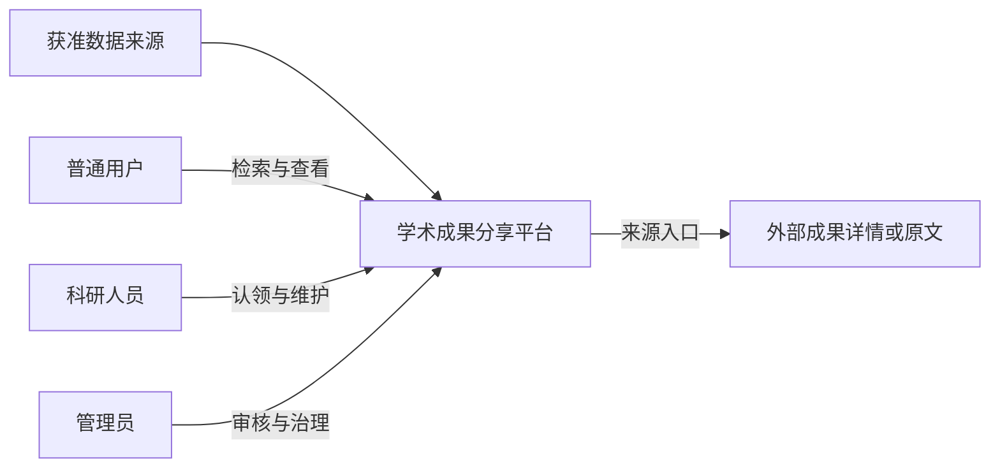

# 软件系统分析与设计作业

**系统名称：学术成果分享平台**  
**作业名称：需求分析与可行性报告**  
**日期：2026年9月30日**  
**版本：V1.7 待小组评审**  
**课程提交定位：需求调研阶段主报告（含一期可行性论证）**

| 项目组信息 | 内容 |
| --- | --- |
| 小组编号 | 待填写 |
| 小组名称 | 待填写 |
| 小组联系人 | 待填写 |

| 学号 | 姓名 | 联系电话 | 本次实践中主要承担的工作内容 | 本次作业占比（95%～105%之间） |
| --- | --- | --- | --- | --- |
| 待填写 | 待填写 | 待填写 | 待填写 | 待填写 |
| 待填写 | 待填写 | 待填写 | 待填写 | 待填写 |
| 待填写 | 待填写 | 待填写 | 待填写 | 待填写 |
| 待填写 | 待填写 | 待填写 | 待填写 | 待填写 |
| 待填写 | 待填写 | 待填写 | 待填写 | 待填写 |
| 待填写 | 待填写 | 待填写 | 待填写 | 待填写 |

## 项目概览

**面向谁：** 普通用户寻找成果和专家；科研人员确认、维护自己的成果门户；管理员处理数据质量与审核。

**解决什么问题：** 学术成果分散在不同来源，跨平台检索不便，同名作者容易错配，科研人员维护多个档案费时。本平台聚合已有成果元数据，建立可核验的“学者—成果”关系，让查找和作者维护形成闭环。

**本期做什么：** 采集与治理论文、专利、科研项目、获奖四类成果；提供成果／学者检索、学者门户、认领审核、成果确认与纠错、管理后台，以及机构排名、领域热点和基础专家关系网络。最终验收规模为不少于1万条成果，并完成至少一项创新。

**明确不做：** 不提供论文投稿、审稿、发表、全文托管或付费下载，也不做专利交易、社交平台及全网实时搜索。对原文只提供来源入口，访问权限由原站决定。

**拟定创新：** 在基础合作网络上增加领域／机构筛选和合作路径查询，展示构成关系的论文依据；选题待教师确认。

本报告第2章记录调研依据，第3～6章给出范围、需求和关键规则，第7～9章说明可行性、验收与待决事项。功能主干见第4章，具体实现方案在后续SRS、SPEC和架构设计中细化。

## 版本变更历史

| 版本 | 提交日期 | 主要编制人 | 审核人 | 版本说明 |
| --- | --- | --- | --- | --- |
| V1.0 | 2026-09-26 | 项目组，姓名待填写 | 待评审 | 综合访谈、问卷原始数据、同类产品及数据源报告，形成需求、可行性和一期边界；纠正统计口径与材料冲突 |
| V1.1 | 2026-09-26 | 项目组，姓名待填写 | 待评审 | 合并原需求调研报告中的10个平台比较、跨学科需求推导、页面证据入口及需求追踪，补齐版本与分类要求 |
| V1.2 | 2026-09-27 | 项目组，姓名待填写 | 待评审 | 明确以学者为中心的产品定位、学者成果关联及维护闭环；限定插件为数据接入机制，区分成果补录与论文发表 |
| V1.3 | 2026-09-30 | 项目组，姓名待填写 | 待评审 | 整合现成调研统计报告的公开研究证据；补充低负担成果确认、跨学科差异与统计可解释性，并说明二手证据边界 |
| V1.4 | 2026-09-30 | 项目组，姓名待填写 | 待评审 | 前置项目概览；按七类能力收束功能主干并统一优先级；保留关键业务规则，将实现细节留待SRS／SPEC和架构设计 |
| V1.5 | 2026-09-30 | 项目组，姓名待填写 | 待评审 | 压缩调研、范围、可行性与文末说明；将复算、平台对照、证据入口和详细论证移至独立附录，保持需求与关键业务规则稳定 |
| V1.6 | 2026-09-30 | 项目组，姓名待填写 | 待评审 | 对照任务书补采集任务状态；区分课程阶段与小组计划、课程要求与自定来源基线；补齐Agentic Coding证据摘要与报告提交定位 |
| V1.7 | 2026-09-30 | 项目组，姓名待填写 | 待评审 | 细化Optional范围：增加论文详情页相似论文推荐与基于用户授权行为的轻量个性化推荐；明确均不作为一期基础验收要求，不要求一期构建完整用户画像系统或论文关系图 |

## 目录

1. 引言
2. 调研结果与需求依据
3. 项目目标与系统边界
4. 功能需求
5. 数据需求与业务规则
6. 非功能需求
7. 可行性分析
8. 实施优先级与验收
9. 待确认事项与参考资料

## 1. 引言

### 1.1 编写目的

本文作为课程“需求调研阶段”的主报告，综合小组已提交的用户调研、同类产品分析和数据源调研，同时补充一期可行性论证，明确功能、边界、优先级和验收依据。本文用于需求调研评审及后续SRS、用例模型和核心模块SPEC编写，不代替详细架构、数据库或算法设计。

### 1.2 编写依据与格式

依据包括课程实践任务书、`report3.md`、`学术平台同类产品调研.md`、`需求调研.zip`中的调研方案、访谈、问卷及需求总结，此前形成的`学术成果分享平台需求调研报告.md`，以及`学术成果分享平台现成调研统计报告.docx`汇总的公开研究。正文采用参考模板最后一页的“1、1.1、1.1.1、1.1.1.1”编号层级，图表按章节编号；同时保留模板中的小组信息、版本历史和目录。Markdown不复刻Word的页眉、页码、字号和分页。

本报告中的需求为拟定基线，需经小组及课程评审确认。课程硬性要求优先于问卷偏好；原始CSV优先于有差异的统计摘要；尚未验证的外部数据源不能作为无条件交付承诺。

### 1.3 项目背景与总体判断

本系统定位为**以学者为中心的学术成果聚合、共享与管理平台**。平台通过多个来源获取科研人员及其论文、专利、科研项目和获奖元数据，经过清洗、去重和身份识别建立学者与成果的关联，形成可检索、可认领、可维护的学者门户，并支持统计分析。

普通用户通过平台查找成果与专家；科研人员通过自动归集减少重复录入，通过认领、确认、补录和纠错维护个人成果档案；管理员负责采集、身份审核与数据治理。**学者与成果的正确关联及持续维护是核心业务，统一检索和来源跳转是其中的访问能力。**

数据源可以通过统一适配接口接入，但插件只是采集与字段转换机制，不构成整个产品。平台不要求其他网站主动改造或接入，也不假定任意网址都能自动成为可用数据源。成果在外部发表后可被本系统收录；本系统不提供论文投稿、审稿、录用或出版服务。

项目具备**有条件可行性**：六人团队可以完成万条级数据的共享、检索、认领、治理与统计，但应限制外部数据源数量、采用公开元数据而非全文托管、以规则与人工核验处理消歧，并将实时全量同步、交易和复杂推荐留到后续。数据获取条件不确定时，采用已获许可的文件导入或明确标识的模拟数据保留业务链路。

### 1.4 术语

| 术语 | 本文含义 |
| --- | --- |
| 学者档案 | 平台中的科研人员信息实体，可以先于用户账号存在 |
| 门户认领 | 登录用户申请管理某个学者档案，审核通过后获得权限；不代表法律上的成果确权 |
| 成果确认 | 对某项成果与某位学者的关联作确认，不等同于论文质量认证 |
| 成果补录 | 将已有且可核验的成果元数据补充到平台，不是向平台投稿或发表新论文 |
| 数据源适配器 | 按统一契约获取来源数据、转换字段、提供来源链接的模块，可理解为受控的数据源插件 |
| 来源记录 | 某数据源提供的一条原始记录，多条来源记录可能对应同一成果 |
| 去重与消歧 | 分别解决成果重复和同名作者身份混淆 |
| 本人确认与管理员审核 | 两种独立来源的确认信息，不用一个“可信”标签混淆 |
| Must | 本期最终验收必须完成；内部按主链路和补齐范围安排实施顺序 |
| Innovation | 本期须完成至少一项经确认的创新功能，当前候选为IN01 |
| Optional | 时间允许才实施，不作为本期验收承诺；对应历史版本的P2 |

## 2. 调研结果与需求依据

### 2.1 调研对象与证据范围

小组材料包括6份匿名访谈、24行问卷答卷、10个平台的官网／帮助文档调研，以及四类成果的数据源调查；另参考《学术成果分享平台现成调研统计报告.docx》汇集的公开研究。访谈和问卷是一手材料，平台观察与公开研究是二手材料，不能合并计算样本量。详细平台对照、问卷复算、页面入口、研究来源和材料冲突处理见[调研与可行性论证附录](./学术成果分享平台调研与可行性论证附录.md)。

问卷样本小且学生占比高，未提供概率抽样依据，仅用于本课程需求排序。CSV与原统计摘要不一致时以逐行复算为准；平台帮助文档不能当作本组已登录实测，外部接口可访问也不等于获准采集。

### 2.2 核心发现与需求对应

表2-1 调研发现到需求

| 核心发现 | 主要依据 | 对应需求 |
| --- | --- | --- |
| 用户首先需要在一个入口查找成果与学者，并按领域、机构、类型等缩小范围 | 访谈P1、P6；问卷中多源检索获18票，学者门户获14票；Google Scholar、PubMed流程 | FR01～FR03 |
| 自动归集能减轻维护负担，但同名错配、误归属必须允许本人确认和纠错 | 访谈P2～P4；ORCID、INSPIRE流程；公开研究中的低维护时间现象 | FR03、FR05～FR06、FR09、FR15 |
| 来源、更新时间和公开范围影响信任；认领不能等同于成果真实性证明 | 问卷“来源与更新时间”均分4.75／5；访谈P4、P5；不同公开态度 | FR02～FR07、FR10、NF03、NF06 |
| 四类成果跨学科字段不同，统计必须说明去重、归属和数据范围 | 课程任务书；跨学科平台与数据源调研；访谈P5、P6 | FR08～FR13、5.1～5.3 |
| 基础合作网络、机构排名和热点分析属于课程范围，社交、推荐和论文发表不因同类平台具备而进入一期 | 课程任务书优先于偏好排序；同类平台及公开研究只提供设计启发 | FR11～FR13、IN01、3.3 |

### 2.3 调研结论的适用边界

24份答卷中16人接受注明来源的自动采集展示，8人希望先经本人确认，因此当前拟定规则是：允许展示使用条件明确且归属可靠的公开元数据，标示来源和确认状态；有争议的归属先待核验，个人敏感信息不默认公开。该取舍仍待评审，不代表所有受访者意见一致。

十个平台用于比较检索、门户、归属修正和专业筛选流程，并非一期接入清单。公开研究来自不同年份和样本，不能跨研究相加为“总调查人数”，也不能用其比例预测本项目使用率。数据源的授权、字段覆盖和更新可行性仍需逐项验证。

## 3. 项目目标与系统边界

### 3.1 一期目标

本期交付第4章所列Must能力、至少一项经确认的创新，以及课程规定的工程与文档证据；四类成果均可展示和维护，成果总量不少于1万条。

#### 3.1.1 课程背景要求与系统职责

表3-1 课程五项背景要求对应

| 背景要求 | 本系统承担的职责 | 核心验收依据 |
| --- | --- | --- |
| 获取科研人员及对应成果，处理清洗并更新 | 获取人员和成果元数据，建立关联，保存来源，维护更新策略 | FR08～FR10、FR15，数据库中人员与成果关系可核验 |
| 按领域管理，以科研人员为中心展示并支持认领维护 | 分类、门户、身份审核、成果归属确认及变更处理 | FR03、FR05～FR07、FR15 |
| 普通用户检索查看科技人员及成果 | 统一查询本地成果和学者，展示详情并提供来源入口 | FR01～FR02 |
| 专家网络、机构分类排名与领域热点 | 基于声明的数据范围和归属口径计算分析 | FR11～FR13，固定样例可手工核对 |
| 一期共享，后期有偿增值 | 一期提供元数据共享和来源访问；付费全文、成果转让和专利交易后置 | 3.3.4的边界及D01 |

“门户展示所有成果”落实为展示本平台已收录并按规则关联的全部成果，支持持续更新和补录；页面注明收录范围，不承诺穷尽学者在全球所有来源的成果。

### 3.2 系统参与者

| 参与者 | 能力边界 |
| --- | --- |
| 访客 | 无需登录即可查询公开成果、学者、机构及统计 |
| 登录用户 | 提交认领、查看本人申请和通知；未通过前不能修改目标门户 |
| 认领通过的学者 | 维护本人简介和展示设置，提交本人相关成果的确认、补录、纠错和解除关联申请 |
| 管理员 | 管理账号状态、采集任务、认领和变更审核、数据质量、分类及日志 |
| 外部数据服务 | 提供约定范围的元数据或文件；其账户、收费和运行由外部平台负责 |

采集调度器是系统内部组件，不作为具有用户权限的人类角色。账号与学者档案分开建模，一个登录用户可以同时承担访客和已认领学者的使用场景。

### 3.3 一期范围

#### 3.3.1 必须建设

建设范围以第4章七类Must能力和IN01创新候选为准，提供有限范围的更新和人工核验。**至少验证两种独立来源输入是小组拟定的验收基线，不是任务书明文规定的来源数量。** 第8章给出验收场景，本节不再重复功能清单。

#### 3.3.2 数据范围限制

覆盖多个学科的代表性样本，建议包含计算机、物理、化学、生物、材料和医学；不承诺全学科完整收录。国家级科研项目优先，机构、年度和来源范围由采集配置确定。课程规模是全部成果总量不少于1万条，并非每一类各1万条。

建议试运行数据配比为论文9000条、专利500条、项目300条、获奖200条；这是便于规划的建议，不是教师规定，按可得性调整。四类中都应保留正常、缺失、重复、归属冲突、修改等可演示样例。真实与模拟数据分开标识、支持过滤，不用模拟数据描述真实世界的排名或热点。

#### 3.3.3 可选及后续范围

收藏、邮件订阅、引用导出、复杂报表导出列为Optional；推荐能力分为两类可选增强：

1. **相似论文推荐**：在论文详情页根据标题、摘要、关键词、领域等内容特征推荐相似论文。第一版不要求构建论文关系图，具体召回与排序方式在后续SPEC中确定。
2. **轻量个性化推荐**：在用户明确同意记录相关行为的前提下，可根据近期检索、浏览、收藏等行为提取领域或关键词兴趣特征，用于推荐相关成果或学者。该能力不要求一期建设完整“用户画像系统”，用户应能够查看或清除相关偏好数据。

上述推荐能力均不作为一期基础验收要求，也不能成为检索、门户、认领等Must功能的依赖。全面学科映射、复杂OCR、多省获奖批量适配和跨库高精度消歧列为后续增强。没有必要为所有未来功能先实现空接口或按钮。

#### 3.3.4 明确不做

一期不做论文投稿、编辑审稿、录用出版、原创论文发布、付费阅读、论文全文存储和下载代理、支付、专利或成果交易及合同流程、学术质量认证、个人综合学术排名、社交私信、通用科研问答、学校内部系统深度集成、全球全量实时同步。提供合法来源详情外链不等于提供本平台全文下载服务。认领证明附件属于受控审核材料，不属于公开全文资源。

### 3.4 系统上下文

图3-1 平台业务职责与外部数据来源

平台对已收录成果提供稳定检索；外部来源暂时不可用时，已收录信息仍可浏览，并显示数据更新时间。

### 3.5 数据源接入与原文访问边界

一期支持有限数量、经核验可用的外部数据来源；两种独立来源输入按3.3.1的小组基线验证。平台负责跨来源成果去重、学者归属、认领授权和统计；来源缺失的信息标明未知，不编造字段。新增来源应尽量不改变用户的检索和门户使用方式；具体接入契约由后续架构与接口设计确定。一期不做插件商店、用户安装任意第三方代码或自动热更新。

成果详情提供“查看来源”入口；来源明确提供可用原文链接时，可提供“在原站阅读／下载”入口，由原站或浏览器完成访问。需要账号、学校订阅或付费时转原站处理；不保证每条成果均有原文，不代理认证、不托管全文，也不把公开链接解释为允许再分发。链接失效时保留元数据并显示失败反馈。这里的外部下载入口不等于任务书后期的有偿全文下载服务。

## 4. 功能需求

本章只规定系统应提供的能力、使用者和本期可验证的结果。FR01～FR16继续作为需求追踪编号，但按七条业务能力合并呈现；状态、去重、统计口径见第5章，接口、字段校验和更新策略在后续SRS／SPEC中细化。

### 4.1 本期必须完成的能力（Must）

表4-1 功能需求主干

| 业务能力 | 对应编号 | 谁使用、系统要做到什么 | 本期验收重点 |
| --- | --- | --- | --- |
| 成果采集与治理 | FR08～FR10、FR15～FR16 | 管理员接入多个获准来源，系统持续获得四类成果及相关人员信息，清洗重复记录，建立可信的学者—成果关系；不确定归属交由人工核验 | 四类成果有样例，总量不少于1万条；按小组基线验证至少两种独立来源输入；重复导入不重复计数；同名不同人不误合并；来源失败不影响已收录数据的浏览 |
| 成果与学者检索 | FR01～FR02 | 访客按关键词及类型、年份、领域、机构等条件查找成果和学者，查看成果详情、来源与外部访问入口 | 无需登录可完成“检索—筛选—详情—来源”流程；缺失字段和无法访问的原文不作虚假承诺 |
| 学者门户 | FR03 | 访客查看科研人员的基本信息、领域、机构和已收录的论文、专利、项目、获奖；学者档案可先于账号存在 | 未认领门户可访问；成果与学者互相链接；页面说明收录范围和归属状态 |
| 门户认领与权限 | FR04～FR05 | 登录用户提交本人认领申请；管理员核验并处理申请；只有审核通过者可以管理相应门户 | 通过、驳回及冲突认领均可演示；未获授权者不能修改他人门户 |
| 成果与门户维护 | FR06～FR07 | 已认领学者维护简介、展示设置，确认系统归集的成果，补录已有成果或提出纠错；管理员审核影响公开成果或归属的申请 | 待审修改不提前公开；错误归属可纠正；处理结果可查询；共享成果不会因一位学者解除关联而被删除 |
| 统计分析 | FR11～FR13 | 访客查看成果分布、机构分类排名、领域热点和基础专家关系网络 | 在固定数据样例上能复核结果；显示范围、时间和口径；基础网络有可追溯的成果依据 |
| 管理后台 | FR14 | 管理员查看采集状态、数据异常、认领及成果变更申请，处理分类与账号管理并追溯关键操作 | 主要待办可处理，失败有反馈，审核和修改有记录 |

### 4.2 创新与可选功能

**Innovation：IN01 合作关系探索。** 在基础专家关系网络之上，支持按领域或机构筛选、查询两名学者间的合作路径，并能查看构成路径的论文依据；无路径时明确提示。该创新方案仍需教师确认，但本期必须完成至少一项经确认的创新功能。

**Optional：** 收藏、订阅、引用导出及复杂报表导出只在Must与创新功能稳定后实施，不计入本期承诺。推荐能力进一步限定如下：

- **O01 相似论文推荐**：用户查看论文详情时，系统可依据论文标题、摘要、关键词、领域等内容特征展示若干相似论文，并说明推荐结果仅代表内容或语义接近，不代表论文质量高低。第一版不要求构建论文关系图。
- **O02 轻量个性化推荐**：在用户明确同意记录相关行为的前提下，可根据近期检索、浏览、收藏等行为形成可解释的兴趣偏好，用于成果或学者的个性化召回与排序。用户应能够查看或清除相关偏好数据；一期不要求建立完整用户画像系统，也不以个性化推荐替代普通检索结果。

O01、O02均为可选增强，不作为Must、IN01或课程基础验收的前置条件。

### 4.3 优先级与细化边界

Must是最终验收必须完成的范围，其中采集、学者—成果关联、检索、门户、认领和维护先组成可运行的核心流程；统计分析与管理后台随后补齐。历史版本中的P0、P1均归入Must，原P2归入Optional。优先级不改变任务书对专家网络、机构排名和热点分析的要求。

第5章只保留影响正确性与验收的业务规则。字段校验、分页排序细节、状态流转异常分支、批量操作交互、调度与重试、数据源适配接口等在后续SRS／SPEC中拆分；技术选型和组件关系归入架构设计。

## 5. 数据需求与业务规则

### 5.1 数据对象及字段

表5-1 核心数据需求

| 对象 | 基础字段及关系 |
| --- | --- |
| 用户账号 | 登录标识、密码散列、角色、账号状态；不与学者档案混为一体 |
| 学者 | 内部ID、姓名及别名、机构关系、研究领域、外部标识、简介、认领状态 |
| 成果公共信息 | 内部ID、标题、类型、时间及时间语义、领域、来源链接、来源ID、入库与更新时间、真实／模拟标识 |
| 论文 | DOI、作者及顺序、发表载体、发表日期、摘要、关键词、预印本／发表状态、可选引用量及来源 |
| 专利 | 申请号、公开号、申请人、发明人、申请日、公开日、可选授权日、IPC、状态及其来源日期 |
| 科研项目 | 项目编号、名称、负责人、承担单位、类别、起止时间、项目状态、来源；不默认采集或公开经费 |
| 获奖 | 奖项、年度、等级、授奖单位、获奖成果、人员或团队、来源；获奖人和获奖项目分别表达 |
| 机构与领域 | 机构规范名、别名、层级；领域代码、名称、父级、来源分类与本地分类的映射 |
| 关联与治理记录 | 成果参与者角色及顺序、来源版本、认领申请、修改申请、采集任务、异常记录、审计日志 |

项目资助论文中的基金编号只能作为关联证据，不能凭此自动生成字段完整的科研项目记录。专利申请人与发明人不能混用；同一申请的不同公开号需保留关系，不能简单按标题合并。

### 5.2 去重、归属与更新

1. DOI、来源ID、申请号等标识按类型归一化后匹配；跨源合并保留所有出处。
2. 无稳定标识时，标题相似只产生候选，再比较年份、参与者和类型，不因相似就直接合并。
3. 姓名相同不足以合并学者，结合公开机构、外部标识、合作者及领域核验；不使用私人联系方式作为公开消歧字段。
4. 学者认领状态、成果与学者关联确认状态、成果修改审核状态分别保存，避免“门户认领后所有成果都自动可信”。
5. 自动更新不能静默覆盖人工审核值；发现冲突时保留公开版本与源版本差异，进入处理队列。
6. 来源删除、撤稿和外链失效分别记录，不因一次请求失败直接删除成果。
7. 预印本、修订版本和正式发表记录保留版本标识、来源ID、状态和关联证据；只有明确来源关系或经审核的匹配才能归并。不同版本不直接增加成果实体总量；无法确认是否同一成果时保留候选关联，统计说明其处理状态。第一期不做全文差异比较。[CP5][CP7]
8. 发表状态、门户认领状态、学者对成果的确认状态和管理员审核状态分别表达。平台审核通过只表示该项业务申请通过，不能转化为“论文已同行评审”或“研究结论可信”的标签。[CP9]

#### 5.2.1 学者与成果关系示例

来源A记录论文T的作者为“王伟，机构甲”，来源B也记录同一论文T。成果标识经核验一致时合并为一个成果实体并保留两个出处。平台中另有“王伟，机构乙”，不能仅凭姓名把T同时分配给两人；机构不同也不能直接证明不是同一人，应结合稳定标识和其他证据，必要时进入待核验。

属于机构甲的王伟完成门户认领后，可以提交T的归属确认，补录遗漏项目，或申报另一篇被误归入的论文。归属确认只影响此人的参与关系，不替其他合作者确认身份，也不使整篇论文获得学术质量认证。审核生效后更新门户与统计，并保留来源事实与人工修正的区别。

### 5.3 分类与统计

一期采用一套本地分类树，保留来源原分类与映射关系。OpenAlex领域、IPC、项目申请代码不承诺自动一一对应；无法可靠映射时标记待分类，不用强行归类保证表面完整。允许同一成果关联多个领域；分类浏览复用检索过滤，明确包含下级分类的规则。新增领域不改变已存来源分类，管理员调整映射时保留记录。

全平台成果总量按去重实体计数；学者和机构可分别拥有同一成果，因此其合计可能超过平台总量。机构归属优先采用成果发生时的单位，缺失时标明未知，不静默使用当前任职机构。多领域计数与预印本／正式发表合并规则需在统计SPEC中写明。引用量不同来源分别展示，不求和生成“总引用量”。

### 5.4 状态与审核边界

| 对象 | 本期必须区分的状态或来源 | 不能混淆的含义 |
| --- | --- | --- |
| 学者门户 | 未认领、认领申请待审、已认领、申请驳回 | 档案存在不等于账号持有人已证明身份；认领通过只授予管理权 |
| 学者—成果关系 | 自动关联、本人确认、待核验、争议／已排除 | 本人确认一项成果不代表确认其余成果；同名且证据不足不能自动关联 |
| 成果变更 | 待审核、通过、驳回 | 待审版本不替换公开信息；审核结果应可追溯 |
| 采集任务 | 待执行、运行中、成功、失败、重试、已停止 | 失败或停止不能视为成功完成；重试不得造成重复入库 |

已认领学者可以逐项或批量提交候选成果的确认、排除意见，但冲突项仍需审核；批量操作不删除全局成果。修改归属生效后，门户、检索与统计应在约定时间内反映相同结果。具体状态流转、证据字段、批量交互和异常恢复由后续SRS／SPEC定义。

## 6. 非功能需求

表6-1 非功能要求与验收条件

| 编号 | 要求 | 建议验收方式 |
| --- | --- | --- |
| NF01 | 可用性 | 访客无需登录即可检索；提供加载、无结果、失败和权限不足反馈；过滤可清除；表单指出缺失项 |
| NF02 | 性能 | 在至少1万条成果、10个并发查询用户、固定查询集、预热后持续5分钟的条件下，检索接口P95不超过2秒；记录硬件、错误率、测试数据；该数值为待评审目标 |
| NF03 | 安全与权限 | 登录凭据和认领材料须受保护；按角色及具体门户控制访问；普通用户不能查看审核材料或修改他人数据；安全措施在SPEC中细化 |
| NF04 | 可靠性 | 外部来源暂时不可用时，已收录数据仍可浏览；失败任务可恢复，重复处理不产生重复成果；完成一次备份恢复核验 |
| NF05 | 一致性与追踪 | 审核通过或数据更新后，正常情况下60秒内在检索、门户和统计中反映一致结果；保留确认与修改记录；暂未生效或更新失败时给出提示。60秒为待评审目标 |
| NF06 | 数据最小化 | 不采集手机号、私人邮箱及未公开项目细节；审核材料设置访问和清理规则；模拟数据显式标识。若实现O02，仅在用户明确同意后记录推荐所需行为，并提供偏好查看或清除入口 |
| NF07 | 可维护性 | 新增或停用来源不应改变用户主要流程；提供接口、配置、部署与恢复说明；管理员可定位失败任务和记录。具体模块划分由架构设计确定 |
| NF08 | 工程与测试 | 核心规则、消歧、排序或统计中至少3个模块行覆盖率达到80%；配套边界用例、权限及集成测试；以CodeArts完成规定流程 |

生产级全天候可用性、全国并发规模和严格服务等级协议不在课程承诺内。性能和资源配置先通过小规模基准测试确认，再冻结指标，不能把目标写成已有测量结果。

## 7. 可行性分析

### 7.1 总体判断

六人小组在课程周期内完成限定来源、万条级成果聚合、学者门户和基础统计**有条件可行**。主要不确定性不在普通网页开发，而在四类数据的获取条件、学者—成果归属和审核工作量。先用小样本验证来源、权限和归属，再扩大数据规模；具体来源评估与技术论证见[附录](./学术成果分享平台调研与可行性论证附录.md)。

| 方面 | 判断与本期取舍 |
| --- | --- |
| 数据 | 论文可优先验证公开元数据；专利、项目、获奖逐项核查来源与使用条件。项目数据风险较高，可使用获准导入或明确标识的模拟数据，不承诺未经验证的外部接口 |
| 技术 | 常规检索、门户和审核可实现；同名消歧只自动处理证据充分的关系，争议转人工；统计从可复核计数与合著网络做起 |
| 人员与时间 | 六人约15周，按每人每周6～8小时估算总投入约540～720人时，这是待小组核实的排期假设；应限制来源数量并给联调留余量 |
| 资源与运行 | 云资源额度、接口授权及运行成本待核实；不以付费接口、短信或GPU作为基础依赖；数据失败应可恢复，管理员应能集中处理异常 |

### 7.2 主要风险与应对

| 风险 | 触发信号 | 应对 |
| --- | --- | --- |
| 四类成果来源不足或使用条件不明确 | 第4周仍无可用样例及使用条件 | 冻结可用来源，改用获准文件或标识清楚的模拟数据；保留真实来源演示链 |
| 学者错配或审核量失控 | 同名测试误合并，待审积压 | 缩小自动关联范围，展示匹配依据，优先处理争议与低置信度候选 |
| 更新后各页面结果不一致 | 审核通过后检索或统计未反映 | 按NF05检查时限和失败反馈，保留变更记录并恢复处理 |
| 课程工期或资源不足 | 主链路部署、创新确认或云资源延期 | 先交付Must主链路，控制数据源和界面复杂度，及时确认IN01与课程资源 |

数据来源需核查授权和再展示范围；不得绕过登录、验证码或访问控制。公开可访问不自动意味着可以批量采集、托管全文或再分发。

## 8. 实施优先级与验收

### 8.1 实施顺序

Must先以小样本跑通“采集—治理—检索—门户—认领—维护”核心流程，再补齐四类成果、万条规模、更新、机构排名、热点、基础合作网络和管理后台；Innovation至少完成一项经确认的创新；Optional仅在前两类稳定后考虑。这里的先后是实施顺序，不把后完成的Must项目降为可选。

下表是**小组内部实施计划**，在任务书的阶段窗口内进一步细化，不改变课程规定的正式阶段及交付时间；具体教学进度以课程安排为准。

表8-1 小组内部实施计划

| 时间 | 主要交付 |
| --- | --- |
| 第2～4周 | 调研复核、需求边界、数据源小样本验证、认领与统计口径确认 |
| 第5～6周 | 调研报告、SRS、用例与认领活动图、采集任务及认领申请状态机、核心SPEC及评审材料 |
| 第7～8周 | 业务类图、关键时序图、规则样例集 |
| 第9～11周（架构）、第10～12周（构件） | 架构与至少3条ADR、数据库、接口及UI设计；第10～11周部署包含学者成果关联的最小链路 |
| 第13～15周 | 完成功能、更新机制、万条数据、统计与创新、集成测试 |
| 第16周 | 功能冻结、备份恢复、权限与性能检查、答辩彩排 |
| 第17周 | 修复剩余问题，提交系统、文档、测试和实践证据 |

### 8.2 验收场景

表8-2 核心验收清单

| 场景 | 通过标准 | 关联需求 |
| --- | --- | --- |
| 数据来源 | 按小组基线验证至少两种独立来源的成果可进入平台；一项来源停用或故障时，历史数据仍可查 | FR08、FR16 |
| 学者成果匹配 | 同名冲突、同人不同表达、多作者、待核验及人工修正样例通过；修正后门户与统计一致 | FR09、FR15 |
| 原文入口 | 有来源链接可跳转；无全文不显示可下载承诺；失效给出反馈；没有投稿或出版流程 | FR02、3.5 |
| 新数据进入平台 | 能查看处理进度与异常；完成处理后可检索；重复导入不增加重复成果 | FR08～FR10 |
| 用户找成果和专家 | 无登录完成多条件查询，进入详情和学者门户，查看四类成果 | FR01～FR03 |
| 科研人员认领 | 提交、补充、通过和驳回分支可演示；通过前不能维护 | FR04～FR05 |
| 成果纠错 | 待审不改公开内容，通过后生效；解除个人关联不删他人成果；日志完整 | FR06～FR07、FR14 |
| 数据更新失败 | 失败原因明确，可恢复处理；保留已成功数据和人工修正；恢复后展示结果一致 | FR08～FR10 |
| 统计分析 | 类型、年份、机构排名、热点及合作网络与固定样例吻合，口径可见 | FR11～FR13 |
| 创新 | 筛选网络、查询最短合作路径，显示证据和无路径分支 | IN01 |
| 数据规模 | 清洗去重后成果总量至少1万条；四类均可查；真实和模拟数量可分别核对 | 数据需求 |
| 权限与性能 | 拒绝跨用户修改和审核材料越权访问；性能按约定环境与查询集测量 | NF02～NF05 |

### 8.3 工程与文档验收

按任务书完成CodeArts需求管理、托管、代码检查、构建、测试和流水线部署；核心模块先有SPEC再编码，保存规范评审记录，根目录维护AGENTS.md，并记录规范到实现的对应关系。

保存代码智能体的项目级生成、续写、解释、单元测试、调试修复5类任务证据，至少3个人工修正案例，并总结能力边界与失效模式；至少3个核心模块行覆盖率达到80%。上下文工程需规避污染、分心、混乱、冲突；防御性提示覆盖精确表述、依赖预判、人工检查点和强类型，预计超过1小时的Agent任务设置人工确认检查点。AI审查简单bug、性能、安全和风格，人工审查业务逻辑与关键决策，留存对比结论；开发提示词与规范模板纳入版本管理，资产清单记录用途、版本和效果评估。答辩展示至少2项AI实践，不代表其余规定证据可省略。

需求调研、建模、分析、架构和构件设计的文档与PPT按课程阶段提交。本报告中的编号应继续关联至SPEC、代码、测试用例和演示步骤，新增需求需同步变更边界、工作量和版本历史。

## 9. 待确认事项与参考资料

### 9.1 评审决策清单

| 编号 | 需确认内容 | 当前建议 | 确认方 |
| --- | --- | --- | --- |
| D01 | 任务书后期有偿服务的本期边界 | 不实现全文付费与交易，只在设计说明扩展方向 | 教师 |
| D02 | 四类数据配比及模拟数据要求 | 总量至少1万，四类均覆盖，来源清晰 | 教师与数据负责人 |
| D03 | 采集数据在本人确认前能否公开 | 仅公开允许展示且归属明确的元数据，标明未确认；冲突隔离 | 小组及业务评审 |
| D04 | 认领证据与争议处理 | 多证据人工审核，已认领冲突不自动转移 | 小组及教师 |
| D05 | 创新点是否足够 | 基础合著图之外实现筛选和最短路径 | 教师 |
| D06 | 数据源冲突及授权 | NSFC及内部API暂不作为必达源；取得条件后再启用 | 数据负责人 |
| D07 | 云资源、预算和时间投入 | 核实额度、配置和成员每周投入，冻结性能环境 | 组长与全员 |
| D08 | 原问卷摘要与CSV不一致 | 以CSV复算为本报告依据；由调研负责人核对原始导出并修订摘要 | 调研负责人 |

上述待确认项不阻止建立原型、规范和小样本链路，但涉及数据授权、范围验收和公开策略的部分应在相应实现前确认。评审后的修改按版本历史记录，不将当前建议误标为教师已批准。

### 9.2 资料与追溯

需求依据包括课程任务书（T1）、小组数据源与同类平台调研（R1～R2）、访谈及问卷原始材料（R3～R6）、参考模板（R7）、既有需求调研报告（R8）和公开研究汇编（R9）。问卷统计以原始CSV复算为准；数据源条件仍须在接入前验证。

各材料的完整名称、问卷复算、CP编号对应的官方页面、十个平台对照、页面示例、原需求编号映射与后续补充访谈问题，统一见[调研与可行性论证附录](./学术成果分享平台调研与可行性论证附录.md)。正文第4章的FR、IN及第6章的NF编号是当前需求基线；附录中的旧编号仅用于追溯。
